# 108套方案

# 1.红酒免费模式, 充 30 万得 30 万送 40 万路虎汽车一辆, 1 年内包赚 50 万

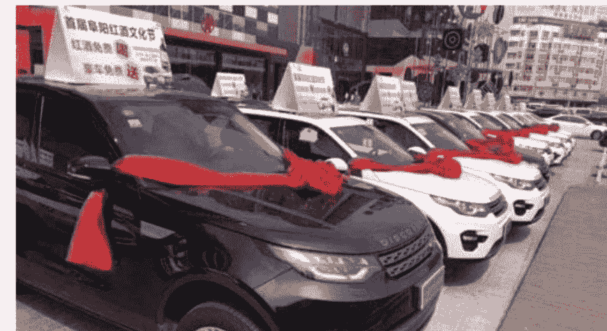

红酒免费模式

对于一些新接触免费模式的朋友，可能看不懂充 30 万得 30 万红酒，再送一辆 40 万的路虎汽车，而且一年还让你包赚 50 万，那他这个是怎么操作的呢？

特别是充值 30 万还送一辆 40 万的汽车，这个路虎汽车大家都知道的，不管你去哪里买，它的成本都是很高的，如果再送 30 万葡萄酒的话，如果你不懂分拆的话，根本看不懂他是怎么操作的，不管你怎么算，都是亏本的，最重心的还有一个，一年还让你包赚 50 万，他是怎么保证能让他代理商年赚 50 万的呢？

这个是怎么做得到的，可能很多朋友都有这样的疑惑，下面给大家详细剖析一下这个红酒免费模式案例是怎么操作的：

首先操作这个案例的老板是卖葡萄酒的，酒的价位在 150 元-1200 元不等，做这个活动的目的主要针对于代理商的，想通过这个活动招募一批优质的代理商。

我们先来看看他做这个活动达到的结果：第一天充值 25 个，收款 750 万，三天总共充值 58 个，最终收款 1740 万。

下面我们来算一下他怎么盈利的：

酒和汽车的成本：因为这个活动是针对于代理商的，肯定没有针对终端客户毛利高，但是酒类产品大家都知道，利润都是很高的，虽然针对的是代理商，利润也有 50%，这里就按 50%的毛利来计算,30 万的酒 x 50%的话（学习更多内容请加微信；xsyxsyqq019）=15 万，酒的成本就是 15 万汽车的话，他这个市场价是 40 万左右，我们就按 40 万来算,40 万路虎汽车，通过内部系统对接的话 7 折左右，我们就按 7 折算,40 万汽车 x7 折=28 万，汽车的成本就是 28 万，最主要的是 28 万这里要注意一点,28 万我们可不可以进行分拆，就是我 30 万的葡萄酒不分拆，送你的 30 万的酒你可以现场全部拿走，也可以拿走一部分，剩下的存放!在我这里分批拿，这个不做限制，但是有点，汽车要进行分拆。因为，大家想一下，如果价值 30 万的酒以及 40 万的路虎车都不分拆的话，全部现场拿走,28 万再加上 15 万，就要 43 万的成本，那他收 30 万的话肯定是不赚钱的，甚至还会亏钱。所以，酒或汽车两个里面肯定要分拆一个，针对于经销商的话，酒分拆也可以，汽车分拆也可以，但是我们来

看一下，这两个哪个分拆划算一些。
如果酒不分拆，他只需要 15 万的成本，如果是汽车不分拆，他就要掏 28 万的成本，28 万的成本的话加上酒分拆的话，假如先给代理商 1 万元的酒，那就是 29 万的成本。
那充 30 万的话，如果汽车不分拆的情况下，特别可是送 40 万的车大于充值金额的，比较大的概率要分拆 40 万的车，那么车子是怎么分拆呢？
下面给大家算一下假如说汽车对接的价格是 28 万,28 万我们按照首付 30%来算，他只要付 8.4 万就可以 了那送出一台车就可以盈 利:30 万-15 万(酒的成本)-8.4 万(汽车首付)=6.6 万，这里送出一台车就有 6.6 万的纯利润，因为酒一次性给你了，汽车是首付，那么后期还款的话，肯定是代理商每个月在这里拿货，然后我把酒的利润的一部分，作为车子的月供金额还款、这是最基本的盈利点，还没有计算送出的每一台车延伸的盈利点。
看过之前分享的免费送车案例的朋友应该都知道，车子一般送的都是裸配的，甚至后排座位都没有，那如果客户需要这些东西，就要加钱升级配置，这块是不是有盈利的空间，还有汽车的保险也有盈利的空间，当然，这里没有计算这块，只算了最基本的盈利点。
这里汽车方面的盈利点，那么给代理商这 30 万元的酒，有些代理商会不会不一次性拿走，比如说他先拿走 15 万，然后剩下的 15 万先放在我这里帮他存放着，下次需要酒的时候，我再免费给他送过去，那么这部分资金是不是可以沉淀下来，做为盈利资活 动 纯利润:6.6 万/人 x58 人=383 万，如果酒的毛利更高一些，车子的提货价更低，大部分客户选择不一次性把货拿，那他的纯利润还会更多。
汽车月供: 首先汽车我们是付的 30%首付，28 万的车一首付 8.4 万=196，就是说我们还有 19.6 万要还,19.6 除去 36 个月供=5444 元,5444 元 x2(50%的纯利润)=10888 元，那么他的代理商每个月至少要从他这里拿货 10888 元，他才能保本，如果只是保本的话，肯定没有搞头，所以他设定的最低拿货应该在 15000 元以上，才有盈利。
所以 15000 就有 50%的毛利 7500 元,7500 5444=2056，那么我每个月就有 2000 多的毛利，这样就长期锁定了这些代理商，让他们持续 3 年在我这里拿货。
所以他做这个活动的目的就是:1、缓解了部分资金压力；2、绑定了代理商 36 个月，让他们长期在这里拿货；3、在当地也形成了一定的影响力，为他以后打造品牌连锁、扩展到更多城市打下了基础。
以上是他做这个活动的前半部分剖析，那么年还让代理商包赚 50 万是怎么回事呢？
50 万/年除于 12 个月=38 万/月，帮代理商设计一套针对终端用户买红酒送产品的免费模式方案，比如：买 1000 元红酒送 1000 元加油卡，送 1000 元超市卡，送 1000 元礼品，注意，这里加油卡和超市卡是要进行分拆的，比如 1000 元的加油卡和 1000 元的超市卡可以分拆成 50 元一张，顾客每次去加油或者购物满 300 元才可以使用一张，假如你能跟这些地方谈到 8 折,300 元的 8 折就是 240 元,即客户加一次油只需要支付 250 元,你还有 10 元可以赚。
那么送 1000 元礼品就简单了，之前也分享过很多，不明白的可以翻看之前的文章，对接的这些硬通货资源，成本比较低,1000 元的礼品，拿货价可能也就 200 元左右！
这套方案出来后，然后让这些代理商按要求去谈合作，找到一些合作商家，把这个活动介绍给他，只占用他店里 2 平方的位置放置红酒架和活动海报，只要通过他这里成交的客户，利润可以分给合作商家一半如红酒的利润在 80%，那么客户在合作商家充值 1000 元-红酒成本 200 元-200 元礼品成本=600 元利润,600 元利润分给合作商家,代理商还有 300 元可以赚！
所以这样的合作方案还是比较划算的，谈合作也好然后，假如找一个合作商家每个月能赚 2000 元,3.8 万除 2000 元就是要谈 19 个合作商家，可以规定代理商在 1 个月内至少要谈 20 个合作店铺，以后每个月增加 5 个合作店铺，达到这个要求，保底年赚 50 万，达不到不保底思考：还有哪些地方可以做的更好？
注意：操作送车活动的要点前期不要订购太多车，先观察前期客户数据以及现场情况判断

跟汽车经销商谈大概需要数量，然后跟部分忠实老经销商提前告知订货送车的活动，提前收一部分订金，再按收取订金的数量订购汽车，活动现场放一部分车子，然后在活动现场成交的，收款后再订车，控制可能存在的风险。

# 2.华联超市免费模式案例详细剖析，3 天充卡 270 万，锁定 2000 会员

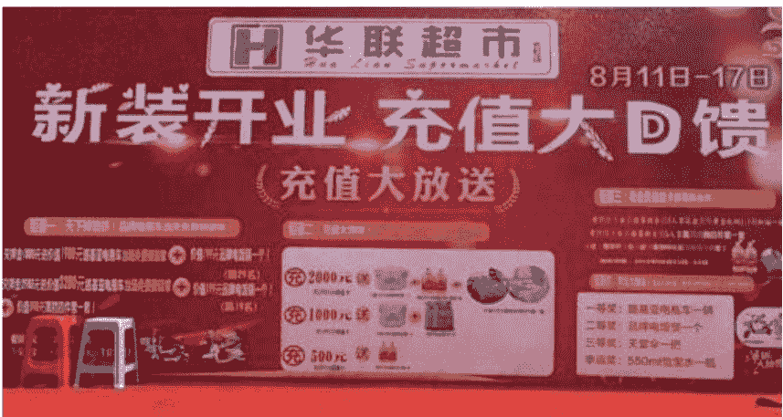

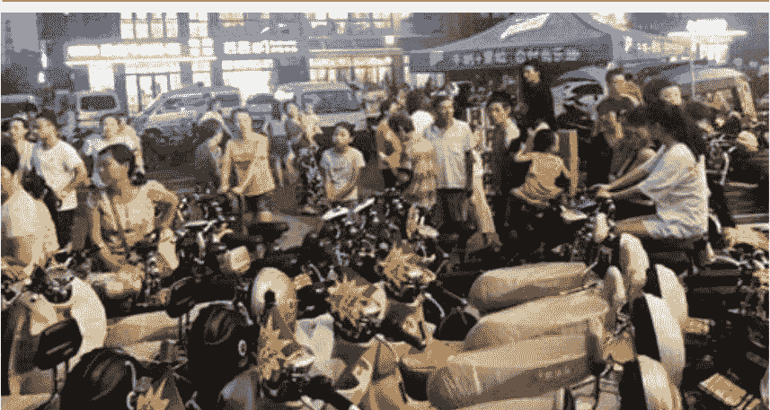

超市免费模式案例

这个超市免费模式案例发生在安徽合肥，开在一个新开盘的小区楼下，超市主要经营日用品、小家电、蔬菜水果等，案例落地时间是在 8 月 11 日到 17 日，活动预计进行 7 天，谁知活动太过火爆，提前达到了预期目标，所以，活动只进行了 3 天就提前结束了,3 天的时间总共充值了 270 多万，锁定 2000 多周边会员。

首先，这个超市的位置比较好，在一片居民区的十字路口，门口有一大片空旷的位置可以

停车，做活动的时候，也比较容易聚集很多人气。

下面给大家分享这个活动具体是怎么操作的：
第一步：引流
1、转发活动内容到朋友圈，积满 58 个赞免费领取伊利优酸乳一箱；积赞 98 个送 5L 的金龙鱼调和油一桶，积赞活动开始时间是 8 月 3 日到 11 日。
2、印刷一批宣传单页，让员工去周边居民区派发；这是引流这块，相对来说比较简单，没有太多的动作，因为周边都是居民区，居民出来留达的时候，就可以很好的把客户引流过来第二步；
截流活动一：
收押金 1、交 1880 元押金，送价值 1980 元的电动车 1 辆，再送价值 199 元品牌电饭锅 1 个，现场交钱，马上就可以拿走；（仅限 29 个名额）2、交 2980 元押金，送价值 3280 元的电动车 1 辆，再送价值 199 元品牌电饭锅 1 个，还送套价值 498 元高档四件套 1 套，现场交钱，马上就可以拿走。(仅限 19 个名额首先给大家来拆分一下，为什么要交 1880 元押金呢？而不是充值卡呢？
因为，这个 1880 元的押金，后期是可以退给你的，相当于电动车和电饭锅是免费送给你的，但是我要拆成 12 个月、或者 24 个月，分期来退还给你，退还时间每个月中或者月底哪两天，我统一给你退还多少押金那他做这个押金的意思是什么呢？(学习更多内容请加微信；xsyxsyqq019)
第一个就是现金流，你交 1880 元押金，除去电动车和电饭锅的成本，我还是有赚的，假如电动车和电饭锅的成本是 1000 元，我还有 880 元现金流可以周转；第二个就是交的 1880 元押金，我给你拆分成 12 个月，或者 24 个月退还，比如说每个月底最后 2 天，你拿着收据，或者单据，带着你本人的身份证，必须是你本人来，才可以到我店里来领取押金，来了就给，没有任何套路；那么，月底的这两天，会不会有人没有时间来领，或者他有事，来不了，或者他忘记 1880 元押金如果拆分成 24 个月的话，一个月也就 80 元左右，对于一些人来说，可能就会忘记来领了，那这部分是不是我们的利间，还有一部分人还是会来领的，这部分来领的人，是不是多了一个让他们每个月进店的机会，也就锁定了他们 24 个月。
他们来的时候，领取了 80 元的押金，有没有机会让他们购买一些超市的东西，毕竟这 80 元相当于免费给他的，我想多少都会买点吧，反正每个月都要采购一些生活用品的。
那么，交这 1880 元押金的意义，还有个，就是锁定了大量的忠实客户，因为，对于顾客来说，他们肯定是占了大便宜的，首先 1980 元的电动车和 199 元的电饭锅他们是免费得到的，因为这个押金还会退给他。那么，拿人家的手短吃人家的嘴软，既然他们占了这么大的便宜，他们会不会跟身边的些朋友推荐我这里，相当于找了几千个免费的广告宣传员，而且他们想买东西的时候，会优先考虑这个超市的。
活动二：储值卡 1、充值 500 元储值卡，送 5L 金龙鱼调和油桶 2、充值 1000 元储值卡，送价值 199 元品牌电饭锅一个；送价值 39 元 5KG 金龙鱼大米袋 3、充值 2000 元储值卡，送价值 598 元高档四件套一套；送价值 199 元品牌电饭锅个；送价值 39 元 5KG 金龙鱼大米一袋。
大家想一下，我们有很多的朋友做活动的时候，是不是充值 500 元，送 500 元储值卡，然后再送一些其它商家的一些券，或者礼品卡，其实这些东西对于客户来说，他们拿到手里，也不一定会到商家那里去消费。当然这种充值方式有好的方面，也有不好的方面，好的地方是能让客户看起来送的挺多，可是实际到客户手上的，能给客户来带实际帮助和价值的不少，只是一种噱头而所以说，当这种新开的店去做充值 500 送 2000、3000 券或者礼品活动的时候，价格看起来虚高，给客户的感觉就是里面有套路，客户会怀疑，客户会感

觉怎么会送这么多，在他们正常的观念里，要不你是真正的亏本，要不就是这里面有很深的套路。看起来你送的捻多的，但是站在客户的角度来说，你这里面有问题，反而你送的越多，客户接受的概率和程度就比较低，特别是新开的店。所以，如果你是新店开业，尽量不要搞这种充 500 元送 3000、5000 券或礼品卡的活动，虽然有点效果，但是吸引来的可能都是些真正贪便宜的老头、老太太，对于年轻人来说，根本不会看，他们正常的思维，你送这么多，这里肯定有问题。活动三：抽奖等奖；价值 1980 元的电动车一辆；二等奖：价值 199 元电饭锅一个；三等奖：
天堂伞一把；四等奖:550m ³ 矿泉水一瓶。
这个活动三和活动一都是为了吸引人气而做的，目的地都是为了吸引大量的人关注，你想想看，这么多的电动车和奖品摆在那里，看起来是不是很震撼，很多路过的人都会过来看看，摸一摸。而且只要充值就可以抽奖，充多少都可以参与，有些人就会抱着侥幸的心理，贪便宜的心理，充值 500 元试试手气，万一抽到电动车了呢，反正 500 元储值卡以后也可以在超市消费，买水果、买菜、买生活用品等都可以用得到，而且还送 5L 金龙鱼调和油一桶。（学习更多内容请加微信：xsyxsyqq019）
活动四：裂变老会员推荐新会员 2 人，送金龙鱼调和油桶；推荐 5 人，送高级纯棉四件套一套；（注：推荐的会员需要充值 2000 元储值卡才有效）
还有哪些可以改进的地方
1、引流的时候，可以做一个小程序，在小程序上设置一个抽奖活动，转发一次微信朋友圈或者微信群，即可获得一次抽奖的机会，奖品可以设置为：饮料、鸡蛋、水果等，设置较少机率的大奖，小程序后台可以设置中大奖机率，中奖的客户可以在活动期间来门店领取。
2、小程序在平时不做活动的时候，可以在上面开发一个微商城，把店里的产品上架到微商城，周边 5 公里内的客户都可以在上面下单，再设置一个抢单功能，让美团、饿了么的配送员也可以在小程序上抢单，配送费由客户出，这样就能保留住这部分老客户，下次再做活动的时候，就不用花费太多引流费用。
3、把部分刚需、高频消费的产品亏本销售，获得大量流量，可以靠其它产品赚钱；
4、锁定更多终端消费客户后，可以扩展更多其它赢利渠道；
核心总结
1、三三制原则，三分之一客户不赚钱，分之一客户微利，三分之一客户暴利
2、所有赠品、时间、内容都要根据客户的角度去思考；

# 3.美容院活动方案，如何通过免费模式，5 家店 10 天时间收款 1000 万元

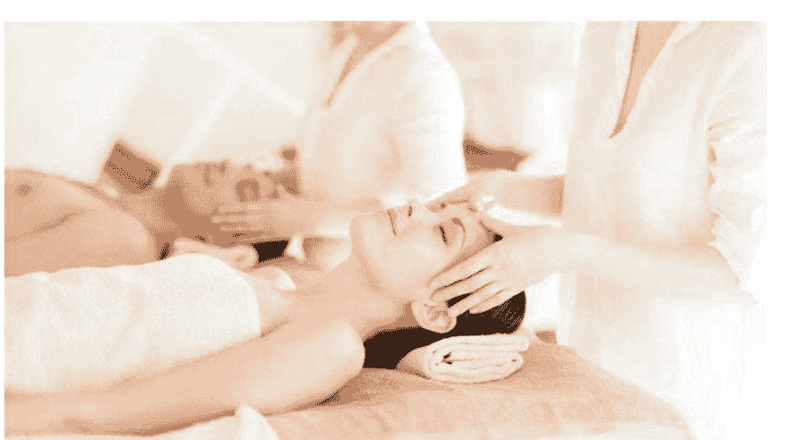

## 美容院免费模式案例

这个美容院活动方案相对来说执行起来并不是很难，但是它里面有一个资格卡的细节，做的是非常好的，对于做门店类的朋友来说，帮助还是比较大的。

首先给大家介绍一个这个案例的背景，这个案例是发生在浙江嘉兴，她在 04 年到 10 年的时候，开了两家美容院，生意不好，就把两家店关了，期间也做过其它的生意，都没有太好的发展，后来想来想去，还是干美容院吧，于是在 2012 年的时候重操旧业，又干起了美容院，这次想做成连锁店，到 2017 年的时候，总共才开了有 5 家门店，每家店的投资大概在 300 万左右。

老板在接触到免费商业模式之前，一直用的都是传统的模式，就是一家店赚到了钱，再开另外一家店，然后第二家再用一样的方法，慢慢的去复制，所以，她用这样的方法开店，是非常慢的！老板也是爱学习的人，后来学习了免费模式，做了这样一个美容院活动方案，达到了以下几个结果：

+   1、每家店如果客户来消费，需要提前预约，要不没有位置；
2、每家店的新客户，每个月自动增加 30-40 人；
3、5 家店 10 天收款 1000 万元；

下面给大家解析一下，这个美容院活动方案具体是怎么做的第一个，他针对于老客户推出了 299 元的资格卡活动：

+   1、挑选优质老客户，交 299 元，送 299 元五粮液直接拿走，而且这 299 元当做押金，三个月后凭收据全部退还；
2、送本店 4 次基础美容项目，每次价值 200 元，另外再送 5 张共享卡，朋友凭借此卡来，可免费享受 1 次基础美容项目，并且朋友如果办这个资格卡的话，给主卡返 50 元。这样看起来，如果按照正常的逻辑，她是不赚钱的，为什么?因为这个酒就算再便宜，也是要成本的，而且这 299 元只是押金，三个月后，客户凭收据，是可以退还的，没有任何套路，也没有分拆。所以，他做的这个资格卡活动是不赚的，但是她赚的是人气，后面会跟大家详细的分享，这是她前期做的一个 299 元的资格卡的活动，对于顾客来说，他得到的好处是非常大的，第一个，这个酒可以马上拿走，押金三个月后还可以退还，如果推荐一个朋友来办这个资格卡，他还有 50 元的返现，然后，平时在这里做的基础项目，每次是 200 元，现在交 299，就以免免费享受 4 次，他朋友来的话，还可以免费享受一次。所以，对于顾客

来说的话，诱惑力还是比较大的，因为本来钱就不多，对于美容院来说,299 元是很小的一部分了，相当于我们去一趟餐馆随意吃一顿的钱。所以说，她这个 299 元的资格卡活动做的非常好，大部分老客户都办了这个卡，这是她做的第一个活动，相对来说比较简单。
第二个，过了一些时间，她又推出了一个 3800 元的美容院活动方案，具体是这样的：
1、如果之前办的 299 元不退的话，可以当双倍金额使用，办 3800 的资格卡时可以抵 598 元。（学习更多内容请加微信：xsyxsyqq019）
2、可以做一年的百项调理项目，这是单个项目，是一个项目的名称，一个月可以做 4 次，不做累计；这个项目平常价就是 400 元次，一年总价值就是 2 万元，一个门店仅限 100 张；
3、赠送 3800 元的礼品，礼品包括：好想你大枣、迪士尼的毛毯、五粮液酒、大米、食用油等，任意挑选，选够 3800 元即可
4、如果介绍一个朋友办理 3800 元资格卡，还可以拿 3800 元礼品，对于客户来说，我办理了 3800 元的资格卡，拿到了 3800 元礼品，再介绍朋友来办理，还能得到 3800 元礼品，这个吸引力就非常大了；由于礼品很给力，其中有一个老客户介绍了 17 个新客户，一家店所有新客户的消费都达到了 100 多万 5 家店 10 天收款 1000 万。
核心细节分析：
1、首先从老客户入手，宣传费用较低，传播效果更好；2、首次活动门槛较低，吸引更多人能参与；3、首次资格卡完全纯粹给予，只赚人气不赚钱，吸纳更多基础会员，锁定客户每个月来 4 次，增加信任度，客户心理觉得确实占了便宜，为下次大的充值活动做准备；4、3800 元也是资格卡的放大版，只是拿了其中一个项目来给客户优惠，还可以通过其他项目赚钱，没有损失太大利润；5、办过 299 元资格卡的老客户，可以双倍抵用，给老客户的专属好处，下次再做活动老客户更容易参与；6、赠送的礼品任意挑选，这种方式客户更容易接受；7、客户介绍朋友办卡，直接再送 3800 元的礼品，客户诱惑力更多；
分享到这里，那她是怎么赚钱的呢？
1、299 元的活动不赚钱，保本；2、3800 元的礼品 1-2 折成本拿货 3、通过办理资格卡来锁定大量客户，后面通过其它产品、项目赚钱，其他产品是正常利润
Ps： 还有哪些地方可以赢利？
1、有大量的客户，是不是可以跟其他高端商家合作，增加更多利润：比如房产、保险、珠宝、出国游、养生馆等(前提质量要有保证)；2、是不是可以收员工押金，分部分分红权给员工，增加员工的积极性，让员工自主经营、管理、减少自己的管理时间，抽身游学更多的商业模式。

# 4.面馆的免费模式案例，10 年老店吃面送钻戒、 电动车、5 天收款 72 万

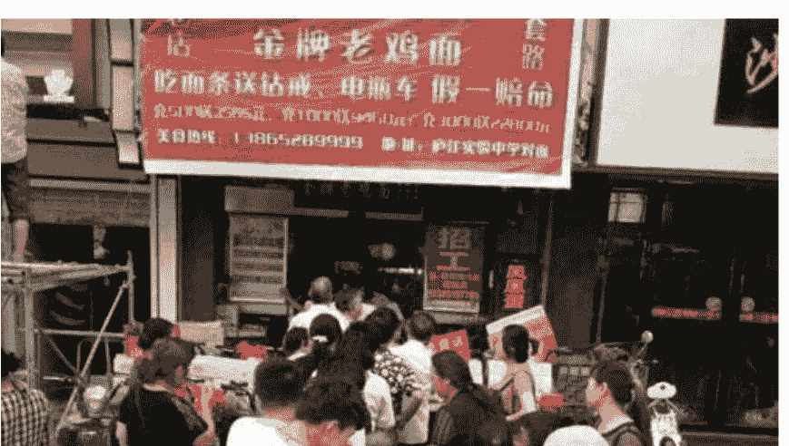

## 面馆免费模式案例

今天给大家分享一个面馆的免费模式案例，这个案例来自安徽庐江县，店里主要经营单一的爆品面“老母鸡汤面”，这家店的面积有 50 平方左右，周边都是做餐饮的，竞争力是相当的大。

首先第一步：引流
1、他印制了 3 万份免费品尝券，拿这 3 万份免费品尝券去跟超市、电影院等谈合作，超市是这样谈的，找到当地最大的超市，跟他们谈在他那里消费满 58、88 元的顾客，就送 2 张免费的品尝券。

2、在当地组织了一次自驾游活动，总共找了 80 辆车参加，每辆车的车上贴上我们的广告，我们可以免费提供一些餐具或者现金消费券等，一辆车的成本不超过 100 元，这样就起了一个大的造势，大量的宣传。

3、通过朋友或在礼品平台对接了 55 度水杯，然后通过朋友圈转发，转发 3 天就可以免费获得 55 度杯一个，这个杯子在淘宝上的售价是 298 元一个，当时朋友圈里的人看到这个信息以后，几乎都认为这是假的，老板疯了，转发个朋友圈送 200 多元的礼品，而且人人都有，大家开始都不相信，后来慢慢的有来自朋友圈后，就有人相信了，然后后面转发的就更加疯狂了。

上面就是这个活动的提前 15 天做的引流的方法，本来活动时间定在 3 天结束，后来由于人太多，就提前了 2 天开始了这次活动，当时资源对接的是电动车、老庙黄金、本地的酒吧、龙虾店、咖啡券、酒店的菜品等等下面介绍一下这次活动送的礼品种类；

+ 一、充值 500 元送 3565 元, (仅限前 199 名)
1、500 元现金储值卡一张；2、一个月免费吃面权(价值 1080 元)；3、价值 1180 元波司登蚕丝被一床；4、大剧院电影票一张(价值 88 元)；5、某酒楼免费品尝券一套(价值 688

+ 二、充值 1000 元送 9460 元(仅限 99 名)1、1000 元现金储值卡一张；2、半年免费吃面权 6480 元；3、价值 1180 波司登蚕丝被一床；4、李虾神龙虾 10 斤(价值 500 元)；5、雪花啤酒 60 瓶(价值 300 元)。(学习更多内容请加微信：xsyxsyqq019)

+ 三、充值 3000 元送 22800 元(仅限 66 名)
1、3000 元现金储值卡一张；2、一年吃面权(12960 元)；3、价值 2680 元老庙钻戒一枚或者项链，或者价值 1980 元电瓶车一辆(三选一)；4、某酒楼免费品尝券一套(688 元)；5、幸福海岸咖啡券 10 张(价值 350 元)；6、价值 1180 元蚕丝被一床 7、皇后酒吧消费券(价值 350

元); 8、李虾神龙虾 20 斤(价值 1000 元)。
那么，看了这个充值方案，怎么算充 3000 元送 22800 都是亏钱的，那么盈利点是怎么来的呢?
下面为你揭秘:
3000 元的充值卡分拆成了 21 张,1000 元的主卡一张，主卡是绑定你的身份证的,100 元的副卡 20 张，这样的话你可以拿回去送给你的家人，送给你的亲戚朋友，不然 3000 元的面一年你也是吃不完的; 那么这个免费吃一年的面是我家常拿手的款爆款面，让你一年随随便吃，一天吃 3 碗都没有问题，如果有同行来模仿的话，就没办法轻易的被模仿。
另外我们店里还有卤菜、凉菜、酒水等，正常的情况下，你来吃面，不可能每次只吃面不吃菜吧，多少会另外点一些小菜吃吧，这样我们就锁定了会员一年，也锁定了他身边的一群朋友，他的朋友来这里免费吃面，会不会带 2、3 个人来这里消费，几个人来了，不可能只吃面吧，多多少少也会点一些小菜、酒水。
那送的电瓶车、钻戒并不是直接在我们店里领取的，而是你充了卡以后，给你一张券，盖过章的，然后你拿这个券自己到老庙黄金的店里或者电动车的店里去领取，这样的话我们的信任背书就会增加，因为直接在店里送这些东西，有些顾客可能会觉得是假的，或者别的东西问题，那直接凭券过去对方店里拿的话，就不会存在这种信任问题了。
我们这次的活动打出的口号是 10 年老店、不玩套路、没有任何欺骗”，那个咖啡券直接去咖啡店里就可以免费拿，酒吧也是，没有任何套路，直接可以消费。
送的 20 斤龙虾也是，因为这个店也是老板自己另外的店，送你的龙虾也可以直接消费，但是每次只能消费一斤，不可以打包，只能在店里吃，这个前期宣传推广的时候就要讲的明明白白，清清楚楚。
所以，把这些前期的活动全部准备好以后，本来是打算只做 3 天的店庆活动，后来因为人太多，朋友圈里转发的、打电话的过来的，或者直接来店里的，都要求提前做活动，提前充值，所以我们就提前了两天开始这个活动，第一天活动下来，充了 30 万零 500 元。
本来这次活动只做 3 天的，后来因为充值的人太多，直接延期到 5 天结束,5 天的时间总共充值了 72.5 万元，当地预计是的 3 天时间充值 50 万就差不多了，但是却没有想到充了 72 万。

# 5. 美容院免费模式案例，消费 3000 送 3000，再返 3000 是怎么赚钱的

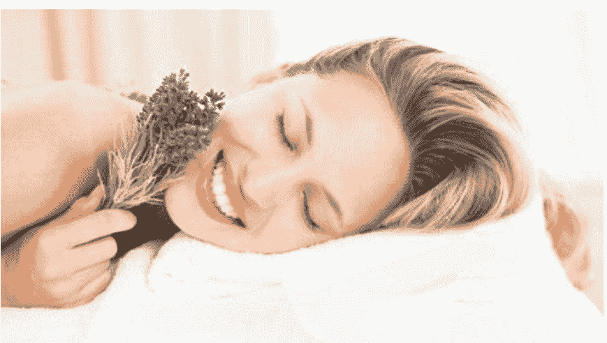

## 美容院免费模式案例

美容行业的竞争非常激烈，但是越是竞争激烈的行业，促销活动越是层出不穷，各种营销创意也是在这些行业里面产生的最多。

今天分享的这家美容院免费模式案例，就打出了非常厉害的周年庆活动，活动出来之后，很多顾客便纷纷选择大额消费，这个活动是什么呢？
具体来说是这样的：今天消费满 3000，我就赠送你 3000，并且再返给你 3000 的现金猛一听你是不是觉得这个老板疯了，接下来给你解释一下这个方案是怎么做的？
首先，你要在店内消费满 3000 元，那我怎么赠你 3000 呢？是我有一张卡，这张卡里面给你预存 3000 块钱的现金人民币。
其实这只是一个数字，赠送这 3000 有一个要求，就是你今天不能花，等你以后再来消费的时候，就从这里面可以减钱，但是不是全额减，是减 10%。
假如：一个月以后，你来这里消费买了 1000 块钱的一套产品，你需要付给我 900 块钱的现金，从我送你的 3000 块钱里面减到 100 块钱的数字，还剩下 2900。
又过了两个月，你和你的好朋友一块来买，又买了 5000 块钱的产品，这时候你只需要付给我 4500 块钱的现金，我又从送你的余额 2900 里面减掉 500 块。
这时候你的余额就剩 2400 块了，依此类推直减下去，当我送你的 3000 块钱全部减完的时候，我会一次性再给你 3000 块钱的现金还给你。
其实我们来仔细的分析一下，购买满 3000 送 3000，并且最后再返给你 3000 的现金，好好像听起来不花钱一样，但是这里只是让顾客看着比较开心。
你仔细想一想，购买满 3000 的时候，就是 3000 块钱，送的这 3000，他并不是可以当正常 的金额来消费，而是每次抵扣 10% 也就是说如果送你的 3000 全部送完的时候，你已经在这个店里消费了 3 万块钱。
这其实是他提前锁定你消费了 3 万块钱，有 3000 元是从卡里扣除的，这样也就说你拿了 2.7 万块钱的现金。
当他收到 2.7 万现金的时候，再一次性返给你 3000 的现金，也就是说最后，你买了他 3 万块钱的产品，老板收到了 2.4 万块钱，这样一算是 8 折。
原来只是搞一个 8 折优惠的活动，可是顾客的大脑是不一样的想法，如果你只是说今天买 3000，以后消费是 8 折，不见得那么有吸引力。（学习更多内容请加微信：xsyxsyqq019）因为别人看不到具体的数字，但是说今天买 3000，我送你 3000，然后还返你 3000 现金，

别人就会觉得赚了大便宜。
所以在营销策划的过程中当中，给顾客一种占便宜的感觉，会让顾客加速的来买你的东西这只是一个数字游戏，也可以说文字游戏我们很多的活动都是这样，其实仔细一算，并没有多大的折扣，但是义听起来却诱惑力非常大所以你相信什么，你就能看到什么；你相信潜规则，就会发现无数潜规则；你相信不平，就会发现无数不公平；而你相信努力就会发现努力真有回报。

# 6. 艺术培训中心招生方案，如何设计免费鱼饵，10 天引爆 2000 多顾客

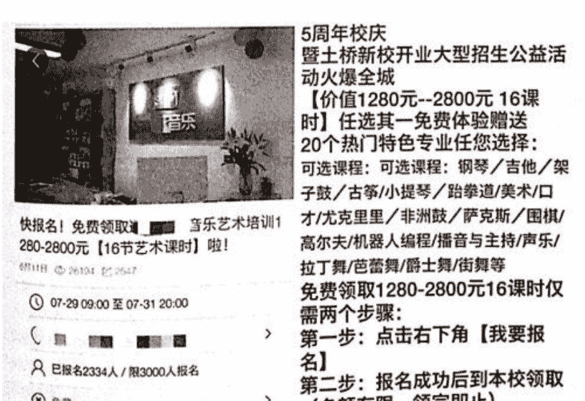

艺术培训学校免费模式
这是一家儿童艺术培训学校，包括儿童音乐、舞蹈、美术、跆拳道培训等，几个项目结合在一起的，基本上把儿童艺术类培训教育的板块都做了有 700 多平方。其实儿童教育培训这个市场还是挺大的，这些行业利润很高，一个跆拳道馆，算 80 平方的话，只要请一个教练，每个月上 8 天班，就周六、周日经营的话，一年也能赚个 30 万左右。
这家儿童艺术培训学校开业的时候，通过包装免费的鱼饵，然后借助微信传播的操作方式，在 10 天左右的时间就成交了 2000 多位顾客，回收了 60 多万现金，那他是如何操作的呢？
第一步：包装一款鱼饵产品打造一款价值 1280-2800 元“16 节艺术课时”，然后可以免费领取这 16 节艺术课时，有钢琴、吉他、架子鼓等 20 个热门特色专业，任意选择其中一个免费领取学习，这款鱼饵对于家长来说很有吸引力和诱惑力吧，所以你在操作的时候，学会参考案例中的包装打造方式。
第二步：做一条微信链接，做朋友圈裂变传播鱼饵打造好以后，如何传播吸引顾客进店呢？

把这款鱼饵做一条微信链接或者互动吧链接，然后通过朋友圈推广宣传，那么发出去以后，肯定会有一批家长报名对吧，家长报名的时候，需要添加店里的员工为微信好友，然后，要求报名的家长，把这条链接再转发到她的微信朋友圈，家长的朋友圈有人也想要的话，也会转发这条微信链接，这样就实现了一轮轮的微信传播，从而实现了吸引大量顾客进店的效果。
当然，这是我们主动要求顾客做的传播，还有的顾客也会自动传播，什么意思呢?就是如何你报名成功了，你觉得这个非常好，你不仅会转发朋友圈，甚至你还会特意告诉身边也有孩子的朋友或者同事或者家长，告诉他们有这样一个免费学习的好消息。
这样这条链接最终会实现一传十、十传百的传播下去，到最后会有几万、十几万、甚至几十万人关注，如此大的关注量，快速的打开了知名度和影响力，而且还会有一定比例的顾客直接转化进店。

## 第三步：巧妙的利润布局那如何快速收回现金流呢？

顾客在互动吧或者微信链接上报名以后，还需要来店里报名，这样才可以正式报名成功，顾客进店以后，想要免费学习这套课程，需要缴纳 300 元保证金，保证能够准时来上课，因为教室有限，还需要安排老师上课，这都是费用投入，如果报名以后不能按照要求来上课，就会导致座位空置，浪费老师的时间，还浪费了教室的资源。
所以，为了确保学生能够正常时间来上课，需要缴纳 300 元保证金，这个难度并不大，那么 2000 多人报名，一个人收 300 元保证金是多少钱?是不是 60 多万了，一个活动就收了 60 多万了。(学习更多内容请加微信：xsyxsyqq019)
那 16 节课时，学生上完以后怎么办呢?是不是需要退款呢?其实，如果学校老师维护的好，会有一大批学习在上完 16 节课以后，报名后续的年费课程，所以只要学校把学生和家长维护好，后期根本不用担心退款，维护好了退不了多少钱，因为后面会有很多家长续年费课，还能再创造一大笔利润不仅如此，借助这次活动策划，店里的微信上又圈了一大批精准顾客资源，所以在相当长的一段时间内，再也不用担心客源的问题了总结：这个案例中的鱼饵，基本上属于纯免费的鱼饵了，之所以收保证金，实际上是做筛选，筛选掉一批纯占便宜的顾客，如果说，连这个保证金都不愿意交，那基本上后续追加销售年费课程就比较难的了。
所以，通过包装免费的鱼饵，然后通过微信去传播，需要鱼饵的吸引力和诱惑力更强，鱼饵打造的吸引力和诱惑力的前提是永远不变的。

# 7. 水果免费模式案例，水果免费吃 10 年，轻松吸引用户并锁定用户钱包

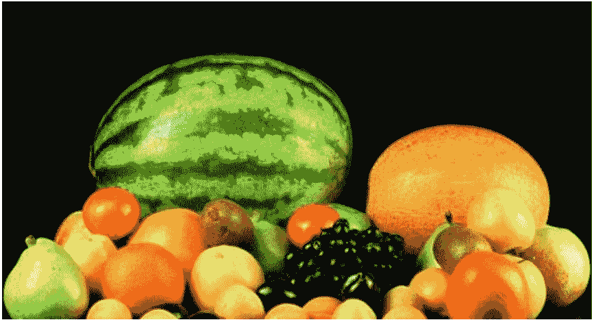

水果免费模式案例

今天和大家分享一个颠覆传统的水果免费模式案例，而且杀伤力非常猛，因为他不是次免费，也不是一年免费，而是免费吃十年水果。

很多人看到标题可能觉得，又在吹牛逼了，因为十年免费吃水果啊，谁敢这样干？你不赔死啊，如果不赔死，关键是你怎么赚钱？

很多你看来不可能的事情，但是就有人敢这样干了，那么下面和大家分享一下，他们是怎么玩的关于水果项目国内有几家知名的大家都知道的，这些基本都是玩 020 的模式，玩线下连锁的模式但是这家公司并没有在线下开设实体店，而是用互联网来玩水果项目，很多人会认为是微商的模式，但是他们不是玩微商的模式。

那么既然没有实体店也不玩微商的模式，10 年水果免费送是怎么玩的呢？

他们玩的是会员，这招非常厉害，如果你利用好这招，吸引用户锁定用户包括现金流等等都没有问题。

10 年水果是不是直接免费送 10 年?没有任何的条件？

答案肯定是有条件的，没有条件，是个人都可以领的话，你有多少都不够对吧。

他们设置了 3 个套餐 A 套餐：你充值 3000 块，每个月送 20 斤当季的水果给你，而且还包邮送上门，一年给你 200 斤，也就是说有 2 个月是不给的,10 年就是 2000 斤，简单的说就是交 1 年的钱给你 10 年的水果。

B 套餐：充值 5000 块，除了和上面的 一样，另外成为会员起满一年加送 200 斤水果或者超值礼品或者 500 块红包。这个套餐就相当于 10 年免费吃水果，因为，每年 500 块红包，十年不就是 5000 块？

C 套餐：充值 10000 块，一个月 40 斤，一年 400 斤,10 年就是 4000 斤水果，成为会员起满一年加送 200 斤水果或者超值礼品或者 1000 块红包。而且前几百名还给你分公司每年总营业额的 1%分红。不仅水果免费吃还能有钱赚。

这家公司怎么赚钱?很明显的亏本啊！(学习更多内容请加微信； xsyxsyqq019)
首先，他们是掏了一笔钱承包了几万亩 50 年产权的果园，而且这些果树都是种了 3 年以上的，意思是说，基本上都是有水果收的了大家要明白的是，一个果树种下去，他是每年都结水果的，简单的说，假设你掏了 5 块钱买了一颗果苗回家种，然后每年给点农家肥，是不是每年都有水果收?如果能收 50 年，但是你投进去的成本就是树苗的 5 块钱，明白这个原理就很好理解了。
所以，他们就是每年投入一点果园的维护成本采摘，快递等等，但是这些费用他也不是一年就投进去的啊，他是每年都投一点点，这个成本可以通过把项目运营好来解决这个成本的。
简单的说就是他不靠这个水果赚钱，水果只是他锁定用户的一个方式，用水果把一个用户锁定在平台 10 年，而且相对来说水果的成本是比较低的，因为水果都是自然开花结果，并不是说结一次果要一次成本的。
那么他既然不靠水果赚钱，靠什么赚钱?短期来说他可以获得大量的现金流，这个是肯定的。他能锁定用户 10 年，而且水果还是一个刚需的产品，既然锁定了用户，他们就有可能把其他的利润产品嫁接到这些用户，直接产生利润，能卖给用户的产品多得去了是吧。
中国水果市场是几千个亿，哪怕瓜分 0.1% 都是几千万是吧。
另外，有了这些用户，比如说玩金融，玩众筹，一个万个用户，每个用户出资 1 万块，就是一个亿的现金啊。
也就是说他可以再从这些用户手中拿钱，还可以让这些用户成为创业者，帮他们赚钱。
也就是说他们锁定用户 10 年，可以卖给用户 10 年的产品，赚的钱远远比果园维护的钱要多得多。还有更多的盈利模式大家自己想吧。
具体后面会怎么样，是不是真的能给你 10 年的水果，或者说是圈钱?这个我们不做判断，如果是一家小公司这样干，很多人们会认为是圈钱，但是，如果他的背后是某个知名的集团下面重点孵化的项目，你会认为这个有可能吧。

# 8.如何利用免费玩具吸引大量儿童，后端对接平台的商业模式

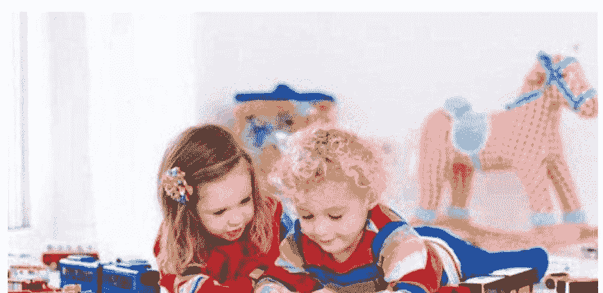

## 免费玩具商业模式

现在各个行业的竞争是越来越大，越来越多的传统行业都被颠覆了，今天给大家分享的就是关于玩具免费模式案例。

玩具市场其实是一个十分巨大的市场，有人估算这个市场每年的规模超过 200 亿，这个市场有怎样的痛点呢？

低端的玩具，很多的家长给孩子买回去之后，孩子玩几天之后就会觉得厌烦，这样容易造成严重的浪费；高端玩具，价格比较般的家长舍不得购买。

上面就是关于玩具的几个痛点，接下来我就根据这几个痛点来给大家讲一下几种玩法说起来，高端市场的玩的人比较多，并且高端市场大部分都是以免费的形式来玩的，高端玩法的免费模式是怎么样的呢？一般来说租赁的玩法比较多，当然租赁玩法也是有分类的。

第一种就是平台自己采购这些高端玩具，然后再进行出租，当然这个出租是免费的，但是免费是可以，只不过需要交押金，然后你在一 نہ内可以租多少个玩具，可以换多少次等等，因为这种高端玩具的采购成本基本都是等于或者低于三分之一，所以，一般都是一一次性交 3000 块，或者一次性两年交个 5000 块押金。这个押金是可以退还的，对于家长来说，也就不是花钱给孩子玩了很的玩具！

那有某些人就会问了，不要钱，公司怎么赚钱？
首先第一点，收的这些押金都是按年来收的，那么在这一年以内这些钱能够拿去变成多少钱呢？我想要把玩具钱赚回来是没有问题的吧？其次假如有些孩子很喜欢某些玩具，假如硬要买下来的话，家长也是会同意的，这也是一个赚钱点，除了玩具，还有一些其他方面的产品也都是可以的。

第二种模式的话，就是共享的模式，也就是假如你买了玩具，但是孩子不喜欢了，用不到了，你可以共享到平台来，平台帮你出租，然后你可以获得出租的佣金，平台方也就能想办法获得另外的收益。

这种办法也是广泛被各种公司使用，毕竟玩具是一个可以重复使用的东西，中间也就多了一个消毒的流程！

上面说了高端玩具的玩法，那么低端的玩法是怎么样的呢？对于低端的玩具，其实价格都不高，但是丢掉的话主要是怕浪费，于是有一家公司是这样玩的，他弄了这样一个平台，然后大家可以在上面发布自己的玩具，然后双方有玩具并且对对方玩具都比较心仪的时候，就可以进行交换了，也就是给你们一个平台，有玩具的可以在上面自由的交换，也就省下钱去买新玩具了！（学习更多内容请加微信：xsyxsyqq019）

那这个平台怎么赚钱呢？大家想一下，用玩具的大多数是儿童，也就是这么多母婴用户用你的平台，想赚钱还不是很简单？比如接个广告，或者自己推广一款什么产品这类的，总之赚钱的方法多的是可以说现在不是传统行业赚不到钱，而是传统的思维赚不到钱，要想赚到钱，还是要具备不一样的思维！自己不懂这样的思维，就得去找懂得这些思维的人学习，这样才能让你尽快的跟上时代的脚步！

# 9. 餐饮如何免费吃“霸王餐”，借助微信快速裂变1个月收回投资成本

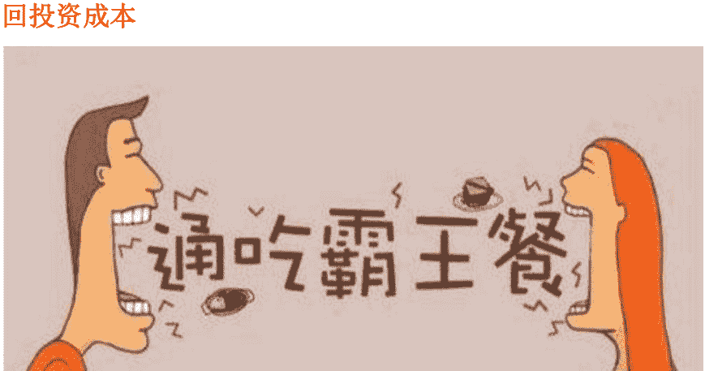

餐饮免费模式

这家餐饮店是做牛肉火锅和烧烤的，有 3 层楼,32 张桌子，任何新开的店，都希望在当地快速打响知名度和影响力，同时又能快速收贵投资成本，这几乎是所有开新店的老板首先想解决的问题。下面，分享具体的餐饮策划方案：第一步：包装一款鱼饵产品“霸王餐”；什么叫霸王餐，就是只要你来店里吃饭，不管你吃多少都免费，是不是夸张到不可能思以，这个非常有吸引和诱惑力吧，顾客有足够的转发动力。记住，吸引力和诱惑力永远是鱼饵包装、打造的第一前提条件。第二步：打造一条微信链接，做朋友圈裂变传播顾客如何才能够免费吃到霸王餐呢?条件很简单，只要把这条免费吃霸王餐的微信链接转发到朋友圈，连续转发 10 天，并且每天转发到朋友圈的链接不能删除，就可以免费来吃霸王餐了。因为鱼饵非常有吸引力和诱惑力，很多人会转发，最后疯狂到什么地步，这条链接在短短的 10 天左右的时间内，关注量就达到了 49 万+，也就是说在短短的 10 天左右的时间内，有将近 50 万人关注了这家新店开业的消息，一下子火遍全城，爆炸式的打开了知名度和影响力。(学习更多内容请加微信；xsyxsyqq019)第三步：利润环节巧妙布局想要免费吃霸王餐，除了需要连续转发 10 天微信链接到朋友圈这个条件以外，还有一个前提条件，就是你吃多少钱，最后结帐的时候，你就需要充值多少

钱，这样才能免单，比如，你当天消费了 200 元，就要充值 400 元，以此类推。
可能有朋友会有疑问，这样操作能收到这么多钱吗？
现在粗略算一下,49 万的关注量，一般操作微信裂变活动得到的数据反馈，转化率在 3%-6% 左右，按照最低 1%的转化率计算，那就是 5000 人,5000 人就是 5000 桌，那么 5000 桌平均下来，一桌消费 200 元，就要充值 400 元。
5000 桌乘以 400 就是 200 万，这 200 万只是最低标准，收到的钱可能远远不止这个数，这里我们只是打个最低标准算，做过餐饮的人都知道，餐饮的利润正常来说是对半开，像这类火锅的利润能够达到 60%左右，我们就打个对半开,200 万的充值，实际消费的金额就是 100 万，当月的成本就是 50 万，所以当月收到的钱就是 150 万左右，这还是最低保守算出来的。
可能有很多没做过餐饮的朋友都有疑惑，那下个月这些来充值的人，会不会消费掉 150 万里面很大一部分钱，其实这种担心是多余的，我们按照最差的情况计算，就是下个月来吃火锅的都是上个月充值的人，也就是说没有新顾客，那 150 万充值金额对半算，还有 70 万利润吧，这只是保守估计，一个月赚 70 多万是不是也不少了。
现实的情况是不会出现这种的，为什么呢？
因为下个月来吃饭的人，不可能都是准时约好的，不可能都是充值的顾客，正常的情况下，肯定也会有很多其他没有参与这次充值活动的顾客过来消费，这样上个月充值的顾客就会和正常消费的顾客实现对冲，也就是说，正常消费的顾客所创造的利润会对冲掉上个月充值顾客进店消费的成本，如果做的好的话，第二个月，在对冲掉第一个月的充值成本后，还能赚钱的。
这就好比一个蓄水池，这里边第一个月蓄了一部分水，第二个月，打开排水口排水，但是同时又有水龙头往里面放水，只要放的水跟排的水一样多，这个蓄水池里边的水就不会少，如果放的水比排的水多，这个蓄水池里的水，还会上涨，相信做过生意的人都会明白这个道理。
所以这位朋友第一个月收到这 150 万现金，如果第二个月经营的好，都是净赚的，甚至比这个还要多，这里只是保守的计算。
本案例只是给你一个思考的方向，如果你是做火锅店的话，也可以拿来参考，但是并不能保证也能做到这个效果，为什么?因为店的情况不同，包装的鱼饵产品，给顾客的感觉不同，那么起到的吸引力就不同，如果说这是一家装修很普通的火锅店，顾客看到鱼饵产品以后就可能不感冒，这是店铺本身因素决定的。
还有一种情况，就同市场环境不同，如果这个市场上，这种方式很多同行都在使用的话，最后起到的效果也不一样，当然，最关键的就是执行的人不同，任何一流的营销策划方案，最后能够操作出来一流的结果，都是需要一流的执行团队来操作的，如果团队是三流的，那么结果就是三流的。
这家餐厅一共有 32 张桌子，不管做中餐晚餐、宵夜，在承载客流量方面也是没有问题的。

# 10. 电视卫星免费送，如何垄断周边村镇，绑定后端赚更多钱的商业模式

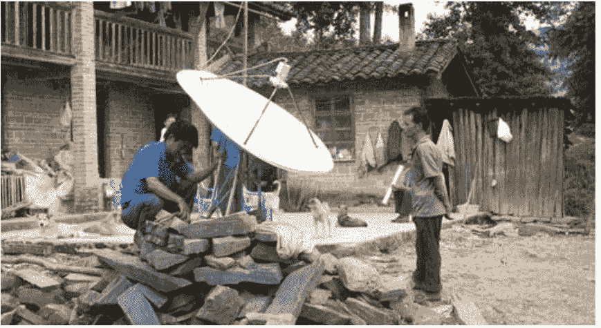

### 电视卫星免费送案例

有个老板，姓王，王老板是专门在城里售卖电器的，机缘巧合，他到镇上亲戚家吃饭的时候，发现了一个商机，附近几个村里的人，准备大量安装电视卫星，于是他瞄准乡镇市场，打算在乡镇里开一家分店，售卖家电于是第二天，他就到乡镇售卖电器的店家，以及周围居民中做了简单的市场调查，调查得知，每一家售卖电器的店家，都有售卖电视卫星，而且各种品牌都有，各种价格 200 至 1000 元左右不等。

那如何在众多的店家中脱颖而出，让大部分的人都选择王老板的产品呢？

王老板连续做了几天的市场深入调查后，老王立即向一家小众品牌的电视卫星厂家订购了 2000 套电视卫星(电视卫星锅加电视卫星机顶盒)；因为小众品牌，想开拓市场，所以订货成本非常低，一套价值好几百元的电视卫星成本仅需 100 元，而且厂家非常注重产品质量，使用寿命至少长达 5 年之久。(学习更多内容请加微信：xsyxsyqq019)

王老板和厂家签订了合作协议：
1、王老板和商家谈好了，王老板先付 5 万元押金，余款 3 个月后全部还清。
2、王老板叫厂家分 10 次发货，每次 200 台，半个月时间完成所有发货。(减少前端运营的成本 10 天后厂家才开始发货，在这 10 天内，王老板先租用了一家店铺，做简单的装修，然后印制和派发大量的活动传单，此传单只针对于附近尚未普及电视卫星的村庄，为的是预热和推广他店铺的电视卫星，预热传单非常详细的介绍了他的电视卫星各项功能及优点等等，而且传单中他的电视卫星的售卖价格高达 888 元一套可能这时很多人就会思考，再怎么好的产品，毕竟是小众品牌，以 888 元的价格定位，非常不符合售卖给乡村人群，而且完全竞争不过比 888 元还要低价格的名牌电视卫星产可王老板，压根没当回事，淡定的监督店铺装修，以及雇佣员工，等待收货。
10 天期限到了，电视卫星陆陆续续到了，第二波传单也送过来了；这次的传单大有不同，这次的传单，主要突出了，以下几点：
1、新店开张，价值 888 元整套电视卫星免费送 2、专业人员上门安装，不收取任何费用；3、交 100 元的押金，体验三个月后，才收取看电视卫星的观看年费(以下简称“年费”)150 元，三个月期间不满意，押金全额退款，电视卫星有专人上门回收。
此传单，再次分发到了每家每户手上，第二天，店铺外面就排满了前来领取电视卫星的用户，一星期的时间 2000 多套电视卫星全部送完用高品质的产品，免费送的模式，不花一分钱送出了 2000 套电视卫星。(收取的 100 元押金解决了运营成本，王老板没有花自己的钱就把这 2000 套电视卫星送了出去）可能有些人就会很疑惑，为什么那么多人去领取老王的电视卫星？

- 1、因为老王的电视卫星，一开始的标价是 888 元，最后因为新店开张活动，直接免费领取，而且大多数农村家庭都非常节俭，所以这么好的事情，大家都抢块去了！
- 2、别人家收的电视卫星观看年费是 180 元到 500 元不等，而老王只收取 150 元！

那么，一套电视卫星成本 100 块钱，老王送出去 2000 套，看上去亏了很多钱，可他是怎么赚钱的呢？

- 1、三个月免费领取，体验后，每家每户各交 150 元电视卫星观看年费 150(年费)减去 100(成本)乘以 2000(台电视卫星)=10 万(利润 备注：第二年时,150(年费)乘以 2000(台电视卫星)=30 万(纯利润
- 2、每台电视机顶盒都印有自己的广告，我们收取广告费，合作 1 年。

12(月)乘以 1(元/月广告费)乘以 2000(台电视卫星)=24 万元(利润) 总结：把主产品免费送，绑定后端的消费赚钱，通过送出 2000 套电视卫星,1 个星期就收了 20 万押金，三个月后就赚了 10 万。还通过整合广告资源，多赚了 2.4 万。

上述仅通过第一个盈利点就已经实现扭亏为盈了；可是这背后还可以延伸很多利润点出来，不知你是否能联想到呢？

我们可以免费送电视卫星，我们还可不可以送其他产品?我们通过让客户感受到超值，能不能转化一部分的客户成为我们的会员，绑定他后端的消费?我们除了在这个乡镇免费送电视卫星，我们还可不可以去其他乡镇送?

# 11. 奶茶店如何利用免费送模式送 100 杯奶茶，一个月赚了 12 万元

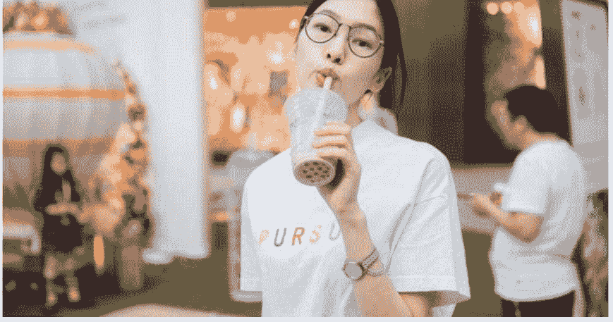

### 奶茶店免费送模式

随着奶茶行业的日益庞大，各类口味层出不穷，其市场发展潜力巨大，利润空间巨大消费者对奶茶产品的认可度非常高，消费群体已非常成熟。

那么在竞争白热化的今天，如何从市场中脱颖而出?如何才能杀出一条自己的血路呢?

很多商家对这个问题摸不着头脑，辗转反转千百遍也没有找到一个合适的方向。
今天给大家分享奶茶店营销案例，看它是如何利用免费模式达到月利润十几万的？
这家奶茶店开在步行街边上的一个小胡同里，胡同不长只有几百米，这条胡同往东可以通往另外一条主马路。由于有个中学的缘故，胡同里开了几家小商铺，但总体来说不是很多。不过这个奶茶店的位置不太好，虽然学生很多，但奶茶店的生意并不太好。
丁老板的手艺很不错，调的奶茶很独特。丁老板想着位置比较偏，所以价格订的要比其他店里便宜一两块。可是生意一直不太好，所以一直在寻求办法改变。接下来就看一下丁老板是如何让自己的奶茶店生意火爆并持续吸引客户的？（学习更多内容请加微信；xsyxsyqq019）
招牌奶茶、果粒、杯子、吸管等等…，杂七杂八加起来差不多平均每杯 1.5 元。没有计算人工成本和房租。附近有个有两三千人的中学。丁老板做了一件事免费送 100 杯招牌奶茶给中学生，也许有人会有疑问，本来生意就不好，再送的话不得亏死?大家不要急看一下丁老板具体是怎样操作的。
免费送 100 杯出去，然后当客户过来你店里喝果汁的时候，你跟他们说，这两天我们店里有活动，原价 9 块钱一杯的招牌奶茶，现在你只需交 35 元，就可以一个月内，每天过来喝一杯招牌奶茶了。你看你要不要充值?大家可能又会有疑问了，送 100 杯都已经亏大了，再 35 块钱可以喝一个月 30 杯冷饮，没得赚吧?本都亏光了。
大家仔细算一下这笔账。你免费送 100 杯出去，相等于 1 个客户你送了 1.5 元。当客户购买了 35 块钱一个月的套餐，你 30 杯的成本是 45，而你收回 35 块钱，相当于一个客户你要亏损 45+1.5-35=11.5 元。你可能会说不能这样算吧，房租呢?人工成本呢?这些都没有给算。店铺开在那里，就算一个人不上门，也得交房租，也得在那里守着是话是这么说，但一个月亏 11.5 元一个人，如果来 100 人，就要亏 1150 了。还不算房租人工。其实不能这么算的。你想想看，学生不会每天都到你店里奶茶的，对吧?我们算他来 15 天，成本是 15*1.5 元=22.5 元。加上免费的那杯 1.5 元，你收回 30 元，是不是就赚了 35-22.5-1.5=11 元?
顾客过来，不可能每次都喝你送的奶茶吧！
总得换个口味，你可以推荐个更好点的给他喝，比如果那款 12 块钱一杯的 xx 奶茶，他得要补 3 块钱，但你的成本基本没有增加。他们过来，不会每次都只喝一杯奶茶吧?会不会有时点一些吃的?这个可是原价的。另外，他们也不可能每次都是自己一个人过来啊，是不是有时会带同学过来?他同学的可不免费啊。
总之，你是以 1 杯免费的奶茶来获得这个客户到店的机会，然后以 35 元一个月的套餐，锁销了顾客一个月，还可以积累客户资源建立自己的平台以达到多次消费。如果他天天来都只喝一杯奶茶，你也就 11.5 亏元。
但如果他在上面的任何一个地方消费一次，就能赚回来。每当那些可以让你有得赚的人快消费完的时候，你又可以再推出一个月套餐，这样你就不愁没有客户了。至于那些每天过来喝 1 杯招牌奶茶就走的，下个月不给他购买套餐的机会就是了。
方法很简单，但很有效，丁老板按这样的方法操作，不但店铺没有转让，一个月还赚了 12 万。这里，并不是让大家生搬硬套的去使用，一定要结合自己的实际情况，反复的去试验，所有的案例只是提供一种新的思维，新的商业模式，最终找到合适自己的模式。

# 12 学校如何跟大型超市合作,免费得到自己想要的办公用品

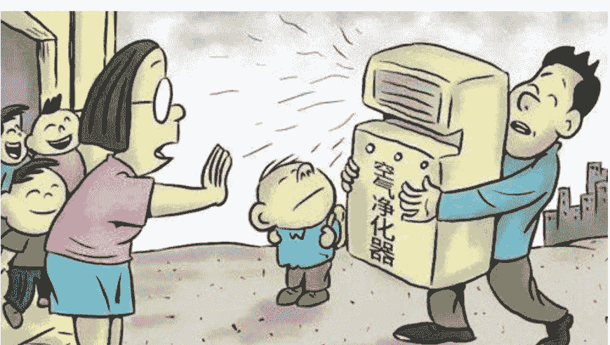

### 学校的第三方共赢模式

有一位黄老师，他是从事营销策划的，有一天，他带着 9 岁的儿子去学校参加家长会，这家学校在当地是很有名气的小学，教育资源及师资力量都很不错。但是，这所小学却深受“商品经济”的影响，时常变换借口与理由，向家长们均摊筹资要钱买材料、设备等。在这次的家长会上，毫无例外，在班主任讲完一些“客套话”后，就又开始“诉苦”了，大谈特谈什么“学校缺电脑”、“缺复印机”之类的“苦恼”。总之，归结为一句话就是：“请每位家长赞助 500 元钱”。这已经不知道是第几次了，总之，这样的要求，让家长们感觉“这是无理的要求”，大家意见都很大，大部分人 存在着抗拒的心理，不太愿意交钱。但是，自己的孩子又是在这家学校读书，如果太明显的跟学校对着干，好像对自己小孩的学习也不太好。这家黄老师呢，就想应该想个办法，把这个问题解决一下，既让自己以及家长们不再受“筹资”之扰，也能让学校找真正愿意掏钱的人。这次家长会，集资摊派之后，黄老师就找到学校的领导表明身份，并坦率的提出了一个“三方共赢”的解决方案。这套方案提出之后，让学校的领导都拍案叫绝，很快就获得了自己想要的结果，以后再也不用向家长“集资”了。黄老师让学校的领导，直接派人去跟附近的大型超市联系。在学校附近，有很多的大型连锁超市，有好又多、家乐福等，跟他们一一商谈合作事宜最后，学校与“好又多”达成了合作协议，并形成长期的合作关系。作方式很简单，“好又多”超市希望学校能帮他带来更多的消费客户，而学校希望获得超市提供的资金或实物的资助。因此，他们签订下协议：“由学校组织家长，在 8、9、10 三个月内，在好又多超市购物，凭电脑小票来统计，只要总额累积达到 30 万元，那么，好又多超市即赠送该学校价值 5 万元的学习、办公用品”。接下来，学校跟家长们沟通好，请求家长们做 2 件事 1、尽量到“好又多”超市去购物；2、每次购物之后，把“购物小票”积累下来，由自己的孩子带到学校来。家长们一听也就很愉快的接受了。（学习更多内容请加微信； xsyxsyqq019）

原因很简单：生活必需品是要经常购买的，去哪家超市区别都不大，既然学校提出出来，以后不必再“集资”了，那么，就去“好又多”购物好了，反正这些小票如果不积累下来，也会随手扔掉。
现在把购物小票积累下来，既帮了自己，也帮了学校，何乐而不为呢？
于是，家长们全都行动起来，在 3 个月时间内，加大了去“好又多”购物的次数，每次也都尽量多购买一些商品。
于是，在不到 3 个月的时间，学校就积累够了 30 万的总额，交到“好又多超市那里，顺利地领回了自己想要的办公用品。
所以，这就是一个真正“三赢”的营销案例，家长赢了，以后不用再被学校“集资”了；学校赢了，获得自己想要的办公用品；好又多超市赢了，增加客流及消费金额。

# 13.烤鱼店用免费卡模式整合周边资源案例，做到每天生意火爆

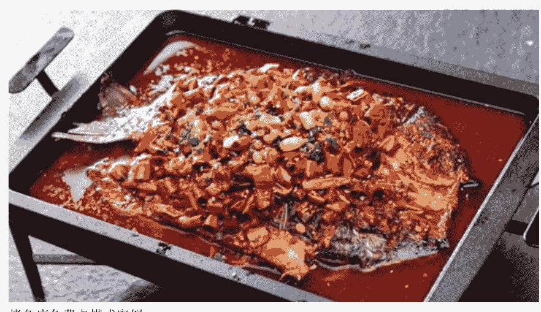

### 烤鱼店免费卡模式案例

今天给大家分享一个烤鱼店营销案例，这家烤鱼店开了大概有 3 个月，目前每天的客户量太少，虽然做过一些广告宣传，什么发传单啊、打广告啊，但是他店里的人气就是上不来。经过了解，她的烤鱼是 78 元一份，鱼用的是草鱼，一般一份烤鱼的鱼在 2 斤左右，加上一些配料、小菜，成本大概在 25 元左右，但一般一桌客户消费都在 130-180 元左右，她的毛利润在 100 元以上。

没有模式，不开公司，这个时代所有企业的基础就是商业模式，产品和品牌已经是标配，模式才是刚需。一家企业起步在哪里不重要，但是路径非常重要，从一开始就要做好企业的生涯规划。

把该花钱的事情让别人去干，但是所有的钱进我的账，整合各种资源来打造一个系统盈利的生态圈

这个老板就按照新的思路，开始整合各行各业的资源。她找到了附近的美发店、蛋糕店、洗脚城跟他们合作，前期每个店先给 30 张免费的卡去测试，这个是免费提供给他们的，对于这些店来说，就相当于去拉赞助，帮助他们做促销，维护和客户的关系，他们也非常愿意的。

举例：由于你是我们的老客户，最近呢我们老板一位朋友在附近开了一家鱼庄，我自己去吃了口味特别不错，于是我们老板在这家店团购了 30 张烤鱼卡，只要是想回馈我们的老客户，由于您是我们店的老客户，所以我们今天送您一张，您持这张卡可以到这家店免费吃烤鱼。

用这种回馈客户的方式，对于各个合作商来说可以帮助他更好地维护客户关系，同时也让客户觉得非常有价值，因为这个东西并不是什么人都可以得到的，是因为他是这家店的消费会员或者老客户才可以得到。

这个学员通过测试，测试了 200 张卡，结果带来 90 个客户，经过她的反馈，基本上都消费 130-180 元之间。这个时候我们来算笔账通过免费提供给一些店，帮助这些店做促销或维护客户关系，虽然测试了 200 张卡，来了 90 人,110 人没有来，那 110 人不来是没有任何损失的，那 90 人来了，相等于有 90 桌客户，平均消费在 130-180 元，减去一桌的烤鱼成本 25 元，基本有 105-155 元的毛利，也就相当于这些店给这些客户优惠 25 元而已，也就是来 90 人，最少可以赚到 9000 多元。（学习更多内容请加微信：xsyxsyqq019）如果让更多的人都来体验了产品，只要卫生和口味没有问题，基本都有可能回头重复消费。

目前通过这种方式，到现在已经做到了从以前一天只要几桌的生意，做到了 一天几十桌的生意，每天人流爆满，生意火爆。

# 14.餐饮行业充卡案例，请全城王姓进店免费吃喝，充 2500 送 25000 元

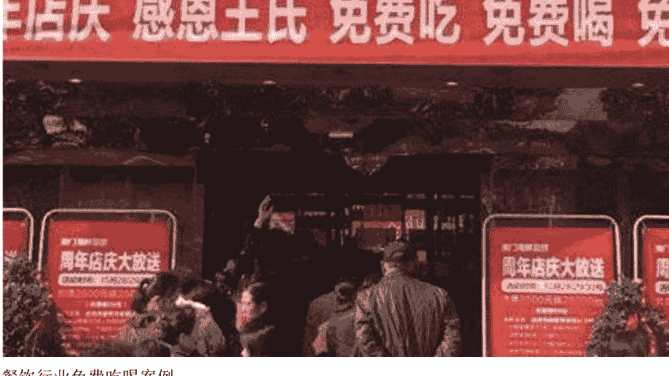

### 餐饮行业免费吃喝案例

上图主要透露了下面几个信息，餐饮店周年活动：“请全城王姓进店免费吃喝，充 2500 元还送 25000 元，仅限 99 名”。相对应的免费模型有：客户模型的应用、充卡三限理论以及时间模型。

第一步：引流 1、通过制作现金卡送给你的联盟商家或者其它异业商家，对于愿意合作的商家来说，有很大的好处，给自己的客户最大的充卡附加价值，联盟商家不用花一分钱，就可以相互引流，共享资源。

2、客户模型的应用：全城王姓进店免费吃与第 1 条一样，免费的目的 是让客户进店，享受一次或多次的免费机会，最终的目的是现场形成排队充卡的人气效应；一次免费是用一类主副产品 的设计形成交叉补贴来挣钱。

比如，主产品鱼头泡饼免费吃，那么就利用副产品酒水或者其他副菜来收款；而多次免费，是利用延长利益链条实现后端盈利，比如，每人发几百瓶啤酒，但不能带走，只能店内使用，那么以此来实现顾客经常来店消费的结果。

那么利用客户模型，全城王氏均可免费吃，主要目的是制造稀缺感和成就感，因为客户消费的是感觉。这个感觉有了，就会有我们想要的结果；而如果放开，全城免费吃，虽然成本可以很好的控制，但形成不了一种稀缺感，也就不会形成排队的现象。

那么可能有人问，只是王氏可以有这个待遇，别 的姓氏就没有，会不会对门店品牌造成伤害?其实不会。只要制造一个可以说服的理由完全没有问题，比如，老板姓王，加有喜事，周年庆典，请全城的王氏家族老少爷们吃饭！合情合理！（学习更多内容请加微信；xsyxsyqq019）

模式在几千人以上的庆典活动，你愿不愿意，在我这挂个条幅来宣传下你的品牌？同时，你愿不愿意跟我合作，不用花一分就可以让你营业额提高？你愿不愿意给我提供一些你们设计的引流产品？
打个比方：你是做美容美发的，可不可以支持我一些洗发卡来送给我的客户？你是做健身的，可不可以将你的一个月免费健身的卡送给我的客户？你是做足疗 spa 会所的，可不可以送几张足疗的卡给我的充卡会员客户？等等这些就是后面要跟大家解释的充卡方案，请看下面的内容；通过以上几种方法引流，开业当日，人气爆满！接下来就是第二步了，怎么留流，也就是充卡的问题，相信这个也是大家最关心的问题充卡的目的无外乎两条第一、快速收钱，收现金；第二、绑定我们想要的消费群体；所有充卡活动，免费模式都遵循三个原则限人(仅限 99 名)；限量(只能充值 2500 元)；限时(活动仅限三天活动所有赠品全部放在现场，将结果透明化，增加客户的信任感，把客户所看不见有疑问的环节直接呈现给客户面前！免费模式就是做到让客户无法抗拒！
再来看这个充卡方案周年庆店大放送！
活动时间:10 月 28/29/30 号
充值 2500 元送 25000 元(仅限 99 名) 1、送现金储值卡 2500 元，店内消费券，没有消费门槛 2、送茅台酒 4 瓶(价值 2912 元)现场拿 3、送净水机一台(价值 2980 元)现场拿走 4、送空气净化器一台(价值 4980 元)现场拿走;5、送金牌肥牛王 30 份(价值 2640 元)店内消费 6、送干洗店洗衣卡(价值 1500 元)，去洗衣店洗衣；7、送燕京啤酒 800 瓶(价值 3200 元)店内消费；8、送驼绒被一床(价值 2680 元)现场拿走 9、送鲍鱼 50 只(价值 880 元)店内消费；10、送小新星国际教育卡(价值 1198 元) 为什么选择充卡？
要想让客户充卡，把钱留下来，首先必须得解决的就是顾客的信任问题，充 2500 元，得到 25 万元的产品，让顾客充 2500 的卡，直接拿到实际的产品都超过 2500 元，通过这样彻底解决顾客的信任问题。
如何实现充 2500 元，送 25 万元呢？
充卡一定做到：虚+实，虚实结合来做，另外就是接上面提到的整合思维，用借的思维去整合周边的商家，从利他的角度出发，相互引流，最终形成三赢的局面；
虚：用第三方的产品，帮助第三方引流，甚至引流到第三方还能赚钱；实：用公信力比较高的产品，去解决充卡信任问题，这里的比较有公信力的硬通货哪里来呢?可联系客服帮忙对接！

# 15.海鲜酒楼如何通过免费“鱼饵”，快速打开知名度和影响力

### 你敢转！我敢送！转发免费赠送138元火锅套餐（可供4人享用）

海鲜酒楼免费“鱼饵”案例

这家海鲜酒楼面积有 300 多平米，投资了大概 50 万，由于是新店开业，急需解决的就是，如何快速打开当地的知名度和影响力，最好还能短时间内收回投资成本。

酒楼老板通过一套免费鱼饵的操作方案，在开业当天，就做到：场面火爆，排队吃饭，停车场停满了车辆，更疯狂的是，顾客一批批的赶来，形成了壮观的羊群效应。

更关键的是，通过这个活动，快速在当地打开了知名度和影响力，开业前几天，每天都有将近上万元的营业额具体是怎么操作的呢？

第一步：包装一份价值 138 元的海鲜蒸锅“鱼饵套餐”，把这款“鱼饵套餐”包装的很有影响力和诱惑力，然后做一条微信链接，把“鱼饵套餐”的文案和包含的菜品拍好照片，做到微信链接里去，然后，给这条微信链接起个吸引人的标题，让别人看到这个标题就知道这条链接是干什么的？

第二步：鱼饵打造好以后，就是把这条链接传播出去，让更多的顾客看到这条消息，并把他们吸引到店里来。目前，传播消息效果最好的方法就是利用微信去传播，这是当前操作免费鱼饵最快的方法之一，当然，微信传播只是一个渠道，还有很多渠道可以操作第三步：如何传播这条消息?最简单的方法，先让身边的朋友帮忙转发这条“价值 138 元的，免费吃海鲜蒸锅”的链接到他们自己的朋友圈里，这些人是你的原始传播源，这些人转发以后，他们朋友圈的其他人就能看到，当他们也想要这个价值 138 元的免费套餐的话，那么，这些人又会帮忙转发，这样就会一直裂变下去。（学习更多内容请加微信；xsyxsyqq019）

经过这三步的操作，这条链接在 3 小时内，关注量达到了 8000 多，很多人都会加老板的微信，转化了大量顾客进店，有了大量粉丝，就可以建立顾客数据库了，有了顾客数据库，以后只要做活动，一个小小的活动策划，就能让你的店面顾客爆满。

第四步：方案设计的很好，也引爆了客流量，那怎么赚钱呢?相信你也有这样的疑首先，这套价值 138 元的套餐，要想免费吃，这里有一个小小的条件，那就是必须需要 4 个人同来，才可以使用，也就是说，如果你想享用这个套餐，你需要再叫 3 个人起来，这样才可以免费使用。

现在，你应该知道了，这份海鲜套餐 4 个人肯定是不够吃的，顾客还会点一些其它的菜品、啤酒等，有时候喝的开心了，光点的菜就是这份套餐的几倍，要知道，海鲜酒楼的菜品价位是比较高的，加的菜品和酒类的利润还是很可观的，加上海鲜的锅底也是要收费的，这样算起来基本上是不会亏钱的。

通过以上几个环节的巧妙布局，海鲜酒楼开业期间，每天的营业额都有 1 万多，除去免费送出去的成本，利润还有 30%，更重要的是，通过这次活动，彻底打开了海鲜酒楼在当地的知名度和影响力，很多顾客都知道了这家店，吸引了更多的顾客到店消费，并且圈了大量的当地精准粉丝，老板建立了精准的顾客数据库，为活动结束后，海鲜酒楼的稳定运营，持续获利打下基础。

相信你看了这个鱼饵营销案例以后，对免费鱼饵的打造有了更深的认识，免费是最有力的营销策略，它能给你的店铺快速带来人气，希望你也可以重视它，把它做你拓客的秘密武器。

Ps：免费鱼饵虽然是开发顾客最快的营销方式，但是也需要策划人根据当时的实际情况设置一些限制条件，把控好每一个细节，比如海鲜酒楼的案例，它的鱼饵并没有完全免费，而是设置了 4 人同来才可以使用的限制条件，这样即保证了免费也不会亏钱，如果没有限制条件，那么大量顾客进店后，吃就一份套餐，也不多点其它菜品，那你可能会亏死。
当然，也有另外一种解决方案，就是餐饮行业，通过免费的鱼饵操作的话，免费鱼饵不限制使用条件，完全免费，等顾客进店后，引导顾客充值赚钱，这种操作方式有一定的风险，因为餐饮店没有专业的销售团队，这个时候销售高价位的充值产品，成交量就很难保证，如果成交量没有办法保证，那前面的完全免费送，就是纯粹的赔钱赚吆喝了。

# 16.景区免费模式案例，终身免费吃喝，如何用最低的成本吸引大量客户

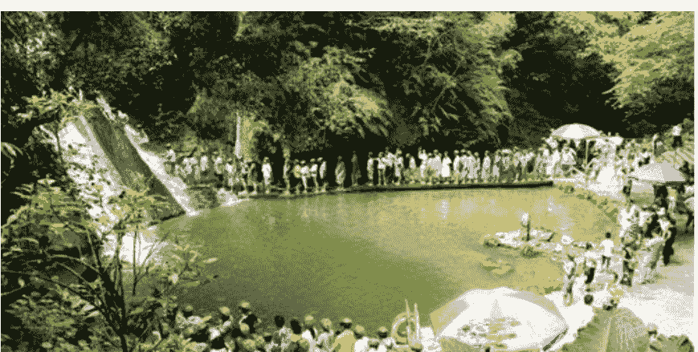

景区免费模式案例

我们经常说，厉害的高手都是道的高手，而不是术的高手，术的高手基本上都是给道厉害的高手所雇佣。

也就是说，这个世界上，其实最厉害的并不是拥有术的那帮人，而是会领略道的那一帮人。
所以，有人修术，有人修道。
是不是感觉很难理解？来点简单的吧大家都知道佛教，为什么佛教没有花钱推广，而能影响这么多人？而且还能经历几千年，关键是影响的人越来越多。
为什么？
为什么佛教不需要花钱推广？而我们天天苦逼的烧钱推广还没有效果。大家是不是有这样的疑问？
可能大多数人认为这样的，佛教首先是帮助大家净化心灵，然后再让你们去帮助有需要帮助的人。也就是利用一传十，十传百的模式。
说起来谁都懂这个模式，但是真正去用的，很少，包括我也没有用。这个模式其实是个非常牛的模式，我给透露一点你就知道关注本站的朋友里面一定有很多老板是某些培训师的徒弟。交了几十万甚至上百万的费用成为某一个知名讲师的徒弟。
其实这里面的模式就佛教一样，一个人的力量是有限的，要想影响更多人，你只需要找到一部分人，然后让这一部分人影响更多人就好了。
这就是一传十，十传百的模式。
前两天看到有这样的一个对话，这两个老板都是混迹网络圈的，也就是说在网络上都是有一定的粉丝用户的。
其中一个老板说，我粉丝有几十万，而你的粉丝不到我的一半，为什么你的影响力比我的要强？
各位？能理解为什么吗？
因为粉丝少的那个老板说，你虽然有几十万，但是你服务的是全部粉丝，我虽然粉丝不多，但是我只重点服务 1000 个就好了。
因为我服务的 1000 个粉丝里面，如果他们背后每人都有 1000 个用户，我相当于拥有 100 万的粉丝。而且我做的所有内容都是这 1000 个用户所关心的，其他的我都不用理。而且服务起来非常轻松。
如果你能理解里面的内容，我觉得比你去上一堂几万块钱的课都要值。因为价格越贵的课程教你的永远都不是术，而是道。
各位，理解了没有？表面上不是理解了？
但是，可能你会说，我不是搞培训的啊，我怎么利用这套模式落地呢？
下面我给你来个真实版本的。
给大家分享一个很牛的推广套路，这个套路如果你学会了，并且拿去用了，价值会非常大，这个套路经常被一些高手使用。
国内有一个度假区，准确的说应该是滑雪场度假区，电视里面也报道过这个滑雪场度假区。主要是这个地方冷，然后有一个大大的滑雪场，很多人喜欢来这里滑雪。关于风景啥的我就不再详细介绍。
主要和大家说里面的套路，一般来说，这种景区的宣传推广模式都是广告为主吧。电视媒体的，地面推广的等等。
但是这个度假区搞了另外一个套路，他说，你来我这里免费滑雪，免费喝咖啡，免费用餐，而且是终身免费。各位，看到这个是不是瞬间被吸引了？
终身免费啊，这不是要倒闭的节奏吗？难道还有其他套路？（学习更多内容请加微信：xsyxsyqq019）
他是怎么设计的呢？很简单，只要你的好友有 1000 人，就可享受这个活动，而且每个城市只限制 100 人。换句话说就是，我在招募宣传大使，如果你满足这个条件就可以享受这个活动。

我们算一下，如果一个城市 100 个人，一个人有 1000 个好友，直接影响就是 10 万人。
还不包括二次传播，但是他们花费的成本是多少?你一年能来多少次?每次都是一个人来吗?
所以，这种模式就是利用最低的成本，找到一批忠实的用户帮他们免费宣传，他只需要报务好这些宣传大使就好了，利用一传十，十传百的模式进行裂变所以，最厉害的推广模式，不是自己去推广，而是发动用户帮他们去推广，帮他们做裂变。

# 17.红木家具免费用五年，如何迅速获取大量精准高端人群

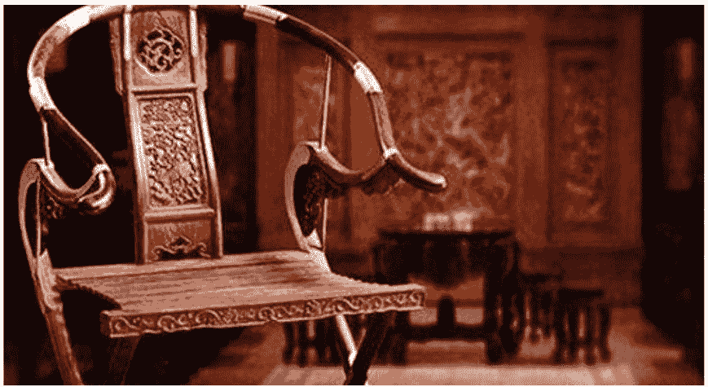

红木家具免费模式

不知道大家有没有看过一个新闻，在南京有一套紫檀照壁，最终以 1 亿 5 千万的价格成交，成为了全球资产艺术品拍卖价最高纪录，也打破了家具拍卖单件的成交记录。
为什么红木类的家具售价售价那么高，而且很多有钱人都要搞上一两套呢，因为在中国红家具的历史比较悠久，在风水上面来说，可以聚阳气、聚财气、聚人气，也就是说可以旺宅旺财旺人，但是总的来说，驱动用户购买的理由主要有两点。
第一，养生第二、增值。
当然酷爱艺术和红木的也算。
真正的红木家具也算是一件艺术品，专门请一些大师来雕刻的，因为艺术品这种东西基本都是独一无二的，也就是具有升值的空间，一般来说，一套红木家具的价格都是比较高，几万甚至几十万，对于用户来说会有风险，一下掏个几万块门槛还是有点高的，主要的原因是存在风险，万一买回去过一段时间不喜欢怎么办，自己出手还是比较难出所有一家公司换了一个模式，红木家具可以免费用，而且可以免费用五年，免费用真的不用钱吗?那是不可能的，对吧?
那又是.=么免费用呢?
他们的办法是你今天掏几万块钱，把红木家具买回去，五年后，如果你不喜欢了，你把家具退回来，我把几万块退给你，不就相当于红木家具免费用五年了吗?

如果说五年后你喜欢这套红木家具，或者说五年后这套红木家具升值了，你只支付当时购买这套红木家具的价格，换句话说你获得了增值的钱，对用户来说五年几万块购买红木家具如果升值了可以赚钱，如果没有升值或不喜欢了还可以退，最多就是损失一千多块钱的银行利息。

很多人可能会说你这个模式也没有什么新颖啊。用户表面虽然没有什么风险，但是五年如果你倒闭了或者跑路了，用户找谁退钱，信任这个环节怎么解决，也就是说如果能够确保用户在五年以后能够推到前，这个才是关键。

所以对于商家来说，第一他最好确保这些红木能升值，这样五年以后升值了就基本没有用户会退货了，就算有也是一些缺钱的或者其他的原因，但是量很少，就算你退货了这个红木升值了还可以卖钱啊，所以，他们把每一套红木家具搞点互联网科技，在里面搞个芯片，全球唯一的 id，还搞个二维码，只要你扫描就可以知道哪里生产的，用什么材料制造日期国家的权威检测报告等等。

这样就基本证明这套红木是真实材的。

第二，和银行合作，用银行做他托解决信用问题，怎么做呢？

用户购买红木家具，你只需要把对应的保证金交给银行进行很多 人会说银行为什么同意？从简单的方面来说，他们可以获得精准用户，这些都是有投资意向的有钱人，那么另外一个来说红木家具的利润还是比较可观的，因为他的是真正的红木啊，全球唯一的呀，再说每一套可以给一定的收益银行，所以他们引入银行的模式解决信任的问题，把用户考虑的风险降到最低。

这种具有升值的产品，可以采用这样的模式去干，我把红木生产出来，你给我押金就可以免费用，不想用了可以退给我。

也就是交押金，免费用产品，这是不是有点类似共享经济的模式，但是他们多了一个功能，那就是可以升值，可以购买，不中意的可以退！

# 18.果农如何利用免费模式加社群营销，3 天销售 7000 斤苹果

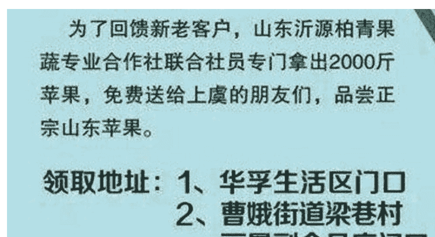

果农免费模式加社群营销

大家都知道山东的苹果比较多，很多果农家里本身就有许多苹果滞销，无法销售出去，般

都是拉着小货车到周边地区零售或者拉到批发市场销售，但是一天也就卖个 100 来斤。其中有位果农朋友就很聪明，也很爱学习，他利用免费模式加微信社群销售的方式，天时间就销售了 7000 斤，他是怎么做的呢？方法很简单：“2000 斤苹果免费送，加好友，每个人送 2 斤！文案如下本群为山东苹果直供群不定时会有红包：进群就送打皮刀和 1 斤苹果品尝享受买苹果每斤便宜 0.5 元待遇，加群主为好友领取。

二、邀请十个当地好友进群再免费送五斤大号苹果三、产品领取地址七、《XXX 生活区门口》2、《XX 副食品店门口四、本群为福利群，禁止广告，五、参与活动的朋友们邀请够人数找群主确认！

1、普通果 2.5，群员 2 元；1、大果 3 元，群员也是 2 元；这就是这次活动的所有内容，只要进群，就送 1 斤苹果，同时还送打皮刀 1 个，邀请 10 个人，再送 5 斤苹果。

而在操作这个活动之前，这位朋友本地微信好友也才 5 左 右 个，建群的第一天，群里的几个人都是吃过山东苹果的忠实客户，等活动开始的时候，第一天只裂变了 100 人，再也无法裂变。

等到活动奖品放发的时候，老板都会拍一些现场的照片发到群里，很多领取到免费苹果的客户，也开始在群里晒图了，大家一看，确实能领到苹果，群里开始快速裂变起来，很快就达到了 300 人。

因为只要进群就免费送 1 斤苹果，而且邀请 10 个人，还送你 5 斤苹果，所以很多人进群。到现场领取苹果之后，苹果又很好吃，而且只要 2.5 元一斤，市场价要 4、5 元呢，很多来免费领取苹果的客户，大部分都会再购买一些，平均每个人消费 5 到 10 斤左右。

第一天活动结束的数据是，当天销售苹果 3000 斤左右，能拉够 10 个人的客户只有三十个不到，领取 1 斤苹果没有购买的大概 150 人左右，这就是他的成本。

这里需要注意一下，因为这个产品，在市场上来说，确实品质比较好，很多人吃过之后，都觉得很好，那这个回头率就很高。

第二天的时候，更加疯狂，因为大家都在观望，很多人不太相信这是真的，借用的社区超市和食品店老板都不让用了。因为人太多，停车的位置都没有了。

三天活动下来，从开始准备送 2000 斤苹果，结果送出去不到 500 斤,3 天时间加了将近 300 多本地精准客户，总共销售了 7000 斤苹果。

这里需要注意一下 1、有人为了能够邀请够人数，会做假，邀请的不是本地的客户，这个可以不用管他，因为能拉够 10 个人的很少；2、第一天的销售现场，要拍很多的客户见证发群里，这样群里的成员裂变的会更快；一定要让这 500 群成员加你的个人微信，平常销售，他们也会购买，而且以后做活动的时候，他们都会第一个支持，并帮你拉客户，因为有好处呀。

# 19.营销失败案例分析，火锅店 120 元免费吃一个月，竟然被吃到暂停歇业

为了回馈新老客户，山东沂源柏青果蔬专业合作社联合社员专门拿出2000斤苹果，免费送给上虞的朋友们，品尝正宗山东苹果。

- 领取地址：
1、华孚生活区门口
2、曹娥街道梁巷村

大多数创业者在生意不好的时候，都想通过一个活动来吸引消费者，希望通过这样的活动提高一下人气，哪怕不赚钱。
虽然想法总是好的，可是现实总是那么残酷意，有的人活动做了，结果没什么效果，而有的人做活动，生意虽然火爆的不得了，但是最后还有亏很多钱，甚至亏到暂停歇业那生意火爆，为什么还会亏钱呢？
其中很大一个原因就是，你对这个活动的风险控制能力，活动越刺激，用户的响应就越强烈，活动做好了赚钱，玩不好就亏钱。
今天看到一条火锅店的信息，成都一家新开的火锅店，做了一个“充值120元，免费吃个月火锅”，结果活动才进行到11天，就暂停歇业了，那到底是什么原因导致这种结果的呢？
如果你以后搞这样的活动，需要注意哪些问题?怎样避免这样结果出现，尽量做到自己想要的结果！
这家火锅店刚开有半年时间吧，生意一直很般，后来就策划了这个充值活动“充值120元，免费吃一个月火锅”，结果活动一推出超级火爆，火爆到什么程度？
它门口排了很长的队伍，把记者都吸引来报道,10天的时间就办了1700张会员卡，收了20几万。
这样的活动从成交主张来说，的确厉害，因为即使外行人都能算出来,30天，如果每天都去吃一次,1次才4块钱，就算一个月吃10次,1次才12元，相当于一个快餐的钱就可以吃一次火锅。
如果你身边有这样一家火锅店，吃一次火锅只要12元钱，那你会去吃火锅还是去快餐，相信你一定会毫不犹豫的回答，吃火因为这个成交主张太有吸引力了！
但是，从商.bt角度分析,4元钱吃一次火锅，肯定是亏的，但是商家老板他的目的很明确，想希望通过这样的活动吸引一批忠实的用戶，虽然前期亏本，通过口碑传播活动更多的客户，用户多了，然后可以把各方面采购成本降低，可以获得更多的利润。
但是，意外的是，细节没有做好，一张会员卡，张三用了给李四用，李四用了又给七大姑八大姨用，一张会员卡，一天都可以吃上10次火锅，这样一算，妈呀，吃一次火锅才4元钱。
所以后来实在顶不住了，暂停歇业，会员卡要么变成折扣卡，要么退还费用。
很多模式看似很有吸引力，一个细节没有做好，满盘皆输。

所以在做这种活动的时候，最好的办法就是先测试，比如搞第一期，限量 100 位，从这里面找到问题，然后接着搞第二期，第三期，这样即使亏也不会亏太多。
虽然亏了几十万，但是，基本上海全国各地的用户都知道有这么一家火锅。因为什么？因为 hao123 首页推荐，各大新闻媒体报道，还有各大自媒体的报道。
如果是从宣传品牌的角度来说，几十万这个费用还是比较便宜的，你认为呢？
不过，比起之前分享的火锅店的案例，那个活动就比较成功了。
它也是成都的一家火锅店，它打出这样一则广告“火锅免费吃一天”！
同样是获得了记者的报道，各大新闻媒体的报道，全国人也知道了，但是他们的活动仅举办了一天，也就是说，他们这次活动的成本是火锅店一天的支持成本，具体数字官方没有透露是多少，但是成本应该没有 50 万所以这种活动从活动本质来说，其实是想通过活动，提供更多的实惠吸引更多人的关注，但是从营销角度来说，也可以理解为个事件营销，如果你是为了推广自己的品牌，其实算是一个一箭双雕的事情，因为用户得到了最大的好处，而你的品牌又可以获得各大媒体电视的免费报道。很多人花钱却没达到这个效果。
所以，大家做任何的活动之前最好先小范围测试，特别是对自己风险比较大的，因为万一玩不好，几十万就进去了。
你的活动越是刺激，风险就越大，除非你是像他们这两个火锅店的老板一样，我知道活动会亏钱，但是我就是要这样做。
所以，有很多东西我们可以计算，但是唯有人性很难计算，营销策略就像一把剑一样可以救人也可以杀人，用好了可以为你赚钱，用不好就会赔钱。

# 20.鞋店老板用免费模式，每个月营业额从 5 万到 35 万

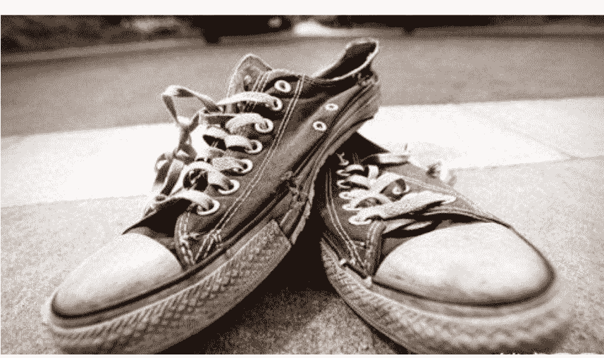

鞋店免费模式案例

这家鞋店的老板有自己的鞋厂，发现好的款式，马上可以生产销售，他销售的渠道主要有 2 种：淘宝网和线下的实体店，线下实体店开在大学城附近，人流量还是可以的，虽然还有一点业绩，但是去掉成本，每个月也赚不到多少钱，刚好保本。
老板也很苦恼，到处寻找突破的方法，一次机会，遇到一位做营销的老师，老师帮他出了

个方案鞋的成本价大概在 55 元，销售价格一般在 150 元左右，也就是每双鞋的利润大概是 300%；大学城的学生大概有 10 万左右，市场还是很大的。
了解了这些之后，老师帮他出了这样的方案：“本店店庆，凭学生证，免费领取价值 10 元的袜子 1 双，每天限领 300 双！
广告出来后，每天至少有 300 个学生来领取袜子。因为鞋店的产品很多，装修也可以，很 多人领过袜子后并不会马上就走，他们会在店里逛一会，看到各种各样玲珑满目的鞋子， 非常漂亮，那么就会有一定比例的人购买。
结账的时候，老师又让收银员做了这样一件事：当学生去收银台付款的时候，收银员会 告知学生，“同学，你知道吗？今天这双鞋你可以半价获得。
当客户听说有半价优惠的时候，会很吃惊问：“真的？怎么半价啊”“很简单，你只需要预存 200 元办理一张会员卡，成为我们的 VP 会员，对于首次办理 VP 会员的客户，我们推出了 享受半价优惠的活动，也就是说，你只需要从预存的 200 元当中扣除半价款 75 元，即可获 得这双价值 150 元的鞋子。
不仅如此，当你拿到了超低价格的鞋子，成为了我们的会员之后，如果我们进新款鞋子， 我们会优先通知你们过来挑选。不仅如此，以后任何时候来消费，都享受 9 折的特权对于 一个就在附近上学，需要买鞋子的消费者，这个超级有吸引力的成交优惠，没有人有理由 拒绝的。
所以，相当一部分比例的人(60%)会立马充值。在购买的人当中,60%比例充值，每人充值 200 元，虽然只是充了小小的 200 元，但是却培养了一个客户的消费习惯，进而锁定了一个 长期客户。
每一个消费者都有一个规律，所有的人在一个地方办卡成为会员后，就会形成消费的习惯， 以后的购买，会首选已经办卡的店铺，这是人性的规律，就是“客户的钱在哪里，心就在 哪里”的道理。
在这些办卡的人当中，(30*60%=18 人)，有 60%的人(即 18*0.6=10 人)，平均会在这个店消 费 3 年，每年购买 2 双鞋子，结果就是 10*3*2=60 双。因为他们是会员享受 9 折，即每双 鞋子净利润 150*0.9-55=80 元,60 双利润:60*80=4800 元。
加上前期所赚的 600 元，那么，共计利润为 4800+600=5400 元。
所以，店铺老板花费的前期投入为 300 元，后期收入为 5400 元！也就是说，“每送出 1 元 钱成本的袜子可以得到 18 元的收入使得利润率高达 18 倍！
这才是我们想要的结果，这里才是真正赚钱的地方！！！
后来的事实证明，方案效果非常的好：“这家鞋店仅靠这一方案每个月的营业额由 5 万元增 长到 35 万元，提高了 7 倍。”
其实秘诀很简单！
因为在大学城旁开店，客户都是在校学生，在这里上学 4 年，就会有很多次消费的机 会(平均每个学生每年购买两双鞋子,4 年需要 8 双鞋子)我们的利润在后面的 7 双鞋子上。
所以，我们在第一双鞋子上，一分钱不赚，甚至亏一点点，我们都应该给客户让利，让他 们成为我们的会员，这样，才能锁定后续的 7 双鞋子的消费。
所以，看似亏本的一招，却让我们的利润魔术般地提高了 19 倍，但是，作为老板，如果他 没有这种长远的眼光和思维模式，他就只能艰难的维持平淡的生意了！
所以说，思维决定了你的发展，现在这个时代，如果你的思维跟不上，那被淘汰是分分钟 的事情！

# 21.塑料袋免费模式案例，竞争激烈的塑料袋生意，如何提升利润 60 万元

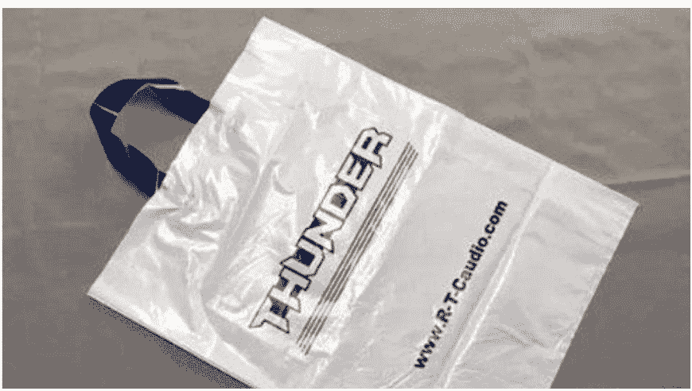

塑料袋行业免费案例

我们先看一下这方案的前提，首先我们的塑料袋，每包 5 块钱的成本，卖 7~8 元，平均销售一份 2 块毛利润，还不算业务各种开支可是塑料袋又是天天要用的消耗品。没有量用起来这个就是鸡肋，弃之可惜，食之无味。

这位老板主要是给宾馆做这些业务，可是又没有太多关系。很难找到采购的人，又由于价格下不来，找到了也很谈判。

有时候，遇到这样的生意，我就挺纳闷的，按照我们的经营理念，我们就不该去做这样的生意，但是很多老板已经选择了，没有办法，没有回头路。那就只能硬着头皮往前走。

这时候如果我们还是按照传统的方法去干事情，不然结果就是倒闭。为难自己，还不如换行业或者换玩法。

我们当时第一个想到的建议还是免费。

具体怎么免费呢?由于你的量太小，根本赚不到钱。索性把这块业务的利润不要了，这个世界上最可怕的竞争对手就是不图赚钱的竞争对手。

首先，先去找一些广告公司，直接问他们，如果有一万个广告位，会不会有人去打广告？他所在的地方是小地方，但是小地方一般有哪些企业需要打广告呢？

+   7、金融公司：不管是理财还是贷款，他们的贷款需求跟融资需求还是非常旺盛的； 2、地产公司；再小的地方，现在房地产都是要打广告的； 3、当地的地方特产或者地方酒店，这些东西也是广告需求旺盛的人。

我们先去了解了市场情况，他说合作的酒店全部加起来有 10000 间房。我们在这上面做文章。我们可以在门房上面张贴一个广告位。现在我看到的酒店就是房间号，跟本没有任何广告。但是我加一个广告在上面，我想问题也不会特别大。

由此我们继续延伸一下思路，电视机旁边，贴一个小广告位置，卫生间，张贴一个位置，每个手机充电处下面，张贴一个位置，每个房间至少两个充电处，如果你现在有 1 万间房的资源，就相当于有 5 万个广告位子。

今天我免费把这些塑料袋都送出去，免费给宾馆，但是我要求在这 5 个位置上留一点广告位，如果塑料袋的诱惑不够大，洗发水，次性拖鞋牙膏牙刷或者其他的东西也免费送，或者半价给。相信这个肯定是有诱惑力的，宾馆除了水电，就是这些日用品的损耗了。看

这些东西不多，日积月累也是一笔不小开支，这个就相当于通过协议控制，我免费提供一些消耗品，去控制一万家客房的广告。

相信今天你去做广告的生意，肯定会比你卖塑料袋赚钱。

说到这呢，老板非常激动，他一拍大腿，说太好了，同时他又说了一句差点把我气死的话，他说我没做过广告，我说你不懂广告业务没关系。拉一个开广告公司的人一起来玩就好了嘛。

今天只要你能把一万家客房签下来，那么这个东西怎么样都是一个大生意。

如果你们认真阅读本站的文章你就会发现，高手设计商业模式最快的核心方法，就是模仿，但是模仿并不等于抄袭。

启示：商业模式不可简单的模仿，别人的模式一定有其前置的条件和准入标准，模式复制前一定要做到信息对称。

我们回到这个案例，问了老板说有个开广告公司的朋友。这样完全可以把那个朋友拉过来一起玩。如果没有做广告的朋友也可以找到，，毕竟利润非常大，无非就是利润分配问题
而且，如果你免费送这些塑料袋，洗发水什么的，我相信整个湖北，甚至全国的酒店都愿意跟你合作。那到后期就不是一万间房，可能是几万间，几十万间房，这是巨大的资源。

我们来测试算下成本，今天你每天赠送的塑料袋+洗发水如果成本是1块，一个月才30，我相信肯定没有这么高。如果我们每间房的收益能够达到30就可以不亏本，5个广告位，一个月只需要30块钱，很多人不会嫌贵，毕竟每天看到的人都不一样，一个月成本30万，如果一个月5万个广告位能卖30万以上就可以干。

前期先去做下市场调查，如果1万间房能够卖30万以上，这个方案就是可行的。

# 22.体验式营销案例，如何通过免费体验3个月，提前完成一年的营业额

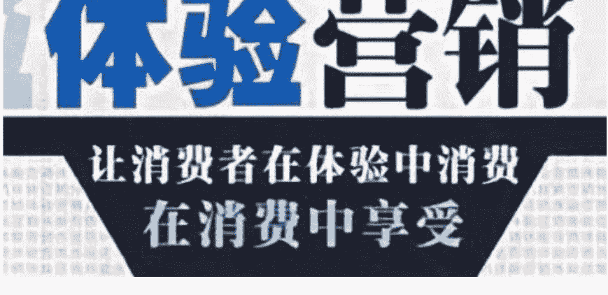

### 体验营销免费模式案例

体验营销是一种全新的营销理念和营销模式，它的发生给市场营销带来了深远的影响。体验营销与传统营销相比具有自身鲜明的特点。体验营销是企业通过向顾客提供各种体验来提高业绩。
客户往往对待一个新的产品抱着怀疑与渴望的双重态度，如何让客户感觉到安全与信任，就成了企业营销的核心。那么体验，是通过客户先进行体验，获得客户的信任后，再进行成交的方式。免费体验，具体可以分为两种种是企业设计可以用于体验的产品，客户可以免费体验该产品，感觉良好后再进行消费种是与时间挂钩的免费体验，就是客户在单位的时间内，可以免费体验该产品，而后进行资费长期的使用。

下面我给大家举个例子，来深度解析一下免费体验的营销模式这家公司是做健康医疗器材的，吕总通过学习，运用免费体验模式，2年时间开了300多家分店，营业额突破3亿。他们公司有一款产品是按摩床，当时他们是这样策划体验营销的：按摩床免费体验三个月，客户每天可以体验20分钟，按摩床旁边放了一台饮水机，客户可以随时取水喝当时吸引了来体验的很多都是老头老太太，因为他们有时间来体验。

现场店员从厕所马桶里取了一杯水，倒入饮水机里，通过饮水机过滤后，店员接一杯水直接喝了，当时老头老太太们，非常激动，纷纷想购买净水机，店员告诉客户说饮水机不卖。让客户每天体验按摩床20分钟也是有原因的，因为20分钟左右，客户差不多快睡着了，当客户快要睡着的时候，店员去把客户叫醒，说您体验的时间到了，你们想着，当客户快睡着的时候被店员叫醒，客户是不是最不情愿起来，这样就会更刺激客户想要得到这张按摩床啊。当免费体验三个月后，这家公司出了一个活动：买按摩椅赠送饮水机一台。当时活动一出，来体验的客户纷纷疯狂抢购，就这样这家公司三个月完成了一年的营业额。

+   体验营销需要注意的因素
1、体验式营销要求产品和服务具备一定的体验特性，顾客为获得购买和消费过程中的“体验感”，往往不惜花费较多的代价。运用体验模型的产品必须有明显的效果。
2、客户体验产品时，必须给客户留下充分的时间来让客户体验。
3、产品质量必须有保证。有的老板想，免费体验三个月，那我这三个月不挣钱，免费体验三个月，那我这三个月不挣钱，我没有这种魄力这么做，正所谓干大事者必须有魄力，有舍才有得，做生意要长远看。

# 23.新开龙虾店营销方案，免费送两斤，甩同行10条街的促销引流模式

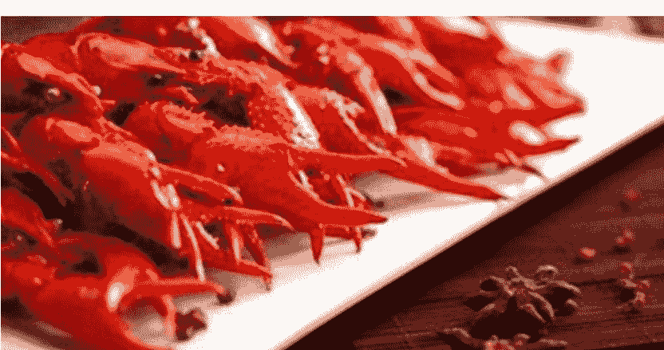

### 龙虾店营销方案

这个龙虾店的老板前期准备投资几千元，做成传单宣传自己的店，后来通过学习免费营销模式，换了一种营销模式，生意异常火爆。
方案是这样设计的：
龙虾的成本是 10 元/斤,2 斤大概 20 元左右。
老板直接做了 100 张卡，进店可以免费送两斤龙虾，原价 58 元，不能打包，通过鱼塘赠送一百张，持卡者几乎全部要过来，一百张相当于一百桌，况且两个人都能吃四斤，只要再额外点上一两斤，前面免费送的就是分摊掉了。
然后来的人再每个人送 10 张卡给他们，让他们送给自己的朋友，他的朋友来了之后，再每人送两张结束活动，这样店铺的知名度基本上就带火了，是不是有很大的盈利空间呢?大家可以仔细思考一下。
水果店也是一样，很多水果店不敢无限量提供水果，做引流产品，完全也可以采用这样的模式，先做一张卡，持卡可免费购买 20 元的苹果，其实成本也就最多 10 块，这样先发出去一百张卡，也就是两千块钱的成本通过鱼塘把卡送出去，这一百人基本上全部过来，来了之后给出一个成交主张，让他们冲个卡，学习完万能系统之后的都知道，这样一部分肯定会消费，你就收到了一部分钱，再和前面成本以抵消，最后真正免费送出去的可能也就是几百张，如果主张到位，前面两千元的成本都能收回来来了这一百人，每人送她他们五张水果购买半价卡，他们可以送给自己身边的朋友，朋友持卡过来，可以在规定的时间内半价购买比如 5 斤橘子，这样这一百个人又会带动自己身边的朋友过来。
然后他们带过来的朋友，你又每人发两张给他们，让他们带动身边的朋友，每一轮过来的都做一个会员卡主张进行充值，这样就相当于没有花费成本就获得了大量的客户。
大家要理解这个策略的核心是什么？
前面这一百张卡免费，相当于打广告的费用用来提高店内的知名度，只要明白其中的原理了，很多行业直接套用就可以了，与其花大量的广告费，还不如这样操作。
（学习更多内容请加微信：xsyxsyqq019）

# 24.豆浆机免费送案例如何借助餐厅发展城市合伙人，月入4万元

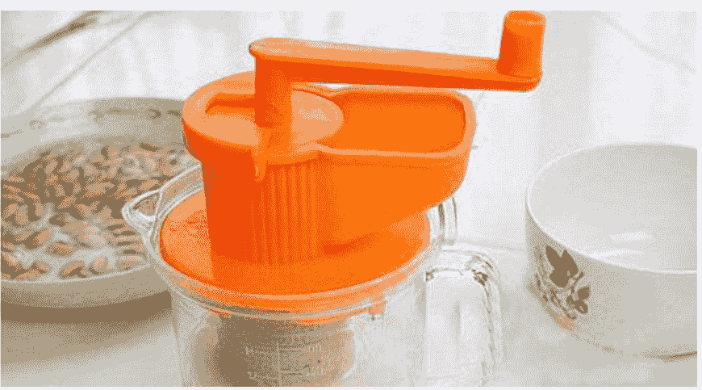

### 豆浆机免费送案例

今天给大家分享一个豆浆机免费送案例，首先这个都豆浆机不是送给个人消费者的，而是送给餐厅，模式是这样的艾总也是福建人，经营的生意是豆浆，这个豆浆的卖点是脱毒豆浆一据说生豆浆中含有多种有毒物质，如含有抗胰蛋白酶素，能影响蛋白质的消化，有的毒素会伤害胃粘膜，所以脱毒豆浆是针对豆浆产品的现状，解决了这个问题。

任何健康类的产品，教育市场的成本是非常高的，消费者对于豆浆是否脱毒没有很强烈的认知，所以做直接消费者路线，还是比较累的。

艾总研究出来一种模式，效果非常好，我现在把这种方法告诉大家，其实对于各位来说，是可以触类旁通的。这个方法就是：和餐厅该合作一一把豆浆机和豆子免费送给餐厅一一用脱毒豆浆的概念扎豆浆 39 元推荐给食客一其中 20 元给餐厅--3 元给促销员一一剩下 16 元归艾总公司我们来看看到这个模式的可取之处：豆浆机送给餐厅，很多没有提供扎装豆浆的餐厅，大部分是乐于接受的，给服务员 3 元一扎的提成，服务员在顾客点餐的时候，会推荐脱毒豆浆，产生了卖点，一扎 39 元，在中档以上餐厅，其实是不贵的，顾客也乐意买单。

餐厅不花一分钱，赚 20 元，利润率很可观，比卖椰奶，卖可乐雪碧的利润强多了，假如一天能卖 20 扎，就赚了 400 元，而且豆浆机是免费的不用自己去买，放到后厨，豆子都是袋装的，都进行脱毒和清洗后干燥处理，直接加热水放到豆浆机里榨汁即可。

剩下的 16 元里，就是艾总的毛利润，只有前期的一次性豆浆机的投入 1000 元左右，剩下的只有豆子的原材料成本。

艾总在福州大概选择了 50 多家餐厅合作，平均每家餐厅一天能销售 10 扎豆浆，一天就有 500 扎，每天营业收入 8000 元，净利润非常可观。

一个好的商业模式，一定是可以复制+形成持久体系。

自己掌管 50 家餐厅，需要牵涉不少的人力和精力，不可能大规模自己铺货送货发货。

艾总又发展了招商模式，就是招城市合伙人：一次性从他这里购买几千元的豆浆机和脱毒豆子，他把整个营销话术和模式教给城市合伙人，城市合伙人可以去在本地城市找餐厅合作，选择自己精力忙的过来的餐厅数量合作，很容易就能月入几万，这个模式非常容易操作。

艾总的盈利模式，是从原来的自己给餐厅铺设豆浆机和豆子，变成了卖豆浆机和卖豆子，虽然把大部分的利润让给了城市合伙人，但是他的销售额翻了好几倍，而且标准化操作，比以前轻松多了，以前需要经常去餐厅维护，去和餐厅的老板搞好关系，现在每天只需接单发货即可。后来艾总学习了实体店社群营销，把这些营销方式教给他的城市合伙人，他的城市合伙人把这些方法和他们合作的餐厅分享，因为有信任感，餐厅很有兴趣，所以他的城市合伙人免费帮助餐厅建立实体店顾客社群，把过来消费的顾客吸引到社群了，推广这个豆浆的好处，销售豆浆机和豆子，利润仍然给，餐厅大头，所以餐厅的积极性非常高，所以带来了更多的信心。

# 25.充 500 送 1500 免费案例，让竞争对手都无法控制自己想成为你的客户

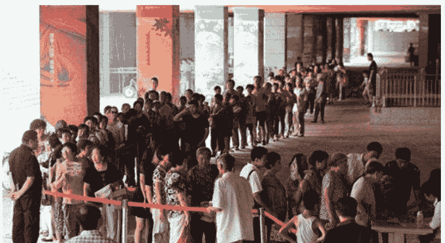

### 免费模式案例
今天，给你分享一个连竞争对手都无法控制自己想成为你客户的免费模式案例，这个案例，如果不解释，你的竞争对手再过 100 年都无法理解。
这个模式就是：“充值 500 元，得 500 元、送 500 元、抵 500 元、还返 500 元”，这个是怎么做到的呢？
下面为你解析，充值 500 元成为会员，可以享受的权益 1、得到一张内含 500 元现金的储值卡，卡可以在店内抵现金使用，没有任何消费门槛 2、送价值 500 元的充值礼品：比如，送价值 500 元的王老吉；送价值 698 元的五粮液；送价值 2980 元的美年大健康体检卡送价值 2000 元的啤酒 500 瓶等等。3、送 500 元抵扣券；消费满多少，用抵扣券可以抵扣现金使用、再或者送周围其他商家抵扣券等；4、返 500 元现金：就是所有参与充卡活动的会员客户，从下个月起，每月固定某天，本人带着小票凭有效证件到店领取一部分现金。
其目的就是回流，让消费者与商家有一个非常合理的高频来店理由。
这里再次重点的解释一下最后一条返 500 元现金我们假设次月起，每月 19 号为本店的会员返现日。所有充卡会员当天，本人带着充卡小票并凭有效证件到店领取一部分现金，50 元或 100 元。没有错，是现金！不玩任何套路，免费模式，用的极致效果就是不会有任何让

领取现金需要满足两个条件 1、必须固定时间领取，过期不延后，作废处理；原本就是纯现金返还，大家肯定接受 2、凭充卡小票，而且必须是本人，这点就是在保障会员的自身权益，不能代领。
在這個点上，就是一个很大的坎，很多不能一下子理解，把現金返回去，那还挣啥钱啊 但，拥有免费模式思维的老板，看见的可是大把的现金收益回来！之所以，让其每月进店领取现金，其目的就是锁定目标客户群体再次进店消费。返现日同时也是会员日，店内再次作每月一次的常规活动营销。总之，会让回来领取现金的客户觉得领取现金绝对亏！继续消费才觉得超级划算！这•点，对于很多行业都很实用！服装、耗材、生活家居用品等 等比较高频消费的行业都可以运用。当然，如果客户选择直接领取现金，必须要返还其现金的！但后面还有很多次进店机会，总有几次再次消费，而再消费,50 元、100 元现金肯定是不够的，只会消费的更多所以，生意生意，有意才可以生财，有时候，在见多了传统买卖形式的消费者，宁愿参与一下这些好玩的商业模式，也是一个参与感的满足。

# 26.爆米花的免费案例，如何借助桶身广告，一年卖出 3 个亿

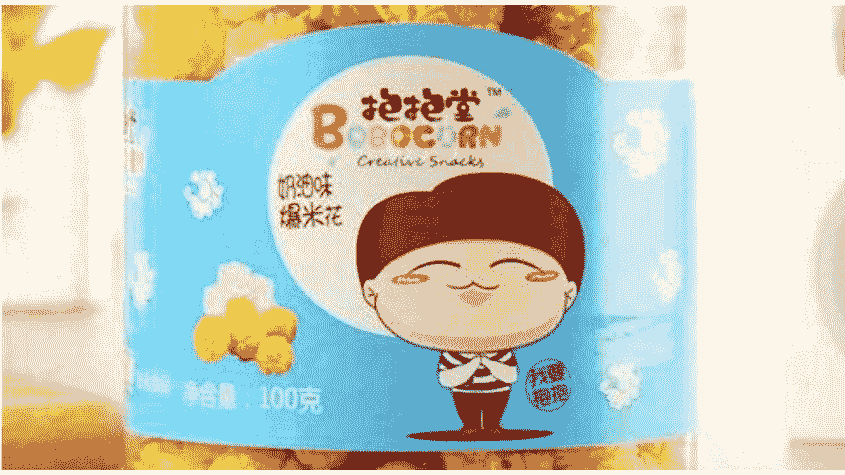

### 爆米花免费案例

爆米花，这种街边小吃 1 年还能卖出了 3 个亿?不仅如此，《小时代》、《终结者 5：创世纪》等电影大 IP 还是它的合作对象?看来，这家公司有点不简单。

这家公司就是“抱抱堂”，创始人叫林水洋，是新浪微博的开山功臣，之前担任新浪微博的产品副总裁，见证了新浪微博从 0 到 1，从没有到上市。可以说，新浪微博的第一条消息是他的“公元第一条”。

2014 年新浪微博在美国纳斯达克上市，前程一片大好的林水洋，却没有待在舒适区，毅然在 2015 年离开了新浪。其实，抱抱堂是他在 2011 年就投资的项目，当时的抱抱堂还只是一个球形爆米花加工厂。不过，当时他也只是玩玩没有放在心上，离开新浪以后，才全职加入了抱抱堂。

2014 年，这家代工厂的利润高达 1500 万。
这让林水洋大为震惊，这仅仅是单纯的代工，如果做自有品牌，利润会达到多少呢？
抱抱堂的转型升级之路看到这背后的商机，离开新浪微博后的林水洋决定全心将抱抱堂打造成一个品牌」

第一、对爆米花进行产品升级。颠覆市场普遍存在爆米花：从美国引进的球型爆米，其加热温度能达数百度，膨化率高，入口没有渣，而且外脆内酥，入口即化。

为了解决传统爆米花甜腻的痛点，抱抱堂采用的是独有配方的焦糖，让你咬下去第一口是苦的，但又慢慢回甘，用微苦解腻，让你不知不觉就吃掉了一罐。
第二、对原材料进行升级。爆米花最核心成分就是玉米、焦糖、椰子油。抱抱堂采用的是最极致的原材料：美国的非转基因的球形玉米，印尼的椰子油，韩国的焦糖。
第三、对生产技术进行升级。自主研发了全自动的爆米花生产线。
第四、占据价格优势。之前，抱抱堂代工的产品都卖到 29、8 块、30 块，但是抱抱堂将品牌做起来进入市场后就将价格定在同类产品价格的 1/3。
当然，抱抱堂这样做的底气在于其走货量大,2016 年抱抱堂用了整个中国玉米进口配额的 70%,2017 年能达到 90%
第五、成为行走的广告桶，与上百部影片合作抱抱堂通过和几个电影大 IP、院线、影视公司合作，一夕之间爆红，成为广告商酷爱的合作企业，更一年卖出爆米花销量高达 3 亿林水洋是互联网行业出身的，人脉较广，所以卖起爆米花也是与众不同。从一开始，他就和各种各样的娱乐 IP 做整合营销，把抱抱堂的线下网点变成电影的宣传渠道、推广渠道，以 “送送送 “的方式打开知名度！
林水洋第一个找上的是郭敬明，希望他授权小时代 IP 印在抱抱堂爆米花桶上，当时抱抱堂有 10000 个线下网点，短短 1 个月就能流通上百万只爆米花杯。
对于《小时代》来说，是一个宣传电影的好时机，对于抱抱堂来说，也能提升品牌知名度，于是双方愉快合作了！
有了成功案例后，林水洋把目光瞄准进口大片《终结者 5：创世纪》。和小时代一样，对方只要把授权给抱抱堂，抱抱堂就能免费帮《终结者》补充覆盖了 70 多个城市的宣传，增加影片的曝光度。
和这两个电影合作后，抱抱堂一战成名！目前，抱抱堂合作上了百部片子，促进了合作电影宣传效果的同时，更极大提升了抱抱堂品牌的知名度和影响力！
第六、抱抱堂-城市合伙人(APP)-终端夫妻店众所周知，好吃的爆米花保质期都非常短，抱抱堂的也不例外，所以林水洋控制流通周期为 22 天-25 天。
之所以可以控制在这个周期，是因为抱抱堂自主研发了 APP，并在每个城市都招募了城市合伙人。
城市合伙人负责去跑市场、终端、夫妻小店，小老板们必须通过 APP 跟抱抱堂下单，这就取消了所有中间渠道。
由于渠道的扁平化，一下订单货就发到终端,7 天发货到城市仓,3 天内上街,5 天内卖掉，存货周期最多不会超过半个月。(学习更多内容请加微信：xsyxsyqq019)
只要解决了终端的库存问题和送货问题，小老板们都很愿意下单，靠着强大的分销系统，抱抱堂流通快、产量大，很快创造了亿元销售额！
第七、为爆米花行业注入互联网基因林水洋是互联网出身，当他深入爆米花这个传统行业的时候，会忍不住用互联网思维来审视这个行业，发现了些需要改进的地方。
电影广告就是需要改进的地方，传统做法是广告商用 U 盘拷贝广告给电影院，每个广告都需要员工用人力拷到放映设备上。
这样会产生很多问题，比如 U 盘和人工容易出现误差，导致广告不能顺利播放，还比如冷门电影和爆款电影广告收费同价等问题。
这样就导致了广告主无法监测广告效果，其价值发挥不出来。抱抱堂致力于解决这些问题，深入到影院数字化系统去做好广告推当他发现美国 90%的电影院都是使用 TMS 技术，于是便并购了一家这样的技术公司。电影院用这套系统，大大提升了整体的放映质量！抱抱堂也因此成为集影院管理系统，卖片服务，广告传媒三位一体的非票收入运营商！
总结:

不怕企业新，不怕企业没名气，就怕企业不创新！
成立仅 3 年的抱抱堂就用产品的创新、技术创新、营销的创新，把一个新品牌从 0 卖到了 3 亿世界总在推陈出新中进步，那些默认守陈规的老企业，如果再不变革创新，等待你们的就只有被淘汰了！

# 27.龙虾店成功营销案例，小龙虾免费吃盈利背后的秘密

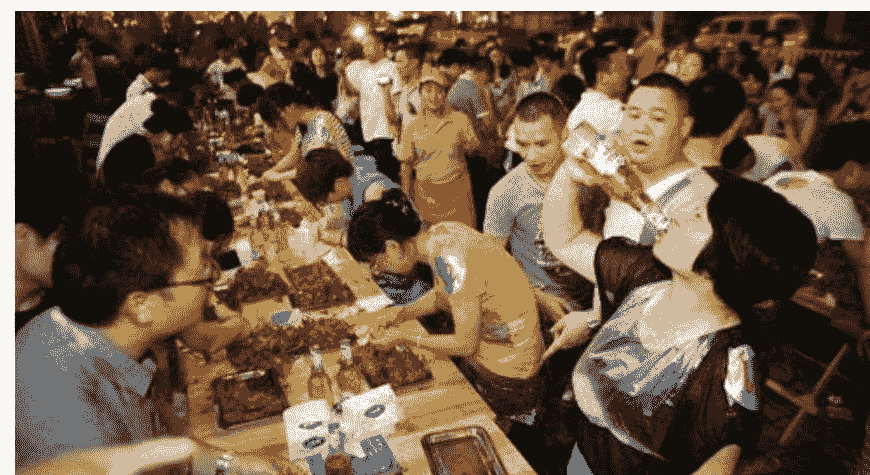

小龙虾免费吃盈利案例

现在的天iran慢慢也开始热起来了，吃夜市第一个蹦出来的可能就是小龙虾。可是，小龙虾怎么样才能做到没有对手?有朋友就说，那我们可以用搞特价打折。
这是不是我们惯常的思维都是如此?因为我们担心赔钱吗?是不是肯定不会去免费的?
估计绝大多数的朋友都不敢去免费，我们就打个最低五折，是不是已经很有吸引力了但是，当你拉出这么一条条幅的时候，你抬头一看，哇噻，满大街的夜市摊儿,80%都是这样，都撞衫了，你能想到的，别人家也会想得到。
那我们应该怎么做，才能够打遍天下无敌手呢?
那在南方某地也有这么一家小龙虾店，他也是一个夜市摊，投资并不大，十几万而已。
满夜市摊都是小龙虾，大家都在打折都在搞特价，那如何才能让自己脱颖而出，让自己能够获得源源不断的客户呢?
这家店的老板通过学习免费模式后，想出了个点子：就是免费吃小龙虾。当他把这样一个牌子挂到了门口之后，想想会有什么样的结果发生呢?
瞬间就会有非常多的人涌进了他的店里来了。免费吃小龙虾，这样的便宜不占白不占啊！不过，我们做的是可控。所以，我们给客户是 10 只小龙虾可以免费吃。我们大家是不是可以想一想，许多许多的客户进到店里来了，在这样的一种环境下，我们是不是成功地实现了引流?引流成功之后，接下来第二个动作，必须是截流，你必须要有一个完美的解决方案，这样才能真正的实现你的结果：就是财流。
用什么样的办法能够简单、粗暴、有效实现截流呢?

那么，我们就拿出了一个非常小的一个资格卡来作为截流。这个资格卡呢，就是你只需需要充 100 块钱，仅仅只需要一百块钱，你就可以获得赠送 100 瓶啤酒，同时，再送给你一个小电风扇。因为夏天来了，天气比较热，大家应该还是很喜欢这个小电风扇的。
这样一个赠品比较应景，才会得到大家的欢。这也是一个小窍门儿。那么这 100 瓶啤酒，并不是让你现在可以把它喝完的。我们这 100 瓶啤酒，是有玄机在里面的。
接下来破解一下如何用这 100 瓶啤酒让你钞留这 100 瓶啤酒，正常我们卖五块钱一瓶，是不是都价值 500 了?另外还可以送给你一个 100 块钱的小电风扇。加起来是不是已经是 600 块钱了?你仅仅需要 100 块钱就可以拿到 600 块钱的东西。这对消费者来说，是非常有诱惑力的吧?关键是你还是不是白吃了点小龙虾呢，对不对?在这样的心理的这个诱导下，就很容易达成去充这个资格卡。
那么,100 瓶啤酒是怎么来使用的?那我们有要求呢，你每次来最多可以喝 10 瓶啤酒。每次来可以喝 10 瓶啤酒，那 100 瓶啤酒需要来几次呢?
实际上呢，这 10 次的到来，你每次来肯定不仅仅是来喝啤酒吧?必须要菜吧?那我们的这个销量是不是就会上升了?而且你直馋记着你这里有 100 瓶啤酒呢，你在吃宵夜的时候，你还会去其他人的家吗?你肯定首选我家了，是不是?你就一直想着我在这还有啤酒在放着呢。对不对?关键还有什么呢?别忘了一开始我们的这个引流是：免费吃小龙虾。所以，你每次来都能在吃十只的小龙虾。你是不是每次都要来?
我们说到了这 100 瓶啤酒，你需要 10 次才能喝完。所以说，这是一个玄机，也就是我们给我们的客户脚上装上了导航。心里装上了 Wif，他就馋记着要来我家来吃宵夜了。爆满了，我就是这么一个小点子，就可以实现我的几倍的盈利。
关键是你每次来吃小龙虾或者说来喝你的啤酒的时候，你往往不会一个人来，对不对?咱俩这个吃宵夜的时候，特别是到夏天，晚上大家都是一群一群的朋友结伴而行。那你来的时侯是不是也给我带来了一桌的朋友和伙伴。那么，这一桌子的人，他们是不是也可以来参与到我的这个资格卡的活动当中来?他也可以充 100 块钱，是不是也得到价值 500 元的 100 瓶的啤酒?同时还有一个小电风扇?这样一来，一变多，多变更多，是不是就可以实现裂变了?可以想想，整个夜市街上就我家的生意肯定是最热闹最好的。
这就是我们一个免费吃小龙虾的小案例，异常的简单。但是，非常有效。其实，学习免费模式，更多的能使我们打开了自己的格局，没有任何理由的付出，纯粹的给予，让我们能够懂得怎么去倒推，通过免费作为个端口吸引海量的人群。
接下来，我们再通过延长利润链条实现交叉补贴。在刚刚分享小龙虾免费案例的时候，可能有朋友会有疑惑，那就是这 100 块钱的资格卡，是不是还可以正常消费呢?大家想想，其实我们是赚钱的，对不对?这 100 瓶啤酒，他是分成 10 次来喝完，每次他肯定还会有其他消费来补贴这个啤酒的成本吧?

# 28.按摩椅免费模式，免费为 4S 店提供按摩椅，利用美女销售年入 500 万

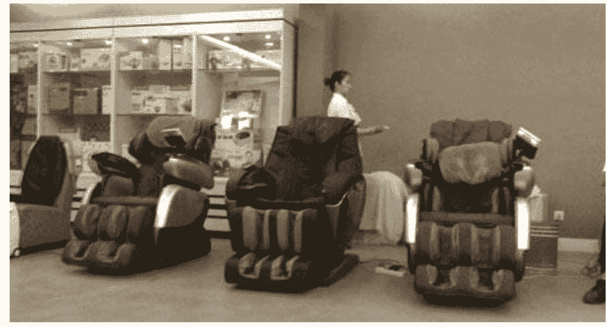

### 按摩椅免费模式

今天给大家分享个非常高端的，按摩椅免费模式，按摩椅平均 1 万左右一台，够高端吧?看人家是怎么一年卖 1000 多万，净赚 500 多万的。

周总是原来是做外贸服装的，生意渐渐不好，于是选择了改行，改做什么呢？就是代理了一款高端的电动按摩椅，开始在万达广场租了个门店销售，生意也不好，后来一次偶然的机会进入到高端 4S 店，结果找到门路了。

同样很多人模仿他，一年的销售额连他 10% 都不到，基本上赔钱，只有老周赚钱。老周怎么做到的?最开始老周进入 4s 店，是想死马当活马医,4S 也需要给他们的顾客提供服务，于是允许老周把按摩椅放到 4S 的会客厅里，给前来保养车子的顾客免费坐坐。

至于能不能卖掉，要看卖家的本事了。

老周搬了几台按摩椅到 3 个 4s 店开始尝试，从网上招来 2 个销售，放到其中两个店里去做销售，还缺一位，正好他有个外甥女，20 来岁，还没有合适工作，就来给老周卖按摩椅。为什么放在 4S 店的按摩椅，可以卖 1000 多万她们就是去邀约一些车主前来体验，顺道再推销，一星期过去了，老周发现，他那个长的很漂亮的外甥女，总能邀约到车主，短短 1 周，其他销售没有卖掉，他的侄女竟然卖掉 2 台。

他似乎恍然大悟，开始了重新规划，专门去谈了 4 个品牌的 4S 店，即宝马、奔驰、路虎、保时捷。

总共有 6 家店，重新招聘销售员：最大的要求是美女，底薪 8000 元，提成按照销售额的 20%，有这么高的薪水，当然可以招到几个美女销售，进行一番培训后，就安排到不同的 4S 店这些销售员，会自己评估，对是老板模样的男车主，重点邀约，如果看起来像司机的，就不邀约。

因为美女的邀请，所以很乐意去体验，这次在销售环节进行了改进，不现场推销。就是只让这些老板在体验按摩椅，然后她们和老板聊天，加了微信。

因为保养车子平均要 1 个多小时，然后就舒服服地体验了好长时间的高端按摩椅，并在轻松愉快的气氛中认识了一位卖按摩椅的美女。

就这样每天这 6 家店，总共至少有 100 位体验者，其中 80% 都加到微信上。并进行了备注，这些销售非常注重微信朋友圈的经营，发出的每个说说，都是非常认真的，是经过专业的培训，很会拍照，很漂亮。

她们就积极的和他们进行互动，一来二去，很多都开始熟络起来，果不其然，其中很多体验者，竟然主动和她们微信聊天，有的主动邀请她们吃饭所以很快，按摩椅就在 4S 店之外卖掉了。

平均每个美女销售一个月可以卖 20 多台，他们一个月底薪加提成，至少可以赚 3 万，多的可以达到 5 万以上。

同样，老周一个年可以轻松赚 500 万以上。

总结
- 按摩椅在商场不好卖，是普遍现象；
- 按摩椅搬到 4S 店做体验式销售，因为 4S 店也需要顾客服务手段，所以进入 4S 店不难；
- 女人爱美，男人好色，老人健康，儿童教育，是永不过时的 4 大朝阳产业，用美女来邀约，男性很难抵挡；
- 选择高端品牌 4S 店，是为了找到精准流量入口，挑选老板模样邀约，是为了筛选更精准的高净值群体
- 当场不推销，是因为现在人们都有普遍的抵触心理，不喜欢被推销，而且 4s 店，并不是个消费场所。
- 做好微信朋友圈经营，和备注的体验者互动，增强线上的联络，拉近距离，这些老板都是男性，美女对他们有的天然的吸引力，原因你懂得。
- 老周控制了 4S 店的场地和货源渠道，所以他能在本地建立起了自己的商业壁垒，几年内不怕被人抢了生意。

所以成交就是水到渠成，成功的商业还是因为抓住了人性，周老板也从一个摇摇欲坠的门店小老板，变成了年入 500 万的富翁。

（学习更多内容请加微信：xsyxsyqq019）

# 29.如何不花一分钱，利用免费模式空手整合一座价值 2700 万的矿山

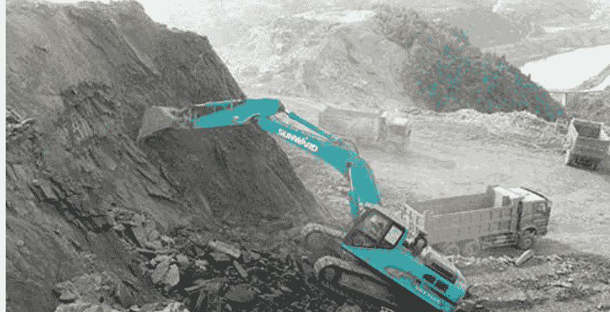

免费整合 2700 万矿山

今天给大家分享一个，如何空手整合一个 2700 万矿山的案例，这个案例的主人公叫赵金梅，她非常厉害，下面还愿赵总原话，直接从干货开始。

全国各地的企业家，大家晚上好，我是广西南宁的赵金梅，今天晚上给大家分享免费模式，我不是一个老师，我是自己做企业的，所以我想给大家分享的是我一些学习之后的收获。

说到免费模式，我们身边比比皆是，你看现在我们用的微信就是免费模式，我们用微信都是免费使用，但是为什么腾讯公司这么有钱，是不是?那么像平时我们用的百度也都是免费的，但是为什么李彦宏他又那么有钱，我们用的淘宝，只要我们不买东西，上淘宝都是不花钱的，但是马云却又那么有钱现在免费模式在我们的身边已经比比皆是，到处都有了，但是如何运用好免费模式，这就是我们需要学习的。
当初我第一次接触到免费模式，我说我是卖石头的，大家可能不知道这个行业，就是我有自己的石头山，爆破之后卖给搅拌站，我是做这个生意的，当时我说我一个卖石头的，免费模式跟我有什么关系，可是我来听了之后，我真的是彻底的改变了这种传统的思维。
免费模式适用于任何一个行业，它已经不分行业了，你只要懂得免费的思维，那么你就可以运用到你的企业当中。我的行业非常的传统，产品也很单一，但是我学习了免费模式之后，用得非常好。
所以今天给大家分享的是，我是如何不花分钱拿下 2700 万的矿山的。在我们南宁市 2015 年还有 80 几家石厂,16 年就只有 60 家了，那么少的这二十几家为什么少?他们是证件到期之后就不能续了，你再有钱只要办不了证，你就相当于倒闭。
那么在没学习免费模式之前，我知道我南宁厂的旁边就有一家采石厂，他要卖，他所有的证件都办好了，但是还没开工，他就想卖转转手，然后不干了。当时他叫价 3000 万，像去年这样的经济形势，咱们投入 3000 万去做一个厂，大概要用一年到一年半的时间才能够收回成本。
那么人是这样的，当你什么都没有的时候你就敢赌命，但是当你什么都有的时候你就怕失去，去年我的状态就是怕失去的状态，因为我光是南宁厂，我一年的净利润大概是在 5000 万以上。我是这么考虑的，如果我投入 3000 万去做这个厂，我还得去找人，包括找运输队找啥的，经营起来非常的费力而且万一有事故的话，有可能会倾家荡产如果一年里面有几个月都在下雨，也可能会延长我收回成本的时间。所以我说钱能用多少呢，够生活就算了。反正现在咱收入也还可以，不折腾了，我就不买他了。
但是我学习了免费系统课程之后，我的思维发生了非常大的改变，老师跟我们讲，一个企业，如果你做不到裂变两个字的话，你的企业永远做不大。我当时听了后，第五天我人还在郑州，我就给我的股东打电话，我说你到旁边张老板的厂去问他最低价多少钱，后面他给我回电话，他说张老板说最低 2700 万，我说行，你跟他说 8 月 5 号 2700 万直接付现金给他，到时候直接把名字过户到我名下，所有的证件都过户到我名下。
那么 8 月 5 号我们买下来之后,8月 6 号我马上做了一个动作，我把去年倒闭的这二十几家没有证件的人名字列了一遍，我找出了四个非常专业的石厂老板。我跟我的两个股东讲，你们去跟这四个老板谈，你跟他们讲，每人给我们交 600 万的押金，三年后退还，他们就可以到我们这里来自已安装设备生产，我对外是一个公司，四条生产线，但是对内我是分包给了四个老板。那么你看每个老板给我交 600 万的押金，四个老板是不是 2400 万?你们用我的公司名称去开发票，我们要交税给国家，这样子你们每家再给我交 100 万的税金，预付款给我，那是不是相当于每家总共要交 700 万?
四家就给我交 2800 万，是不是?那这样子，我给你们一个要求。9 月 1 号之前钱必须到位，我是 8 月 6 号跟他们释放的这个信息,9 月 1 号之前所有的钱必须到位，如果不到位，马上下一个，有大把人等着。这个行业他们一定是削尖了脑袋都要玩的。16 年最贵的一本开采证 1800 万，他们如果正常要开一家石厂的话,3000 万其实是平本价，那现在你只用交 700 万，你就相当于开了一家石厂了，你肯定就削尖脑袋都想玩。
而且交的这钱还是押金，三年后我还退回给你，所以他们肯定很乐意玩，所以 9 月 1 号之前我 2800 万全部收到手里了，当时他们说好，马上修路，上山马上就开工，我说你们谁也不能动,9 月 19 号才能开工，所以我这个项目是 9 月 19 号开工的。他们 9 月 19 号开始全部动工，开始修路上山，才用了三个月的时间，他们的路全部修好，平台全部建好，在1月份的时候，春节前他们都已经可以生产了。
最近这段时间还有很多人给我打电话，说起金梅，我给你1000万，你把这个名额给我行不行?我说不行，我要的不是能给我1000万的人，而是要那个会做市场的人。
那么你看你们只是交了押金来，你们就安装设备生产了，那你们要不要跟我分成，如何分成，你们自己提出来好不好?这个时候他们提出来了五五分，四六分，最贪的人这样讲，跟我沟通说，他说你赵老板那么有钱，如果三七分就更好了。
你看这个厂2700万买下来，现在我收到了2800万的钱，相当于这个厂没有花我的钱就买下来了，对不对?我用他们的押金就已经买下了这座厂，那么现在我挣多挣少已经无所谓了，是不是?他们挖的越多我挣的越现在所有经营的事情都是他们来干，找运输也是他们去找，找人来经营也是他们去找，下雨了也是他们操心，所有经营的事情全是他们，一旦发生了事故，也是由他们来当，大不也就是我们的法人代表有可能被关进去几天是不是?
但是所有的钱还是他们来承担的，是不是风险我们已经嫁接出去了。咱们就按最低的来算，你看同样的设备，同样的人员，我南宁厂我能挣5000万1年，你能不能挣我的一半2500万?
这太能了，因为他们有可能会挣6000、7000万比我还可能了，但是我就算降低一半来说，2500万都可以了,2500万我占20%是不是?我就赚500万，一家赚500万,4家我就赚2000万，这2000万我不花吹灰之力就拿在手里了，为啥?所有的钱先放到我的账户，我先扣下我该要的，再把剩下的转到你们的账户当中，所有的东西全部可控。
老师说过，企业只有做成平台才能够做得大那么我已经不是一个石厂老板了，我是个平台，你们给我交管理费，所有的钱全部过我们的帐，该扣下多少，我们该扣完了以后才给你们我们传统思维,2700万买下来之后，咱们自己干才不要给别人干呢，传统的思维，是不是这样想的，但是现在呢，我就用了老师的新的思维，把钱分出去，让更多的人参与进来，让他们挣钱，只有他们挣钱了，咱们才能够挣到更多的钱。
现在对于他们来讲，其实他们也很高兴，为啥?他不用花钱去办证，他只交了一个押金700万，他每年挣几千万，是不是?三年后他还可以再拿回这押金。
我分享到这里，我跟大家讲，三年后故事才刚刚开始，我学习到三个月的时候，我不花分钱拿下了这个矿山。当我学习到四个月的时候，我整合了南宁市各行业。
当我学到六个月的时候，我不花一分钱，又垄断了另外两个行业，现在我花时间在各个场合去分享，把我的所学所用分享给大家。
你看老师非常的辛苦，全国各地的去分享，就是想把这种免费思维普及传播给更多的人，现在咱们做实体的，做店铺的，做各行各业的老板都做得非常的辛苦，思维不改变，只能得到旧的结果。

# 30.免费模式营销策划，买10万电线送10万元汽车，还返还10万元

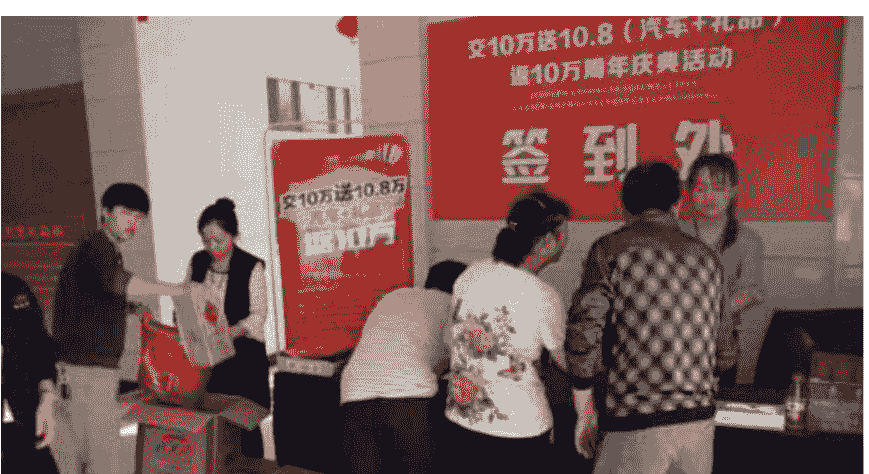

### 电线免费模式案例

今天分享的这个免费模式营销策划案例，是河南某电缆公司庆祝12周年做的活动“充值10万，送价值10万元的汽车(9.8万汽车+15000五粮液)，还返还10万元”！

电缆厂的老板在学习了免费模式后成功增加了163位经销商，还让企业在未来3年新增可计算营业额8个亿，让公司员工在未来2年都有活可以干。

那么这个活动是怎么做到的呢？

首先这家电线电缆企业原本就是当地的明星企业，企业资质，产品质量都是相当过硬，他们承诺产品质量100%国标，数量100%足米，服务100%诚信承诺价格若高于同行10倍差价补偿。

XX电缆，保用70年质量:100%国标；数量:100%足米；30天无理由退换货(整盘)；买贵、买假，差价10倍赔偿。

但就是这样的产品承诺，他们厂的业务员以前去那些经销电线电缆门市部的推销的时候，人家经常是不理不睬，甚至连口水都不给喝，业务员很努力，但是出差回来经常只有一堆报销单，没有业绩，这种情况，老板和业务员都很苦恼，也没有办法电缆厂老板在学习了免费模式以后，在家悟了一个月，豁然开朗，精心策划了这次活动大获成功，让企业未来不再缺客户，当然也就不再缺利润了。

现在详细给大家剖解一下，如何交10万，送10万，返10万的？

经销商先交10万元给电缆厂，获得市场价值10.8万元的汽车一辆，这10万元每月只可使用5000元充抵进货款,20个月用完，之后10万元再分20个月返还，每月返还5000元，成功锁定客户近3年时间，只要他们的产品质量一直过硬，价格比同行低，根据客户的销售情况给到对应的激励返点，这将把直锁定这些客户的终身价值！

买10万，送10万，再返10万，这看似倒贴亏方那电缆厂是如何赚钱的呢？

由于电线电缆这种产品的特殊性，他们测算过，每个经销门市部每个月至少进货在3次左右，电线颜色红的，绿的，蓝的，黄的等等，哪种少了就需要补货，电线有硬线，软线，横截面有大的，有小的等等规格，只要不够经销商就要来补货，每次进货量都在几万块钱，一个月下来，至少进货量都在13万元左右。

他们现在规定每次进货不少于35万元，可以免运费，可以使用5000元，按最低进货量10万元来计算,163家*10万元*20个月=3.2个亿。

20个月后，每月返还客户5000元，条件是每次进货不少于4万元，按每家门市部每月进货13.5 万元来计算，这样后面 20 个月的销售额就是 163 家+20 个月+13.5 万=44 个亿！
做活动送给客户的 163 辆汽车，通过对接的资源，每辆成本价 6.6 万元，再加上保险返点和车体广告等赢利点，最后的成本降到 62 万元每辆，车辆用的是按揭和汇票方式付款,163 辆车前期公司总共只花了不到 200 万的现金就拿到了。
通过这样一场活动，如何成功引流 600 准客户到现场，获取了这 163 个客户未来至少 40 个月的值！成功锁定客户近 3 年时间，只要他们的产品质量一直过硬，价格比同行低，根据客户的销售情况给到对应的激励返点，电缆厂将会一直锁定这些客户的终身价值！
五金行业呆过的的中小微企业家，都是知道电线的利润差有多少? 1%-5%? 很多老板和我说我们的行业利润差太薄不能运用免费商业模式，看到这你还有什么话说？
了家还是那个厂家，产品还是那个产品，业务还是那个业务，可是，商业模式一变，切都变得和以前不一样了！原来让企业负责人一筹莫展的销售问题，突然一下就变得豁然开朗了！
所以，现在商业之间的竞争已经不再是产品的竞争，而变成商业模式的竞争

# 31. 3 个免费模式案例，让你看懂微软，苹果，海底捞背后免费秘密

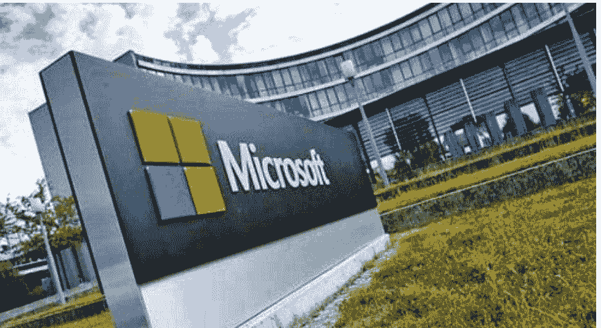

微软，海底捞免费模式

01.微软：免费的目的是垄断 Windows 系统刚刚进入中国市场时，大多数人都是用盗版，包括 Office 软件，但微软公司一开始并没有严厉地封杀，而是采用“睁只眼闭一只眼”的方式有意纵容盗版扩散。
尽管表面上喊一喊，打一打盗版，但只是虚张声势。
等绝大多数人都接受了 Windows 系统，习惯了使用 Office 软件，等把竞争对手赶出了中国市场，让其没有任何生存的空间，微软公司获取了中国市场的垄断地位，成为绝大多数人的唯一选择。
于是微软公司开始搞“正版计划”，首先从政府机构和大企业入手，通过正版计划迫使大批机关和企业把过去省的钱吐出来，要不然会面临法律的制裁，所以这是一种以时间换空间的免费模式。如果在早期严厉打击盗版，微软就不会形成市场的垄断地位，就没有了后续的生意。

这也是国内目前如火如荼的打车软件上演残酷竞争的一个原因。
软件不仅免费，甚至倒贴，很多人看不懂软件公司图什么，其实道理很简单，他们就是在寻找垄断。
因为一旦形成垄断，就可以剥夺消费者的选择权，那时就由不得消费者了。
众所周知，中国的消费者“太精明”，往往为了自己的眼前利益而忽视长久的成本，更不会思考一旦被某一家公司垄断的后果是什么，到头来一定是聪明反被聪明误，等明白过来的时候已经晚了。
# 02 苹果：先免费，后捆绑
随着苹果手机开启的智能手机时代，各种免费的 App 应运而生，人们面对免费的 App，几乎没有招架之力。对于厂家来说，免费可以带来知名度和客户基础，通过免费下载相当于实现了传统企业的广告宣传，当然比传统企业的广告更进一步：第一可以精确定位，第二可以快速传播，第三可以亲身体验。过去传统的广告宣传仅仅是让客户知道某个品牌，或者某一个产品，但是免费下载却可以让更多的人拥有一个初级版的软件，这样就远远超过了传统企业“硬广告”的效果。

不过这种玩法仅仅在“比特时代”才能做到，毕竟，数字化产品一旦开发出来就没有后续费用了，大家下载时对厂家来说并不产生额外的费用。
不像“原子时代”，只要你做出来一个物理上存在的产品，就一定会有费用发生，而且做得越多成本越高。

当消费者习惯了某一个免费的 App 之后，App 就成为客户生活中的一个组成部分，就可能带来延伸价值。
厂家既可以推送其他广告，捆绑其他服务，也可以通过免费获得的客户数据赚钱，还可以提供升级版的收费 App，把要求更高的客户转到收费的产品上，自然给企业带来利润。小米手机更是把一些在苹果手机上必须收费的 App 及一些加密的软件解密后免费送给客户，从而赢得了客户的尖叫”。
不过，这种玩法仅适用于软件行业，其他行业很难模仿。
# 03 海底捞：羊毛出在羊身上，赠品模式
闻名全国的海底捞也是免费模式的实践者。
去过海底捞的人都知道，他们可以提供免费的美甲服务，免费的擦鞋服务，还有各种免费的瓜子、小吃等等，让客户觉得来了海底捞可以占很多便宜。
其实羊毛出在羊身上，也就是我们所说的“赠品模式”。这里免费，那里收费，通过些免费项目吸引客户，增加服务的价值，再通过产品销售把免费的成本收回来。

当然，海底捞的这种玩法能否持续下去，主要取决于中国的人口红利到什么时候结束，只要海底捞始终能招到来自贫困地区的低成本员工，就可以保持价格竞争力。
大家都知道，海底捞的产品与其他企业相比并没有什么不同，而服务水平也只比其他企业稍微好一点。
海底捞之所以会成功，得益于老板对人性的理解，他是洞察人性的高手，知道消费者内心深处最需要什么，最想占什么便宜，最渴望得到什么关怀。尽管消费者自己根本没有觉察，但是面对这样的“知己”，他们是很难抗拒的。

# 32. 免费吃火锅，新开火锅店请你免费吃 10 天，背后的套路是什么

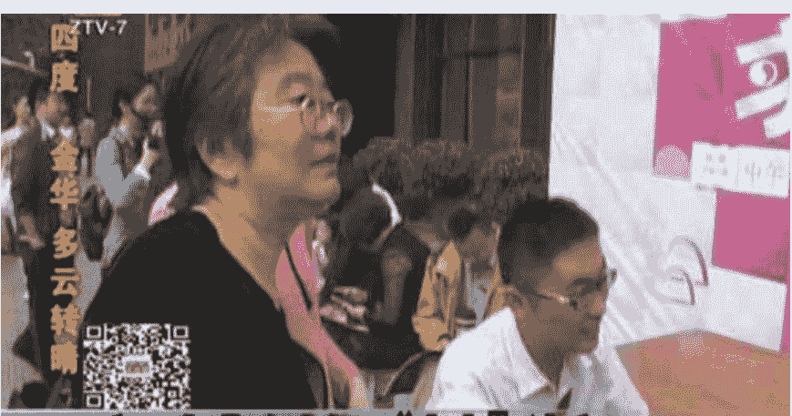

### 免费吃火锅案例
新店开业最想要的就是人气爆棚，哪怕前几天不赚钱，只要店铺有了人气，赚钱是迟早的事。而打造人气的传统方法基本上都是做优惠活动，再送一些小礼品等，但如果是同样的模式，换一种玩法，也许结果就有很多不同。

那今天就跟大家分享一个免费吃火锅的模式，我们看他是怎么玩的？

他也是同样的套路，只是有色一点不同，那就是“文案”不同，产生的效果也完全不一样，他的文案是这样写的新店开业免费请你吃火锅，连续吃 10 天全部免单！

作为消费者，你看到这样的标题会不会被吸引？肯定有吧，既然有吸引力那就肯定能吸引一部分客户进店了解吧，那么这个活动就已经成功了第一步，因为你已经把客户吸引进店了。客户进来后，这个“火锅免费吃10天”，是真的免费吗？当然不是，如果是的话，你不亏死才怪！

那么，这个免费吃10天的套路是什么呢？

只要你今天充值消费的同等金额，今天就免单”，也就是说假如你今天充值了200元，那么今天的消费就不要钱了，而且你充值的200元可以用于下次消费。

看到这里，你可能会说，这不就是打5折吗？有什么区别呢？如果你这样想的话是说你还是传统的思维模式，还不知道这背后的原理是什么？

你想想看，打5折，没有任何套路，客户消费了200元，只需支付100元，就结束了，而且对于用户来说，打5折，看的太多了，并不能吸引多少客户进来。

而这个文案，“新店开业免费请你吃火锅，连续吃10天全部免单”，站在消费者的角度，是不是吸引力更大？至少比直接打5折吸引的人多一些吧，只要客户进到店里了，不吃就走的人很少吧，因为现在喜欢吃火锅的人太多了，所以，这个文案已经超过打5折太多了。

那么，再来看“只要你今天充值消费的同等金额，今天就免单”，也就是说吃2次火锅只需要付一次的钱，相当于也是打5折，但是他充值的200元，他下次一定还会再来消费的，这样就锁定了客户的下次消费。

当客户再次来消费的时候，如果消费超过了200元，是不是要支付多出的钱？那消费不到200元的话，他下次是不是还会再来，因为他卡里还有钱，通过这样的模式就锁定了客户的多次消费。

重要的是赚到的钱是不一样的，第一种消费200块，用户付了100块，假设商家只赚了10块，因为餐饮很多都超过50%的利润，但是可能下次这个消费者就不来了，商家就仅仅赚了10块。

而第二种模式呢，假设消费者两次消费的金额都是 200 块，商家就赚了 20 块。同样是 5 折，用免费文案吸引来的不仅能多赚钱，还能锁定用户的下次消费，如果你的产品不是很难吃，消费者来个两三次基本以后在你这里消费的几率是很大的。

如果觉得上面这种套路还不够吸引你，那接下来给你分享更深的套路，这个套路是什么呢？

广告文案不变，还是免费吃 10 天，这次是真的免费吃 10 天，但是有名额限制，每天仅限 10 位顾客，这 10 位名额怎么获得呢？

很简单，就是“抽奖”！抽中的就真的可以免费吃。

那没有抽中的怎么办呢?如果免费吃每天有 10 个名额的话，这个活动可能没有很大吸引力。

这个时候就要配合打折来玩了，打折有两种玩法，第一种按照人数，如果 2 个人消费 58 折、3 个人消费 48 折、4 个人以上就 3.8 折。

所以，就算你没有中奖，也可享受一个很大的优惠，人数越多，优惠力度越大，当然，对于商家来说肯定不可能亏本的。

另外一种打折的玩法就是按照日期来打折，比如,1 到 3 号打 4 折、3 到 6 号打 5 折、6 吃到 9 号打 6 折，这种打折的模式，也能刺激客户在你开业的时候集中在 1 到 3 号获取大量客流。因为越往后，能享受的优惠越小，这样就能刺激到客户喜欢占便宜的心理，提前来消费。

如果以上两种模式还不够吸引，那接下来给你分享第三种模式，还是免费吃 10 天的模式。文案仍然是新店开业免费吃 10 天，这种模式适合应用于中高端级别的，对于普通的不太适合，那么他们又是怎么玩的呢？

免费吃 10 天，他也是真的免费，但是他是免费送你价值 120 块的 5 个菜品，一份汤，份青菜，再来 3 份肉。菜是免费送了，但是你吃火锅是有锅底的吧，这个锅底就是几十块，差不多把菜的成本收回来了。

但是很多人来，不仅仅仅吃这几个菜，因为不够吃啊，而且看到还有其他的这么多菜品肯定还会点菜对吧，所以最终的消费其实最少都是 200 多块了，但是后面还有套路。

当你结账的时候，服务台旁边有一个大大的 X 展架，上面写着，新店开业充值送豪礼，充值 500 送价值 500 进口道具一套，充值 1000 送进口不锈钢锅具 6 件套，充多少送多少，还送 120 元的好友体验卷 3 张，这个就是用来裂变用户的，还有其他的一些小优惠。所以为什么说这种模式适用于中高端的呢，因为这些人有钱，他其实是用免费送菜品来吸引用户来消费，消费完以后再充值。

以上这三种套路，都是用免费吃 10 天来做营销的，希望你学会以后，可以变通思维，打造出适合自己的“免费吃 10 天”模式。

# 33. 房地产的商业模式，如何用免费模式拿下价值 4500 万的公寓

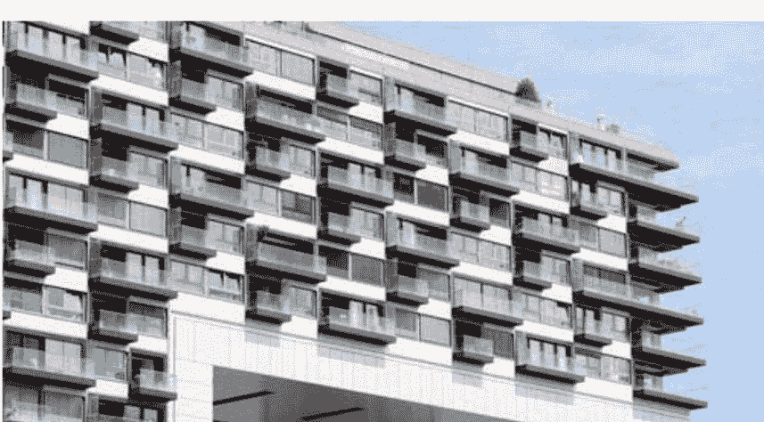

### 房地产免费案例
长沙某公寓楼房开盘的时候，王总预付了 500 万定金订了一栋公寓，可是交房的时候，王总却没钱支付剩下的尾款了，这幢公寓房共有 300 个房间，他预定的时候价格是 4800 元/平，到快交房的时候，价格已经涨到 6500 元/平了。如果王总不支付剩下的尾款，就算违约了，500 万定金就会打水漂，可是王总现在已经没有钱了，怎么办呢？

下面我们看看王总是用什么方法，在没花分钱的情况下，把这栋楼拿下的首先，把这 300 个房间设计成酒店，当时，王总算了一笔账：这幢公寓共有 300 个房间，每个房间大概 30 平米，按 4800 元/平，一间房大概 15 万，300 间房乘以 15 万就是 4500 万。也说就是说老王如果要买下这幢楼，减掉已经交付的定金 500 万元，他还需要再交 4000 万，可是，现在老王连 40 万都拿不出来啊啊但是，如果不交钱，开发商就把他交的 500 万定金没收了，现在的市场价是 6500 元/ 平，但这一幢楼是商业房，只有一个房产证，分不了房产证，他就卖不出去，要卖房子也只能卖给一个人，无法切割卖。针对这种情况，把这 300 间房改造成酒店还是比较合适的，那么，做成一个什么样的酒店呢?在长沙这个省会城市，三星级的酒店般 300 多块一晚，五星级的酒店应该 500 多、600 多，像万豪酒店都 900 多、1000 多，所以，老王决定按照三星级酒店的方案来做，你可能在想，这跟老王的 4000 万没啥关系呀?告诉你关系很大其 次，融资，用酒店作为载体去运作企业的现金流，去运作企业未来的钱和社会的钱，基于此，我们就用酒店作为载体，使用使用权和收益权来融所需要钱。(学习更多内容请加微信：xsyxsyqq019)

如果按 50 元一晚对外销售，会不会有人抢着买?如果 30 呢?于是，王总就设计了以 10 年的使用权和收益权作为一个产品包对外销售。老王算了一笔账: 如果按 30 块钱一天，年是多少钱?一万，卖 10 年行不行?10 年就是 10 万，如果今天一个宾馆的房间 10 万元，给你十年的使用权和收益权，你要不要？结果是基本上都被抢完了！这样，老王一个房间能卖多少钱?10 万！那么，300 个房间就是 3000 万！拿这 3000 万去买 4000 万的房子，能不能买下来?答案是太能了，按照百分之 30

首付是 1200 万，百分之 50 首付才 2000 万，这个时候房子就成为老王的了。
设计完这样的方案以后，老王身边的朋友买买就卖完了，在朋友圈一个人买 10 间,30 个人买就卖完了，假如你是老板，你买 10 间，你也可以送给朋友住，也可以招待客户用，也可以卖给别人住,10 万块钱住 10 年太划算了！
今天你买了一个客房，这个客房你会不会一年住 365 天啊?答案是不会，你天天住酒店你家老婆都会有意见，所以基本上 100 天你都住不了了，那么，就算你住 100 天，那还剩 265 天呢?265 天我帮你卖出去，按 300 元每天来卖，收入咱俩平分，我要 150，你要 150，这 150 能够酒店的开支吧?
那么这一年的开支就够了，买房的人每天收入 150 元，假如卖出去 200 天，那就是 3 万/ 年，那么，三年多投资者就回本了，而且，年还可以免费住 100 天，就运用这样一个方式，老王在短短一个月时间，就把房间卖完了！他只花 2000 万就把整幢房子套下来了。
到此你明白了：客户买的是什么?买的不是产品而是未来，未来的收益权和使用权。
卖什么都不如卖未来；
卖什么都不如卖预期；
卖什么都不如卖真实的商机。

# 34. 家政公司免费模式，如何通过 “免费” 获取顾客，并快速占领市场

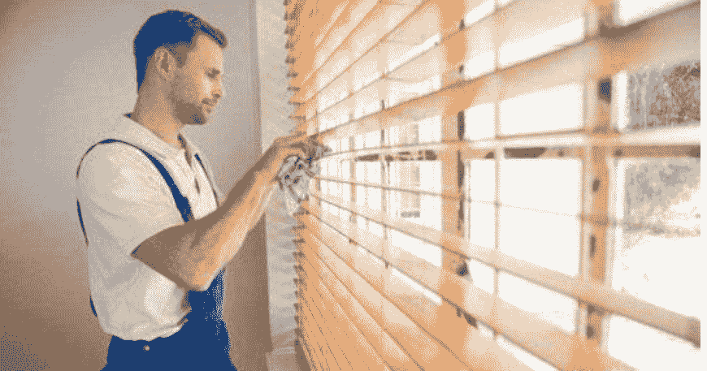

### 家政公司免费案例
程总经营一家家政服务公司，这个行业传统开拓市场的方法就是在报纸上推广分类广告、在小区粘贴像牛皮癣一样的广告等方式。程总还尝试过在桶装水上推广公司的服务，但整体的推广效率依然不佳。经过重新整体策划后，程总迅速成为该市家政服务行业的前三强。

我们推出的策略是：

程总与每个小区的物业合作，推出一项 “免费清洗空调”服务，即小区业主可以向物业申请，由物业登记后，程总提供免费上门清洗空调服务物业在小区里给程总提供了醒目的广告位置，用来宣传此次免费服务业主的活动。

作为宣传回报，每登记一个客户，程总给物业提供 50 元现金。

在这项活动中，业主通过物业了解这项活动具体详情，因此对该活动信任度不存在问题。
同时通过免费地清洗空调，业主感受到程总公司服务品质与服务态度此时业务员会向业主推广其他清洗服务、空调加氟服务、家电定期清洗保养服务、公司 VP 会员卡服务等，每一个业务员走出客户家门时，都不会是空着手走出来的。
程总通过免费的提供价值，轻松走进客户家门，收获了一群忠诚的客户，迅速占领了市场案例总结让客户体验到产品的价值是建立信任最有效最快捷的方式，提供价值的方式有很多种比如你可以免费为客户解答问题，你可以提供赠品让客户免费体验，你可以免费接送客户等等。
当你积极的为客户提供价值，让客户尝到甜头时，客户就愿意把信任票投给你！

# 35.啤酒饮料免费送，实体餐饮如何设计裂变环节，1 天裂变几千用户

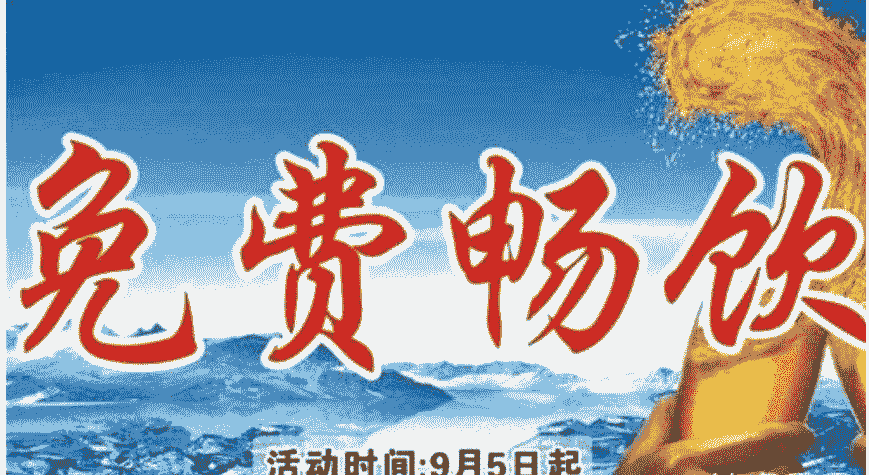

### 餐饮免费案例
很多做实体店生意的朋友，经常抱怨：“我没有用户啊，怎么获取更多用户呢”？关于这方面，你去扫街也好，地推也好，发广告也好，整合其他资源也好，反正你擅长哪个就做哪个，只要知道你的精准用户在哪里，就去那里找。

所以，不管你用什么样的办法，首先你都要先获得第一批种子用户，一个活动方案能不能成功，取决与你有多少种子用户。

因为，只要你的种子用户数量够多，只要他们帮你转发分享一下，这个裂变是很快的，即使你的方案很普通，如果你有几千个用户帮你转发的话，活动效果也不会差多少。

所以，你想赚多少钱，你首先问一下你自己，你能搞到多少用户。

那么对于实体店来说，如何有效的获取更多的用户呢？

那就是：“裂变”！

所以今天跟大家分享一个卖串串的实体店的玩法，也叫卖麻辣烫，看他们是怎么做裂变的，如何设计裂变环节的这个卖串串的实体店他搞了一个开业活动，啤酒饮料免费送，怎么送的呢？

只要你分享用餐的照片到朋友圈,直接送 50 瓶雪花啤酒,只要分享就能免费获得 50 瓶啤酒，哪怕按照最便宜的 3 块钱一瓶，也价值 150 元啊，如果是 5 块钱一瓶的呢?价值 250

元啊。
如果你看到了，要不要分享一下？
所以，平时我们看到很多老板是怎么玩的呢？分享朋友圈，送你一瓶啤酒。这些老板聪明不？很聪明吧。
一瓶啤酒才 3 块钱，只要你进店消费，我绝对不会亏本，因为再怎么吃一个客户我也能赚二十块左右啊对吧。
但是，有的人说，你送 50 瓶，那不是要亏本的节奏么？如何控制不亏本呢？
我送你的啤酒只能在这里喝，不能带走。所以，你一次喝不完，下次要不要来继续喝？
所以，利用啤酒可以让你多次重复消费，这是第二呢，他还限制时间，他送你的啤酒是有时间限制的啊，比如有效期是两个月。所以，在这个两个月内，要么你经常来，要么你就邀请更多的朋友过来，无论是哪一种，商家都高兴因为串串它不是随便免费吃的，是按照签的根数来算钱的。所以你吃得越多他赚得越多，来的人越多他也越赚钱。
那么实际会不会亏本？有可能，如果你遇到那种一次就可以干几十瓶啤酒的酒鬼，分分钟亏本。但是，这种概率非常小，小到可以忽略。
所以，如果有三家同级别卖串串的实体店，口味啊，环境啊，价格啊基本都差不多，也就是说相差不大，在这种情况下 A 店：没有任何优惠 B 店：转发朋友圈送一瓶啤酒 C 店：转发朋友圈送 50 瓶啤酒请问，如果你要去吃串串，请问你会去哪家？答案不用说，你心中
有数就行。
所以，有些人就是太聪明了，你转发一下我要送啤酒，啤酒要成本的啊，不送，卖一瓶还能赚对半呢以，总的来说，任何一个方案落地，你都需要找一批种子用户，一帮愿意帮你宣传的用户，如果你找不到用户，给你再好的方案也是没啥效果，从今天起，积累你的用户吧

# 36.买润滑油送面包车免费模式案例，送车一辆车还赚了 5000 元？

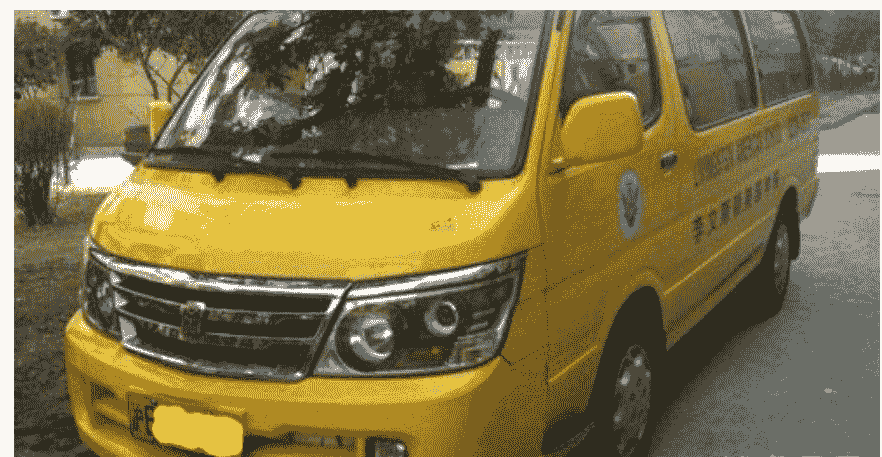

### 润滑油免费案例
今天给大家分享一个买润滑油送面包车的免费模式案例，通过这个案例，朋友们可以

感受一下，免费模式到底应该怎么玩？
这个案例是云南的公总操作的，他们策划了场活动，买多少润滑油就送多少钱的面包车他们打算前期先送出去 300 辆面包车，因为量也挺大的，他们也很担心，怕价格谈不下来，操作下来没有多少利润，当时，老板就跟好几家面包车厂家去谈，长安、五菱等都谈过了，光谈这些面包车厂家就谈了 2 个月最终确定方案：购买 33900 元的润滑油送辆市场价值 33900 元的金杯面包车。因为金杯车比较好谈，金杯车厂给的支持力度最大，和金杯的合作协议，每辆车最低价给到 23000 元。
能够谈到这个价位让公总也很满意，毕竟车是硬通货，价格还是很有公信力的，如果只买一辆车，这个价位是难以想象的。
在寻找赠品汽车来源的同时，他自己还跑到深圳代理的润滑油的厂里找老板谈，总经理张总接见了他。
公总说现在这个行业生意太难做了，竞争太激烈，很多代理根本不赚钱，尤其是类似我这样刚进入这个行业的，亏本的居多。我现在在策划搞一场大型活动，需要厂家的大力支持，否则我就不干下去了。如果我这个活动成功了，一旦推广开，厂家销量一定会猛增张总是机油厂的总经理，公总是他们的代理，厂家也不愿意损失一个这么大的代理商，张总说：行，你要怎么搞这个活动，你先说说吧。
公总就把买润滑油送汽车的方案给张总说了一遍，张总也觉得这个活动很可能能成功，如果活动成功了，对他们的润滑油销量肯定有很大的促进作用。
张总就说：这个方案非常好，你需要厂家支持多少？
公总说：我每送出去一辆车，需要厂家给我 5000 元的补贴。也就是说每卖出 33900 元的润滑油，厂家给优惠 500 元。其实，公总知道卖出 33900 元的润滑油厂家利润大概就是这么多。
经过一番讨价还价，最后谈到：送一辆车厂家给补贴 3000 元，公总有点不愿意。
公总随后和其他几个会员朋友商讨了两个小时，把利润点重新梳理了一遍，还分析厂家给的 3000 元补贴太少，会造成这次活动利润打折，还有不少空间。然后分析厂家的痛点，怎样塑造这次活动对厂家的价值。如果润滑油厂家要成为行业第一名，它需要什么？行业第一名绝对不是在卖产品。大家分 析厂家需要扩大影响力，厂家需要影响力，怎么扩大影响力？
然后，公总又再次去到厂家谈，还带上了针对性的话术和几十个做汽车售后服务市场的系统同学的合作意向书，(他们也需要润滑油，换个牌子的卖。)要求每送一辆车厂家要补贴到 5000 块。
公总说：你们算算我这次活动会有什么样的影响力？就是你们为了打开市场，这钱你们也得出，少于 5000 块这活动我就不得后来，厂家开会商讨这件事，认为毕竟这么大的销量，锁定渠道几个月后就可以赚钱了，可能还会上电视或者报纸等等，会有很大的社会影响力。最后，通过了每辆车给 5000 元的补贴。
车的采购价是 23000 元，减去 5000 元厂家补贴，每辆车相当于成本 18000 元
这个送汽车的案例有一部分赢利点类似于我们之前分享的买鸡精送汽车的案例。既然是模仿，那就少不了车体广告这块收入。当时，公总找广告合作商，找了 8 家，谈的是五年的期限，第一家愿意给 3000 块，公总没同意，接着找到一个做房地产公司的，他们愿意出到 5000 元，公总觉得还可以，就准备签合同了。
但是，公总把这个信息反馈到润滑油厂家的时候，厂家一听，用我们润滑油做活动怎么能出现其他企业的广告呢？这车就是送给买润滑油的人的，而且他们的客户也要用润滑油的，这个广告太精准了，不能让他们做，肥水不流外人田，我给你出这 5000 元广告费，这 300 个流动广告位我们包了。
其实，公总也希望这个广告位由润滑油厂家做，反正都给一样的钱，厂家做也相当于给

我自己做广告，扩大自己在当地的影响力，反正当地人买车仆润滑油都要找自己。所以，这个事一谈即妥。这时候厂家又出了 5000 元。这个时候，是不是每辆车相当于成本只有 13000 元了。

公总需要的金杯车是定制款的，其他硬件都一样，就是出厂的时候车身上带有车体广告，新车上牌照前是不能做车体广告的，但是公总给 4S 店商量好，由 4S 店统一上牌照，每辆车需要交 500 块，你说行不行？你提车的时候需要 1000 元购买内饰，全车太阳膜，座套还有脚垫什么的，你交不交？这起就是 1500 块，成本 500 块，每辆车赚 1000，这时候每辆车成本是不是相当于 12000 元了？

买车，就肯定少不了保险这块，提车的时候要预交五年保险。一年全险是 800 元，五年 4000 元。反正这是迟早要交的，也少不了，到时候多退少补。现在车需要多少钱拿回来,8000 元对不对？

公总又与金杯 4S 店谈，一辆金杯面包车我 需要给你付款 23000 元，但是我的付款方式不全是现金，而是 13 万的现金加 1 万元的油。反正本身 4S 店就需要润滑油给汽车做保养、做售后的，所以,4S 店也就同意了。一万的油按 30%利润计，是不是可以省 3000 元。现在，购车款是不是只要 5000 元？

可是，我还卖给客户 33900 元的润滑油，不是还有利润吗？利润是多少呢？

33900 × 30%=1 万元。大家算算，是不是做到了送一辆车还赚钱了 5000 块？

此外，还可不可以有其他的盈利点呢？这个当然可以有，大家在不断的学习和复训过程中可以不断spawn出来。

最后，让我们来对比一下：平常卖出 33900 元的油利润有 1 万元，我就拿 1 万的 50%做活动，送 5000 块钱赠品，能有多大的吸引力呢？可以送部手机，送得了汽车吗？平常大家都是拿出自己的利润的一部分做活动，能有这么效果么？同行的利润率和你是一模一样，你能牺牲多少同行也能，没有绝对的优势。所以，不用怕免费模式，能打败对手吗？

> （学习更多内容请加微信； xsyxsyqq019）

# 37.美发店免费模式案例,业绩从 300 万突破 900 万背后秘密

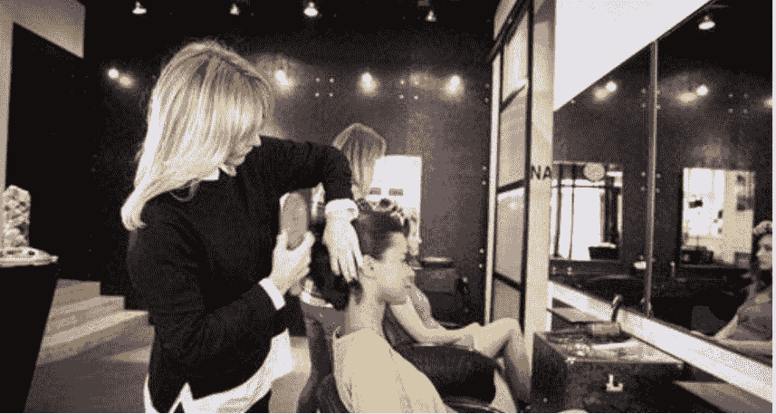

理发店免费模式

平时理发店帮客人理发，都是跟技师五五分成或者四六分成，但是这家理发店却把所

有提成都给了技师，这其实就是利用了一个反向思维，对内部免费的模式，听起来简单，可是朋友们，你有没有想过通过这样的反向思维，在你的生意上面如何对内免费呢？

当你把全部提成都给技师的时候，他们的服务可以做到极致，他们会自己花钱给客人买水果，并切成水果拼盘，给他自己的客人提供绝对优质的服务，这样的話，让女人会有种很享受的优越感。

我们都知道，女人消费凭的就是一种感觉，如果她们对这种消费感觉好了，那么她还会消费其它的一些产品、项目。最优质的服务就是让她有感觉，最优质的粉丝就是让她有感情，所以女人消费要的就是一种感觉。

正因为这家理发店的技师可以拿全部提成，很多客人在传播这家理发店，那么就吸引了很多其他的技师来应聘，其他技师来应聘的时候，怎么判断他们的技术优劣呢？他这里有三天的试用期，试用期里的提成是不给他们的，这样，就沉淀了很多劳动力。这些沉淀下来的劳动力，是不是也是一种价值的沉淀？

通过这些沉淀下来的技师，进行理发师 PK，优秀的就留下，最后留下来的就很有荣誉感，这样品牌就树立了，也会形成好的口碑传播，要想找最好的造型师，就在 XXX。

虽然在这里提成全部都给技师了，可是我这里有设备，有场地需要交押金，这个怎么个交法呢？

般海选一个比较厉害的理发师月拿 15000 元是没有问题的，再加上提成也全部给你了，好的技师一个月至少可以拿三万，你想在这里干，就需要交一个月 的押金，如果一个店 10 个人算，那就是 30 万，这个押金是不是一个纯利润？

很多朋友可能感觉押金不好收，那是因为你的人气不够，做一个成功的项目，首先就要先聚人气，人气够了，你才能下手挖掘其它利润点。

这家理发店有四层，一楼虽然牺牲了大部分利润，可是他还有二、三、四楼都可以制造盈 利点。他把这些楼层改造成了其它相关项目，把企业做成了平台，只做抽水人，重体力活不再自己干，所以，我们在做活动的时候，一定要纯粹，等额消费，送 给客户的就是送给客户的，而现在很多朋友在做活动的时候都不纯粹的，我们来看一下理发店是怎么纯粹的？他要求员工五次之内绝不可推销，如果发现员工推销一次罚款 1000 元，他甚至还派人假装成客户，看员工有没有推销，以保证绝对的纯粹。

这家店给顾客提供这样的服务，顾客的感觉是不是完全不一样了呢？差别有多大呢？比如：凡是客户要离开的时候，当客户走出去 10 步时，背后的员工就会追出去说：“姐等下，这里有一壶蓝月亮洗衣液，您拿回去用客户出门之后走多远，要有一个精准的计算，再追出去服务客户，这样的服务，会让客户深受感动，客户会觉得你是她值得终身托付的人。

这个活动方案执行之后，周边的几家店已经倒闭了，还有一家因为刚刚开业，刚装修完，而且是这家理发店的员工，后来，实在是支撑不下去了，就找到这家店的老板说：“哥，我错了，我这个店投资 173 万，您看看能给我多少钱，把这个店收了吧。”

老板跟他说：“我给你 200 万，可是我现在手上没有这么多现金，先给你 10 万，剩下的，按 6 个月分批给你。”在这个过程中，他又通过卖思维的方式，一个月收回了两百多万，通过这样的手法，他一口气整合了同城 26 家店。

免费是未来的一个发展趋势，你如果不把握这个趋势，不把握当下，最终肯定会被淘汰。不管哪个行业，一定不能死守，过去成功的原因可能就是未来失败的原因。

商业的本质就是盈利，免费不是赔钱！免费颠覆了固有盈利模式的限制，它打破了固有的“交易”一词的概念，让你的产品“免费的同时实现盈利！

# 38.咖啡机免费模式，咖啡机不要钱，如何通过后端赚其他产品的钱

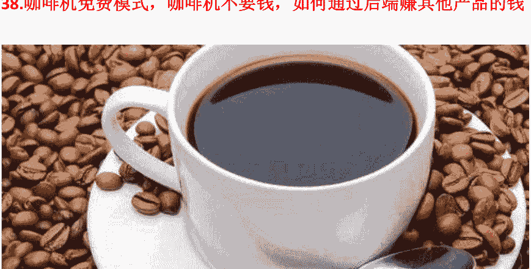

咖啡机免费模式

那个谁谁谁说的，站在风口上，猪都能飞起来，有了一个好的商业模式，你就可以瞬间超越你的竞争对手。

今天给大家带来一个顶尖高手是如何设计商业模式颠覆行业赚大钱的真实案例。

首先，如果你想赚大钱，你选择市场很关键，你的市场大小就已经决定了你未来能干多大的事，如果你选择的市场很小，就算你能干到行业第一也赚不了大钱，因为市场份额已经决定了你的收入。

什么样的顶尖商业模式如此厉害让原本的行业老大都被打败了？

当时经过分析你会发现，这种商业模式和以前分享过的世界顶尖高手利乐公司的商业模式非常的类似。这家公司采用的就是“剃须刀+刀片”的模式。

那么这家国外的公司要卖咖啡，他是怎么干这个世界上最厉害的营销，永远都是模式。

一、产品，是解决持续的问题。一个产品要能持续活下去，必须要有价值，要么是交换价值，要么是使用价值，要么是心理价值，要么是金融价值
二、营销，是解决相信的问题。名人做广告也是一种相信，企业，也是一种相信，体验也是一种相信。
三、模式，是解决宿命的问题。一个企业在今天的中国这种条 件下，三年五年上到一个亿，是很正常的，如果一个公司三年五年还没有上到一个亿，你就需要转变模式。
商业模式指一个完整的产品、服务和信息流体系，包括每一个参与者与其在其中起到 的作用，以及每一个参与者的潜在利益和相应的收益来源和方式。
简单的说，顶尖的商业模式就像一股台风，这个世界上最厉害的营销，永远都是模式。
一、产品，是解决持续的问题。一个产品要能持续活下去，必须要有价值，要么是交换价值，要么是使用价值，要么是心理价值，要么是金融价值
二、营销，是解决相信的问题。名人做广告也是一种相信，企业，也是一种相信，体验也是一种相信。
三、模式，是解决宿命的问题。一个企业在今天的中国这种条 件下，三年五年上到一个亿，是很正常的，如果一个公司三年五年还没有上到一个亿，你就需要转变模式。
商业模式指一个完整的产品、服务和信息流体系，包括每一个参与者与其在其中起到的作用，以及每一个参与者的潜在利益和相应的收益来源和方式。
简单的说，顶尖的商业模式就像一股台风，那个谁谁谁说的，站在风口上，猪都能飞起来，有了一个好的商业模式，你就可以瞬间超越你的竞争对手。
今天给大家带来一个顶尖高手是如何设计商业模式颠覆行业赚大钱的真实案例。
首先，如果你想赚大钱，你选择市场很关键，你的市场大小就已经决定了你未来能干多大的事，如果你选择的市场很小，就算你能干到行业第一也赚不了大钱，因为市场份额已经决定了你的收入。
什么样的顶尖商业模式如此厉害让原本的行业老大都被打败了？
当时经过分析你会发现，这种商业模式和以前分享过的世界顶尖高手利乐公司的商业模式非常的类似。这家公司采用的就是“剃须刀+刀片”的模式。
那么这家国外的公司要卖咖啡，他是怎么干的呢？
他没有开实体加盟连锁店，因为很难撼动实体行业老大的地位。他选择的是卖咖啡机+咖啡杯大家都知道美国人是喜欢喝咖啡的，就像中国人喜欢喝茶一样。所以市场空间巨大，所以他一年干了10几亿的净利润。
按照一般的人来说，卖咖啡机就是赚差价。
但是市场上那么多咖啡机，你想在市场上分杯羹，那么你只有打破市场的规则，重新建立游戏规则，才有可能颠覆市场。
那么这家公司采用的模式就是，当所有厂商都在赚咖啡机差价的时候，他们选择咖啡机不赚钱。咖啡机不赚钱那就要通过其他 的产品赚钱啊，答案就是咖啡杯。
什么是咖啡杯呢?简单的来说就像红茶绿茶那种一个道理，就是一个杯子，然后杯子里面放上一个渗透的装置，里面放上咖啡，然后上面用铝箔封口。
然后将这种杯子放到咖啡机里面，按下开关，加压水管就会直接进入到杯中，然后不到一分钟，咖啡就煮好了。但是这种杯子只能在他的咖啡机上面使用。
为什么要设计这种咖啡杯呢，因为，正常的咖啡机都是一煮一大壶，喝又喝不完而且口感也不是很好。他们就是发现了这个痛点然后开发了这种咖啡杯。
这种咖啡杯的好处是方便，只要放进咖啡机里面都是全自动的，一下就好了，更为重要的是便宜，一杯只要0.5美元，相对外面星巴克的便宜非常多，价格是星巴克的十分之一。对美国的家庭来说非常的方便实惠。
首先是他们采用杯装咖啡，实惠便宜口感好。然后采用不赚钱的卖咖啡机，迅速占领市场。有了大量的消费者，为了满足他们不同人的需求，授权其他厂家也可以生产这种咖啡杯，
生产不同口味的产品来满足消费者的需求。
对于消费者来说，咖啡便宜了，而且方便快捷。对于这家公司来说，虽然咖啡机不赚钱，但是通过咖啡机获得了海量的市场，后期源源不断的销售咖啡杯赚钱。对于其他公司来说，不用重新开发市场，利用他们咖啡机的市场份额，就可以大量的销售自己的产他们通过这种方式，一年卖掉十几亿咖啡杯，换句话说一年卖了十几亿杯咖啡，这个数量远超星巴克。
大家看到这里应该明白了吧，首先发现市场的一个痛点，然后采用前期咖啡机不赚钱，后端卖咖啡杯赚钱。看似一个卖咖啡机的公司，实际上是一个卖咖啡的公司。
咖啡机卖得越多，他们就赚得越多。因为只有通过咖啡机不赚钱，才能迅速的避开竞争对手获得市场。
更牛逼的赚钱招数到这里还没有完，有人说，那这种模式跟雀巢的模式不是一样的吗，授权其他厂家帮生产咖啡机，然后咖啡机只能煮他们生产的咖啡。
但是这家公司更加厉害更加先进，其他厂家你们也可以生产这种咖啡或者热可可和茶等等用这种杯包装，让买了我这种咖啡机的家庭也可以买到你们产品的其他口味。
但是，你每生产一杯需要向我支付 6 美分的权益金，这招非常厉害，就算这个公司以后不生产咖啡了，他仍然有源源不断的收入。
咖啡品种丰富了，不用自己生产，你们每卖杯我都有钱赚，全自动赚钱。
所以，大家懂了吧，就是通过咖啡机不赚钱迅速打开市场。这种就是前期不赚钱，后期自动赚钱的模式。高手都是喜欢这样玩的，因为前期只要把市场份额占领了，后端基本上都会有源源不断的收入，当另外一个竞争对手出现的时候，高手往往又玩另外一种模式了。
大家可能觉得中国人对咖啡没有美国人那么热衷，但是中国人喜欢喝茶啊，大家看了这个案例，不知道你是否能从中得到启发，去发现一些市场中存在的一些痛点，然后设计个商业模式，生产一个解决痛点的产品，下一个颠覆行业的人可能就是你。
所以有些人想创业想赚大钱，以为一定要找一个很高大上的项目或者产品，其实一个普通的产品改变一下商业模式，重新定位市场，改变一下玩法，仍然可以赚大钱。
有的人说，不就是免费送产品吗，老子送产就是了，但是你后期没有一个好的赚钱商业模式，你送得越多就亏得越多，后期的盈利模式没有设计好，前面的都是白干。

# 39.驾校如何快速招生？驾校如何利用免费思维，2年时间垄断全市生意

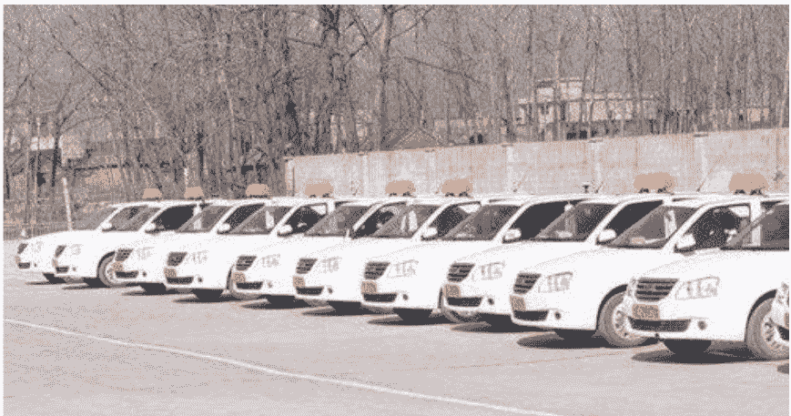

## 驾校免费模式案例

自动赚钱的模式。高手都是喜欢这样玩的，因为前期只要把市场份额占领了，后端基本上都会有源源不断的收入，当另外一个竞争对手出现的时候，高手往往又玩另外一种模式了。

大家可能觉得中国人对咖啡没有美国人那么热衷，但是中国人喜欢喝茶啊，大家看了这个案例，不知道你是否能从中得到启发，去发现一些市场中存在的一些痛点，然后设计个商业模式，生产一个解决痛点的产品，下一个颠覆行业的人可能就是你。

所以有些人想创业想赚大钱，以为一定要找个很高大上的项目或者产品，其实一个普通的
产品改变一下商业模式，重新定位市场，改变一下玩法，仍然可以赚大钱。

有人说，不就是免费送产品吗，老子送产品就是了，但是你后期没有一个好的赚钱商业模式，你送得越多就亏得越多，后期的盈利模式没有设计好，前面的都是白干。现在学车的人越来越多，很多看到这个前景，纷纷加入驾校行业，随着竞争者增加，很多人都没赚到多少钱。今天分享的这个驾校如何快速招生案例的主人公只有 4 台车，每辆车有 10 个学员，由于没有更多人来报名，老板也不敢增加投入。

驾校的报名费是 3000 元/人，抛开场地，油费，教练工资，利润大概有 1500 元，现在要解决的就是新学员招生的问题。

让老板降价 500 元，老板是不愿意的，说：“我现在都很难赚钱，如果再降价，我可能就要亏钱了”，我们先测试下效果怎么样，老板说那就只能先试试，我们就印刷了几百张海报，易拉宝，把附近几条街的超市跟餐馆，茶馆，健身房，全部跑了一遍。

跟这些合作的老板说：“只要你给我介绍一个客户过来，我给你 500 元提成”，老板打算让利 500 元给合作的商家，这样，很快就找到了 300 家合作的商家，在他们的招牌、门牌等位置张贴了驾校的广告,500 元虽然不是很多，但也不少，执行了一段时间，还真来了 30 个学员。

现在一个学员少了 500 元利润，还有 1000 元利润,30 个人就有 75000 元的进账，有 3 万元的纯利润，除去前期的推广经费，就算是 1 万元，那还赚 2 万元，也就是说我们并没有降低收入，反而增加了收入！赚了 75000 块回来了，来ER这么多人，等待的时间就更久了，很多学员就抱怨一天来 2 次，一次就只能摸 2 次方向盘，体验感很差，那我现在必须要增加车子才能满足现有学员了。

驾校都是最便宜的那种东风雪铁龙的那种爱丽舍，这个车子最便宜只要 5 万块钱，那我现

在有了 75000 的进账，我们是不是又可以贷款买 2 辆车？
大家慢慢听，我说你这 2 个车先不要给这些人，你先搞一个 VIP 班,6000 块钱,1 个月内拿证，一个人一辆车，一个教练，试下有多少人愿意报这个班，提供最好的服务，最好是单独的隔离出来，搞很多饮料过来，免费的无限畅饮，空调无限开启。
买了 2 个车,30 个新学员加之前的 60 多个学员差不多 100 个吧，推出这个活动呢，吸引了 7 个人报 VP 只用多加 3000 就好了嘛，那我这个 3000 起码又多了 2000 块的利润把，7 个人我瞬间是不是赚了 14000，那我们是不是可以算 100 个人里面有 7 个人是愿意出这个高价快点拿驾照的对不对，我们再来算个账,10 个普通班的学员我可能是赚 15000，但是 10 个 VP 我可以赚 35000。(学习更多内容请加微信；xsyxsyqq019)
我们再来进行测算，如果我把驾校降到 2000，我可以吸引多少人来呢?我一个普通班的学生我只赚 500 就好，但是我吸引 100 个人来了以后转换到 vp 班去，就算 10% 的转化率吧就又多了 3,5 万，虽然我前面利润少了，但是后面的 v 把利润又补上来了，其实我实际的利润没有怎么少。
然后马上又把降价海报换一批，继续降价，降到 2000，因为还要给这些人提成嘛,1 个月的时间呢，又吸引了 100 个学员过来，这个驾校的人已经人满为患，一个驾校已经装不下这么多人练车的需求了,100 个人一个学费就是 20 万，我 20 万是不是又能搞 4 个车这个时候呢，学员已经在源源不断的来了，来了之后怎么整合更多的资源，打造更多后端呢？
因为已经比市面上低 1000 快了，优惠力度已经很大了，这个时候，你再推荐一个学车的，我奖励 200，或者再减免 200，无时无刻想着裂变，无时无刻把客户变成自己的业务员，大家记住，我不是盲目的去降价，我们是经过测算的，策划绝不是拍下脑袋想个点子，而是要考虑到整个链条如何快速打败竞争对手，让对手提前进入淡季，防止别人跟风！我们要像下棋一样，走一步看 3 布！
我再前端降价以后，我的目的是吸引更多的人来。
然后后面我们再做好服务的同時赚取更高利润或者更多的钱，所以大家要明白你的竞争对手为什么敢降价，甚者不赚钱，更有甚者赔钱来做生意，就是因为后面赚钱的东西你不知道，所以千万不要盲目的跟风别人打价格战很多生意并不是靠差价赚钱，我们要的是现金流！京东每年不赚钱却越做越大就是这个道理，手上掌握了大量的现金流，掌握了海量的数据，在后面可以不断的变现的，现在开始整合产业链，这个呢，许多考过了，拿到驾照了是不是要练一下车子?因为驾校跟实际上路还是有很大区别的，这个时候呢，在场地上挂一个牌子。
考试通过了，vp 学员可以免费上路 1 个小时，教练陪练，(继续吸引哪些人去报 VIP)如果还要加练的,100 块一个小时，这个不说有很多需要，但是肯定是有人需要的，很多权利尤其是 vp 班的，都是想快点买车的，但是如果能有旧车或者别人的车来练一下那是很的，反正 100 块里面我给教练提成 30 块，你想想，一天有 16 个小时是可以练车的。
有的人甚至愿意学习一天，一天也是 1000 多的收入呢，那学员车技好了，是不是要买车，我们是专业的，如果你要买一个车，我带你去买，还要便宜点，我还教你汽车的些知识，你愿意自己去跑 4S 还是愿意让我们陪着你去跑 4S 店?反正我们承诺，你先去看车子，看中了跟我们说，我保证比你自己问的要低我现在手上的学员是不是越来越多?我完全可以开始跟各个 4S 店去议价的，给我们返点就好了，我也不要多，你们业务员怎么提成，我就怎么提成，是不是大家都有好处？
那你 4S 店是不是要张贴一个我的海报，学驾照，到 XXX 无时无刻想着裂变，无时无刻把客户变成自己的业务员。
买了车之后，是不是又有保养?大家都现现在卖车是不赚钱的，是赚保养跟维修的钱，大家也都知道 4s 店的保养是非常坑爹的，那我们再继续整合，在驾校附近找一个洗车，保养，

美容装饰的店子，我带客户来保养，你给我分钱！一次保养一般都是好几百那如果现在你带一个客户过去，我给你 200~500 你爽不爽？那你这里是不是要张贴一个海报，学驾照到 XXX 学，无时无刻想着裂变，无时无刻把客户变成自己的业务员，是不是大家都有好处??大家都有好处就好谈，不要总是只想到自己的利益，多为别人考虑的时候就很容易谈合作，先利他，再成就自己，那你在价格这么低？别人的驾校还有没有生意？
都没什么学员了？教练都是死工资，但是我们的教练还有各种提成，以前的教练都是大爷，现在后面这么多服务，你要是态度不好是不是就没有提成了，也在倒逼教练服务提升，形成了良性循环、可是别人的驾校都没生意怎么办？关门呗，后来开始慢慢兼并其他的驾校，要么关门，要么被我收购，也就是说，我们通过一系列的动作开始走自己的路，让别人无路可走了！
2 年的时间，开了 30 多家了，一个月的流水，你们猜下有多少？快到 1000 万了，去年的时侯他们开发了一个网上学车的，预约学车，练车，选车，保养的这个平台，这个平台现在被估值是 7000 万，那我现在卖个 10%的股份是不是就可以轻松回收 700 万？
卖未来卖预期卖商机才是最暴力的事情！大家现在要记住，现在做生意，尽量不要用自己的钱。
在这个世界上你想要的，基本上都是现成的，把别人的资源整合到自己的体系中来就好，这家驾校现在基本都不自己租地了，找有场地的人来合作！你提供场地，我提供后面的服务，！我的车子现在都是 4S 店赞助的，因为我每年要给他卖不少车，我不自己开保养的店子，我要求入股你的店子，你不同意我就开你旁边，要么呢是合作伙伴，要么就是竞争对手！
聪明的都知道怎么选择！我继续整合保险公司！反正我现在客源多，谁手上的资源多，谁就是大爷！从最开始一个学员赚 1500，到后面做流水，先疯狂的吸人，不停的有流水进来，开始在其他的地方赚钱，利润转移到产业链的下游来了，再到后来是不是做成了平台，一条龙全部都垄断。
很多人不会做生意，看了这个不知道大家有什么启发，还是那句话，前端疯狂吸人过来了，在后端吸人，很多公司几乎免费的套路吸人来，后面追销其他的服务，产生利润，线上线下都是一样的，往往都是通过低价或者免费先吸人，没有人你什么都做不了，更不谈赚钱，所以大家每天琢磨吸粉，方向是对的。
但是大家要清楚后面我通过什么变现，想清楚思路，我卖茶的不赚钱，但是我可以推销其他的东西赚钱啊？哪些东西跟茶联系很紧密的？比如说摆件？手串？字画？去延伸啊，我某种茶不赚钱，其他的茶赚钱行不行呢？我可不可以推荐他们搞其他的服务赚钱呢？比如很多老板都有各种需求，洗车，健身，保健，等等等。
起合作嘛，推荐去一次给我反多少钱，并不一定非要在自己做的事情上赚钱的？多想想相关的产业跟产业链的下游，我卖保健的，我在保健品上面不赚钱，但是我追销其他的健康食品行不行？保健的器械行不行？我卖水果的，我在某一个水果上面不赚钱？
但是你吸引人来了以后追销其他的产品行不行呢？很多人思路僵化？不知道变通，其实你再不改变，别人就把你干掉了，所以在获得了稳定流量以后，一定要开发新的利润增长点，把你不赚钱的东西去跟别人竞争的时候，同行往往还没搞清楚情况就被你打败了，不整合自己的资源跟身边人的资源，你就是浪费他们，你是在跟钱过不去。
人字怎么写？一撇一拉，是互相支撑的，不懂合作的人，格局太小的人，是赚不到什么钱的，大家把身边的资源都利用起来，全部都整合到一起来，形成一个系统，这样威力才非常巨大，如果我们每个人都把资源注入到这里，这个平台就非常强大了，阿里巴巴的合作商也才 100 万，如果我们有 100 万人在一起，我们人人都富翁了，人人身价都是百万，而这个根本不需要你们做什么，记住，哪些是你的强关系，可以给你带来利益的人才是你的强关系，锦汇之所以让你们来学习，我希望我们所有的人全部都抱团一起前进，你有货。

今天就分享到这里，再总结一下：
第一步：驾校学习的费用直接降到 1500，因为驾校每个学员的成本就是 1500，通过低价，迅速的就可以吸引很多考驾照的来，现在人是有了，可是Checking怎么办啊？别急，人来了就好说！
第二步：开VIP班,1人1车，独立开辟一个位置出来，每个人一个教练跟着连，无限供应饮料，现在有钱的人很多的，虽然可以通过便宜吸引很多人来，但是并不是所有的人出不起钱，这个大家要清楚，你想想你们在那边 10个人一个车，一天就只能摸一下车子，对于那些急于想拿到驾照的人，多给钱其实无所谓的，肯定可以再吸引一部分人报 VP 班的。
第三步：客户拿到驾照以后多希望能上路再练练，你可以再搞一个陪练的部门出来，反正你的驾校里学生会源源不断，这样又多了一部分收入出来了。

第四步：技术练好了是不是就要买车了？那我们再给这些学生去推荐车，你想想，他们大部分都是不懂车的，教练对他们来说是专家了，教练推荐的车学生一般都会重点考虑，然后再招 3个人去全部的 4S 店跑一边，我这边给你推荐人买车，你 4S 店给我返点
第五步在驾校附近搞一个汽车保养店，这些学员买车了以后肯定要保养啊，后面还有很多，保险啊，装饰啊，稳定的生源来了之后，学生介绍一个来报名的，再给 500 的奖励，再到后面，唐总准备把报考驾校的费用直接免掉，因为周边的有些驾校已经有人在跟风，那我直接把学费都免掉，我看你们怎么跟我玩，我通过后面的一些列的服务再把这个钱给赚回来。
这样一搞，很多其他的驾校都没生意了，很多其他驾校的教练都往这边跳槽，其他的竞争者都不是对手，2年的时间把唐总边边的驾校一家一家的收购，现在价格又慢慢的在往上面提，可是已经无所谓了，因为已经没有什么竞争对手了，本来一锤子的买卖又变成了长期买卖！一条龙的全部垄断了，前面源源不断的吸收客户，后面源源不断的赚钱，这就是免费模式，就是一种吃亏利他的思维模式，把这种思维模式应用到企业的运营管理当中，达成合作，赚别人看不到的钱，完成利润指标。
大家要好好琢磨这个免费商业模式，非常巧妙，把自己赚钱的产品当作抓取客户名单的手段，再以此为筹码去谈合作，从另一方面赚钱，当后面业务量大的时候，你又成为整个婚庆行业的操控者，你的每一步都在布局消费者资源是我们最容易掌控的，只要掌握了消费者资源我们就很容易控制抢你业务的同行？

# 40. 中医养生会所策划案例，中医世家如何用免费模式吸引更多精准客户

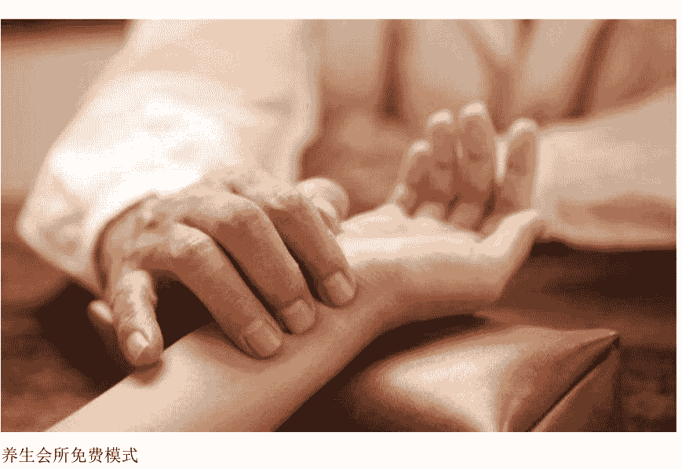

### 养生会所免费模式

老张是一个中医世家。在当地开了家中医保健会所，主要包含各种推拿、按摩、拔罐、足浴等服务。但是，生意一直都没有好转。

同时，随着同行的增加，以及美团等团购平台的进入，竞争越来越激烈，价格也越来越低，老张的生意是一天不如一天。

在与老张沟通了解具体的情况后，我们建议老张可以将自己的客户定位更精准一点。然后，给这些客户提供一些最基础的服务，不定非得是自己已有的中医保健服务，也可以是其他不同行的，通过他们来吸引客户过去，然后通过服务，引导这些客户去消费中医会所自己主营业务。

老张思来想去，最后将人群定位为有车族原因有

- 第一、有车一族一般消费能力不会太低，经济基础还可以；
- 第二、有车一族经常开车的话，一般身体是处于亚健康状态的，需要自己家的服务。

确定好客户群体后，他设计的是一个免费洗车的引流方案。这样每个来洗车的用戶，都有可能引导成为自己保健会所的客户。

于是，他在中医会所楼下腾出一块地用来免费洗车，大家都知道，洗车需要一段时间，客户在等洗车的过程中，他们把客户带到楼上自己家的中医会所里面，让客户在里面舒服服的休息一会。

也不用做什么推销，每个位子都放好了准备好的小册子，休憩区的大厅还有大电视在重复播放健康节目视频，里面详细说了一些开车族常见的健康问题，以及如何调整和预防。结果，自然是老张家的主营业务、中医保健啦。

视频内容非常的真实和攻心，在这种环境下，加上小册子文字图片以及电视里面播放的内容，充分利用人性的趋利避害，相信各位没有几个不对自己的健康关心的？这个时候，客户很容易主动咨询。

其二，人家免费的给你洗车，给你端茶倒水伺候着你，你心里肯定是想着消费点什么对吧？那么，接下来的就是成交流程了。

成交流程的前端是几十块钱的专业足疗，只要客户进入这个成交流程，后面的一系列保健70%以上都会成交了。

说到这里，大家都应该明白了整个思路了吧?那么，重点来了，如何去把鱼饵放出去?先去印刷几千张面值 1500 元的免费洗车卡和送免费洗车卡的海报，海报贴在墙上，名片放收银台。
卡片一面是免费洗车介绍和说明，主要烘托 2 点：一点是免费洗车，另外一点是免费茶水和休息厅。另外一面是临时停车卡。丽娜说到这里，聪明的朋友就明白了这个卡牌的设计的奥妙，就是让客户经常接触到和使用到张卡片，进一步提高粘度。
当然上面留有一个微信客服二维码，每一个加客服咨询的客户，都会被拉到微信群里面进行统一的维护。然后，就去找饭店合作凡是在饭店消费的客户都送一张面值 1500 元的洗车卡。有车的朋友就自己用，没车的朋友就送给朋友用。
每张卡上面盖有他们饭店的章子，客服拉进去的群也是有他们饭店的标识。比如张三饭店，客服加微信的时候，需要一个验证信息: 张三饭店，这个时候客服把他们拉倒标有张三饭店的标识的群里面，为什么要这么干?不知道各位有没有悟透的?
所以，在做布局的时候，一切都要站在人性的角度去设计和思考，互惠共利才是最重要的，这样就会有很多的饭店、大排档、酒楼都愿意合作。

（学习更多内容请加微信；xsyxsyqq019）

# 41.免费模式运用实体店，企业如何打造适合自己的免费商业模式

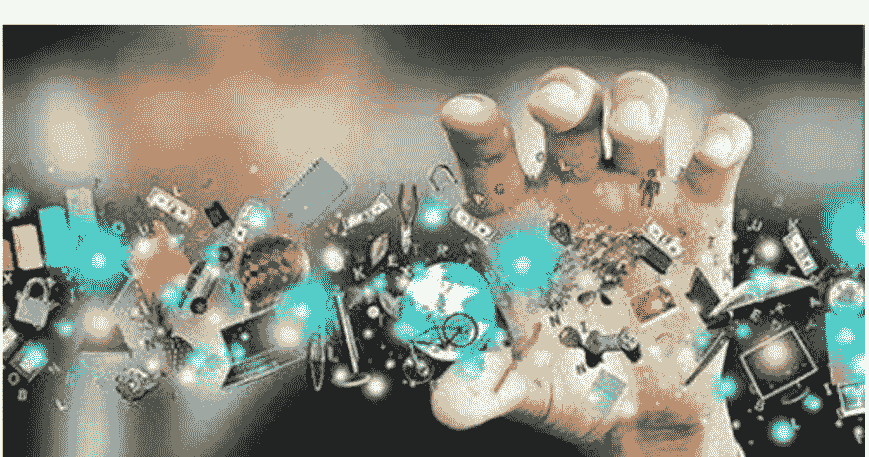

实体店免费模式打造
免费是一个非常有前景的商业模式，是未来的一个发展趋势，你如果不把握这个趋势，不把握互联网，最终肯定会被社会淘汰。不管哪个行业，一定不能死守，过去成功的原因可能就是未来失败的原因。
一、免费是营销思维的转变免费模式是整个营销思维的转变。在过去供不应求阶段，市场是以厂家为核心，想卖给谁?怎么定价?厂家说了算。随着竞争的加剧，卖方市场逐渐向买方市场过渡。这时，要考虑消费者的利益，而最大的利益就是“白给”。
免费模式不是今天才有的，只是今天它已经无处不在，几乎所有行业都能跟免费沾边。
所谓的免费就是在消费者最关注的地方免费，在消费者不太在意的地方收费。比如，个公园门票免费，但是进入公园后得买这个买那个，其实是免了小头得了大头。
人的本性喜欢占便宜，(占了便宜之后如果发现不错，可能从此就持续消费了。所以，)

就会有试吃、试喝、试穿，实际上都是给大家提供一个体验，体验成为持续购买的第一步

### 免费需要金字塔结构

假如一个企业的产品结构是金字塔形的，底端应该尽量免费，或者是接近成本价。这是获得更多消费者的最佳途径，因为门槛很低所谓免费模式必须是多个层次共存，比如腾讯，用免费的服务把人撬进来，之后提供很多需要付费的增值服务，而这些服务是有层次的，是个金字塔结构。
举一个最通俗的例子。去吃狗不理包子，吃后发现很一般。现在中国很多老字号都存在这个问题，名声很响，但做的都是低端产品。人家慕名而来，发现跟想象的不一样，结果牌子也慢慢砸了。但是，如果有 100 元、200 元甚至 300 元一斤的狗不理可以选择，效果就不一样了。
不能把消费者都放在底层，也不能都放在上层，免费有个很重要的原则就是把选择权交给客户。消费者的利益最大化，一个是付出的成本低，另外一个就是有选择权。
金字塔结构会让企业的模式丰满起来：顶级产品是做品牌树立形象的，而且会给人留下美好的印象；而消费低端产品的人，只要习惯用企业产品，也会跟着往上走，因为人的消费水平在不断提高。
这方面燕京啤酒做得非常成功。燕京啤酒当年是北京最便宜的啤酒，一元多钱一瓶，普通老百姓喝的。等大家慢慢习惯它的味道以后，它在基本味道不变的情况下升级，从燕京精品、燕京纯生、燕京王到顶级的燕京紫玫瑰。
免费模式一定要把消费者的选择从低到高不断地拉升。低端产品就是尽量不挣钱，引进门，混个脸熟；中间产品开始挣钱，挣小部分钱；高端产品量没有那么大，但是挣大钱
两种免费逻辑企业常用的免费模式分为两类第一类，免费之所以迅速腾飞取决于互联网的爆发式发展，它不再创造实体。比如，下载 100 万份电子刊和印刷 100 万份杂志是完全不一样的成本，这恰恰导致了免费的流行。只要你的产品能够在复制的过程中不增加成本，你就可以免费。从这个角度看，企业要尽量跟互联网结合，把物理上存在的东西尽量电子化。
第二类，是通过体验。比如，在台湾有一家蛋糕店，蛋糕比别人卖得贵但还卖得好，靠什么呢?起初是所有人来这家店吃蛋糕都免费，唯一的条件就是吃完后写一份心得放到网上。结果，网上评论迅速呈几何级数增长，很多人都知道这家店蛋糕好吃，纷纷跑来买。广告过去是“自吹自擂”，现在变成真正体验过的人写出来的真实感受。当然，基础还得是货真价实，真正有客户利益。
四、嫁接互联网不管你是做什么传统行业，都可以嫁接互联网。通过互联网一方面可以降低成本，另一方面可以给客户提供与众不同的体验。当然，如果你能找到新的免费模式那就更好了，只不过现在很多企业并没有看到免费背后带来的更大利益在免费的商业模式运行中，我们能看到两种情况：一种是花钱砸，但是没有看到后端的东西；还有一种是一开始就处心积虑地去设计后端的收费。
怎么看待这两种方式呢?
首先还是得看企业的目的是什么。满足用户价值是你的核心。同时，做免费要符合公司的整体战略和经营体系。另外，免费模式的另一个成功因素，就是整合资源。如果你的战略资源、客户资源以及其他合作伙伴资源没有整合好，那免费就是一个 abroad招，就是找死免费是商业行为，对客户首先要有价值，但最终企业自身要有利润。

# 42.如何开一个面馆？面条免费吃1年，不亏钱还赚钱的商业模式

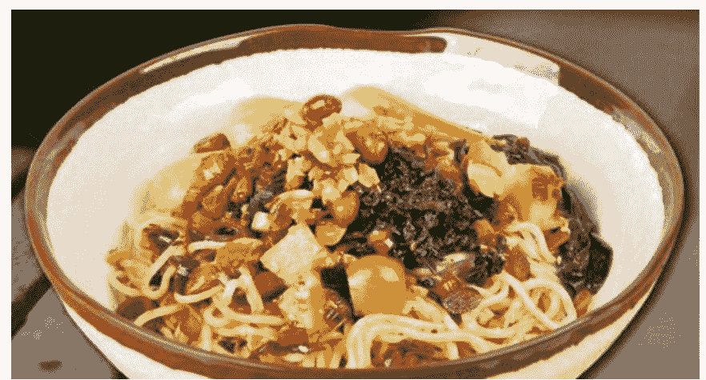

面馆免费模式
很多 人把营销和促销搞混在一起，做营销的重点在于品牌的传播，比如，有的老板砸个 100 万做广告，他啥也不卖，他就告诉你他是做什么的，就是推广宣传他的品牌。促销呢，更多的是在于销售产品，通过打折降价的手段来吸引用户消费，目的就是赚钱盈利，所以，两者本质上还是有区别的，侧重点不同，但是最终的目的还是相同的，都是为了卖产品赚钱。
今天和大家分享两个土豪玩法的营销案例，为什么说是土豪玩法呢?因为他的活动杀伤力太猛了。一般人不敢这样玩，因为玩好了有 可能赚钱，但是玩不好，可能会亏本。
先说第一个案例吧，重 庆火锅免费吃一年，在重庆有一家火锅店搞了一个活动，办超级会员卡，免费吃一年火锅，超级会员卡多少 钱呢?一万元。说多不多，但是说少也不少，为什么?因为免费吃一年啊。 有的人马上就说了，这背后肯定有套路，万元吃多少次?每次消费多少还是抵多少?
等等，但是，你错了，因为万元不限次数，不限人数，也就是说你 365 天每天都来吃都可 以，你一个人来还是 5 个人来都可以，但是，消费不能超过 400 元一次。
当然，前提是你的火锅口味不错对吧，所以，如果持卡人带的朋 友平时又带朋友或者家人过来消费，所以，这其实就是一个口碑宣传，所以，最后把这些综合起来，可能会平本，也可能会亏本但是，他们达到 了一个口碑宣传的目的，所以，这种套路想赚钱有点难，所以，会有名额限制，多了亏不起，亏了就算做广告了，这种套路不要轻易玩哦。
下面在和大家分享一个也是很角色的案例，怎么狠法?他推出“100 元免费吃一年面条, 1000 元终身免费吃”，那他是怎么盈利的呢?下面为你分享:
一个在装修的店面搞了一个活动,100 元免费吃一年面条,1000 元终身免费吃。这个价格可以接受吧,100 块,1000 块不算多吧，现在一碗面条少说也要 10 块钱，吃 10 碗面条 100 块那都不是事，但是，他们的面条是 18 块一碗。
我们算一下，如果你天天吃一碗面条,365 天乘以 18 那就是 6570 元啊，但是现在只要 100 块钱。其实后面这个才狠,1000 元终身免费吃，具体能吃多少钱，不知道怎么算了有的人说，

绝对是骗子，怎么可能，套钱跑路的吧，但是，看完这个条件，你就觉得不是了，因为他是限制名额，只有 100 位，另外一个还限制地方人，只有两个地方的人能办虽然是限制，但是如果是卖面条肯定亏本对吧，这个是人人都知道的，但是，后面有什么套路呢？就不知道了，后面还有套路？比如，哪天混熟了以后，把你拉成店面的合伙人？你看你经常吃我们的面条，味道也不错，要不要掏点钱成为合伙人？有分成哦。
如果成为合伙人以后，估计你不会天天来吃面条了，当然这是一个后面想的。
那么这个活动力度这么大，有什么好处？用户看到了会不会多看一眼？会不会有的用户帮忙宣传？100 块吃一年啊，这个吸引力还是很大的啊。报纸要不要宣传一下，甚至电视台的也搞一个宣传，所以，装修完以后，很多人也知道有这个店了，哪个店？100 元吃一年 1000 元终身免费吃那 bre店啊。
那么，他们真的是卖面条的吗？不好意思，你又错了，因为他们卖面条仅仅是其中一个系列，还有，石头烤羊排、小笼蒸菜、老醋鲤鱼炖豆腐、白彦花勾鸡、蘸烧海参等等太多了，因为他们也是一家菜餐厅。
以，正常的餐厅怎么宣传？某某号本餐厅开业，全场 8 折，还有抽奖哦，请问你能记住这样的活动吗？但是，他们怎么宣传？
100 元免费吃一年面条,1000 元终身免费吃面条。请问你能记住哪个广告？用户又会帮你宣传哪个广告？觉得后面那个更加容易让用户记住，你觉得呢？
免费作为一种营销策略乃至商业模式，已经越来越多的企业所认知和广泛运用，并创造着可观的利润，不仅仅是互联网经济领域，在传统实体市场同样如此。
你需要的资源这个世界上本来就有，创造远远没有整合来得快！

# 43.洗车店经营方法，免费洗车怎么颠覆整个行业，年利润超过 500 万

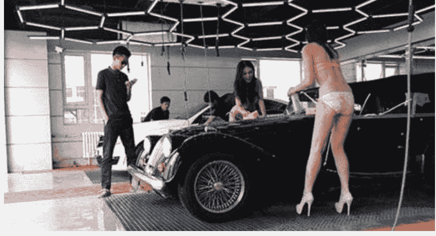

洗车店免费案例

假如你有一部价值 50 万的豪车，你肯定会给它上保险对不对，之前办理保险都是在平安保险办理，假设保费是 1 万。现在呢保险还是在平安保险，保费也是 1 万，什么都没变，但是现在呢，你在我的洗车店里代办，1 年内免费洗车，不管你来多少次，你愿不愿意？
这个消息一公布，大家都知道哪个圈子传播速度是最快的，肯定是老板。老板认识的

多是一些高端的人脉，因为老板经常要去应酬，比如说：今天晚上吃饭一起，有十几个坐在一起，坐着大部分都是有车的人，对不对这十几个人当中没有 bada “某某的洗车店，只要保险在他这里代办，还是同样的保险公司，同样的保险费用，一年内免费洗车，不管你去多少次。”老板们在饭桌上一算一个月洗车 6 次，好了，一年就 12 个月。12 个月乘以 6 次，一年就要 72 次。每次去洗车的时候要付 30 元,72*30 算一算是假如你有一部价值 50 万的豪车，你肯定会给它上保险对不对，之前办理保险都是在平安保险办理，假设保费是 1 万。现在呢保险还是在平安保险，保费也是 1 万，什么都没变，但是现在呢，你在我的洗车店里代办，1 年内免费洗车，不管你来多少次，你愿不愿意？

这个消息一公布，大家都知道哪个圈子传播速度是最快的，肯定是老板。老板认识的多是一些高端的人脉、因为老板经常要去应酬，比如说：今天晚上吃饭一起，有十几个坐在一起，坐着大部分都是有车的人，对不对这十几个人当中没有 bada “某某的洗车店，只要保险在他这里代办，还是同样的保险公司，同样的保险费用，一年内免费洗车，不管你去多少次。”老板们在饭桌上一算一个月洗车 6 次，好了，一年就 12 个月。12 个月乘以 6 次，一年就要 72 次。每次去洗车的时候要付 30 元,72*30 算一算是 2160 元，只要保险在talk wash车店里代办年就帮车主省下来 2160 元，感觉值不值。

那么请问有没有人感兴趣，会不会下次保险到期了，在洗车店这里代办，有没有可能性。然后，这十几个人会不会再去聚会，再谈论这个故事，肯定有很多。他用了三个月的时间就有 500 辆车子保在这里。

那请问洗车店有没有亏钱，肯定是没有，为什么?因为他把保险公司提成的钱直接给洗车工人。一般一辆车子提成是 500 到 20000 左右那么他给洗车工的价格是 8 元一次，按一年 72 次来算 72*8 等于 576 元，也就是说保险公司提成的钱足够付洗车工的费用还赚点所以我们在设计商业模式一定要做到前端免费，后端赚钱。只要前端免费了，才能吸引更多的流量进来，那大家肯定会想，这样有很多人，让我们怎么赚钱呢?但是我不免费还能赚点钱，现在还能挣什么，三个月的时间有 500 辆车子保在他这里，每辆车子平均是 8000 保险费，那总共是多少呢 500*8000=400 万，是 3 个月的时间，他用这个方法用了一年，在他的洗车店里面总共车子有 2200 辆车子。那是什么概念，2200*8000 差不多是 2000 万，那么保险公司知道了，担不担心，肯定担心。

请问保险公司赚什么钱，他们玩的是金融，然后有两个保险公司聘他当副总，然后每个公司给他多少钱年薪加各种保险提成，请注意是各种保险提成，费用一年纯利润就有 410 万。如果他洗车的话能不能赚到 410 万，洗死也挣不到。

大家想一下：如果这么多人进来了，还能挣什么钱？

既然洗车店和保险在一起，那么可不可以卖其他的保险?保险公司人员出去见客户，天也见不了几个，还带着很多礼品去到客户的办公场合去见他们犯了最致命的错误。你去办公场合见客户，是不是老有人找他，是不是很多事他要处理，因为这是他的地盘，他想静下来，但是别人不允许，他根本没有时间静下来和你聊天。这种现象多不多。

请记住成交客户是把客户带离办公场所，越远越好，现在呢。

比如说，你把车子开到洗车站，刚停好车子，就有人帮打开车门，抬头一看，有个身高 1 米 68 穿着超短裙，迷人身材，还有两个小酒窝，含情脉脉地看着你。比如说你姓张：“张总，三天不见，你最喜欢的咖啡已经帮你准备好了，还是老地方坐坐。”你刚在郁闷这是洗车店呢还是夜店。那个女孩子就把左手放再后背，右手往前伸直为你引路这种接待的现格比接待市长还要气派，这种感觉爽不爽。当你再休息厅坐下来的时候，你还在回味的女孩，这个时候，那个女孩就坐在你的对面和你聊天，聊你喜欢的话题，把张总的家庭背景、人脉、性格爱好等等大致理解个全面。如说她问：“张总，这辆车子是 50 万，至少您的身价 100 万了吧。请问您的成功方法是什么？

这个时候，他一下就忘记自己姓什么了，有没有可能性。何况对面坐着那个女孩子用崇拜的眼睛看着你，那么找到客户的需求后，又认识了李总。用同样的方式去了解，那么你有没有可能让张总和李总两个人认识，让他们合作，帮助他们的事业更加辉煌。帮助张总认识更多的人脉资源。张总会不会感激你，李总会不会感激你，肯定会的。
请记住：永远是先了解客户的需求然后帮助他有句话说：滴水之恩，当涌泉相报。一般理解是别人帮助过我们，我们一定要用泉水来回报人家，对不对。现在反过来説，我们要帮助别人越多，那不是回报的就越多。这个时候，张总和李总知道那个女孩子是做保险的，如果张总有需要购买教育险、意外险、疾病险等等，会不会就先从这个女孩子那里购买。如果他自己卖了，会不会再介绍朋友来购买。
请记住：当你有了人脉资源的时候那就是财人脉不是你认识多少人，而且有多少人认识你并且愿意帮助你。当时呢，有个客户的老公是在海南做房地产开发的，房子呢面朝大海有个沙滩。去过海南旅游的人都 Beau那边的风景确实不错，但真正海南的房产基本上被谁买走的。来旅游的客户看到这风景好打算下来不想走了。有些人是为了养老，有些人是偶尔过来休闲的。因为风景实在太美了，空气又好，但是房子卖不出去，没有销路是因为没人脉，怎么办？那么这个洗车店干了件什么事情呢。
他在地产开发公司也就是说跟这个客户的老公谈，说我可以带人来看你的房子，每卖出去一套，你就要给我 3%的提成。那去旅游的飞机票让房产公司出。大家可能不知道包机的费用，包机的费用很低的，来回要不了多少那住的地方呢，房产公司自己也开发了酒店，反正去就行，住宿吃饭在他酒店，来回的机票也没有多少。房产公司二话不说就同意。因为他们正愁房子卖不出去。只要报销来回机票就行，而且还能带来这么多的高端客户。洗车店对所有的客户通知，海南免费旅游包飞机来回，一切免费，那么去旅游的人多不多，肯定多。去海南旅游，吃住都在这酒店，随便看下他们的楼盘，房子就卖出去了。
有些人是单纯的投资，有些人是打算养老，有些人是为了休闲，反正是有各需求，总共就成交了 8000 万，那他 3%的提成是多少，又是 240 万。这就是人脉资源带来的财富。
当有这么多客户的时候就要挖掘背后的消费习惯。
问大家几个问题: 平常消费的地方有哪些，会不会去酒店吃饭，会不会去旅馆，会不会去电影院，会不会去茶楼聊天，会不会去足浴店，会不会去美容美发，会不会保养车子，会不会 ktv 唱歌，会不会酒后代驾，这是车主的基本生活习惯。但是有很多地方都没有折扣就是没有打折的，有些不会打折是资金管理分散，卡又多，很多卡加起来充值第二语钱加上去就很多了。
比如说，一个店最高是 5000 打 7 折,2000 打了 8 折,1000 打 9 折平常的话会充值 2000，对不对。充 5000 又太多，感觉划不来，但是每个店都先充值，真正打折也打不了多少，而且每天带这么多卡在身上是非常不方便，而且呢经常卡不知道放哪，有时又想不起来了还忘记了密码，对不对。现在呢，他去和所有店的老板先谈，就拿我们和足浴店的老板谈吧。假设之前洗车店有 3000 个客户，而且足浴店基本给客户最高折扣不超过 8 折。那么这个方案就是让他就只抓住一个核心点如果我能为足浴店带来 1 万个客户，你能给我的客户打 6 折吗？各位如果你是足浴店老板，你会干不干？我 '--我想肯定是愿意干的。
如果能新增 10000 个客户，这笔买卖绝对划算的。学员呢就这样拿下了所有和车主消费相关的店。洗车店给客户的价格是 6.5 折，洗车店从中抽取了 0.5 折的利润。当然相对于很多卡的客户来说更愿意。只要一张洗车店里的卡，最主要的是充值后比原来更低的折扣去消费，你愿不愿意办。当然也是和消费场所协议好：每个季度，有的每个月结次账。各位，能想象出是什么吗？也就是说我们账上长达多久的现金流。客户的充值的钱是谁的，这钱能不能用。各位，一个客户不多，就存 2000,100 个客户就是 20 万，10000 个客户呢 2000 万，这还是保守的数据，不包括多存的，不包括在其他地方盈利的各位 2000 万给你换一两万没有任何问题吧，有没有问题。当然关于现金流如何放大这中间许多运作提成，等到下一次讲到资金运作提成中讲到也就是类金融的一种，大家只要改变模式，这洗车店就能做的好，大家有没有悟出什么。不挣钱，那是一直按照你的思维，你的固有的挣钱方式在做，挣不到钱那是必然的，当你的商业模式设计好了，任何的产品都能卖出价值。不在于它到底值不值钱，重要的是你能透过它挣哪里的钱，商业模式就是解决挣钱的问题。
这家洗车店它的模式颠覆了整个洗车行业，让基本不赚钱的行业成为相当赚钱的行业。
所以在坐的各位仔细想想自己企业的商业模式，你能不能做到像洗车店那样，当然也不是完全套用这个模式。毕竟行业不同，但这个关键点还是可以借鉴的。有些是不可以做的，因为地方不同，在做之前最好咨询一下我们的客服，但是我们希望讲这些能够在座的各位有所启发。我们再也不能按照以往的思维去做企业了。闭门造车的结局是注定的，我们一定要打开思维跟着所讲的系统，重新梳理你的模式。做生意不挣钱，真的要好好反思，去看看你的商业模式是否真的能从市场中换来较高的收益。

# 44. 美容院如何利用免费模式，跟银行、4s 店合作，成交率提高到 50%

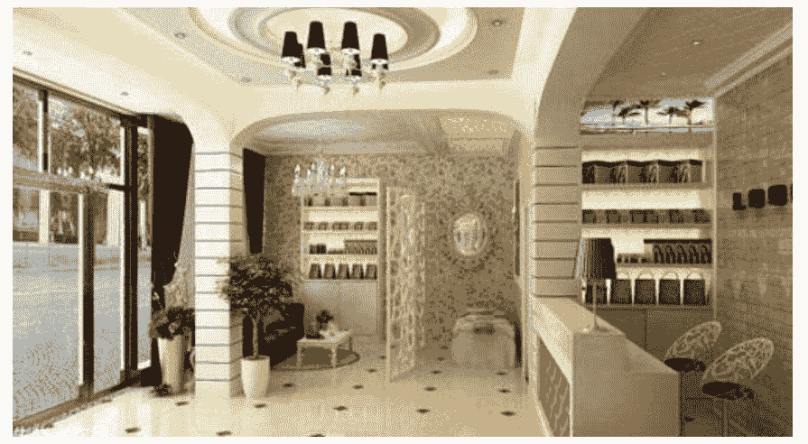

美容院免费模式

有一个朋友，在烟台开了一家美容院，2015 年的时候生意很不好，没什么人气，为了抓取客户，她招聘了 7、8 个业务员进行营销推广：门口发传单，出去揽客户，参加各种活动。心费力，一年的业绩只有 210 万左右，但是就在去年的年会上，她们全年业绩突破 2100 万左右，奇怪的是在会场却看不到销售员的身影第一步：不要再成立销售部了，所有人员全部开掉，节省成本第二步：把公司产品线，梳理清楚，留住最核心最好的产品(不超过 5 个美容院产品很多，一般公司产品不要超过 3 个就可以了) 好产品就是好口碑，你永远记住，只要你有好产品就不怕没有好市场第三步：把公司定位清楚，是走高端路线，还是走低端路线，还是走白领路线(中端路线)，其实股东就是她跟她爱人，第二天就把结果告诉我了，她说做高端，中低端产品全部都去掉。
第四步：好好思考一下，你所要寻找的高端客户有什么特征?他们聚集在哪里?她说就是有钱人，我说不明确，什么样的有钱人?
她思考了说有好车，好房，高额存款的人都算高端客户，我说好，也就是说你想要的

客户都在高端售楼处，高端汽车 4s 店，银行大额储户是吗??她说是。

最后一步，跟银行、4S 店合作，把你的产品送出去，切记：要送就送真金白银，把几千元上万元的产品送出去，你拿出一个产品，送给你想要的客户，她过来消费请问你产品怎么样?她自信满满说非常好，那如果 10 个人来用你的产品，她们既有消费能力，又有这个需求(没有需求他是不会来美容院的，就算白送她们也不会过来)你觉得能成交几个后端年卡?

好，那我在问你，如果 10 个潜在的消费者，在你们店消费体验，按照你们过往的经验你觉得你会成交几个后端，她说能成交 40%，我说好了，你算算你有多少利润吧?

你 10 个客户，只要成交一个，你就可以把送出去的成本全部赚回来了，再多成交一个就是利润，请问你有多少利润?

有人会问这些银行和 4s 店为什么会合作呢?银行为了能够让更多的的客户去购买它们的理财产品会赠送大量的礼品,4s 店为了能够促成销售的成交也会赠送大量的礼品，以前都是需要采购的，现在你出现了，免费提供，他们何乐而不为?

在这一之后，她的店里每天都有 58 位高品质客户登门去体验服务，每天都会有 40%的成交，而去年我帮她设计一套追销方案，成交率可以提高到 62%。

# 45. 亏损的连锁超市，如何用免费模式扭亏为盈，而且欠款 270 万不用还

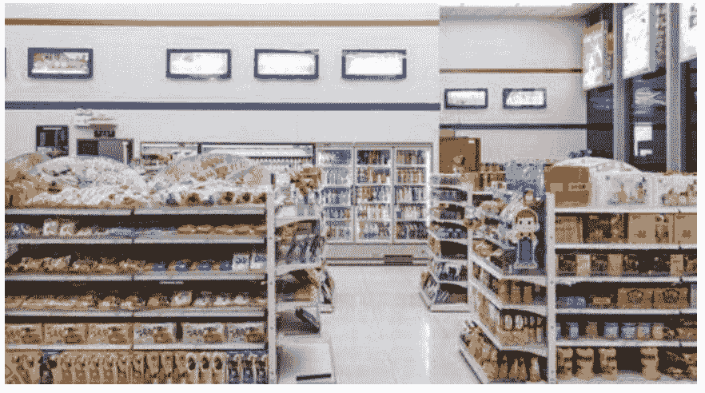

超市免费模式

这家严重亏损的超市现在存在 3 个问题一、公司已拖欠员工 2 个月工资；欠供应商货款 270 多万，供应商已经停止供货，天天有人来催款；三、目前 80%的店面出现亏损；那么，这样情况下的连锁超市是如何用免费模式扭亏为盈的呢?

下面为你揭秘什么是免费思维模式，其实免费思维就是吃亏的思维，你永远无条件的吃亏，无条件的付出、无条件的给予，无条件的爱你的客户，谁也无法拒绝一下发自内心爱你的、对你好的人所以，放生意上，就是永远把员工、供应商、顾客放在最安全的位置，自己吃点亏，不能让客户吃亏，这样客户就会一直追随你。

具体操作方案：（学习更多内容请加微信；xsyxsyqq019）
一、分析亏损的原因 1、拖欠员工工资，员工没有积极性；2、公司资金链断裂，供应商不给供货，货品不全；首先，选择 6 家门店，把店里 80%的股份送给员工，第一个店选两个股东，每个股东收 3~5 万押金(根据店的面积收取)，退股返还押金，因为都是员工，都知道超市的投资和经营情况，所以,6 家店的股东都爽快的把钱交了，签了合同。 核心：没让员工吃亏，投资几十万的店才收他几万押金，还送他 80%股份。 这 6 家店改革试运行一个月，这个月期间，我们把所有的资源都倾斜到这 6 家店，保证这 6 家店的老板们能赚到钱。 一个月的试点过去了，我们开了个全体员工的启动大会，现场给这 6 家店的老板们分钱。这场启动会结束，43 家店全部送出去了，加上原来的店收的钱一共 200 万现金。 从此以后公司开启了新纪元，由原来的雇佣制改变为现在的创业合伙制。 一、当员工都变成合伙人的时候，欠的工资都折成购物卡了，因为他还可以卖掉，所以除了离职的员工，其他员工都换成卡了。 二、当员工都变成合伙人的时候，仓储物流成本就下降了 60%，每个月公司只免费配货三次，如果你超市在让配货，就需要承担车费所以员工都提前根据销售数据囤货，囤多了过期了自行承担，以前都是公司囤货在仓库，会出现过期等一系列问题，现在仓库转移到员工家里了(因为员工都住在店附近)，店里没货了就回家弄两箱，给老板打工的时候，员工怎么都不肯把货放在自己家一个月试点过去了，我们开了个全体员工的启动大会，现场给这 6 家店的老板们分钱。这场启动会结束，43 家店全部送出去了，加上原来的店收的钱一共 200 万现金。 从此以后公司开启了新纪元，由原来的雇佣制改变为现在的创业合伙制。 一、当员工都变成合伙人的时候，欠的工资都折成购物卡了，因为他还可以卖掉，所以除了离职的员工，其他员工都换成卡了。 二、当员工都变成合伙人的时候，仓储物流成本就下降了 60%，每个月公司只免费配货三次，如果你超市在让配货，就需要承担车费所以员工都提前根据销售数据囤货，囤多了过期了自行承担，以前都是公司囤货在仓库，会出现过期等一系列问题，现在仓库转移到员工家里了(因为员工都住在店附近)，店里没货了就回家弄两箱，给老板打工的时候，员工怎么都不肯把货放在自己家里，没货了就等公司配。 所以人只操心跟自己有关系的事，目前这个连锁超市是店店盈利，并且在超市把日常食品鸡蛋大米亏本卖增加人流量(如鸡蛋平时卖 9 毛每个，成本 5 毛，赔本卖 3 毛，每人限购)引爆客流至于怎么解决 270 万债务的问题，这个是关键点，当然解决这个问题肯定不是用收到押金来解决的，至于怎么解决的，请看以下方案十几个供货商共 270 万，跟供货商说，现在逼着要钱也没有，但是如果继续合作的话从现在开始每次进货现款现结，我现在生意好了，以后现金进货了，如果各位供货商同意把各自的应付欠款转化为进场押金，那么我们继续长期合作。 如果有哪位不愿意那么我们解除合作，我再找别的供货商谈照收进场押金还欠款，因每个供货商各自欠款不多又想继续做这笔生意，而且彼此都熟悉了，所以也都同意了，关键点：少了员工没积极性给他们 80%股份自己分配，还不用开工资。老板赚的 20%纯粹是纯利润还不用管理躺的收钱哪里找？(学习更多内容请加微信；xsyxsyqq019) 家赚取 20%纯零润 43 家是多少钱呢?自己算去吧。 最最主要的还是员工，当老板了能不能好好尽心给自己干嘛?把创造力发挥到极致。换算只是得失，任何营销把握不住人性，注定再精明的换算也是一时成功，做不到全面。 (学习更多内容请加微信；xsyxsyqq019)

# 46. 免费送模式案例，世界顶尖高手如何设计颠覆行业的顶级商业模式

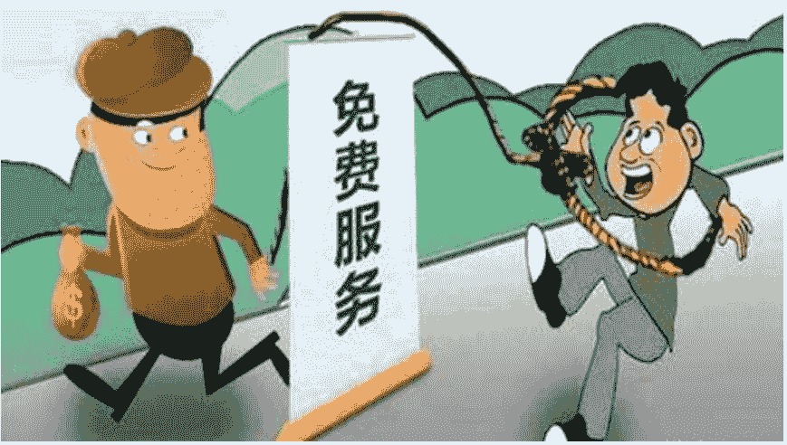

经典免费模式设计

下面分享的这个免费送模式案例，你会看到世界顶尖高手是如何设计颠覆行业的顶级商业模式，当他所在的行业都在卖设备的时候，他却卖起了耗材，当行业都在卖耗材的时候，他却靠绝活赚大钱了。

很多人天天喝牛奶，只知道蒙牛伊利他们赚大钱，但是很少人知道他们背后的公司同样赚大钱。

其中比较出名的一家就是生产销售包装材料、饮料加工设备和灌装设备的公司，这是家世界500强年收入达到上百亿的瑞典公司，掌控着全球75%左右的市场份额，并在十年前控制了中国95%的无菌纸包装市场。

伊利、蒙牛、三元、光明、汇源、娃哈哈、旺旺、银鹭等中国乳业和饮料行业中的龙头企业都是他的客户。

这家公司刚开始也是卖生产设备的，但是他们发现卖设备只能做客户一次性生意，而且下面分享的这个免费送模式案例，你会看到世界顶尖高手是如何设计颠覆行业的顶级商业模式，当他所在的行业都在卖设备的时候，他却卖起了耗材，当行业都在卖耗材的时候，他却靠绝活赚大钱了。（学习更多内容请加微信：xsyxyqq019）

很多人天天喝牛奶，只知道蒙牛伊利他们赚大钱，但是很少人知道他们背后的公司同样赚大钱。

其中比较出名的一家就是生产销售包装材料、饮料加工设备和灌装设备的公司，这是家世界500强年收入达到上百亿的瑞典公司，掌控着全球75%左右的市场份额，并在十年前控制了中国95%的无菌纸包装市场。

伊利、蒙牛、三元、光明、汇源、娃哈哈、旺旺、银鹭等中国乳业和饮料行业中的龙头企业都是他的客户。

这家公司刚开始也是卖生产设备的，但是他们发现卖设备只能做客户一次性生意，而且设备价格上千万比价贵需要客户投资比较大。感觉就是给自己设置了门槛，把很多客户拒之门外所以他们想到了另外一个方案，就是你只要付20%的款就可以了，剩下的80%你不用付钱，但是你需要购买我的包装材料，这样就把销售设备和包装材料进行捆绑起来，从包装材料上把钱赚回来。

通过这个模式，原来很多买不起设备的企业都成了他们的客户。这样他就有了源源不断的收入，牛奶厂家不需要投入大笔资金去买设备，可以把一部分资金拿去开发市场。直到后来他们直接把设备免费的赠送了，直接靠不起眼的包装材料赚钱。很多人看了这个案例说，好像我也可以这么干，但是如果你仅仅看到这个层面，那么你注定走不远。之前也说过，把设备免费赠送了，靠抽取提成也好或者靠包装材料赚钱也好。都存在一个巨大的风险，那就是如果那个企业经营不是很好，耗材用得少，或者经营不善倒闭了。那么你不但没有钱赚，甚至是亏损。（学习更多内容请加微信；xsyxsyqq019）如果这个公司只做到了送设备靠耗材赚钱，绝对不会成就今天的世界500强。为什么他能成为耗材界的顶尖高手?如果仅是靠送设备靠耗材赚钱，世界还有很多企业同样有送设备这个能力所以他进入了更高的境界，靠的是绝活，其实他不卖设备也不卖耗材，卖的是绝活，卖的是赚钱的能力。这个竞争对手根本无法复制，所以成就了他成为顶尖高手中的高手。因为卖设备卖耗材这些土豪的竞争对手同样可以复制你的商业模式。如果卖的是赚钱的能力。竞争对手就很难复制，这就给竞争对手设置了很高的壁垒。因为，你送给厂家设备，他可能经营不善或者倒闭或者发展很慢。对你来说是非常致命的，因为你把设备送出去，钱收不回来，资金链一断，注定破产。所以高手考虑的是我把设备送给你，还要让你大规模的够买我的耗材，而且长期的购买我的耗材。更为重要的是，我可以帮助你的企业快速的发展。这个公司首先开发了一套自动化生产管理软件，给所有的的厂家使用，几乎不收钱。这对企业来说省掉了很大的一笔经费。这套软件从牛奶生产到消费者手上全程跟踪，任何一个环节有问题，马上可以找出来并且优化，这对企业的发展是非常有利的。但是你只能使用他的包装材料才可以，这是其还全程提供产品包装的设计，市场调研，工艺设计，市场分析，甚至是渠道建设和市场推广方案，培训等服务。客户根本无法拒绝这样的服务。所以他牛逼就在这里，给客户提供了独一无二的价值，竞争对手很难复制，他就成就了霸主的地位。对企业来说，企业省掉了大笔经费，获得了飞速的发展。对于这个公司来说，只有企业获得快速发展，他才有可能长远的赚大钱，才有源源不断的收入。有的人就说，这个模式好啊，我也复制去干，但是，如果你没有核心竞争力你是从本干不起来的，就算你土豪，送几百台设备，但是你怎么保证他们大规模的使用你的耗材，如果这个环节你没有解决，你再怎么送，也是等于徒劳，送多少你就亏多少。所以有的人在第一环节设备赚钱，有的人在第二环节耗材赚钱，但是高手就在第三环节绝活上赚钱。所以高手设计商业模式，不仅是盈利，而是要长期盈利，要长期盈利，就要给竞争对手设置一定高度的壁垒。赚钱环节的颠覆是商业模式设计里面非常重要的手段，你赚钱的环节越是后置，你设置的门槛就越高，你的竞争对手就越难复制，你赚钱就会越长久。如果你要设计一个颠覆行业并且同行很难复制的商业模式，那么你就要设计商业模式的差异化。包括很多产品也是这么玩的。你设计差异化，就相当于创新了一个领域。你设计的差异化越有特点，你的同行就越难复制。

# 47. 桶装水全年免费模式，每年送你 56 桶水，还能赚钱的商业模式

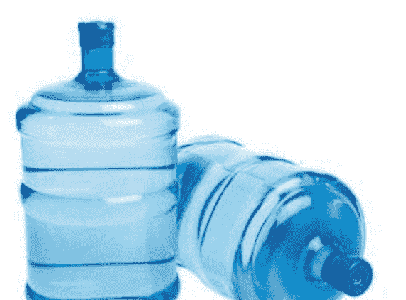

## 桶装水免费模式

一般的矿泉水公司的营销模式都是买多少水送饮水机，这种模式已经很常见了，对用户来说，已经没有什么新鲜感了，还有一种玩法就是打折、促销，这些都是传统卖产品的模式。
还有一种更高级的玩法，你一定没有见过，那就是利用免费送水，玩金融的模式，玩的是现金流。
这种玩法就是你只需交 858 元的押金，每年免费送你 56 桶水喝，每个月送 3 次，一次送给你 2 桶水,1 年以后押金退你 800 元，为什么只退 800 元，不是还有 58 元吗？
这 58 元是买桶的钱，这个桶就归用户了，相当于全年的水是免费喝的，对于用户来说肯定是赚到的,1 年能省几百元钱呢。
那公司怎么赚钱呢？（学习更多内容请加微信：xsyxsyqq019）
第一个盈利模式就是押金，要知道这个水不是一定性给用户的，是分 1 年给的，就是说，公司手上会有大量的现金流，他可以拿这个现金流去投资其它高回й报的产品，赚回这个水的钱一点问题都没有。
另外一方面，你花 58 元买的水桶还在用户手上，一年以后，要么你把三个桶都扔了，要么再交 800 元，继续喝他们的水，这样就把用户锁定了。
当然，每个月给你送水的过程中，他们会不会推荐一些其它的产品给你呢?比如：净水器等！你自己想吧。这种模式就是他们卖的不是水，他们要的是现金流，利用这个现金流，投资其它高回报的项目。还有另外一个玩法，这种模式既不卖水，也不要押金，水桶也免费给你，还送水到家，但是需要 2 元钱的配送费，这个一般用户都不会拒绝吧那这种模式是怎么赚钱的呢?他们的玩法是做水媒体，利用矿泉水桶做广告，把广告的收益来补贴矿泉水的成本。你想想看，你每次喝水的时候，是不是每次都会看一下广告，这样的广告是 100%送达啊，他们利用这种模式吸引大量的用户，最后用第三方付费广告来补贴成本。
如果一个城市 50%的用户都喝你家的水，这个广告覆盖率有多大？
这就是利用水桶做媒体，水来做媒介，最后干了广告的事情，你一定没有想到，做矿泉水的公司竟然是做广告的。

# 48. 贷款 80 万的火锅店，如何用免费模式回款 200 万实操案例！

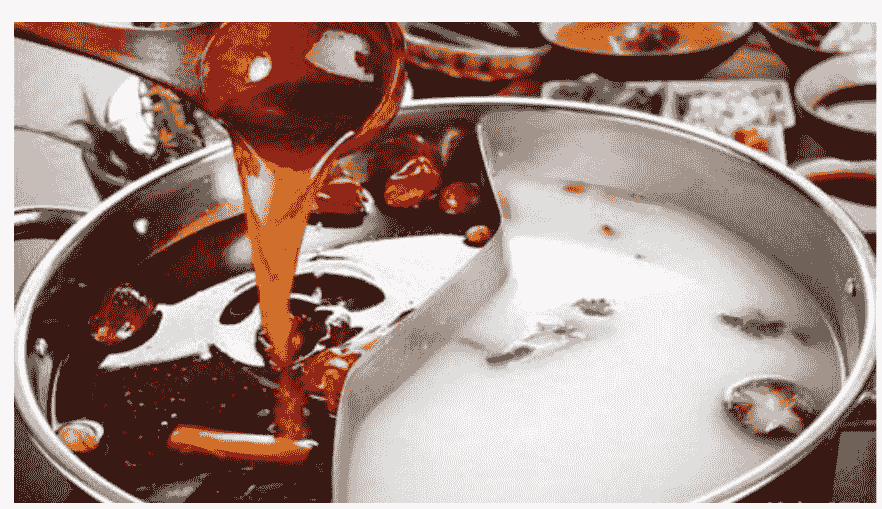

火锅店免费模式案例

大家都知道，做餐饮回款最快的方法就是充值，那怎么做充值活动并锁定客户在这里消费 1 年以上，是每个老板梦寐以求的。

餐饮店想完成充卡，首先要做的是引流，具体方案如下：

这家火锅店老板设计的卡片有效期是一个月，因为一月后失效，所以还有二次充值方案，让顾客再充值一次。第二步的充值消费完成后，我们将销售贵宾特权卡给二次充值的顾客，成功将顾客锁定，成为我们的终身客户。我们给客户设计的开业引流产品，商家计算了一下成本，大概是在 35 元以内。

购买 5 元会员卡，免费吃价值是 130 元的双人火锅套餐。

顾客要花 5 块钱办理一个火锅店的会员卡，开业期间首次来店消费，赠 130 元的双人火锅套餐，为了让这个会员卡更有价值，我们还给顾客设计了一个成交门槛。因为，没有要求，谁都可以买到的东西是没有价值的，管理越严的东西越珍贵！【完美的东西不值钱，稀缺的东西才值钱】这个门槛是，购买我们的会员卡，并将做好的这 5 元买卡送价值 130 元双人套餐的软文，转发到他的朋友圈并获得点赞 10 次，凭微信朋友圈的截图才有资格购买，这样就设计了一个门槛，让大家能参与能互动才好玩，才有价值。【让顾客成为您免费的业务员】于是，来购买会员卡的人越来越多，购买的数量已经远远超出老板的预期。开始我们是做了 1000 张会员卡。后来发现，根本不够。通过一个 5 元钱买会员卡的策略，开业前就吸引客户数量高达 5000+，并且都关注了商家的微信。当看到这个数字的时候，你就知道，引爆后面的充值活动是必然的。（学习更多内容请加微信：xsyxyqq019）

充卡方案要挖掘人性去设计效果才会好，设计的充卡不能让客户足够心动产生行动就是废的，很多传统的餐饮店都在用充 1000 送 200，充 1500 送 300，充 2000 送 400，并且常年累计月都可以充值。

这种充值，效果怎样，想必各位老板都清楚。

但是老板在这个方案是：充值 500 元，持卡人本人可以带一个朋友，免费在一个月里面，不限制次数，来店里吃火锅，除了酒水饮料以外，不再收取其他费用。看到这里也许你会不明白了，500 元吃一个月的火锅，那商家是不是赔了？

如何盈利呢?分析如下:
1 材料采购量大的时候成本会低;【筹码】2 持卡客户大量的来店里消费, 每天都要排队就餐, 路过的人看到都是生意异常的火爆, 吸引更多的人来就餐;【眼球经济】3 像餐饮这种模式, 即使你店里一个客人都不来, 房租费用人员费用管理费用一分不少;【成本=不变成本+可变成本】4 来吃火锅的人, 购买冰镇啤酒和饮料是必不可少的。【副产品来盈利】抛开以上这些, 给大家说一个重点, 你能连续 30 天, 每天都带一个朋友吃火锅吗?
开业第一天, 办了会员卡的人蜂拥而至。享受开业期间免费吃价值 130 元双人火锅的优惠。而当持卡人, 开业的时候。我们就给客人推出了充值 500 元, 不限次数吃一个月。 在店里面, 大量的宣传推广, 还有服务员经过培训练精准话术。客人吃完以后感觉火锅口味非常好, 充值的人已经在吧台前面排起了长队。榜样的力量是无穷的, 随着前面充值排的人越来越多, 后面等座吃饭的人也排成一行。
于是, 店里形成一个奇观, 一条长龙排队充值买卡, 另一条长龙排队吃饭。这充值引起了, 过往路人的好奇, 有很多人把这个场面拍下来发到朋友圈里, 引起了第二次的就餐热潮。
我们设计的第二个充值方案是针对第一次充值的顾客, 消费到 20 天的时候, 我们提醒来店消费的顾客。给他们一个更加无法拒绝的充值方案。你可能会说, 她都吃了一个月的火锅了还会再来吗?
那我想问你一个问题, 如果你在这个店里充值 500 元, 可以免费吃一个月火锅, 另外我再赠送你价值超过 500 元的以下几项服务:
1. 一个月内不限次的洗剪吹月卡 200 元;
2. 5 次洗车服务价值 120 元;
3. 价值 80 元养生按摩一次;
4. 价值 180 元的 KTV 唱歌一次;
5. 还可以领取一个 5 寸蛋糕。
那你要不要充值?
这些都不是平时那些买多少送多少, 或者有什么条件的才赠送, 全部都是实实在在直接领取直接免费。如果 你都觉得这些条件足够诱惑你了, 那掀起第二次的充值热潮, 也就不足为奇。
第一次的充值商家收回了 100 万充值。100 万的投资成本已经回本了, 商家已经乐开了花, 二次充值这次又是 100 万, 这是真正实打实的收益了。第三个方案, 最后要锁定客户的终身价值, 也就是将客户永久锁定方法。依然是会员卡, 但这一次是针对前面充值两次的会员, 可以充值 500 元升级成终身贵宾。
充值 500 元即获得终身贵宾特权卡, 持卡人带一个朋友来店消费, 不限次永远免费赠送价值 68 元的本店的特色菜一份。这次, 仍然是 100%无法抗拒, 依然是毫无悬念的充值 100 万。(学习更多内容请加微信; xsyxsyqq019)
听到这里, 也许你会很纳闷, 这 500 块钱的礼品是从哪里来的?难道是要商家花钱去买吗? 500 元办卡, 以后每次来就送他一份 68 元的特色菜, 即使一周来一次, 一年就要 3264 元菜金了, 更别说终身免费送了, 饭店岂不是亏大了?你还可能会发现一个重点, 自始至终我们搞的活动都是有一个条件, 要求持卡人带一个朋友来消费。
Ps。看了这个案例, 相信你一定很吃惊, 但是你可能无法去执行, 因为你没有一个系统, 或者你不会资源整合, 只靠你一个人的力量是很难以完成的, 思维模式看似简单, 但是背后所依靠的力量是很多的。

# 49. 啤酒、白酒、康师傅饮料长期免费喝，餐饮店结合免费模式赚钱案例

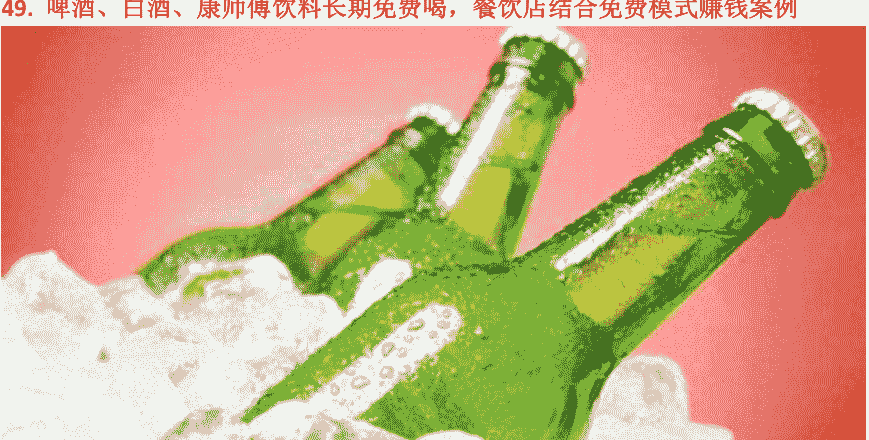

### 啤酒饮料免费案例

作为一个餐饮行业的经营者，除了靠菜品酒水差价赚钱以外还能赚钱什么钱呢？
这个时候大家就要思考，把所有的能赚钱的个一个列出来，找出一个避免竞争还能赚钱的产品，比如普通的菜品差价，酒水差价，或者是菜品不赚钱靠卖时间赚钱，又或者靠广告，或者是其他的等等。
有一家鱼火锅，门口上面挂着一个横幅，本店啤酒、白酒、康师傅饮料长期免费喝，很多人看到这个广告就会想，长期免费喝不亏死你啊，这背后肯定有套路，要么是会员，要么是充值成为会员。
但是，当你进去消费的时候，发现，他的鱼、他的锅底、调料等等和其他的火锅店基本一样，最少价格上基本上没有区别，但是他们店里面多了一个啤酒饮料免费喝，而且啤酒饮料的品种还有十几种之多，关键的是他们竟然没有任何的套路。由于没有任何的套路，只因为多了酒水免费，所以，他们的生意每天晚上都是爆棚，基本都是排队消费，因为消费者也不傻啊，在其他店要 6 块钱一瓶的啤酒，在这里是免费的，随便喝个几瓶那就是几十块啊。
所以，很多人来这里消费就是因为酒水免费喝，有很多人请客吃饭就来这里，因为请客一般都要喝酒吧，而这里的酒水免费喝，对请客的人来说非常的划算，随便几个人，酒钱就能省下 100 多块。
那么酒水免费是能吸引大量的用户，并且能锁定回头客，但是，不说赚钱，怎么能保证不亏本呢?酒水的成本怎么解决?
因为免费酒水，所以每天都是爆满，一个 400 多平方的店一天可以做到一万多的营业额，大家都知道餐饮的利润基本上都有 50% 以上，所以，一天的利润也有 5000 以上，但是，经过他们计算，一个店一天免费酒水的成本就是 5000 多元。也就是说，一个店，基本上除去各种支出，人工，水电，房租，基本上是不赚钱的，好点能持平，差一点的就是略亏本。(学习更多内容请加微信； xsyksyqq019)
因为如果遇到一些比较能喝的用户，十来个人喝掉几件啤酒几十瓶饮料那是很正常的，但是也不是所有人都这么能喝对吧，但是如果遇到一顿喝了 200 瓶啤酒的

家伙，估计老板是很心痛的，但是这种也是很奇葩的。
好了，火锅菜品的利润基本上能补贴免费酒水的成本，但是他是怎么一年赚 1000 多万的呢？
接下来为你揭晓这里面的核心秘密他们的赚钱模式其实很简单，就是靠酒水的返利，仅仅靠酒水的返利一年就能赚 1000 多万。那么，大家都知道，酒水你消费越多，返利就越多对吧，他们一年能拿 1000 多万的返利，那么可想而知他们的酒水销量有多大。
所以，要达到这么大的一个销量，仅靠一个几百平米店面就算你 24 小时爆满也是不可能的，所以，他们是有几十家连锁店的，而且几十家都是酒水免费模式而他们其实拥有 30 几家连锁店，就按一个店 5000 元一天的酒水成本，如果按照 35 家店，大家算一下一年的酒水成本是多少，年最少就是 6000 多万的酒水成本，只有多没有少。
所以，很多人搞不明白，很多人认为酒水免费一定会亏本，如果单拿一个店来说，绝对是亏本的，因为你的酒水量上不去，但是几十家店，酒水的量上去了，返利就会越多就会越赚钱，虽然说有的单店用这种模式是亏本的，但是总体来说能保持平衡，他们就能保证赚钱。
所以，这个时候表面上看他们是卖鱼火锅的，但是他们其实已经变成了一个啤酒的销售代理商，牛逼的是，他们还是用免费酒水的模式来赚酒水的钱。
所以，表面上看，他们真傻，酒水利润这么高竟然永久免费喝，而他们就是靠这个招获得源源不断的用户，基本上不用做什么营销，因为用户会口碑相传，来了 一次，只要味道还可以，基本上还会来第二次，因为没有套路，用户确实能获得较大的实惠。
所以，免费的酒水就是为了吸引大量的用户，只要用户越多，那么喝掉的酒水就 越多，而他们就越赚钱。随着连锁店越多，他们就越赚钱，因为除了酒水以外， 火锅的食材又会变成一个赚钱的利润点。
所以最后你发现，我靠，一个干餐饮的，竟然不是靠餐饮赚钱，也不是靠酒水的 差价赚钱，而是厂家返利赚钱，一年还赚了 1000 多万。老子辛辛苦苦各种营销 各种套路还不赚钱。
所以，在这个世界上，有人能把免费模式玩 到极致，还能轻松赚大钱，他不需 要绞尽脑汁给用户设套路，也不需要搞多么高深的营销模式，就是一招酒水饮料 免费喝，真正的利他精神。当然这种模式没有一点格局和�力的老板根本不敢这 样干。
（学习更多内容请加微信：xsyxsyqq019）

# 50. 洗车店经营方法，高端洗车行利用免费模式年盈利 5000 万

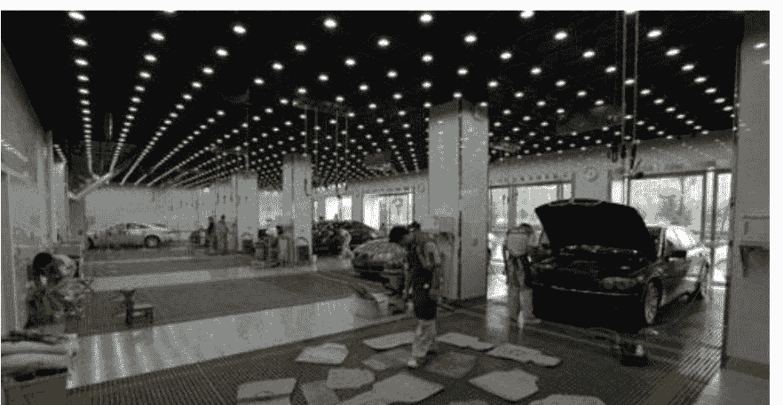

### 高端洗车免费模式

这个社会你是谁不重要，你和什么样的人在一起才是最重要的，有句话是这么说的：“跟着百万赚10万，跟着千万赚百万”，把根稻草绑在白菜上，就是白菜价，绑在大闸蟹上，就是大闸蟹的价格。
今天分享一个洗车店经营方法的案例，这个老板姓刘，在学习了免费模式后，通过思考，制定了一套洗车店的免费方案。
第一、进行客户定位只服务30万以上的豪车车主，主动找奔驰、宝马、路虎等4S店谈合作，跟4S店说，只要是您的客户，我帮你赞助他们价值1800元3个月的免费洗车券、免费打蜡一次和免费车内杀毒一次。因为这些都是免费的，4S店很愿意合作。
然后，刘总打出广告：“世界名车免费维护保养中心”，只服务30万以上的豪车。
客户到店后，由于店里聚集的都是有钱人的圈子，就很喜欢这个氛围，每天，刘总的洗车店门口都停着很多豪车，附件的豪车车主都被吸引了过来。
聚集了大量人气后，刘总找到按摩椅厂家告诉他们：“我这里每天富豪云集，如果你来我这里卖按摩椅，一定能卖的很好”。厂家来考察之后，果然豪车云集，于是就租下了刘总二楼的房间，每个月付给刘总一定的租金，卖掉一套按摩椅还有提成。
于是，二楼摆满了按摩椅，客户来洗车，顺便按摩休息，而且，按摩椅商家，都会有专业的美女销售。每次洗车30分钟，就按摩30分钟。于是，按着按着，就买了按摩椅，一套按摩椅便宜的两三万，豪华的五六万，随便卖一套按摩椅，就赚一两万。
这是第一项收入：租金+按摩椅销售分成有钱人都是很爱面子的，而且喜新厌旧，手机可以经常换，车子旧了换新的，成本太高了，一般没哪个车主会随意换车的。
于是刘总就有了第二项目收入：
深度挖掘客户的需求，引导客户进行全车镀金，打蜡、汽车装饰、汽车防爆贴膜、车内杀菌、音响改装等，改装之后就跟新车样假如一年服务5000台豪车，平均每辆车消费5000元/年，就是2500万的营业额，按最低30%的利润，一年也能赚750万，有的项目利润不止30%，可能更多。（学习更多内容请加微信：xsyxsyqq019）
在洗车的时候，客户就悠闲的待在空调房里，聊天着，吹着牛，还有美女沏茶，

旁边坐的都是有钱人，这个气氛就很不一样了，于是刘总就整合了卖高档茶叶的商家，商家看，都是有钱人，当然愿意合作了，就租下了一块柜台，装修高档一些，而且卖出去的茶叶，刘总还有提成。

而且泡茶的女子，个个年轻漂亮，又是经过专业训练的，她们一边泡茶一边跟客户说：“现在是秋天，我们要享受大自然的恩赐，秋天喝秋菊，可以清肝明目，静心安神。像您这样有身份的成功人士，只有这样的好茶才配得上，来喝一杯。”车主喝着喝着，有没有可能买一些呢？

几乎每个客户都在他店里多多少少买了一些茶，除了菊花、普洱、铁观音、红茶、绿茶，反正各种茶应有尽有。很多客户买了茶，还需要买茶具、纯实木茶桌，有的客户买一台实木茶桌就花了 20 几万。因为他们平时忙，没时间去逛街，恰好洗车的空余时，看到喜欢的，就买了。

刘总的第三项收入：卖茶叶、茶具，每个客户赚 2000 元,5000 个客户，就赚了 1000 万，就算是只有 30%的人买，也赚 300 万。

富人们在一起很喜欢攀比，看着别人开着几百万的豪车，自己的车才 30 几万，感觉很没有面子，就会考虑换车，这时候，店里墙上挂的液晶电视，就专业的循环播放汽车介绍，而且只要想试驾，只要刘总一个电话，名车销售店派人上门接送客户。

这就是刘总的第四项收入：销售汽车！每个月卖出去 100 多台豪车，一年卖上千台车，台一百多万的车，怎么样也能赚 1 亿块吧?可能还不止这么多，单单卖豪车每年都赚上千万。

后来，刘总的店里赚到了钱，就提升了服务。由于服务好，店内环境舒适，结果越来越多多人往里挤。刘总没办法了，就说：这样吧，为了把最好的服务提供给有需要的人，我们设立一个小小的门槛，每个人缴纳 3 万元会费，如果要退出，提前一个月申请，钱一分钱不少退还。由于刘总先付出，又跟客户打交道这么久，大家都相信他！才 3 万，毫不犹豫的答应了。于是，刘总单单这一项，就收了 1.5 个亿。不过，这里要提醒一下大家：这是种子资金，不可以乱用，要用别人的钱生钱。刘总拿着这 1.5 亿，5000 万购买国债，因为国债最安全。5000 万用来跟着富人做投资，5000 万专做买房赎楼的过桥资金，半个月 2 分利息。单单赎楼业务每个月赚一两百万，年赚一两千万。

所以，刘总的第五个收入来源就是：钱生钱！

钱放自己账上是成本，放到别人账上叫微利润！我的客户就是你的客户，你的产品就是我的产品！

刘总把自己的客户与其他行业对接，产生价值，别人的产品被刘总免费整合，自己不用进货和销售，坐享其成。而在这之前，你要花成本培养信赖感！因为，任何生意都是建立在信任的基础之上的。

# 51. 鱼塘的鱼免费送，年底居然营收百万？这一切是怎样做到的？

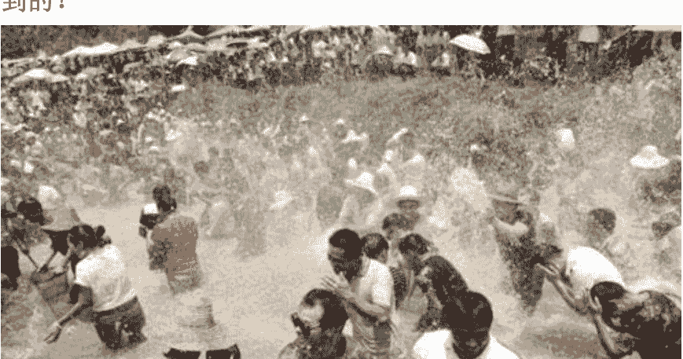

鱼塘免费模式案例

有一个老板承包了当地 10 亩鱼塘，每年都会举办一次免费抢鱼的活动，抢到鱼的就可以免费拿走，谁抢的鱼最大还有奖励。
他通过策划这个免费抢鱼的活动，每年都能吸引几万人过来参加这个活动。
那么，鱼是免费送的，那怎么盈利呢？
原来这个老板还在鱼塘附近还开了一家生态鱼村，鱼村里还提供住宿服务。
很多人参加过这个抢鱼活动后，是不是要吃饭，是不是要住宿，那他这个鱼村都提供这些服务，那这些游客是不是就会在这里吃鱼，没抢到鱼的游客也会顺便买一些带回去虽说是免费抢鱼，但是他这个免费抢鱼活动是有时间限制的，大部分人都抢不到这个鱼，看热闹的居多。
他通过这个免费抢鱼活动，吸引了大量人气，再通过一些地方媒体的报道，大大提升了鱼村的名气，另外，他还在鱼塘周围设置了一些广告牌子，通过广告招商又赚了一笔。
PS. 免费抢鱼只是一个吸引游客的手段，把人气吸引过来后，带动游客消费更多才是目地。

# 52. 辅导班招生策略，培训机构利用免费策略，一个月垄断本地业务

辅导班免费案例

现在的小孩成绩只要跟不上，家长就会给报辅导班，还有的家长要上班，没有时间看孩子，也要送到辅导班。

多数辅导班都是以家庭式的为主，环境设备差就不用说了，老师的教学水平也参差不齐。

活动开始前需要准备的：

- 1、获得教育资质；
- 2、改善教学硬件设施，每间教室装上高清摄像头，大厅安装大的 LED 显示屏，可以清楚的看到老师辅导学生的实时画面；
- 3、招兼职大学生作为代课老师，解决老师的教学质量问题；
- 4、延长辅导班的教学时间，照顾家长的下班接孩子的时间，别 的辅导班放学时间一般在下午 5:30 左右，没有加餐，本辅导班直接延长至 6:30，并提供晚餐。

通过以上的改进优化，与同竞争对手相比，具有明显的优势。不论是做实体生意，还是做销售卖产品，首先考虑的不应该是如何引流的问题，而是先要考虑，如何打造核心竞争力的问题，比如：

我可以给客户带来哪些竞争对手没有办法满足的需求？

我可以给客户带来什么不一样的体验？

只有有了你的核心竞争力，接下来的引流是就简单了。否则，客户来了不能很好的锁定，那么引流的越多，可能死的就越快！这也是很多生意不稳定持久的根本原因！

接下来就是解决怎么招生的问题第一步：设计引流产品免费试学1个月为引流产品，并设计相关小赠品，分别是：拼音本、铅笔、橡皮、记作业的作业本等等； 整个招生过程没有发过一张宣传单页，发传单的效果实在不敢恭维，而且不能保证效果，很多宣传单客户看都不看直接进了垃圾桶，更重要的是无法分辨哪些是精准客户，不能有效的和学生家长建立互动的管道，也就无法做到监控和信任度的建立，所以也是这次招生没有采用宣传单页的原因。 但是，没有宣传单页，并不是就不能招生而是把招生信息印在了写作业的作业本上，封面是辅导班的LOGO第一页是招生信息，并设计了一个家长签名栏。 之所以选择定制作业本，是因为，作业本是学生每天记录老师布置的作业，所以使用周期相对时间要长，可以长时间保存在学生手里，更关键的是家长每天要根据作业本检查孩子的作业完成情况，相当于长期的值入广告，无形中增加了品牌曝光度。 具体做法是这样的： 第一步，发放引流赠品 在学生放学阶段，每个学生免费领取一本作业本，并告诉学生，回家让家长签字，明天在家长的陪同下可以去辅导班再领10本拼音本、10支铅笔和一块橡皮。 首期发放100本作业本，仅对一、二年级的学生。 第二天，将10本拼音本、10支铅笔和1块橡皮，打包在印有LOGO的手提袋内，送给来辅导班领礼物的家长。家长来了之后，有专人接待，参观教室环境，鼓励家长让孩子免费试学一个月，整个过程没有任何的营销成分，当时共计来领的家长有68位，成交率在80%以上，第一批成功招生55位学生，强调一下，有部分学生家长因为工作原因，或家离学校太远，没有来领，总投入的引流成本大约1200元。 第二步、品牌曝光 1、100本印有LOGO的作业本，可以直接影响同班同学的羡慕； 2、印有LOGO的手提袋，直接进入家庭，对家长形成品牌形象传播； 3、招生到的每个学生，发一个印有LOGO的胸章，统一缝制在校服上，区别其他学生，方便学生接送。这就相当于在学校投放了55位移动广告位。 更有意思的是，很多学生是因为印有LOGO的作业本和胸章标志，吵着家长报名辅导班，连平时不愿上辅导班的孩子都要求报名，直接形成了事件传播，所以在短短2周内，招到130位学生，最后由于教室有限，不得不终止招生。 第三步、利用智力游戏体现教学质量 在暑假临近结束时，在学校附近小区搞了次文艺演出，辅导班联合了几个舞蹈学校，搭了个舞台，在小区进行演出，其中有个节目就是经过策划的：智力游戏，让小区的小朋友都可以参加，但是最后胜出的全都是辅导班的学生，最终台下的家长观众会认为上辅导班的学生真cool啊，脑袋反应就是快，间接体现了辅导班的教学质量。 第四步、让家长排队，引发从众心理 孩子除了完成学校的作业，在辅导班还我们的教学质量。 孩子除了完成学校的作业，在辅导班还会相应增加一些额外作业，并且，辅导班老师会逐一进行批改，对错题或不会的题都会进行一对一讲解。 很多家长来接孩子都会遇到这样的情况，大厅接待老师会告诉家长，“再稍微等一下，今天孩子有几个题不理解，老师正在给他做单独辅导”，如果你作为一名家长，肯定会配合老师的，并且会认为老师对孩子非常的负责，也正是家长所期望的，而且家长可以通过显示屏看到，老师确实是在辅导自己的孩子。 所以，辅导班的口碑一直非常好，加上每天辅导班门口很多家长排队接孩子，很

多家长主动为孩子转学到辅导班，所以在一个月的时间垄断了附近的辅导班。

## 第五步、整合周边艺术培训班，扩大实力

通过上面的4个步骤，辅导班很快做出了当地的影响力，由于学生资源多，吸引了周边艺术培训的老师主动来谈合作，所以除了正常学习辅导外，还增设了舞蹈班，音乐班，绘画班，跆拳道班等等，更重要的是，辅导班不需要给艺术培训老师一分钱的工资，相反还可以得到艺术培训班的分红，相当于白捡的一块收入，正好可以填补招聘大学兼职的费用！

以上是对小学教育培训行业做的部分策划方案，但不是完整方案，里面还涉及到很多的细节打磨，包括招生广告撰写问题、定制个性作业本问题、家长接待问题、定价问题、回笼资金问题、打造成交主张问题、后端盈利点问题和后端布局问题等等，因为涉及到商业秘密，这里不方便向大家透漏，大家只需要知道整个策划方案的运用，能够明白案向背后的思维，然后套用到自己的生意中去就可以！

# 53. 免费餐厅盈利方法，餐厅活动这样搞，既能引爆流量又能保证赚钱

免费餐厅案例

这是一家自助烤肉和披萨一起的餐厅，环境就不用说了，肯定差不了，而且他们的自助的菜品就多达300种，每一种吃一口都能把你吃撑。因为是自助餐嘛，所以，随便你吃，什么麻辣小龙虾，东北烤串，新疆的羊肉串，海鲜等等，其他的就不说了，关键的是还有哈根达斯。

有一次这家餐厅搞活动，一大盆麻辣小龙虾吃到你撑再加每个人一个哈根达斯而且不到70块。

这里面的性价比就先不说了，但是他们能通过这种超高性价比来吸引用户，过不久就搞次这样的活动让用户爽一下，当用户上瘾以后，基本上这些用户吃自助餐都会来这家餐厅，据他说这家餐厅还经常搞活动，关键的是还没看到有要倒闭的预兆。
说了很多，回到今天的主题，全场免费吃，那么这种活动怎么搞，既要保证引爆活动又要保证赚钱。
以前就分享过你的活动能不能引爆，关键的是你给的诱惑大不大，也就是你的鱼饵产品起着至关重要，就像一个年轻貌美如画的美女和一个豆腐渣的大妈，哪个吸引力大？
那么一般来说搞活动首先要做的是找借口，怎么找借口呢？太多了，什么节日啊迎接什么什么啊，甚至连学生毕业也可以成为活动的借口。
所以这家餐厅玩的是，周年庆，老板大放血，全场免费吃，免费吃怎么赚钱呢？重点来了哦，重点就是一句话。
“你在这里消费以后，在你的会员卡上面冲上 4 倍以上的餐费金额，当餐就可以免费。”
就比如说，你这次消费 250，然后你充值 1000 块，这 250 就免了，你的会员卡上面仍然有 1000 块消费。
而且只要充值满 500 块，不仅当餐免费，还送你价值 168 块的香薰抱枕。如果你充值满 1000 块的话，不仅这餐免费，还送你价值 1980 元的波司登高档蚕丝空调被一床。
对于用户来说，当餐免费，还有礼物送，就比如冲 1000 块来说，还送你 1980 的品牌空调被，那么其实这个蚕丝空调被实际价格大家都懂的，这说的是价值 1980 哦，为什么是这种产品呢？
大家平时如果有注意的话，为什么很多公司搞活动啊搞年会啊，都是这种类似的产品呢，因为这种产品第一有品牌知名度，第二，就是价值高实际成本非常低。
但是对用户来说感觉就是品牌高价值，自然心里觉得爽了。
所以，大家明白了吧，全场免费吃是有条件的，但是这么好的环境，这么牛逼的菜品，冲个几百对这些用户来说很容易吧。你想啊，冲个 500 块就可以当餐免费，还有礼品拿，关键是我的会员卡里面还有几百块。
而且他们的用户基本都是中端以上的用户，所以充值几百块对这些人来说基本上也不用经过大脑就可以做决定。
所以，现在比较流行的玩法就是充卡，通过赠送让你感觉超值的产品来吸引你充卡，充卡不仅可以锁定用户，重要的是可以获得现金流，你的钱在我的手上，你爱什么时候来就什么时候来，先把钱拿到手再给你服务，不怕没客户。

# 54. 最厉害的商业模式案例，机场大巴免费坐，每天多卖 10000 张机票

机场大巴免费模式案例

相信不少人都有过搭飞机的经验，我们知道通常下了飞机以后还要再搭乘另一种交通工具才能到达目的地。
在中国的四川成都机场有个很特别的景象，当你下了飞机以后，你会看到机场外停了百部休旅车，后面写着“免费接送”。
如果你想前往市区，平均要花 150 块人民币的车费去搭出租车，但是如果你选择搭那种黄色的休旅车。只要一台车坐满了，司机就会发车带乘客去市区的任何一个点，完全免费！你是乘客你要不要搭？
居然有这样的好事？请先略读下面这则新闻：
四川航空公司一次性从风行汽车订购 150 台风行菱智 MPV。四川航空公司此次采购风行菱智 MPV 主要是为了延伸服务空间，挑选高品质的商务车作为旅客航空服务班车来提高在陆地上航空服务的水平。为此，川航还制定了完整的选车流程。
作为航空服务班车除了要具备可靠的品质和服务外，车型的外观、动力、内饰、节能环保、操控性和舒适性等方面都要能够达到服务航空客户的基本要求四川航空，这家航空公司，向风行汽车买了 150 辆休旅车，这么大一笔订单当然是
为了要提供上述免费的接送服务用途。四川航空方面提供的机票是五折优惠，一方面又给乘客提供免费接送服务，这一举措为为四川航空带来上亿利润。我们不禁要问:免费的车怎么也能给它创造这么高的利润?这就是商业模式的魔力:原价一台 14.8 万元人民币的 MPV 休旅车，四川航空要求以 9 万元的价格集中一次性购买 150 台，提供给风行汽车的条件是，四川航空令司机在载客的途中提供乘客关于这台车子的详细介绍，简单的说，就是司机在车上帮风行汽车做广告，销售汽车。
在乘客的乘坐体验中顺道带出车子的优点和车商的服务。每一部车可以载 7 名乘客，以每天 3 趟计算,150 辆车，带来的广告受众人数字是:7*6365*150，超过了 200 万的受众群体，并且宣传效果也非同一般。
司机哪里找?想象一下在四川有很多找不到工作的人，其中有部分很想要当出租车司机，据说从事这行要先缴一笔和轿车差不多的费用的保证金，而且他们只有车子的使用权，不具有所有权。因此四川航空征召了这些人，以一台休旅车 17.8 万的价格出售给这些准司机，告诉他们只要每载一个乘客，四川航空就会付给司机 25 块人民币！
四川航空立即进账了 1320 万元人民币: (17.8 万-9 万)X150 台车子=1320 万。你或许会疑问:不对，司机为什么要用更贵的价钱买车?因为对司机而言，比起一般出租车要在路上到处晃晃的找客人，四川航空提供了一条客源稳定的路线！这样的诱因当然能吸引到司机来应征！这 17.8 万里包含了稳定的客户源，特许经营费用，管理费用。
接下来，四川航空推出了只要购买五折票价以上的机票，就送免费市区接送的活动！
如此一来，整个资源整合的商业模式已经形成了。
我们继续分析，对乘客而言，不仅省下了 150 元的车费，也省下了解决机场到市区之间的交通问题，划算！
对风行汽车而言，虽然以低价出售车子，不过该公司却多出了 150 名业务员帮他卖车子，以及省下了一笔广告预算，换得一个稳定的广告通路，划算！
对司机而言，与其把钱投资在自行开出租车营业上，不如成为四川航空的专线司机，获得稳定的收入来源，划算！
至于对四川航空而言呢，这 150 台印有“免费接送”字样的车子每天在市区到处跑来跑去，让这个优惠信息传播大街小巷。还不够，与车商签约在期限过了之后就可以开始酌收广告费(包含出租车体广告)。
最后，四川航空最大的获利，别忘了还有那 1320 万，当这个商业模式形成后，根据统计，四川航空平均每天多卖了 10000 张机票！
回想一下，四川航空付出的成本只有多少?
到这里，各位一定发现了资源整合的惊人效益！分析:
商业模式是什么?
从四川航空的案例不难看出，商业模式就是打造一个平台，让你在上面既能做好人，又能做好事。模式是要从一个点到一条线再到个面，再编制一张网，最后形成天罗地网。
模式怎么盈利?
老板的任务不是自己在舞台表演，而是编制这张天罗地网，让更多的去上面表演，任何人上去表演，老板都可以抽成。
最近一家公司市值超过微软，就是苹果电脑，它打造了世界上最大的软件平台，
上面四万套软件可以下载，手机软件也可以下载，但是没有哪个软件是苹果自己花钱做的。“此路是我开，此树是我栽。欲想此处过，留下买路钱。苹果电脑，山贼是也”。这就是苹果的商业模式。凡是成功的商业模式都有这么一个共同之处，找到更多的人给自己支付成本，找到更多的人给自己创造利润。苹果电脑如是，四川航空亦如是。
具体来说，我们怎么才能找到更多的人给自己创造利润和支付成本？
这里要考虑三个关键词：“最大化” “利益相关者” “提供服务”。
“最大化”，就是最大化企业的价值。
比如麦当劳，做到 24 小时营业后，租金成本不变，让它的生产资料价值最大化。四川航空让司机当起了业务员。让乘客成为汽车的潜在消费者，在某种程度上让消费者变成消费者，这本身是让企业价值得到最大化发挥。
“利益相关者”，就是在这张天罗地网中的各个利益群体。一套好的商业模式是多赢的。
四川航空在设计这套商业模式时，设计的企业利益相关者有乘客、司机、风行汽车公司、航空公司。四方的利益都得到照顾，各取所需。
“提供服务”，就是为各个利益相关者提供服务，从而使得他们为你带来业务。使企业的值最大化，在企业价值最大化过程中为所有的企业利益相关者提供服务，通过提供服务让他们给企业带来业务，这个过程所中形成的交易结构，就是四川航空的商业模式。

# 55. 免费商业模式案例，如何用免费模式切入一个点，撼动整个行业

免费模式思维

今天分享一个高手如何从一个小的切入点进入市场，然后撼动整个行业的免费商业模式案例，从这个案例中你可以学到，高手是如何一步一步打造商业模式，一环紧扣一环，最后实现一个大的生态系统平台赚大钱的。

大家都知道这两年新能源领域很火，迎来了发展的风口。特别是电动汽车领域。大家都知道我们的国内电动汽车都卖到国外去了，所以这个领域掀起了一股造电动汽车的大风口。
那么电动汽车，就需要充电桩吧。所以有些企业就搞起了充电桩的生意。因为很多地方都没有充电桩，所以有些人买了电动汽车，安装一个充电桩至少需要几千块。所以导致很多地方都没有充电桩。
那么有一家公司就搞了一个免费安装充电桩的模式，选择跟一些大企业合作，给你免费安装充电桩，大家都知道每个单位的变压器富余量是有限的，意味着你占有了，后来的竞争者想安装，就必须增加变压器的容量才行。
那么他们通过这种免费的模式，在很多地方安装了充电桩。有的人就会问了，安装充电桩免费，怎么赚钱？靠电费赚钱？太难了吧，收高了，别人不干，收低了，何年何月才收回成本。而且，你安装了充电桩，都没有人有电动汽车，怎么赚钱？
那么这个时候，充电桩有了，想要赚钱，你就要解决车的问题吧，要有人买车啊，于是他们搞了一个活动，电动汽车免费赠送。
汽车免费送啊，很多人听到觉得不现实，但是他们就这么干了，叫以租赁售，意思就是说，你跟我签个合同，这个车租给你，5 年内每个月交租金最便宜的 600 块。换句话说，你每个月花费 600 块租一个车用。
对于企业来说，解决了用车难的问题啊，这些相当于给销售人员报销车费的钱还要少，而租满 5 年后，这个车就是你的了。
那么对于个人来说，花钱买一辆要 5 万多，但是通过这种模式 5 年才 3 万多，省了一万多啊。而且不用一次性给首付这么多钱啊，而且这个车你还可以租给别人用。租个 5 年就得一辆车。划得来吧。
对于有车的人来说，邮费一年最少要六千多吧，但是用电动车的话，一年才两千块啊。省了几千块，并且节能环保啊。
那么通过这种模式，就会有一些人去租他的这个车，当然，拥有这个租车权利必须...
那么这个时候车有了，充电桩有了，但是还是不赚钱的啊，那他靠什么赚钱呢？盈利模式在哪里？
你使用他的充电桩，
所以他们通过一个点切入一个行业，打造整个行业的生态圈系统，卖电、卖车、租赁、广告、电商、金融等等。
所以高手都是以一个小小的切入点，打造个完整的生态系统，一环扣一环，最后实现赚大钱，然后每一步再设计相关的模式来促进项目向前发展，最后达到整个项目的成功。

- 1、他们线上的服务平台可以收取一定的费用吧。
- 2、他可以卖车吧。
- 3、修车可以赚钱吧。
- 4、租车可以赚钱吧，就是电动车出租服务
- 5、用户每天要充电，每天要支付，这个时候就品台就会有大量的粉丝和活跃用户，这个时候可以做广告吧。
- 6、当发展到一定规模的时候，可以做电商吧等等。

# 56. 如何理解免费思维？没有不能免费的行业，只有不能免费的思维！

## 如何理解免费思维

这几年非常流行互联网思维，有很多行业使用互联网思维都颠覆了行业，所谓互联网大家最为熟悉的就是免费模式，那如何理解免费思维呢，下面给大家分享：（学习更多内容请加微信：xsyxsyqq019）

免费模式我们都不陌生，有人免费亏本，有人免费赚钱，还有人免费赚大钱！

免费商业模式的核心是让顾客充分占便宜，以此吸引大量的客流，通过延长利益链条，实现后端盈利。

通过整合各种商品资源，从一个生产销售商变成一个渠道商，通过产品组合打

包的形式进行捆绑销售，来完成后续的隐形盈利……
没有不能免费的行业，只有不能免费的思维！
对于免费的商业模式我们也亲身感受到了并且也见证了很多成功的案例。那么对于互联网免费商业模式的精髓是什么？
本人总结了很多成功高手的案例得出三点：
1、产品
2、免费
3、增值
那么从上面这几点，我们看出，你要使用免费的商业模式这招，你首先要有一个产品，而且这个产品还要具备以下特点：
1、有需求
2、粘度高
首先你这个产品是用户需求强烈的产品，如果可有可无，那么就不能大量的吸引用户，就不能增加用户的粘度，如果这两个条件都不存在，那么后面的增值服务就很难实现盈利。
第二个，就是免费，免费可以最大化的吸引用户，同时让你的竞争对手毫无还手之力，这样你才能锁定用户，这里所说的免费不定是全免不要钱。那么免费的真谛就是计算你的赚钱用户数量，比如说你通过免费吸引 100 万用户，这个时候是不赚钱，那么当你积累到 200 万用户的时候，你就能实现盈利。这个才是目的。
那么第三个就是增值服务，这个就是你的赚钱的法宝，通过前面的免费，你聚焦大量的用户，这个时候你的平台或者项目就产生了价值。举个简单的例子，比如说搜索引擎，对所有用户都是免费的，那么通过免费他吸引了大量的用户，这个时候他就可以推出其他的服务了吧。
假如有 100 个人购买他的服务，他就能平本，那么当有 200 个人购买他们的服务的时候他就赚钱了。他并不需要使用他产品的所有人都购买他的服务。只要有一定比例的人购买他的服务他就能实现盈利。
下面通过两个案例让大家对这种免费的商业模式在实体大项目和互联网项目中运用的模式有一个清楚的认识。
大家都知道我们看的很多电视电影的拍摄地点都是在影视城横店拍的，横店影视城其实是一家横店集团打造的一个超级项目。
他们在横店建大量的仿古建筑。投入了大量的资金，按照一般人的思路，我耗费巨资建设这么多建筑，那么对于想拍摄影视的剧组应该是收费才能赚钱吧，对于影视剧组来说，我到你这里拍摄，我付钱也是合理的，因为般的拍摄基地也是按日收租金的模式。
但是他们采用的是免费，所有的剧组都可以免费来拍摄影视，采用这种模式，那么就会吸引大量的剧组来这里拍摄影视。
那么他建设这么多建筑花费大量的资金，现在免费使用，他靠什么盈利呢？
答案是其他的配套产业，你们来这里拍摄影视，吃喝拉撒是避免不了吧，这个时候就会产生很多消费，他把这些配套产业出租给些当地的居民来经营。
这个时候对于当地的居民来说，获得了收益，对于没有经营生意的人来说，可以去当当群演吧。
那么对于他们集团来说还有另外一个赚钱点，这里是影视城，明星这么多，是不是有很多人想去看一看啊，收门票 280 一个，一年一千多万人，这个钱也不
少吧。
所以这个无论从任何一个角度来说，他们这种免费的模式对于任何一方来说都是受益者。
那么我们再说一个互联网教育的案例，有个做教育公司搞了一个做教育的网站，专门做小语种还有一些其他的考研啊，中小学啊，英语啊等等，都是一些细分的行业课程。但是他们都是请比较知名的老师来做课程。
按照同行的话，那么这些课程都应该收费啊，对吧，因为都是一些专业老师的专业课程。但是他们采用的是免费。
他们的模式比较新奇，就是你要花钱购买他们的课程，你要在他们规定的时间内学完，这个时候他们会全款退还学费。但是如果你没有在规定时间学完，那不好意思。
那么这种也是相当于免费的手段，他们这样做的好处是，对于用户来说，成了一个强制自己学习的方式，为什么?因为很多用户都是学到一半就不学了，这样效率很低。
他们采用这种模式，就可以看到激励用户认真把所有的课程学完。这样用户也得到最大的收获。
那么对于平台来说，如果每个人都是那么勤奋在规定时间内学习完，那么怎么赚钱呢?
他们采用规定时间内学完，那么就增加了这个用户的粘性，当你学完之后，收获很大，他们还有其他的定制服务，这个时候可以收费了吧。
所以他们主要是通过免费让你学习，让后通过后面的增值服务赚钱。
所以如果你要设计免费的商业模式，最重要的是你ethical 的，你要设计好你的盈利模式。如果好你没有好的盈利模式，盲目的免费只会加快项目结束。

# 57. 怎么样开好瑜伽馆?揭秘瑜伽课程免费送，也能赚大钱的秘密

瑜伽馆免费模式案例

张总开了一个健身会所，开张之后一直苦于没有客源，他一般的广告宣传都是传单，传单这种模式现在都已经被大家用烂了，遵照广告的载体一定要遵循对广告的受众有利的原则，所以传单随着时间的流逝，越来越没效，传单就是垃圾广告，因为对受众是没有利益的！因为利益才是最大的驱动力。
做任何行都事前定位，不做定位你就找不到努力的方向，像这家健身会所呢，每天派很多人去发传单，最后发现派的人越多，越难发出去，而且还要防着城管，所以老板很苦恼。
原因是他不知道瑜伽的产品定位，他的瑜伽馆是在一个别墅群里面，环境很优美，课程项目非常丰富，价格当然是偏高，唯一的缺点就是教学面积小一点，一次只能接纳五六十人，传单效果没有太大作用之后，他综合自己的瑜伽馆的特点，进行了进一步的定位他拿着现金卡去找那些高档服装店、美发店、美容院、化妆品店去合作，找到卖服装的老板跟他讲，你卖一套衣服 1000 块钱，你就把 880 元的健身卡送给他做促销，店老板会不会跟你合作？肯定会对不对？因为这是对他有利的，便于他的成交和就好的口碑。
如果你卖 880 元，肯定有障碍，如果你通过有些有价值的渠道，送 880 元出去，这个就没有障碍了，对吧？
大家看案例不要看热闹似的看过之后激动一下就忘记了，要从案例中提炼出规律来，这个案例的精髓是，把别人的利益放在自己的利益之前，先让别人得利，把利益前置。
这时候肯定有人心里纠结，用 880 元来做促销，会不会成本太高，不划算以至于会亏本，这里我再向你分析一下。瑜伽馆有客人要花钱，没客人也要花钱，这是固定成本，不可能客人没来你就不开空调、不开灯，不发工人的工资，对吧？人来了，也不过还是这些开支，只不过人来了，多出 2 瓶矿泉水，这个就不算什么费用了。
因为开一家店，重要的成本是固定成本，而不是运行成本，开任何的店，固定成本都很高，运行成本都很低。
自己的目标客户到底是谁？做瑜伽的男人多还是女人多？因为定位的很大一部分的重点是聚焦，把市场范围缩小，而这家瑜伽馆的目标客户就是那些高收入的、有钱的女人，这种有钱的女人来瑜伽馆来锻炼身体，或者是塑形啊、调养皮肤啊、调养内分泌，或者是减肥，她们除了来瑜伽馆消费还会去那些地方消费？
我不想这么直接的就告诉你答案，你仔细的想一想她们可能会去美容院、高档服装店，化妆品，酒吧也有可能，对不对那么接下来，怎么把自己的客人和这些服装店、美容店的客人对接呢？也许又有人会问了，你列举的是瑜伽馆的案例，那么体验式营销最适合用在哪些行业呢？最适合用在那些飞机型产品，价值点太多又不突出的产品，利润高的产品，重复消费频率很高的产品，跟客户长期接触的产品。
这家瑜伽馆以前是按月来收费、或者按天来收费，后来做了半年的瑜伽课程，把价格定为 880 元，把这 880 元做成了现金卡，规定半年内随随便来，不限次数，半年按 180 天来算，一天不到 5 块钱，一般在中国任何一个城市，你去参加瑜伽的课程，一天 5 块钱有没有可能？几乎没有对吧依此类推，他们通过这种成交主张，找到自己的目标客户群，找到各种可以合作的店铺谈合作，这样引来了 500 人的流量，而这家健身会所容纳不了这么多人，所以就采用先到先得的方式他已经把人流量吸引过来了，通过那些服装店、美发店，在短期内吸引 500 人有没有可能？这个城市在这几种店铺里送给 500 人，有可能吧这 500 人有没有能全部都是你的顾客？这几乎是不可能的。
我们提供的是初级的瑜伽课程，在免费体验的过程中我们就可以向顾客推出中级的课程，因为人堆来了要过滤是不是就变得很简单了，她天天来这里练习，练个月、两个月，你叫她报别的课程是不是就变得容易了，教练基本就可以成交！

你要明白这些人在不在乎钱？她在乎的是你说的那个结果，一开始你讲的时候，她是不相信，如果她跟你打了一个月的交道，请问下还有没有障碍？
后来从 500 人里面得出e组数据：17%人购买了中级瑜伽课程，36%的人买了瑜伽服，11%的人购买了其他课程，比如减肥的塑性的、半胸的，留下学习的 100%购买的各种瑜伽用品，所以现在你应该明白，前面的 880 元是用来引流的的，是让别人来这里体验的，你想一想她在这里半年你都对她促销，有没有可能对她促销成功？
这样的话他的瑜伽馆就会很爆满，爆满是不是有利于口碑的传播，这种口碑在有钱人的圈子里面是很容易传播的，就会吸引更多的有钱人去，说那家瑜伽馆多火爆!! 所以后面推出的东西就可以越卖越贵。
所以目前体验式营销，还很少人做。如果你在你的行业内，能够做到前面，你就是这个行业的标杆！在这个案例内，练习瑜伽的人得到了好处，服装店、美容店、美发店得到了好处，瑜伽馆自然也得到了好处，所以这是一个三方共赢的局面！
通过这种体验式的营销，先把流量做起来，(不免费不可能会吸引 500 人的高精准流)，因为瑜伽本来就含有很多的产品结 QQ，360、微软、中国电信、中国移动，凡是你看到的世界 500 强没有哪家企业不是这么做的，所以有句话说的的好，免费就是最贵的。

# 58.如何利用免费模式赚钱？免费不等于白送,千万别掉进免费的误区！

经常看我网站分享的朋友都知道，分享最多的是免费的商业模式，很多朋友看了不少
免费模式案例，可能 orosz 进入一个误区，总认为免费模式就是把产品白送给客户，其实，这样理解是错误的，免费是一种利他的思维，只有想法利用免费送模式，达到吸引客户到你这里，在免费的氛围中冲动消费，这就是最好的免费商业模式你在做免费模式的时候，一定要记住，免费不是白送给别人，但给别人的感觉就是白送的，千万别掉进免费的误区，操作不好，反而会降低你产品的品牌和利润。
很多朋友一定见过“买1送1、9.9元包邮、充多少钱话费免费送手机”等活动，真正懂得利用这种模式的人赚到不少钱，而有的人用这样的模式却做着亏钱的生意。
那么，免费模式到底应该怎么做才能赚钱的呢？下面分享个案例让你理解：
充话费送手机，预存 2000 元话费，赠送价值 2000 元的手机，话费一分不少，分 24 个月返还。
乍一看，免费得了手机没花一分钱，心动吗？的确，我在学生时代就购买过这样的手机，宿舍 6 人集体出资，作为宿舍公共电话使用。
记得当时免费购手机后，网线还打了 3 折，可以说当时整个宿舍楼都采用这种模式办的网线。
这么做划算吗？划算，一笔账下来，宿舍每个人省了 200 多块钱，然后吃了几顿大餐。
我们作为消费者，看后认为很划算，认为他们在赔钱做生意，大家想想，他们真的会赔钱吗？
不但不会还会挣钱，这就是我们很多人没有看明白的道理，你送赔钱，别人送就会挣钱我们仔细分析一下，他们赠送的这些东西，我们看看市场价，也确实是这些，大家想想，他们批量购买买是什么价位吗？
据了解，批量购买很可能只需 500 元。他们敢这样做，因为他们知道学生的基数很大，卖得出去就划得来。可以说，免费模式带来了双赢。
再比如 99 包邮，有人说都不够邮费，实际上 99 包邮产品的月销量基本在 10000+，在这种情况下和快递合作，费用可以低至 5 元，产品价格只需控制在 4 元，商家一个月的盈利也有 10000 元+，但你要知道这是个产品的盈利，在月 10000 的客流量下，其它产品的附带购买也是一笔不小的利润。
他们赚大了，我们也认为占了大便宜。这就是商家免费送的同时也要有利润获得。这一点，麦当劳、肯德基便做得不错。他们拥有免费的卫生间并人尽皆知，内急找不到公厕的时候去哪？答案很明显。
这样做，好处是什么？
- 带来客流量，烘托人气；2、有助于品牌传播；3、让过客有机会成为顾客。
当然，除了免费模式，还有很多很牛的营销模式，比如：卖服务，给客户高价值体验卖情怀，让客户情不自禁掏腰包；卖萌，让顾客动心动钱包。但相对免费营销模式来说，它们的受众都是有限制的，反观免费模式下的基数人群，是庞大且充足的。
如果说免费营销模式靠的是流量，那流量呢？也需要靠免费的模式吧！试问一下自己，如果你现在有一款产品，你有魄力在还没有客流的时候做免费营销吗？

# 59.免费的商业模式案例，消费一万送一万，颠覆实体行业跨界打劫同行

## 这将是一个变化迅猛的世界

传统行业做生意的方式就是低价买高价卖出去，赚取利润差，随着互联网的发展产生了很多免费的产品，所以很多人选择互联网创业，最为让人惊讶的地方是你免费送别人产品，最后你还成了富翁了，这用传统的理念是无法解释的。

关于商业模式的免费模式已经和大家分享有很多了，今天在给大家带来一个超级震撼的最新顶尖的免费的商业模式案例，希望各位能从中学到如何发现一个商机，如何设计个顶尖的商业模式，通过这个案例，你会学到免费商业模式的核心秘密。

这个案例正如标题所说消费一万送一万，颠覆实体行业跨界打劫，究竟是怎样的顶尖商业模式?敢号称消费1万送1万，当2万用，市值从千万变成超亿，合作商家已经达到两千多，营业额2015年突破百亿，成为互联网行业的黑马。

这个案例是一个知名的集团公司打造的一个020项目，以移动互联网为载体，与生活服务领域为主体，以免费加消费增值的020商业模式，为全国传统实体商户解决纳客难，留客难，盈利难的问题，同时为全国品牌供应商提供多维度分销渠道。

且直面终端的综合渠道商，是开启全民免费消费新时代的创新互联网+的生活服务的020平台，整个项目的原理很简单，线下实体店加盟他们的平台，然后一些产品的品牌供应商也加盟他们的平台。消费者在已经加盟他们平台的线下实体店消费，消费多少，然后送多少币，然后这个币就可以到他们平台上兑换品牌供应商提供的产品。

大家都知道，商家推广产品的一般都是采用打广告的形式，其实这并不是最好的推广方法，最好的推广就是免费送，把打广告的费用用来送产品。客户拿到免费产品不仅为你宣传，而且增加了对你产品的信任度，如果你的产品确实不错，就会产生大量的复购率，这个平台跨界打劫了模式非常的厉害首先整合了线下实体店，整合了产品的品牌供应商，整合了广告投放的渠道，整合了影视等等。用免费的模式颠覆线下实体行业，他们平台覆盖的生活服务领域有，餐饮美食，娱乐休闲，旅游酒店，健康美容，日用百货，汽车生活等等。对于消费者来说，线下实体店的消费还获得某某币去兑换相应的产品，相当于免费获得了产品。对于线下实体店来说，加盟他们的平台，就相当于把消费者引到他们实体店进行消费。增加了客流量和回头客，解决了传统实体商户传播、引客、销售、留客难的问题。对于产品商家来说，通过这个平台，把产品免费送出去，在这个平台获得大量的曝光量，还获得消费者的分享传播，让你直接面对终端，去掉中间环节，达到了更大的市场占有率。对于平台来说，通过某某币兑换产品，把大量在线下消费的用户引到平台来兑换产品，并

且长期的粘住用户有了大量的用户平台就有了价值，怎么变现这个就简单了就会有很多的商家到平台投放广告为此，他们也和影视业合作，投放电影广告植入，通过全员会员机制，与消费联盟模式，真正把企业最难的两个问题都得以解决，创造一个庞大的 020 影视产业链大平台，通过资源整合，通过产品的兑换，吸引大量的用户，有了用户，这个平台就有了投放广告的价值，所以广告商就会愿意投放广告当然这些广告投放都是行业大佬级别的，他们采用的是加盟代理的方式进行全国开展业务，就是招代理商的方式进行，对于代理商，很多人都会说，都是一个免费平台，代理商为什么要加盟你?赚钱点在哪里?其实对于代理商来说，有很多赚钱的地方，你可以获得商户的加盟费，新币的销售收入，你下级的代理收入，广告收入还有其他的增值服务等等。
当然里面的收入是要和平台进行比例平分的的，你只要拉倒线下实体店越多，你的收入就会越多。大家从这个案例会发现，高手是如何设计一个顶尖的商业模式，实现跨界打劫资源整合来颠覆行业，这个商业模式里包含了非常多的商业模式的结合和资源整合思维在里面。如果你把这个案例悟透了，想明白了，你就懂得了商业模式的厉害之处，你不敢跨界就有人来跨界打劫你。
免费不仅仅只是一种商业模式，也是一种非常厉害的营销手段，高手都喜欢用这招，简单的说，你花费一百万去打广告，可能到最后屁都不响一个，但是你花费一百万去做产品，免费给几十万用户用，那么这些用户用了你的产品，在免费的过程中就无形地对你的产品进行了传播，收到产品后就会对你的产品有一个认知和信任，后面转化成购买，
这也许是比打广告更有效的一种营销手段。在互联网时代，可怕的不是竞争对手比你强，最可怕的是你连竞争对手是谁都不知道，高手都已经用互联网思维，布局跨界打劫你的市场，而你却全然不知。

# 60.免费商业模式设计，如何设计鱼钩和鱼儿，让客户主动买单

今天分享的这个免费商业模式设计，将教会你如何设计“鱼钩”和“鱼饵”，让客户主动买单下面以3个案例让你更好的理解案例1：益生康健设计的“钩”和“饵”模式益生康健打出广告,1元钱一瓶螺旋藻，但是广告下方还有一行小字：仅限会员一瓶。
但是要怎么样才能成为他们的会员呢?花150元，买他们一个产品就可以，比如大蒜片、鱼油、螺旋藻。
它的实质是什么?是让消费者花151元买两瓶他们的产品，如果它的广告是151元2瓶螺旋藻，买的人就少了，这个广告带给商家年5个亿的销售额。
同样都是卖产品，前后策略的不同，导致了销售额的巨大差异，这就是点石成金术带来的震撼力量。
案例2：某品牌白酒招商设计的“钩”和“饵模式某地知名品牌白酒利用免费模式火爆招商，引爆了一个又一个市场，传统代理模式是你签订合同，货你拿回去之后，更多的是靠自己的力量去开拓市场，需要付出大量的人力财力和物力，而这家企业却不同，你只需要加盟，市场人员和费用投入由他们全托管，什么意思？
收你钱加盟以后，你不用像以前的加盟商那样操心劳累，亲自招兵买马跑市场，厂家帮你全托管做市场，而且还和你签订协议，你赚不回你的投资款，到期后厂家补给你差额如果
你去考察项目，一尝白酒品质也不错，不需要你劳心亲自做市场，厂家全权负责辅导，到期后投资款赚不回来，厂家还负责给你补差额，相当于你一点风险也没有，赚了钱该分你的利润还是你的，一分也不会少！
在白酒行业干了多少年，从来没遇到这样的好事，请问你干不干？
这还不算，商家帮你做市场的同时，还推出你吃饭我买单、买酒送车、买酒送加油卡、买酒送旅游等免费模式帮你开拓市场，让谈过的客户找不到拒绝的理由，合作渠道顾客盈门，顾客越是占便宜，你反而赚的越多，卖给你费劲，送给你还费劲吗?是不是很容易就打开了市场。
这家公司就是靠着免费送开拓市场的模式的“饵”，让你游到它身边，靠全托管、保底模式的“钩”让你咬紧不松开，从而绑定在起同心协力，这样的模式你说它能招不到商在反思你企业现在的招商策略，如果是同行，你能竞争过人家吗？

案例 3：民营医院免费杂志设计的“钩”和“饵”模式以前我们爱逛街的朋友，经常能够看到有些人发一些免费杂志的 16 开册子，一看就是某某医院"不孕不育"等民营专科医院的广告，有的人拒绝接受，有的人随手扔掉，有部分人没有扔掉，甚至拿回了公司和家里为什么呢?虽说册子里面有广告，但同时还有一些非常有价值的生活知识、工作技能资讯和可读性的两性情感故事，这部分内容质量高的内容还会转手几人去看阅读，民营医院就靠这个来打开市场，直到现在还在用。
“饵”就是免费杂志，“钩“就是里面有价值的核心内容，让你扔了还可惜，只好拿着了。大家都知道这样的医院利润是非常高的，这里只要出现一定比例的转化，几千几万本的钱早就赚回来了，还会在乎这点小钱吗?

# 61.免费模式怎么赚钱？价值 1.5 万取餐贵免费送,背后的盈利模式？

家做自助取餐柜的公司，他们的免费模式怎么赚钱的呢?他们在一些餐厅的角落安放着一排排他们的自助取餐柜，什么是自助取餐柜呢?简单的说就是跟超市的储物柜一样，输入密码就可以取走柜子里的东西，那这个自助取餐柜取的肯定的这家餐厅的饭菜噢。其实这是一套硬件和软件结合在一起的玩法，用户可以在他们的软件上上下单，然后直接到这个自助取餐柜前输入密码就可以取餐。也就是说，如果你想去一家餐厅吃饭，但是你又不想排队，所以你可以在去之前在手机上面下单，然后到店直接到这个柜子里面去你订的快餐。因为这个快餐是你到餐厅之前，厨师做好以后直接安放在你这个柜子里面的。也就是说这套产品主要是针对用户端和商家两端做一个连接，用户不需要排队等餐，到餐厅取餐只需几秒钟就可以吃了。对于餐厅来说，用户体验明显提升了，而且还节省了收银员和服务员，高峰期可以接更多的单，做好了直接放到这个餐柜里面等用户来取就 OK。订单数提高了，利润明显提升了。这个餐柜对于餐厅来说是有好处的，省成本多赚钱。省一两个员工，一年就省掉几万块了，

而且还能接更多的单。
那么按照这种逻辑来说，把这套设备卖给餐厅也是可以的对吧，成本 1 万 5。卖个两万多三万。餐厅半年就可以把这个成本赚回来但是，他们并不是把这个成本 1 万 5 的餐柜卖给餐厅，而是免费送给餐厅。
对于餐厅来说你能拒绝吗？这么好一个产品竟然不要钱，而且连押金都不要。所以，几乎没有餐厅是拒绝的。
那么原本可以赚钱的餐柜竟然免费送，成本都是 1 万多啊。怎么赚啊？他的赚钱点在哪里？为什么免费送？
首先，用户要用这个产品是不是得使用他们的点餐软件，这样就把餐厅的用户导流到他们的点餐平台上面，那么用户付款是不是也是支付到他们的平台上面？而且他们和餐厅的结算时间都是一个星期到半个月。
这就会产生一笔现金流，这个跟支付宝是一样的，买家先付款到支付宝，用户收到货后，支付宝再支付给商家。所以，他们就会获得一个非常强的现金流。
假设都是铺设在餐厅用户多的地方，如果套设备一天有 200 个人使用，那么千个 10 万套下去，一天就是 2000 万人，如果一个用户消费 20 块来算，那么一天就是 2 个亿的现金流，同时每天可以获得 2000 万人的流量入口。是不是很恐怖？当然前期这些设备都是靠融资来维持。
从另外一个角度来说，他们就是用免费的餐柜换取稳定的流量入口和现金流。如果靠卖，短期是可以赚钱，但是阻碍了速度。但是采用免费送的模式，是不是可以快速的铺开？因为餐厅没有理由拒绝啊对吧。
那么真正的赢利点在哪里呢？
如果大家把他想象成是一个做流量生意和现金流生意就很好理解他的赢利点在哪里了，因为他的产品已经免费送了，所以产品本身并不能赚钱了。
那么每天稳定有大量的流量，是不是可以做很多的事情，广告啊产品啊，健康饮食啊等等，这是针对 c 端的用户，如果针对 B 端呢？是不是也可以考虑整合一些餐饮的采购项目等等。

# 62.免费送水模式，解读买桶装水送车模式，如何一天收 700 万

这个桶装水公司的免费送水模式比较绝，免费送车一天收款700万。
买房赠车"在许多房地产促销方式里已不罕见，但在一个工业园区内，一公司也打出"买水赠车"的宣传，让在场市民和经销商代表十分惊喜。
这是该公司推出的新营销手段，员工及经销商买10万元的水，送一辆价值10万元的轿车
企业负责人表示，购水者不用一次性交款，可办理车辆按揭，员工、经销商每月给银行交一定费用的车贷，公司每月发给员工、经销商相等数量的出厂价桶装水。
交车贷及取产品都要经过一定的时间，只要签了合作协议，公司就可以尽快将车交给员工、经销商。这就相当于员工、经销商花10万元，得到了－辆车，还获得10万元的出厂价产品，员工及经销商还可按照市场价将产品对外销售变现获利。
当场宣布这项政策后，现场就有20多位经销商和员工上台签订协议，顺利拿走了轿车，并且以后每月将能领到一定数量的桶装水(注意10万元的桶装水是分批次的给，不是一次性的交付)。
当天共计成交额达700多万元,70辆轿车被领走。这实际上一是一种免费商业模式的创新。现在全国产能过剩，高库存现象严重，盘活库存是很多企业的需求。
通过整合各种商品资源进行整合，从一个生产销售商变成一个渠道商，打通渠道让各种产品消化出去。它的盈利有很多点，其一就是以成本价来聚集各种资源，然后通过产品组合打包的形式来進行捆绑销售实现盈利。
换个思维去做销售，你会得到不一样的结果，没机会就要学会自己给自己创造机会，没关系就要想办法去发生关系。
这个思维很简单，先同车厂谈好出厂价送车市场价值加银行利息收入同等价值的水由银行先给水厂支付所有车款。
水厂再把车厂的款支付给车厂，剩余的是水厂自己的一一员工和经销商领走了，每月按月支付银行贷款，支付多少就可以领多少水如果每月付银行利息4000就领4000的出厂价的水，如需本次本月水加量必须另外付款。

# 63.免费模式案例，高清电视机顶盒免费送，后端对接理财产品

## 品赚钱

有一家做理财的公司搞了一个高清电视机机顶盒免费送，不仅机顶盒免费送，还送你 1 到 2 年的会员费给你，相当于你免费获得机顶盒和会员资格。
个机顶盒少说也要几百块，会员费一年虽然不多，也要一两百块，关键是机顶盒里面的内容丰富不得不了，很多高清的付费项目啊，还有其他的教育啊书画等等，反正都是很丰富，那么这家公司为什么要送机顶盒呢?是不是无条件领取呢?

其实并不是，理财公司嘛，无非就是搞钱，所以他们有一个条件，你投资一万块就可以免费获得高清机顶盒，并且给你开通VIP 可以获得收益，而且收益还比一般的理财要大于 12%。

看到这里大家明白了吧，简单的说，你投资万块钱，免费领取高清机顶盒，而且还可以获得收益，对于用户来说很划算，去别的地方理财也是理财，但是在这里可以免费获得机顶盒，对吧，而且收益还不错对于理财公司来说，通过这种模式轻松的把理财产品卖掉，而且成本还非常低。

因为一个机顶盒成本并不高，重要的是通过送的形式很快就可以获得大量的用户，因为万块并不多是不是，如果你采用广告的形式，不仅获得获取用户难，竞争激烈，获取用户的成本都在两百块以上。

所以换一个方式大家都爽，而且最为厉害的是，他几乎已经把你锁定在他们平台上面的，因为你天天用机顶盒，我就可以天天给你一点广告诱惑。

其实到最后很多用户投资的并不是一万块，而且更多的是几万几十万，因为你在用我的机顶盒，我就有机会卖你产品，所以他们就通过一个机顶盒轻松获取用户，并且锁定用户，而且可以长期获得与用户接触的机会。

就这样，通过免费送你一个产品。然后通过这个产品推荐我的理财产品，达到双赢的局面，用户获得产品，公司获得用户。

# 64.产品免费送模式，高档消费品免费送，你能猜到其中的赚钱商机吗？

本站发布的案例价值巨大，如果你能参透任何一个案例，价值甚至超过 10 万以上，但对于一些人来说可能一毛不值，但是对于真正愿意思考的人来说价值肯定超过百万！
看了这么多案例，怎么能应用到自己的项目上呢？最简单的方法就是，进行移花接木，去测试就行了，如果测试成功了，就去放大，狠狠的执行就行了！
今天分享的这个产品免费送模式，讲的是茶油免费送的商业模式，都知道茶油是一种高档的消费品，如果它也免费送的话，聪明的你，也许已经猜到它后端的盈利模式了。
如果你购买过茶油产品，一定知道茶油是种非常好的高档植物油，而且还有保健功能，属于健康型的高档食用油。
记得九几年的時候花生油还是四五块 1 斤，山茶油就是七八块 1 斤，主要是它的价值非常高，而且茶树就是果树一样，每年结果，不用每年像花生一样都要种植，所以现在有很多地方开始大力推广种植茶树。
所以有的人就普通的种植茶树打造成一个赚钱的项目。一般来说，农村农民种植茶树就是压榨以后拿到市面上出售，但是一般的家庭是不会购买茶油的。
所以一些公司就把茶油定位改为礼品市场，就像脑白金一样，本来一个补脑的产品变成一个送礼的产品一样，但是礼品市场刚开始的时候没有竞争，能赚些钱，但是现在竞争很激烈。
茶庄老板开了一个茶园，而且还结合休闲农庄一起做，打造休闲农庄茶园一条龙的模式，但是遇到了很多创业者遇到的问题，农庄没有人来，茶油也没有人买，后来他学习了免费模式后改了一个模式，茶油免费送。
你交 1 万块钱，成为我们的会员，送你一定亩数的茶园，而且还送你价值 1 万块的茶油，分五年送，每年 2000 块，而且五年之内你可以随时免费的来农庄旅游参观茶园，包括茶子的采摘，所有的环节你都可以参与，让你得到真正的茶油，那么五年以后，我出 1 块钱回购茶园，如果你不愿意，我再送你价值 1 万的五年的茶油。

对于消费者来说好事啊，五年免费来山庄旅游，还可以获得 1 万块的茶油，而且 1 万块钱五年之后还可以拿回来，不拿回来还可以获得 1 万块的茶油，相当于投资一万块钱得两万块的茶油，或者说免费获得一万块的茶油，如果是对茶油感兴趣的用户，基本上已经无法抗拒了，但是对于操作这个项目的人来怎么实现盈利的呢？第一、你来山庄休闲，你不吃饭不睡觉啊？我的菜都是用茶油炒的，你不吃我都有办法诱惑你吃对吧，这个就是具体的招数了，先让你感受到价值，但是这些可以收费吧第二、这些用户都是中高端用户，一年 2000 块钱茶油够吃吗？基本上肯定不够吧，当你吃习惯了这么好吃的油，你是不会换其他的油的，你是不是在这五年当中还要购买呀？第三、就是靠这些会员带动消费，介绍更多的人来消费茶油，所以免费只是给你一个无法抗拒的理由，关键是后续的盈利空间。

# 65.影楼如何利用免费模式干掉同行，颠覆摄影行业

很多人办喜事都喜欢选择在过年的这段时间，特别是结婚的，有很多人都选择接近过年的时候结婚，因为这个时候很多亲朋好友都回来过年，大家在一起都比较热闹。
婚纱摄影这一直都是一个非常传统的行业，而且还是一个非常暴利的行业，这个行业直存在很多的猫腻，比如说刚开始的时候拍摄婚纱的价格到最后的价格相差非常大，如果价格固定死，那么到最后拍出来的质量非常的不理想。
前段时间有一个人吐槽在一个影楼拍摄婚纱是去马尔代夫拍的，结果拍出来的照片没有人知道是马尔代夫，就像在农村拍摄样，一个用互联网的免费的模式去颠覆传统的行业，那么对于很多传统的婚纱摄影行业来说，基本都是靠婚纱摄影来赚钱。
那么如果婚纱摄影免费了，怎么赚钱本就业就是靠这个吃饭的，而且获得客户的成本这么高，你现在要免费，那不亏死吗?按照传统的思维，这种免费拍摄婚纱的模式绝对是亏死的节奏，因为婚纱摄影的最大成本是人工啊?这家公司是怎么把原本暴利的行业赚钱模式免费还要盈利呢?
传统婚纱摄影对于消费者的痛点一般都是先交钱，然后再给你拍摄，当然中间会有比叫更多的隐形消费，当然很多的消费者也非常不满，但是一生一般来说也就一次，他们是怎么玩的呢，先拍摄后给钱，这样你不怕猫腻吧。
如果不满意你可以不给钱，这样消费者就不怕存在的猫腻了，简单的说拍摄过程没有任何的隐形消费，不对呀，你不是说他们玩的是免费拍摄婚纱吗?怎么现在又是先拍摄后给钱呢?但是他们把这个钱分 80 个月全额返还给你，也就是六年多的时间，每个月都返还现金给你，直到全部现金返还完毕。
那么返还的整个钱你可以继续用于消费，也可以直接提现，对于消费者来说不就是免费 吗?对吧，那么我们的这种模式对于用户来说好处多多啊。
第一、先拍摄后给钱，你拍摄不好不给钱，这样保证的用户体验非常爽对吧。
第二、在你这里不仅拍摄质量好，而且没有任何的隐形消费，不用担心中途出来这个费用，那个费用。
第三、也是比较重要的，花费同样的钱拍摄婚纱，几年之后我还可以全部拿回来，完全是免费的呀。
很多人说对于用户来说是爽了，但是公司怎么赚钱怎么玩资金池，但是你还要把本金返给客户啊，你拍摄的是有成本的呀，那么这里就涉及到顶层设计涉及到你的格局涉及到前端产品与后端产品的问题等等，比如说顶层设计，他敢免费，那么公司必然是要赚钱，所以倒退回来。
他的目的并不是做婚纱摄影，因为他不靠这个赚钱，她把婚纱摄影当做是前端产品，真正赚钱的是后端产品，接下来看看他们是怎么玩的，到底靠什么赚钱。
首先来说，这种模式的出现，本来就是一个颠覆性的举动。先拍照后付费，在全返，那么从他们的网站里看，并不是所有的项目都是全返的，它是多种模式相组合。
第一种就是没有任何的返现，价格一般在几千块钱以内，也就是正常婚纱的价格范围内,4000到 5000 以内，那么选择这个区间的用户很容易看得出来，他是消费能力比较低的，也就是经济型，后续的消费并不高，你选择这个他能 100%不亏本对吧?也赚钱是吧。
然后就是第二个区间，返现 50%的，价格在 7000 到 1 万左右，这个区间的用户，消费能力就比第一个要高一点,50%返现，其实对于婚纱摄影这个行业来说也不亏是吧，只是赚少一点，接下来就是第三个区间百分之百全返的模式，这个很明显，价格在一万以上，能花费一万。
拍个婚纱摄影的家里面基本上都是小康以上吧，房子车子都不是问题，也就算是有些钱的啦，这些人的消费能力比较强，那么从前两个模式来说，他们拍摄婚纱并不亏本是吧，但是为什么第三个消费高的反而全反的呢?
但是大家要注意的是他们的返现是六年多的时间啊，换句话说，它通过全返的模式把一个高端的用户锁定在平台六年，这群人一般来说都是 20 岁到 35 岁之间。
这些人基本都是属于高消费，追求质量的阶段，婚纱虽然不赚钱，但是延伸出来的，后续消费非常的恐怖，比如拍了婚纱之后要不要去旅游，要不要搞酒席；结婚以后要不要生孩子，孩子要不要吃奶粉。
母婴这个市场大不大？结婚六年你还不生孩子，除非你们没有生育能力，当然他们还可以把你们介绍到一些好的医疗机构是吧，在接下来就是理财等等。
也就是说从拍摄婚纱摄影开始，用户真正的高消费才刚刚开始，这就是为什么他们选择高端的用户选择返现，而且还是规定六年多的时间，因为这些用户有钱啊，高消费，他们赌的就是在这六年期间把婚纱摄影的成本收回来，有了高端用户六年还赚不回来几千块的成本，只要提供的服务足够好，基本上可能不用一年都可以赚回来了。
也就是说他们看重的不婚纱摄影这个利润，而是后端的消费，后端的消费远远大于前端婚纱摄影的利润，所以他们通过婚前的免费行为获取高端客户，并且通过返现锁定用户，最终打造一个生态闭环赚大钱。当你们还在打价格战的时候，高手直接把免费掉，当前面产品，玩后端赚钱！

# 66.这个公司通过产品免费送，一个月起死回生，他是如何做到的？

现在社会什么东西都能免费送，有的赚钱，有的亏钱，今天分享一个产品免费送模式，而且已经成功的商业模式，洗碗机免费送，什么费用都没有。(学习更多内容请加微信：xsyxsyqq019)
这家洗碗公司在这个行业已经做了 20 年以上，公司下面有 4 个洗碗机生产车间，最高的时候，年产值达到 2 亿元，这几年市场开发遇到了阻力，虽然请在上百个销售人员，线上也进行了推广，可就是突破不了瓶颈，经营已经出现亏损。
而且他们这个产品属于一次性消费品，客户基本上买过一次，就能用好几年，很难再次成为回头客。
那么这样一家公司是怎么通过产品免费送模式，让企业起死回生的呢，现在给你分享一、洗碗机的优势：
1、可以让客户节省洗碗的时间，有更多的时间去工作，提高工作效率；2、降低劳动风险，减少体力消耗，让洗碗机变成流水线作业；3、降低能源消耗，节约水和电，更加省时省力，使厨房更加整洁，降低污水排放产品免费送模式方案 1、洗碗机加热水机加泡池，商家只需缴纳 6 万元设备押金，并且给予分三年返还，第一年返 1 万元，第二年返 2 万元，第三年返 3 万 2、双方签订免费租货合同期限为 36 个月，也就是三年，合同期满后赠送正在使用的洗碗机设备，商家每月支付 4500 元租金，生产厂家返还市场价值 4500 元礼品，礼品清单下面都有说明，商家享受的服务，免费保修三年、人员免费培训、技术巡查保养。
就是以上的一个简单而明了的方案，企业老板回去之后马上就落地执行，一个月的时间迅速占领了国内 2000 多个市场份额，免费送出去了 2000 多台洗碗机设备，取得了近五年来前所未有的成绩。
那么我们来分析一下这个方案是怎样能够赚钱的，一套市场价值 12 万元的洗碗机设备，成本是 3 万元，现在我们免费送设备就收 6 万元押金，分三年全额返还，这就有了资金的沉淀，现金流的运转。
每月在洗碗机厂家的企业商城平台付款购买 4500 元礼品乘以 36 个月等于 162000 元乘以纯利润占最低标准 35%的利润，那么就有 56700 元的空间利润再减去 3 万元成本，那就是净利润还有 26700 元。也就是说，每送出去一套洗碗机设备净赚 26700 元在这里我们对企业平台的所有礼品做个简单说明 1、礼品的对象所选的都是使用洗碗机商家的配套产品，而且是利润点稍高的产品。
2、整合一级代理或礼品的生产厂家拿第一手价格 3、使用洗碗机的商家通过企业内部商城平台下单，那么洗碗机厂家就安排礼品商厂家发货，其实免费策略的本质就一句话二个核心点句话：先聚人气后聚财气比如：通过免费送洗碗机控制客户，把利润转移到礼品消费这块利润。
比如：用免费的洗车去控制客户，把利润转移到配件汽车美容服务即使你是一个小白只要掌握这个“核武器”的运用法则，你也可以轻松粉碎你的敌人，彻底霸占市场。

# 67.免费模式营销，白送 10000 台空调还抽佣金，靠什么绝招赚大钱？

有些人看了很多的免费模式案例，很不理解产品免费送的目地，只是单纯的以为免费送产品就是做促销卖货这么简单，还不知道免费送产品的真正核心是什么？
其实真正 的核心就是一句话：绝对资源的控制真正的商业高手送产品并不是简单的把产品处理掉这么简单，而是通过送产品实现对资源的控制，打造一个超级大的平台生态系统，把更多的资源整合到平台上面，实现轻松的赚大钱。

国内有一家做空调的公司，把 1000 万台价值几百亿的产品免费送，很多人会想，几百亿产品免费送怎么赚钱啊。而且如果你通过他们的平台帮助他们免费送空调还可以获得佣金。看到这里我相信很多人都懵了，免费送还要给推广人佣金那么他们是怎么赚钱的呢？这个听起来感觉很不可思议。

那么，他们免费送并不是看见十个人就送，而是已经买车和要到 4s 买车的车主，只要在与他们合作的 4S 车店登记委托保险信息，就可以直接带一台免费云空调回家。各位，看到这里明白了吧，为什么你的免费送亏本，而高手免费送却赚大钱。

而且他们的空调，在传统空调的基础上，增加智能化技术和模块，使得所有家用的空调与他们的数据中心相联。每天空调耗了多少电，运转不正常问题在哪个部件，空调都能智能诊断。更为核心的是，空调安装了一整套家庭终端系统，未来可以接入任何一种消费服务。送出 1000 万台空调，他就有 1000 万个用户，服务 1000 万个中上层的家庭。空调只是一个平台，就像苹果手机，链接上网之后,1000 万用户就进入了他们的平台。后续可以延伸出
来非常多的盈利用模式。
对于车主来说买新车领免费空调，车主只要自愿委托车险等相关保险给他们公司的平台就可以免费获得，车主并没有花费多余的钱，保险费每年都是要交的。
所以一台车的保险费的佣金都是几千都上万，仅靠这个保险费就轻松的赚回空调的钱。你只要在他们的平台交上一两年的保险，他们空调的钱和佣金的钱早就收回来了。如果后续还在他们的平台交保险，那么他们就可以源源不断的获得收入。
最为重要的，他们看中的是这 1000 万的中高端客户，未来的收益无限啊，比如可以延伸到医疗、教育、汽车、金融等各个领域，对于消费者来说，有这么一台空调在家，就好像有了一棵摇钱树，甚至有时候商家免费给你送钱都有。
为什么他们直送有车一族？因为这些人有钱啊，赚有钱人的钱才好赚钱。所以，他们免费送给你的并不是一台空调，对于公司来说，这个空调就是一个赚钱机器。
原来只是简单的把空调卖给消费者，赚取一次性收益，现在免费送，赚取更多的收益。
因为他们不再是靠卖产品差价赚钱，而是打造一个平台，赚更多的钱。
站在消费者的角度，不仅没有损失，而且还免费获得一台空调，站在商家的角度，虽然是免费送，但是后端的杠杆利润更加的惊所以真正的商业高手，不再局限于产品的利润差，而是把产品当做一个前端获取用户的的一个入口，通过免费送产品达到对资源控制，最后变成一个全自动赚钱机器轻松赚大这个案例非常的经典哦，有很多的免费模式 也是利用这套思维去干的，如果你悟透了你会发现，原来免费模式是这样玩的。
免费模式也只有这样玩才能保证免费的同时可以轻松赚大钱并且源源不断的赚大钱，免费仅仅是开始，而不是结束。

# 68.开连锁药店怎样赚钱快？营销大师教你快速锁定用户，抓住用户钱包。

现在很多人通过自媒体建立个人卖产品，同样的产品，如果别人有个人品牌就是比你卖的好。
当然，如果你的产品或者服务能提供给客户更多的好处，让你的产品更有价值，这样也会吸引一部分客户到你这里购买。
所以，在同质化部分激烈的时候，你只有让你的产品更加超值，提供更好的服务给客户，肯定有客户会选择你。
下面分享一个药店如何运营的案例，让你理解这种模式是如何在实体店运作的药店大家一定不会陌生了，大街小巷到处都是，因为药店曾经也是一个很赚钱的项目，但是现在竞争也很大，有很多药店还是处于亏本的状态，因为一条街你都可以看到好几家药店，实在是太多了。
那么，药店通常使用的招数就是对一些常用的保健药品打折啊，送鸡蛋啊，抽奖啊，免费量血压啊，偶尔做一下免费检查啊等等。
但是这些招数都是偶尔用一下，也不是天天都能用的啊对吧，而且几乎所有的药店都在使用这种招数，你把广告做出去对用户对用户来说也已经形成了免疫。
因为所有的药店都在这样做，这个时候你的产品就不会让用户感觉超值或者说让用户觉得获得更多的好处。
所以，你要想重新吸引用户的眼球，那么你就要创新，必须推出不一样的服务。
在这里跟大家分享一个做连锁药店的老板是怎么玩的，他在当地有二十几家连锁店，同样进入同质化竞争，后来，他设计了一个服务，通过这个服务不仅吸引用户而且还锁定了用户在他 的药店消费。
是什么呢?免费小儿推拿，成人穴位按摩。
对于小儿推拿和成人的穴位按摩大家都应该有所了解吧，就是中医的那一套，而且在外面都是一些收费的项目，之前也分享过小儿推拿，有人把这个项目做成了店中店的模式在运作。
如果你是一个普通的消费者路过这家药店会不会被吸引?肯定会吧，因为这是别人收费的项目但是他们却是免费提供，我们就拿小儿推拿这个来说，通过推拿就可以让你的小孩有效缩短病程，好得更快。
所以，一般带小孩去药店的都是小孩不舒服的，你难道不想让小孩好得更快?而且他的药店提供免费推拿哦，如果你是家长，你会不会选择这家药店?你会不会在这家药店买药?会吧，因为他提供了比其他药店更超值的服务啊，但是这个服务对他们来说并没有花费太多的成本。但是你要享受这个服务，你就必须是他们的会员啊，所以除了通过免费服务吸引你，还通过会员卡锁定你。这两个结合，不但吸引用户而且还锁定用户。所以，如果你的产品或者服务遇到同质化的情况下，不妨通过增加服务项目来让你的产品更加的超值，但是，增加服务的成本最好是边际成本为零的，或者说成本是很低的。这样你不仅把用户吸引过来而且还能通过这个服务锁定用户。

# 69.如何清库存？通过免费赠品策略，快速清理库存的技巧

今天分享一个如何清库存的营销案例，通过这个案例你不仅能学会快速清库存的技巧，还能学到运用赠品策略吸引更多的目标精准客户。

王总积压了3万多条清洁毛巾，毛巾质量不错，可就是卖不出去，如果一次性把货清给批发商，批发商会把价压的很低，亏的更多，他也尝试过摆地摊促销、买一送一低价销售等，最终的效果都不是很好后来接触到赠品营销策略，他了解到，他的毛巾市场价一般在10元钱，而毛巾的成本只有2元，他所在的城市经常会下雨，每个家庭都会备好几把雨伞，而一般质量的雨伞市场价在15元左右，成本价在4元，于是他就做了一个“免费赠送雨伞”的方案,15元钱买2条毛巾，免费赠送一把15元的雨伞。

他找到一个做微商的朋友，因为做微商也是需要客源的，特别是宝妈客源，王总的资源正好是他朋友需要的，所以，他就让他做微商的朋友拿2万元，定制了1万把雨伞，雨伞上打上做微商朋友的广告，印上他朋友的二维码。

周末的时候，王总请了几个大学生，在一些热闹的路段摆摊，拉上横幅，一边演示清洁毛巾的效果，一边挂上标语：“原价10元的清洁毛巾，现价15元2条，同时还赠送一把价值15元的雨伞”。

结果，促销的效果非常好，没多久就抢购空了，每个小区都是这样的效果，王总的2万多条毛巾一个月不到就全部清理出去了，更重要的是，不但不亏本，而且还赚了一笔钱为什么那些家庭主妇会对这样的活动感兴趣呢因为清洁毛巾、雨伞这些都是家庭必需品，而且也是消耗品，买回家里放在一边也不会浪费，同时还有雨伞免费赠送，当然不会错过这样的机会！

下面我们简单分析一下，这个方案给大家带来了什么样的好处对于王总来说,2条毛巾成本就4块钱，雨伞也只花了2块钱，总共就6块钱的成本，卖价是15块钱,2万条毛巾，总共

赚了 9 万块钱。同时他又让每个领雨伞的都加上了他的微信,2 个微信总共加了 7000 人左右 (因为有部分年龄大的不用微信，有不部分人加上微信后就删了)。
2 个微信,7000 多人，因为有了这么多资源，自己也开始做微商了，经过一段时间的沉淀也取得了不错的成绩！王总把这一批毛巾处理完就赚了 9 万。
对于出钱做雨伞的微商老板来说，也是超值的，因为仅仅花了 2 万块钱就让 10000 帮他做了一下广告，还有一部分人主动加了他的微信，也是超值的！对于那花 2 万块钱 买 3000 多个精准客户人群的微信也是超值的！
就这样一个简单的活动，就实现了多方共赢！消费者也赚了，处理毛巾的王总也赚了，微商老板也赚钱了！

# 70.免费模式案例，如何打造前段吸引客户，后端盈利的商业模式

### 羊毛出在猪身上

如果你想更轻松的赚钱，那么你就要有前端和后端的思维，前端用来吸引客户，后端用来盈利。同时，你还要有平台的思维，因为只有做平台，你才可能有更多的盈利模式
有一个老板做了一款游乐园的会员管理软件系统，针对的是那种小孩游乐园的，而且，这个系统非常方便，直接在公众号上面实现。那么按照传统的模式，一个干软件的，就应该卖系统赚钱啊，直接去这些游乐园推广啊。
但是，这个老板直接把这个系统免费送给游乐园。对于游乐园来说有了这个会员管理系统是不是更加的方便轻松?更重要的是不要钱啊。如果你是于游乐园的，你愿不愿意使用?一个系统就让你减少大量的工作量那么，很多 人就有疑问了，你干系统，系统都免费了，你图什么?你怎么赚钱?
那么这个老板又有什么要求呢?很简单，我开发系统要钱吧，我虽然是免费送系统给你们用，但是我需要获取你的场地的使用权，获取这个使用权干什么用呢?做广告做活动当然前提肯定是不会影响你的正常营业，做什么广告?比如，有推广需求的母婴产品，蛋糕等于母婴人
群相关的，活动呢?比如第三方要举办一些品牌推广的活动啊。又或者是做一些按照推广点击付费广告。
也就是他通过送系统的模式换取场地的广告权，因为这些场地有流量啊，特别是周末。
但是，这不是最重要。
因为有的老板一定会说，广告哪里有这么好搞，仅靠这些广告肯定不够运营成本。确实，如果仅靠这点收入是很难赚钱的。
不知道大家注意到上面提到的没有，他的系统是直接做到公众号上面的。意味着什么？
也就是，这些游乐场的用户都会关注他们的公众号，都是一些精准的母婴用户。
这些用户的价值大不大?而且都是本地的用户。
所以，他是不是可以做一些其他的广告，比如，游泳的，亲子游的等等，甚至是卖产品，因为他有用户啊。
所以，他就是通过送系统的模式，和本地的几十家游乐园合作，因为系统不要钱啊，然后这些游乐园就源源不断的为他输送精准的母婴客户。
所以，他需要自己去找这些母婴客户吗?不需要，直接找到有精准母婴用户的商家，然后挖掘这些商家的痛点，用免费的模式获取这些商家的资源。把这些商家的用户直接导到自己的平台上面。
只要用户在自己的平台上面，后端是不是可以干跟多的事情?所以，如果你是干实体店的，最起码你要搞一个公众号，把用户导入到你的公众号日积月累，以后就是一笔财富。

# 71.一个濒临倒闭的宠物店，不卖只免费送，却起死回生大赚一笔

这种商业模式也叫剃须刀+刀片的模式，也就是捆绑式销售，这个模式的核心就是通过牺牲某一个产品的利润来锁定用户，从而使新的竞争者无法再进入这个行业，同时建立起自己的商业壁垒，这样就轻松的避开了恶性竞争，同时再关联这一产品的延伸产品或者服务来实现盈利，从而获得可持续的稳定收入。
有一个卖宠物用品的公司，当然也包括提供些宠物的其他服务，原来他也是按照很多

做宠物用品的一样的模式来干，做广告促销推广等等，但是他发现广告的成本越来越高，用户的流失越来越多，他觉得不能再这样干下去了。

所以，他搞了一个在行业内属于创新的商业模式，把剃须刀+刀片的模式应用到卖宠物用品领域，很多人就不明白了，卖宠物用品的怎么玩这种模式呢？

要应用这个模式你首先要找出不赚钱的剃须刀，然后找出赚钱的刀片，而且这两个还是要相关的才行啊对吧，难道说，免费送宠物盆宠物碗，然后通过卖宠物粮来赚钱？但是好像也没有多大吸引力啊。

那么这个老板找的剃须刀是什么呢？是宠物，你想不到吧，就是那些阿猫阿狗，然后所谓的刀片就不用我说了吧，就是那些宠物用品啊和一些宠物服务啊。

为什么能应用剃须刀+刀片的模式呢？因为宠物和宠物用品是两个相关联的产品，狗需要狗粮，需要狗窝，需要狗盆，需要洗澡梳毛等等。

关键的重点来了，既然是宠物免费送，怎么送？你送的是宠物而不是农村的土狗啊，农村的土狗可能不值钱，十块都可以买一个，但是宠物少说都是要几百块一个的啊，成本也不便宜啊。

而且免费送怎么锁定客户呢？剃须刀锁定客户的方式是必须要用他的刀片，但是宠物和宠物用品怎么锁定客户呢？我免费领了你的宠物可以去别的地方买宠物用品啊对吧。

所以，应该怎么干呢？很简单，搞个会员制度就不完了嘛。

你缴纳一定的会员费成为他们的会员，就可以免费领一个宠物养，而且他保证他的宠物都是纯种健康的，而不是像一些人去街边买的那种，说不定买回去过几天就死了，刚有点感情就死了。

所以，只要你成为他们的会员，就可以免费领养一只宠物，我还免费教你怎么养宠物，而且终身享受他们宠物用品的会员价格，更重要的是同样品质的产品价格比市场价低 20%以上。

所以，只要你成为他们的会员，基本上海他们就能锁定你后端的消费了，为什么？因为可以享受 N 多的专业服务啊，而且同样的产品 价格更便宜，你没有理由不在他们那里购买啊对吧。

所以，他们通过剃须刀+刀片模式再结合会员卡模式，就轻松的锁定了用户的后端消费，同行收费的我免费，同样质量的产品我的价格还要比同行低 20%。

他们就轻松的实现了一次成交长期锁定用户，就能产生稳定的后端收益。而且同行也没有办法和他竞争，他要做的就是不断的送宠物不断的开发新的客户就好了，老的客户会自然而然的在他们那里购买。

那么，今天分享的是宠物领域，如果说把里面的阿猫阿狗换成其他的动物是否可行呢？

比如，养猪的养鸡的养鸭的，直接把小猪小鸡小鸭免费送，然后你购买我饲料的价格和其他商家的一样甚至还要比其他商家的价格低 20%，你愿不愿意？

# 72.健身房如何设计免费模式，后端对接金融理财产品

现在聪明的人做项目，都知道先给客户贡献价值，让用户感受到好处，然后再让用户心甘情愿不知不觉的就把钱掏了，用户掏了钱还要感谢你，这才是卖产品成交的最高境界。 今天就和大家一起学习健身房盈利模式，看健身房如何把多种模式结合起来通过跨界结合把不可能变成可能赚钱的套路。

家健身房，经营陷入了困境。后来，学习了商业模式课程后，开始做一个 APP 应用健身模式。邀请了一些专业的帅哥美女健身教练，录制一些简单的短视频健身教程。这些视频都是免费的，而且是专业的健身教练录制的。

健身教程都是非常简单的，只需要简单的器械就可以完成，还有的是无器械的教程。

对用户来说，解决了去健身房的烦恼，而且都是专业的课程，随着这些教程训练，基本都会有一些效果。效果的具体多少肯定是看个人。当这些短视频的教程一上线，就非常受欢迎，播放量最多的都上千万了，基本上少的都是十万级别的。当然，健身教程多数是针对一些健身的小白用户。对于小白来说，这些课程对他们非常的有帮助。所以，他们的 APP 应用不到一年的时间，注册用户数量达到几千万，月活跃用户也上千万。

课程是为了吸引用户而录制的，它是一个鱼饵产品！

当这些小白的用户学到一定的程度以后，对健身有一定了解了，想要学习高一级的课程了，怎么办？

接下来，就开设了收费 1000 块的课程，训练周期是一个月 30 天，教程仍然是视频，专业的健身教练在线上指导。

当用户按照教程完成一个月的训练以后，所交的 1000 块返还给用户，而且还给用户 7% 的年化收益。换一种说法，只要按照要求学习完 30 天的课程，我不仅把 1000 返还给你，我还给你收益。免费学健身教程还赚钱?所以会吸引一定数量的用户去付费学习这些课程，没有风险，送钱给用户学习健身课程。

看到这里，肯定有人会问，如果没有按照要求完成的怎么办?就会收益减少，还会扣除一定的服务费。也就是说明，用户报了课程，一个月 30 天一节课都没有学，也没有损失啊。因为，健身房还是会把 1000 块退给用户。那么，为什么要这么做呢?是怎么赚钱呢?

在这里，我和大家简单分享一下就知道。你不要忘了，其实都是线上的课程，一个视频录制好了，一个人看和 1 万个人看成本是一样的，就是录制视频的成本。所以，这个成本可以忽略掉。

但是，我的 APP 里注册有用户几千万，月活跃数都在千万级别，哪怕只有 10%的用户报这个健身的课程，也就是 100 万人以上，再来一个 10%的人付费报课程，那都是 10 万人以上。

一个课程 1000 块，大家算一下多少钱?一个月账上定期的钱不少于 1 个亿吧?

然后，把这些钱拿去金融理财。因为他们账上永远至少有 1 个亿的钱在那里，理财可以获取收益吧?收益的多少那就看他们的操作了，高的高超过 20%的都有，但是他们只给用户 7% 年化收益啊！中间是不是有利差?

还有一部分没有完成课程的用户呢?服务费可以赚钱吧?收益还不用给！

所以，在这里，你可以把他们免费课程看做是付费课程的前端鱼饵产品，你又可以把付费课程看成理财的前端产品，怎么说呢?

普通的理财公司玩金融，基本都是口头一个高回报收益，什么都没有，所以竞争很大。

但是，如果你通过一个产品把用户的钱轻松的拿到手里，而这个产品又是一个没有成本的产品，就像上面的健身课程，如果你把他们看成一个做健身的，那他们就是和第三方对接理财公司，如果他们本来想做的就是理财呢?那么健身课程就是他们获取用户钱的一个方法手段。

所以对用户来说，健身就是理财，理财也就是健身。

分享到这里，你可能觉得，他们就是玩理财的吧?用钱生钱！但是，他们还有另外的赚钱。因为，他们有大量的精准健身的用户，不卖产品不是浪费吗?所以，他们还搞了个商城，商城卖什么你们应该都懂了吧?

健身的人群需要的产品都可以卖，设备、服装、有机食品等等。所以他们卖产品还可以赚钱。当然，这么多用户，帮别人做广告的收益也不少是吧。

还有其他的某些小细节就不在详细分享了，所以，通过这个案例，大家可以发现，高手千项目都是一环扣一环。

一个健身课程都可以设计多个赢利点，表面看是帮助小白用户学习健身，让更多的用户不用到线下的健身房去办卡，办了又没有时间去学习。但是，最后你发现，其实他们是搞理财、卖产品的。而健身课程就是他们的一个吸引用户的一个法宝。

但是，很多玩理财的、卖产品的人都没有个法宝去吸引用户，就是赤裸裸的把自己暴露在用户面前，只要不是瞎子一眼都能看穿你的把戏。

而真正的高手，都是把自己的项目包装成个顶级美女，表面看起来很吸引人，但是你又摸不透。

所以还有很多的产品适合这种模式，大家可以自己思考一下，当然也有人用实物产品玩这种模式。

# 73.如何让充卡变得无法拒绝？这个火锅店用这个模式做到了

现在各种打折、促销、返利、抽奖等营销模式把顾客折磨的死去活来，与其做这样的活动，不如想办法怎么给顾客省钱，怎么给他们省更多钱。

经营火锅店的张总，设计了一个火锅店免费模式，这个活动方案执行下来，生意好的不得了。

他是怎么设计这个充卡方案的呢?

只要在活动期间充值 5000 元，就送你 7 万元，而且还让你赚 3 万元,7 万元包含王老吉、矿泉水和 50 张价值 1180 元的招牌羊肉券,这 50 张羊肉券价值 59000 元,每次可使用一张 118 元的招牌涮羊肉券，每张卡可消费 10 次还让你赚 3 万元是怎么回事呢?

这个火锅店的招牌涮羊肉是 118 元/份,充值 5000 元的客户拿主卡,送的 50 张价值 1180 元的副卡可以自己使用,也可以送给朋友使用,只要有人拿着你送的这个副卡来消费,除了可以免费送一份价值 118 元的招牌涮羊肉,再给主卡返 59 元。

现在我们来扒开这个活动:

每次来消费免费送一份价值 118 的招牌涮羊肉,一人 1180 的副卡要进来 10 次消化完,50 张卡要全部消化完就要进店消费 500 次。

不同的人来合计消费 500 次,无论是谁来只要拿着卡,500×59=29500 元(主卡返钱,前面说了充卡让你赚钱就是这个意思,当然了,不一定 50 张卡都会全部消化完,但是最低也能赚 1 万,想多赚钱的人肯定会努力给亲朋好友送卡。

我们来看一下,充卡的客户除了来店里消费是不是还间接的成为火锅店的业务员了?

迅速裂变:每人带动 500 次的消费频次,并且找的都是精准客户。

三方得利:火锅店的人流量增多(薄利多销),充卡的客户消费的同时还能赚钱,拿着副卡去消费的客户可以免费吃价值 118 的招牌涮羊肉。

其他方面:整合周边资源,实行一卡通,周围的酒店,足疗,超市,美容,其他餐厅全部互相转换客户,办一张充值卡,附近所有消费都可以享受会员价(需要开发系统软件,一张卡在任何店里都可以结账)0-12 岁儿童免费吃,60 岁以上老人免费吃,还有提供免费爱心早餐。

# 74.免费模式下的盈利方法，全城免费洗车，商业广场是这样吸引投资的

这家新开的商业广场急需解决招商的问题，之前的宣传方式就是做做户外广告，发发传单这些，发现效果并不好。

后来接触到免费模式下的盈利方法，做了一个“全城免费洗车”的活动，要知道免费洗车肯定是亏钱的，那么他们为什么还要这么做呢他们这么做肯定是有后端的，如果你经常看销客巴巴的分享，看到这里可以暂停一下，想想他们的后端是什么？

现在继续分享，他们这么做的目的很明显，就是让中高端人群来投资他们的商铺，因为有车一族相对有钱一些，客户也基本精准。

那么客户吸引来了以后，怎么布局后端呢？

现在，大家可以思考一下，一个商场如果想赚更多的钱，最需要的是什么？

是不是大量的人流。

这家商场帮助投资商铺的客户免费招募“店铺合作人”，任何想加入商铺合作人的客户，只要缴纳一定的费用，就可以成为店铺的合伙人，享受店铺的收益分红，商场里的所有店铺都可以投资成为合伙人。

假如你一个店铺入股 1200 元，你来消费可以享受 9 折的优惠，投资 20 股，可以享受 7 折的优惠等。

而且，你成为这个店铺的合伙人之后，还可以介绍新的会员成为合伙人，你还可以享受这个新合伙人的终身年度销售返利。

这种模式其实也是一种众筹的模式，让更多人成为合伙人，让他们带动身边的朋友来消费，由于这个店铺有你的股份，你会拉更多的朋友来消费。

对于商铺投资人，只需要买下这个商铺，不用自己经营，不用自己管理，只需要监督执行就行，同时自己消费也有的一定的折扣，更享受每年的收益和分红。

对于合伙人，你在商场投资了几个店铺，逛商场的时候肯定会先来这里逛逛，逛的同时，你还会消费其它店铺的产品。

这样，让更多的人成为店铺合伙人，利用店铺的合伙人带来更多的流量，如果一个店铺有几十个合伙人，那几十个店铺就是几千的合作人，这些合伙人肯定会主动帮忙宣传，带来更多的用户的，因为他们在这里可以享受收益和分红。

商场举行活动的时候，这些店铺的合伙人会不会转发，能不能带来更多的用户？

这种合伙人模式不仅可以快速回收很多现金，还能带来更多的流量，投资人投资一个商铺可能就几十万，但是你投资的这个店铺招到合伙人可能有上百万。

所以，不要以为他们只是“免费洗车”，这个只是他们设计好的鱼饵，当你来洗车的时候

候，他们的销售人员就会说服你投资他们的店铺，投资他们的店铺后，他们还会免费帮你发展合伙人，而且这个店铺的投资费用又不高，有闲钱的客户会不

# 75.如何策划免费送鱼活动还赚钱的商业模式

在四川有一个新农村，通过整体的规划改造，把当地农村发展成一个度假旅游的地方，而有一个老板，就承包了当地的一个水库，养鱼，同时再搞一个农家乐。所以，平时来当地旅游的很多游客都会去他水库进行钓鱼，同时也会有一部分游客在他农家乐消费。但是，他承包的是水库，这么多的鱼他是怎么卖的？他在当地挖了一个十亩的鱼塘，专门用来免费抢鱼，怎么抢？他每年都策划一次免费抢鱼活动，然后吸引一些周边县域的用户过来免费抢鱼，把十万元的鱼直接倒入这个鱼塘里面，用户就可以参与免费抢鱼，抢到的就可以拿走，抢到最大的还有奖励。但是这跟赚钱有什么关系呢？明明是把十多万元的鱼免费送给游客，为什么还能年赚百万呢？因为通过策划免费抢鱼的活动，就提高当地的名气，同时吸引更多的游客过来，搞一次免费抢鱼活动，有时候能吸引 4 万多人过来那么这些人来了以后，会怎么样？是不是要消费要住宿？还要去钓鱼？等等。所以，在他们当地的农村就开了几十家的农家乐，供这些来旅游度假的住宿啊消费啊。（学习更多内容请加微信：xsyxsyqq019）而在四川这个地方，比较出名的就是火锅，而火锅里面用户喜欢吃的就是鱼火锅，所以，他们当地直接把这个农村发展成一个鱼村，就是这里的农家乐，基本上都是把鱼做成十几道菜，各种焖的炖的煮的烧的等等，利用鱼文化吸引一些游客的过来。而这些农家乐用的鱼就是这个举办抢鱼活动老板水库里面的鱼。看到这里大家明白了吧，为什么 10 多万元的鱼免费抢鱼还能年赚百万。因为通过免费抢鱼，聚拢人气，然后再通过些媒体的报道，提升当地的名气，而这些游客来了就是到当地的农家乐吃鱼，而吃的鱼就是这个老板水库里面的鱼。换句话说，这个老板是把鱼卖给当地的农家乐，但是要想当地的农家乐购买更多的鱼，就要吸引更多的用户过来，而免费抢鱼就是一个吸引用户不错的方法。当然，免费抢鱼这种一般都是一年搞一次，平时再配合一些其他的活动来吸引更多的用户。所以，免费抢鱼不仅不亏本还赚钱。

而且，免费抢鱼虽然说投资 10 万块的鱼，但是，实际上并没有这么多，因为，抢鱼时间有限啊，而且有很多是来看热闹的，有很多没有抓到的，所以最后又回到他的水库里面而 10 万块的鱼仅仅是吸引用户的一个噱头，吸引用户过来，这些人去农家乐消费，他又把钱给赚回来了。另外，用来搞免费抢鱼的那个 10 亩的鱼池，周围全部安装广告位用来招商，所以广告又是一个收入。

所以，免费的目的行驶吸引更多的用户，从而带来更多的消费。

而在另外的一个地方，同样有人用这种模式来玩，有一个也是搞养鱼的老板，同样是用免费抢鱼的模式吸引用户，而且抢完鱼以后就邀请这些游客，免费吃鱼。

因为是水库养殖的鱼，味道更鲜美，所以很多游客来了也是直接购买一些回去吃，同时还吸引了一些干餐饮的老板过来参加活动。

而这些老板试吃以后发现，他家的鱼比较好吃，所以有些餐饮的老板直接长期订购他的鱼

所以，对于这些搞农家乐的或者说搞农庄的，很多都是通过举办活动来吸引用户，而用户来了以后就会带来更多的消费，而吸引用户最好的办法就是设计诱惑，特别是免费的诱惑。

# 76. 每年免费送 200 万粮油，如何快速打开市场

有一家专门做有机食品的公司，包括有机的油、盐、米之类的他们通过一年积累累积了大概 1000 左右的高端客户，平均每个客户每年消费 2000 元，但是问题来了，因为有机的东西看不见摸不着，吃了也不觉得特别好，不吃也觉得无所谓，所以第二年让他们继续消费的时候很多人不愿意了。

后来找人专门设计了一个类金融的商业模式他们的每个高端客户，不需要再花钱消费有机食品，每年 XX 粮行赠送价值 200 万元的有机食品给这 1000 个高端客户。

是怎么做到的呢？

找银行合作，每个高端客户存 10 万元到 XX 粮行指定的银行，XX 粮行有 1000 个高端客户，这样就是 1000 个 10 万元，总共一个亿。换句话说，粮行给这家银行的分支行行长拉了一个亿的存款。

10 万元的定期存款是 3%左右，也就是存 10 万元到银行年的定期存款的利息是 3000 元。那么 XX 粮行给这家支行的行长拉了一个亿的存款，这家银行可以给 XX 粮做回报，年化率可以达到 5%。

10 万元 x(5%-3%)=2000 元。

这样 XX 粮行的类金融模式就是：一个高端客户存 10 万元在 XX 粮行指定的银行，每年享受 3000 元的年化收益 率，XX 粮行再赠送这个客户价值 2000 元的有机食品。这叫“羊毛出在猪身上，小狗来买单。

银行的利益点：通过这种方式拉了一亿的存款。

高端客户：没有花一分钱，只是把其它银行的存款从这个银行挪到了 XX 粮行指定的银行 X X 粮行：通过这种类金融的模式，很快打开了市场。

更重要的是，XX 粮行已经从卖产品的模式转型到经营人群模式，利用类金融这种免费模式，可以在不同的市场区域进行复制，迅速的挑起来一批高净值人群，围绕着这部分高净值人群还可以做后端的隐形利益链条延伸，企业轻松的打开了产品滞销的市场，同时企业的价值将会被成倍放大，越来越高！

顾客免费，公司赚钱，我想这是大多数传统企业老板最希望发生的事情了，这个世界只有你看不到的，没有你想不到的，传统企业还在赚差价模式，你和这种跨界免费模式怎么去竞争点还手之力都没有，所以说不学习的企业注定被淘汰。

顾客免费，公司赚钱，这样的免费模式你看懂了吗？

# 77.餐饮营销方案，包子免费送 30 天，让顾客在这里形成消费习惯

这家餐厅主要是做快餐和面条的，那么，为什么要卖包子呢？大家都知道，一般的餐厅正常营业基本上是 10 点以后才开始，那么早上就会有一段时间是空闲的，所以，这家餐厅把这个空闲的时间用来卖包子，准确的说是卖早点。

利用早上空闲的时间卖早餐可以多赚钱，因为这段时间餐厅是空闲的，不用额外增加成本。另外，他不仅卖包子，还有稀饭啊，油条啊，炒饭啊，烧饼啊，豆浆啊，粉条啊等等，也就是说早上吃的基本上他们都有。

那么，在一般人看来，利用餐厅早上空闲时间卖包子，其实就是为了多赚钱。但是很多人忽略了一点，那就是为餐厅引流。

他这个活动就是为了聚人气，其实他免费送包子并没有亏本，为什么？首先他餐厅所在的位置

置的周边是一些上班族，通过免费送包子吸引用户来领包子，但是一般来说，一个包子是不够的。

所以有一些人会加钱多买一个，又或者购买豆浆油条，还有一些会进入餐厅里面进行消费其他的早点。

所以，只要用户掏钱购买任何的一个早点，他就不会亏本，但是，他通过这个活动带动了人气，这些人免费领了他的早点，味道其实还不错，通过免费就把其他早餐店的一部分用户吸引过来然后，这些用户，一般都是上班族，到了中午，你觉得他们会在哪里吃饭？会有一部分用户选择去他们的餐厅吃快餐，老客户就不说了，但是对于新客户为什么愿意去消费呢？因为你领了他的包子，味道还不错，在用户心里留下了好印象。

所以，简单的一个免费送包子活动，可以实现一箭双雕的效果，用免费送包子吸引用户过来，用户来了，发现一个包子不够吃，再继续消费，如果你的包子比其他店的好吃，你就成功的把竞争对手的用户截流了。

通过包子吸引来的大量用户，就会有一些用户转化成快餐的消费者，所以，他的餐厅就不再需要去做宣传，也就是说不需要再投广告费，把广告费变成了利润。

当一个用户，免费领了30天的包子，基本上已经形成了一个行为习惯了，或者说一个消费习惯，过了30天，基本上这个用户会继续在他那里购买早点，如果这个用户没有在他那里购买早点，一定是他的产品质量不行，或者说性价比不高。你就要思考是不是你的产品不符合用户的口味了。

所以，如果你也是卖快餐的，而且你的用户也都是一些上班族的话，是不是可以借鉴这种模式测试一下？怎么借鉴？自己做包子？

其实不需要，你找到你们当地包子卖得最好的，或者说最好吃的，批发过来卖，卖多少钱？这个就看你了，你是为了赚点早餐钱还是为了培养用户的习惯为餐厅引流。为了赚早餐钱，价格和旁边的一样也是可以的，因为你的本地最好吃的啊对吧，如果你是为了培养用户习惯为餐厅引流的话，你可以平本卖啊，因为你赚的就是人气，当然用户来了以后，你可以搞点活动引流到你的餐厅也是可以的。

这种模式，操作起来似乎比直接投广告要麻烦，投广告直接把钱砸出去就完事了，但是这种免费送包子的模式更利于培养信任，建立口碑。

所以，聚财先聚人，引流，其实有很多的方法，就看你怎么玩。

# 78.产品免费送模式，高档抽纸免费送还能赚钱的商业模式

今天分享的这个产品免费送模式是一个细分领域的玩法，这家公司是做纸巾的，他们做了一个活动，高档纸巾免费送 1 年，一个月送一次，而且还不收邮费。
他是怎么赚钱的呢?很简单，就是抽纸盒上面的广告，因为他在抽纸盒的四个面或者 5 个面都印上商家的广告，一个面板差不多收块钱，一盒纸巾广告费都有 5 块钱。
其实实际上，不止 5 块钱的广告费，为什么呢?这个就看你找到的是哪些商家，如果你找的是房地产或者一些商铺类的呢?又或者是一 些汽车类?又或者是一 些砸钱推广的呢?又或者是一 些暴利性行业的呢?所以，广告费肯定不止 5 块钱。
有的人马上就会说了，那纸巾和印刷不要成本啊，快递邮费不要成本啊，商家为什么愿意出这么高的广告费?商家脑袋被驴踢了?
说得简单，怎么赚钱?

在表面上看确实存在这样的问题，因为快递费少说也要 3 到 4 块啊对吧，这是一个很大的成本啊。
但是，实际上不是这样玩的。
我们首先说，纸巾和印刷的成本，这个其实很容易解决，因为现在有很多干日用品的商家有专门的干这个的，广告帮你印刷好还包括纸巾，你知道成本多少吗?
般来说不到 1 块钱，甚至是几毛钱一盒，当然这个要看你要的规格和纸巾的质量数量有关。
一般来说是一块钱左右。
你可能会说，那加上包邮成本也要 5 块以上啊，广告费也才几块钱，还怎么赚钱?
如果说你是送给个人用户，每一个用户要发次快递的话确实，这个价格根本不赚钱，甚至还赔本。因为这样干的话，最大的成本支出就是邮费。
但是，如果说，一次发 10 个或者 20 个用户呢?甚至 100 个用户呢?或者说几百个用户呢?

成本是不是就降下来了？
所以，首先他们不是所有的用户都送，首先他干的是本地的用户，限定本地的区域，而且是一些中高端的写字楼。
为什么是中高端的写字楼?因为这些用户才有价值，广告费才收得高懂吧，也就是说他做的是专门针对写字楼的白领用户。
所以，如果一个公司有几十个白领用户都申请，整栋写字楼，有多少?自己算一下，那么，配送起来是不是成本就很低了?一个公司打包成一大包，然后送到公司，你们自己申请了的就自己分吧。
所以，这样成本就会变得很低了，因为他们针对的用户都是中高端的白领用户，所以，这个广告费是不是可以收高一点?这些商家是不是愿意在上面做广告?精准的中高端用户。他为什么每个月都送一次呢?而不是一次性把一年的量送了呢?因为每个月送一次。每个月就可以干一次广告赚一次钱。所以，这个每次送的量不是很大，一般只能够你一个月用。
因为用户每次用纸巾都会注意到盒上面的广告,所以这个广告的价值是不是比一般的发传单的价值大?
而且，他要求你每次收到货以后都要确认收货，下次才给你配送，而确认收货你必须在公众号上面完成，也就是说，他可以获得本地大部分写字楼的中高端用户。
那么有了这些用户，以后不管是在公号上面做广告还是卖产品都是一个很不错的收益。
另外，他由于每个月都要配送纸巾给这些用户，所以，是不是可以对接一些产品的商家，用户购买产品直接配送过去。所以，同样是免费送纸巾，就看你是怎么干的，如果你是随便一个个人申请就配送的话，基本是赚不到钱的，或者说这是一个亏本的项目。
但是，如果你筛选的是中高端的用户，并且是集中在一个地方的话，那么亏本的项目就变成一个赚钱的项目至于赚多少，这个就要看你送的量，还有是否开发后端产品，如果仅仅靠送纸巾的差价赚钱的话，这个量一定要大，但是一年赚几十万还是不难，为什么呢?
因为公号的价值非常大，你想啊，一个拥有本地中高端白领的公号，如果有十几万的用户，一条广告的费用都不少。当然，这些用户用来开发后端产品的话价值会更大。

# 79.衣服免费穿的商业模式，买 999 元衣服送 3000 元洗衣卡

让客户花钱不如给用户省钱，只要让客户感觉到省钱了，她才会愿意消费，那怎么给顾

客省钱呢？
就是把你的产品做成免费的产品。
有家经营女装的公司，开了10家女装连锁店，一家干洗店，他是怎么运用免费模式的呢“凡是在本店消费满999元，送3000元的洗衣卡，此卡可以洗你家所有的衣服，并不限制只洗本店购买的衣服”。
而且这个卡，你还可以免费送给你的朋友使用，这样是不是：“等同于免费了他之前的免费模式是这样运作的：“在本店购买衣服免费1年干洗，仅限在本店购买的衣服”。
但是这样的免费，第一不够量化,1年和3000元的，后者更直观量化第二、一旦只限制免费洗本店购买的衣服消费者的免费的感觉就会大打折扣。通过盈亏链条的设计，这个洗衣卡可以免费送给所有人，可以送给物业公司，送给婚纱店，送给高端男装店等而且洗衣店还赚钱，还能帮助联盟的商家朋友实现大量的引流，引导顾客消费。

# 80.免费送产品还能赚钱？几分钟揭秘国学机赚钱套路，你也能学会

现在做国学机项目的公司也很多，这种产品售价一般都在1000元以上，当然也有便宜的，几百元的，利润很可观，一般在2倍以上。
这家公司是怎么玩的呢?他没走线上销售，因为现在线上竞争也非常激烈，他们主要做线下渠道。
首选，你要找到你的用户集中的地点，这个产品针对的用户群体在哪里?有人说，在小区啊，但是小区的用户是很分散的啊。但是还有更好的地方，那就是幼儿园啊。
那么幼儿园需不需要这个产品呢?这个产品对他们有没有用呢?事实证明，非常有用，因为老师上课省心了啊，把这个国学机往讲台一放，下面小朋友就跟着学，跟着念，声音好听还有点背景音乐。
小孩子也喜欢啊，反正幼儿园要教的很多东西这个国学机上面都有，教书省心多了，当然，你不能一天几个小时都放这个对吧，配合用就行。
所以，找到你的用户以后，你要怎么把这个产品卖给你的用户，那么，这些公司又是怎么玩的呢?

他们直接把国学机送给幼儿园，为什么是送而不是卖？因为送比卖更加容易，你要说服一个幼儿园购买你的国学机是不是比较困难？但是你把国学机直接送给幼儿园是不是很容易？所以一个幼儿园直接送个两三台。
那么送这个国学机有什么意义呢？虽然说两三台成本也就一千来块，说多也不多。因为这是一个做广告的最佳模式，为什么呢？
因为你送国学机给幼儿园，你不可能偷偷的送，你干的是好事，要正大光明，要敲锣打鼓懂吗，所以，我免费送你国学机，往好听的说，我是在做公益啊。
所以，重点来了，送给你，是不是要在你幼儿园拉一个横幅，某某公司捐赠某某产品给某某幼儿园，这还是一般的，还有更牛一点的，怎么玩？搞个赠送仪式。唱歌跳舞的，最后来个产品赠送仪式。
真的是这样玩的吗？不信，问一下你的娃，你娃的幼儿园有没有免费送的国学机，有的话就知道了。
这样的话，家长来接小孩天天看到那个横幅，妈呀，这家公司真有爱心啊，产品应该很不错，再加上，小孩天天听这个国学机，基本上会有一些小孩喜欢听，为什么，小孩喜欢听什么？故事啊，十万个为什么啊，这个国学机上面都有啊。
所以，小孩也会跟家长说，喜欢听，对于家长来说，既然小孩这么爱听，接下来你就应该懂了，也就是说会有一部分家长会购买这种国学机。
所以，通过这种免费送幼儿园的模式，直接覆盖本地的一些幼儿园，让这些小朋友帮你宣传产品，因为这个产品的受益者是小朋友，天天接触，所以成交那不是很简单的事情？这是其其二，你送给这些幼儿园，是不是做了好事了，所以，你以后做宣传的时候是不是就更加有说服力？为什么？
本市 50 家幼儿园都在使用 XXX 牌国学机，好产品值得信赖，怎么样？懂了吗？一个产品好不好，你说好不算好，大家说好才是真的好，本市几十家幼儿园都在使用这个品牌的产品上课，这本身就说明了这是一个好产品就像当年你读书的时候，老师说，这个课外练习资料隔壁那个重点中学一直都在用，而且还很多学生考上了名校，你要不要买？老子就算不吃饭也要买啊对吧。有人可能会说，这种国学机是一次性消费产品啊，不能产生重复购买啊，这样搞能前端赚点钱，后端在哪里啊？如果购买过的用户就知道了，国学机是一次性消费产品，但是成交其实仅仅是开始，因为后端还有很多的线上课程等着你，提升的课程，学习资料等等。
还有另外一种玩法就是和一些培训机构合作，当然这种合作一般都是促销赠品的模式来玩，至于怎么玩，那你就要和这些机构商量了。

# 81.海鲜餐厅营销案例，如何利用网红主播免费吃，赚粉丝的钱

这次分享一个海鲜餐厅营销案例，看他是怎么玩的。这种玩法不仅适合于海鲜餐厅，其实可以适用于其他的餐厅，甚至是一些其他的行业。
有一家海鲜餐厅，专门卖海鲜的，什么海参鲍鱼八爪鱼螃蟹龙虾等等。
一般来说，这种餐厅的推广方法无非就是投放广告发传单的形式，然后告诉用户，最近有什么优惠，打多少折等等。
但是，他们的玩法不一样，他们直接投放广告招募主播，什么主播?就是那种网络的主播，大家都知道，现在全民主播时代，这种主播非常多。
然后，只要你有颜值爱吃海鲜，并且有一定的粉丝，你就可以加入他们的海鲜餐厅，加入有什么好处？
然后你可以到他的餐厅免费吃海鲜，每天都吃一顿，这里的海鲜随你吃，而且还给你发工资，还有提成拿。
对于这些主播来说，是不是不掏一分钱免费吃还能赚钱。但是你吃的时候你得在他们餐厅做直播，顺便介绍一下这里的海鲜好不好吃啊，怎么样啊，和你的粉丝互动。
餐厅为什么要请这些主播免费吃还发工资呢，很简单啊，这些主播有粉丝啊，主播就会邀请她们的粉丝到餐厅消费啊，粉丝来得越多主播就越赚钱，而她们只要做好她们的直播就好了。
那么这些主播的粉丝经常看到这些主播去同家餐厅消费，这些粉丝是不是就会认为这家餐厅的海鲜比较好吃?再加上主播随便讲几句这些粉丝会不会过来消费？
你要知道，这些粉丝对于主播是很忠诚的，忠诚到什么程度，你到网上看一些那些打赏主播几万十几万的报道就知道了，所以，对于这些主播来说，不影响你自己做主播赚钱，而且你还可以获得额外收入，也就是说你连吃饭都可以赚钱。
对于餐厅来说，找几个或者十几个主播合作，让主播为他们带来用户，根本不需要到处去做广告，也不需要怎么宣传他的产品有多好，也不需要想着怎么解决信任问题等等。简单的说，如果哪个明星连续几天到你的餐厅吃饭，以后基本你不愁生意不好了。
所以，如果你的餐厅是中高端的，你可以尝试和这些主播合作，当然合作不好，你可以开除的嘛对吧，就跟你请一个员工一样。

所以，这种模式是不是可以复制到其他的行业？比如，你是卖红酒的或者是卖咖啡的是不是可以找到这些网红或者主播，你来我这里永久免费喝咖啡，或者每天送你一杯红酒，后续成交还给你提成，你愿不愿意？
不愿意？那你就拉倒，再找其他的不就行了 吗对吧，只要你找到十几个当地的网络主播合作，你还怕你的店不火？要是还不火的话，你真的值得思考一下是不是你的产品不行了。在今天这个年代，光有套路，你是玩不久的，还需要你的产品够好才行。所以，现在的餐厅也开始玩跨界了，宣传方式多样化，不再局限于简单的发广告。

# 82.免费商业模式案例，留学中介如何免费，通过后端实现盈利

在各行业都处在竞争激烈的时代，如果你不创新，有可能明天被淘汰的就是你，而后来的创业者，为了在这个市场分取一杯羹，往往把你赚钱的产品变成免费来切入市场，通过后端来实现盈利。
今天给大家分享一个免费商业模式案例，看高手是如何运用免费模式切入市场，通过后端产品赚钱的在广东这边有一家专门做国外留学服务的中间公司，而且这家公司是去年才刚成立的，在国内专门搞留学服务的中间机构公司有 400 多家。
虽然每年到国外留学的学生有几十万，而且每年都在增长，但是你一个新开的中间机构凭什么在市场分一杯羹？
所以，如果你想在激烈竞争的市场上面分杯羹，那么你就要提供与竞争对手不一样的服务，所以，这家公司是怎么做呢？
免费申请留学。可能很多人不知道，其实留学申请是一个很麻烦的事情，各种材料提交，各种院校的规定都不一样，而且包括哪些院校和你的条件最匹配等等，这个也是困扰很多申请留学用户的问题。
所以，很多想要留学用户，一般都是通过中间结构，然后找一些专业的机构，进行咨询服务，包括递交材料啊，资质啊，各种留学方案啊，留学进度啊，还有目标院校城市，甚至包括推荐信怎么写啊等等问题。
但是很多的中间机构，对于这类服务一般都是收钱的，或者说是收押金的，特别是一对指导

服务。
那么，这家公司怎么玩呢?所有留学申请的相关服务全部免费，还包括一对一指导，包括帮你写推荐信，也就是说，如果一个想留学生放在他们的网站上面申请留学，不需要掏一分钱给他们，而且还获得和其他中介机构相同的服务。
而且，如果你获得录取以后，他们的顾问还免费帮你指导在境外生活的一些注意事项，还包括给你们提供兼职等等。
所有的一切看似都是免费的，那么这家公司到底怎么赚钱?为什么他们敢把一些收费的项目免费掉，他们的后端在哪里？
第一个，拿学校佣金，这个很容易理解把，当然其他的留学中介机构也能拿留学佣金这个钱，一般都是第一年学费的 10% 其实关系学校佣金这个事情，在中国的很多学校都有，你帮他们介绍一个大学生，会得到一定的提成，这个也是行业的惯例。
如果说仅仅是这样一个盈利模式，那真的是太少了，所以，他们还有其他的后端产品赚钱。
一个中国人到一个陌生的城市，吃穿住行是不是一个问题？
所以，你到一个陌生城市，你不知道到哪里吃饭，到哪里租房子，如果你有钱，你还想购买房产，还想去旅游，甚至以后还想参加一些培训等等。
那么，换句话说这些商家是不是也想获取用户?所以，他就在网站上面专门帮这些商家做广告，他会告诉你，如果你到某某城市留学，去某某餐厅吃饭，去哪里租房子，哪个旅行社比较，哪些培训机构专业等等。
包括一些房产公司，成交一套房产佣金不少啊，所以，他们就通过为这些商家做广告获得一部分收益，还包括后端的培训服务等等所以，他们就是把同行一些收费项目变成免费，为用户提供免费服务，而他们还能赚钱。所以，如果你想切入一个红海市场，那么你就必须创新，为用户提供不一样的服务而很多高手，往往就是直接拿同行一些收费的项目免费玩，然后再寻找其他的赢利点，这样就能把同样的一些客户抢过来变成他的用户。免费无疑是获取用户比较有杀伤力的种手段。

# 83.实体店经营策略，母婴店冲奶机免费送，锁定客户持续消费

今天分享一种通过赠品锁定用户的实体店经营策略，这种模式目前来说在線下的母婴店玩得比较猖， 而且几乎是被一个厂家抢了大部分的市场，具体是怎么回事呢？
有一家做智能冲奶机的厂家，搞了一款智能冲奶粉的机器，因为冲奶粉对于一个生小孩子家庭来说， 是一件很头疼的事情，奶粉的量，水的水温等等，而且一天还要冲好几次奶粉。所以，这个机器就很轻松的解决了这些问题，把你需要的数据设置好，一键按下去，就可以为你冲好一杯小孩子的奶粉。
那么正常来说，做这种机器的厂家也不止他家，但是，为什么市面上的线下母婴店很多都被这个厂家垄断了呢？
因为，他们为母婴店搞了一个促销的活动方案，首先，对于母婴店来说，一般存在什么痛点呢？缺少新客户，无法锁定老顾客，做促销买一送一也没有什么吸引力而且也达不到长期盈利啊。
所以，他们针对母婴店策划了一个活动方案，智能冲奶机免费送，怎么送？也不便宜啊。很简单，只要一次性购买你们店里面的奶粉达到多少斤就可以免费送一台，比如，10 斤还是20 斤，这个随你设定又或者说随你购买一斤，交一定的押金就可以把冲奶机拿回去，累计购买量达到多少斤以后，押金返还。用户花奶粉的钱免费得到了冲奶机。
看起来这个活动方案是不是很简单？但是，里面包含了很多的营销思路在里面，首先对于一个生完小孩的母亲来说，奶粉是必须的，在哪里买都是买，但是，如果在这个店买可以免费获得一个价值 1000 多元的冲奶因为这个冲奶机不需要额外花钱，而且，冲奶机确实方便，所以，可以吸引用户来消费，而且是长期的消费你的奶粉，而且经常会过来。因为，你不可能一次就把一年的奶粉购买了吧，所以，多数是每个月来一次。（学习更多内容请加微信；xsyxsyqq019）
所以，这个产品对于母婴店来说，是不是可以吸引更多的用户，并且锁定用户更多的消费，因为用户除了需要奶粉还需要其他的东西啊。所以，对于母婴店来说，通过奶粉和冲奶机就可以实现吸引用户锁定用户让用户持续消费的目的。
所以，这个厂家，把这个方案复制到很多的线下的母婴店，让这些母婴店不是卖他们的冲奶机，而是采用这种方案免费送产品。对于母婴店来说卖产品容易还是送产品容易？
肯定是送啊。厂家为什么要这样呢？因为你送得越多他就越赚钱啊。叫你送总比叫你卖他们的产品好吧。
所以用户不花钱得到价值 1000 多的产品，得到好处的用户持续在母婴店消费，至少一年以上。厂家，通过这种模式，很轻松的占领了线下的母婴店，同时把产品销售出去当然，销售产品的同时还获得大量的母婴精准用户。后端赚钱还是杠杠的，为什么？因为后端多想空间很大。
当然，这些母婴店肯定是签了排他的协议，所以，占领了这些线下的母婴店，基本上就成为了行业的老大。如果一个城市有一半以上都是这样的话，他喊第一绝对没有人敢喊第二了。所以，有时候不需要通过会员制的模式也能锁定用户，只需要一个产品，并且让用户持续的消费你的其他产品。
其实这种模式成功的关键在于，用户是免费得到产品，并且这个产品对用户产生了一定的价值，而且送的这个产品和用户所要购买的产品是有一定的关系，因为冲奶机是冲奶粉的，没有冲奶机让用户每次冲奶的时候都不爽。
所以，如果你送的是一个热水壶，或者一个榨汁机，是不是感觉总有点不对劲？因为这个和奶粉是不相关的。
对于母婴店来说，只是牺牲了一点奶粉的利润，母婴店并不会亏本，为什么？因为奶粉的利润一定要比冲奶机产品的成本高，如果你买 10 斤不赚钱的话，我让你买 20 斤可以吧？但是，其他的母婴产品就是他的利润来源了。

那么这种模式在这个行业其实还算是成功了的，已经被验证的，至于其他的行业，能够可以采用这种模式的肯定有，具体的就要大家自己去思考去发现了。
可能有的人说，靠，母婴店这招牛逼哦，用款产品就能锁定用户让用户乖乖的消费。
但是，其实真正的<|start|>手是干冲奶机品牌ь的厂家，因为他做的广告是冲奶机免费送，而用户也确实免费得到了冲奶机，关键的是喊免费送的人不掏钱还赚钱，因为掏钱的是母婴店所以，如果你也有一款类似的产品，也能使用这种免费送的模式，当你的同行还在苦逼想怎么卖产品的时候，然后你到处喊，老子价值多少钱的产品免费送，而你还能偷偷的赚钱。

# 84.如何开一个面馆，小面馆用免费模式，3 天充值 70 万

可以看到上面发的这个图片，充五百免费吃一个月，充一千免费吃半年，冲三千免费吃一年。用这个主产品免费的话，有一点是需要强调的，这个主产品，别人不可以复制。因为这个李总的他的这个面是做了很长时间的，他本人的名言就是+年只为碗面，所以说大家可知这里有多精致。

另外呢，不可复制，但是他也是成本很低的。这个主产品免费的话，它的成本低利润是高的。而且在这个活动做的时候，最主要重点是在于引流，引流大概是引了十五天的时间。而充卡了只用了三天的时间。在这个引流里面呢，发出去三万多张免费券。

他合作的，有身边离得最近的超市。只要是超市你买多少钱的东西都可以送你两张免费品尝券。旁边的电影院，还有就是自驾游。

自驾游，这个旅行社里面四十辆车的自驾游广播上也有做这个宣传。还有就是朋友圈里面，凡是连续三天转发本活动可获得价值 298 元 55 度水杯一个到店领取。这个引流的话是资源对接的，还有本地的酒吧、铂戒电瓶车、咖啡券等等。

在本卡的设置里面赠送的东西都是没有套路的，铂戒，项链的话，直接到老庙黄金里面去领取有这个信用背书。赠送的电动车呢，也没有其他的利润延长点儿也是直接赠送。

但是呢，这里有一个主副卡的绑定，主副卡的绑定这里面体现了一点儿。大卡在设置充卡

模式的时候大卡不赚钱。

但是赚大卡背后的人脉资源。他是如何设置主副卡的三千块钱的，主卡绑定一个身份证，然后分出去两千块钱，两千块钱呢，分为二十个副卡。二十张副卡一张副卡也就是 100 元钱。
持附卡的人不可以免费吃面，但是呢，他拿的这个副卡可以抵现金来使用。这样的话就把大卡背后的人脉资源给调动，让客户成为这个业务员另外还有点，在对接资源的时候呢，李总运用了置换。这里面李享大虾是这个李总自己的店。但是其他的咖啡券儿了，还有这个电影院套票的话。
这都是李总用自己的面条免费券去置换过来的。比如说咖啡这个十张咖啡券的话，他是有这个玄机的。你只能十张一次只能消费一张，但是这一张是没有套路直接就可以消费的。
另外这个这个案例给我的启发是什么呢，这个案例给我的启发，本店是一个十年的老店。十年的老店，他做引流还做了十五年。
所以说我们在设置这个冲卡模式的时候呢。
特别是新店，老店都已经如此注重这个引流，新店的话更应该注重这个引流。也就是说你引流所付出的成本。必须是真正的吃亏，必须是真正的利他，必须是真正的付出。
个老板没有点魄力免费模式根本用不了，但是只要你敢用，一定会得到超值的回报。
这个活动最后的效果，本来目标呢，李总目标是充三天冲 50 万。可是第一天的时候已经充卡 30 万，三天下来，总共冲值达到 72 万多。

# 85.土特产的营销模式，土鸡蛋免费送，还能赚钱的运作模式

这个老板是当地村的一个村民，以前在外地打工，后来回家创业，在农村创业的无非是养猪养鸡种植这三个行业的比较多。
然后他选择养鸡，搞了几十亩山围起来成了一个养鸡场，在农村现在养鸡其实也是一个竞争的行业，因为养鸡的人太多了。那么他是怎么养鸡的呢？而且如何销售的呢？
他养的鸡都是土鸡，不喂饲料，喂玉米啊，谷糠啊等等，然后养一部分母鸡，养一部分公鸡，

母鸡下的鸡蛋就是土鸡蛋，那么问题来了，他是怎么销售他的土鸡和土鸡蛋的呢正常来养鸡场多数都是批发给商贩去卖，但是，他的土鸡一部分批发给商贩以外，另外部分的土鸡蛋和土鸡都是被一些县城里面的家庭订购了，那么有的人就说，他是怎么找到这些用户的呢？如何大量的获取这些用户的呢？

他首先找到县城里面的十几家幼儿园，然后和领导打好招呼，然后定期免费送土鸡蛋给幼儿园，让幼儿园的食堂把土鸡蛋煮给幼儿园的小朋友吃，因为他们这些都是真正的放养土鸡蛋，所以，味道比市面上的好吃，所以这些小孩也爱吃但是幼儿园也不少，如果每家天天送的话，个没有那么多，另外一个成本也高啊，关键是怎么赚钱呢？所以，他是隔一段时间送一次，这些幼儿园轮流分批次。

为什么要把土鸡蛋送给幼儿园呢？首先，站在幼儿园的角度来说，如果有一个养鸡场说要免费给你送土鸡蛋，你要不要呢？当然，前提是各种安全要做好情况下对吧。那么就会有一部分幼儿园是愿意接受的，如果这个都没搞定，那自己想想哪一步没有走好好了，既然幼儿园愿意接受他的土鸡蛋，为了让家长更加的放心，在幼儿园做一个土鸡蛋鸡场的介绍可不可以？为什么要这样做呢？

原因很简单，因为家长每次接小孩的时候都会看到这个广告，而且小孩也觉得这个土鸡蛋比市场买的好吃那么结果是什么？结果就是有一部分家长专门采购他的土鸡蛋在家里煮给小孩吃，还有些家长，有空还到他的鸡场参观，因为他的鸡场还搞了一个烤鸡的地方。周末带上几个朋友和小孩去玩。

就是这样一个简单的动作，给幼儿园送土鸡蛋，一个幼儿园就能覆盖一百多位家长，十几家，直接覆盖一两千家长，所以他的土鸡和土鸡蛋还愁卖吗？因为都是这些家长给订购了。在一般的小县城，城里人最喜欢土鸡了，有时候专门找一些熟人帮忙从农村带土鸡给他们。所以，他也用不到处去宣传，这些家长自然会帮他宣传，因为对于城里人来说，是不是土鸡，是不是土鸡蛋一吃就知道，再说，你可以到他的鸡场去看啊对吧。所以，他就是通过这个送土鸡蛋给幼儿园，免费送土鸡蛋啊，时间一长，口碑就很容易起来了，因为没有人这样干过啊，他是第一个，一般容易出名的都是第一个。所以，他的很多土鸡蛋都是直接被订购的，送货上门的。怎么订购？很简单，这年头一个微信群就解决了。可能有的人说这种太小儿科了，但是在特定的环境下，有时候越是小儿科的模式越有效，而且非常容易落地，所以，在农村来说，多数赚到钱的都是玩简单粗暴的。你想啊，如果你要去找这些家长去哪里找最容易，当然是幼儿园啊，如果连幼儿园都是购买他的土家鸡蛋的话，就很容易解决信任的问题所以，有很多人说，卖产品最难的是如何搞定信任，有时候信任是可以嫁接的，你搞定个幼儿园就相当于搞定一百多个家长，有了这些幼儿园，有了这些家长，以后卖点农村的大米，卖点农村的蔬菜，甚至是一些农村的水果什么特产什么的，基本上都是很容易的事情。所以，有一些创业者在一些小县城创业反而比一些在大城市的创业者赚钱，为什么呢？其实小县城现在的消费水平也不低，甚至比些三四线的城市消费水平都更高，但是，在小县城，想赚钱，就要玩专注，不断的筛选不断的过滤，找到几千个你的核心用户，专注经营你的核心用户，你就可以活得很滋润了，赚个几十万一年难度还是不大的。

# 86. 餐饮免费模式成功案例，火锅免费吃，这背后是怎样的套路

在重庆有一家火锅店搞了一个活动，只要在他们店办理超级会员卡，就可以在他们店免费吃 1 年火锅，这个超级会员卡要多少钱呢？
你天天来吃都行，只有一个要求，每次消费不可以超过 400 元/次。
每次 400 元，1 年吃 25 次火锅就是 1 万元，要知道重庆人是非常喜欢吃火锅的，每年肯定不少吃 25 次火锅，对于一些公司来说，公司经常聚餐的时候来吃一顿还是很划算的，但是对于个人用户来说，就有一定的门槛了，毕竟 1 万元不是小数。
这背后是一个怎样的套路呢？
1 万元一年不限次数不限人数绝对亏啊，所以，老板的账是这样算的，因为需要本人到场，办卡的第一周可能你吃个三四次，但是随着时间的推移，次数会减少，所以，就按你一年吃 100 次，也就是 3 天左右吃一次，这个数值可以了吧，不多不少。
所以，就算你一年吃掉 5 万块的火锅，按照利润 50% 来算，也就是 2.5 万的成本，减少万元，所以，亏掉 1.5 万。
最后可能亏差差不多一万元，为什么呢?因为，400 元的火锅你每次都是一个人吃，你觉得有意思么?所以，如果消费超过 400 块，是要付费的，另外一个，你带朋友去吃了，所以，这些朋友下次是不是会有可能会带另外的朋友去消费？
当然，前提是你的火锅口味不错对吧，所以，如果持卡人带的朋友平时又带朋友或者家人过来消费，所以，这其实就是一个口碑宣传，所以，最后把这些综合起来，可能会计本，也可能会亏本。
但是，他们达到了一个口碑宣传的目的，所以，这种套路想赚钱有点难，一定要有名额限制，多了亏不起，亏了就算做广告了，这种套路不要轻易玩哦。如果你无法锁定客户在你这里重复消费，那你的生意会越做越累，会做生意的人，会花钱的钱，把客户锁定在他这里重复消费，锁定的时间越长，赚的越多。
所以，如果你的条件允许，就要维护好老顾客，做好口碑营销。

# 87.如何利用免费模式赚钱，汽修店永久免费换机油，后端赚钱的模式

今天分享的是一家汽修店，他们做了一个汽车机油永久免费更换的活动，他们这个活动推出，无疑会对同行造成很大的打击。
要知道汽修店换机油都是收费项目，换一次都要收费好几百，利润也很可观，现在他给免费了，而且还是永久免费。
你想想看，如果你是做汽修店的，平常在你家加机油都要收费的，现在突然在旁边冒出一家永久免费更换机油的汽修店，你的客户会不会被吸引过去一部分那免费换机油，把客户吸引了过来后，怎么赚用户的钱呢？
所以，他们是怎么玩的呢？免费模式+充值模式一起玩。什么意思呢？很多人都知道免费模式的杀伤力大，可以打劫同行的客户。
那么充值模式又有什么作用呢？第一可以过滤用户，第二，可以长期锁定用户。
所以，如果你想要获得永久免费换机油的服务，你需要充值一定的金额在他们的平台上面，充值个几百几千，这个就根据你要更换多少次机油什么型号的机油有关了。因为五菱宏光跟一辆迈巴赫换机油的钱肯定不一样对吧。
你不是说免费吗？怎么又是充值啊，因为充值的这个钱你可以在他们的维修店消费其他项目，比如服务或者其他的商品，假设你充值 1000 元，那么你可以获得永久免费换机油以外，你的会员上面还有 1000 元。对于用户来说是不是赚到了？
可能有的人会说，你机油是免费，但是你后面的服务都是费贵的，用户也不傻啊，如果你这么想，用机油免费，然后后端的服务死贵死贵的，这个跟你自己玩自杀没有什么区别所以，他们就是用机油免费来撕开一个口子切入市场，来打劫同行的用户，然后通过充值模式，过滤一些贪便宜的用户，因为这些用户即使来了，也不能为你的后端贡献多大的价值，而且充值可以回收一部分现金，先收钱后服务，你想跑也跑不掉，通过这个充值的钱锁定用户在你的维修店消费其他项目因为机油又是一个刚需，所以，这是一个能长期锁定用户的项目，那么有的人可能要问，为什么不用免费洗车？难道免费洗车不行吗？
其实不是免费洗车不行，如果免费洗车没有出现的时候，你玩免费洗车，效果肯定杠杠的，但是当免费洗车烂大街的时候，你还玩免费洗车，你觉得有效吗？所以，这个时候就需要用另外一把刀来打破这个平衡，因为谁也不愿意花 10 块钱解决的事情要花 100 块钱啊。所以，免费机油就来了，但是过了几年以后，你还玩免费机油项目，估计又没有什么效果了。
那么免费机油以后怎么赚钱？其实不用详细列出来大家都知道了，因为一个汽车维修保养店不仅仅是换机油一个项目，所以，后端的盈利空间有多大，就看你能干多大了所以，要想后端轻松的赚钱，你就必须要锁定用户在你的平台，要想锁定用户在你的平台，你就必须要给一个用户到你平台的理由。

我为什么要选择你。所以，免费加充值结合起来玩才是最有效果的，做只属于你的精准用户。

# 88.免费送空调营销案例，价值 700 万的空调免费送，如何还能赚到钱？

有家公司搞了个免费送空调套路，把价值 700 万的空调免费送，而且如果你在他们的平台上，帮他们免费送空调，他们还给你佣金是不是很不可思议，但是他们这个空调并不是随便送的，而是送给已经买过车的客户，并且这个客户要在跟他们合作的 4s 店购买保险，这样才可以免费送一台空调。
现在你明白了吧，为什么有的人免费送会亏钱，而高手免费送却可以赚钱，而且他们的空调在传统的空调基础上增加智能化技术和模块，使得所有家用的空调与他们的数据中心相连，每天空调耗电多少，运转不正常问题，在哪个部件，空调都能智能诊断。
更为核心的是空调安装了一套家庭终端系统，未来可以接入任何一种消费服务，送出一千万台空调，他就有一千万个用户，服务一千万个中上层家庭，空调只是一个平台，就像苹果手机链接上网之后，一千万用户就进入了他们的平台，后续可以延伸出非常多的盈利模式。
对于车主来说，买新车免费领空调，车主只要自愿委托车辆等相关保险给他们公司的平台就可以免费获得，车主并没有花费过多的钱，保险费每年都是要交的，一台车的保险费的佣金都是几百上千仅仅靠这个保险费就轻松的赚回空调的钱，你只要在他们的平台上交两年的保险，他们的空调的钱和佣金的钱早就算回来了，如果后续还在他们平台交保险，那么他们就可以源源不断的获得收入。
最重要的是他们看重的是这一千万的中高端客户，未来的收益无限啊，比如可以延伸到医疗、教育、汽车、金融等各个领域。
对于消费者来说，有这么一台空调在家里就好像有了一棵摇钱树，甚至有时候商家免费给你送钱都有，为什么他们直接送有车一族，因为这些人有钱啊，赚有钱人的钱才好赚所以，他们免费送给你的并不是一台空调，对于公司来说，这个空调就是一个赚钱机器，原来只是简单的把空调卖给消费者，赚取一次性收益，现在免费送，赚取更多的收益，因为他们不再是
靠卖产品差价赚钱，而是打造一个平台赚更多的钱，站在消费者的角度不仅没有损失，而且还免费获得一台空调站在商家的角度虽然是免费送，但是后端的杠杆利润更加的惊人，所以真正的商业高手不再局限于产品的利润差，而是把产品当做前端，获取用户的一个入口，通过免费送产品达到对资源的控制，最后变成一个全自动赚钱的机器，轻松赚大钱。
这个案例非常的经典，有很多的免费模式也是利用这套思维去看的，如果你悟透了，你会发现原来免费模式是这样玩的，免费模式，也只有这样玩才能保证免费的同时可以轻松赚大钱，并且源源不断地赚大钱。

# 89.免费商业模式案例，这家公司饮水机免费送，垄断当地市场

对于一个项目来说，最难的是获取用户，因为现在获取用户的成本越来越高，如果你想迅速占领市场，那么意味着你要花费至少几百万的广告费用。
下面介绍一个新品牌是如何在竞争对手占领 80%市场的情况下成功逆袭的案例，这个案例使用的是免费商业模式。
国外有家公司是做饮水机的，在他们当地饮水器领域已经被一家知名品牌占领了 80%的市场，这个情况对于一家新的品牌，而且市场已经被竞争对手占据超过 80%的市场，无疑是一个致命的打击，但是这家公司却没有花 1 分钱广告费的情况下，在最短的时间内迅速逆袭成为当地饮水机领域的行业老大什么样 的定价模式让他在此短的时间达到惊人的效果，答案是免费！他直接把免费饮水机免费赠送，不要钱，很多人会想这个我也会呀，但是这么多人每家送一个，那不是亏死了吗?所以为什么有些人使用免费的商业模式就获得了成功，有些人使用商业模式就亏得内裤都不剩，是因为你们根本没有学到精髓部分，那么他们免费送是有条件的。
第一，是你家要有饮水机，我们是以旧换新，就是你们家只要有饮水机，不管是新的旧的什么牌子都好，只要你打电话给我们，我们免费帮你安装好，不收 1 分钱，但是那个旧的饮水机我要拿走。
下面给大家分析一下。他们这么做的原因，首先是已经购买饮水机的用户，说明这部分已经被市场教育好了，或者被竞争对手教育好了，他们已经接受了使用饮水机，这样就省掉大量
的费用去教育市场。
大家都知道一个新产品，要想一个用户使用，都要经过教育的，打个比方说，你从来都不用饮水机的呢，那么我就教育你，使用饮水机有什么好处，你家的水怎么怎么不卫生，这些会不会经过过滤了喝了对人体产生什么样的危害，会有什么样的疾病等等，这些都需要给他们灌输知识的，所以他们选择以旧换新，这样就直接找到了这些已经被教育的用户，换句话说，这些用户已经认可使用饮水机了。
那他们为什么要选择以旧换新呢？
为什么不是直接送给这些已经安装的用户呢？他们以旧换新这个手法就是直接把竞争对手干掉，把竞争对手的饮水机拿走以后呢？你只能用我的饮水机，要不然你还会使用竞争对手的饮水机，这招其实就是斩草除根那么客户有了，怎么赚钱？
饮水机免费送，毕业要赚钱的啊。大家都知道饮水机是要换滤芯的，就是说用一段时间里需要更换滤芯，这个可以收钱了吧，所以他们赚钱点就在滤芯上面，他们会教用户，你家滤芯使用 3 到 4 个月，要更换，要不然喝了这个水对你的健康有什么样的危害，所以我免费给你装，而且把你原来的净水机拿走，那么以后你只能更换我的机芯。
你不可能因为换一个滤芯，你不用我的产品去买另外一个饮水机吧。他们就是靠这种免费的模式，短时间内把竞争对手干掉，成为行业老大，后面源源不断的赚钱，当然前提是你的产品要足够好，不能说你拿一个垃圾产品去免费送，大家明白了吧，硬件免费也能实现赚大钱，关键是你能不能找出了一个稳定的盈利模式，一个好的商业模式，即使是个新的品牌，也能颠覆行业成为老大

# 90.母婴店怎样用免费的模式，赚的钱多到手抽筋

顶级的营销高手都喜欢用免费模式来垄断竞争对手的用户，把竞争对手的用户吸引过来后，通过他们布局好的后端项目赚更多钱。
今天分享的就是一家母婴连锁店如何用免费模式吸引用户，然后变现的方法，如果你想经营一家母婴店，但是不知道怎样经营母婴店，那这篇文章一定可以帮助到你。
这家母婴连锁超市，在当地有 10 几家连锁店，口碑还是不错的。主要经营的产品有婴儿奶粉、婴儿辅食、孕妇用品和一些婴幼儿、儿童衣服等，当然，还有一些服务性的项目，比如：儿童游泳池、儿童摄影、儿童乐园等。
那么，他们是怎样吸引客户的呢？
他们把儿童摄影这块业务拿出来“免费”了，要知道这块业务在其它影楼可是主推项目，利润也是非常可观的，现在他们把这块业务给免费了，也就是把别的赚钱项目免费了。
他们为什么要这么做？
如果你经常看我发的文章，相信聪明的你应该已经猜到了，那就是利用“免费摄影”来吸引客流，把客户吸引到店铺后，他的后端可是一个大的母婴超市要知道，他的免费摄影开在二楼，拍照的时候，用的道具都是一楼超市的产品，比如：
拍照的时候穿的衣服，非常好看，妈妈和孩子都非常喜欢，你会怎么办？要不要买？
拍照时小孩子穿的鞋子，很好看，要不要买？
拍照时孩子拿玩具，小孩非常喜欢，你要不要买回去？
其实，在拍照的时候，摄影师就是一位销售员，他会不断夸你的孩子穿这套衣服多么好看，这双鞋子多么漂亮，还有宝宝手里的玩具，宝贝非常喜欢等等。
所以，父母越看越喜欢，心里非常开心，会不会到一楼都给买了，反正价格也不贵，有些产品甚至比其它母婴店的还要便宜。
结果就是，很多父母冲着“免费摄影”来的，走的时候提着一袋子母婴超市购买的产品。
还有一点，时间久了，他们这些免费摄影就成了这个市场的标记，会形成口碑传播，很多来过这家母婴超市的父母，等到孩子要拍百天照的时候，都会想到这家超市拍照是免费的。所以免费拍照就会成为父母传播的一个话题，这也给母婴店建立了一个引流的入口看到这里，相信你已经明白了，免费拍照只是一个引流产品，只要你来这里拍照，总会接触到这家超市，后端持续的消费，肯定要超过免费拍照的成本的。
Ps 通过免费拍照引流，实现母婴超市持续的收入，当你某天发现，你的生意突然不好了，
那你就要想想，你的行业是不是被别人免费了。

# 91.农村免费商业模式，免费帮农民碾米，每年多卖 1000 台
农具案例

19 万粉丝在一个小县城，有一家农具公司，主要销售农耕机，就是那种耕田的机械，都是小型的农耕机。
一般农具公司的销售方式是不是在县城刷广告？
是不是在农村刷墙?或者做一些促销活动，还有找一些业务员到农村去推销等等。
再狠一点的，就是把机械拉到农村做展示，现在有些地方也把汽车拉到农村做展示了。
但是这家公司，他不是这样干，他玩免费模式，他是怎么干呢？
他找几个业务员，然后每天开个三轮车拉几台小型的碾米机到农村去碾米，正常来说，农村除了自己家购买小型碾米机以外，大多数都是拉到专门碾米的碾米房来碾米，但是一般都是收费的，现在具体收费是多少，以前好像是 100 斤十几块吧，但是不管多少，都是收费的，而且，家里面没有碾米机的还要专门运送到固定的碾米地点。还有一些农村也有一些专门干碾米生意的，固定每个月的多多少来碾米，但是也是收钱的。
所以，这家公司，就派几个业务员到农村去碾米，而且是免费碾米，他们的业务员不是去推销产品，而是去农村专门免费碾米。然后在三轮车上面就做他们公司的广告。
就是在县城周边的农村天天这样走村串巷的去免费帮助农户碾米，然后时间长了，就建立了口碑，只要碾米，就想到他们公司，每个月都来要想一次，每个与都来和村民打交道，时间长了，你想一下，陌生人也变朋友了啊。
所以，这家公司，在他们县的农村没有人不知道的，为什么?因为你家的米就是他们碾的。
所以，这家公司的口碑非常好。那么这样的结果是什么呢?相信不用我说你们都知道了，就是只要有农户想购买农耕机的，基本上都是去他们家购买的，为什么？
第一，已经长期接受到他们的免费服务，心里亏欠，按照农村的话说要报恩，城市的话说人要感恩。
第二，因为长时间的接触，只要了解他们的人就好了，因为他们公司的人都是这样好的服务，

产品也差不到哪里去第三，就是信任，都是老朋友了，买东西肯定是优先选择啊对吧。换句话说，如果你家天天吃着他们免费碾的米，而你却去其他家购买了农耕机，相信你以后都不好意思去免费碾米了。
所以，一个卖农耕机的，他不是怎么去推销农耕机，而是用免费碾米去服务群众，建立信任，建立公司的口碑。后端当然是卖农耕机赚钱了。（学习更多内容请加微信：xsyxsyqq019）
所以，有人请几个业务员天天去发广告，而有人请几个业务员天天去帮农户免费碾米，其实成本差不了多少，因为碾米机其实也是一次性投入。但是结果却是天差地别啊。所以，每年能卖出 1000 多台农耕机根本不在话下。所以，他们不需要绞尽脑汁怎么推销产品，只是定期去帮助农户碾米哟哟嗬就好了，这就是生米煮成熟饭。
所以，即使他们不用推销他们的农耕机也会有人购买，因他已经把人心收买了，先舍后得

# 92.你以为西餐厅开业免费送现金卡是傻？人家赚的是引流的钱？

这家西餐厅在一条热闹的大街上，街上餐馆很多，竞争很激烈，老板不会营销，餐厅直处于亏损状态，老板急需转让。
当地一位张姓老板看到这个消息，决定把它拿下，经过跟餐厅老板谈判，从刚开始的要价100 万谈到最低 40 万，这个价格已经餐厅老板能承受的最低限度。
但是张老板并不打算自己出这 40 万，他决定用最低的风险来收购这家西餐厅。
他是怎么做的呢？
首先他制作了一批价值 500 元的咖啡现金卡，通过免费赠送给其它店铺，让他们送给优质客户，帮助引流。通过微信朋友圈，发布一条“全市所有姓李的人免费吃三天”，只要转发这条信息即可；
通过这两个引流手段，餐厅重新开业时，吸引了大量的客流，现在要做的是如何让这些客户充值，成为会员。
那如何充值呢？
充值的时候要遵循三个充值原则，就是：“限人、限时、限量”。
张老板打出这样一则海报。充值 1000 元，送 5000 元(赠品清单)；充值 3000 元，送 10000 元(赠品清单)。充值 1000 元，送 41800 元(赠品清单)；当然，这些赠品清单需要你提前去整合，如果你不会整合礼品，那这个方案你是无法执行成功的。
Ps1 让客户充卡，解决的就是顾客的信任问题，充 1000 元，得到 5000 多的东西，彻底解决顾客的信任问题
ps2 充卡做到虚+实，虚实结合。虚：即用第三方的产品，帮助第三方引流，甚至引流到第三方还能赚钱这就是免费商业模式里的：“花别人的钱，办自己的事，还不用还钱，别人还很感谢你”！

# 93.一个濒临倒闭的蛋糕店，从门可罗雀到人满为患，只因做了这件小事

如果你经营一家蛋糕店，平时的促销方式除了做活动，降价促销，会员折扣，这些常用的促销手段，不知道你有没有想过留下顾客的联系方式，出生日期及家人的生日，如果你平时有注意这些，你的蛋糕店一定比别人的生意好很多。
想留下顾客的联系方式和生日需要注意问题。蛋糕是需要过生日人才需要订购，如果不过生日，很少人会去订购蛋糕。那么，你首先要考虑的是如何知道客户的生日，在这个过生日的顾客准备过生日的日期前一两天促销。那么买蛋糕的是什么人？肯定是寿星的朋友或者亲人，对吧？
那么我们如何获取客户的生日信息呢？
第一种，你可以以打折的方式告诉客户，来购买你蛋糕店的小点心，然后，让他们填写自己的出生年月日以及电话姓名，告诉他们填写的好处，这个地方一定要想很好的理由让他们填写，因为，他们认为填写对他们有好处，所以，他们填写的。
想很好的理由让他们填写，因为，他们认为填写对他们有好处，所以，他们填写的一定是很真实的，不会以假乱真。
然后告诉他们如果你能填写你爸爸、妈妈或孩子等一至两个人的生日，电话联系方式，我们就赠你半斤点心或一斤都可以，(主要自己设计，控制成本)。
这样，你通过打折的宣传，吸引了很多人来购买你们店里的任意一款产品，只要来一个人，你一般就能收到三个客户的名单。这样！假如一天来 30 顾客来免费领取，你就能抓到 100 个客户名单，你有了他们的电话号码生日和姓名。如果一天按 50 个潜在客户来算，一个月下来你将会抓到 1500 个名单，每天都会有人过生日，以发短信或打电话的方式来进行促销蛋糕，送货上门，货到付款。
由于你是本店的老客户，给你打八折，(先把价格提高点，再降价)这样一直循环，用小点心作为前期抓潜。来一个客户，抓三个客户。后期来促销蛋糕，这样循环，用小点心作为前期抓潜。来一个客户，抓三个客户。后期来促销蛋糕，这样你会有永不断续的客户，凡是来买蛋糕的人，你都可以留下他们的联系方式，后期进行促销。生意一定火爆。
你还可以做学生的市场，学生喜欢过生日，找到学校的老老师或联系人，通过一种方法把所有的学生的联系方式拿到手，学校一定有，包括住址电话，生日都有。
这样你的市场更大，为每个学生现在都喜欢过生日，所以，你有了从幼儿园到高中的学生，大概上万人的信息的关系方式，你不用担心没有客户。你最后你不需要自己做蛋糕，你找十个员工专门送蛋糕。找几家做蛋糕做得比较好的，跟他们谈判，说我每天都要订购很多的蛋糕，你给我一个最优惠的价格，这样你什么也不用干了，只进行对这些客户进行促销就可以。到最后你可以做成一个蛋糕配送中心，只要这些人想过生日，问他想定什么样的蛋糕，哪家蛋糕，你都能做到，只管联系这些业务，专人配送。这个思路，你可以把他做成连锁。

# 94.怎么让干洗店更赚钱？用这个模式扩大经营，让你躺着就赚钱

前几年是互联网的天下，竞争从线下到线上，现是在社区经济时代，很多人的图子已经缩小到了自己所在的社区，他们买东西喜欢就近购买，不用出门就能买到自己想要的东西，实在没有的会到线上购买。
这家干洗店就开在社区附近,10 元钱就可以洗 1 件衣服, 如果你不方便送到门店, 他们还可以上门取件, 帮你洗好, 再送到你家里, 因为干洗店就开在社区旁边, 所以成本并没有增加多少。
这家样板店运营稳定后, 他就想扩张更多社区干洗店, 但是开一家干洗店光设备费用也要 10 几万, 加上其它费用, 至少 20 万才能干起来, 要想扩张更多社区洗衣店, 可能需要几百万资金, 他暂时也拿不出这么多资金。那他是怎么做的呢, 他找到一些社区, 住户在 1 万人左右, 在每个小区的中间位置租间 1 楼的房子, 把所有收到的衣服都集中回收到这里, 这样, 他只需要在一个城市搞一个集中洗衣店, 多进几套设备, 集中洗衣。只是这样还无法做到快速扩张, 他设计了套免费加盟模式, 让加盟商找合适的社区, 找到之后, 所产出的费用他全包, 一个小区只招募一名加盟商, 只要在 1 楼, 面积 100 平方左右,2 室 1 厅的户型就行。
这样一套加盟模式, 有没有吸引力, 各种费用全免, 加盟商只负责收衣服就行了。那些退休人员, 刚毕业的大学生会不会被吸引过来。那这个老板是怎么赚钱的呢?
前面提到过, 租的房子要在 1 楼, 面积在 100 平方以上,2 室 1 厅, 要达到这样的标准才可以, 为什么要这样?
因为客厅可以用来收衣服, 旁边有间房子用来做社区超市, 还有一间可以收取快递, 帮 快递公司收件, 快递公司会给 1 元到 2 元的补贴, 加上超市的利润, 这样就把房租、水电的支出持平了。
而洗衣服的利润, 基本上都是纯利润了, 如果在你的城市每个小区都找一个这样的服务点, 你可以覆盖到多少人?
以后你是不是可以卖更多的产品, 你可以加入医疗服务, 金融理财服务等, 这个服务点就是一个流量的入口, 通过它你可嫁接各种产品和服务。

# 95.平台免费模式，如何对接加油站，通过加油优惠吸引车主后续消费

今天分享一种利用优质服务来获取用户，后端让用户消费更多周边产品的案例，有一家公司做了一个平台，专门帮助车主省油钱的，他们是怎么做的呢？
平台的一端对接加油站，另外一端对接车主，因为加油站其实它也是一个竞争的行业，所以，有一些加油站为了吸引车主，会经常做出一些折扣优惠。
但是对于很多车主来说，他们并不知道哪个加油站什么时候做活动有什么样的优惠，所以，这个平台就是专门帮他们把合作的加油站活动的优惠信息展现到软件上面，比如 APP 对吧。为什么是合作的呢?因为合作，他才帮你展示，车主加油他们就会有一定的佣金，那么对于车主来说，使用这款软件的好处就是，只要打开可以随时随地知道哪一个加油站做活动，哪一个加油站的油便宜，然后根据自己所在的区域去做选择。
这样车主可以省钱。特别是对于一些跑物流的车辆，加一次都是几千块，可以省不少钱呢对吧。对于加油站来说，和他们合作，可以为自己的加油站导流量，增加销量。
那么对于平台来说，最直接的赚钱模式就是通过这些合作商家来拿佣金，对用户来说免费使用还可以直接线上支付，方便。因为对用户有好处，所以通过这种有价值的免费吸引用户来使用。(学习更多内容请加微信; xsyxsyqq019)
但是这仅仅是他们的赢利点之一，你想啊，你有几十万的精准车主用户的时候，你还可以干什么?卖车险?保养?汽车金融?汽车周边产品?等等，这个时候，这些人会抢着要和你合作，为什么?因为你有几十万用户啊对吧。
所以，有很多人说，老子也想搞资源整合，空手套白狼，但是，很多人在去谈合作的时候，发现没人理你，对方不愿意合作。因为你自己没有啥资源。但是，如果你有一个本地几千或者几万的精准用户，而且也是他们的精准用户，这个时候你再去谈，你说他要不要合作?他如果不合作就是傻，这个时候会很多人找你合作。因为你有大量的用户。
所以，其实你会发现，高手做项目，表面上看他做了一个不赚钱的项目，但是其实他是通过这个项目获取用户，用后端口盈利，但是前提是你能吸引大量的用户并且把用户留在你的平台上。这个时候即使你的平台目前不赚钱，但是有了大量的用户，你的这个平台也就值钱了。
所以，赚钱和值钱其实是两个概念，简单的说，同样的一个项目，A 每年都赚一百万，三年以后就赚了 300 万，但是他没有把用户留在平台上，随着时间的推移，获取用户的成本越来越高，利润就越来越少。
但是 B，每年赚不了多少钱，甚至是每年还略亏，但是三年以后，B 虽然没有赚到钱，但是他的平台有了几百万的精准用户，直接把这个平台卖给了某公司，赚了 1 个亿。
所以，同样的项目，A 三年时间赚了 300 万，但是 B 三年时间赚了 1 个亿。A 干的是赚钱的事情，B 做的是值钱的事情。

# 96.水果店经营技巧, 苹果亏本卖, 免费送, 如何盈利?

新鲜水果大促销，苹果只要 1 元一斤”，看到这样的宣传语，你会不会心动，会不会进到这家水果店看看，我想，你的答案一定是“会的有这样一家水果店，老板的营销手段非常奇葩，他把店里购买频次比较高的苹果，标价只卖 1 元钱一斤，而且是长年都卖这个价，很多 人可能都觉得，这个老板是不是疯了，苹果卖 1 元一斤还不亏死，要知道平时品相好一点的 苹果都要卖到 4 元多一斤，更好点的苹果还有卖到 8 元一斤的。
但是这个水果店里的苹果就卖 1 元一斤，不仅没有亏，反而生意好的不得了，很多人不明白 是怎么回事?下面为你解密。知道，他这个苹果卖 1 元一斤肯定是亏本的，但是却引起了爆 炸式的口碑传播，很多附近的居民看到这样的广告，都禁不住诱惑，就会到这个水果店里看 看，当看到苹果的标价确实是 1 元一斤时，大部分的居民都会买几斤回去，买完了苹果，会 不会看看其他的水果。
我想如果你买过水果，肯定也不会只买这种水果吧，有一部分人还会买一些其他的水果回去， 那些购买了其它水果的人，是不是就可以把你卖苹果亏的钱补了回来，甚至还有一部分利润， 要知道水果的利润一般都在 25%~35%之间，而且有些进口的水果利润都达到 50%，那免费 送又是怎么回事呢?
开水果店的都知道，水果属于时令的高消费品，水果店里最头疼的问题就是水果的保鲜了， 如果水果坏了或者不新鲜，不仅损耗大，而且有时卖给了客户，还影响你的口碑，投入太多 的保鲜柜，成本又不划算，而且还增加人工成本。
这个老板是怎么做的呢?
每天下午 5 点左右，买水果的人比较多，凡是购买任意水果超过 5 斤以上的顾客，他 都会送给顾客一些水果，但是他送水果的方式很特别，怎么个特别法?
比如：你买了 5 斤的芒果，这个芒果售价是 5 元一斤，他就送一个“售价 10 元一斤的芒果， 那些买了 5 元 1 斤芒果的顾客，在品尝了 10 元一斤的芒果后，肯定会觉得 10 元斤的比 5 元一斤的好吃，下次他再来买芒果会不会有可能买 10 元一斤的芒果，肯定会有人买的嘛， 这样水果店就增加了更多的利润哦。过生意的老板都知道，老顾客回头消费是很重要的，因为 开发一个新顾客要比留住一个老顾客成本要高得多。
通过前面的 1 元一斤的苹果吸引到大量客流后，水果店要考虑怎么留住这些顾客，让他们长 期重复来消费，这个老板推出了一个会员系统，只要是来买过水果的顾客，他都让他们办一 张会员积分卡，通过积分制，来吸引顾客来重复消费。
具体的会员积分卡是这样制定的：“凡是来水果店消费的顾客，1 元一个积分。满 100 积分就可 以在本店任何时间以 5 折的价格购买水果的权限”。通过这样会员制度，增加了顾客的归属感， 让顾客感觉我在这家水果店是有特权的，无形中增加了他们的优越感，也达到了留住顾客的 目地。
Ps 通过 1 元一斤的苹果吸引人气，达到口碑传播，顾客买特价苹果的同时，顺带会购买一些其他的水果，提高了店里的利润；再抓住顾客爱占小便宜的心理，每个买满 5 斤水果的顾客就送一个同类高价的水果，让顾客消费更高价的水果；最后通过会员积分制，满 100 积分 5 折买水果，来吸引顾客重复消费。

# 97.从免费试吃到一年开 600 家加盟店,这个小店是如何做到这一切的

10 年前，她干了一个烧饼品牌火爆全国，年多的时间巅峰时期超过 1 万家店，刚开始用免费吃测试市场，结果柜台被挤破，然后第二天就有人要加盟，结果一个月后就在深圳最火的步行街开店，结果电视台来采访带来大量的流量，所以上电视还是有好处的。但是最后由于冒牌货的出现，市场被玩坏，最后倒闭了。
但是，十年后的她用类似的模式，继续干烧饼，一年时间全国干了 600 多家的加盟店。还获得了上千万的融资。为什么这些他们都倾向于做小吃而不是餐饮呢?因为小吃的利润高啊，餐饮的利润可以做到一半，但是消费的利润可以做到百分之六七十啊。
那么他们又是如何用传统的方法玩的呢?
首先来说，产品至关重要，因为很多互联网光环下的小吃品牌，有很多人反应比路边摊的还难吃，但是为什么还是有那么多人愿意吃呢?吃的 Sophisticated。
因为小吃是一个讲究回头客的行业，你做的不好吃下次用户就不会再来，所以，传统的玩法，更多的是把产品口味做到极致。
那么你光有好产品不行啊，所以，他们这才采用的和十年前类似的模式，十年之前是在深圳最火的地方开单做免费吃活动，现在做的是在北京最火的望京开店，而且开业前免费吃三天。新店开业免费试吃这种是非常传统的模式了，但是好产品老模式仍然适用，因为免费吃对于用户来说还是很有吸引力的对吧，所以，她所有的加盟店开业都使用这招。
可能有人就有疑问了，卖烧饼，利润虽然高，但是有必要在这种植地方开店吗?这也是很多传统行业开店使用的招数，人流量大的地方开店。但是，大家想一下，这些地方聚集大量的互联网公司的中高端用户，在这种地方开店而且还是卖烧饼的，而且还免费吃三天，用户就会自然而然的去传播，直接省掉一大笔营销费用，另外一个，如果在这种地方卖烧饼都能赚钱，说明这个模式是成立的，以后就可以直接复制了。
事实证明确实能赚钱，而且日收入在 2 左右万。所以，当想创业的用户看到一个烧饼店开在这种高租金的场所都能赚钱，恰恰说明他们的产品很好模式没有问题，有一套自己的赚钱模式，所以，对于招商来说更加的容易。那么另外一个就是，跟着传统的大型商场走，商场开在哪里，他们就开在哪里，因为这些商场有流量啊，不同于互联网的用情怀讲故事引流，店铺并没有一个固定的选址。
这种套路看起来很疯狂，但是省去了很多大的营销费用和品牌的宣传，因为开在这种地方本身就是一种宣传。
所以他们就是靠打磨好产品，全部标准化，摸索出一套单店的盈利模式，然后就是招商加盟全国复制。
并不是说他们不使用互联网，而是他们使用的是加互联网模式，把传统模式应用好再加上互联网的玩法，而不是像其他的一些品牌，一开始就是玩互联网的路线。但是不管哪种方法，用得好能赚钱就是好方法。
（学习更多内容请加微信；xsyxsyqq019）

# 98.婴儿游泳馆怎样利用免费吸引客流，后续产品盈利

有一家做婴儿游泳项目的公司，像我们一般的游泳馆都是用门票和游泳圈，泳衣来赚钱的。可是这家店的老板发现如果也和平时那样的模式的话，竞争对手太多，而且如果使用降低价格的方法，那根本赚不到什么钱，还可能是亏本的。经过一段时间的思考策划，他们用了另一种模式，他们表面上是开游泳馆的，其实是用其他的产品服务来赚钱的。他们直接放出话婴儿免费游泳。
那么这活动一出现，所有的同行都懵了，想你肯定干不久，自己的本业都不赚钱了你还想做什么？
就是因为这样的一个活动，很多的家长都带着自己的孩子来这家游泳馆游泳了，其他的同行瞬间感觉没什么客户了。
那么现在游泳不赚钱了肯定得设计一个其他的项目来赚钱吧，总不能就是单纯的为了造福社会吧。
其实这个免费游泳就是一个鱼饵罢了。那游泳都不赚钱肯定需要设计一个比之前更赚钱的产品服务才可以赚更多的钱吧。
所以找产品服务的话肯定是需要找低成本高价值的才可以，于是，他们测试了很多种产品，最后发现保险这个挺合适的。
大家应该都知道现在保险行业是利润非常高的一种，而且也很吸引人。
那么他们是怎么做呢？做这个活动的话人流量就有了，剩下的就是想办法赚钱，小孩子的话除了学习培训就好像没什么可赚钱的了，那只能从大人身上来赚钱了。
现在大人都比较宠爱爱护自己的孩子，所以他们就想到了保险这个产品，给自己的小孩买保险。
那些小孩来有用，大人肯定也需要来的吧？
那么来了之后有专门的服务员帮忙看着小孩游泳，这个时候大人就有点无聊了。
于是他们就把大人领到旁边的屋子里面喝茶喝咖啡，然后就聊天，在聊天中挖掘这些大人的痛点，然后巧妙的切入保险，介绍保险的一些好处等等。
当然这些人是经过培训的，对保险行业非常熟悉的。就这样每天来几十个成交几个就 oK 了，然后下次来的时候再介绍其他的些保险业务给你，大家如果有被保险推销过的就知道了。
他们通过免费游泳吸引消费者，然后通过卖保险实现盈利。这也算是交叉营销的一种手段，放弃一个产品的利润用另外产品来弥补免费产品的成本。
所以高手就是懂得利用免费产品吸引消费者，通过后续的产品来实现盈利。
那么通过这个案例，你可以为自己的产品或者服务设计一个免费的鱼饵，当别人主营

业务你拿来免费玩，这招是很具有吸引力的，通过这样一个鱼饵你可以获得大量的潜在客户，那么你只需要设计另外一个盈利产品就可以了。

# 99.农业共享经济案例，葡萄免费吃三年，他们后端是怎么赚钱的？

今天和大家分享一个重磅的干货，如何把农业项目包装成一个共享的项目，这个案例非常有代表性，虽然今天分享的这个案例是一个葡萄的案例，但是大家转一下脑筋，把葡萄换成其他的产品即可。

那么什么是共享农业呢?就拿共享单车来说，你交一定的押金，车用完以后，押金返还给你，当然用车收费与不收费现在我们就不讨论了。这么说大家很容易理解吧。

所以，共享农业就是你缴纳一定的押金，可以享受某种服务，然后一定时间以后押金退还。当然这里说的是种植行业，不是机械设备啊这些。

那么回到今天的主题，共享葡萄园的模式，对于葡萄种植，以前玩的比较多的是众筹模式，比如众筹多少钱给你多少斤葡萄。

当然，现在这种众筹模式还有人用，而且不少，为什么呢?因为这个对种植业来说好处太多了，先销售后生产，葡萄还没长就已经卖了当然爽啊是吧。当地的政府其实也很支持这种模式，农民增加收入，拉动当地的经济但是，现在玩众筹的，玩的不是普通的葡萄，因为普通的葡萄已经没有吸引力了，玩的是什么呢?叫做有机葡萄，或者说叫玫瑰葡萄，多少钱一斤?贵的时候200一斤，葡萄中的土豪。

但是这家公司，除了种植普通的葡萄以外，也种植这种有机葡萄，而且他们不是单单种植葡萄，而是把葡萄基地变成一个旅游景区，国家3A级的旅游景区，形成了“美酒美食、美景”三美产业，成为集葡萄采摘、酿酒、品酒、旅游观光为一体的旅游胜地。

投资都在2000万以上，几百亩面积，一部分用于现代农业，一部分用于休闲娱乐。但是还是以葡萄为主，而且都是现代化的种植模式。

就在上个月他们搞了一个免费吃三年葡萄的模式，怎么玩的呢？

你交398元成为他们的会员，也就是他们这个公园的会员。然后第一年你可以享受4件15元一斤的普通葡萄，第二年，你可以享受2件15元每斤的葡萄，然后第三年你可以享受价值600元的有机葡萄两件。关键是3年以后直接退给你400元，当然你也可以用来购买葡萄对吧，给你8折。
那么这个模式对很多用户来说是不是有吸引力，3年免费吃葡萄还可以到他们的基地公园去玩，因为你们是会员啊。
就从表面来说，用户肯定是占了好处啊，葡萄免费吃，押金退还，但是对于种植葡萄的来说，怎么赚钱呢？葡萄要给用户，钱也要给用户。
很简单，发行这个会员，他的基地是不是就相当于有上千个宣传者了？能参与进来的，我相信基本不是为了占便宜的，因为你想占便宜的话，去街上买一斤才3块钱对吧。所以，这些都是有消费能力的中高端用户，穷人没有多少个会参与这样的活动的。
那么，只要是葡萄好吃，你觉得这一点儿够吗？带家人过来采摘，休闲，度假，要不要吃喝住？我就不信你开个车来这里吃两斤葡萄就走了。来这里品酒，美食，观景，后端的消费非常多，这个只是吸引用户的参与的个活动。你来了就有办法让你把更多的钱留下来。
如果你的产品足够好，这1000多个用户随便帮你宣传一下，基本上就愁不销路了。所以，这种模式就是用白吃来吸引用户，让用户过来体验消费，帮忙宣传。
当然，如果你的规模没有这么大，你可以针对自己的情况做个迷你的版本，利用共享农业的这个模式来吸引消费者。基本上做农业基地的都可以这样搞，比如樱桃园？石榴园？或者是茶园？又或者玫瑰花基地？等等，太多了，大家自己套。
总得来说，大家要懂得借助风口的概念包装自己的项目，你会发展得更快，为什么呢？
因为老子是本行业第一个玩共享农业的，以后的小弟都是学我的，用户就会默认你就是这个行业的老大，这个行业的开拓者，这个时候你就已经赢了。

# 100.空气净化器免费送，竟然赚的盆满钵满，成为了跨界营销的成功案例

空气净化器传统的运作模式，很多都是，促销和买滤芯送净化器，又或者是租赁的模式。这就是当前比较流行的模式，如果你还是用这种模式去做，也就意味着你进入的是个红海市场。
可是有人就搞了空气净化器共享的项目，直接和商家合作，大家一起分钱，这个时候就要寻找合作商家的对象。

那么空气净化器的市场在哪里呢？你至少要放在一个封闭的环境吧对吧，所以，他们寻找的是酒店，大家想一下，平时去住酒店，开门是不是有一股味道？或者说遇到空气不好，是不是很难受？

所以，他们就找到酒店合作，是高端酒店呢？还是中端？又或者是低端呢？答案是中端的酒店，因为高端档次的酒店，有的本来就配备空气净化器，而且通风做得很好，不需要。低端的呢？这些用户本来就是找性价比的，所以，也不需要，换句话说不是精准用户。而中端的酒店，一般都是几百块钱一晚，这些人有消费能力，一般也是一些经常出差的用户，所以，他们直接和酒店合作，免费给酒店的房间配送空气净化器，当然也无需全部都安装对吧，因为有些用户还是不需要的，这样就浪费。

而且签订协议，比如，5年内，你不能安装第二家的空气净化器，这样就先入为主，因为一个房间你不可能放几个空气净化器啊。

免费送怎么赚钱呢？

对酒店来说房间有空气净化器你可以提高价格啊，又或者说用户自己扫码支付对吧。然后就分成，比如，我六你四。因为你什么都不用干啊。只是在用户入住的时候提醒用户，需不需要空气净化器。

对酒店来说，不增加成本的情况下增加收入，而且用户的体验更好了。所以，通过这种模式，在空气红海的市场找到了一个蓝海，而且你占领了就没有人和你竞争。这种模式是不是和共享按摩椅模式一样一样的。

再一个，共享按摩椅他玩的是招代理路线，你招到的代理越多，以后就是躺着赚钱，因为是拿分成的啊，所以这个模式也可以复制到空气净化器行业，仍然招代理模式。

所以，从红海市场找蓝海市场，跨界复制模式来玩，那么怎么证明这是一个有效的市场呢？或者说怎么证明这个市场能赚钱呢？很简单啊，你搞个几十台去测试不就知道了，这个东西拿走也很方便啊对吧。

所以，赚钱需要改变的是思路，学会寻找蓝海市场，而且真正赚钱的模式不是想象出来的，更多的是测试，当测试有效能赚钱的时候就不断的复制放大。

# 101.免费思维赚大钱，亲子乐园免费玩，打造后端多种盈利模式

一般的亲子乐园的盈利模式都是收取门票来赚钱，在国外有一家这样的亲子乐园，把别人收费的项目免费了，这样的乐园你说能不火吗？
这家亲子乐园是德国的一个休闲农场搞的，这个农场主要种植的不是水稻大米或者蔬菜，而是草莓，这是一个主打草莓的休闲农场在这个农场里面包含了农贸市场、水上陆地游乐园、小动物园、采摘园以及水族馆等的大型体验乐园。园内主要区域，如游乐区采摘区、制作区、贩售区等，皆融合了草莓的元素，并以此为主题贯穿了整个农场。
但是让很多人不敢相信的是，所有的游乐设施都是免费开放的，不需要一分钱你就可以在农场的游乐设施玩上一整天。
正是因为游乐设施丰富，而且免费，所以聚集了大量的人气，家长通常都会带小孩来这里玩，那么问题来了，游乐设施免费的农场是如何赚钱的呢？
其实它的盈利模式有三个方向，第一个就是采摘草莓销售，第二個就是草莓衍生品，第三个就是农场举办的各种活动。
先说草莓采摘这个，你可以付费，然后可以进去采摘区采摘一篮的草莓，然后你以后还想吃，你可以到超市或者代销点购买他们的草莓，怎么知道是他们的草莓呢?很简单，品牌对于采摘这个其实国内也很多是采用这种形式，但是，国内的很多单纯仅仅是草莓采摘，没有免费的亲子乐园吸引用户。亲子乐园的又仅仅是靠门票获得收入，而他们就是把这两个结合起来，亲子乐园和草莓采摘结合，拿其中一个收费的项目免费玩，用来吸引用户，草莓采摘季节，一天可以来一万多人。
但是，如果仅仅靠这个草莓采摘来赚钱，是很难维持农场的正常运用的，不说赚钱，绝对亏本，因为盈利模式太单一了，所以，他们开发了草莓的衍生品，这才是他们赚钱的来源。
一整条产业链不仅涵盖了饮品、糖果、果酱等食品生产，更是包含了美容护肤品，服装首饰、日常家用等研发产品。具体哪些产品呢?太多太多了，厨房用的，生活用的，吃喝的等等。也就是说，他们其实真正经营的是一个品牌，然后衍生出各种各样的产品。
这些产品你除了在农庄的超市可以购买到以外，你还可以到外面的代售点可以购买到。
你能想象一个以草莓为主的超市是什么样的吗?这个才是他们后端真正赚钱的来源。当然，还有就是举办一些活动，通过活动带动人气，从而带动餐饮和产品的销售。
所以，从整个项目的布局来说，他们仅仅是拿出亲子乐园的一个项目来免费玩，因为这个项目是可以把成本降到最低的一个项目，这些项目只要是搞好以后定期维护就可以了，而亲子乐园又是一个吸引家长和小孩的个项目。

他们把亲子乐园的利润收入嫁接号到草莓的衍生产品上，从而让整个项目变成一个盈利的项目。所以，玩免费模式如果是单纯的一个产品基本上是玩不转的，而是需要多个产品的组合，也就是需要有更多的赢利点。
也就是[说，不管是国内还是国外，很多高手都是设计一个免费的产品或者项目来吸引用户，先聚人气后聚财气

# 102.矿泉水不要钱，还能赚大钱的商业模式

今天为大家分享一个卖水的商业模式，你会发现，任何的产品服务只要有一个好的商业模式，都能轻松的赚大钱。
首先介绍一下背景，他这个水每一瓶的零售价高达18元，而且仅有部分超市才能买到这个水的生产商是中国水务集团控股的一家分公司，而且这家分公司已经在美国上市了。首先听到这个背景就已经觉得这个水不简单了。
他这个水定位的是高端人群的，据说他这水是取自于青藏高原某一个地方的地下水，纯天然无污染反正就是非常的好。
他这个水专供国家领导，有钱人，明星等等，据说马云的一家都是喝这个水我们今天主要的目的就是剖析他这个水背后的商业模式，你会发现一瓶只有十几块钱的水通过商业模式的设计，也能轻轻松松的赚大钱如果你要卖水，首先你要交十万的加盟费，然后送给你价值十万的水，如果四年以后你不干了，那么十万块钱一分不少还给你，水免费送给你。看到这里你会觉得有点不可思议这让我想起前段时间广州的一家超市号称百分百返还购物款，结果超市的产品全部抢购一空。
那么下面听我逐一为你解答背后的商业模式，你会发现高手赚的已经不是产品差价的钱了，我之前也强调过这个问题，很多人赚不到钱的原因是永远停留在卖产品赚差价上赚钱。
我们来分析一下这个商业模式的厉害之处。
首先加盟费十万送价值十万的矿泉水。为什么加盟费是十万呢，而不是一两万呢。这个条件决定你是一个有钱的老板，如果一个普通的屌丝，谁愿意拿十万去帮你卖矿泉水啊。去加盟的老板身边的客户朋友也有很多是老板级别的。

加盟者交十万块钱后拿到价值十万块钱的水后怎么办呢?按照他设计的模式是，你只需把这个矿泉水免费送给你身边的朋友客户。
你送这么贵的水，你不可能见个人就送吧，这样你有多少水你都不够送。你要送给你身边有钱的人。对生活品质有要求的人。当然你一定要拿去卖也是可以的。
那么这个水免费送，他是怎么赚钱呢?这里面有一个很关键的地方，就是这个纸箱里面有一张会员卡，这个会员卡跟你的信息是绑定的。当客户觉得这个水好喝的时候需要订水了。那么他只需要按照这个卡上面的电话联系总部去订水就可以了，卡上还有一个编号，通过这个编号就知道是哪个加盟者的客户了订水至少是半年起订，好的水也会喝上瘾的，一个人一天喝两瓶水不多吧，天气热点，如果是一家人喝的话，一箱一天都没有了。
大家要知道，他送水的这些客户都是有钱人，不要觉得不可能，人家敢设计这样的商业模式，一定是经过测试成功了的，不可能盲目的去干。
那么下面我们来分析一下这个模式的每一方利害关系。
首先，对于消费者，就是拿到水的人，免费送的水，不花钱，而且是品质这么好的水，我是不是还要感恩送水的人呢，这个很好吧对于加盟者，我送的都是一 些有钱或者对生活品质要求高的人，我的目的就是让这些人继续喝我的水，当这些人订水的时候，那么我就 有提成了。这个好吧，不用自己推销自己卖。而且就算这些人没有订购我的水， 四年后我的十万块钱一分不少的拿回来，我不亏吧，我还 捞得个人情。
有的人说，十万块钱存在银行或者投资别的项目也有钱赚啊，你十万块钱四年还是十万块，人民币贬值已经是亏了。那么我告诉你，一个有钱的老板对于十万块钱根本不值提，还有，你投资别的项目你能保证不亏本？
我十万块钱得了价值十万的水，而且我还能拿回 来十万块，重要的是，如果有人持续订购这个水，我就会有源源不断的收入，而且是全自动的。这个对于加盟者来说是没有任何风险的，而且是稳赚不亏。
对于运作这个项目的人，我们给他算一笔账，我们按至少的算如果全国招商500个人，那么他手上就有5千万的现金流，而且他有四年免息的利用时间。
他把这个钱拿去投资收益更高的金融产品或者项目，或者买股票等等。如果做得好，很少伙伴退出，那么这十万块钱就有更久的使用权，再说，有人退出，肯定也有人加入进来对于项目的人他运作的不是产品，运作的是金融。有的人说，你这个水要成本吧，怎么会有这么多现金流呢。
大家要明白，这个水成本并不是很高。只是价格高。那么，当一个合作伙伴送出去价值十万块钱的水的时候，如果有人订购这个水一年或者半年，需要提前支付你这一年或者半年的钱。换句话说，你水还没有喝到，就已经给钱了。明白了吧，就单单这个就已经足够运转水的成本的钱了。
大家可以从这个卖水的商业模式中看到，赚大钱，不在于你有什么样的产品，而是在于你有什么样的商业模式，如果你按照正常的渠道，去批发这个水然后去卖，那你永远都赚不了大钱。
大家可以看到，对于加盟者根本不用承担任何的风险，就可以获得全自动收入的赚钱机对于项目运作的人，利用加盟者帮他开发客户，利用加盟者的钱去投资项目，借鸡生蛋。所以往往赚大钱的人，已经不再停留于产品差价层面了。当然世界上靠产品差价赚大钱的人仍然是非常多的，任何事情都不能说绝对的。

# 103.实体店众筹方案，小龙虾店玩众筹，让客户免费转介绍案例

有一家做小龙虾的实体店铺在某平台发起了众筹,仅仅6个小时筹到了上百万元的金额,众筹的目标是180万,最后筹到了240多万,也就是说超额完成了众筹的目标。
那么问题来了,为什么他们的项目能超额完成?而有的项目到众筹结束都没有筹到目标金额的一半,这里面又有着什么样的众筹套路?
其实核心就是让众筹者稳赚不赔,因为对于众筹者来说,我参与众筹就是为了赚钱,如果有风险我为什么还要投钱对吧,那么在这个基础上,你要想方设法的让参与众筹的人把风险降到最低。
那么这家小龙虾在发起众筹之前,已经在当地运作有两年了,在当地来说算是中高端的档次。至于怎么高端,小龙虾怎么好,环境怎么高档,有髙特色,口感怎么样,服务怎么样等等,这些我就不详细说了这家店每年的销售额就超过600万,利润就超过200万。换句话说这是一个赚钱的实体店。一个不缺钱的实体店,因为年赚200万,而众筹的目标是180万,所以他们并不缺钱。
那么仅站在这个层面来说,一个赚钱的实体店发起众筹,如果是你,你愿不愿意投?
个年赚200万的实体店邀请你到果园吃荔果,你要不要去?
那么仅仅是这个并没有说服用户,所以,重点来了,如何在回报机制的设计上,让参与众筹的用户感觉超爽呢?
6000块一份,投资时间是一年,无论经营如何一年以后都原价回购。至于这个钱干嘛呢,肯定是用于门店装修升级对吧。给予你的回报方式是,按季度分红,6000块占0.1%,最高出让权是49%。按照筹集到的240多万金额来算,其实际出让权在40%多点。
那么按照他们的预计年利润在300万,所以,按照这个算的话,如果你投6000块,年的回报就是3000块。即使按照上一年200万利润,也是2000块啊。对于投资者来说,这个收益是非常吸引人的。

但是这还不够，如果你在分红的期间在本店产生了消费的行为，消费的金额可以用你投资的本金抵扣，关键的是每季度的分红依然按照投资本金给你，什么意思呢，就是说，假设你投了6000块，第一个月你就用你的本金消费了6000块，对于你没有亏吧。但是，但每季度分红时依然按投资本金分红，爽吧。
这样投资者就以消费的模式提前回收本金，这样对于投资者来说，可以把风险降到最低，即使投资赚不到钱，老子也不亏，因为我已经消费了对吧。第二第二个由于这是一个经营有两年的实体店，而且年利润还超过200万，所以，基本上来说，用户不会担心跑路的问题那么一年以后他回购你的股权，但是在这一年的时间你给他们带来多少用户，因为你去吃不可能一个人去吃吧，所以这些用户后续还会继续消费，也就是说，他们第二年靠你带来的这些用户，有可能利润超过300万。

# 104.影楼免费模式案例，如何从欠款40万，8个月收款533万并新开9家店

今天分享的是婚纱摄影免费模式案例，这家影楼总共有4家店,4家店开了有7年，他在接触免费模式之前，也就是在做这个活动之前，他总共欠了房租30万，欠了员工工资有10万。
他之前单店一年的营业额平均不到100万元，算上员工工资、房租，他这4家店基本上都是亏钱的，一直处在资金链断裂的边他学习了免费模式以后，触动很大，思维也颠覆了很多，回去之后就做了一系列的活动达到的结果：
1、还清了所有的欠款；2、8个月时间成功收款533万；3、没有花自己一分钱就开了9家新店；截止到目前为止，他总共是开了13家新店，这13家新店都没有花他一分钱操作步骤 第一次活动活动时间:2014年10月1日-26日；活动内容：充值5000元的会员卡
1、送价值5000元的婚纱照，就是室内室外电子版的拍照一套，平常在他店里正常的价格就是5000元；
2、送你一套价值1000元的婚纱服饰
3、送你价值1000元的红酒；
4、送你价值1000元的好想你大枣，寓意“早生贵子”；
5、送价值1000元的宝宝满100天照片；
6、送价值1536元的五粮液金火爆白酒
7、送两个月的宝宝奶粉；
8、下个月开始每个月返还400元现金。
2、下个月开始返还400元现金，才是这个案例最重要核心，因为，他的这个行业跟其它的行业不太一样，他是拍婚纱摄影照的，客户拍过照以后，基本上以后就不会来了，很少有人会再拍第二次所以说，他这个行业大部分都是一次性销售，基本上很少有二次重复购买的，不像其它行业的产品，给客户返现金，是为了让客户下次来消费。
3、所以说，很多人搞不明白的一点就是，这个返400元现金是怎么回事，因为，充值的5000元给你拍了婚纱照，虽然里面有利润，虽然还送了这么多东西，虽然送的东西的成本非常低，那不管再怎么低，这送的东西还是要成本的，摄影师也要给他付工资，然后拍照时用的一些耗材，也是需要成本的那么，如果再把这400元钱每个月返还给客户，直到5000返还完为止，那基本上是不赚钱的？
4、后面会跟大家解析这400元如何不返给客户，如何还赚钱更多钱，如果你今天把这套模式搞明白了，哪怕你的行业是一次性消费，也可以用这套模式做活动。
5、所以，通过这个活动，第一阶段他总共成交了232对新人，收到116万现金，他收到这116万现金后,30万给了房东,10万给了员工，还剩下76万，拿出26万作为11、12月返还给客户的钱，余下的50万又去开了家新店。
6、第二次活动:2015年1月1日，也就是上次活动间隔2个月后，他又给新店做了一次活动，在现场搭了一个舞台，找到10辆保时捷，并且通过自己的人脉关系，找到了电视台做活动现场的报道。
7、然后，新店做的活动跟之前第一次做的活动内容是一样的，也是充值5000元，送一些礼品和每个月返还400元现金，活动当天成交了62对新人，收款31万元。
8、这次活动和第一次活动不同之处在于，新店以交押金分红权的模式，跟摄影师收了10万元押金、化妆师收了5万元押金、并说房东以租金加现金的形式再入股，又收了房东10万元现金，这里需要有一定的沟通能力，口才要非常好，一般的房东不会愿意把房子免费租给你，除非这种合作方式收益大于房租；所以,31万+10万+5万+10万=56万，做活动的第1天就收回了投资的50万成本，而这家新店基本上不需要他过问，他只需每个月享受分红即可。
9、第三次活动:和第二次活动内容差不多，几家门店同时做活动，并且把充值5000元婚纱照的模式升级到了6999元，成交了517对新人，收款361万元。
10、116万+56万+361万=533万(8个月时间内)；他通过这种复制、裂变的模式在15年的时候就开了9家门店，几乎垄断了当地的婚纱影楼市场。
11、下面说一下他是怎么赚钱的，和怎么不返现给客户的？
12、1、送1000元的婚纱服饰是最低端的，新人需要自己去对接的婚纱服饰店自己挑选；挑选的时候发现有更多好看的、高端婚纱服饰，有一部分人就会加钱升级成更高级的服饰；2、对接的礼品都是通过资源和一些礼品平台对接的，拿货的价格低到吓死人，很多都是1折的品牌货源；3、送的宝宝百天照，一般在拍照完之后，只给客户挑选20张左右，如果你想要更多好看的照片，就要加钱洗照片；4、送2个月宝宝奶粉，这个送的奶粉是固定品牌，有些宝宝喝习惯了，就不想换其它奶粉了，三个月之后如果你想继续使用这个牌子的奶粉，在市场买价格贵，在我这里买价格便宜，这又是一个赢利点；5、影楼里放了好想你大枣、红酒、白酒、空气净化器、小家电、婚纱、酒店宴席卡、旅游、房产等产品和广告，这些产品和广告都是之前和关联商家对接好的，卖出的都是有利润的；每个月返400元是怎么回事？
13、1、用下次做活动收的款去返上一个客户的钱，每个月1-2号是退款日，退款当天必须是你本人拿着票据、身份证到店里返现，不转账、不打折，必须本人到店领取；2、客户到

店后有两个选择，第一种是直接拿 400 元走人；第二种就是在影楼挑选价值 600-800 元的产品领走，同样领走的产品也是内部资源和礼品平台对接的，成本很低，大部分人都会选择拿走 600-800 元的产品，这样又有一些利润；3、如果返款当日你没有来领取，那么本月的 400 元将不返现给你，那些没有时间或忘记来领取的人，这也是一部分利润；4、通过锁定客户每个月来店里领取返现的 400 元，吸引客户二次消费，比如：大枣、红酒等；5、第三个月的时候，跟客户说，剩余的金额如果不领取，可以作为现金入股，享受本店的分红，即成为本店的合伙人，并且你介绍来的客户，有返现；当然可能有一些人不选择入股分红，那就给他正常的返现，但是还是会有一部分人选择做合伙人来拿分红；总结：1、赠品必须是和你的产品相关联的，并不是想送什么就送什么，这个案例里赠送的产品几乎都是客户未来需要消费的相关产品；2、赠品必须是高价值、高诱惑，低成本的产品；3、整合的商家礼品对客户也要有价值；

# 105.火锅店免费模式案例，如何用 3 万元收购 80 万的火锅店并且当月盈利

分享这个火锅店免费模式案例之前，先简单介绍一下做餐饮店的 15 个注意事项，高手可以直接跳过。

- 1、定位定位非常重要，没有定位就跟娶老婆一样，是个女的都可以娶回家
- 2、选址繁华地段不一定是最好的，高手都不敢干的，你千万不要干，要不然你会死得很块
- 3、装修装修要有特色，让人眼前一亮的感觉，这年头人要出名猪要壮。
- 4、消费群体年轻人都是吃货，年轻族的钱相对好赚
- 5、合同
租期要长，租期短你本都收不回来
- 6、口味
没有招牌特色，不如不开回家种田
- 7、加盟

很多人没有经验，盲目选择加盟店，加盟前去所有加盟店溜一圈就知道了

### 8、大厨

如果你请一个牛逼的大厨，你得分股份给他，不然他很快就会跑路，最好能流程化

### 9、利润

很多人告诉你餐饮行业利润高，其实纯利润你能做到 25% 已经不错了

### 10、养店

餐饮行业回报周期比较长，想回本，等上年以上吧

### 11、季节性

要选择一年四季都能做的，要不然换季的时候你都不知道去哪里哭

### 12、薄利多销

骗人的，会累死你，一年忙到头还赚不到钱

### 13、营销

不营销，等顾客自己上门，关门的一般都死在这里

### 14、合伙人

定要选好，见过一个合伙的，店装修好，合伙人不干了

### 15、取名

个好的名字客户立马就记住你，并且免费为你传播转介绍下面用看看怎么用 3 万元收购 80 万火锅店案例按照正常思维开火锅店需要最少 60 万投资，我曾经看到一个开火锅店的老板，开店时非常热闹，三个月后就关门了。

正常人会选址，装修，请人工等等，前期可能都要花掉将近 50 万了，剩下的 10 几万来开业运营，因为后面的风险不可预估，所以很多人如果选址不好或者营销不到位基本上都会关门。

我们来看高手是如何操作的，仅仅使用 3 万元就把一个 80 万的火锅店收购了，而且马上持续盈利。

在很多人眼里，可能觉得是天方夜谭，怎么可能，3 万元就把一个火锅店收购了，大家可以从这个案例中发现商业模式的厉害之处首先找一家正常营业的火锅店，然后跟这个老板谈，我想收购你的火锅店，首先看这个老板愿不愿意卖，不愿意的就下一家。

一般是那种不温不火的，经营太好的人家不愿意卖，除非缺钱，经营差的说明味道不行，也没必要买。

找到一家愿意卖的，如果他一个月的纯利润是 2 万 5，他就跟这个老板说，我给你三万块，我试营业一个月，如果一个月后我觉得我不合适经营火锅店，三万块给你。

如果一个月内我觉得合适，我就把它买下来，里面的员工全部是你的，这个月用的食材的钱我出。

但是这个月所得的利润全部归我，因为我已经付你三万块了，相当于我买断了你一个月的经营权，然后跟老板签一个合同。

对于老板来说，他没有任何风险，一个月本来利润 2 万 5，但是现在给我 3 万块，对于我来说，我也不亏，看到后面你就明白了，当你取得老板的同意后，接下来就是高手出招的时候了。

首先，他策划一个活动，找个借口，庆祝本店什么周年庆啊，然后在活动期间，充值 600 元可以免费吃一个月火锅，并且再赠送 600 元优惠券各位，看到这个广告，被吸引了吧，然后发广告宣传。

这个活动一出，很多人都傻眼了，所有的人都觉得这家火锅店要亏大了。

人都有一个占便宜的心里，每个人一看都觉得自己赚到了。

这个活动一出，每天都很多人送钱来，每天至少有 50 个，一天的收入就是 30000。

短短一个月，现金收入超过 80 万，然后一个月后他直接拿出来 80 万给老板，就这样把这个火锅店收购了，仅仅用了 3 万块钱。

到这里很多人搞不懂里面的原理，下面为大家逐一解答首先充值 600 元送 600 元，这个绝对是一个很具有诱惑力的鱼饵，你的鱼饵有多大就可以钓多大的鱼，站在消费者的角度，永远都不会亏是吧，这里说明的一点就是充值的人才能享受优惠。

我们站在火锅店的角度分析一下，一般的火锅店的价格都在 40 到 100 之间，一个人的食材平均在 20 块左右，我不信他能天天过来吃火锅我们就按他一个月吃 15 次来算，就是 300 块钱的食材，如果他带朋友来，朋友是另算的，一般很少一个人吃火锅的，算了火锅店不亏还有盈利。

送的 600 元呢，是你吃完一个月以后，以后再来吃，一次可以给你减免多少钱，比如消费满 300 减 150。

首先充值 600 让你免费吃一个月，然后送 600 块让你下次吃火锅还要来他们这里吃，这样就锁定消费者，最后就是用消费者的钱去购买火锅店。

杠杆借力思维：不用自己开火锅店，收购后马上盈利，手上有大把现金流，钱不够搞个活动就回来了。

我们看任何的商业案例模式，一定学会分析，一直强调好的商业模式，一定是所有方都是受益者，这样才能推进项目的前进大家从这个餐饮案例也可以发现，对于消费者对于餐饮老板对于自己，每一个都是有益的

# 106.电缆厂免费模式，买 10 万电缆送 10 万汽车，再返现 10 万现金案例解析

这家电缆厂开在河南焦作，他原来的销售模式就是传统的业务员上门去推销，但是，现在这种销售方法很落后，已经很难做了。

接触过电缆行业的都知道，电缆的毛利是非常低的，一般的毛利也就15%到20%左右，他通过学习免费模式过后，通过一场充值活动做到了下面的结果 1：三天活动总共送出去了163辆汽车，收到了1630万现金；2：通过这次活动锁定了163个客户，未来三年的营业额至少能做到8个亿，每年的利润能做到1000多万。

那他具体是怎么做到的呢？下面给大家详细分析引流：

- 1、首先，他做了一个质量承诺，也就是免费系统里讲的“给顾客绝对的安全感”，如果你的活动或产品不能给客户绝对的安全感，那么顾客购买的欲望和动力就没有那么强烈，可能就达不到你想要的结果。
所以，他就先做了一个质量承诺：“质量100%过标,30天内无理由退货,买贵退10倍差价”。

- 2、活动开始前20天，他通过线上微信朋友圈转发；线下业务员分组，分了4个片区筛选精准目标客户进微信群，在群里定期发红包引关注，发布活动信息及公司优势，最终3天的活动，现场来了将近600个目标客户为什么前期要做这样的铺垫呢因为要给顾客绝对的信任感，如果说你的产品、或者价格太虚高的话，你做活动的时候，顾客就会想，我充值的话，如果以后你随意给我涨价的话，那我不就亏了吗？
所以说，他就提前在群里发布这样的承诺，“30天无理由退货，买贵退10倍差价”，对于他们这样的行业，一般的厂是不敢做这样承诺的，但是他做到了，并告知周边的目标顾客，让这些顾客提前知道。

截流：

- 1、预交10万货款，得10万元电缆线，送市场价9.8万的汽车一辆，再加1万元的五粮液，最后还返10万元现金。
- 2、每个月销售额达到10万的，还有5000元大礼包；每年销售200万的，返利1.5%，送国内旅游3个名额；每年销售300万的，返利2%，送国内旅游5个名额；每年超过500万的，返利3%，送国外旅游3个名额 每年超过600万的，返利3.5%，送国外旅游5个名额。

如何盈利？

- 1、分期拿货: 经过测算，每月每个门市都要进货35次，每次都要3-4万元，一个月下来不低于13万，因为线有几种颜色，还有不同的类型和型号，所以不是少这就是少那 2、政策支持：每次进货35万即可免运费，鼓励他们每次至少拿够3.5万的货 3、10万电缆:10万的电缆每次只能用5000元,20个月用完后再开始返，前前后后总共绑定他们40个月！并且每次提货量不能少于 3.5 万(免运费)，一般情况下，每个客户每个月提货量都在 13 万以上。
- 4、10 万返现：返的 10 万元现金，等前面 20 个月的货用完了，再按每个月返 5000 元的方式返还，每个月进货量不得少于 4 万元
(免运费),20 个月返完。
- 5、车子盈利：汽车本身差价、保险、车身广告、行车记录仪、装饰、保养、承兑汇票等，这些商家都是电缆厂提前谈好的，我推荐的客户去你这里，你给我一定的提成。
下面我们来计算一下
3.5 万×15%利润=5250 元-5000 元=250 元利润；
13 万提货量×15%利润=19500 元利润
5000 元=14500 元利润=11%毛利；
13 万/月 x20 个月=260 万 X163 个商家=42 亿
x2=8.4 亿；
13 万/月×12 个月=156 万×163 个商家=25 亿
11%利润=2700 万；
以上只是锁定的 163 个客户，还没有计算现场零散的客户拿货，通过这样的活动，他基本上不愁客户、不愁销量了。
核心总结
1、做这样的活动，企业要有一定的信用背书
2、产品质量和价格要有一定的保证，客户交钱之前会担心产品质量及后期是否会随意涨价
3、产品利润及后期盈利点一定要提前详细计算好。

# 107.家具厂转轻资产模式案例，并且运用免费模式 7 天收回几百万现金

（学习更多内容请加微信：xsyxsyqq019）

亲爱的朋友，这个家具厂如何转型为轻资产模式案例我建议做生产型的企业家们多看几遍，相信对你一定有很大帮助，这个家具厂在当地做了 18 年，他学习免费模式后,7 天时间就把自己的企业从重资产重组，变成了轻资产运作。

并且还收回了几百万现金，更重要的是他把自己的企业变成轻资产后，把经营的压力转移了出去，不用自己每天再操心工厂的事，而且产品的生产效率、产品质量、利润都翻了至少一倍。

这位老板是在 2002 年的时候，和一位朋友合作开了一个家具厂，刚入这个行业的时候，当时国家的趋势非常好，所以时代造英雄，那个年代成就了很多白手起家的人，10 年的时间，他就在家具行业赚到了自己的第一桶金。

2014 年的时候，国家的经济开始下滑，房地产的形式也没有以前好了，直接就影响了家具行业出现更严重的下滑，虽然他的企业因为有着 10 年的沉淀和客户基础，没有像其它企业直接倒闭，但是影响也是很严重的他听完免费模式回去之后，就跟现在的合伙人商量，能不能把家具厂从重资产快速转型为轻资产运作，他们工厂原来有 100 多个员工，在这 100 多个员工里面找到 10 个有领导能力的，而且工作努力的，更重要的是一个有野心的，想当老板的员工。

因为没有哪个员工不想当老板，但是大部分人都没有这个魄力，不敢去冒这个风险，而且家具行业前期投资比较大，设备、厂房工人等都是费用，所以，他就找到 10 个有潜力的员工，跟他们一个一个交流：你如果愿意做这个，就要按照我的思维去做，所有的条件都是有利于员工的。

一、厂里原有订单全部给他们，先保证他们最基本的生存问题，然后，他们可以自己在外面接订单，这就有了多的纯利润，他们可以拿到的利润大概有 10%，就算员工自己开工厂，可能也做不到这个利润，所以，很多员工都争着合作。最后，根据生产线的不同，有的员工交 10 万、有的员工交 20 万、最高的交了 50 万押金，因为，只有交了押金，员工才有权力和条件成为合作人。交押金的目地一个是要保证产品质量，原材料一定要环保；第二就是：留钱留心，钱在哪里，员工的心就在哪里。把原来 10 条生产线的设备，全部拆旧卖给了员工，为什么要这么做？因为把机器卖给他们自己，他们会更爱护自己的机器，这样就省了很多心。生产行业操作机器设备其实很危险，员工不小心就可能出现工伤事故，这种工伤事故之前都是由公司承担，现在机器承包给他们自己后，所有员工的费用和工伤问题，就要由承包人来解决。

所以，承包人就会全心全意的服务好员工、配合、监督好他们，这样就省了很多心，员工的问题就得到了彻底的解决，因为这个行业每年的年底的时候，都要提前招工，工人流动性很大，现在就不用考虑这个问题了，10 条生产线，每个承包人都带了 10 个员工过来，他们每个人找 10 个人，对于一个人找 50 个员工难度小很多，所以也成就了他 10 条生产线承包出去之后，还有很多的好处，就是以前要管理 100 多员工，现在只要管理 2 个人就行了，这 2 个人就是车间的质检工，因为是品牌家具，所有家具在出厂之前都要保证完好无损，一定要质量过关，这 2 个质检工每天就是检查一下他们的生产工艺，检查一下他们的流程，是否符合品牌的标准。

而核心的业务团队还是他亲自操作，车间的工作一个月不进去都没有问题，只要领导好这 10 个承包人，平时多沟通就好了。

之前员工做一个平方是 50 元，现在承包后给他们加了 20 元，因为考虑了利他，收益高了，动力就高，虽然给他们加了 20 元，但是利润并没有降低，以前房租、设备还有员工工资都是我的，现在即使多给承包人 20 元，我的利润也有 30 元，因为还有很多无形的费用，像残次品也是要承包人承担的所以，因为这跟他的收益有关，他就会很注意，残次品也减少了很多，以前他们是为我干，现在他们是为自己的梦想干，每一个流水线的员工都很有力地赶的工作。

虽然这些生产线承包给了他们，但是这个厂还是我的，品牌也是我的，所有进入厂里的外单都要经过总公司接单、谈判，他们没有谈判的权利。

另外一个盈利点就是，经销商是先打款再生产，然后员工给上游的生产商是月底结账，而我给员工的结账周期是次月的 20 号，这个现金就会在我的手里有 50 天的账期，我就可以随意用这些现金流。

有些朋友可能就会觉得，收员工的押金早晚都要退的，这个应该不算盈利点，但是，我告诉你，员工交的这几百万押金，永远不用退，因为在签订的协议里有一项：如果他们不愿意继续合作了，需要提前半年时间申请，在这半年的时间内，我完全可以再找下一家，下一家进入之前就要先给我交押金，我再把这个押金转给上一个承包人就可以了，根本不需要把原来收的押金退给他们。

表面上看通过卖生产线把成本收回来了，自己也解脱了，所有人也知道厂子还是我的，跟他们没有关系，但是现在我不用去管理车间里的每一个人了，他们把每一条生产线都打理的井井有条，生产线的工艺提高了几倍，在生产效率十也比之前提高了几倍因为这一切都跟员工有关，他省的每分钱都是自己的，他节约的时间也是自己的，设备他们自己每天下班都会打理、保养，以前是没人会这样做的。

所以，做了 18 年的重资产家具厂，能瞬即收回成本，按照以前传统的思维模式，做到最后不想干的时候，肯定是低价转让出去，但是现在，你学会免费模式拆分模型后，就能在很短的时间里把重资产企业转型为轻资产，自己又不用参与管理，工厂也能完全自动运转。

# 108.如何开五金建材店？建材店充 5000 送 2 万,用免费模式 21 天收款 110 万

郑州经营灯饰店的刘总，主要从事家居照明商业照明墙壁开关插座批发零售等业务，在郑州东建材和华丰灯饰界各有一家门店。
08 年部队转业以后开始接触的灯具行业，当时在郑州一家灯具公司做灯具销售业务，11 年底开始自己创业，说起自己创业，其实远远没有大家想的那么辉煌，只是买了辆两轮送货电动车从郑州的灯具批发市场批发普通灯泡节能灯送给郑州市区的五交化五金店，在骑车配送期间，无论刮风下雨风吹日晒，几乎没有休息过。
他从 13 年出租别人一面墙壁起步，到 13 年底有了自己的第一家门店，再到 15 年上半年，一切还是挺顺利的，在整个灯具的经营环境中业绩各个方面包括员工都在稳步的增长但是到 15 年下半年的时候，随着盲目的扩张上产品，他发现库存的产品越来越多，欠的外帐也越来越多，这个时候因为资资金的缺口加上个别板块业务的下滑，造成生意整体的营业额停滞不前，这个时候整个个人开始慌张，一度的到处找人取经，找原来的经理一起做降价促销，去外边学习课程学习员工激励，给员工打鸡血开早会、开晚会学习股权课程，给员工送股份，但是整体所有的折腾下来，他发现这个生病的企业不但没有任何的改变，反而资金的缺口以及生意的下滑，愈加增大尤其令人气愤的是个别的员工得到了他赠送给他们的免费股份以后，不但没有被激励，反而出现上班时间溜出去上网流出去打台球，因为他们觉得反正我有份，反正我可以吃大锅饭，干不干都行，员工的积极性不但没有提高，反而降得更低。在这种情况下，刘总真的是看在眼里，急在心里，天天跑着找方法力偿款，因为如果找不到合适的方法，他的企业资金流一旦断裂，就可能倒闭，后果不堪设想，这对于一个从农村走出来的孩子来说，有可能这一辈子就铸进去了，他的整个家庭、整个家族都有可能因此陷入这场风波。在 16 年的时候，他接触到一种新型的商业模式，那就是“免费商业模式”。
下面还原刘总的原话分享：
在学习了免费商业模式后，结合了我们的产品，结合了我们现现有的状况，设计出了个方案，方案主要集中在开关操作板块，当时活动设计的是买 3300 块钱的墙壁开关插座，送 2000 块钱的电动车，再送 1300 元的五粮液，那么活动做出来了以后，和我的几个客户进行了一个简单的交流，他们听了以后都非常的感兴趣，做了市场调查以后，觉得这个事儿是可行的。但是因为我是做的批发生意，不是零售，毛利润非常的低，那么我算了一下我的产品如果做 3300 块钱的墙壁开关插座按此执行，毛利率只有 20%，那么利润只有 660 元，送出去一辆价值 2000 元的电动车，电动车的进价就达到了 1030 元，五粮液酒的进价又达到了 300，那么整体算下来采购的成本就达到了 1330 元，而我的毛利润只有 660 元，算下来我还要赔进去将近 700 元。
在得到这个方案和执行的同时，我也更加的困惑，因为我实在找不到更好的方法去找我的第三 方去找给我做赞助的人，因为对于我而言，我的产品不适合作为载体，谁也不会在小小的 开关上做广告，把它作为广告的载体，在家里苦思冥想了两天，我实在想不到我合适的第三 方，晚上的时候我想一个人出去走走，在我打开门关灯的一瞬间，我忽然想到了合适的第三 方，虽然我的产品不适合作为载体，但是我的脑海中一直回忆着一句话，“我的客户谁比我 更需要”？
虽然我的产品暂时做不了载体，但是我的客户可以作为载体，因为在所有的家庭装完灯具装 完墙壁开关插座以后，紧接着就是买家具、家电、沙发、电视等等家用电器，那么这些人是 否能够成为我的第三方呢？
奔着这个思路，我第二天早上起床以后没有直接去我的门店，而是来到了郑州东建材西边的 一个家具批发市场郑州中国家具批发市场。我从南门进去以后找到了一个卖沙发的，现在还 记忆犹新，那个老板姓陈，他是我找到的一个第一个第三方客户，当时我们是这样交流的， “陈总，您看呢你也是做批发的，我也是做批发的，那么我的产品呢基本上是在您的上游， 对于您来说呢我这边呢可以给你引流客户，我不知道您有没有这个意向”，因为是早上生意 不算太忙，陈总我们两个做了一些简短交流。
我接说：“我主要做的是灯具和开关插座，那么我的客户买完灯具和开关插座以后，紧接着 是要买家具的，那么陈总我不知道您目前有没有兴趣让我为您引流一些更多的客户，给你带 来一些更多的终端客户”陈总说，说老实话，今年生意确实不好，要有方法，咱也可以坐下 聊聊，我说行是这样的，因为呢我所有的客户呢基本上都在您的上游，那么我呢主要是做批 发的。
对于我们两个来说呢，基本上没有任何的冲突，那么我现在我的手里呢有 1800 多家，全部 是批发，客户主要集中在河南，然后在安徽和山西也有分布。
是这样的，我这边呢客户每个月都会进货，那么我我的客户呢都是批发客户，他们呢是对准 终端的我的客户，他们卖出去的东西终端只要消费了，紧接着下一步就会去消费像您的沙发 和家电这些产品。
那么目前呢我愿意把我的客户贡献出来，目前我愿意把我的客户给贡献出来，嗯您在哪个 地区做的不太好，比如说洛阳或者说安阳，或者说河南的某些地区，您做的不太好，你 想单独开发这些地区的市场，我可以把你的沙发的彩页加在我的箱子里。
或者说您沙发的活动贴在我的外箱上，我给你引流客户帮你做广告宣传，因为我所 所有的客户他只要消费了我的灯具和开关插座，他绝对是您的准客户，他是有很大的几率直接 买您的产品的。
在谈到这里的时候陈总也比较认可，他说可以是可以，但是你怎么保证你给我引流的客户绝 对有效，你怎么保证我在您那上边带的这些广告啊带的什么的，你就绝对能让客户收到，绝 对能让终端客户收到。
我说这样，因为咱俩客户不冲突，你选中的这些地区，我把我的客户资料直接给你，那么每 个地区呢也不建议你选太多，一个地区你选一百家就行，一个客户我象征性的收 20 块钱,20 块钱呢我给你带一年的广告，那么您在这一地区选一百家客户一年的广告费用也就是 2000 块钱的费用。
对于你来说，你随随便便卖个三五套沙发就会赚回来了，那么为了保证您的宣传，您的广告 绝对的有效，我愿意跟你白纸黑字签一个协议。
我一个客户收费是 20 块钱，那么如果说你选的这个客户这个月他没有发货，我们会以快递 的方式把您的宣传产业单独寄给客户，因为我们每个月还要寄我们自己的新品，即我们自己 的宣传彩页，我们会带着您的您的宣传彩页一块寄给我们的客户，为了保证宣传绝对有效，

我所有的客户资料我会交给你他们的电话地址微信我都会给你，你可以直接和我的客户联系。如果他说收到的产品上边没有您的宣传页，或者这里边没有您的宣传页，那么我落实了以后，确实没有一个客户我退您 40 块钱，也就是说如果说您在我这里做宣传的客户，你选的这一部分客户他们没有收到您的宣传彩页没有在箱子里面直接带到终端的家里，那么我落实了以后一个客户我退您 40 元，我进行双倍的退还，我们两个签个协议。通过这种方式呢来保证您的权益绝对不会受损，再者来说，我也不会因为这两千块钱来骗你，我们都是做生意的，因为这两千块钱我也发不了财，还落个不好的名声。整体的交谈还是比较愉快的，那么陈总呢选了河南南阳这个地区选了一百家客户，但是在最后谈到要交款的时候，陈总犹豫了，陈总说也不知道您这到底怎么样，也不知道到底有没有谱这个你现在让我交钱，我再考虑下那么我眼看着边边的交谈这么愉快，到最后要成交的时候，这个我的第三方犹豫了，我又没法实施了，那么我该怎么办呢然后我扫了一眼整个大厅，我对陈总说：“陈总，您看是这样，在咱们这整个大区里，从一楼到三楼卖沙发的不说一千家起码也有 800 家，那么我这个呢是一个开始，到后期呢我们还要融入瓷砖，还要融入卫浴，还要融入其他的某些东西，那么我觉得您刚刚才也谈到了您的生意不是太好，我觉得等我们整体和你旁边的王总或者李总我们建成一个系统以后，那么您到时候您的客户从哪丢的你就不知道，因为从上游我们就已经直接截走了，我觉得两千块钱对于您来说真的不算什么，你完全可以试一次，而且我给你白纸黑字签的有协议，您的广告随时更换，我随时给你带走，随时直接给你带到终端，两千块钱你随随便便绝对能够赚回来在我说了这些以后，陈总想了想最终是拿了两千块钱直接转到我的微信红包里，到目前为止这个微信红包我都还保留着，因为我觉得这是我在免费商业模式的启发下，第一次收到了非我本行业的第一桶金，那么这个思路落实落地了以后呢，我觉得这个思路是可执行的，然后我就跟我的业务打电话让所有的业务员回来，停止出差的状态，处理完手里的事抓紧时间回来，有其他的工作要安排等业务员回来了以后，我就把整个过程跟他们讲了，然后我们就开始启动了找第三方方案，这其中呢又找到了卖家电的还有卖硅藻泥的，还有卖电视的。我一共找到了 12 家，每一家都是 2000 块钱，那么我就找到了 24000 块钱的第三方，看了这个方案和执行以后，我开始加大了地推的力度。在河南有一份灯饰杂志，它主要是针对于我们，都是商家，我们出钱在上面做广告，那么他拿来在河南全省去免费的发放给下边的灯具店，于是我们扩大宣传，就在上面投放了广告，投放了我：买 3300 块钱的墙壁开关，就送电车送五粮液的广告，同时门店也开始启动所有的产品，所有的礼品就位。当时活动做的计划是从 6 月 10 号启动，到 7 月 10 号结束一个月的时 间，一共设置 300 组活动，那么只要是在活动期间拿 3300 元的墙壁开关插座就送电车和五粮液，产品已经就位了，但是我算了一下金额，我还是要赔钱，因为一组要贴讲要将近 700，对于目前这个状态寻找第三方太慢了。然后我就想我能不能再去找另外的第三方，在这个时候我想到了我的上游我的生产厂家，于是我和我的厂家老板打电话，我告诉他我要做一个买 3300 元送电动车和送酒的活动，这次的投入比比较大，需要您这边的大力支持，看您这边大概能给我返五个点吧，我还可以帮你做做宣传，那这样可能不行，因为这次我投入的比较多，这样的话算下来我赔的还是比较多。本身呢咱们这个佳的开关、佳的这个品牌也不算太出名，就算是投广告费了吧，您多少定要再加一些，然后宁总说啊我们那个厂家老板姓宁，我们宁总说嗯那最多厂里给你七个点，在多肯定出不了，可能赔钱。然后我说：“那这样吧，我买明天早上的一班航班我们见面谈一下”，于是第二天早上我买了第二天早上第一班到温州的航班，然后来到厂里，通过一个上午跟厂家老板的协商以及我整体方案的落地方式跟他进行互相交流，然后我告诉他只要这边是成功的，您可以用这个方案推向全国最终和宁总商谈得非常愉快，宁总给我的返点也让我大吃一惊，宁总最终同意也给我 15%的返点，也就是说我拿一百萬的货，他直接给我返 15 万，这个，之所以把这个点说出来了，是告诉大家我们再找第三方的時候可能更多的是找到我们的下游，而忽略了我们的上游。

然后算了整体的活动，以后算上我的第三方赞助，算上厂家补贴，算上我们市场部，让我帮做的广告，整体的活动算下来基本上不赔钱，但是也不赚钱，那么我还有一帮跟着我要吃饭的兄弟们，他们就没有业务提成，没有其它东西可拿，那么在这个时候我觉得这并不是我太想要的，我应该去找其他的方法公司里想了一天，我突然想到在“免费模式”里有一个主产品免费模型时，我停了下来，我想到作为墙壁开关插座，结合我产品的特性，我的产品呢它是可以适用于主产品免费模型的，如何适用于主产品免费模型？

您的床头充电的五孔不会再去装一个别的牌子的，因为开关和开关之间每一个厂家和每个厂家之间的颜色有很大的差异，样式有很大的差异，装一块不好看，然后我本着这个思路又做了一个限制，是墙壁开关插座里的一开、两开、一开五孔等这些最常用的东西算在 3300 的这个套餐内。只要是您的 3300 打过来，这些产品随时都可以拿，但是其他的像空调电视电脑这些产品就不参与其中，这些产品就不在那里，基本上我的客户我大概算了一下配合一个套餐拿下来，基本上就拿到了 4000 多,6000 多，而对于我来说他们拿到的 4000 多 5000 多，多出来的这 1000 多 2000 多，就是我另外额外的盈余。在与厂家的结算方式上，我与一个同学交流的时候，他告诉我说在他那里有承兑汇票可以用，不用实在在的跟厂家付款，之前没有接触过这个东西，我不知道是什么，然后我就去找了它他，他跟我讲了一下承兑汇票，那么我说你现在手里有没有，他说我这有有，刚好是昨天收的一个 20 万的单子，别人比较着急用，那么给了我的呢，是实话实说，是 19 万，你要是真的需要的話也不要多，你给我留 500 块钱手续费，这个票据拿走。

然后我就从他那里又找到了承兑汇票，希望我们在经营当中，如果你们暂时没有接触到承兑汇票都可以去了解一下这个承兑汇票具体的使用方式，多多少少都会为你们节省，那么整体的方案，所有的盈利率基本上这么多，然后广告投放了以后，这个时候开始出现了一个神奇的效果。

以往有客户打电话咨询，首先问的是墙壁开关插座质量怎么样，那么现在客户打电话过来，首先问的是你们送的电动车是什么牌子的、你们送的酒是什么样的酒，多少度的情况，客户的焦点已经不再注意在我的开关插座质量、薄厚等问题，他的注意力已经被赠品吸引。

由于咨询的人比较多，我又设计了体验模型，客户给我打一百块钱的定金或者两百块钱，我的产品和赠品通过物流代收的方式直接发到您那里，您可以先看看产品质量，电动车和酒您现场看货觉得满意了，您再交款给物流提货，觉得不满意的东西给我，反过来还是我的东西那么所有的东西发出去以后没有一个客户跟我返回，整体的活动计划呢是从 6 月 10 号到 7 月 10 号一个月时间结束，那么我们实际的时间是从 6 月 10 号启动，没有到 7 月 10 号用了 21 天，把 300 个活动全部结束，通过一个简单的赠品模型和第三方支付模型，在原本夏季淡季的时候，我的墙壁开关插座月销量 15 万的情况下，我当月 21 天直接收款一百多万，这在以往的经营当中是不敢想象。

哪怕是年前装修的旺季也不敢想象，因为在淡季的时候收益真的是不好，那么对于我来说，我觉得这一次活动给我带来最大的欣慰是资金上的盈利，而是客户上的。我在淡季的时候一个月时间我收了 47 个新客户，那么这些客户在年前旺季的时候就开始跟我订货。

活动结束以后，员工的斗志也来了，员工个个都很有兴趣，很有因为大家看到了不一样的希望，干劲也比原来有所提高，开早会的时候了都能感觉出来，大家完全不一样的斗志，那么这个时候我就一直在想如何正确的引导我们门店把员工的股份给重新分配。

在这期间我就做了一个实验，以我所代理的四个品牌当中的其中的一个品牌拿出来，这个开关的库存目前是 20 万，库存是固定的，就是这个产品销售出去多少，仓库管理就会报门店，门店在进货基本上所有的产品都是 20 万库存，这 20 万的库存，那么这 20 万的库存品牌我交给业务最突出的一个人出，让他作为这个产品的品牌业务经理，您在这 20 万的库存里，您给我交 5 万块钱的押金，我给你分百分之 50 的分红，也就是每个月的销量给你占 10 万块钱分红。

然后呢我再给你配一个业务组长，这个业务组长交 3 万元的押金，那么配合着你来工作，他可以享受到 6 万分红，也就是一个人占 50%，个人占 30%，我只占百分之甚至 20 分红，把更多的钱留给员工，那么在这个时候呢我们会发现我们收员工的呢是押金，不是他直接入库，公司有某个阶段性的需要，比如说需要调整行的售价，要做活动可能会影响到这个产品的利润的时候。

如果说员工是直接入库，那么和他协商起来是有很难，但是现在我们收他的是押金，那么这个店呢还是我说了算，这个产品还是我说了算，我要做什么样的活动，还是由我来决定，而且如果说你不好好干这么高的分红，我就要换人了。

出这个政策以后，员工的响应度很高，就这样一个品牌全部都认购给了我目前的业务经理和业务组长，而对于我来说，目前我虽然说只占 20%，但是我占一个品牌的百分之 20%，几个品牌算下来一点也不少，而且管理呢也更加的轻松，员工呢也相当于说是在自己创业，自己当老板一样更有斗志。

讲这么多是想告诉大家，其实很多案例，我们是没有往自己的公司套，很多东西，是完全全可以照搬到我们自己的公司的，在接下来的经营中，我发现我们的门店还有一个问题，我想这个问题也是很多企业所面临的问题，那就是有很多销量很小的产品，或者说利润薄的产品，但是呢又不能不备货，因为又有很多人客户需求，就比如说我目前经营的产品当中的节能灯，节能灯由于带到目前 led 的冲击，销量是在大量的下滑，市场是在大量的萎缩，但是我又不能不备货，又要占着资金，对于我而言呢这个产品的销量又不大，那么不备货呢，会丢失客户，备货呢又会占用我的资金，在这个时候呢我想到了一个体内系统，我把它融入到了我的公司当中我对于我的内勤人员给他们在创业的机会这个您在这上班，公司变奖金不变，我给你个产品，我给你们门店展示的地方，我给你这个产品在这展示的地方，我们店的客户可以给你共用，我这 1800 多家客户我可以给你共用，你可以随随便联系，那么市场调货你也可以用，我们门店的业务员也可以用，这叫都是免费的，你都可以免费用，也就说我帮你把销路来铺好，那么每个人呢我在给你们两块钱去创业。

产品就相当于说是您的创业工具一样，那么我的平台给你提供保证绝对销路打开，那么我们的门店呢所有的产品目前引筹出去的共有四种，有节能灯，有能够给我们家厨房卫生间装的面板灯和等带这四个板块，这对于我来说是比较担资金，但是销量不太大的货，那么对于我们的员工呢，公司不便，奖金不变。

另外呢我给他们增加了创业的机会，这个板块实行了以后，我的员工说老实话真的比原来稳定了很多，因为他们能够拿到在其他地方完全达不到的待遇。

在这个板块实行了一段以后，我发现了这个板块里头还有一块可以用的地方，那就是我和我们的同行，当出现我的同行和我恶意竞争的时候，我可以与我的员工把股份互换，我用我的开关换节能灯的股份，我去换他一万块钱，他持有我一万块钱，我只有他一万块钱，那么它又与面板等互换部分用于同等部分。

假如说现在市场上来了一个人，与我们恶意竞争，原本进价十块的产品，那么正常的销价，按 12 月份的话来的同行，他为了抢客户就有可能 11 元出，这个时候我们进价十元的产品就可以直接九元出售，九元出售表面上我们的员工他是赔一块钱，但是背后他是只赔两毛五，因为我们四个人呢把股份给互换了一下，每个人呢只均摊到其中的 1/4，也就是两毛五，那么表面上给两毛五的实际上不赔的，因为背后我的开关跟面板等还在盈利。

学习更多内容请加微信： xsyxsyqq019
