# 539档案第一期

## 前言

《539档案》已申请了版权，恭喜你拥有了它！这是一部真正的宝典，汇集了有史以来最经典的539篇广告文案，它是你必须收藏进“点子文档库”里的重量级文案素材。

这539篇经典文案，每篇在入选前，都必须满足五个条件：

+   1. 它必须有强力的标题（大卫·奥格威曾说“标题可以让你广告效果提升500%！”。在这里，你将得到数百个强有力的广告标题，略加修改，就可以应用到自己的广告中。）
2. 它必须引人注目，言简意赅，内容充实（因为为你销售产品的是文案，而不是愚蠢的照片，哗众取宠的口号，或华而不实的设计）。
3. 它必须是社论式风格（根据盖瑞·亥尔波特所言，这种风格“有时可以使反应率增加2200%。”如何让反应迅速倍增？让我们看看撰稿专家们是怎么做的。）
4. 它必须销售的是优质的产品，或者是曾经非常著名的产品，或者是直至今天仍久盛不衰的产品（无需多言……很可能你家现在就拥有其中一款产品）。
5. 它必须是纸上的推销术（阿尔伯特·拉斯克尔，洛德-托马斯广告公司领导人，据说是广告界赚钱最多的人，就因为约翰·E·约尼迪1904年曾经告诉他广告的实质是——纸上的推销术）。

你可以看到，经过5层过滤，筛选出的文案，不仅能迅速抓住人们的注意力，可读性强，还能确保这些文案是通过市场验证的，而且还杜绝了强势广告的推销，但又能促使顾客行动。

显而易见，这才是真正的经典。

《539档案》有选自大品牌公司的经典文案，还有帮助中小企业

持续卖货的攻心文案。这些文案一共创造了数万亿美元的销售额。

来自大品牌公司，比如：

+   - 华尔街日报
- 大都会人寿保险公司
- 通用电气
- 雷诺士
- 宝洁
- 联合利华
- 象牙皂
- 家乐氏
- 美国运通
- 纽约证券交易所
- 桂格麦片
- 固特异轮胎
- 苏格信息公司
- 绿巨人公司
- 通用食品公司
- 理诺公司
- 贝尔通助听器公司
- 李施德林漱口水

还有很多....来自其它不同行业，不同产品的有数百篇...

《539 档案》里的经典文案时间跨度从 1910——2015 年（大多数是 50 年前的经典）……他们没有掉进“形象广告的陷阱”，而是促使大众记住他们的名字，并购买他们的产品。

这些并不是过时的旧广告。用到如今的移动互联网传播上，效果会倍增！每篇文案的言辞都是实实在在，不夸大，不隐晦欺骗，更加真实，但又能促进顾客采取行动的广告文案。

它们是有史以来最有威力的、创造了数万亿美元的 539 篇经典

文案。

这些经典文案出自：克劳德·霍普金斯，尤金·斯瓦茨，大卫·奥格威，马克斯韦尔·萨其姆，约翰·卡普尔斯，盖瑞·亥尔波特，乔·卡伯，本·苏珥荟，约翰·卡尔顿，杰·亚伯拉罕，丹·肯尼迪，杰夫·保罗，约瑟夫·休格曼......等等数百位世界顶尖撰稿人之手。（其中，盖瑞·亥尔波特撰写的经典广告文案就有 29 篇！！）

你要做的是标注，改编，提取，复制，粘贴你需要的精彩广告，并把它们直接应用到你的销售中——迅速增加你的文案反应率，业绩提升 300%-2000%是完全有可能的事（这些经典文案 10 年，20 年后都不会过时。如有不明白的可以咨询李炳池，微信：zixun8）。

在这里，你可以看到顶尖文案撰稿人撰写的已经证明有说服力，让人无法抗拒的广告文案...

在这里，你可以看到已经成功销售数亿美元的产品与服务的广告文案...

在这里，你可以看到成功塑造了当今知名品牌的广告文案...

在这里，你可以看到为原本很小的公司带来成千上万的忠诚客户，最终使其成为大企业（其中一些已成为跨国企业）的广告文案...

在这里，你可以看到影响你购买厨房，浴室，卧室以及客厅用品的广告文案...

最终，你将得到...

+   一、99 篇减肥，健康&美容用品经典文案
二、17 篇家居用品经典文案
三、77 篇专业书籍经典文案
四、29 篇药品经典文案
五、13 篇服装经典文案

### 六、97 篇食品经典文案

### 七、55 篇汽车经典文案

### 八、53 篇信息产品及研讨会经典文案

### 九、42 篇保险经典文案

### 十、19 篇零售经典文案

### 十一、38 篇赢取奖品的经典文案

虽然行业有分类，但是你可以借用不同行业的广告文案手法，超越竞争对手，而不是一味的使用本行业的操作方式，造成同业同质化。

这些经典文案原本都是零散的文案，经过我们的用心归类（见精装版），行业细分，你读起来会更加方便，使用起来会更加便捷！

你只需……把这些广告文案略加修改，直接套用到你自己的产品或服务上即可。

它们能帮你创造出新的灵感，它们能帮你撰写出攻心的广告文案...它们能帮你节省数万，数十万，甚至数百万的广告费用...它们能让你的产品销量、利润滚滚而来，滚滚而来...

不仅如此，经常抄写这些经典文案，它们会烙印在你的大脑中，成为你的一部分，即使不看任何模板，文案范本，你都可以信手拈来，写出杀手级的文案。

注：每篇文案的后面都留有空白页，你可以记下你的笔记。本册是第一期，按照计划每 45 天出一期，共计 10 期，目前根据进度可能会提前完成。最后，你还拥有一套行业细分的精装版，供你珍藏留念。

李炳池
微信：zixun8
2016 年 2 月 25 日

## 有蛀牙的成人和儿童的福音

## 你的蛀牙是不是越来越多了？

来自：玛格丽特·希金斯
著名记者，普利策奖获得者

你是不是经常蛀牙？

其实，很多人都像你一样！

美国 95%的人都有蛀牙。每年，新得蛀牙的人，远超过医生能治疗的人数。

这就是为什么你看到的新发明会和我一样兴奋。它对成人和儿童都适用，几乎可以让蛀牙减少一半。

大多数蛀牙发生在牙齿的“弱点”上——牙齿表面薄弱的地方。如今，科学家们发现了一款新的牙膏，加有氟化亚锡的佳洁士牙膏——可以巩固牙齿表面的“弱点”，减少蛀牙——这种成分是其他牙膏中都不包含的。

“听起来非常不错，”我说“但是，你怎么知道佳洁士能防止蛀牙呢？”

他们告诉我，“佳洁士”进行了测试，成千上万的成年人和儿童都参加了测试。这是在所有牙膏测试中，规模最大的一次测试。

使用佳洁士牙膏的人中，新得蛀牙的人数，远少于使用普通牙膏的人。

在儿童组测试中（由著名大学监督指导），新蛀牙减少了 49%。

在成人组测试中，新蛀牙减少了 42%。

我还了解到，在复查中，很多测试佳洁士的人，都没有再长新蛀牙。诺曼·洛克威尔在广告另一页绘画的，正是这个快乐场景。

当然，这并不意味着，使用佳洁士牙膏，你就永远不会再有蛀牙。

但是，得新蛀牙的可能性一定会大大降低。佳洁士会帮助你和家人远离蛀牙，牙齿更漂亮。

******

把你的地址和姓名，另附10美分，邮寄到俄亥俄州，辛辛那提，宝洁公司牙科研究主管部门F-4，182信箱，即可获取30页的内容丰富，插图精美的小册子《如何保护你的牙齿》。

牙齿健康消息从宝洁,佳洁士牙膏生产商开始

## 作业

## 警惕“中年”病痛！

不要忽视这些病痛——
它们可能就是关节炎或风湿病的前兆！

你是否也和大多数人的想法一样，认为关节炎和风湿病都是“老年人’的疾病”？许多人都这么认为——然而，据统计数据显示，“中年人”身上通常出现的轻微疼痛，往往是关节炎、风湿病的早期阶段。

美国公共卫生服务的报告显示，关节炎和风湿病征兆最早会发生在25至35岁。当人到“中年”——35岁的时候，有此征兆的人数会增加2倍多！事实上，“中年人”中有超过十分之一的人，都遭受着关节炎和风湿病引发的不适，这应该引起“中年人”对身体出现的各种疼痛的关注。

## 真正有效的治愈方法尚未发现

不幸的是，医学界还没有研发出能治疗关节炎的有效方法——但是，医生可以开出暂时缓解早期关节炎和风湿病轻微疼痛的药。有个备受推崇的三重治疗法：在疼痛区域敷上温暖的东西；服用水杨酸止痛药；按摩疼痛区域。

著名的曼秀雷敦实验室研发出来的一款新产品，就包含了所有这3种好处——这款产品叫做曼秀雷敦深层加热按摩霜！

## 一款真正有效的按摩霜

当在疼痛的区域擦上曼秀雷敦深层加热按摩霜进行按摩时，它可以刺激血液循环，让肌肤深处感到温暖，舒缓。它里面含有的有效止痛成分水杨酸甲酯，能穿透皮肤，被血液吸收——从而快速发挥效果。曼秀雷敦深层加热按摩霜含 4 种活性成分，它们都有一个共同的目标——暂时缓解早期关节炎疼痛症状。

如果你是“中年人”，感到持续疼痛或严重程度增加，一定要及时咨询你的医生。如果想快速临时缓解早期关节炎和风湿疼痛，请使用曼秀雷敦深层加热按摩霜。

## 特别提议

如果你还没有尝试过曼秀雷敦深层加热按摩霜，现在几乎可以不用任何成本就能试用它了。你把 25 美分连同你的姓名和地址（邮费和手续费）邮寄到纽约布法罗 13 号曼秀雷敦有限公司,G 部门，即可获得（对不起，一个家庭只能领取一管。）有效期截止到 1962 年 12 月 31 日，所以，马上行动吧！

## 作业

# 3、来自 9300 万英里以外的礼物

## The Gift from
93 million
miles away

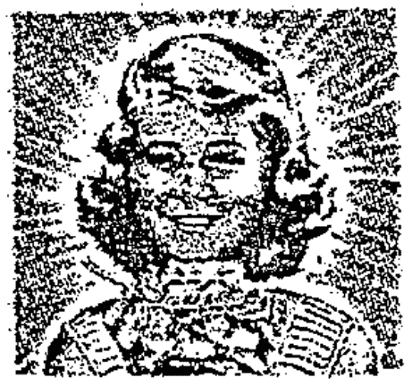

Centuries of writers have given us a whole library of inspirational thoughts about the sun. Shakespeare called it "the fire that severs day from night." Nietzsche wrote of its "inexhaustible riches" -- that from them "it flings gold into the sea, so that the poorest fisherman rows with golden oars."

Scientists on the other hand have given us a catalog of sun facts. That its surface radiates energy at the rate of 50 horsepower per sq.in.; that its diameter is some 866,400 miles--or 110 times that of the earth; how fast it's moving, what makes its spots, and on and on.

But it remains for corn--America's down-to-earth grain--to give man an edible store of the sun's greatest treasure. Good vitamins and energy to nourish the body, to help millions upon millions of little boys and girls to grow into strong men and women, to help keep those men and women healthy and happy.

The reason that corn is able to give us this gift from 93 million miles away is quite simple. Corn soaks up more sun than any other

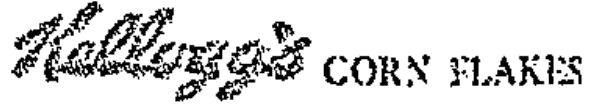

grain. Its average growing season is more than 100 days. So when huskin' time rolls around, this golden grain is rich with the sunny goodness that gives life to the entire world. That's one reason Mr. W. K. Kellogg chose corn as the basic grain for his experiments when he was searching for the answer to more appetizing forms of the good grains. And that's why, when he found the answer--and called it Kellogg's Corn Flakes--he started a breakfast habit that's become almost as much a part of the morning scene as the sunrise itself.

In fact, today the morning sun shines on more bowls of Kellogg's Corn Flakes than any other cereal. And can you think of a tastier, handier way of having plenty of sun on your table for breakfast every morning?

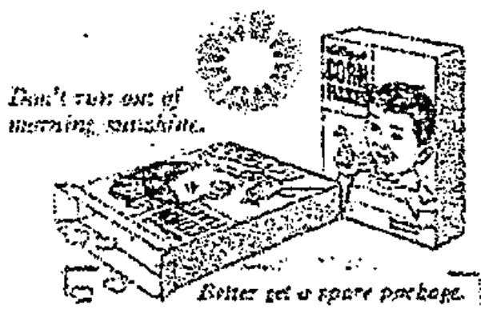

## 来自 9300 万英里以外的礼物

从古到今，许多文人墨客都对太阳进行了各种极富想象力的描述。莎士比亚把太阳称为“从早到晚不停燃烧的火焰”。尼采说它是“取之不尽，用之不竭的财富”——“太阳把金子洒向了大海，贫穷的渔民看上去就像是在大海上划着金色的桨，结伴而行。”

科学家也给出了一些列有关太阳的数据。它的表面以每平方 50 马力的速度辐射能量。它的直径约 866400 英里——是地球的 110 倍；太阳的移动速度；以及太阳为什么有耀斑，等等。

但是，玉米留住了阳光——美国实实在在的谷物——给人提供了一座可食用的太阳最伟大的宝藏。优质维生素和能量滋养着身体，帮助千千万万男孩女孩成长，成了强健的男人和女人，让他们健康，幸福。

玉米之所以能馈赠给我们这个来自 9300 万英里以外的礼物，原因很简单。玉米比其他谷物吸收的阳光更多。它的平均生长天数超过 100 天。因此，成熟后，这种金色的谷物，把生命的能量提供给了整个世界。这也是在研究如何让优质谷物更易消化的时候，W. K. 家乐氏先生，选择玉米作为基本研究对象。这也是为什么当他找到答案后——家乐氏玉米片——养成了像太阳每日照常升起一样，再也离不开的早餐习惯。

事实上，今天，早餐食用家乐氏玉米片的人数，比食用其他谷物的人数都多。你还能想出更好，更美味，更简单的方法，把大叠阳光放到你的早餐桌上吗？

早晨，家中请常备阳光。

家乐氏玉米片

## 作业

# 4、让美国人不再需要吃泻药的食物
### The food that is breaking America's laxative drug habit
### Constipation caused by
lack of bulk can now be ended
without pills or medicines

In spite of danger warnings, millions of people are still trying to "doctor away" constipation with harsh laxative drugs.

If you are one of these people, perhaps you do not realize that a common cause of constipation is a deficiency of bulk-forming foods in the diet.

In these cases, drug-type laxatives can relieve irregularity only temporarily. They cannot correct it.

Fortunately, correction is simple. You can restore the bulk that may be missing from your diet with a small daily serving of Kellogg's All-Bran.

Of all nature's foods, bran ranks highest in bulk-forming properties. And Kellogg's All-Bran is whole bran—whole bran at its most effective.

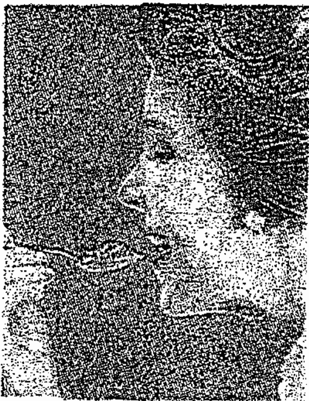

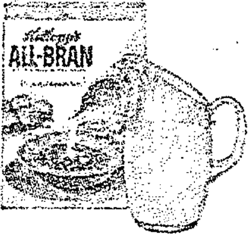

appetizing best. A half-cup with milk each day can give your system all the bulk it needs for natural, gentle regularity.

Before deciding your condition is hopeless, try correcting it this pleasant, no-drug way. Try eating Kellogg's All-Bran for 10 days. Get the original whole bran cereal — Kellogg's All-Bran. It stays crisp in milk and has always been America's overwhelming favorite. Kellogg's All-Bran.

## 让美国人不再需要吃泻药的食物
### 因为缺少粗纤维，而引起的便秘
现在不吃药就可以治好了

现在依然有不计其数的人，不顾警告，试图服用泻药“医治”便秘。

如果你也是其中一分子，可能你还没有意识到导致便秘的原因，是饮食中缺乏粗纤维。

药物只能暂时缓解由于缺乏粗纤维而引起的便秘，无法根治。

幸运的是，治疗方法非常简单。在饮食中每天加入一点家乐氏全麦维，你就可以轻松获取身体所需粗纤维。

在各种天然食物中，麸皮是含纤维最多的。家乐氏全麦维就是全麸皮——保留了它最有效的助消化功能。每天用牛奶泡半杯，可以调节体内环境，轻松帮你摆脱便秘。

在你对治疗便秘感到绝望之前，试试这种轻松，不用服药的方法吧。连续食用家乐氏全麦维10天。你会发现惊人效果。购买家乐氏全麦维——轻松获得天然全麦麸。加入牛奶，它依旧保持脆脆的口感，十分美味。

## 作业

# 5、如何不吃药摆脱便秘
### How to overcome constipation without pills or medicine
Millions rely on this
Good Food Way to end irregularity caused by lack of bulk in the diet

Many people who are bothered with constipation have fallen into a trap that has become both harmful and expensive.
Every time they get off schedule, they seek relief with harsh laxative drugs. Before long, they are taking pills and medicines more and more often. And in larger and larger doses.
Doctors warn that this continued use of harsh laxatives can be dangerous. Instead of restoring regularity, these drugs may do serious damage to the system.
It is welcome news to these "addicts" that there is one safe, natural way to break the chain laxative habit. Yes, it can usually be corrected the Good Food Way—the Kellogg's way with Kellogg's... All-Bran.
You see, one of the common causes of irregularity is lack of bulk in the diet. And Kellogg's All-Bran is whole bran—nature's best bulk-forming food. Just a half-cup of Kellogg's All-Bran with milk gives you all the good bulk food needed each day for pleasant, youthful regularity.

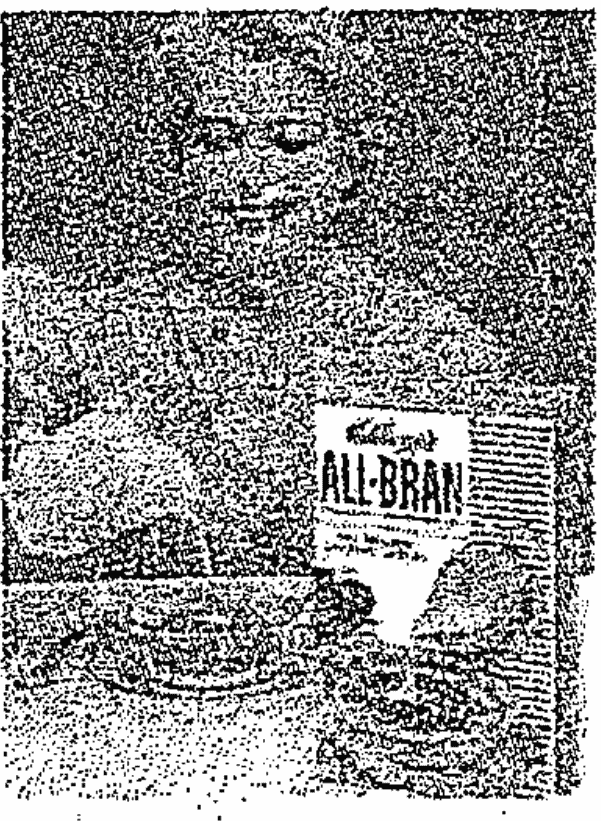

If you'd like to ease away constipation this Good Food Way, try eating Kellogg's All-Bran once a day for 10 days. But be sure you get the original appetizing whole bran cereal—Kellogg's All-Bran. Millions of satisfied users from coast to coast have made it America's overwhelming favorite.

## 如何不吃药摆脱便秘

数百万人通过食用这种食物
都摆脱了由于缺乏粗纤维而导致的便秘

很多受便秘困扰的人，都陷入了一个有害而且花费较大的怪圈。

每次他们便秘时，都会通过泻药来缓解。久而久之，他们服用泻药的次数越来越多，而且每次服用的剂量也越来越大。

医生提醒大家，经常服用泻药是非常危险的。它不会根除便秘，而且会对身体系统造成伤害。

好消息是，有个安全，天然的方法，可以帮你轻松摆脱这个“怪圈”。是的，就是通过正确的饮食——家乐氏方法，食用家乐氏全麦维。

你也知道，引起便秘的一个常见的原因就是，饮食中缺乏麦麸。家乐氏全麦维是全麦麸——大自然最好的粗纤维食品。每天用牛奶冲食半杯，就可以获取身体所需的所有优质粗纤维，让你告别便秘，永葆青春。

如果你想通过饮食告别便秘，请尝试一下家乐氏全麦维吧，连续食用10天。但是，请确保你购买到的是纯正、美味的麦麸谷物——家乐氏全麦维。全国数百万满意的食用者口口相传，使得它已经成为美国最受欢迎的麦麸谷物。

## 作业

# 6、“送我一个爱阅读的人！”
### “Send me a man who reads!”

Tomorrow's Navy thinks in terms of tomorrow. So do its young enlisted men.

Their plans often include a work- crammed course of study at the U.S. Naval Academy in Annapolis.

We talked to 24 former enlisted men who are in the upper quarter of their class at Annapolis.

Besides classroom work, these men spend plenty of time on extracurricular activities, physical education courses and evening homework.

Yet each man spends over 3 hours a week reading newspapers, 3 hours on magazines—and over 14 hours a

month on books above and beyond required texts. The implication is as clear as print:

Men who read more achieve more.

To make the grade, a sailor needs more than seamanship. The Annapolis entrance examination includes such subjects as reading comprehension, mathematics, vocabulary and English composition.

Once at Annapolis, he continues to keep his sea legs firmly grounded in the social sciences. He becomes more aware than ever that it takes wide-scale reading to make an officer. And a well-rounded man.

### Can you hold a conversation on these subjects?
- ☐ Algeria ☐ The Gold Flow ☐ The Common Market ☐ Katanga

Are you ever at a loss for words when the conversation turns to current events?

Here's what to do.

One: Learn to scan every headline in your daily newspaper. This will give you some idea of what happened.

Two: Now read the stories behind the headlines that interest you. They tell you why things happened.

Three: Read a good news magazine every week. Here, you'll meet the people who make the news.

It won't be long before you start enjoying conversations.

Free: Write Box 37, Education Department, International Paper, 220 East 42nd St., New York 17, N.Y., for free reprints of this advertisement.

## "送我一个爱阅读的人！"

今天的海军都很有远见。年轻士兵也是如此。

他们的学习计划包括，安纳波利斯美国海军学院安排得满满的学习课程。

我们采访了安纳波利斯美国海军学院班级排名前四分之一的年轻士兵。

除了课堂作业，这些人还会在课外活动、体育课程以及晚间作业中投入大量时间。

然而，他们一周还会抽出 3 个小时读报纸，3 个小时读杂志——每个月除了完成规定的文本阅读，还会投入 14 小时读书。言下之意非常清楚：

读书越多的人，收获越大。

为了达标，作为一名水手，除了航海技术，他还需要学习很多。安纳波利斯美国海军学院入学考试包括，阅读理解，数学，词汇，以及作文等科目。

在安纳波利斯美国海军学院，他涉猎了大量社会科学方面的知识。他更意识到，要成为军官，必须广泛阅读。

### 你能够驾驭这些话题的讨论吗？

阿尔及利亚 / 黄金流 / 欧洲共同体 / 加丹加

当谈论者的话题转向当今时事时，你是不是无言以对，不知所措？

下面的方法可以帮助你。

第一：尝试浏览每天报纸上的所有标题。这会让你对外面发生了什么事情，有个大概印象。

第二：阅读你感兴趣的标题下的具体内容。它们会让你了解这件事为什么会发生。

第三：每周阅读一本好杂志。在这里，你可以了解到新闻中说到的人物。

用不了多久，你就会享受交谈。

免费：写信至纽约市 17 号 220 东 42 路国际报，教育部门，27 信箱，免费索取这个广告的复印本。

©国际纸业公司 1962 年

# 国际纸业公司

杂志，书籍，报纸·家庭，办公室用纸·纸和包装纸板·标签·折叠纸盒·牛奶容器·集装箱·多层袋。杂货和特殊袋，普通纸袋·工业纸浆·木材·胶合板和建筑材料等的制造商。

## 作业

# 7、“送我一个爱阅读的人！”
### "Send me a man who reads!"

Why do you remember one teacher long after you’ve left school? Research by International Paper explores a key factor that leads to inspired teaching.

We studied the reading habits of 100 high school teachers who, though they have been teaching less than five years, plan to make teaching a lifelong career. Then we interviewed 100 high school teachers who have been teaching for over 15 years and were named outstanding by their principals.

We found that during the peak work load of mid-semester, 7 out of 10 teachers in both groups budgeted time to read books. Their average: Over 3 books a month.

The younger teachers read on the average 3 magazines and 12 newspapers a week. The outstanding teachers read over 3½ magazines and 13 newspapers a week. The conclusion is as clear as print: Great teachers keep on reading.

They know they must meet the fast pace set by bright young minds. Minds that are eager to know. Not just a²+b²=c² and "amo, amas, amat," but why and how.

Students, too, are learning the value of reading beyond what’s required. The increasing demand by everyone for literature of all kinds has made possible the range of books now available in paperback form.

Consider just three titles: On sociology: Mainsprings of Civilization. On philosophy: The Pocket Aristotle. On psychology: Beyond the Pleasure Principle. Total cost: $1.75.

### The secret of helping your child learn to read

Here’s how you can help develop your child’s reading ability at home:
One: In the beginning, check with your child’s teacher to find out how she wants you to help.
Two: As your child learns to read, ask him to read out loud regularly. Be sure to praise his progress.

Three: Once your child can read on his own, get a list of recommended reading from his teacher. Make these books available in your home.
Free: Write Box 25, Education Department, International Paper, 220 East 42nd St., New York 17, N. Y., for free reprints of this advertisement.

INTERNATIONAL PAPER
公众微信：LBC333 #62001

## "送我一个爱阅读的人！"

为什么你在离开学校很久之后，依然记得你的老师？国际纸业公司的一个研究找到了启发式教学的关键因素。

我们采访了100所高校中，虽然教龄不到5年，但是都计划把教学作为终身专业的老师们的阅读习惯。然后我们又采访了100所高校中，教龄超过15年，被校方评为先进教师的老师们的阅读习惯。

我们发现，学期中最忙的时候，这两类老师中，70%的人都会抽时间阅读。一个月阅读量超过3本书。

年轻教师平均一周阅读3本杂志，11份报纸。优秀教师一周阅读量超过3本半杂志，13份报纸。结果非常明显：

优秀教师一直保持着阅读习惯。

学生们也开始明白了课外阅读的价值。人们对各类文学作品的需求日益增长，使得各种书籍的平装本开始畅销。

想想这3本书：关于社会学：《文明的主要动力》。关于哲学：《口袋里的亚里士多德》。关于心理学：《快乐原则之外》。总价？1.75美元

## 帮助孩子学会阅读的秘诀

下面是你在家帮助孩子培养阅读能力的方法：

- 第一：开始阶段，和孩子的老师探讨孩子需要怎样的帮助。
- 第二：在孩子开始学习阅读时，定期让孩子大声朗读。一定要夸赞他取得的进步。
- 第三：一旦孩子可以自己阅读了，可以向老师索要一些推荐阅读的读物清单。买回来，放在家里，让孩子触手可得。

免费：写信至纽约市 17 号 220 东 42 路国际纸业公司，教育部门，27 信箱，免费索取这个广告的复印件。

©国际纸业公司 1961

# 国际纸业公司

杂志，书籍，报纸·家庭，办公室用纸·纸和包装纸板·标签·折叠纸盒·牛奶容器·集装箱·多层袋。杂货和特殊袋，普通纸袋·工业纸浆·木材·胶合板和建筑材料等的制造商

(376/469)

## 作业

# 8、一个新方法，消灭你的轮胎的最大敌人——高速行驶引发的高温

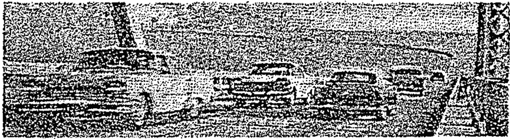

### A new answer to your tires’ worst enemy–high-speed heat

At steady waspike speeds, your tires get so hot you could practically fry eggs on them. The heat that builds up gets into the neighborhood of 250 degrees, and at temperatures like that, tires take a beating on two vital counts. Number one, high-speed heat works to literally eat away ordinary tread rubber. And, number two, the same heat that eats away tread rubber also weakens ordinary tire...opening the door to tire failure. Obviously, the only way to beat high-speed heat is to find the answer to both of these problems—and that’s exactly what Goodyear scientists have come up with. Turnpike-Proved Tires, introduced by Goodyear just about three months ago, are unlike any tires ever built. They’re made with new rubbers, new chemicals, and triple-strong steel cords. And we’ve proved, on Goodyear’s five-mile, 140-mph test track at San Angelo, Texas (we call it “The Turnpike That Never Ends”) that these new tires will give you up to 25% more safe mileage. In terms of tire-making, it all started with Goodyear scientists. Working on the problem of tread rubbers, they found a way to bring rubber molecules and certain new chemicals into a more intimate mix.

> By GOODYEAR.
> the Greatest Name in Rubber

ture, creating a rubber that has far greater toughness and resistance to wear. To tick the cord problem, they found the answer in triple-tempered 5-T cord (Tyrtex or Nylon). Triple-tempering, under precisely controlled conditions of Tension, Temperature and Time, gives strength and heat resistance that other cords simply do not have. Together, these two discoveries led to a completely new kind of tire… a tire that resists heat more than any tire we’ve ever made. And in Texas heat, on the blistering pavement of our “turnpike that never ends,” we ran these tires until we had turnpike-proved, beyond question, that every Goodyear tire is the toughest, safest, longest-wearing tire in its class. With the two hottest months of the year coming up, we suggest you stop in and talk to your Goodyear dealer. He has Turnpike-Proved Tires for every car and budget—and they won’t cost you a penny more than ordinary tires. Goodyear, Akron 16, Ohio.

More people ride on Goodyear tires than on any other kind!

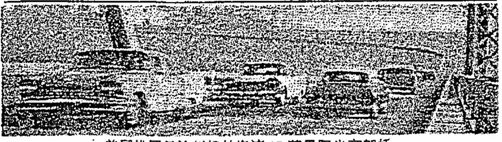

美国佛罗里达州坦帕海湾 15 英里阳光高架桥

## 一个新方法，消灭你的轮胎的最大敌人——高速行驶引发的高温

# 固特异轮胎
最优橡胶品牌

在匀速高速行驶时，你的轮胎温度会升高到，甚至可以在上面煎鸡蛋。它的温度可以上升至 250 华氏度左右，这样的温度下，你的轮胎将面临两种危险。

第一种，高温会吞噬一般胎面的橡胶。第二种，吞噬胎面橡胶的高温，同样会削弱一般的轮胎帘子线，使轮胎面临爆裂的风险。

显然，打败高速行驶引发的高温的唯一方法，就是找到解决这两种问题的答案——这正是固特异轮胎科学家们不断探索的。

固特异轮胎公司三个月前推出的经过高速检验的轮胎，和以往市面上所有的轮胎都不同。这种新型轮胎采用了全新的橡胶，全新的化学材料，以及坚实度增加了 3 倍的轮胎帘子线。

我们在圣安吉洛，以及德克萨斯州的车道上，对固特异轮胎进行了，以每小时 140 英里的速度，持续行驶 5 英里的测试，（我们称之为“永不结束的高速行驶”），结果证明，这种新轮胎，会让你的安全行驶里程增加 25%。

就轮胎制造而言，一切都得益于固特异的科学家们。他们不断研究轮胎橡胶问题，最终发现了一种，利用橡胶分子，和某种新化学物质合成一种聚合程度更好的混合剂，从而制造出韧性更好，耐磨性更强的橡胶。

为了解决轮胎帘子线问题，他们研制出了一种三重回火 3-T 帘子线（泰勒克斯或尼龙）。三重回火技术，在严格的拉力，温度和时间控制下，使这种新型帘子线拥有了其他帘子线不具备的强度，和耐高温性。

这两种发现，成就了一款全新的轮胎……一款比我们之前使用的轮胎更耐高温的轮胎。在德克萨斯州温度极高的公路上，我们“永不结束的高速行驶”测试中，对这些轮胎进行了测试，直到它们通过高速检验，毫无疑问，每个固特异轮胎都是同类轮胎中最坚实，最安全，使用时间最久的。

今年最热的两个月份就要到来了，我们建议你逛逛我们的经销商店，向经销商咨询。他那里有每款车型的经过高速检验证明的轮胎，而且价格划算——我们的轮胎价格，不会比你购买的其他普通轮胎价格高一分钱。

固特异轮胎&橡胶公司，俄亥俄州，阿克伦市 16

使用固特异轮胎的人数远超其他品牌！

## 作业

# 9、在拥挤的马路上自由穿梭的一条小鱼

### The fish that swam
in a stream-
of heavy traffic

by GOODYEAR
The greatest name in rubber!

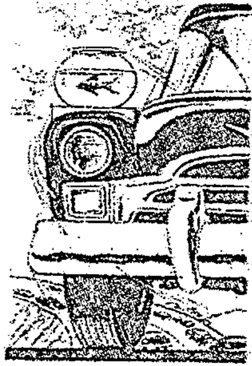

This rare story you are about to read is true. Even better, it has a happy ending. The fish kept right on swimming—and helping to prove that new cars could have an old and gain a new kind of ride.

You see, Goodyear engineers fastened this fish’s bowl of water to a fender of a car equipped with new 14-inch Custom Super-Soft-Cushions. Then fish—and engineers—went for a mile ride over a stretch of busy highway that included several bouncy railroad crossings.

When the engineers brought the car to a halt, there was still plenty of water in the bowl for the fish to swim in.

That’s because this new kind of Goodyear tire is wider, softer. It levels out bumps and bounces as no other tire before it could do to give you a new kind of ride—the Custom Ride by Goodyear. Tough and resilient triple-tempered 3-T Cord soaking up jars and jolts—banishes the rudeness of rough roads. Protects you, too, against the danger of a sudden blowout.

And the Custom Ride is a silent ride, too—not a murmur in a mile. New Custom Super-Soft-Cushions bring a wonderful new hush to modern motoring.

Next to the road where safety begins is a tire action tread that makes the Custom Ride a safer ride. 86-80 biting edges stop you up to 24% quicker. Not even wet weather can dampen the extra stopping power in this tire’s new Twin-Grip tread design.

This new Goodyear tire is standard equipment on many of America’s finest new cars. It’s styled to complement their graceful beauty. And it’s a long-lasting kind of beauty—for in the Goodyear tradition, you’ll get long, long miles of extra wear. See your Goodyear dealer. Goodyear, Akron 16, Ohio.

## 在拥挤的马路上自由穿梭的一条小鱼

固特异轮胎
最优橡胶品牌

你读的这个关于小鱼的故事，是真实的。更棒的是，它有一个快乐的结局。小鱼不停地游啊游——证明了一个事实，你的新车可以获得全新的驾乘体验。

在图片中，你可以看到，固特异的工程师把一个盛着水的鱼缸，固定在一辆配有 14 英寸自由行超级缓冲橡胶轮胎的车头挡泥板上。然后工程师开车，载着鱼缸在川流不息的公路上行驶了 1 英里，其中；还通过了几个凹凸不平的铁路路口。

当工程师把车停下来时，鱼缸中仍有足够的水让鱼儿游动。

这是因为，这种新型轮胎更宽，更软。可以让你在崎岖不平的道路上平稳行驶，这是之前所有的轮胎都无法做到的，它可以给你一种全新的驾乘体验——固特异自由行轮胎。坚实却富有弹性的三重回火 3-T 帘线，可以消除所有颠簸和振动——帮你抚平起伏不平的道路。保护你免受突然爆胎的危险。

而且，自由行轮胎行驶起来噪音非常小——让你纵享宁静。新型自由行超级缓冲橡胶胎面轮胎将带给车主们一种全新的安静舒适的驾乘体验。

紧贴道路，给予你安全驾乘体验的，是采用自控抓地技术的胎面；让你的自由行轮胎为你提供更安全的驾驶。8640咬边设计，让你的停车速度增加 24%。这种全新的双支承胎面设计，让你即使在潮湿的天气，也操控自如。

这种新型固特异轮胎，是美国很多好车的标配。它优雅的风格

样式，和你的爱车相得益彰。这是一种持久的美丽——因为，在固特异这里，你可以获得寿命更长的轮胎，这也是固特异的一贯品质。赶快去拜访你的固特异经销商吧。固特异轮胎&橡胶公司，俄亥俄州，阿克伦市 16。

超级缓冲橡胶 T.M.固特异轮胎&橡胶公司，俄亥俄州，阿克伦市 26

使用固特异轮胎的人数远超其他品牌！

## 作业

# 10、为奔跑而生的尼龙！

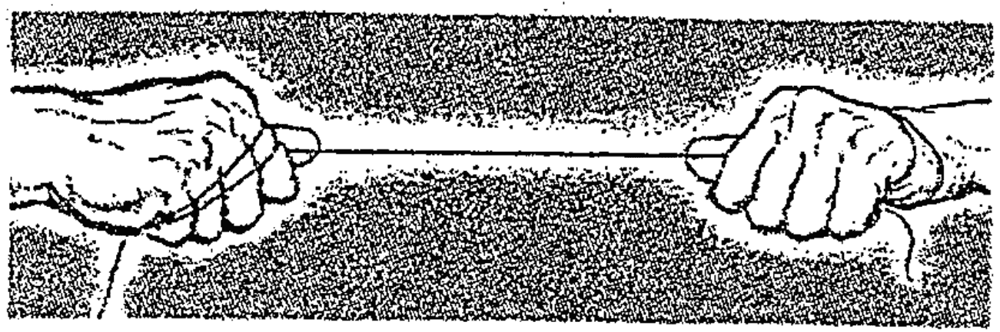

### Nylon that was made to run!

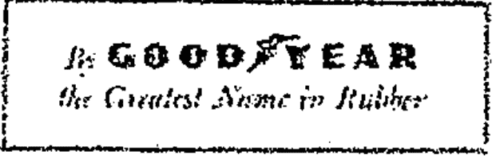

## 为奔跑而生的尼龙！

# 固特异轮胎
最优橡胶品牌

3-T 尼龙帘线要比钢筋强韧许多。它跑起来温度更低，时间更长，让你的轮胎使用里程数更长。

但是，只有提前做好恰当的处理，尼龙才会在拉力下延伸。为了控制其延伸方向，固特异的研究人员研发了一套独有的处理方式，精确地控制了拉力，温度和时间。结果：三重回火 3-T 尼龙帘线——在它能经受的最大强度和弹性下，保持了完美的稳定性。

经过最近的一系列测试，固特异技术人员证明了：采用 3-T 尼龙帘线的轮胎，外部更强韧，内部更安全。

首先，用手提钻——用来钻混凝土的那种——连续钻击轮胎 34 小时！在超过 200 万次钻击后，没有一根 3-T 尼龙帘线被损坏。

手持钻测试证明 3-T 尼龙帘线比其他任何轮胎帘线的柔韧性都好。这种柔韧力可以让你的轮胎防爆裂能力更强——轮胎寿命更长，更安全，因爆胎被困在路上的次数更少。

随后，我们进行了湿路测试，两辆车以同样的速度驶向木制屏障，在同一瞬间制动。配置标准轮胎的汽车撞到了屏障上。

而配置 3-T 尼龙自由行超级橡胶轮胎的汽车快速、平稳地挺了下来，因为两个完全独立的胎面紧紧地抓住了地面。

这款 3-T 尼龙自由行超级橡胶轮胎是你应对各种路况最安全的保障。现在——由于需求量持续上升——你可以用以有史以来最低的价格拥有它。

拥有这款三重回火；三重坚韧度的轮胎，你可以享有终生保障。马上去固特异代理商那里了解详情吧。这周一定要去哦。固特异轮胎&橡胶公司，

俄亥俄州，阿克伦市 16。

超级缓冲橡胶 T.M.固特异轮胎&橡胶公司，俄亥俄州，阿克伦市 16

使用固特异轮胎的人数远超其他品牌！

(630-631)

## 作业

# 11、你可以看到，车主们都偏爱固特异

### THE SATURDAY EVENING POST

### Note How Goodyears Dominate in Every Street

### You Can See That Men Prefer Them

Numerous doubts... Goodyear tires after 15 years of betting... 

### All-Weather Treads

This is another distinctive Goodyear feature... The grip... 

### What Brings Men to These Tires

We need difficulties... All riders and drivers... 

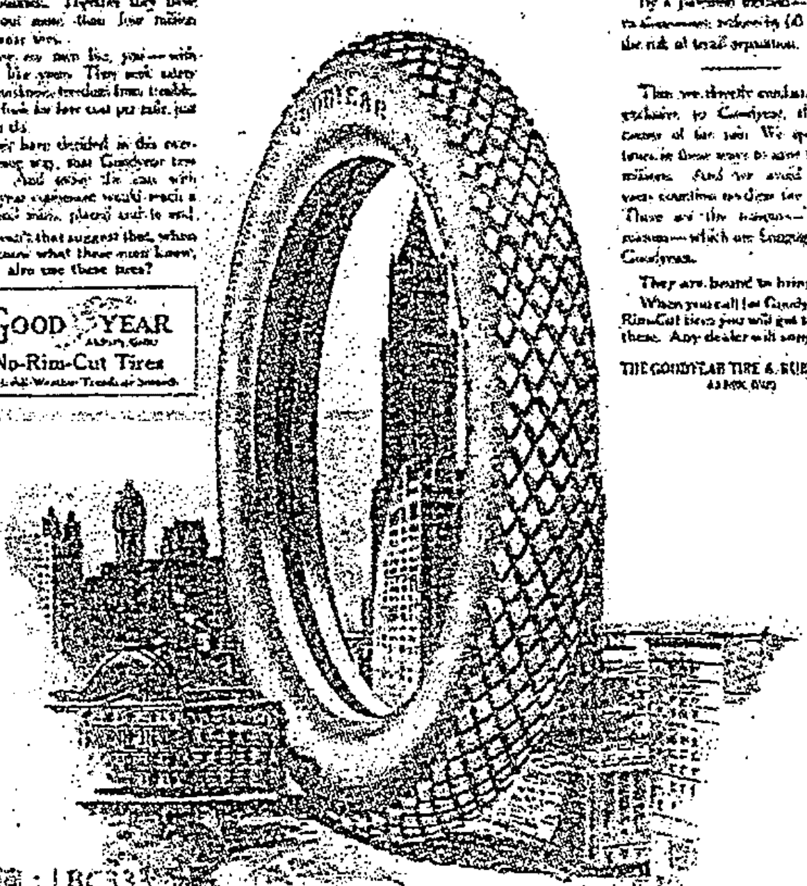

### GOOD YEAR No-Rim-Cut Tires With All-Weather Tread for Smooth

## 注意固特异占领了每条街

## 你可以看到，车主们都偏爱固特异

如果四周看看，就没有人会怀疑——固特异轮胎最能满足车主的需求。

你看看那些想要高质量轮胎的车主中，使用固特异轮胎的车主比例就知道。固特异轮胎，经过 15 年的测试，销量远超其他轮胎。

固特异用户数量成千上万。他们尝试的固特异轮胎总叠超过 400 万。

他们是和你一样的人——和你有同样需求的人。他们追求安全，稳定，无烦恼。和你一样，他们追求每公里最低成本。

使用后，他们都认为在这些方面，固特异轮胎远胜于其他轮胎。今天配置固特异轮胎的汽车首尾相接，能绵延 1000 英里。

这难道还不能说明，如果你和这些人有同样的想法，你也会选择同样的轮胎呢？

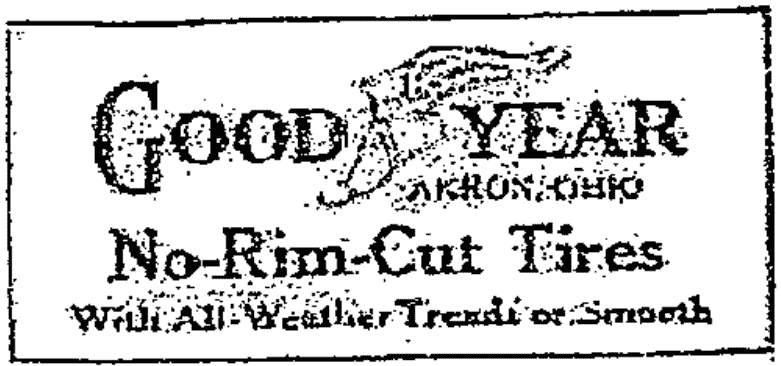

固特异无损轮辋轮胎
俄亥俄州，阿克伦市
适用于各种气候的胎面或工业车辆用轮胎

## 适用于各种气候的胎面

这是固特异轮胎又一个独有性能——坚实，双层加厚防滑胎面。拥有超强，持久的抓地力，以及对抗路面异物的防护力。即使缺气，依旧可以保持同样的性能。

固特异轮胎，有普通胎面的平稳，又有超强的坚实度，双层加厚，高超的抓地能力。还有哪种轮胎，不论何种价位，能像固特异这样满足冬季路面的需求？

## 是什么让人们选择了固特异轮胎

我们每年在实验室的花费高达 100000 美元，为的就是确保给你提供最优质的轮胎。所有橡胶和织物都必须通过严格的测试。

无损轮辋轮胎--我们掌握的技术--是有损轮辋轮胎做不到的。

我们每年还会投入 450,000 美元到我们独特的“空气”检测技术中。解决了轮胎爆胎的主要原因。

通过专利技术--我们独有--我们把胎面剥落的风险降低了 60%。

我们直接解决了引起轮胎损毁的主要原因——这是固特异独有的技术。在这方面，我们投入了大量资金，为轮胎用户节省了数百万美元。为我们的用户避免了无数不必要的轮胎问题。这就是人们选择固特异轮胎的无法抗拒的理由。

它同样会吸引你。

给固特异公司打电话，订购无损轮辋轮胎，你就会轻松拥有它。任何经销商都会为你提供你想要的轮胎。

固特异轮胎&橡胶公司，俄亥俄州，阿克伦市

## 作业

# 12、现在你不用多花一分钱，就可以看到有固特异无损轮辋轮胎

## Goodyear No-Rim-Cut Tires Cost Nothing Extra Now

Last year these patented tires cost 20% more than other standard tires. Yet, our tire sales jumped to $8,500,000—multiplied three times over in that single year. All because these Goodyear features cut tire bills in two.

Now these same tires—these oversize No-Rim-Cut tires—cost no extra price. Our multiplied output has cut the cost of production. You can get all these advantages by simply specifying Goodyear No-Rim-Cut tires.

## Tires Ten Per Cent Oversize

## Rim-Cutting Impossible

## Why We Give It

## No Hooks Needed

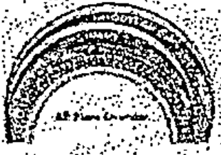

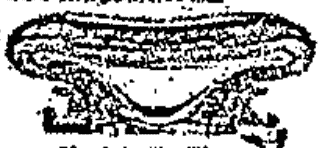

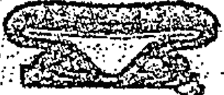

In every great show held this year—up to this writing—more pneumatic tired cars were equipped with Goodyears than with any other make.

Sixty-four leading motor car makers have contracted for Goodyears for 1911. They know from experience what these two features mean.

## No Extra Cost

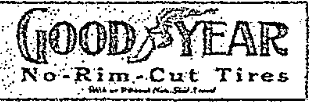

## Ask for the Book

THE GOODYEAR TIRE & RUBBER COMPANY, Seneca Street, AKRON, OHIO. Branches in All the Principal Cities We Make All Sorts of Rubber Tires

## 现在你不用多花一分钱

## 就可以拥有固特异无损轮辋轮胎

去年，我们的这种专利轮胎比其它标准规格的轮胎售价要高20%。但它的销售额却飙升至850万美元——仅仅在那一年的时间内就增加了三倍。这全部要归功于：固特异牌轮胎的独特性能……

现在，购买这种轮胎——这种大尺寸、无损轮辋轮胎——你无需再多花一分钱。因为倍增的销量，已经使我们的生产成本大大降低。你只需要指定购买固特异无损轮辋轮胎，便可以得到所有这些优势……

## 轮胎尺寸增加 10%

这张图显示了和其他同等额定规格的轮胎相比，固特异轮胎的不同之处。

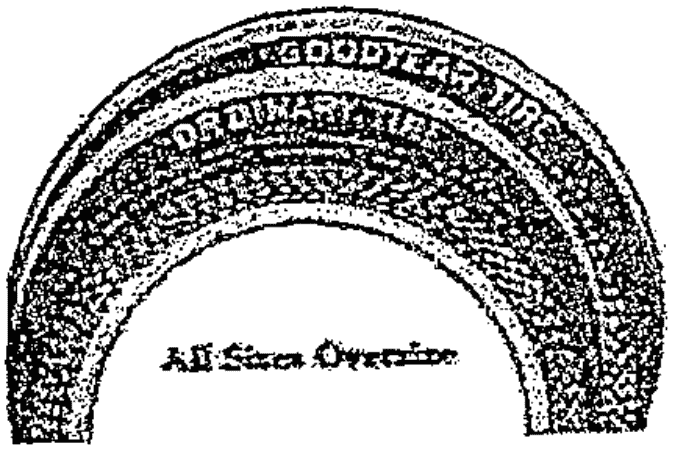

固特异轮胎尺寸平均增加了 10%——额定宽度增加了 10%。

这就意味着轮胎增加了 10%——能多容纳 10%的空气——多10%的承载力。也就是说，同样的车，每只轮胎可以使它的行驶里程增加 25%。

然而，尺寸增加了 10%的固特异轮胎，和其他没有这种优势的轮胎价格一样。额外增加的尺寸完全免费。

## 我们为什么这么做

固特异无损轮辋轮胎，正如我们在本页中所说的，不需要用钩子固定在轮辋上。它用 63 根高强度的含碳钢丝嵌入底部，所以，没有什么能让它脱落。

因为这种独特性能——我们独有——我们不需要担心轮胎脱落。所以，我们可以增大轮胎尺寸，没有任何风险。

我们这么做——而且不加收任何费用，为的是保护固特异轮胎的声誉。因为，我们经常能见到这样的情形：

汽车制造商，根据预期负载重量，决定轮胎尺寸。即他们销售的车辆本身的重量，以及预估每位乘客 150 磅的体重。

他们就按照这个载重标准生产轮胎，很少留有超重空间。轮胎很贵，现在的汽车生产商都是精打细算。

你还要给汽车装一些东西，可能是——挡风玻璃，汽油指示灯，油箱，备用轮胎，以及其他重物。而且，乘客有时体重可能会超过 150 磅。

汽车十有八九都会超重，通常会超出几百磅。这对轮胎来说，是致命的。你的载重超出 25%，那么你的行驶里程就会降低一半。

最终结果就是爆胎。有时，甚至是新轮胎。这时，司机就会抱怨轮胎。

这就是我们固特异轮胎增大尺寸的原因。我们把它增加了 10%。今年，你购买这种超大尺寸轮胎，不用多花一分钱。一般的小轮胎和我们固特异轮胎的价格一样。

固特异无损轮辋轮胎的销量已经达到了将近 50 万。我们还进行了 100 次缺气实验——行驶里程远达 20 英里。没有一个有损轮辋的轮胎能做到这点。你想想这意味着什么。也就是说，如果需要，即使轮胎瘪气了，你依旧可以开车回家。

## 63 根编织镶嵌高强度含碳钢丝

图片显示了固特异无损轮辋轮胎，适用于可快速拆卸轮胎的标准轮辋。同理，它也适用于可拆卸轮辋。

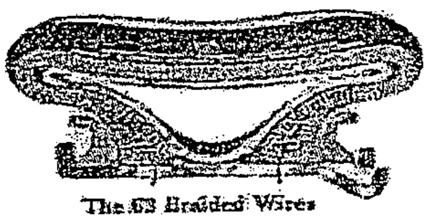

固特异轮胎适用于任何轮辋。图片之所以选择了这种轮辋，是因为它几乎通用于所有新款车辆。

注意，轮辋法兰盘——可拆卸——用来向外勾住无损轮辋轮胎。这种轮胎边缘是圆形的，任何时候都不会损伤轮辋。

这张图片显示一般轮胎——紧箍式胎环——如何与同种轮辋契合。

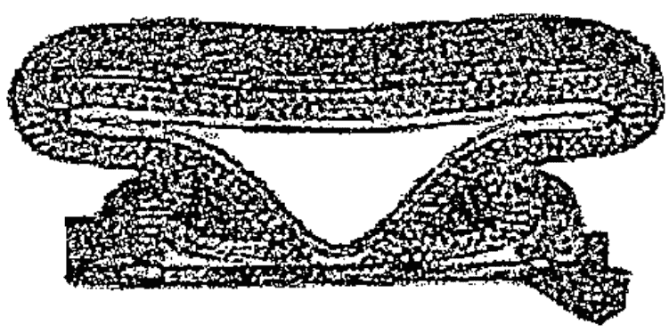

这种情况下，轮辋法兰盘必须向里勾住轮胎——抓住轮胎上的钩子。这些钩子在把一般轮胎与轮辋紧密勾合中起着关键作用。

你可以注意到，当轮胎瘪气后，胎体会触碰到轮辋法兰盘尖锐的钩子。从而损伤轮辋。被扎破的轮胎瞬间报废。

## 不需要钩子

固特异无损轮辋轮胎底部没有钩子，因为这些轮胎不需要用钩子将其勾住到轮辋上。因为 126 根编织镀铬高强度含碳钢丝采用硫化工艺镀铬在轮胎底部。所以，轮胎底部不会被拉伸。什么都无法使轮胎从轮辋脱落。除非你移去法兰盘。固特异轮胎非常安全，不需要任何轮胎螺丝——不必使用任何轮胎螺丝。

当轮胎膨胀时，这些高强度含碳钢丝会拉紧。此时，轮胎会被每英尺 134 磅的压力压向轮辋，结合得非常紧密。

这就是为什么它不需要钩子。这就是为什么你卸下轮辋法兰盘，轮胎放气后接触到的是圆形边缘。

我们掌握这种独特科技，目前没有其他哪种方法能实现这个目的。在高气压下收缩的高强度含碳钢丝，是这种安全无钩轮胎的关键。

在今年的所有优质展出中——截止到我撰写这篇广告时——使用固特异轮胎的气胎车的数量，比使用其他轮胎的数量都多。

1911 年 64 家领先汽车生产商都与固特异轮胎签下了订购合同。根据他们的经验，他们知道这两种特殊性能意味着什么。

## 没有额外费用

记住，固特异无损轮辋轮胎现在不比其他任何标准轮胎多一分钱。你可以免费得到额外尺寸。你用购买可能随时报废的轮胎的价格，就可以帮助到无损轮辋轮胎。这种差距今年可以让车主们节省

数百万美元。

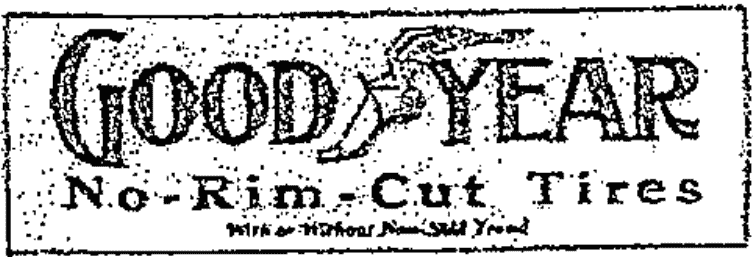

## 索取书籍

《我们的轮胎书》上涵盖了许多车主应该知道的事实。遵循这些事实，可以让你节省一半的轮胎费用。内容简洁，翔实。给我们写信说，“请给我寄一本你们的轮胎书”，我们就会在下一封邮件中，把它寄给你。千万不要忘记。

## 固特异无损轮辋轮胎

有防滑胎面或无防滑胎面

固特异轮胎&橡胶公司，俄亥俄州，阿克伦市，塞内加街

所有主要城市分部

我们制造各种橡胶轮胎

加拿大工厂：安大略省，布朗斯维尔

加拿大主办公室：安大略省，多伦多

(1100)

## 作业

# 13、固特异轮胎的故事

## The Tale of Goodyear Tires

We have invented a tire which can’t rim-cut—called Goodyear No-Rim-Cut tire. Over 500,000 have been sold to date.

The method of fitting on any standard rim lets us make this tire 10% oversize. And we do it—adding 25% to the average tire mileage without extra cost.

Because of these features, our tire sales trebled last year—jumped to $8,500,000. Yet these patented tires, during most of the year, cost one-fifth more than other standard tires.

This year—at an equal price—64 leading motor car makers have contracted for Goodyear No-Rim-Cut tires. The demand is greater, by six to one, than for our clincher tires.

This avalanche of favor, due to the saving of millions, seems like a sudden sensation. But back of it all there are twelve years of tire making—of invention, experiment and ceaseless tests.

To make you a better judge of your tire needs, please let us tell you about them.

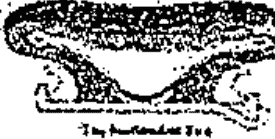

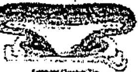

## 10% Oversize

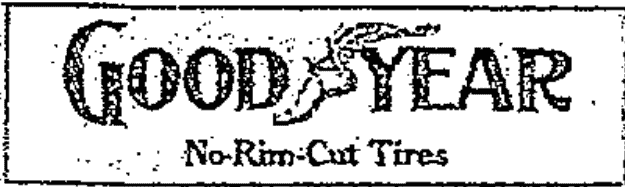

THE GOODYEAR TIRE & RUBBER COMPANY, Seneca Street, Akron, Ohio

## 固特异轮胎的故事

我们研发出了一款不损坏轮辋的轮胎，叫做——固特异无损轮辋轮胎。截止今天，已经销售了超过 500000 个。

适用于任何标准轮辋的技术，使我们能够生产比一般尺寸大 10%的轮胎。这使得我们的轮胎平均行驶里程增加了 25%，价格却没有上涨。

因为这些独特性能，去年，我们的销售额增加了三倍——增长到了 8500000 美元。然而，我们这些受专利保护的轮胎，大多数情况下，比其他标准轮胎价格高五分之一。

今年——同等价格——64 家国内领先汽车生产商签约了固特异无损轮辋轮胎。需求量远超我们之前生产的紧钳轮辋轮胎。

因为可以节省数百万美元的成本，这款轮胎收到了如潮水般的支持，这一切看起来像是突如其来。其实，这后面有固特异研发人员十二年的轮胎制造心血——发明，实验，以及不断的测试。

为了让你更好地了解自己的轮胎需求，请给我们一次机会，让我们向你讲讲轮胎。

## 开拓

12 年前；制造汽车轮胎是一个全新，且困难的课题。

我们能寻求的唯一参考，就是自行车轮胎制造方法。

当时还没有快速拆卸轮辋。因此，轮胎制造商都采用紧钳轮辋轮胎，这种轮胎可以搓压倒整个轮辋上。直到可快速拆卸轮辋的出现——也就是今天的标准轮辋，使得无损轮辋轮胎成为了可能——这种轮辋依附于传统轮辋结构中。结果是，如果轮胎部分漏气或完全漏气后，继续行驶，会损毁轮辋。

这是我们要解决的问题之一。另一个问题是寻找最好的高耐磨胎面胶。还有一个问题就是，把爆胎的风险降到最低。

可怕的张力是引发纤维的选择，帘线编织，缠绕，调配以及硫化方法等方面的问题的一大原因。因此，都必须通过研究和实验来解决。

## 专家援助

我们轮胎的制造，是多位橡胶行业有着丰富的实战经验共同努力的结果。他们在实验室，实验和测试部门的帮助下，由国内最好的技术院校毕业的化学家和工程师等专家全权负责。这些人把他们所有的时间都用在了解决轮胎问题上。

## 轮胎测试

为了证明他们的想法——把不同方案进行对比——我们设计出了轮胎测试机。

这个测试机一次可测试4个轮胎。它通过压力和张力，模仿各种路况，磨损轮胎。以仪表记录里程。

对40种不同的紧钳轮辋轮胎制造方法进行了测试。对大约200种纤维进行了对比。对每种编织，缠绕，以及硫化方法也都一一进行了测试。

最终得出哪种轮胎是最好的。

在同样的机器上，我们还对竞争对手和我们的轮胎进行了并排测试。

我们不断地制造，测试，比较，淘汰，对不同的方案进行打分。

通过多年不断地研究和筛选，我们逐渐找出了什么是最好的。

## 结果

12 年的回报，是近乎完美的轮胎。去年，在足够的资金支持下，我们的更新成本约增加了 8-10 个百分点。

固特异轮胎行驶 6000-10000 英里不爆胎太平常不过了。行驶一个季度没有丝毫磨损，也司空见惯。

这一切都为我们掌握轮胎制造技术——制造固特异无损轮辋轮胎，奠定了坚实的基础。

对比无损轮辋轮胎和普通轮胎。我们这两种轮胎都制造。

图片显示，在同样的轮辋上——适用于快速拆卸轮胎，以及可拆卸轮辋的标准轮辋。

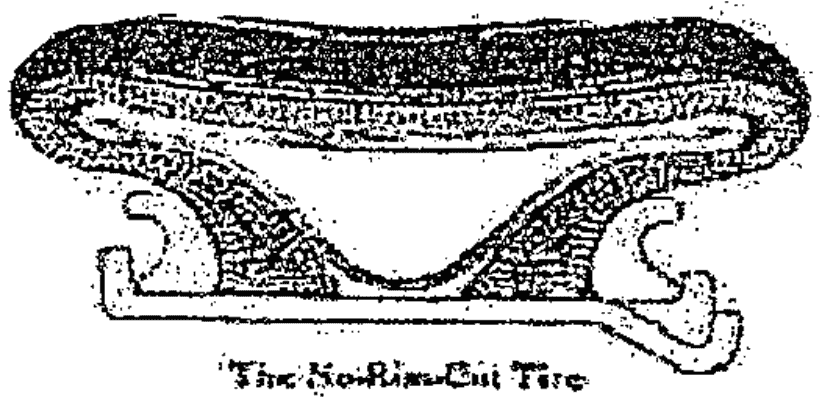

对于无损轮辋轮胎，可拆卸法兰边缘向外弯曲。对于普通轮胎，则向内弯曲来抓住轮胎内的钩子。

新式圆形法兰盘的应用，使得轮辋不会受损。而老式法兰盘尖薄的边缘则会刺入轮胎。结果是轮胎瘪气行驶时，被迅速损毁。

秘诀在于：126 根编织镶嵌高强度含碳钢丝采用硫化工艺镶嵌在无损轮辋轮胎底部。所以，轮胎底部不会被拉伸。什么都无法使轮胎从轮辋脱落。除非你移去法兰盘。

高强度含碳钢丝使得轮胎在高气压下收缩。当轮胎膨胀时，轮胎会被每英尺 134 磅的压力压向轮辋。

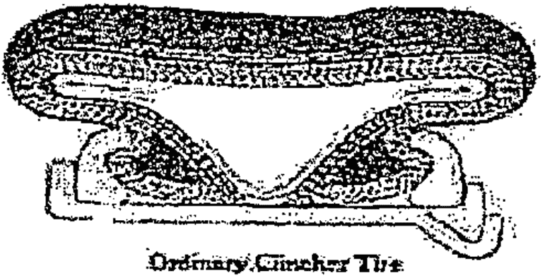

这就是无损轮辋轮胎基部无需钩子的原因。它甚至不需要轮胎螺栓。

我们掌握这种独特科技。制造安全无钩轮胎的关键在于扁平的高强度含碳钢丝，使得轮胎在高气压下收缩。一般的单根或双根帘线做不到这点。

## 尺寸增加 10%

因为独特的技术，固特异无损轮辋轮胎可以比一般轮胎尺寸大 10%。这就意味着轮胎增加了 10%——能多容纳 10%的空气——多 10%的承载力——来承载其他轮胎十之八九都无法承受的超重部分。

装备尺寸精确的轮胎的汽车，通常都会超重。这是大多数轮胎爆胎的原因。我们的超大尺寸轮胎，对一般车来说，增加了 25%的轮胎里程。这两个特性——无损轮辋，和超大尺寸——通常会为你节约一半成本。

然而固特异无损轮辋轮胎的价格，和其他有损轮辋标准轮胎——不是大尺寸轮胎——价格是一样的。

《我们的轮胎书》上涵盖了许多车主应该知道的事实。这是我们制造轮胎 12 年来的心血。快向我们索取吧，我们会寄一本给你。

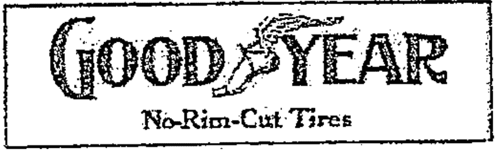

## 固特异无损轮辋轮胎

固特异轮胎&橡胶公司，俄亥俄州，阿克伦市，塞内加街

加拿大工厂：安大略省，布朗斯维尔   加拿大主办公室：安大略省，多伦多

103 个省市分部和代理机构

我们制造各种橡胶轮胎

(1101)

# 作业

# 14、他把生命押在了制造一款轮胎上

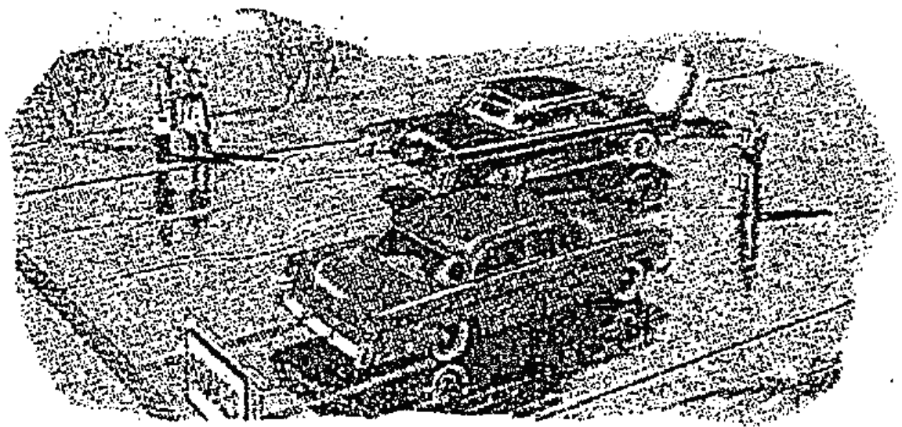

# He Staked His Life
on a Tire He Helped Build

By GOODYEAR the Greatest Name in Rubber

原文为英文广告正文，因图像模糊无法完整准确识别。文中提及 Mel Wilson、Nylon Custom Tubeless Super-Cushion by Goodyear、Twin-Grip tread、Triplex-Tempered 3-T Nylon Cord 等内容。

# 他把生命押在了制造一款轮胎上

# 固特异轮胎
最优橡胶品牌

一般来说，梅尔·威尔逊与令人兴奋的戏剧最亲密的接触，是周六晚上，在电影院看悬疑电影的时候。

然而，不久前，这个人在一次大胆，且富戏剧性的行动中，备受瞩目。他把自己的生命押在了他参与制造的一款轮胎上——固特异一款新型尼龙自由行无内胎超级橡胶轮胎。

梅尔·威尔逊和一个假人并排站在洒满水的路上。两辆车以同样的速度咆哮而来，并同时刹车。

配备一般胎面新轮胎的车，撞倒了假人。但是，另一辆配有高牵引力固特异轮胎的车牢牢抓地——8640花纹设计死死抓地——使汽车快速、安全地停在了威尔逊先生前面。

尼龙自由行超级橡胶轮胎赋予了固特异能拯救生命的安全系数。

这款新型轮胎胎面的安全系数非常高。这种新型双支承胎面下，是三重回火3-T尼龙帘线，在同等压力下比钢筋都强韧。

你会看到今年将有更多豪车配备这款新轮胎。它也将是你爱车的绝佳选择，它比一般轮胎只多几美元。

所以，如果你想安全驾乘，并想选一款时尚漂亮的轮胎，我们建议你去你附近的固特异经销商店看看。固特异轮胎&橡胶公司，俄亥俄州，阿克伦市16。

超级缓冲 T.M.固特异轮胎&橡胶公司，俄亥俄州，阿克伦市16

使用固特异轮胎的人数远超其他品牌！（514）

# 作业

# 15、为什么要花钱——伤害或欺骗你贵重的嗅觉

# Why spend money—
to deaden or deceive your
precious sense
of smell?

By Dorothy Kirk
Writer and lecturer in home economics.
Member of American Home Economics Association

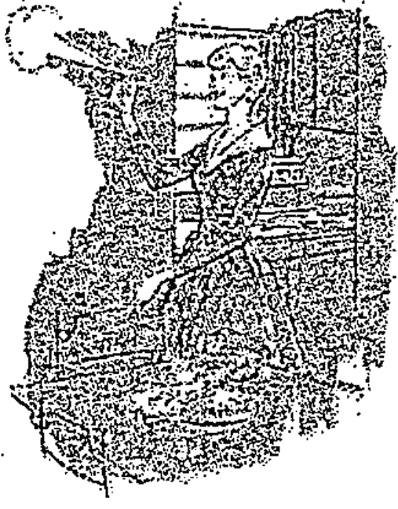

This year, housewives will spend $52,000,000 to combat cooking, smoking, and other common but disagreeable household odors. This is proof that the average woman views odors with alarm and a clean-smelling home with pride.

Much of this money is wasted. Leading chemists know that very few of the many aerosol or wick-type brands actually remove odors. As one authority explains—"Until now, there have been two main types of air deodorizers: one de-sensitizes the nose and deadens your sense of smell; the other 'masks' the odor with a heavy perfume, to deceive your sense of smell. In both cases, the odor molecules will remain."

But chemical research has discovered a superior, significantly different product—a real odor killer—an amazing combination of chemicals that doesn't deaden or deceive your sense of smell ... it kills odors! You can now buy this product as new GOOD-AIRE!

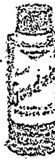

New Good-Aire works like magic to banish disagreeable odors. Press the button and Good-Aire reaches out, attacks and destroys the offending odor by chemical action. It does it quickly, pleasantly...and without any strong perfume or chemical smells! In seconds, cooking odors and lingering smoking odors are gone. Your home has that inviting air—fresh and clean as an ocean breeze!

What's more, a special germ-killing ingredient combination, 'VIRU-KIL', reduces bacteria count in the air. For restaurants and nurseries, especially during the cold and warm season.

Use new GOOD-AIRE every day in every room, for good housekeeping. You'll find the freshness lasts and lasts!

Try new GOOD-AIRE today—get it at your favorite store. Two extra-light fragrances—Floral and Spice—and two sizes, 75¢ and an economy size at $1.50.
SHULTON Fine Chemicals Division

# 为什么要花钱——
伤害或欺骗你娇贵的嗅觉

来自：多罗茜·柯克

家庭投资顾问，作家、美国家政协会会员

今年家庭主妇们在对抗家里烹饪、吸烟时产生的气味，和其他常见的令人不快的气味上的花费将达到52000000美元。这证明普通女性对令人不快的气味十分憎恶，而且以拥有干净，清新的家庭环境为傲。

其实大部分钱都被浪费了。国内著名化学家指出，只有少数的气雾剂，或除味剂品牌能真正消除气味。一个权威人士解释道：“到目前为止，市面上主要有两种类型的空气除臭剂：一种用来麻木，扼杀你的嗅觉；另一种用更重的香水气味来掩盖房间里的气味，欺骗你的嗅觉。在这两种情况下，气味分子仍然存在。”

但最近化学家们，研究发现了一种更高级，明显不同的产品——真正的气味杀手——一种神奇的化学制品——它不会麻木或欺骗你的嗅觉。它能杀死气味！你现在就可以买到这种新产品“GOOD-AIRE”！

这种新“GOOD-AIRE”能像魔法一样，消除令人不快的气味。按下按钮，“GOOD-AIRE”就会喷出来，通过化学反应，攻击并破坏气味分子，高效，快捷。没有任何强烈的香水或化学气味！只要几秒钟，烹饪的气味，和挥之不去的烟味，就会完全消失。你家里就会拥有干净、海风般的新鲜空气！

更重要的是，里面含有多种特殊杀菌成分，“VIRU-KIL杀菌王”，减少空气中的细菌数，尤其是在感冒和病

每季节。

每天，整理房间时，在每个房间喷点“GOOD-AIRE”。你会发现，房间的空气会持久清新！

今天就试试“GOOD-AIRE”吧——在你经常去的商店都可以买到。有两种气味可选——花香型和清香型——两种容量可选，有70美分一瓶的，还有1.59美元加大经济版一瓶的。

萨尔顿精化公司

（337）

# 作业

# 16、小公司也能成功

Here's the story of Chicago's young Py-O-My Company, whose baking mixes prove

# The Little Fellow
Can Succeed

—if he brings you desserts as new and different as these!

Just look at the brands of baking mixes your grocer carries! Most of them are made by business giants—good products, fairly priced, and widely advertised.

"What chance has a little fellow—especially in this field?" you might ask. And you might even say: "If a little fellow can grow against such competition, he must have something excitingly different that I should know more about".

Py-O-My Mixes are different. For example, a blueberry muffin mix—with all the "fruits" inside—was unheard of until a young father suggested packing plump, wild blueberries in a baby food can—with a fine muffin mix and paper baking cups (suggested by his wife)!

Or take Py-O-My Brownie Mix. Imagine using your grandmother's family recipe—treasured for its unmatched flavor—and then packing it in a one-use aluminum baking pan!

And their newest—Py-O-My Ice Box Pie Mix—is the first "baking mix" that needs no baking! It contains graham cracker crust and a chiffon filling that whips in seconds.

Here are pictures of these—plus two other favorites—Py-O-My Puddin' Cake Mix and Py-O-My Coffee Cake Mix. Take a look at each—if you will. And then this week—when you market—pick up one or two. (Most good grocers have them.) We think you will be so pleased you'll try them all—real soon.

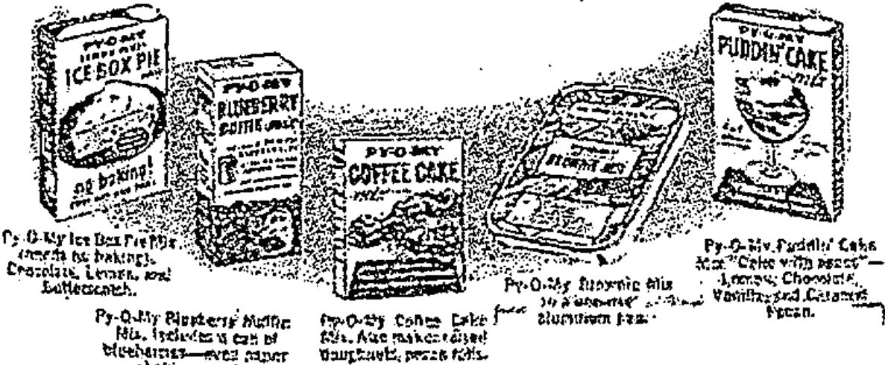

这是芝加哥一家年轻的公司Py-O-My公司的故事，他的烘焙料证明：

# 小公司也能成功

——如果尝到他带给你这么新颖，与众不同的甜点，你就会相信这点！

看看超市里销售的烘焙料品牌！大多数都是大公司的产品——这些产品做工讲究，价格合理，有大量广告宣传。

“那么，小公司有什么机会呢——尤其是在这么一个竞争激烈的领域？”你可能会说：“如果一个公司想在这样的竞争中发展，它必须能标新立异，有一些我应该深入了解的不同之处。”

Py-O-My烘焙料就与众不同。比如，蓝莓松饼烘焙料——里面混合有所有“原料”——这在之前闻所未闻，直到一位年轻的父亲建议，除了上好的烘焙原料，以及烘焙纸外，再在婴儿食品罐里放入果实饱满的野生蓝莓（这还是他妻子的建议）！

或者，你也可以选择Py-O-My布朗尼烘焙料。想象一下，祖母的食谱配料——无与伦比的美味——被打包放入一次性铝箔烤盘，是件多么方便，多么惬意的事情！

还有他们最新研制的——Py-O-My冷藏馅饼料——是第一款不用烘烤的“烘焙原料”！它里面含有全麦饼壳，和几秒钟就可以打好的戚风馅料。

下面是这些烘焙料的包装图片——还有另外两种顾客很喜欢的烘焙料——Py-O-My布丁蛋糕烘焙料，和Py-O-My咖啡蛋糕烘焙料。你可以仔细看看每种烘焙料。这周如果你逛超市——可以选购其中的一两种试试。（大多数大超市均有售）我们相信你一定会很满意，不久之后，你会选择购买所有种类。

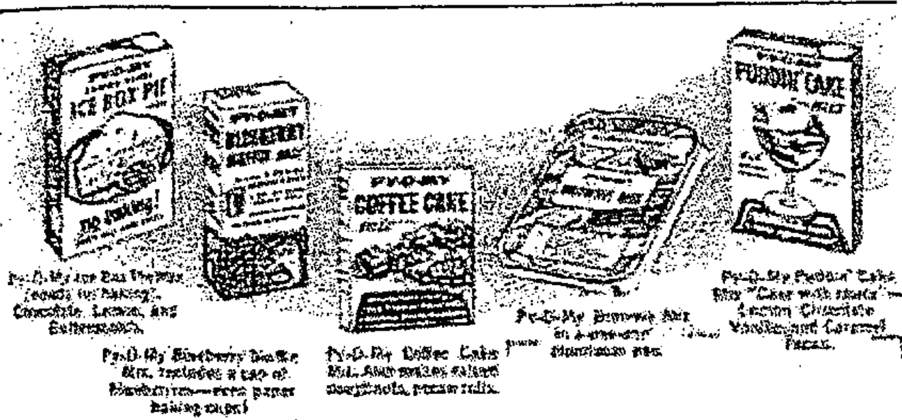

Py-O-My冷藏馅饼料（无需烘焙），有巧克力，柠檬，以及奶油糖果3种味道可选

Py-O-M蓝莓松饼烘焙料。包括一罐蓝莓——还有烘焙纸杯！

y-O-My咖啡蛋糕烘焙料。还可以做成甜甜圈，以及山核桃卷。

Py-O-My在一次性铝箔盘中放置的布朗尼烘焙料。

Py-O-My布丁蛋糕烘焙料，内有柠檬，巧克力，香草，焦糖核桃沙司

(411)

# 作业

# 17、一个意外……不小心把一杯水倒在了已成型的蛋糕糊上，结果做出了 一种新的 “沙司蛋糕”

# How the accident → ...of pouring a cup of water on a fine cake batter

# created the new "cake with sauce"
… PY-O-MY PUDDIN' CAKE MIX

Late one day—not long ago—a new kind of cake batter had just been mixed—and poured into a pan.

Then—a cup of water was spilled over it—by accident. And just out of curiosity—they baked it anyway.

The result after baking! The water had been transformed into a smooth, tasty sauce under a fine-textured cake. All in one pan. And all in one baking!

Everybody got excited—the way people always do—about something good and completely different! Everybody started asking questions. How did it happen? Could it possibly be this easy to make? What flavors should be offered? (Chocolate, caramel pecan, and vanilla proved most popular in testers.)

What should it be called? It wasn’t just a cake. Not just a pudding. So the Py-O-My people called it “Puddin’ Cake Mix”.

Today, you’re likely to be asked by the best cooks you know: “Have you tried that new Py-O-My Puddin’ Cake Mix—you pour water over the batter!”

More homemakers are discovering Py-O-My Puddin’ Cake Mix each month. And their families are asking for that “new dessert” again and again. Especially the youngsters.

The Caramel Pecan, with real, choice pecans is a great favorite. And so is the Chocolate. The Vanilla—richer alone, with fruit juice or fruit salad—offers unlimited variety.

Your grocer has all 3 flavors—or can now get them for you easily. We believe you’ll enjoy new Py-O-My Puddin’ Cake Mix—in your home—this week!

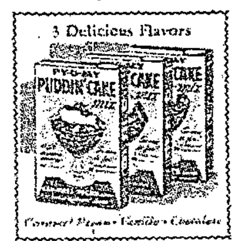

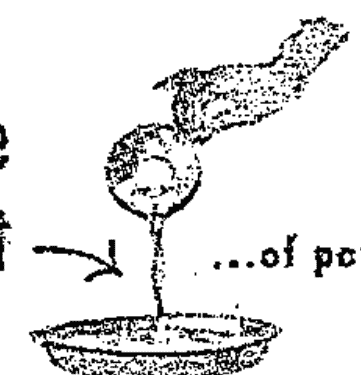

# 一个意外......

# 不小心把一杯水倒在了已成型的蛋糕糊上，
结果做出了 一种新的 “沙司蛋糕”

# ... PY-O-MY 布丁蛋糕烘焙料

最近——蛋糕师刚做好一种新的蛋糕糊，铺在了烘焙盘上。

结果，一不小心，把一杯水倒在了上面。出于好奇，他们还是把那个面包放进了烤箱。

你猜结果怎样？水在成型完好的蛋糕下方，变成了嫩滑、美味的沙司。这些都在一个烘焙盘上，一次烘焙完成！

人们都会对新奇，完全不同的事物感兴趣——这是人的天性！所有人都开始询问，这是怎么做的？做起来真的这么容易吗？应该提供给顾客什么口味呢？（后来的测试证明：巧克力，焦糖核桃，还有香草味最受欢迎。）

它应该叫什么名字呢？它不只是一块儿蛋糕。也不只是一块儿布丁。因此，Py-O-My决定叫它“布丁蛋糕。”

今天，你可能会被你认识的最好的厨师问道：“你有没有尝试过Py-O-My布丁蛋糕烘焙料——把水倒在蛋糕糊上的那种！”

每个月都有越来越多的家庭主妇购买Py-O-My布丁蛋糕烘焙料。他们的家人对这种“新甜点”也是百吃不厌。尤其是小孩儿。

山核桃真果仁的焦糖山核桃口味，是最受欢迎的口味之一。巧克力口味也非常受欢迎。香草口味——纯香草口味，或添加了果汁或水果的香草口味——更是畅销。

一般的商店里都会有这3种口味——现在你轻松就能买到。我

们相信这周，你就能在家享用到这种全新的美味 Py-O-My 布丁蛋糕。

## 3 种美味

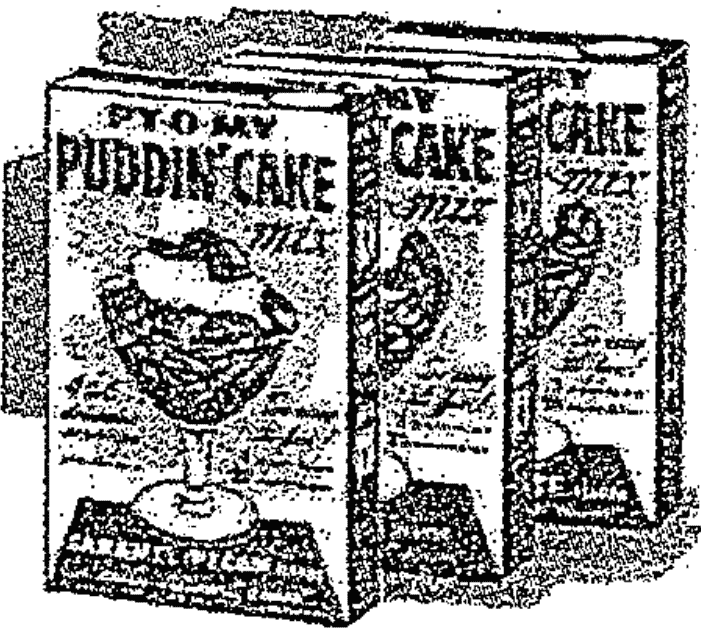

焦糖山核桃・香草・巧克力

## 作业

# 18、你驾驶的里程越长，每公里花的钱就越少！

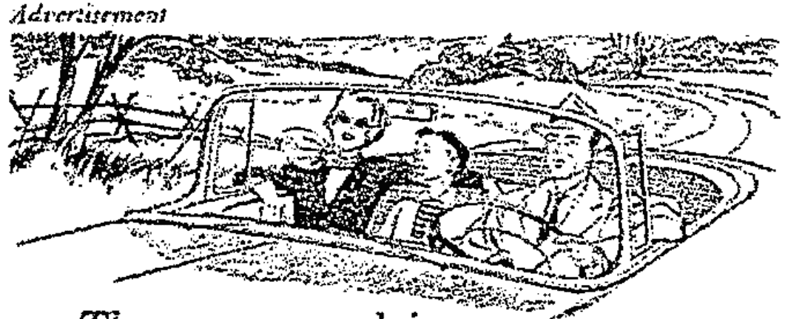

# The more you drive,
the less it costs per mile!

Leaving your car home in the garage costs you almost as much as driving it.
Figures compiled by the American Automobile Association show that the amount of gasoline and oil you use affects total car expense far less than the fixed charges—insurance, license fees and depreciation. These costs are about the same whether you drive 5,000 miles a year or 15,000. If you have any doubts on this, see how little more a car dealer can allow for a low-mileage used car. Trade-in values are based largely on year and condition of the car.
Of course, you’ll use more gasoline and oil as you drive more. But U.S. oil companies have held their prices so low (even with the taxes on gasoline) that additional mileage costs very little. As shown on the chart, the family that drives 5,000 miles a year will pay 5.2¢ per mile for each member of the family. The family that drives 15,000 miles will pay only 2.5¢ per mile … 52% less!
So, to get your money’s worth

Driving Costs for Average Family HUSBAND, WIFE AND ONE CHILD
Item	5,000 miles* 15,000 miles*
Depreciation... $177.50 $ 477.50
Insurance..... 104.40 104.40
License fees... 10.80 10.80
Gasoline & Oil 114.60 343.80
Maintenance... 27.00 111.00
Tires........ 27.50 70.50
$770.60 $1,129.60
Cost per mile for each member of family 5.2¢ 2.5¢
*Source AAA

out of your car investment, use your car more. Take your family on a motoring vacation ... shop by car ... enjoy week-end trips. And remember — the more you drive, the less it costs per mile!

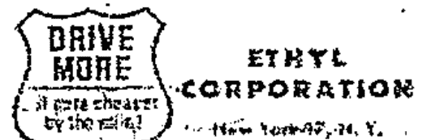

## 你驾驶的里程越长，每公里花的钱就越少！

你把车放到停车库的成本，和经常驾驶它的成本几乎一样。

美国汽车协会调查数据显示，你使用汽油和机油量对用车成本的影响，远低于汽车固定成本——保险、牌照费和折旧费。无论你每年开 5000 英里，还是 15000 英里，这些成本大约都是一样的。如果对此你有任何疑问，去看看汽车经销商对行驶里程数少的二手车做出多少让步。他们以旧换新的估量价值，主要基于你的车的使用年数，以及汽车性能状况。

一般家庭开车的成本
(丈夫，妻子和一个孩子)

每年 5000 英里 15000 英里
折旧费...$477.36 $477.36
保险....104.46 104.46
牌照费...16.83 16.83
汽油&机油114.50 343.50
维修.... 37.00 111.00
轮胎......25.50 76.50
$775.65 $1,129.65

每英里每个家庭成员的成本 5.2¢ 2.5¢

来源：AAA

当然，你驾驶的里程越多，你用的汽油也就越多。但是美国石油公司对于每个家庭成员超出限定公里数所使用的汽油量的油价压得很低（虽然要承担很高的税）。正如上面图表中所显示的那样，每个家庭每年行驶 5000 英里，每个家庭成员每英里的成本是 5.2 美分。而每个家庭每年行驶 15000 英里，每个家庭成员每英里的成本是 2.5 美分……成本降低了 52%！

因此，让你投资在车上的钱，发挥更大的价值，那么多多驾驶它吧。带你的家人驾车度假……驾车购物……享受周末旅行。记住，你驾驶的里程越长，每公里花的钱就越少。

驾驶里程越长
……每公里成本越低！

ETHYL 公司
纽约 17，纽约 (116)

## 作业

# 19、车主如何 “划算” 地享受更多乐趣和便利

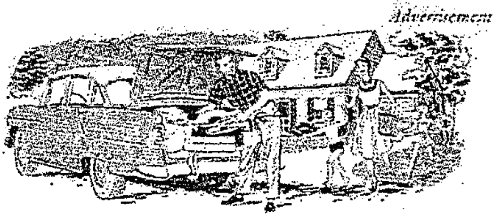

# How motorists can enjoy extra fun and convenience at "bargain" rates

The more you use your car, the more you get out of it.

It opens up roads of pleasure that you and your family might otherwise miss. Trips to the beach, family picnics in the open country, visits to relatives and friends, and many other exciting family adventures.

In fact, there are so many places to go, so many things to see... all of America is just a pleasant drive "down the road." You'll enjoy driving on rumbling back roads that lead to secluded scenic spots... on fast, new highways that connect inviting cities... on tree-lined streets in picturesque villages.

And the more you drive, the less it costs per mile—according to figures published by the American Automobile Association. That's because the fixed costs of running a car (depreciation, license fees, insurance) do not change with mileage.

The chart below shows how this works out.

Driving costs for average family Husband, wife and one child

| Yearly | 5,000 miles | 15,000 miles |
|---|---|---|
| Depreciation | $477.86 | $477.86 |
| Insurance | 104.46 | 104.46 |
| License fees | 16.83 | 16.83 |
| Gasoline & Oil | 114.56 | 342.50 |
| Maintenance | 37.00 | 111.00 |
| Tires | 23.50 | 76.50 |
|  | $775.67 | $1,129.65 |
| Cost per mile | $0.15 | $0.08 |
| per each member of family |  |  |

So plan to get the most fun and convenience out of your car investment. Take weekend trips... sleep by car... enjoy a cool evening at the drive-in theatre. And remember that when you drive more—it gets cheaper by the mile!

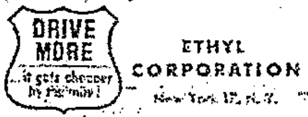

## 车主如何“划算”地
享受更多乐趣和便利

对你的爱车，你驾驶的越多，得到的就越多。

它为你打开了你和家人可能会错过的快乐之行。驾车带着家人去海滩旅行，去辽阔的郊外野餐，拜访亲戚、朋友，以及许多其他令人兴奋的家庭冒险。

事实上，有很多地方值得去，有很多美景值得赏……你只要开上爱车，开心“出发”。无论是沿着杂草丛生的乡间小路，驶向人迹罕至的美景……还是在通往繁华都市的高速路上驰骋，亦或是在风景如画的村庄中绿树成荫的街道上慢行，都会让你心生愉悦。

并且，根据美国汽车协会调查数据显示，你驾驶的里程越长，每公里花的钱就越少。这是因为一辆车的固定成本（折旧费，许可费，保险等）不会随着驾驶里程的变化而改变。

这个图表会说明一切。

## 一般家庭开车的成本
(丈夫，妻子和一个孩子)

| | 每年 5000 英里 | 15000 英里 |
|---|---|---|
| 折旧费... | $477.36 | $477.36 |
| 保险... | 104.46 | 104.46 |
| 牌照费... | 16.83 | 16.83 |
| 汽油&机油 | 114.50 | 343.50 |
| 维修.... | 37.00 | 111.00 |
| 轮胎..... | 25.50 | 76.50 |
| | $775.65 | $1,129.65 |
| 每英里每个家庭成员的成本 | 5.2¢ | 2.5¢ |

因此，让你投资在车上的钱，带给你最多的乐趣和便利吧。带你的家人驾车度假……驾车购物……在免下车电影院享受凉爽的夜晚。记住，你驾驶的里程越长，每公里花的钱就越少！

驾驶里程越长
……每公里成本越低！

ETHYL 公司
纽约 17，纽约

## 作业

# 20、随着社会的改变——女人也在改变

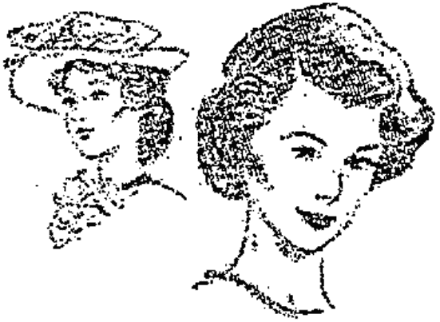

> Today's woman is meeting the challenge of the modern world with intelligence and confidence.

# As the World Changes — so Does the Woman

Step back a few years. Look over your shoulder, around that corner we turned in 1900. Now, take an imaginary walk along those again, turn-of-the-century streets. What a vast change has taken place since then! How incredibly far we have progressed into this fast-moving modern world of ours—building, inventing, discovering, every step of the way!

Today's woman has kept steady pace with her fast-moving times. And she hasn't kept pace reluctantly, either! She has changed, adapted, even taken the lead when necessary. Day after day, she accepts new challenges, meets them with new sureness, yet with age-old grace.

An important part of her busy life is Tampax's internal sanitary protection. Invented by a doctor over twenty years ago, Tampax has been keeping pace with — has been frankly meeting—the special needs of all women, married or single, active or not.

Today's woman looks to Tampax for the answer to that personal challenge during those difficult days of the month. Because she wants the added reassurance, comfort, security at this time — because she wants the freedom to participate in all her busy activities—whenever she likes—she has made Tampax her choice. For with Tampax, she almost forgets about differences in days of the month!

Millions of smart young moderns use Tampax, attest to its complete satisfaction. Within its three absorbency sizes (Regular, Super, Junior) there's a right protection for everyone's needs. Now in use all over the world, Tampax is making an accepted and important contribution to modern living.

Tampax Incorporated, Palmer, Mass.

## 新时代的女性用智慧和自信
迎接着现代社会的挑战

## 随着社会的改变——女人也在改变

让我们回头看看 1900 年。想象着我们走在 20 世纪初古怪的街道上。从那时到现在，发生了多么巨大的变化！我们的时代发生了翻天覆地的变化，时代的发展，令我们难以置信——建筑，发明，改进，每一步都让我们惊奇！

如今的女性，已经能紧跟时代发展的潮流。而且，并非消极被动，而是非常积极地提升自己！他们不断改变，适应，在需要的时候还能身居领导职位。一天又一天，她们不断接受着新的挑战，用自己的才华能力，用自己的优雅姿态取得着一个又一个的新成就。

丹碧斯卫生棉条（Tampax）在女人忙碌的生活中，给她内部卫生提供一层重要保护。这是一款 20 年前，由医生研发的卫生棉条，丹碧斯卫生棉条一直不断根据女人们的特殊需求进行改进——满足所有女人的需求，不管是单身，或已婚，安静，或活跃。

每个月那几天，女人們都指望丹碧斯卫生棉条能帮助她度过这几天的困难时期。因为她想在这段时间更自信，更舒适，更安全——因为她希望能自由地参与各种活动——各种她喜欢的活动，丹碧斯卫生棉条便成了她的选择。因为丹碧斯卫生棉条，她几乎没感觉到每个月这几天和其他时候有什么不同！

数百万的现代聪明年轻女人，使用丹碧斯卫生棉条后，都十分满意。它有 3 种吸收率（常规、初级，高级），可以满足每个人的不同需求。现在全世界都在使用丹碧斯卫生棉条，丹碧斯卫生棉条为现代生活提供着重要的贡献。

丹碧斯卫生棉条公司 （530）

## 作业

# 21、如果你正遭受着轻微关节痛或风湿病的折磨...

Advertisement

# If you suffer from minor pain of ARTHRITIS or RHEUMATISM read these highlights from a recent PAIN REPORT

From doctor-supervised studies on 475 people—suffering from minor pains of arthritis, rheumatism or other muscular aches—come these important facts about DEFENCIN—the new and different analgesic that brings more effective temporary pain relief.

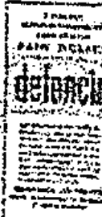

FACT #1: Of all people suffering pain, 82% – a vast majority – reported DEFENCIN brought effective relief. FACT #2: Almost 30% said DEFENCIN brought complete relief of their pains. IN FACT many people who used DEFENCIN reported: DEFENCIN was faster-acting, longer-lasting, or brought more complete relief than all other medicines they had previously used ... including aspirin. That's why we say for many people DEFENCIN is more effective than aspirin.

What these facts mean to you If you suffer from minor pain of arthritis, rheumatism or other muscular aches DEFENCIN—the new and different analgesic—holds new promise of more effective relief than you have found before. Two of DEFENCIN's special ingredients have never before appeared in conventional pain tablets or pills. This unique combination of ingredients in DEFENCIN works together and, among other actions, seems to make patients less aware of their pain. Your doctor would call this "raising the threshold of pain."

You see, aspirin and ordinary pain tablets are designed essentially to blunt pain. They do not act the way DEFENCIN does ... do not bring DEFENCIN's more effective relief. Study the facts about the pain relief DEFENCIN brought to hundreds in clinical studies, and you will know why many people every day turn to DEFENCIN for relief of pains from arthritis, rheumatism and related diseases. Remember, for many people DEFENCIN is more effective than aspirin. Ask your druggist for DEFENCIN today. 24 tablets, $1.00 ... 72 tablets for $2.50. DEFENCIN® ... a fine product of Grove Laboratories, St. Louis, Mo.

## 如果你正遭受着轻微关节痛或风湿病的折磨，请阅读这则从《病痛报告》中摘取的要点部分

医生通过对 475 位轻微关节炎，风湿病或其他肌肉疼痛病人的研究，发现了苯氧丙酚胶树脂酸盐的一些重要作用 ——一种全新、不同于以往药物的镇痛药，可以更有效地临时缓解疼痛。

事实 #1: 在所有遭受疼痛困扰的患者中，82%——绝大多数——服用苯氧丙酚胶树脂酸盐后，疼痛都得到了有效缓解。

事实 #2: 将近 30%的人，都说苯氧丙酚胶树脂酸盐彻底消除了他们的疼痛。

事实上，很多使用苯氧丙酚胶树脂酸盐的人，都说：苯氧丙酚胶树脂酸盐比他们之前使用的其他药物，包括阿司匹林，能更快速、更持久，更彻底地缓解疼痛。这就是为什么我们说，对许多人来说苯氧丙酚胶树脂酸盐比阿司匹林更有效。

## 这些事实告诉你

如果你患有轻微的关节炎，风湿病或其他肌肉疼痛，苯氧丙酚胶树脂酸盐——这种全新，不同于其他任何药物的镇痛药，一定可以帮助你比以前更有效地缓解疼痛。

苯氧丙酚胶树脂酸盐含有传统止痛片，或药丸中从未有过的两种特殊成分。苯氧丙酚胶树脂酸盐中这些特殊成分的独特组合，能大大减缓患者的疼痛感。医生会称之为“提高疼痛阈值”。

阿司匹林以及其他普通止痛药主要是让患者变得麻木，从而减轻疼痛。他们不像苯氧丙酸胺树脂酸盐……不能像它一样更有效地缓解疼痛。

了解了苯氧丙酸胺树脂酸盐临床上，给数百位患者减缓了疼痛的事实，你就会知道为什么每天都有许多关节痛，风湿病以及相关疼痛的患者都会购买苯氧丙酸胺树脂酸盐了。记住，对大多数人来讲，苯氧丙酸胺树脂酸盐比阿司匹林更有效。

今天去药店购买苯氧丙酸胺树脂酸盐吧，24片装1美元……72片装2.5美元。

苯氧丙酸胺树脂酸盐……密苏里州，圣路易斯，格罗夫实验室优品。

## 作业

# 22、一些关于关节炎和风湿病的问答

## SOME QUESTIONS AND ANSWERS ABOUT ARTHRITIS AND RHEUMATISM:

Q: Is there a proven cure for arthritis and rheumatism?
A: No. But physicians often can control the pain, the condition, or the crippling effects of even some advanced forms.
Q: What can I take to control my pain?
A: That depends on the severity of your condition. Physicians have prescribed steroids, gold salts, etc., for more advanced conditions, ... for minor conditions, simple analgesics like aspirin.
Q: Which works best?
A: Again, it depends on your condition. Only your physician can tell you that.
Q: My condition is diagnosed as "minor arthritis." Aspirin helps, but is there anything I can take for temporary relief that is more effective?
A: There is a special tablet called DEFENCIN. It is a new and different analgesic for more effective pain relief.
Q: What makes DEFENCIN more effective?
A: DEFENCIN contains three highly effective medicines. They work together to produce a level of pain relief unsurpassed by ordinary pain tablets. Two of DEFENCIN's special ingredients have never before appeared in conventional pain tablets or pills. This unique combination of ingredients seems to make patients less aware of their pain. Your doctor would call it "raising the threshold of pain."
Q: You mean DEFENCIN does a different job against pain than aspirin or ordinary pain tablets?
A: Yes. Other pain tablets are all designed essentially to blunt pain. They do not act in the way DEFENCIN does and do not bring DEFENCIN's effective relief.
Q: What evidence is there of DEFENCIN's effectiveness?
A: Clinical studies, with detailed information from both doctors and those they treated reported that DEFENCIN was more effective in the great majority of cases. In fact, DEFENCIN gave complete relief of the pain in about one-third of the cases.

Q: Was DEFENCIN compared to aspirin in those studies?
A: Yes, and there was a far greater record of pain relief among those who took DEFENCIN than those who took aspirin. (These studies included a "double-blind" test where patients didn't know which medicine was which. Not even the doctors knew until the results were recorded.)
Q: Is DEFENCIN safe?
A: Yes. Clinical tests confirm its safety. Naturally, as with any medicine for arthritis-like symptoms, a physician should be consulted immediately if pain persists or is severe, or there is noticeable redness, swelling, deformity or stiffness. In no event should you rely upon self-medication for more than ten days.
Q: Will DEFENCIN relieve simple headache, too?
A: Yes, and DEFENCIN is also effective in relieving many of the painful conditions associated with the common cold. It relieves feverish feeling as well as aches and pains.
Q: Is DEFENCIN expensive? It certainly seems it would cost more than usual pain tablets.
A: DEFENCIN costs more than ordinary pain tablets ... more than aspirin, for instance. Those who want DEFENCIN's extra effectiveness consider the few cents more per tablet reasonable: $1.00 for 24 tablets, $2.50 for 72 tablets.
Q: Returning to those test patients who took DEFENCIN under doctors' supervision ... what specific relief did they say they got?
A: Some said pain was relieved. Many said they could reach, lift, bend, walk and move with greater freedom. In some cases, all painful symptoms were relieved.
Q: Where can I buy DEFENCIN?
A: At drug counters in every state. Look for DEFENCIN in green and white cartons. A fine product of Grove Laboratories, Inc., St. Louis, Mo., REG. T.M.

## 一些关于关节炎和风湿病的问答

问：是否已经证明有效的关节炎或风湿病治愈方法？

答：没有。但是医生通常可以帮患者控制疼痛，改善状况，或通过更先进的方法更有效地减轻患者的疼痛。

问：服用什么药物？

答：这取决于你病情的严重程度。医生的处方类药物有固醇、金盐热熨等，或其他更先进的方法。对病情较轻的患者，可以服用基本的止痛药物，如阿司匹林。

问：哪种效果最好？

答：再说一次，它取决于你的病情。只有医生才能帮你诊断。

问：我被诊断为“轻度关节炎”。阿司匹林可以缓解我的疼痛，但是有没有其他药物，可以更有效地帮我缓解疼痛呢？

答：有种叫做苯氧丙酚胶树脂酸盐的药物。它是一种全新的药物；可以更有效地缓解疼痛。

问：为什么苯氧丙酚胶树脂酸盐更有效？

答：苯氧丙酚胶树脂酸盐含有 3 种非常有效的药物。这三种药物共同作用于人体，对疼痛的缓解程度，是普通止痛片无法比拟的。苯氧丙酚胶树脂酸盐含有传统止痛片，或药丸中从未有过的两种特殊成分。苯氧丙酚胶树脂酸盐中这些特殊成分的独特组合，能大大减缓患者的疼痛感。医生称之为“提高疼痛阈值”。

问：你是说苯氧丙酚胶树脂酸盐和阿司匹林，或普通止痛片相比，效果有很大不同，是吗？

答：是的。阿司匹林以及其他普通止痛药主要是让患者变得麻木，从而减轻疼痛。他们不像苯氧丙酚胶树脂酸盐……不能像它一样更有效地缓解疼痛。

问：有什么证据能证明苯氧丙酚胶树脂酸盐有效吗？

答：经过临床研究，医生和患者都反应，在绝大多数情况下，苯氧丙酚胶树脂酸盐比普通止痛药更有效。事实上，苯氧丙酚胶树脂酸盐对大约三分之一的患者都带去了明显缓解疼痛的效果。

问：在这些研究中，苯氧丙酚胶树脂酸盐和阿司匹林进行过对比吗？

答：是的，研究记录表明，服用苯氧丙酚胶树脂酸盐，比服用阿司匹林的效果更好。（这些研究包括“双盲”测试，病人和医生都不知道服用的哪种药，直到结果出来）。

问：苯氧丙酚胶树脂酸盐安全吗？

答：是的。临床试验都证实了其安全性。一般来说，有任何类似关节疼痛的症状，在服用药物后，如果症状还在持续，或变得更严重了，或有任何发红；肿胀，变形，僵硬症状，都应该立即去咨询医生。非处方情况下，服用此药物不能超过 10 天。

问：苯氧丙酚胶树脂酸盐能缓解普通的头疼吗？

答：是的，苯氧丙酚胶树脂酸盐对很多感冒引起的疼痛都有效。它可以退烧，缓解疼痛。

问：苯氧丙酚胶树脂酸盐贵吗？它看起来要比普通止痛药贵。

答：苯氧丙酚胶树脂酸盐比普通止痛药会贵一些，比如，阿司匹林。考虑到苯氧丙酚胶树脂酸盐的效果，你就会认为贵几美分是非常合理的：它的价格是 24 片装，1.00 美元，72 片装，2.50 美元。

问：那些在医生指导下，服用苯氧丙酚胶树脂酸盐的临床试验病人，说他们具体取得了哪些效果？

答：有些人说疼痛得到了缓解。很多人说他们伸展，抬举，弯腰，走路等活动更自由了。还有些病人说他们疼痛的症状完全消失了。

问：我在哪里可以买到苯氧丙酚胶树脂酸盐？

答：每个州的药店都有售。请认准白盒包装，印有绿色商标的苯氧丙酚胶树脂酸盐。密苏里州，圣路易斯，格罗夫实验室优品。

®Reg T.M.

## 作业

# 23、疼痛......疼痛...... “治愈”

## Aches...Pains...and "Cures"

Many products make hopeful promises— but can they deliver?

If you are one of the nearly nine million people in this country who suffer from arthritis or rheumatism, you are considered "fair game" for a variety of products which frequently skirt the borders of ethics to imply that they offer curative powers for your affliction.

The fact is that there is no known cure for arthritis. Science is working night and day to find such a cure. Some day it will be discovered. But anyone now claiming to offer a "cure" should be regarded with suspicion.

## Your Doctor Knows Best

If you have read or heard these claims and are considering the purchase of such a device, diet, or medication, we urge you to consult your family physician first. Let him assess for you the merits of this product before you spend your hard-earned dollars.

However, if your arthritic or rheumatic pain is of a minor nature, there is a product that can bring you temporary relief — not cure you.

It is called Mentholatum Deep Heating Rub. Introduced only seven years ago, it has been the fastest-growing analgesic rub — and with good reason.

Mentholatum Deep Heating Rub is a grease-less, stainless cream that contains 4 active ingredients, each included to accomplish one common goal — temporary relief of minor arthritic pain.

## Acts In Two Ways

The major active ingredient is methyl salicylate. This well-known pain reliever, when rubbed on the skin, is actually absorbed into the blood stream and quickly reaches the affected areas by systemic action.

Other active ingredients stimulate capillary blood flow and create a soothing feeling of warmth. This deep-heating effect helps soothe away those minor pains, helps you get to sleep at night when otherwise you might toss and turn with discomfort.

## Special Trial Offer

If you have not yet tried Mentholatum Deep Heating Rub, you can now do so at almost no cost. To receive a generous tube of Mentholatum Deep Heating Rub send your name and address with 25¢ in coin (to cover mailing and handling charges) to The Mentholatum Co. Dept. G, Buffalo 1, N.Y. (Sorry, no more than one tube per family.) This trial offer expires December 31, 1943, so send today.

## 疼痛……疼痛…… “治愈”

很多药品做出承诺，都让人倍感期待——
但是，它们真的像承诺的那么有效吗？

如果你正好是我国近 900 万关节炎、风湿患者之一，你可能会觉得各种相关药品称能治疗你的疼痛的，经常打道德的擦边球，已经“见怪不怪”了。

事实是，目前还没有能够治愈关节炎的有效方法。科学家们正夜以继日地研究有效方法。相信，有一天，他们会找到这样的方法。但对现在那些声称能“治愈”关节炎的药物，我们应持怀疑态度。

## 你的医生最了解

如果你看到或听到说能治愈关节炎的设备，药物，或饮食方案，并考虑购买，我们强烈建议你先咨询自己的家庭医生。在花辛苦赚来的钱购买之前，让他为你评估一下这个产品的优点。

然而，如果你的关节炎或风湿痛不严重，的确有一款产品能够为你暂时缓解疼痛——不过不是治愈。

它就是曼秀雷敦深层加热按摩霜。这款产品是 7 年前推出的，是销量上升最快的镇痛按摩霜——这种结果是必然的。曼秀雷敦深层加热按摩霜无暇且不含油脂，包含 4 种活性成分，它们都有一个共同的作用——暂时缓解轻度关节炎疼痛。

## 它主要从两个方面发挥作用

它的主要活性成分是水杨酸甲酯。这种著名的止痛成分，搽在皮肤上时，可以被吸收入血液中，到达疼痛区域。

其他活性成分能刺激毛细血管内的血液流动，并且身体会感觉温暖舒适。这种深层加热效应能舒缓轻微疼痛，有助你入眠。不会再因为不适而辗转反侧，无法入眠了。

## 独特试用提议

如果你还没有尝试过曼秀雷敦深层加热按摩膏，现在几乎可以不用任何成本就能试用它了。你把 25 美分连同你的姓名和地址（邮费和手续费）邮寄到纽约布法罗 13 号曼秀雷敦有限公司 G 部门，即可获得（对不起，一个家庭只能领取一管。）有效期截止到 1962 年 12 月 31 日，所以，马上行动吧。

## 作业

# 24、显微镜照片显示，现在的快速去污粉会“咬噬”瓷槽以及瓷盆，使其失去光泽

More than dirt goes down the drain

# Microphotos Show Most of Today's Speedy Cleansers "Bite Into" Luster of Porcelain Sinks and Tubs

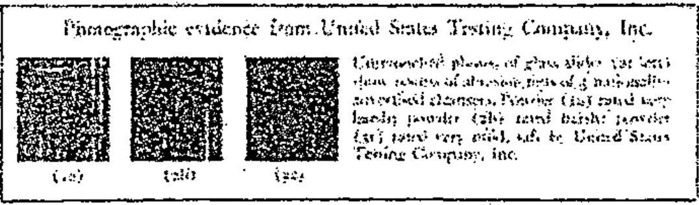

Recent laboratory tests*, made by the U. S. Testing Co., show what no product label has ever told: Most of today's cleansers, whether foaming or bleaching, contain such gritty abrasives, they scratch lustrous porcelain tubs and sinks from the start. (If you listen closely, you can actually hear these cleansers "bite into" the surface.) To test the degree of harshness of these cleaning powders, 5 leading cleansers were rubbed for 100 single strokes each on glass slides. (On glass, cleansers act the same as on porcelain.) Then a photographic comparison was made of the results. And even the case-hardened researchers raised a collective eyebrow. For only one slide remained clear and unscratched. The remaining four slides were scratched and marred.

The name of the one non-gritty cleanser? Why, that good old standby, Bon Ami—with the famous chick on the label. And the reason it "hasn't scratched yet" is simply this. Unlike today's gritty cleansers, Bon Ami powder is completely free from harsh scouring particles. Instead, it contains a remarkable non-scratching substance mined in remote, almost inaccessible "upcountry" regions. This unique substance has the rare property of being able to polish as it cleans porcelain. It never digs in or scratches. Women who use Bon Ami cleanser—and have for years—can confirm the truth of these facts simply by looking at their own shiny sinks and tubs.

## 除去的不仅是污渍

## 显微镜照片显示，现在的快速去污粉会“咬噬”瓷槽以及瓷盆，使其失去光泽

来自美国测试公司的照片凭证

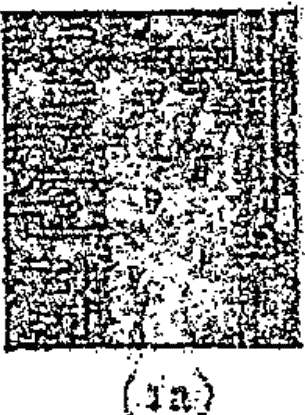

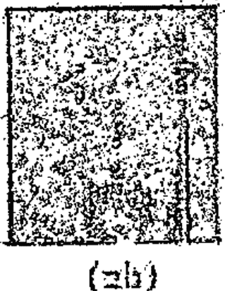

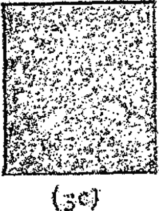

玻璃载片显示了对 3 个在全国范围推广的去污粉的磨损测试结果 去污粉(1a) 显示磨损严重：去污粉(3c) 显示柔和，安全，图片由美国测试公司提供。

美国测试公司最近进行的一项的实验测试结果显示，如今大多数去污粉；不论是泡沫清洗剂还是漂白剂，都含有在产品标签上绝对不会注明的研磨剂，这种研磨剂会从一开始就侵蚀你光滑的瓷槽以及瓷盆。（如果你仔细听，你真的会听到这些研磨剂“咬噬”瓷槽以及瓷盆的表面。）

为了对国内 5 款领先品牌的去污粉进行磨损度测试，实验人员分别用去污粉在每个玻璃片上摩擦了 100 次。（去污粉对玻璃的磨损度，和对瓷器的磨损度一样。）然后，通过显微照片对比结果。结果甚至让那些严肃的研究人员也惊讶地皱起了眉。因为结果只有一片玻璃干净且没有遇到划损。其他 4 片玻璃均遭划损。

那款不含研磨剂的去污粉叫什么？为什么使用标签上印有一只

著名小锥鸡的宝纳米去污粉的玻璃片依旧和原来一样？它为什么“从不磨损”？原因很简单：

和如今含有研磨剂的去污粉不同，宝纳米去污粉完全不含任何粗糙颗粒。相反，它含有从极为偏远，几乎“无法到达”的区域，开采并提取的独特防刮矿物原料。这种独特的物质，在清洁瓷器的同时，还可以使它更具光泽。它永远不会侵蚀，或磨损瓷器表面。

使用宝纳米去污粉多年的主妇们家中那闪闪发亮的水槽和浴盆，都能证明这点。

*美国测试公司报告#20919—1956 年，10 月 11 日

©1957，宝纳米公司——联合染色&化学公司附属机构

## 作业

# 25、全新的洗衣奇迹，震惊了家庭主妇

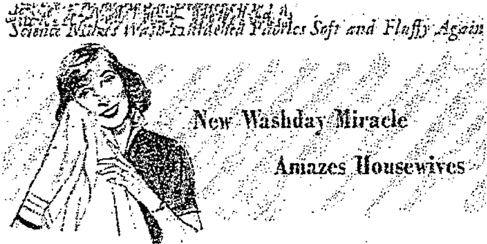

A stiff, scratchy towel and a crying baby started a scientific search that ended in the discovery of a laundry rinse so effective it can almost be called a miracle. You know how discouraging is—trying to dry with a towel that feels like sandpaper, or helplessly sitting by while a rough, harsh diaper irritates a baby’s tender skin. Up to now nothing could be done about it. Even a fresh spring breeze couldn’t bring the bread-new softness back. And when bad weather made drying indoors a must—well, things were just hopeless. But now bath towels, baby clothes, sweaters and hundreds of other washables need never be stiff and scratchy again…for science has found the answer in a new product called Sta-Puf Miracle Rinse. From the first minute Sta-Puf appeared on grocers’ shelves, harassed housewives hoping for a miracle began to try it. Almost every experience was alike. First they skeptically added a half cup of Sta-Puf in their last

rinse water. Then they waited for their wash to dry. Finally they were amazed when they saw woolens, knitwear and blankets, matted down by previous washing, became fluffy-soft and luxurious as new. They became even more delighted when they saw sweaters look “like cashmere,” chenille bath mats, bedspreads and robes fluff up—become silky-soft to the touch again! What’s more, clothes rinsed in Sta-Puf come off the clothesline almost wrinkle-free. Much flat-work sheets, etc., requires no ironing at all. And remaining pieces iron far more easily and quickly. Laundry experts call Sta-Puf “one of the most astonishing washday discoveries in years.” And thousands of women say that they could never get along without it. Sta-Puf is ideal for use in tubs, automatics and regular washing machines. Now available at all better grocery stores—or write for a free sample to A. E. Staley Mfg. Co., Dept. RD1, Decatur, Ill.

科技，让因多次洗涤变硬的面料，重新恢复柔软，蓬松

## 全新的洗衣奇迹

## 震惊了家庭主妇

一条僵硬、粗糙的毛巾，一个哭泣的婴儿，一场科学探索就此开始，最终发现了一个非常有效，可以说是奇迹的洗衣方式。

你知道用像砂纸一样的干毛巾，给一个白白胖胖，肌肤娇嫩柔软的婴儿擦皮肤，或让孩子无助地坐在粗糙的尿布上的感觉，让人多沮丧。

迄今为止，人们对此依旧无计可施。即便是轻柔的春风，也无法让毛巾重新变得柔软，蓬松。天气不好的时候，更是只能在室内晾干……所以，一直并没有什么方法解决这种情况。

但是，现在，浴巾；婴儿衣服，毛衣和其他几百种可水洗的布料，再也不会变得干硬、粗糙了……因为通过科学研究，一款叫做 Sta-Puf 奇迹洗衣的新产品已经找到了答案。

Sta-Puf 一出现在杂货店的货架上，疲惫的家庭主妇，就迫不及待地想试试，希望看到奇迹。

几乎所有人都经历了同样的阶段。首先，他们半信半疑地在最后清洗衣服的水里倒了半杯 Sta-Puf。然后等待衣服晾干。最后，令他们吃惊的是，他们看到以前清洗后变得干硬、毛糙的毛织品，针织品和毛毯变得柔软，蓬松，和刚买的一样。当她们看到原来的毛衣变得“像羊绒一样”，绒绒线浴垫、床罩和长袍的绒毛，摸起来如丝般柔软了，更让他们高兴的合不拢嘴！

更重要的是，用 Sta-Puf 清洗的衣服，从晾衣绳上拿下来后，

几乎没有褶皱痕迹。毛巾、床单等物用 Sta-Puf 清洗后根本不需要熨烫。其他需要熨烫的东西，熨烫起来则更容易和更快捷。

清洗专家称 Sta-Puf 是这些年来，最令人惊讶的洗衣发现。成千上万的女性都说，她们不能没有它。

、Sta-Puf 非常适合使用在浴缸和洗衣机中。现在,各个大型超市、杂货店都有售——你也可以写信到伊利诺伊州,迪凯特 A. E. Staley Mfg 公司, RD1 部门索取免费样品。

## 作业

# 26、数百万主妇在无意中使用了那种

## “咬噬”瓷槽以及浴缸光泽的去污粉

# Unknowingly Millions of Women Use Cleansers that "Eat Away" Luster of Porcelain Sinks and Tubs

> U.S. Testing Company confirms what you may have read in leading consumer-guide reports: Most of today's scouring powders (never supposed to have harmful effects) contain such gritty abrasives, they scratch shiny porcelain, make it dull and rough. To discover whether or not the cleanser you use is a "threat" to your sinks and tubs, read the facts below.

Millions of women, especially those with new porcelain sinks and tubs, should be shocked by these facts about today's cleansers. Recent laboratory tests showed that most of today's so-called "speedy" cleaning powders, whether disguised as foaming or bleaching, are so abrasive, they scratch from the start. This causes a steady "eating away" of porcelain luster so that sinks and tubs turn dull, grey and old-looking in almost no time. For proof of this, 5 leading cleansers were rubbed for 100 single strokes on glass slides to test for abrasiveness. (On glass, cleansers act the same as on porcelain.) The result? Four slides became dingy and rough. Only one remained smooth and shiny. The name of the one non-gritty cleanser? Why, haven't you guessed? The one your grandmother used—Bon Ami powder—with the famous chick and eggshell on the label. And the reason it "hasn't scratched yet" is simply this.

Unlike today's gritty cleansers, Bon Ami powder is completely free from sandy scouring particles that cut into porcelain. Instead, it contains a remarkable, non-scratching substance, mined in remote, almost inaccessible "upcountry" regions. Called feldspar, this unique substance has the rare property of being able to polish as it cleans glossy porcelain surfaces. It never digs in or scratches. Next time you read an advertisement that tells how fast a cleanser can clean, ask yourself how fast it will scour the luster from your precious porcelain possessions. There'll be no question in your mind that today's so-called "speedy" cleansers are still years behind good old Bon Ami powder (and cake) for safe, easy cleansing of shiny porcelain.

## 数百万主妇在无意中使用了那种“咬嗒”瓷槽，以及浴缸光泽的去污粉

美国测试公司证实了一件你可能在消费者指南中看到过的一个事实：如今大多数去污粉（从来没有怀疑过其危害），都含有研磨剂，这种研磨剂会侵蚀你光滑的瓷器表面，使其变得粗糙，暗淡无光。要想知道你使用的去污粉是否对家里的水槽，浴缸有“威胁”，请阅读下面事实：

数百万主妇，尤其是那些刚安装了新瓷槽和浴缸的人，肯定会被当今去污粉的一些实情所震惊。

最近的实验测试表明，如今大多数所谓的“快速”去污粉，不管是伪装成泡沫清洗剂还是漂白剂，都具有磨损性，会从一开始就划伤你的瓷槽和浴缸。这会慢慢地“吞噬”瓷槽和浴缸的光泽，使其变得暗淡无光，瞬间看起来很旧。

为了证明这点，美国测试公司对国内5款领先品牌的去污粉进行磨损度测试，实验人员分别用去污粉在每个玻璃片上摩擦了100次。（去污粉对玻璃的磨损度，和对瓷器的磨损度一样。）结果？4片玻璃均遭划损，变得粗糙，暗淡。只有一片光滑，亮泽。

这款不含研磨剂的去污粉叫什么？你有没有猜测过原因？那是你祖母使用的一款去污粉——宝纳米去污粉——标签上面印有一只刚破壳而出的小雏鸡。它“从不磨损”的原因非常简单：

宝纳米去污粉和如今含有研磨剂的去污粉不同，它完全不含任何会损害瓷器表面的粗糙颗粒。相反，它含有从极为偏远，几乎“无法到达”的区域，开采并提取的独特防刮矿物原料。这种独特的物质，叫做长石，它在清洁瓷器的同时，还可以使其更具光泽。它永远不会侵蚀，或磨损瓷器表面。

下次，当你看到宣扬某种去污粉清洁速度多么快速的广告时，问问你自己，它会多么快速地侵蚀你珍贵的瓷器的光泽。你心里肯定非常清楚，当今所谓的“快速”去污粉，安全性，以及清洁光滑瓷器表面的能力远落后宝纳米去污粉（以及去污膏）。

*美国测试公司 报告#20919—10 月 11 日，1956 年。
©1956，宝纳米（Bon Ami）公司——联合染色&化学公司附属机构

## 作业

# 27、牛奶商已经不满足于牛奶了！

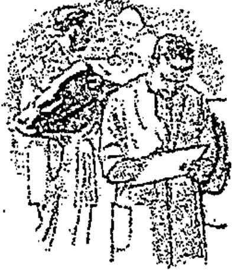

# Today, tens of millions can enjoy health that Nature couldn't give them because of...
The Milkmen who weren't satisfied with Milk!

A group of nutrition scientists in a small plant on the South River in California have come up with a milk miracle which is better than Nature's "perfect" original — for some 60 million overweight Americans! These Americans are faced with a looming amount of medical evidence which shows that high calorie diets and excess fat in foods are causing them serious obesity, dangerous overweight and damaged health. Insurance tables indicate that an alarming number of Americans are becoming ill while still young; many victims of cardiovascular diseases... because of the simple fact that they are too fat. While this research was being accumulated, scientists, headed by dairy industry leader David D. Peebles, had been conducting almost four decades of experiments. Their aim: A milk discovery in convenient, economical dry form... a natural milk that would be delicious for drinking... but in a nonfat form! Peebles and his experts set out to slash away the fat in whole milk... to find a pure nonfat dry milk that

could contribute to new health for the one out of three Americans possessing overweight problems for physicians. It was only after 57 years that the answer finally came—in dramatic form. The solution amazed the scientists, actually led to the descriptive name, "Magic Crystals." Here, in a new form, Peebles and his associates had retained all the protein, B-vitamins and calcium of whole milk—without the need of additions! And the natural "Magic Crystals" mixed with water, were delicious for drinking. Most important "Magic Crystals" were nonfat! "Magic Crystals" are now known as Carnation Instant Nonfat Dry Milk. This new milk miracle is superior to ordinary milk in other ways, too —in its low cost, and its convenience. It mixes instantly, is always cupboard handy, doesn't crowd the refrigerator. This modern milk discovery for drinking, cooking, baking and whipping is at your grocer's in the familiar red and white Carnation package. The milkmen who weren't satisfied with perfect are satisfied with Carnation Instant Nonfat Dry Milk. Try some today!

如今，数千万人们都享受着大自然无法带给他们的健康，因为…

一群来自加利福尼亚南河的牛奶科学家，创造了一个牛奶奇迹，他们为美国 6000 万超重者发明了一种比“最完美”的天然牛奶还好的奶！

医学数据表明，由于高卡路里，高脂肪饮食，引发严重肥胖，超重，以及损害健康的美国人越来越多。保险记录表明，患有心血管疾病的年轻人数量十分惊人……原因很简单，他们太胖。

在收集到大量信息后，乳制品行业领袖大卫·D·皮布尔斯带头进行了近 40 年的实验。他们的目标是：发明更方便，更经济的奶粉……一种非常美味的天然牛奶……不过是脱脂形式！

皮布尔斯和他的专家想办法减掉了全脂牛奶里面的脂肪……为的是制作一种全新的脱脂奶粉，能为美国三分之一的超重患者带去健康。57 年后，他们终于成功了——以一种戏剧化的形式。这种奶粉，让科学家都感到惊讶，于是这种奶粉有了一个神奇的名字“魔法水晶”。皮布尔斯和他的相关同事，以一种新的形式保留了全脂牛奶中所有的蛋白质，维生素 B 和钙——没有添加任何添加物！这种天然“魔法水晶”与水混合，饮用起来非常美味。最重要的是，“魔法水晶”是脱脂的！“魔法水晶”是现在被称为三花即食脱脂奶粉。

这种新的牛奶奇迹在其他方面也优于普通牛奶——它成本低，而且方便。它能快速溶解，方便存放于橱柜内，所以不用担心放冰箱里太挤。这种新型牛奶可以用于饮用、烹饪、烘焙，快去到你附近的超市购买那种最常见的红色，以及白色三花包装的“魔法水晶”脱脂奶粉吧。对“最完美”的天然奶都不满意的牛奶商，却对三花即食脱脂奶粉青睐有加，今天就试试吧！（617）

## 作业

# 28、什么样的牛奶让人惊呼！

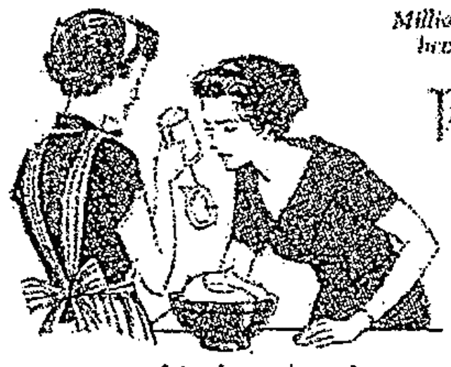

Millions of women are better cooks today because they discovered the answer to:

# What is this Milk that whips?

In this day of modern convenience foods, one stands especially high in favor among women who pride themselves on being good cooks. For convenience is only one of its advantages; it also provides remarkably superior results in many different recipes. These ladies wouldn’t be without the milk that whips.

This milk that whips is actually pure, fresh milk with over half the water removed—nothing else. Only vitamin D is added—no sweetenings. It is sterilized for the second time after the can is sealed.

So safe, nourishing and digestible is this milk that it has been recommended by doctors everywhere as the first food of millions of babies. So rich is it—over twice as rich as ordinary milk—that millions of others enjoy it in coffee this morning. And so superior is it to ordinary milk for cooking that still other millions are using it today to make their favorite dessert, custard, sauce or soup.

This product is Carnation Evaporated Milk. It is the world’s most popular milk, yet its truly amazing qualities as a cooking milk are still unknown to many.

Not only is Carnation double-rich; it is also specially homogenized to blend better with other ingredients. For these reasons, whether it is used undiluted or mixed with an equal amount of water in recipes calling for milk, results are startling. Such foods as fudge, desserts, gravies, pies, soups and sauces take on a smoothness not possible with ordinary milk.

Its unique qualities make many “problem” foods, like custards, failure-proof. Other dishes can be prepared in far less time. Its versatility is limitless. Yes, it even whips—at a fraction of the cost of heavy cream. And it has twice the nourishment of ordinary milk. Yet despite these advantages, Carnation cuts your milk and cream bill one half.

Discover Carnation yourself. For Mary Blake’s free booklet “Failure-Proof Recipes,” write to Mary Blake, Carnation Co., Dept. B.O.115, Los Angeles 19, Calif. And be sure to get a few cans of Carnation today.

无数家庭主妇做的饭都越来越好吃了，因为她们发现了：

# 什么样的牛奶让人惊呼！

在各种食物都方便快捷的今天，有一种食物备受自认为做得一手好菜的家庭主妇们的青睐。方便只是它的一个优势；它还为很多种菜谱锦上添花。没有这种让人惊呼的牛奶，这些主妇们就无法做出这么美味的食物。

这种让人惊呼的牛奶其实就是一种半脱水的鲜纯牛奶——没别的。里面添加了维生素D——没有加糖。在包装封口后，又经过了二次消毒。

这款牛奶安全、营养，易消化，备受各地医生的推崇，认为是婴儿食品的首选。它营养丰富——营养是普通牛奶的两倍——许许多多人都喜欢清晨喝咖啡时加点这种牛奶。在烹饪方面，它也远优于普通牛奶，每天都有数百万人选择用它制作他们最喜欢的甜点、布丁、酱汁或汤。

它就是三花半脱水牛奶。它是世界上最受欢迎的牛奶，但是依旧还有许多人不知道它在烹饪中发挥的神奇的作用。

这种三花牛奶不仅营养加倍，而且特别均质化，能更好地与其他食材混合。因此，无论是原汁使用还是按配方与等量水混合使用，效果都令人惊讶。软糖、甜点、肉汁、馅饼、汤和酱汁，都能获得普通牛奶无法达到的顺滑口感。

其独特的品质，使许多“问题”食物，如布丁的制作，都不会再失败了。有了它，其他菜肴可以在更短的时间内准备好。它的多功能性是无限的。是的，它甚至还可以打发——成本只是重奶油的一小部分。它的营养是普通牛奶的两倍。尽管有这么多优势，三花半脱水牛奶能帮你节省一半的牛奶和奶油开销。

亲自尝试一下三花半脱水牛奶吧。快快写信给玛丽·布莱克，索取玛丽·布莱克的免费小册子“永不会失败的食谱”吧，地址是：加利福尼亚州洛杉矶三花有限公司 Dept. B.O.115。今天你一定要尝试几罐三花半脱水牛奶。

## 作业

# 29、全新 Zippo 打火机燃油，燃烧干净，无烟无味

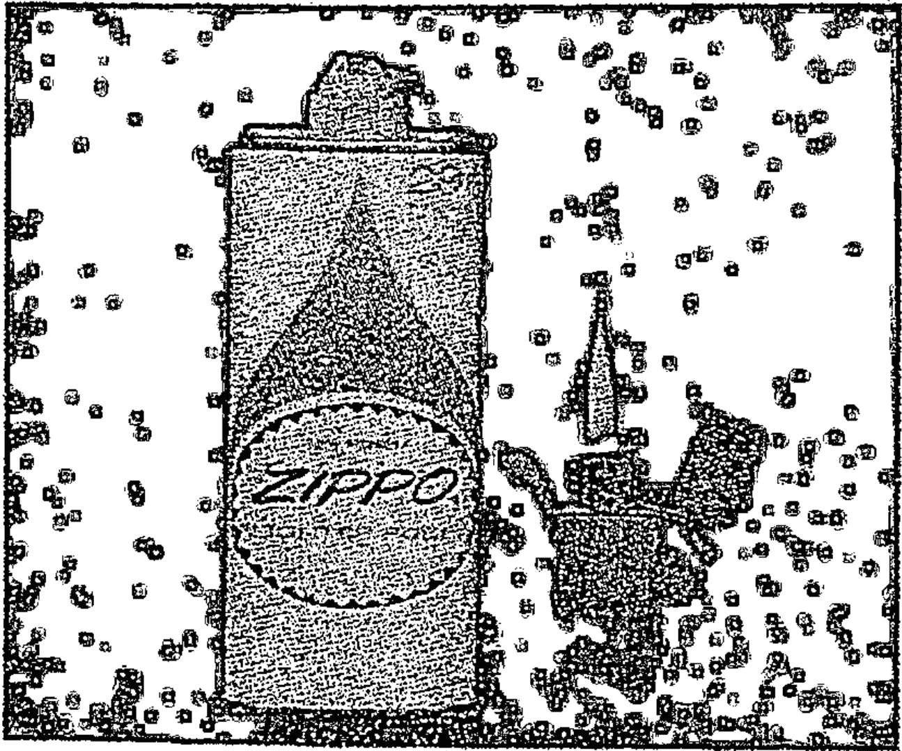

New Zippo Fuel is filtered to clean it burns without smoke or odor!

# This big can of new Zippo Fuel gives you an average of 38% more lights for your money than the leading brand

More lights per filling: carefully controlled laboratory tests prove new Zippo Fuel is so good that it gives you an average of 24½% more lights* than you get from the leading brand.

More fuel for your money.
The same 49¢ you pay for a 4½-ounce can of that other brand buys you a 5-ounce can of Zippo—11% more fuel.
*3-second lights... time enough to comfortably light some cigarettes.

All this adds up to a giant saving for you: an average of 38% more lights for your money!

Two money-saving sizes
New Zippo Fuel is available both in the 5-ounce can at 49¢, and in the new economy 10-ounce can at 49¢.
New Zippo Flints—5 for 10¢

ZIPPO MANUFACTURING CO., BRADFORD, PA., AND CANADA LTD., NIAGARA FALLS, ONTARIO

全新 Zippo 打火机燃油，燃烧干净，无烟无味

# 这种全新的 Zippo 打火机燃油和其它领先品牌相比，花同样的钱，多获得 38%的燃火

每罐拥有更多燃火：通过严密控制的实验测试表明，Zippo 燃油非常好，它比其他领先品牌的打火机燃油，平均多给你 24½%的燃火。

# 用同样的钱，获得更多燃油

同样 49 美分，购买其他品牌的 4½ 盎司燃油，你可以购买 Zippo 5 盎司燃油——多 11%。

这些因素可以帮你省很多钱：可以让你花同样的钱，多获得 38% 的燃火！

# 两种省钱容量

新款 Zippo 燃油有两种容量，一种是 49 美分 5 盎司，还有 49 美分 10 盎司经济装。

新 Zippo 火石——10 美分 5 枚。

*3 秒火焰——可以让你轻松从容地点燃香烟。

ZIPPO 布拉德福德制造有限公司，加拿大有限公司，安大略省尼亚加拉瀑布。

## 作业

# 30、致迈阿密所有想成为职业女模特的一封公开信

# 致迈阿密所有想成为职业女模特的一封公开信

电头：迈阿密南海滩——如果你已经是职业模特，或者，如果你想成为职业模特，这将是你读到的最令人兴奋的信息。

另一方面，如果你想成为模特……但是……你却不具备成为模特的条件——这个信息可以帮助你节省数千美元，并避免你的很多烦恼。

听着：当大多数人提起模特，至少你可能称为“主流模特”的人，他们通常指的是时装模特。事实上，世界上只有少数顶级时装模特。这些幸运的女性，每年收入几百万美元，过着令人难以置信的精彩生活。有时，他们会拍电影，电视剧，他们最终会拥有自己的公司（香水、泳装、化妆品等），成为富翁。

# 你有成为顶级时尚模特的条件吗？

可能没有。

数据表明，每 37512 位女性中，才有 1 位拥有成为时尚模特的必要条件。这些条件包括：

- 1. 你必须有漂亮的脸蛋儿。
- 2. 你必须非常上镜，镜头中的你也要非常漂亮。令人悲伤的是，许多漂亮的女人，在镜头中看起来却很一般，而肉眼看起来“普通”许多的女人，在镜头中看起来却特别漂亮。你猜怎么着？没有人知道这是为什么！
- 3. 第 3 个必要条件是；你必须拥有高挑，纤瘦的身材。你也知道，在照片中，女人看起来要比实际体重重 10 磅，矮 2 英寸。这就意味

着，你的身高必须达到至少 173cm，身上不能有赘肉。

4.好，上面的条件你都满足。你还需要什么吗？肯定的，你还需要……

## 运气！

年收入几百万的顶级模特，和年收入少得多的模特之间的区别，并不是因为前者比后者漂亮许多。真正原因是，顶级模特，处于某些原因，在镜头前，公众前出现的次数更多。

有件事情看起来很奇怪，却是事实：你知道吗，模特（甚至是世界模特）在杂志封面中出现一次，得到的报酬“少的可怜”，甚至是在像《Elle》、《时尚》、《芭莎》、《时尚 COSMO》这样的大杂志中。这是真的，有时候只有 50 美元！

那么，为什么报酬这么少，像辛迪·克劳馥、克劳迪娅·希弗或艾丽-麦克弗森这样的名模还愿意为其当模特呢？很简单：如果一个新出道的模特，做了某著名杂志的“封面女郎”，她的手机（实际上，更有可能是她的代理的手机）将会开始电话响个不停…

## 杂志发行后 15 分钟内

名模都知道；仅有出众的美貌，并且非常上镜，还远远不够。他们知道你必须不断出境。让我们面对现实吧：你拥有世界顶尖名模的“美貌”，如果没有潜在客户看到你，又有什么用呢？

但是，不用担心。现在有个新方法，可以让新入行的模特（或可能成为模特的人）获得世界范围的关注……这个方法，你几分钟就可以学会。但是，首先你应该知道……

要想在模特事业上取得成功，
你不一定要成为“瑞尔猎豆”

“漂亮裸显”是一句行话（通常为专业摄影师使用），用来描述我们常说的那些高挑，漂亮，纤瘦的“主流”时尚模特。

然而，想和模特一样赚那么多钱，你不必非得具备“名模条件”。如果你不够高挑，不够纤瘦，你可能不会成为一个主流时尚模特。但是，还有上千种其他工作，可以让你获得丰厚的报酬。

下面这个故事就是一个很好的解释：不久前，有位教人们如何合法减少所得税的会计专家。他在《华尔街日报》，还有其他类似期刊上投入了上万美金广告费。广告的标题通常是“如何不用再缴税”，下面还附有一张衣着三件套笔挺西服，带着水牛角眼镜的会计的照片，他端正地坐在书桌前，身后是至少放有100部法律相关书籍的书柜。

有一天，他的一位摄影师朋友告诉他，拍广告照时可以让一位漂亮的金发女郎站在他身旁。她在照片中，什么都不用做，美丽地站在他的书桌旁就可以了。

你可能会想，金发女郎没有必要出现在广告照片中啊。她和法律书籍，会计，税收等都没有什么关系。她看起来甚至不像是这个会计的秘书。她出现在照片中，没有任何缘由，没有任何作用。

好吧，你猜怎么着？

这个广告给那位会计带来的收益比他之前的任何广告都高！

性，对促进销售非常有效。

就这么简单。然而，如何在广告中加入魅力，性感，是一门艺术。你不能让自己的广告看起来低俗。它必须展示你的高雅品位。否则，你不但无法把产品卖给顾客，还可能冒犯他们。

有个事实，令人伤心：美国的成千上万家企业本来可以获得更多的利润（事实上不只是美国，全世界都是这样的情况）……

## 如果他们知道怎样在广告中利用漂亮模特的话！

只有少数几种类型的企业，在广告中使用了魅力和性感元素。魅力和性感元素常被用于服装、香水、珠宝、汽车（少数）、杂志、日历、海报、电影、电视节目，等等。但是，这两个强大的营销武器却不被大多数其他类型的企业广泛使用。

为什么？首先，大多数企业主以及公司总裁不知道把一个漂亮的女人用在他们的广告宣传中，效果有多好。其次，不管你信不信，他们不知道怎么请模特，怎么拍摄，怎么安排细节。这对他们来说，完全是个谜。

他们甚至不关心这个：

## 大多数广告公司都不知道怎么做！

很奇怪的一种现象，是吧？成千上万的模特（或有望成为模特的人）都想找更多的工作，许许多多企业都应该利用这些模特……但是，没有人或机构为这两者牵线搭桥。

现在，这个问题有了解决方法。但是，首先……我们来谈谈，你，作为一个模特，永远不能做的一些事：

## #1. 不要浪费钱去上模特“学校”

也许有帮助年轻女性成为成功模特的模特“学校”。但我们不这么认为。我们认为，它们中的大多数都是骗人的。他们的“定调”是，你只要学会做头发，学会化妆，学会像“模特一样的言行举止”，你成为名模的机会就会大大提高。 不管你的条件究竟如何，他们都会这么和你说。

你觉得我们在开玩笑？你可以试试：无论你给其中哪家模特学校发一张你的女性朋友的体重超重，相貌平平的照片。我们敢和你打赌，肯定会有人联系你，说她在模特事业上会有一番大发展。他们会说她尽管体重超重，还有一些相貌上的不足（如果这听起来比较刻薄，诸原谅我们），但是，她身上有些“特征”，他们认为非常符合“商业”需求。当然，她需要一些培训，再支付几千美元，拍一些漂亮照片。

都是胡扯。

## #2：不要浪费钱让一些杂志刊登你的照片

这些人会告诉你，他们的杂志会送到全世界各个广告代理商，模特机构以及星探那里……因为你的“容貌”符合他们杂志的要求，可以刊登到他们杂志上……很快……你就会变得出名，富有。

问题是：没有哪个重要人物会看他们的杂志！

## #3：不要浪费你的时间和金钱在“what”模特机构那里

这些冒牌机构的广告一般是“寻找新面孔”或“迈阿密机构寻找模特新秀”，或“本周模特新秀将亮相 XYZ 酒店”。

不管他们说的如何天花乱坠，最终的宗旨都是一样的。当你和其他一些想成为模特的人（通常会有很多人）出现时，他们会给你们做一场演讲，向你们描述模特事业有多么精彩。但是，他们会告诉你，想成为模特，过程很艰辛，而且你还需要一支一流的“支持团队”。当然，这是必须的。那么，你猜是什么人已经准备好给你提供一支一流的“支持团队”了呢（当然要付一定费用）？你猜对了。和他们签订合同，你就会拥有一些：化妆建议，由专业摄影师组成的摄影团队，模特界“内部关系通道”等等，简而言之，一切你成为名模需要的东西。

这会花费你一大笔钱。具体需要多少，取决于那些大骗子认为自己可以从你那里骗多少钱。但是……不用担心……骗子会说，你投入的这些钱一定会物有所值；因为……你……你这个幸运的女孩……拥有“漂亮的脸蛋”！

这都是谎言，一派胡言。

好了，现在你知道不能做什么了，那么如果你觉得你有成为模特的条件，请翻开迈阿密电话簿，翻到1557页。然后查看“模特机构”的电话列表（一共有59家）一一打电话和他们预约，并告诉他们……

## “我想成为模特，请问我合格吗？”

他们会说“不符合（语气温和），至少你不符合我们的条件”，或“可能符合。”如果他们说“可能符合”。他们会安排你试镜，看你是否上镜。试镜结束后，他们要么会和你签约，要么不会。如果他们是合法的机构，并且真的对你感兴趣，他们不会让你花一分钱。

## 为什么模特机构拒绝你，你不应该感到伤心！

听着：即使是世界上最漂亮的女人，他们中间大多数在镜头中，都没有实际看起来一半漂亮。而且，模特机构一般会倾向于某种特定类型的模特，你没被选中，可能只是因为你不是他们要找的类型。

不要因为这些而否定自己。模特是一个职业，即使你不是“模特料”，你也依旧可以成为非常漂亮的女人，成为一个独一无二，有价值的人。

所以，不管结果如何，不要让它影响你。

现在……

## 最棒的消息来了！

你可能知道，迈阿密南海滩（Sobe）是世界上最令人兴奋的地方。说到模特行业，这里是世界的中心。去年（1993年），5600位专业模特在这里取景。这个地区每天时尚，模特以及摄影行业的平均收入为150万美元。

现在，有件喜讯：迈阿密南海滩现在直接发行了一本《魅力》出版物。《魅力》的办公室位于海洋大道纽仕咖啡旁边的顶层套房820房间。

总之，《魅力》是绝对没有广告的通讯。它在全国50个州，还有其他39个国家发行。它不是免费的通讯，企业主，以及广告机构都愿意投入大量资金订阅它。

在《魅力》中，我们会刊登我们发现的最令人兴奋的模特的照片和详细介绍。当我们的订阅者看到上面模特的介绍后……认为她适合自己的广告，这个订阅者就会直接给我们打电话。我们会告诉他如何联系这个模特，或她的经纪人或代理机构。

然后，你们就可以直接联系，商谈具体事宜了。

我们不会收取任何费用。不会向模特，或她的代理机构收取“提成”。我们也没有想过自己成立代理结构，因为这个听起来太枯燥，太辛苦了，我们觉得发行杂志更有趣。

毫无疑问，我们不会向任何刊登在我们通讯上的人收费。你不能“用钱”买通我们，让我们在通讯上刊登你的信息。

事实上，我们还会给刊登在我们杂志上的模特支付一笔不菲的费用。

另外，我们只刊登我们能找到最好的摄影师，最新拍摄的最漂亮的原创照片……

## 你都无法想象我们的团队有多优秀！

现在，我们最喜欢的摄影师团队由凯文·亥尔波特和娜塔莉·波姆组成。他们都在加利福尼亚州，帕萨迪纳市的设计中心（美国最严厉的摄影学校）经过了严格的培训，他们都痴迷于自己的工作。 比如，娜塔莉，曾经为了拍摄一款非常特殊的汽车（1957 巡洋舰）的任务，她花了 3 天的时间…

## 就为了调整灯光！

我们说这件事的目的是为了说明：如果选择我们《魅力》的摄影师，你可以放心，他们为你拍摄的照片肯定比之前其他人给你拍的都漂亮。

《魅力》怎么盈利呢？我们有两种盈利方式：

+   1. 我们的通讯订阅者会给我们支付很高的订阅费。 2. 许多刊登在《魅力》上的女孩子的照片，都会被用于海报和日历。我们会根据海报和日历的销量，给这些女孩支付合理的佣金。

你对这些感兴趣吗？如果感兴趣，你不用给我们任何照片。不用来我们海洋路的办公室。你只要打电话给我们，给我们的秘书留下你的姓名和邮寄地址。之后，我们将免费送你一本《魅力》，还 有一份我们模特的相应报酬表，和其他所有你需要知道的详细信息。

顺便说一下，你还会免费获得 GUESS 服饰特邀模特，福莱士模特机构经纪的名模詹妮弗·德赖弗的特写。

我们认为，用不了一年时间，詹妮弗·德赖弗就会像名模辛迪·克劳馥或克劳迪娅·希弗那么出名。不过，我们也可能猜的不对。

谁知道呢？让我们拭目以待。

不管怎样，在你收到免费《魅力》杂志，读完我们的信息后……

如果你还有兴趣和我们合作，你可以给我们打电话进行预约，或给我们发几张你的照片（艺术照或生活照都可以）。

很明显，《魅力》对我们想要与其合作的模特只有一个特殊要求。我们不在乎你是否已经和其他模特机构签约……但是……我们在乎的是，你还没有出名。

至少，不是真正的出名。

让我们面对一个现实：和克劳迪娅·希弗、凯特·摩丝、辛迪·克劳馥、布兰迪等其他任何世界名模相比，我们只处于这个食物链的最底层。这没关系。我们想要的是，打造第一个刊登，并让大众认识……

## 未来的世界名模！

我们的营业时间是，周一到周五，上午 9:00——下午 5:00。再重复一次，我们的电话是……

(800) 327-0028

谢谢你的关注，不论你做什么样的决定，我们都祝福你！

## 作业

## 想减肥，请读一读这篇文章……

## 一个高中生减了大约 600 磅，
现在他致力于帮助其他人瘦身！

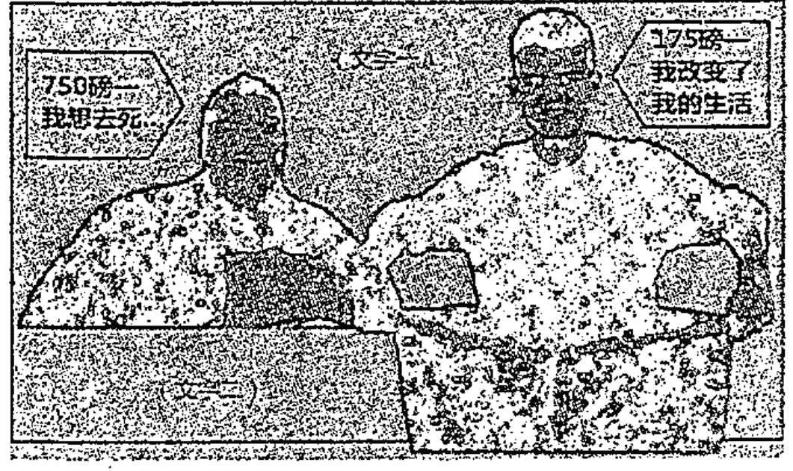

（文字一）拉里·科克的生活像一场噩梦，他的体重竟然达到750 磅。他太重了，每天需要在几个人的帮助下才能起床。后来，他发现了一个神奇的减肥系统，15 个月后，他奇迹般地减重 575 磅！他的医生菲利普·纽曼博士证实了这个身高 174 的密歇根罗亚尔奥克男孩，之前确实严重肥胖，去年7月份，“他成功减到175 磅，看起来很棒。”这篇文章讲述了他的故事，来激励那些因被肥胖困扰，而深感绝望的人。

（文字二）这些是未经修饰过的真实照片。拉里·科克高中毕业时，因为体重过重，他甚至不敢去拍毕业照。但是，现在有了他神奇的减肥系统“拉里减肥法”，他之前那条 74 英尺宽腰围的裤子现在唯一一个作用就是，提醒他他之前有多胖，他成功地减肥多少磅。

亲爱的朋友：

如果你遭受着肥胖的困扰，我希望你能好好看看本页中的照片。

好，看了没？你是否仔细观察了这些神奇的照片？照片中是一

个年轻人（我），他曾经过着露梦般的生活。你可能在哥伦比亚广播电台或早安美国节目上看到过我的故事。或者，你也可能在《底特律自由新闻报》，《奥克兰每日论坛报》，或《国家询问报》上读到过我的故事。

相信我，如果你想减肥，我可以具体告诉你怎么做。

- 不用挨饿！
- 不用控制卡路里！
- 不用吃药！
- 不用放弃美味的食物！

最棒的是，我可以具体告诉你怎么快速操作（非常快速），而且几乎不用花钱。听着：我叫拉里·科克，不久前，我的体重是 750 磅！我觉得自己像个怪物，我想去死。因为体重过重，我的床被我压坏 3 次。我只有 18 岁，我的生活看起来好像就要完了。我每天穿着同样的衣服上学。我只有一件 T 恤（一件看起来像个帐篷的米老鼠超大号 T 恤），以及一条巨大的加肥运动裤……

## 腰围有 74 英尺！

睡觉时，我只能头朝上，因为如果我侧着身子睡，巨大的体重会压住我的胳膊，影响血液循环，胳膊会变得苍白，而且很疼。每天，我都要在家人的帮助下，推我，拉我，我才能起来床，光起床就得花 5 分钟。然后，我弟弟帮我穿袜子，穿鞋。因为我无法弯腰触到我的脚。我不能爬楼梯，无法坐在驾驶座上开车；没有女朋友。这样的懒汉怪物，什么样的女孩子会看第二眼呢？我为自己的体型感到羞愧，甚至不敢去和同学一起拍毕业纪念照。而且……

## 高中毕业后，事情变得越来越糟糕！

我没有继续上大学。我没有工作，没有未来。我每天睡到中午来麻木自己，这样我就可以少忍受像个怪物一样的痛苦生活。我身高 174，体重估计 750 磅。我最后一次找到可以称我体重的秤（卡车称），当时我的体重是 643 磅，后来……

## 我又增加了至少 100 磅！

我的生活一团糟。我试过很多节食方法，但是都没有坚持下来。我越因为自己的肥胖感到沮丧，我吃的越多，长得越胖。然后，我就越沮丧，吃得就越多。简直是一场噩梦。“你可以去死了，”我告诉自己。“面对现实吧，你这个死胖子——你太失败了！”

## 上帝，我想要改变！

听着：我知道，在我体内，有一个正常的家伙挣扎着想离开我的身体。我只是没有办法找到打败我从小养成的贪吃的恶魔。我每天摄入 6000 卡路里，我早餐吃 4 碗麦片，8—10 块涂抹花生酱的烤面包。午餐吃 4 个三明治，晚饭吃 4 份意大利面，或者家人做的其他饭。我从中午开始吃零食，一直吃到晚上睡觉。我会一口气吃掉 4 个 0.25 磅的汉堡，好几袋薯片，几加仑苏打水，6-7 个甜甜圈，和半个馅饼！医生告诉我，我只能活到 26 岁，因为我的心脏不堪重压。但我还是继续吃。1987 年 12 月，新年那天，我决定不要再这么胡吃海塞了……可是，那天还没有过完，我又开始暴食了。

“上帝啊，帮帮我吧”我在祈祷。“帮助我摆脱这个肥胖的躯体，做个真正的人吧！”在 1 月 4 日晚上，我哭着入睡，夜里 2 点，我突然惊醒。我想起了之前尝试过的所有节食方法，细数了其中有益和有害的部分。然后，我列出了每个节食方法中的有益部分，开始做自己的节食方案。此外，我增加了“一些东西”，这是所有肥胖人都在寻找的“缺失成分”。这个“缺失成分”并非我费尽苦心研发的，而是那天晚上灵感一现，这个“缺失成分”威力如此大，以至于……

## 我兴奋得无法入睡！

我给这个减肥奇迹起了个名字，叫“拉里减肥法”。它的效果

非常显著。慧鲍轻体减肥中心（Weight Watchers）说，如果我为他们代言，他们会给我很高的薪水，送我一辆车，一个新衣柜。但我拒绝了。他们的减肥系统可能有效，但我相信，我的减肥系统更好。这就是我和佛罗里达州的一个公司（埃弗雷特&劳埃德公司）合作的原因，通过合作，我可以告诉人们，怎么用和我完全相同的方式去减肥。你知道，说实话，我认为我的减肥系统比其他任何减肥系统都有效。你想想：

- 我在 15 个月内减肥 575 磅！
- 我的腰围减了 37 英寸！
- 我的臀围减了 28 英寸！
- 我的大腿围减了 22 英寸！
- 我的颈围甚至减了 9 英寸！

我被邀请参加电视节目，参加广播节目。报纸上刊登我的事迹，甚至《国家询问报》上都刊登过。你猜怎样？所有人——我是说所有人——都想知道我的秘诀。我不怪他们。现在，如果得到你的允许，我会把这个秘诀告诉你！我想给你寄一份非常特别的报告，我称之为《拉里减肥法：一个仅在 15 个月内，就成功减掉 575 磅的人的神奇减肥秘诀》！这个特别报告揭秘了整个减肥系统。容易阅读，容易理解……

## 你不用花很多钱，就可以得到它！

我不想吹牛，但我真的很为自己感到骄傲。医生帮不了我。所有这些饮食“专家”帮不了我。甚至我的家人帮不了我。（让人欣慰的是，他们都尝试过要帮我。）我从慧鲍轻体减肥中心，理查德·西蒙斯，Optifast，NutriSystem 或其他等等减肥机构那里，都没有得到我想要的帮助。我完全靠自己学会了如何快速、低成本地成功减肥。

让我们来谈谈成本。前几天，我听到一个消息，一般减肥 50 磅，要给减肥中心支付大约 2000 美元。NutriSystem 减肥机构在一开始就会要求支付很大一笔费用，为你购买你需要 的食物。Optifast，Medifast 等其他减肥机构收取的费用，也从几百到几千美元不等。当然，你可以买减肥药，减肥书籍，花钱听减肥课程，直到搞得你灰心丧气。

省点钱吧！所有你需要的东西都在我的这个秘密报告中。听着：那些人或那些公司，肯定不会像我一样……

## 如果“拉里减肥法”对你无效，我会双倍退款！

我知道你在想什么。你可能想知道我有什么资格提供这样的减肥方法。请听我说，我很年轻，但是我不是傻子。我不是医生，也没有大学文凭，但是我想问你……

## 有多少医生，有多少一流的饮食“专家” 能够像我一样，成功减重将近 600 磅呢？

听着：我的方法有效！事实上，如果我的方法没有效果（肯定有效果），你最好去看医生，检查检查甲状腺。但不要欺骗自己。这不是你甲状腺的问题。不，你唯一的问题是你没有使用“拉里”减肥法！如果使用它，你肯定会瘦。

就说到这里吧。现在，我们假设你订购“拉里减肥法”，读完我的报告后，你甚至都不想试试我的秘诀。好吧，在这种情况下，我认为你是一个很愚笨的人。但即便如此，你只要把它退回来，我会 100%退款给你。如果 你遵循我的计划了，但是没有减去多余的体重，怎么办？就我个人而言，我认为这几乎是不可能的。但如果真发生了这样的事情，我想让你去做做体检，如果医生说你身体没有任何问题，那么……

## 我会双倍退款给你！

瞧，我费尽心思向你“销售”，为的是想让你给“拉里减肥法”一次帮助你的机会。因为，相信我，我知道肥胖是什么感觉，我明白你的感受。我知道那种尴尬，挑选衣服的尴尬，那种沮丧，等等。但是，我告诉你……你遇到的问题，可能只是我的那些问题中的非常简单的一个。我不是在嘲笑你的体重问题，但是请记住……

## 我胖得甚至无法起床，医生说我快要死了！

请……让我帮助你。我的秘密系统非常便宜，它是解决你的问题的终极方法。你再看看我的照片……我减了 575 磅，我正憧憬着全新的生活。你也可以做到，订购方法非常简单。只要填写本页下面的订购表就可以。

真诚的，

Larry Coker

拉里·科克

P. S. 如果你真的想减肥，你就应该立即拥有我的报告！这批报告已经不多了，订购晚了，你就得等下一批印刷出来。谢谢。

## 零风险订购券

邮寄：拉里减肥法
3305，福罗里达州，曼哈顿，海外街 5701，4 号楼
公寓 005，爱华特&罗伊德公司

其他快速订购服务
你可以通过电话订购！
我们的热线是：1-800-327-0028
找萨拉·亚当姆斯
东海岸时间周一——周五
早上 9 点——下午 8 点
任意时间都可拨打
请准备好你的信用卡

# 亲爱的拉里：

是的，我想要以尽可能快的方式健康减肥。因此，我想试试那个让你 15 个月就减了 575 磅的神奇秘诀，“拉里减肥法”。请立即发送给我你这个特别报告。我知道，根据你的指导......

- 我永远不会挨饿！
- 我永远不用计算卡路里！
- 我永远不用再为减不了肥而沮丧了！
- 我永远不用为了减肥花很多钱了！
- 我永远不用控制卡路里！
- 我永远不会感到饿的空虚！
- 我永远不用再担心被骗了！

不仅如此，我还明白，我享受上面说的双倍退款保证。因此，我在信件中附上了 19.95 美元的报告费，还有 3 美元的运费和手续费（一共 22.95 美元），订购你的报告。请把你的减肥系统立即寄到下面的地址。

# 请确定付款方式

□美国运通卡 □万事达信用卡 □支票 □汇票 □现金

卡号：_____________ 有效期至：_____________

持卡人姓名：_____________

地址：_____________

城市：_____________ 州：_____________ 邮编：_____________

注意：支票或汇票抬头请写：“拉里减肥法”。国内外订单，我们只接收美元，如果你居住在国外，请额外支付 5 美元国际运费。——谢谢。

# 作业

# 32、请做做这个测试，看看使用后的牙齿会多么闪亮

# Make This Test

See how teeth glisten then

This ten-day test costs nothing. To millions it has brought a new era in teeth cleaning. This is to urge that you try this method. Then let your own teeth show you what it means to you and yours.

# To fight the film

The object is to fight the film which causes most tooth troubles. Film is that vicious coat you feel. It clings to teeth, enters crevices and stays. The old methods of brushing do not end it. So...

despite all care, tooth trouble, have been constantly increasing. It is the film coat that discolors, not the teeth. And nearly all teeth brushed in old ways are coated more or less. Film is the basis of tartar. It holds food substance which ferments and forms acid. It holds the acid in contact with the teeth to cause decay. Millions of germs breed in it. They, with tartar, are the chief cause of pyorrhea. And that disease has become alarming in extent.

# A daily combatant

Dental science has now found ways to daily combat this film. For five years the methods have been carefully watched and proved. Now leading dentists everywhere advise them. These methods are embodied in a dentifrice called Pepsodent. Millions now know it and enjoy it. Wherever you look the results are seen in glistening teeth today.

# Acts in five ways

One ingredient in Pepsodent is pepsin. Another multiplies the starch digestant in the saliva to digest starch deposits that cling. The alkalinity of the saliva is multiplied also. That to neutralize the acids which cause tooth decay. Two factors directly attack the film. One of them keeps teeth so highly polished that film cannot easily adhere. With every application, Pepsodent combats the teeth's great enemies in new and efficient ways. To millions it is bringing cleaner, safer, whiter teeth.

Send the coupon for a 10-Day Tube. Note how clean the teeth feel after using. Mark the absence of the viscous film. See how teeth whiten as the film itself disappears. This test will be a revelation. Make it now. Cut out the coupon so you won't forget.

# Pepsodent
REG. U.S.
PAT. OFF.
The New-Day Dentifrice

A scientific film combatant combined with two other modern requisites. Now advised by leading dentists everywhere and supplied by all druggists in large tubes.

10-Day Tube Free
THE PEPSODENT COMPANY,
Dept. 110, 1111 S. Wabash Ave., Chicago, Ill.
Mail 10-Day Tube of Pepsodent to...

# 请做做这个测试

# 看看使用后的牙齿会多么闪亮

这10天的测试，我们不会收你一分钱。它已经为数百万人带去了牙齿清洁新时代。这次免费测试，是为了促使你尝试这种牙齿清洁的新方法。然后，你的牙齿会告诉你：它对于你和你的牙齿意味着什么。

# 对抗薄膜

它的目的是对抗会引发大部分牙齿问题的薄膜。薄膜，是你能感觉到的那种粘性表面。它依附在牙齿上，进入牙缝并留在那里。过去的刷牙方法并无法清理它。因此，不管多么小心，牙齿问题还是会不断地增加。

实际上，使牙齿变色的是薄膜衣。而以过去的方式刷牙，几乎所有牙齿都或多或少地会覆盖上这种薄膜衣。

薄膜很难对付。它会沾上食物，食物会在牙齿表面发酵并形成酸性物质。它会让牙齿上酸性物质不断增加，导致牙齿腐蚀。

成千上万的细菌会在里面繁殖。它们很难对付，是引发脓漏的主要原因。而那种疾病一旦扩散起来，就会令人十分担忧。

# 每日战士

牙齿专家们已经发现日常清除薄膜的一些方法。五年来他们认真地观察，并证明了这些方法的有效性。如今，各个地方的优秀牙医都赞扬使用它们。

现在，这些方法集中体现在了一种名叫“百普赛登”的牙膏中。如今，成千上万的人都知道它，并且使用它。无论你走在哪里，都

可以看到人们闪亮的牙齿，那就是百普素登的效果。

# 在五个方面发挥作用

百普素登牙膏中一种成分是胃蛋白酶。另外一种物质，可以让唾液中的淀粉消化酶加倍，更好地消化附着在牙齿上的淀粉。同时唾液中的碱度也会加倍，从而中和会腐蚀牙齿的酸性物质。

能直接清除薄膜的物质有两种。其中一种会使牙齿亮白，使薄膜无法轻易地黏着在牙齿上。

百普素登牙膏的每一种功效，都以全新、有效的方式清除牙齿主要的敌人。它已经为成千上万的人带来了更清洁、更牢固、更洁白的牙齿。

把下面这张优惠券填好寄给我们，你就可以得到一管免费的10天试用装牙膏。请注意在使用之后牙齿会变得多么干净。记住黏膜不见了的时刻。看看黏膜衣消失之后，牙齿可以变得多么洁白。

这个测试将会出乎你的意料。请现在就开始行动。先把这张优惠券剪下来，这样你就不会忘记了。

百普素登（美国注册专利）
新型牙膏

一种科学的薄膜清除剂，可以与其它两种现代必需品结合使用。现在各个地方的主要牙医们都在推荐它，并且所有药店老板都供应大管牙膏。

# 10 天免费试用

伊利诺斯州，芝加哥，沃巴什大街1104号，百普素登公司，510部。

邮寄10天免费试用百普素登牙膏至：

每个家庭只限寄一管试用装

> “注明你的地址——方便我们邮寄”

# 作业

# 33、五种新方法，使牙齿更洁白、更干净、更安全

# Five New Ways
To whiter, cleaner, safer teeth

# Pepsodent
The New-Day Dentifrice

A scientific film... whitens stains and protects the teeth without use of harmful grit. Now advised by leading dentists the world over.

10-Day Tube Free
THE PEPSODENT COMPANY, Dept. 124, 1101 S. Wabash Ave., Chicago, Ill. Mail 10-Day Tube of Pepsodent to ...

# 五种新方法

# 使牙齿更洁白、更干净、更安全

牙医学家们一直在寻找更好的保护牙齿的方法。

事实证明，所有旧的方法都是不合适的。牙齿问题不断地在增加。很少有人能够幸免。过去，一口漂亮的牙齿比现在少见得多了。

牙医学家们研究发现了它的原因，并提出了五种新的解决方法。

# 主要的敌人

研究发现，牙齿的主要敌人是黏膜——即你感觉到的粘性薄膜。它附着在牙齿上，进入牙缝，并留在那里。

食物残渍等，先使牙齿变色。然后，便形成了肮脏的黏膜衣。牙垢就是在黏膜的基础上产生的。大部分的牙齿多多少少都是这样失去光泽的。

黏膜还会粘住那些会发酵和形成酸性物质的食物。它所保留的酸性物质会不断地与牙齿接触，从而造成牙齿的腐蚀。成千上万个细菌在上面繁殖。它们和牙垢，便构成了形成脓漏的主要原因。

# 太多地方刷不到

使用旧的刷牙方式会使大量的黏膜都刷不到，从而污染牙齿，日日夜夜可能带来严重的伤害。

而为了对付那种黏膜，找到两种方法。一种是凝固黏膜，一种是移除黏膜，并且两种方法都不用对牙齿进行有害的洗刷。权威人士已经证明，这些方法是有效的。它们在一种叫做“百普萤登”的牙膏中体现出来了，并且全世界的牙医们都开始力劝大家使用它。

# 其它要素

牙医学家们发现其它一些效果也很有必要，并且已经找到了方法来实现它们。而所有的一切如今都体现在百普素登牙膏中。

百普素登牙膏可以刺激唾液的流动——是牙齿的天然保护器。

它可以使唾液中碱度加倍。这样便可以中和口腔中的酸性物质——造成牙齿腐蚀的原因。

它可以使唾液中的淀粉消化剂加倍。这样便可以消化牙齿上面附着的淀粉沉淀物——不然它们就有可能发酵和形成酸性物质。

它可以把牙齿抛光，这样黏膜就很难附着在上面。

# 数百万的人都拥有了漂亮的牙齿

其中一个效果就是拥有更加漂亮的牙齿。你可能在各个地方都能看到它们——令人敬羡的牙齿。但是，那只是更干净、更安全的牙齿的一种标志。黏膜衣、酸性物质和沉淀物都被有效地清除了。

请填写并邮寄下面的这张优惠券，来索取一管免费的10天试用牙膏。请注意在使用之后牙齿变得多么干净。记住黏膜不见了的时刻。看看黏膜衣消失之后，牙齿可以变得多么洁白。

请现在就将这张优惠券剪下来。

百普素登（美国注册专利）

# 新款牙膏

一种科学的黏膜清除剂，在对牙齿没有任何有害研磨的条件下，可以使牙齿变得更洁白、更干净，从而达到保护牙齿的作用。现在全世界的牙医们都在推荐使用它。

# 10天免费试用

伊利诺斯州，芝加哥，沃巴什大街1104号，百普素登公司，704部。

邮寄10天免费试用百普素登牙膏至：

每个家庭只限寄一管试用装牙膏

(1002)

# 作业

# 34、你在英语中犯过这些错误吗？

# Do You Make
these Mistakes
in ENGLISH?

Does your English reveal your lack of education or does it prove that you are a person of culture and refinement? English is the one weapon you must use every day. This tells how you can improve it almost at once.

# WONDERFUL NEW INVENTION

# LEARN BY HABIT—NOT BY RULES

# FREE BOOK ON ENGLISH AND 15-MINUTE TEST

# 你在英语中犯过这些错误吗？

你的英语是让你看起来文化程度不高，还是让人觉得你是一个有文化，有教养，温文尔雅的人？英语是你每天必须使用的一个武器。本文将向你揭示如何瞬间提高你的英语水平。

很多人都会说：“你今天收到过他的信吗？”其实他们应该说：“你今天收到他的信了吗？”有些人把“日历”写成“日立”或“日丽。”还有些人把“你我之间”（“between you and I”）说成“你我之间”（“between you and me”）。让人惊讶的是，有很多人连最简单的字都能写错。

还有一些人不知道有些单词是一个“e's”或“m's”或“r's，还是两个，不知道什么时候该用逗号清楚地表达自己的意思。还有一些人的用词平淡无奇，枯燥无味。他们的讲话，他们的文章毫无生气，单调无趣。听他们开口说话，或看他们写的文章，你就能看出，他们根本不懂英语的要点。

# 令人惊奇的新发现

科迪先生多年来致力于研究，使用流利的英语，创造本能的习惯的问题。经过无数的实验，他终于发明了一种简单的方法，每天只需 15 分钟，就可以让人们更好地掌握英语。现在你终于可以不再犯那些令你头疼的英语错误了。科迪先生的学生在五周获得的进步，比其他学生用传统方法学习，两年获得的进步都大！

# 通过习惯——而不是规则

用传统方法，你只是记住了规则，而没有形成正确的习惯。最后，规则还是会被遗忘。舍温·科迪的新方法，通过不断地引起你对自己经常犯错的地方的关注，帮你形成正确的习惯。

科迪先生课程的一个精彩之处就在于，这些培养习惯的练习，能够快速用于实践演练。你可以在 15 分钟内写出 50 个问题的答案，在 5 分钟内修正你的错误。科迪先生的方法，让你结束了不断重复的枯燥学习。你只需要关注自己的错误，直到它变成你正确说活和写作的“第二本能”。

# 免费获得英语新书及 15 分钟测试法

掌握有效，优美的英语，代表着你有文化，接受的教育好。它能帮你赢得朋友，给日常接触的人留下良好的印象。现在，你只要在家，运用这套 100% 的自我修正的方法，不断检查，核对，每天只需 15 分钟，你就会发现惊人的进步。

科迪先生准备了一个 15 分钟的简单测试，你在家就可以完成。内附正确答案，以便你判断自己处于什么样的水准。如果你已经能高效地使用英语，通过学习，你会对自己更有信心；如果还无法高效地使用英语，那么你肯定想知道怎么提高。

今天写信向我索取，你就可以免费获得这套测试。我们还会非常开心地为你寄出我们的一本新书《如何更熟练地说英语，写英语》。你只要把优惠券或回邮卡寄给我们，就可以获得。

# 舍温·科迪英语学校

纽约 罗彻斯特 塞尔楼 383

纽约，罗彻斯特 塞尔楼 383 舍温·科迪英语学校
请给我寄一本免费新书《如何更熟练地说英语，写英语》，还有 15 分钟测试

姓名 ..........................................................
地址..........................................................
城市..........................................................州.............. （1027）

# 作业

# 35、你在英语中犯过这些错误吗？

# Do You Make These Mistakes in English?

# 你在英语中犯过这些错误吗？

舍温·科迪的令人惊奇的新发现，已经帮助超过 70000 万人，改正了自己的英语错误。每天只要 15 分钟，就能提高你说话和写作的水平。

很多人都会说：“你今天收到过他的信吗？”其实他们应该说：“你今天收到他的信了吗？”有些人把“日历”写成“日立”或“日丽。”还有些人把“你我之间”（“between you and I”）说成“你我之间”（“between you and me”）。

让人惊讶的是，有很多人连最简单的字都能写错。还有一些人不知道有些单词是一个“e’s”或“m’s”或“r’s，还是两个，不知道什么时候该用逗号来十分清楚地表达自己的意思。

还有一些人的用词平淡无奇，枯燥无味。他们的讲话，他们的文章毫无生气，单调无趣。听他们开口说话，或看他们写的文章，你就能看出，他们根本不知道英语的要点所在。

# 为什么大多数人都会犯错

为什么有这么多的人不能很好地使用英语，进而影响到了我们的事业？为什么有些人总写错字，还有些人不知道怎么使用标点符号？

为什么许多人都无法用合适的文字充分表述自己的意思？无法很好地运用语言，原因很简单。温·科迪通过数千次科学测试，最终找到了结果。

大多数人无法很好运用英语进行交谈，或写作，就是因为他们没有形成这种习惯。

# 科迪在加里做了什么

任何习惯的养成，都需要不断地练习。莎士比亚，你可能也相信，从来不学习规则。没有一个可以正确使用英语的人，在说话或写文章时，心里还想着规则。

英语是我们的母语，它建立了我们的文明，没有语言，我们现在应该还是一群啃啃呀呀的野蛮人！

然而，我们的学校——因为方法不对——使本应该很快乐的学习，成了一个艰难的任务，我们变得不喜欢学习语言，逃避学习语言。这多年来一直是个耻辱。

舍温·科迪的方法和学校教学方法的不同之处正在于此！事情是这样的：几年前，威廉姆·沃特，著名的加里教育系统作者，邀请科迪先生去印第安纳州加里教授小学高年级学生的英语。

通过独特的实践练习，科迪先生带领的学生，在五周内取得的进步，比先前学生用传统方法学习两年获得的进步都大！这个结果并非随意猜测，而是通过科学的对比分析得出的。

令人称赞的不仅仅是学生取得的巨大进步，更有趣的是，学生们“疯狂地”爱上了这种学习方法。这种学习就像做游戏。

## 100%自我纠正机制

科迪先生的新方法的基本原则是习惯的养成。通过不断地使用正确形式，任何人都能正确地写作和交谈。但是，人们怎么才能知道自己每次说话或写作，表达是否正确呢？

科迪先生以一个简单，独特，而且能够感觉到的方式解决了这个问题。

就好像他永远站在你的身边，时刻提醒着你。每当你说错，或写错一个字的时候，每当你语法使用错误时，每当你用词不当时候，你好像都能听到他在你耳边私语：“你错了，应该这么说。”

通过短时间的一段学习，你就会习惯在说话或写作时，使用正确的形式，正确的词语。

如果你一次次犯同样的错误，他会耐心地一次次地纠正你，告诉你正确的形式。他就好像是一直站在你身边的老师——这个老师不会笑话你，相反，他会支持你，帮助你。

这就是 100%自我纠正机制的作用。它就好像科迪先生站在你身边悄声细语，随时准备好纠正你的错误。它能发现你的错误，并纠正它们。你不需要学习任何你已经知道的知识。不要记忆任何规则。

## 每天只需 15 分钟

每天只需 15 分钟。这 15 分钟不是用来学习，而用来做有趣的练习！

科迪的学生通常都是用通过自己的业余时间做这个练习。他们通常从没什么收获的阅读或辩论的时间中抽取 15 分钟。效果真的非常显著！

舍温·科迪把出色的语言功底，融入到每个使用这个方法的人的血液里。使用他的方法的人，学习到的东西无法用金钱去衡量。

他们学习到的东西，令他们永生不会忘记。他们学到的说话艺术，不管在何种场合，都会让人觉得他有教养。他们获取的这种新能力，使得他们信心、自尊心倍增。

就物质上的收获来说，能否很好地使用英语，在成功的道路上起着举足轻重的作用！当然，没有语言，没有人能够取得十足的发展。

## 免费——英语手册

在这么短短的篇幅中，我只能对科迪先生的新方法，及其实践练习的内容，进行一个简单的描述。

如果你想了解更多信息，对精彩小册子《如何每天花15分钟，拥有优秀的英语说写能力》感兴趣，你甚至不用给我们写信。你只要立即把优惠券，或邮政卡回寄给我们即可。

纽约罗彻斯特 塞尔楼14号 舍温·科迪英语学校

## 纽约罗彻斯特 塞尔楼14号 舍温·科迪英语学校

请给我寄一本免费新书《如何每天花15分钟，拥有优秀的英语说写能力》

姓名：

地址：

*这本新手册只送给成人

## 作业

# 36、使用棕榈香皂

THE LITERARY DIGEST

## Use Palmolive Soap

Avoid Effects of Sun and Wind—
Escape Injury From Dust and Smoke

Palmolive Soap furnishes just the protection the skin needs by keeping it healthy, firm and soft.
This is not a new theory.
It is a fact—old as the Pyramids.
When ancient Greece and Rome were at the height of their glory, palm and olive oils were in daily use by the

most beautiful women of that time.
The same cleansing and healing oils are scientifically blended in Palmolive Soap.
Palmolive contains no free alkali—no artificial color—women who prize their complexions will use Palmolive Soap, and no other.

## Use Palmolive Cream

You will be delighted with it.
It comes to you snow-white, of exquisite texture and fragrance and completes the Palmolive Toilet.
It whitens, softens and invigorates the skin, supplementing the benefits derived from Palmolive Soap.
It is essentially a skin protector.

Used in windy and dusty weather, motoring, traveling, or in dusty, smoky streets, it prevents damage to the delicate skin and keeps the pores clean and free from dirt and germs.
Use Palmolive Cream with Palm olive Soap and have complexion-perfection.

For Sale Everywhere by Good Dealers

B. J. Johnson Soap Co., 416 Fowler St, Milwaukee, Wis.

## 使用棕榈香皂

防止太阳和大风的不良影响——远离尘土和油烟的伤害

棕榈香皂可以提供皮肤所需要的全面保护——使你的肌肤永远健康、光滑、柔嫩。

这并不是什么新奇的理论。

它是事实——像金字塔一样古老的事实。

在古希腊和罗马的鼎盛时期，棕榈油和橄榄油就是那个时代最漂亮女人的日常用品。

而在棕榈香皂中，去污油和保养油被科学地融合在了一起。

棕榈香皂中不含游离碱——也没有任何人工色素——在众多香皂中，重视肤色的女性都对棕榈香皂情有独钟。

## 使用棕榈油

它一定让你感到欣喜。

它有雪白的颜色、精致的纹理、好闻的香味，是棕榈妆品系列产品之一。

棕榈油可以使肌肤变得白嫩、有光泽，与棕榈香皂配合使用，效果更佳。

它是保护肌肤的必需品。在大风、有灰尘的天气中，在驾车、旅行或者在尘埃满灰尘、烟灰四起的街道里的时候，使用棕榈油可以保护脆弱的皮肤免遭伤害，保持毛孔清洁，远离灰尘和细菌。

将棕榈油和棕榈香皂一起使用，可以达到完美的综合效果。

在各地的优秀经销店都有销售

威斯康星州，密尔沃基；富乐大街 416 号，约翰逊香皂公司（1060）

## 作业

# 37、我的告别汽车

## My Farewell Car

By R. E. Olds, Designer

Reo the Fifth—the car I now bring out—is regarded by me as close to finality. Embodied here are the final results of my 25 years of experience. It marks my limit, so I've called it My Farewell Car.

## My 24th Model

This is the 24th model which I have created. It embodies all I have learned in 25 years, through tens of thousands of tests.

Men are being taught, to my education, a materially better car.

Better workmanship is displayed—better finish with unknown. The features and effects are the first yet discovered.

The finish is exquisite. The body is 37 inches. The squaring... is hastened, genuine leather. The long... are combined—the engine... is thus...

The wheel base is... the automobile is passing—the wheels and... are large.

I have of... at any... to test in a... run.

## Center Control

The most unique feature is this center control. All the gear shifting is done by moving this handle.

tomy inches... of their characteristics.

look... not else... reduced... ... and... ... ... ... ... ... ...

## Price, $1,055

This... ordinary... extra... ... $1,100. This is the... ...

My... from the first... ... ... ... ... this... figure.

R. M. OWEN & CO. General Sales Agents for
REO MOTOR CAR CO., Lansing, Mich.
Canadian Factory, St. Catharines, Ontario

Reo the Fifth $1,055

- 30-35 Horsepower
- Wheel Base 112 Inches
- Wheels 31 Inches
- Demountable Rims
- Speed 45 Miles per Hour
- Made with 2-4 and 5 Passenger Bodies

Top and windshield not included in price. We equip this car with mohair top, side curtains and ... windshield, gas tank and speedometer—all for $110 extra. Self-starter, if wanted, $35 extra

## 我的告别汽车

R. E. 奥兹设计

雷奥五代——我现在设计出来的这款汽车——我几乎把它当作是我的最后一款汽车。这辆车上体现了我25年的经验总结。它已经达到了我的顶峰，因此我称之为“我的告别汽车”。

## 我的第 24 款车型

这已经是我发明的第 24 款车型。它体现了我 在 25 年间，从成千上万的用户那里了解到的东西。

据我估计，人类永远都无法制造出比它更好的汽车了。

比它更好的技术是不可能的了——不过更好的材料无从确定。它的性能和设备是迄今为止最好的。

它的外观装饰华丽无比。车身刷了 17 层漆。车内装潢用的是纯毛真皮。车灯是上钨的——发动机是铍镍的。

轴距很长——汽车后座很宽敞——车轮和轮胎都很大。

我知道花任何代价，用任何方式，都无法制造出比这更好的汽车了。

## 中心控制

这部车最罕见的特征就是中心控制。所有换挡只要通过在四个方向上，移动把手三英寸就可以了。

刹车和离合器都由脚踏板操控，没有任何侧杆——没有任何东西妨碍驾驶。

## 售价 1055 美元

这款新车——我最好的产品——售价 1055 美元。这么低的价格，还是首次。

我的目录中讲述了我们是如何把它的造价降低到这样一个惊人的数字的。

请跟我们索要目录，我们会免费寄给你。

密歇根，兰辛，雷奥汽车公司的总经纪人，欧文

加拿大制造厂，安大略省圣凯瑟琳斯

30-35 马力

轴距——112 英寸
雷奥汽车

轮胎——34x4 英寸
1913年系列

中心控制
售价$1,095

15 个滚柱轴承

可拆卸轮辋

3 个车灯

190 种蓉铅铸件

有可乘坐 2 人，5 人款可选

1095 美元，不包含顶棚和前挡风玻璃的价格。我们为这款车配备马海毛顶棚，窗帘和家具套，挡风玻璃，油箱，前灯，速度计，电动式起动装置，备用轮辋和围板支架———共只需 100 美元（标价 170 美元）。

（如果需要，你还可另外购买盖里&戴维斯车灯，以及启动系统）

## 作业

# 38、一个很棒的商业故事

## A Wonderful Business Story

We have told in a book—which we ask you to send for—one of the greatest business stories ever told. A story of how John N. Willys stepped in two years to the topmost place in motor dom. How Overland automobiles rose in 24 months to this year's sale of $24,000,000. How a factory has grown like magic to a payroll of 4,000 men—to a daily output of 30 carloads of automobiles. And how a large part of the demand of the country has been centered around one remarkable car

## The Discovery

Here is the outline of the story—just enough to whet your appetite.

## The Pope-Toledo Plant

## The $1,000 Overland

## The New Start

## Marvelous Sales

## Get the Whole Story

## 一个很棒的商业故事

我们曾经在一本书中讲过——我们还请你写信向我们索要的那本——史上最精彩的商业故事之一。这个故事讲述了：约翰·威利斯先生是如何在两年内走到汽车界的最高位置的；大切诺基汽车的销售额，是如何在24个月内增至2400万美元的；一家工厂是如何魔法般发展为拥有4000名员工——每日最少生产30辆汽车的大企业的；以及国内对汽车的大部分需求是如何集中到一款卓越的汽车上的。

## 发现

下面是这个故事的概要——足够让你看完之后，欲罢不能，迫切地想了解故事全部详情。

两年前，约翰·威利斯先生还是汽车行业的一名经销商。有天，他发现了一款非常卓越的汽车——很显然，是一位机械天才的杰作。是周围所有人见到过的跑车中，最简约、最结实、最平稳的一款。

这款汽车的名字，就是大切诺基。而它的价格——当时只要1250美元——与汽车本身一样令人惊讶。

这款汽车的销量迅速上升。每卖出一辆汽车，就能带来其他20个人打电话订购。新老汽车主们都纷纷来交预付款——他们都被大切诺基无与伦比的简约所吸引了。

但是，他们预定的这些汽车，没有成功交付。当威利斯先生去找制造商的时候，发现他们正处在破产的边缘。

发明这款非凡的汽车的天才，由于1907年的金融危机，根本就没有经济能力进行生产。

## 新的开始

威利斯先生想办法支付了工厂拖欠的工资——接管了这个工厂——并设法满足顾客们的订单。

然后，在大冲诺基售出的每个地方，都产生了更多的汽车需求。当新汽车售完之后，大家的需求变得更加势不可挡。工厂的生产空间立刻不够用，竟然搭起了帐篷。

威利斯开了一家新的工厂，接着又开了一家——但是，很快，这三家工厂就又供不应求。

在接下来的一年中，这些工厂一共交付了 4075 辆大冲诺基汽车。而这个数量还不够供应人们的一半需求。

经销商们争先恐后地竞争优先销售权。购买者们支付定金。所有人在看过大冲诺基之后，都不满足于其它较小型的汽车了。

而这一切都不是通过广告宣传产生的。如果非要提到广告，那么对于这款汽车而言，唯一的广告就是：使用者对其他人的口口相传。

## 波普—托莱多工厂

威利斯先生的下一步，是购买波普—托莱多工厂——国内最大的汽车工厂之一。这使他又得到了四家设备精良的工厂——而这离他接管工厂，只有短短 16 个月。

但是，托莱多工厂并不是很完善。因此，他给了施工人员 40 天的时间，从而将其打造成一个比原来更大、更完善的工厂。

然后，他用最先进的机器装备了这些工厂——制造一切便利条件——以便在其它任何相对较小的地方都制造不了的汽车可以在这里制造。

现在大冲诺基汽车公司有 4000 名员工。其每天产值是 14 万美元。这个季度经销商们签订合同的需求量是 2 万辆。

如今，威利斯先生的托莱多工厂的面积已经有 23 英亩。从现在开始——他的目标是——让那些所有想要大切诺基汽车的人都能如愿以偿。

## 了不起的销量

在第一辆大切诺基交付前，经销商们就已经订购了 16000 辆 1910 年款的大切诺基。这就是说，在前一年销售出的每一辆大切诺基都带动了其它 4 辆的销售。

而且是在没有任何广告宣传的情况下。

今年大切诺基的销量将会超过 2400 万美元。而迄今为止大切诺基问世才刚刚两年。

## 1000 美元的大切诺基

今年，一辆大切诺基——比去年售价 1250 美元品质还要好的车——只卖 1000 美元——这是因为，巨大的生产量使生产成本降低了 20%。

一辆 25 马力的汽车，一小时可以跑 50 多英里，只卖 1000 美元，还包括灯具和磁电机。从未有过任何制造商能够以这样的价格提供这么多。

还有更大功率款的大切诺基——分别有 1250 美元，1400 美元和 1500 美元三种。与 1000 美元款的大切诺基相比较，它们同样是便宜划算的。

大切诺基汽车的简约是独一无二的。它们通过脚踏进行操控。10 岁的孩子也能立刻驾驶这款汽车。

它们与之前售价 4250 美元的波普—托莱多汽车在同一个工厂、由同一批工人制造。而其价格之所以如此悬殊，是因为大切诺

基的生产量高达每日125辆。

## 获取完整的故事

请将下面这张优惠券剪下来，填好寄给我，您便可以得到一本非常吸引人的书籍，其中讲述了这个完整的故事。了解一下该款汽车是如何在两年之内夺取国内汽车销售行业如此大的份额的。看看是什么导致这一切的发生——大切诺基中到底有什么，才使其成为人们目前最想得到的汽车。请您现在就将这张优惠券剪下来。

（优惠券）
销售经理，巴克
俄亥俄州，托莱多市
威利斯--大切诺基公司
谢谢本帖参阅。
________________
________________

（左下图）
大切诺基38款——售价1000美元 25马力——102英寸轴距。
还可以制作单人无顶座位、双人无顶座位以及游玩汽车座位，只收取一点点额外的费用。

大切诺基
众多大切诺基汽车中的两款
所有的价格都包括磁发电机和全灯装备
联盟成员都要经过汽车制造商的授权——专利销售授权。

（右下图）
大切诺基41款——售价1400美元 40马力——112英寸轴距——可载五位乘客。包括五盏灯和磁发电机。

（1073）

## 作业

# 39、这款车是我的巅峰之作

The Hampton Magazine

## The Car That Marks My Limit

By R. E. Olds, Designer

I have no quarrel with men who ask more for their cars—none with men who ask less. I have only to say that, after 25 years—after creating 24 models and building tens of thousands of cars—here’s the best I know. I call it My Farewell Car.

Reo the Fifth is a great innovation. Its only sensation is the price at which we sell it. It simply shows the best that men have discovered in every detail of motor car engineering. And it shows the best I have learned after 25 years of continuous striving. There are no secret economies. Every detail shows the final touch.

The center control is a new and exclusive feature. The four pedal brakes—the absence of side brakes—for left side drive, all show the coming vogue. I regard the car as close to finality.

The price may be advanced, and must be expected if anything adds to present cost of construction. But the price of no other car is more for the money than has ever before been attempted. This car—my latest creation—will prove, I believe, the most interesting car of the year. Ask for our book about it.

Price, $1,055
The initial price on Reo the Fifth has been fixed at $1,055

R. M. OWEN & CO. General Sales Agents for REO MOTOR CAR CO., Lansing, Mich. Canadian Factory: St. Catharines, Ontario

Reo the Fifth $1,055

30.35 Horsepower
Wheel Base 112 Inches
Wheels 36 Inches
Detachable Horn
Speed—45 Miles per Hour
Made with 2, 4 and 5 Passenger Bodies.

Top and windshield not included in price. We equip this car with rubber top, side curtains and slip-cover, windshield, gas tank and speedometer—all for $100 extra. Grill-starter, if wanted, $25 extra.

## 这款车是我的巅峰之作

R. E. 奥兹设计

对于那些想要更多性能，或更少性能的车主，我无可厚非。我只想说，经过25年——设计24款车型，制造了数千辆车之后——这辆车是我认为最好的。我把它称为我的告别车。

雷奥五代并不是什么特别了不起的创新。

它唯一让你心动的就是它的价格。

它只是展示了汽车的每个细节中，迄今为止最好的。

它展示了通过25年来不断的奋斗，我所能给予的最好的。

这款车没有任何保留。每个细节的处理都是最好的。

中心控制是全新，独有的一个性能。脚踏板刹车——取代了侧杆——左侧驾驶性能，这都是未来的潮流。

我认为这是接近终极的一款车。

## 售价 1055 美元

雷奥五代最终定价为1055美元。

如果现在任何一款配件的成本上升，这款汽车的价格都一定会上涨。

但是今天这款汽车的价格，绝对是这个价格能给予你最多的。

这款车——我最得意的创作——我相信，将会是年度最吸引人的车。请来信向我们索取有关它的书籍介绍。

## 密歇根，兰辛，雷奥汽车公司的总经纪人，欧文加拿大制造厂，安大略省圣凯瑟琳斯

- 30-35 马力
- 轴距——112 英寸
- 轮胎——34x4 英寸
- 中心控制
- 15 个滚柱轴承
- 可拆卸轮辋
- 3 个车灯
- 190 种熔锻铸件
- 有可乘坐 2 人，5 人款可选

- 雷奥汽车
- 1913年系列
- 售价$1, 095

1095 美元，不包含顶棚和前挡风玻璃的价格。我们为这款车配备马海毛顶棚，窗帘和家具套，挡风玻璃，油箱，前灯，速度计——共只需 100 美元（标价 170 美元）。如果想要自动启动装置，只需另付 25 美元。

## 作业

# 40、一款真正的 1913 年汽车

## A Real 1913 Car

By R. E. Olds, Designer

Here are some things which you should look for in a 1913 car. A car without them lacks things you should have.

## New Features

## New Ideals

## Rod Control

R. M. Owen & Co., General Sales Agents for Reo Motor Car Co., Lansing, Mich. Canadian Factory, St. Catherines, Ont.

## 一款真正的1913年汽车

R. E. 奥兹设计

这是你在一款1913年汽车中应该寻找的东西。汽车缺少了这些，也就缺少了你应该拥有的东西。

## 新性能

今年比较前沿的汽车都具备左侧驾驶功能。电子仪表板灯——嵌入式灯——取代了老式的投影灯。

拥有大号轮胎。而那种尺寸较小、由于不耐用而使轮胎使用成本增加了两倍的轮胎已经非常过时了。

在这些方面，所有的汽车都会跟随领先者的步伐。因此，不要买那种最好的制造商都已经不在使用的性能的汽车。

## 新理念

如今，人们都想买一款经久耐用的车。所以，现在最好的制造商都在制造那种驾驶多年还焕然如新，以及那种维修费较低的汽车。

我们最近制造的汽车——雷奥，便体现了这样的汽车需求。

它由钢材制成，而且，每块材料都会再三检查，以确保符合要求。轮胎经由50吨的压碎机检验过，弹簧也经由10万震动检验过，

为了保证安全，每个驱动部件都多增加了50%的超重承载力。

我们选用成本是普通滚珠轴承的5倍的15个滚柱轴承。我们选用190种落锻制品来避免裂缝危险。

我们选用S75型号的磁发电机，双倍加热的化油器，以及无烟机油系统。

我们制造汽车的过程很缓慢、很谨慎——反复地打磨零件——通过无间断的检查系统来监控它们。

每个发动机都会进行五次的长时间测试，共持续48个小时。

我们本可以选用较便宜的零部件，少些检查程序，这样每制造1辆汽车大概可以节约200美元的成本。但是，这样会导致车主将来的维修费大大增加，几年下来，维修成本将是200美元的数倍。

我们为您提供我们所知道的最好的，从而为您节省20%的花费，即使这样做会限制我们的产量，对我们自己造成损失。

所以，我们以极具优势的价格为你提供的汽车，正如我们所描述的一样。

## 杆控系统

雷奥汽车采用的是我们最新的控制系统。与之前的汽车完全不同，它所有的换挡都是通过一个中心杆的控制来完成的。只需要在四个方向上各移动这个中心棒三英寸的距离，就能完成换挡。

没有任何控制杆会妨碍驾驶员驾驶。左右刹车都是通过脚踏板操作的。因此，驾驶员从哪边操作都可以。

当你看到这些对你的意义是多么大的时候，你就会想要自己的汽车也拥有这些性能了。

在汽车制造行业26年的时间，雷奥汽车第5代是我所知最好的。如果想驾驶最好的汽车，请看看雷奥吧。

请给我们写信进行登记，我们将会直接安排您参观离您最近的雷奥样车。它们在各个地方都有。

密歇根，兰辛，雷奥汽车公司的总经纪人，欧文加拿大制造厂，安大略省圣凯瑟琳斯

30-35 马力
轴距——112 英寸
轮胎——
34x4 英寸
中心控制
15 个滚柱轴承
可拆卸轮辐
3 个车灯
190 种落地饰件
有可乘坐 2 人，5 人款可选

雷奥汽车
1913年系列
售价$1,095

1095 美元，不包含顶棚和前挡风玻璃的价格。我们为这款车配备马海毛顶棚，窗帘和家具套，挡风玻璃，油箱，前灯，速度计，电动式启动装置，备用轮辋和围板支架——共只需 100 美元（标价 170 美元）。

（如果需要，你还可另外购买盖里&戴维斯车灯，以及启动启动）

## 作业

# 41、每个人都可以拥有幸运的汽车

## Each a Lucky Car

By R. E. Olds, Designer

In every make an occasional car proves almost trouble-proof. No break-downs, no repairs.

The man who gets it tells his friends he got a lucky car.

But every buyer of Reo the Fifth gets a lucky car. This is how I insure it.

## How I Do It

A lucky car means simply a car built with greater care and attention. I have spent 10 years to learn how all tests are necessary.

I have all of the parts made in duplicate. Then every part is subjected to tests to prove its durability with the facilities.

## Added Cost

I use the trouble... you see... costs... I have added ... per car... I now in the car for every...

## 1,000 Tests

The test... of the car... for the making... get a thousand tests and... Every... the bearings... in actual... hours or blocks... lasts to the chassis.

## Center Control

No other car has such easy control as you find in this type the Fifth.

All the operating is done by turning a handle only three inches in each of four directions.

Brakes are operated by hand pedals. So the car has no awkward gear shift to reverse or change the speed to drive.

You get in this car the practical left side drive. The driver sits close to the rider to pass. You shift the gears with your right hand, too on with the left hand back...

## Costs Me $200 Per Car

For the Fifth... would be ready... the Fifth. For the cars... would... difference... may cost for several... I spent this well for I have dealt... 20 years... 40,000... I spent the... I save $25 per car...

Our thousand dealers now are showing the 1915 model of Reo the Fifth. Write for catalogue and we will tell you where to see the car.

R. M. OWEN & CO. General Sales Agent REO MOTOR CAR CO., Lansing, Mich. Canadian Factory, St. Catharines, Ont.

## 每个人都可以拥有幸运的汽车

R. E. 奥兹设计

有时候，人们偶尔会买到一辆方方面面都没有任何故障的车：不会抛锚，不用维修。

买到这样的汽车的人会告诉他的朋友们，他得到了一辆幸运的车。

但是，每位雷奥的购买者都可以拥有一辆这样幸运的汽车。我这么说，是有十足把握的：

## 我如何制造的

所谓幸运的汽车，其实就是指经过特别小心谨慎而制造出来的汽车。我花费了26年的时间，来学习制造一辆好车所必需的东西。

我使用的所有钢材都符合标准。每块材料都会再三核验，确保它符合标准。

成型的零件也会进行检测。对于每一个零件，我都会要求不少于 50%的超载量。

汽车还会使用压碎机来进行检测，从而保证每个齿轮承受7万千磅的重量。

弹簧由另外一种机器进行检测，从而保证可以承受10万次震动。

## 额外成本

我使用大尺寸的轮胎——34x4——来防止轮胎出现问题，从而为你节省轮胎费用。今年，我在轮胎上的成本增加了30%，使得轮胎平均里程增加了65%。

在这款汽车中，我使用了190种锻铸件，来避免所有隐藏的裂缝。而如果使用钢铸件的话，成本便可以减半，但是我依旧选择了锻铸件。

我使用了15个滚柱轴承——其中11个是用铬镍钼耐热钢做的，另外4个是由高性能的海特做的。普通的滚珠轴承只需要花费五分之一的成本，但是它们经常会破裂。

我使用一种75美元的磁发电机来避免启动问题。

我用热气和热水来双倍加热化油器，使其可以应付低劣的汽油。

我使用离心泵代替虹吸，从而确保良好的循环。

为了保证安全，我使用14英寸的刹车鼓，以及2英寸宽的七叶弹簧。

## 1000次测试

在制造过程中，该汽车的各种零件都经过了上千次的测试和检查。

比如，每个发动机都会测试48个小时——20个小时测试齿轮组，28个小时测试底盘。

装配零件都会反复研磨，直到我们确保其完全准确。

每个车身都涂有17层材料。它的最里面是用真皮来做衬垫的，装满了最好的油毛毡。

电子仪表板灯与仪表板平放在一起。从这样汽车的外表，就可以看到显示出我们认真和谨慎。

## 中心控制

你在任何其它汽车中都找不到像雷奥五代这样简单方便的控制。

所有换挡只要通过一个把手在四个方向上移动三英寸就可以完成了。

左右刹车都是通过脚踏板来操作的。因此，该汽车无论在两边还是在中间都没有控制杆，不会阻碍驾驶员驾驶。

你可以根据自己的喜好，在左侧驾驶。这样驾驶员与他经过的汽车离得很近。但是你可以用右手换挡，就像过去的右侧驾驶一样。

## 每辆汽车多花了我200美元

如果没有这些预防措施，制造雷奥五代的成本，很轻松就可以节省200美元。在最开始的几个月里，你或许看不到有什么区别。但是，多年之后，你就会发现，如果忽略这些预防措施，你将要在其上面花费的成本或许是200美元的数倍。

我深知这一点，因为我已经制造汽车26年了——制造的汽车超过6万辆。我了解汽车驾驶之后所出现问题的原因。

我完全使用自己的零件生产，并提高生产效率，从而把这200美元省下来，并把它们用到这些极致的预防措施中，来为你省下之后的花费。

如果你觉得拥有这样的一辆汽车是物有所值的，那么请让我们将细节内容邮寄给你。

我们的数千位经销商如今都在展示1913款雷奥五代。请给我们写信进行登记，我们将会告诉你到哪里可以看到车。

密歇根，兰辛，雷奥汽车公司的总经纪人，欧文
加拿大制造厂，爱大略省圣凯瑟琳斯

30-35 马力
轴距——112 英寸
轮胎——
34x4 英寸
中心控制
15 个滚柱轴承
可拆卸轮辋
3 个车灯
190 种锻铸件
有可乘坐 2 人，5 人款可选

雷奥汽车
1913年系列
售价$1,095

1095 美元，不包含顶棚和前挡风玻璃的价格。我们为这款车配备马海毛顶棚，窗帘和家具套，挡风玻璃，油箱，前灯，速度计，电动式起动装置，备用轮辋和围板支架———共只需 100 美元（标价 170 美元）。

# 作业

# 42、如果我要买辆车

# If I Bought a Car

By R. E. Olds, Designer

Here are some things which I'd require if I bought a car. I've learned their need by building 60,000 cars.

I could save, I judge, $200 per car by building Reo the Fifth without them. But you might lose three times that by the lack.

# Economy

# Comfort

# Finish

# Safety

# Durability

# Men's Faith In Me

R. M. Owen & Co., Reo Motor Car Co., Lansing, Mich. Canadian Factory, St. Catharines, Ont. 公众微信：LBC333

# 如果我要买辆车

R. E. 奥兹设计

如果我要买辆车，我会要求其满足以下特点。这是 我制造 60000 辆车的经验之谈。没有这些特点，我估计我制造一辆雷奥五代可以节省 200 美元。但是，如果没有这些特点，你可能会损失它的 3 倍。

# 经济

我想在维护方面更经济。这就意味着轮胎尺寸要大。

我制造的车轮胎尺寸一般都大于普通标准。但是，10 月 1 日，我把雷奥 5 代的尺寸增大了 22%。现在它的尺寸是 34x4

轮胎制造商说轮胎尺寸增加 22%，它的里程数平均就能增加 65%。

为了在轮胎以及燃油方面更节省费用，我想要一个轻巧，结实的车。

这意味着要使用普通铸锻法成本 2 倍的冲锻法，这正是我在雷奥五代中使用的 190 锻铸件。

# 安全

购买人和车，我最先考虑的是安全性。

在雷奥 5 代中，我使用铬镍钢，钼钢和锰钢。对每块选材，每块材料都会再三校验，确保每块都具有它必需具备的强度。

我要求汽车一定要具备超高的安全性能。雷奥5 代的每块构造都绝对符合马力45 的汽车的要求。

为了保证有效控制，我使用了14 英寸的刹车鼓。

# 耐用性

如果我要买车，我会找耐用性绝对持久的车。

滚柱轴承比通常的滚珠轴承的成本高5倍。但是它给车主节省的钱远不止这些。

在雷奥5 代中，我使用15 滚柱轴承——其中11 个来自铁姆肯公司，4个来自 Hyatt High Duty 公司。

我通过机器检测我使用的弹簧，要求每根弹簧都能承受10万次震动。

我通过压碎机来检测我的汽车齿轮，从而证明每个齿都能承受7万5千磅的重量。

每个发动机都会测试48个小时——20个小时测试齿轮组，28个小时测试底盘。

我额外多投入10美元的成本，用离心泵代替了虹吸，从而确保良好的循环。

雷奥5 代的不同部分，都经过了1000次核验，因此，绝对不会有薄弱的地方。我的190锻铸件避免了钢铁铸件常见的隐性缺陷。

我规定我们每天的产量不能超过50辆，这样确保不会因为赶工而出现质量问题。

这样的车，磨损度绝对最小。

# 舒适度

不舒服的车，我绝对不会购买，因为开车的乐趣就取决于它的舒适度。

为了提高驾驶的舒适度，我对化油器采用双重加热法。这解决了劣质汽油引发的问题。我使用一种 75 美元的磁发电机来避免启动问题。雷奥 5 代采用的就是磁发电机。

我采用一种全新的控制类型，中心控制，所有换挡只要通过在四个方向上，移动把手三英寸就可以了。试过之后，即使多花 100 美元，你也一定会想要它。

左右刹车都是通过脚踏板来操作的。因此，该汽车无论在两边还是在中间都没有控制杆，不会阻碍驾驶员驾驶。驾驶员坐在左手侧，与他经过的汽车离得很近。

为了确保驾乘的舒适度，我使用了大弹簧——2 英寸宽的七叶弹簧，46 英寸长的后轴弹簧。

我给这辆车设计了超长，加宽的舒适空间。我使用加厚座椅垫，确保它们永不变形。

内部配置，我采用的是带有卷曲皮毛的上等真皮。

# 完美

然后，我还想拥有一款漂亮的车。因此，我给这辆车设计了奢华的车身，外表有 17 层涂层。我采用了电子侧灯，采用了电子仪表板灯与仪表板平放在一起的设计。

每个细节我都尽可能做到完美，增加车主对这款车的自豪感。我讨厌有所保留。

# 人们对我的信心

25 年来，我最大的收获，就是人们对我制造的车的信心。我最大的

目标就是，不辜负他们对我的信心。

在顾客看不到的地方稍作改动，我制造一辆车就能轻松节省 200 美元。那样造出来的车，虽然稍微差了一点点，但是比雷奥 5 代能带给我更高的利润。通过顾客能看到的性能——外表做的漂亮些——和增加别人看不到的价值相比，我的销量会更高，这点毫无疑问。

但是，这不是我的目的。我永远不会购买偷工减料的车，也不会制造这样的车。

我们的车一定是精心制造——奢华，宽敞，经济，安全。车主们会对我的车好评如潮。

雷奥五代，最新升级版，在我们的新目录册上有介绍。请给我们写信索取，我们会告诉你去哪里能看到这款车。

+   30-35 马力
轴距——112 英寸
轮胎——34 英寸
可拆卸轮辋
速度——45 英里每小时
有可乘坐 2 人，4 人，以及 5 人款可选

# 雷奥五代
1913 系列
售价 1095 美元

1095 美元，不包含顶棚和前挡风玻璃的价格。我们为这款车配备马海毛顶棚，窗帘和家具套，挡风玻璃，油箱，前灯，速度计，电动式起动装置，备用轮辋和围板支架———共只需 100 美元。

密歇根，兰辛，雷奥汽车公司的总经纪人，欧文
加拿大制造厂，安大略省圣凯瑟琳斯

# 作业

# 43、雷奥五代——1055美元，用了25年心血制造出来的一款车

# THE SATURDAY EVENING POST

# Reo the Fifth—$1,055

# It Took 25 Years to Build It

By R. E. Olds, Designer

R.M. Owen & Co. General Sales Agents for Reo Motor Car Co., Lansing, Mich. Canadian Factory, St. Catharines, Ontario

Reo the Fifth $1,055

# 雷奥五代——1055 美元

# 用了 25 年心血制造出来的一款车

# R. E. 奥兹设计

我制造汽车已经有 25 年了。雷奥 5 代是我的第 24 款车。

从汽车制造业兴起，到不断发展，我目睹了世界各国在汽车制造方面取得的进步。

我真正经手过的汽车，有数千辆，经手过汽车司机们见过的所有车。

我这 25 年中学到的东西，全部体现在这辆车上了。本行业中的工程师，我还不知道有谁能制造出过这么一款车。

# 我的防范措施

我的意思是：

想要绝对精确，完美，安全系数极大的汽车，只有凭经验才能获得。

实际证明理论上的很多东西都是远远不够的。

有时候，外表华丽的汽车，却因为一点小问题抛锚。制造商纠正了这个问题。接着又出现了另一个没有预料到的问题。

只有通过不断改进，才能做到完美。这一切都源于数年的经验。如果我要买车，一定会买这个行业资历最深的人制造的车。

# 举个例子

我使用的钢材都是经过仔细分析的，所以我知道它真正的成色。轮胎经由 50 吨的压碎机检验过。因此，我确切地清楚每个轮胎能承受的压力。和其它厂家一样，我习惯用铁锤来测试轮胎。

汽车前轴以及转动轴，我使用的是镍钢，尺寸比正常所需稍大。这在所有车中，是最结实的。

连接部分，我采用钝钢。

我把滚珠轴承一个个都换成了滚柱轴承，因为它们没有经受住考研。所以，我采用铁姆肯公司，以及 Hyatt High Duty 公司的滚柱轴承。整部车上只有 3 个滚珠轴承，其中两个在换气扇上。

我把我们的磁发电机和很多发电机进行过大量对比，每次对比时间长达 10 小时。我的化油器采用的是热气和热水，双倍加热。汽车问题有一半都来自劣质汽油，而双倍加热汽化器避免了这些问题。

我坚持追求最精确的标准，每部分都经过 1000 次检验。最终的结果就是，汽车上路后，不会出现问题。

# 奢华的配置

对与车身，我的要求标准和底盘一样严格，因为人们喜欢让人印象深刻、眼前一亮的车。

车身刷了 17 层漆。车内装潢也极为奢华，用的是纯毛真皮。

车灯是上釉的——甚至连发动机是镀镍的。我对每一辆车的要求是，都要做成展示车那样的标准。

大尺寸车轮，大尺寸轮胎。汽车轴距很长——后座很宽敞，司机的脚有足够的活动空间。

雷奥五代没有使用其他厂家使用的任何经济划算的原材料，或结构做工。

# 我的最高水平

这款车上体现了我的最高水平。我的设计制造体现了人们的信仰。

它的每个细节都没有偷工减料。对于 2000 美元价位的车，没有任何一款比这个性能更好。

雷奥五代标志着我的顶峰。如果有谁能制造出更好的车，我都愿意把我在汽车行业的设汁领导者的地位让给他。

# 中心控制
没有侧杆

这款车我采用了全新的控制方式，中心控制。所有换挡只要通过在四个方向上，移动把手三英寸就可以了。

没有侧杆，所以车前面的入口处没有障碍物。两个刹车都由脚踏板操控，其中一个还可以控制离合器。

这款车都具备左侧驾驶功能。驾驶员可以，也应该坐在离过往汽车近的地方。这在以前，只有电车能做到这一点。

# 低廉的价格

这款汽车的最初定价为 1055 美元。但是，我们的和代理商签订的合同中，允许价格上调。

从长远来看，我认为价格不会一直这么低。它需要满足最大的销量，和最低的材料成本这两个条件。

我们有设备豪华的汽车生产车间。我们拥有巨大的销量。我们用了数年时间，来降低生产成本。今年，我们仅在一款底盘上的成本就降低了 20%。

我们永远能够以低于其他厂家的价格销售。但是，这款汽车现在的价格，确实太低了。我敢肯定它会涨价，买迟了，可能就享受不到这么低的价格了。

我制造这款车，在这样的价格下，成本再也无法降低了。

# 你随处都能看到这款车

我们在上千个城市都有经销商。你向我们写信索取目录册时，我们会告诉你离你最近的经销商。

今天就写信索取吧。它里面有迄今为止各种车型的照片，而且包含了有关这些车的所有翔实，有趣的信息。这款车的跑车款，售价为 1000 美元。

我制造的所有车都没有雷奥五代这么受欢迎。再次强调，错过这款车，你将终身遗憾

密歇根，兰辛，雷奥汽车公司的总经纪人，欧文
加拿大制造厂，安大略省圣凯瑟琳斯

+   30-35 马力
轴距——112 英寸
轮胎——34 英寸
可拆卸轮辐
速度——45 英里每小时
有可乘坐 2 人、4 人，以及 5 人款可选

# 雷奥五代

售价 1055 美元

1095 美元，不包含顶棚和前挡风玻璃的价格。我们为这款车配备马海毛顶棚，侧帘，挡风玻璃，油箱，前灯、速度计一一共只需 100 美元（标价 170 美元）。如果想要自动启动装置，只需另付 20 美元。

# 作业

# 1912 雷奥只要 1000 美元

R. E. 奥兹设计

# 暂时定价——为了确定这样的价格是否能让我们盈利

这个价格是一次测验。后期肯定会有变化。之前从来没有一家汽车制造商定过这么低的价格。可能，最终我们也会发现这样的价格无法让我们盈利。

但是，这辆车本身绝对不是测验。它是 R.E. 奥兹先生最新设计的杰作。它凝聚了 R.E. 奥兹先生 25 年的心血——制造内燃机用了 25 年——设计汽车用了 12 年。

在这款车之前，奥兹先生就已经设计过数万辆车。这款车凝聚了这些年来，奥兹先生从该行业资历最深的人身上，以及顶尖汽车设计者身上学到的所有经验。

在我们宣布了这个价格后，订单就如潮水般地涌了进来。三周后，我们才写了这篇文案。对我们目前的销售额——以目前的材料成本——我们还可以保持 1000 美元每辆的价格。在任何雷奥店铺都是这个价格。

# 一次革新

这是我们走在时代前面的一次尝试。未来汽车的价格肯定会下降。我们想首先打破价格底线。

这不是对过去——不是对我们的，或其他品牌的车的价格的一个反应。过去是一个不断发展的时期，不断变化的时期。是一个不断犯错，不断纠正的时期。一次改进，可能使之前的整套机械设备和工具变得一文不值。

之前的汽车，像雷奥这样的，已经基本定型。每年都没有很大的改进。所有的问题，基本都已经解决。需要投入成本较高的测验，也都已经做完。

曾经需要购买的零件，现在我们可以自己生产。过去一年只能生产几千辆车，现在我们可以生产数万辆。大厂家的汽车现在完全没有理由不降到最低价。

美国任何一个其他厂家制造的车，都不会比我们的更好，成本更低。所以，我想，应该由我们起领头作用。

# 品质始终如一

经过这么多年的经营，没有人怀疑我们有能力降低雷奥的价格。毫无疑问。没有人会怀疑奥兹先生是美国最优秀的设计师，也 won't 因为汽车降价而对他的声誉产生任何影响。

事实上，这款新雷奥——售价 1000 美元——是迄今为止我们商店最好的一款车。它的每个细节——每个性能——的设计都是最优秀的。

30 马力的发动机，经过制动试验，显示为 36 马力。因为采用的阀门设计，它为气缸提供的动力，比我们测试过的其他发动机都强大。

我们使用的轴承分别来自铁姆肯公司，以及 Hyatt High Duty 公司。汽化缸的设计解决了劣质汽油的问题。

我们选用的钢材都经过核验，确保它符合我们所有苛刻的要求。轮胎经由 20 吨的压碎机检验。我们的磁发电机通过了任何其他磁发电机都无法承受的严酷测试。

大车轮，大轮胎，大空间。优雅的线条。我们尽自己所知，尽自己所能，让这款汽车达到完美。

这款汽车不是为了销售 1000 美元而制造的，而是为了展示我们最大的能力。

# 标准汽车

从现在开始，我们将集中生产一款雷奥底盘。仅这一点，就可节省 200 美元。否则，1000 美元的售价绝对不可能。

这款 30 马力，后座可乘坐 5 人的汽车，成了通用标准。马力再大，就会出现不过，就会出现过犹不及，使得维护费用上升。很少有人愿意为大尺寸，大动力，或大空间买单。未来大部分车都将是这种类型。因此，我们工厂决定只生产它。

这种大小，这种马力的车未来售价大概是 2500 美元。我们请你把你喜欢的车和 1000 美元的雷奥进行对比。我们遵从你的意志。

# 了解详情

你要做的第一步是和我们了解详情。我们对这款汽车的所有规格，在目录册中都进行了详细介绍。我们详细说明了每种材料，每种结构的细节。方便你和其他车进行比较。

这款车在任何雷奥店都可以看到，全国各处都有雷奥店面。赶紧去看看这款 1000 美元的车有多么卓越，多么时尚吧。它会改变你对汽车的看法。

给我们写信了解详情吧。

密歇根，兰辛，雷奥汽车公司的总经理，欧文

加拿大制造厂，安大略省圣凯瑟琳斯

新雷奥 “30”

后座可以乘坐 5 人

4 只 4x4½ 轮胎

轴距——105 英尺
最好的磁发电机
34x3½英尺轮胎
宽敞，动力强劲的 4 门车——
奥兹最棒的杰作——只要 1000 美元

1000 美元，不包含顶棚和前挡风玻璃的价格。我们为这款车配备马海毛顶棚，侧帘，挡风玻璃，油箱，速度计，——共只需 100 美元 161。

# 作业

# 45、如今的顶级汽车

# 哈德森 6-40-$1550

# 如今的顶级汽车

上月销售 $3, 875, 000

9月份,汽车购买者仅在哈德森6—40款汽车上就消费了387.5万美元。为了满足他们的需求，我们9月份制造的哈德森汽车是去年这个季度的5倍。然而，我们依旧供不应求。如果购买者的选择证明了汽车的优秀，那么，哈德森汽车所取得的销售额，足以令我们相信，它是拥有顶级品质的汽车。

# 进一步证明

另一个事实是：成千上万的人等待数周的时间购买这款汽车。8月1日——这款新车刚开售一个月的时候——我们就收到了4000个订单。

有很多种汽车都可以立即交付，但是这些人想要哈德森品牌的汽车。他们认为，这款汽车值得等待。

而下面这个数据是最有说服力的：仅一年时间，这款哈德森6—40款汽车便使我们的销售额增加了4倍。虽然这款汽车是去年，也是这么多年以来，汽车行业的领导品牌。拥有这样的声誉，销售额增至以前5倍，实在令人惊奇。

# 它的主要吸引力

这款哈德森6—40款汽车，保持着7个座位汽车中，最轻盈的记录。轻盈——通过更好的材料和设计来实现——如今已经成为衡量汽车吸引

力的一个主要标准。

这款汽车很经济。它的新型发动机可以将驾驶成本降低 30%。它的轻盈也降低了轮胎的损耗。它已经被精炼到极限了。哈德森的工程师们——48 位——通过研究，将每个部分和细节都做到了完美。整个工程师队伍一起投入了 4 年时间，才制造出这款汽车。

该款汽车的线型、表面处理、以及在装备上体现的新理念，都很吸引人。对于热爱漂亮外形和奢华的人而言，这款汽车的吸引力是无法抗拒的。而它的价格——款顶级汽车的全新价格——已经使人们开始质疑其它售价比它高的汽车了。人们在这款汽车中所看到的，是其超高的效率，以及巨大的销量能够为他们节约的成本。

# 霍华德·科苏用四年时间打造的汽车

但是，这款哈德森 6—40 款汽车的主要吸引力，在于它出自著名设计师之手。了解汽车发展进程的很多人都认为，霍华德·科苏是这个领域中的天才。他们觉得，十年时间里，他一直处于领先地位。

这款哈德森 6—40 款汽车，是霍华德最后的，也是最好的作品。它以 100 种全新的方式，展现了他的最终理念。

为了制造这款汽车，他投入了 4 年时间，期间还有 47 位能干的工程师们一起协作。在各种各样的汽车生产线上，每个项目和细节都是由专家开发的。你在这款汽车中所看到的一切，都是霍华德·科苏认可的，由这些专家提供的最好的东西。

科苏先生认可了谁的东西，那个人就会觉得特别满足。

# 是时候该买一辆新车了

是时候该买一辆新车了。新的 一年所有的型号现在都已开售。1915 年改进款也已问世。现在是驾车的好季节，你一定不想错过。

如果你想要封闭式车身，那么就应该尽早选择购买。我们制造了豪华的封闭式汽车，但是数量不多。对敞篷车的需求已经使我们负担达到了极限。如果你来得晚，我们担心封闭式汽车会售罄。

请在本周内联系你当地的哈德森汽车经销商，看看哪款汽车最适合你。现在，我们通过快递进行运送，这样一来，如果有经销商不能立即发货，我们可以快递运输给你，挽回一些延迟的时间。

## 五种新型车身

7 人敞篷旅游车，1550 美元；3 人跑车，1550 美元；3 人篷式汽车，1750 美元；4 人小轿车；2150 美元；新款林肯城市汽车，2550 美元。全部都是底特律新产的汽车。加拿大价格：敞篷旅游车或者跑车均为 2100 美元，此价格为刚从底特律生产运来、并且缴纳关税之后的船上交货价格。

## 哈德森汽车公司

美国密歇根州，底特律市，杰弗逊大街 8336 号

## 作业

# 46、你的汽车是怎样制造的？

## How Will Your Car Be Built?

## Studebaker Models

THE STUDEBAKER CORPORATION, DETROIT, MICHIGAN

## 弗兰德斯 “20” 款 斯图贝克 电动 “30” 款

## 你的汽车是怎样制造的？

你的汽车是怎样制造的，对你来说当然是一件非常非常重要事情。它是你花钱之后究竟买了什么的关键所在。并且，一直以来，不同的汽车，它的制造也是存在重要差别的。大部分汽车都很好，有些汽车更好，而只有一两种汽车绝对是最好。你用自己的钱买到了什么，实际上是由你所购买的车辆的制造工厂决定的。这点你要牢记。

今天，和过去一样，斯图贝克公司拥有世界上最大、最好的汽车制造工厂。

例如，斯图贝克-弗兰德斯 “20” 款汽车制造时使用的钢材，就是由匹兹堡工厂完全按照我们自己的规格来制造的，并且我们接收到的每批货物都经过化学分析，从而确保符合我们的标准。我们为每辆斯图贝克-弗兰德斯 “20” 款汽车锻造出的零件，不少于226个。斯图贝克铸造厂所浇铸出的斯图贝克汽缸，所具有的精确度，在市场上根本买不到。

我们使用的所有钢材都是经过热处理，并且在必要的地方，都经过斯图贝克的火炉，以及使用我们自己的秘密方法进行硬化定型。

通过精心独特的打磨操作，将粗锻或铸件打磨为成品，像制作手表一样进行精细地测量，精准是我们的主旨。并且，在每一点上，我们都要进行非常严格的检查以保证准确。斯图贝克的产品，都通过专门的斯图贝克制造过程而制造而成，并且其过人之处在于：它们是经过自动化的机器来实现大批量生产的。人工可能会犯错误，而自动化的机器却永远不会。

斯图贝克汽车绝对不是组装汽车。它们全都是在斯图贝克的工厂里面制造的。这对于一位汽车车主而言意义重大。而它到底意味着什么，有多大的价值，任何有经验的驾驶者都知道。

如果别人提供给你的汽车价格，低于斯图贝克-弗兰德斯“20”款汽车的价格，那么请自行做一些比较。考虑一下外观、舒适度、变速器的设计、弹簧悬置、后轴和刹车的构造、轴承的数量、转向齿轮以及其它重要的特点。

如果有人强烈要求你购买一辆价格更高的汽车，那么你同样也要进行一些比较，这样你便可以衡量出这个事实：相较于使用低级设备的制造商而言，斯图贝克制造系统使我们以可以制造出更好、更便宜的汽车。

斯图贝克汽车对所有消费者都实行统一价格，并且也可以为经销商带来较为合理的利润，因为它们都是很公正地制造，并且很公正地定价的。记住：如果经销商要继续营业，那他就必须要赚取合理的利润。

无论你是购买一辆斯图贝克电动“30”款汽车，还是一辆斯图贝克弗兰德斯“20”款汽车，你所得到的汽车，都是由最好的工厂制造的，而这个工厂管理者的名字，很多年来一直都是企业信誉的代名词。斯图贝克童叟无欺，你无需多说一句话，什么都不会少了你的。

斯图贝克-弗兰德斯“20”款汽车，标准装备……800美元，离岸价。配备有顶篷，挡风玻璃，Prest-O-Lite Tank和里程计…885美元，离岸价，底特律制造。

## 斯图贝克车型

斯图贝克-弗兰德斯“20”款：
- 游览汽车…800美元
- 双人座敞篷汽车…750美元
- 送货车…800美元
- 公共车辆…800美元

斯图贝克-电动“30”款：
- 游览汽车…1100美元
- 可拆卸一半后座的汽车…1100美元
- 双人座敞篷汽车…1100美元

你一定对我们的新目录K感兴趣，请给我们寄信索要。

密歇根，底特律，斯图贝克公司

(1110)

## 作业

# 47、 “亲爱的，这些罐头当然是范·坎普牌的”

## 亲爱的，这些罐头当然是范·坎普牌的

你丈夫能吃出来你端出的是不是范·坎普牌豆子。孩子们也能吃出来。

这种罐头里面的豆子口感酥脆——吃起来像坚果。番茄沙司——选由热透的番茄精致而成——味道绝佳。

吃过一次范·坎普牌罐头的人，就再也不会想吃其它的豆子了。无数的家庭主妇们都了解这一点。

我们的厨师在烘焙豆子方面，无人能敌。因此，这道美味也使得我们的厨房家喻户晓。

这道美味中使用的都是最稀有的食材。所有的豆子都是同样的大小——全部都是最白最饱满的。

番茄沙司由整个西红柿制作而成——利文斯顿（美国新泽西州东北部城市）生长的西红柿——用的都是直接从藤蔓上摘下来的熟透了的西红柿。

其中使用的调味料也很稀有，而且价格不菲。

选取的主要原料的价格成本是其它等级原料的三到四倍。

采用高压之下的流通蒸汽加热烤箱，却碰不到里面的豆子。

因此，我们在 245 度的高温下进行烘烤。但是，却不会把豆子烤碎或者烤爆。

范·坎普牌的豆子口感香酥，而且粒粒完整。

使用家庭烤箱烘烤出来的豆子不好消化。家庭烤箱——不用火烤的话——根本无法提供烘焙豆子所需的足够热量。

而范·坎普牌的罐头虽然不是糊状的，但是却很容易消化，因为它采用流通蒸汽烘焙而成。

为了满足你挑剔的味蕾，我们将番茄沙司和豆子一起烘焙，使沙司的美味完全融入豆子当中。

为了更好消化，我们分小包装进行烘焙，这样，每颗豆子都能被完全烘焙。

为了你食用方便，我们提供给你的范·坎普牌豆子都是最新鲜，且立刻就能食用的。

这就是我们的豆子比其它品牌的豆子更受欢迎的原因。

“大家都喜欢的美味” 范·坎普 “大家都喜欢的美味”

用番茄沙司 猪肉以及豆子烘焙而成的美味

范·坎普 50 年的声誉全在于这一道美食。数百万家庭更是希望能一直品尝到这道美食。

我们投入毕生精力才获得的这一切，迫使我们必须要保持它的品质。

最优质的食材原料种植的越来越少，成本越来越高。我们较为缓慢的、谨慎的制作方法也使得生产成本更高。因此，我们的利润越来越少。

但是，只要这些豆子承载着范·坎普这个品牌，那么，它都会是最好吃的豆子。

这一点我们保证。

在我们这里，你享受到的永远都是最棒的品质。而传统方法烘焙出来的豆子，很少能达到这样的品质。

了解范·坎普牌罐头的人都会购买它。而那些不了解它的人，应该去品尝一下这些烘焙豆有多美味。

有3种容量供选：分别是10，15，20美分/罐

印第安纳州，印第安纳波利斯，范·坎普包装公司生产

总裁：弗兰克·范·坎普

范·坎普牌罐头右图所示：每个豆子都是完整的，独立的

## 作业

# 48、致思想新潮的女人

## To Open-Minded Women

## And the Men They Like to Please

Here are some facts and photographs about Nature's choicest food. Our racial food, exceeding meat in nutrition—hearty, delicious and cheap. Yet a dish which millions never tasted in its fittest form.

## Van Camp's
BAKED WITH TOMATO SAUCE
PORK AND BEANS
"The National Dish"

Van Camp Packing Company (Established 1861) Indianapolis, Ind.

## 致思想新潮的女人

## 以及她们想要取悦的男人

这是有关烘焙豆的一些事实和图片。豆子是大自然馈赠给我们的最优质的食物。它是我们的传统美食，在营养方面超过肉类——它营养丰富，味道鲜美，而且经济实惠。但是，太多的人都没有品尝到以最佳方式烹饪的这道美味。

这是取自用家庭烘焙豆，最上面的一颗典型的豆子。

从图中你可以看出，它已经碎掉了。作为一道菜肴，它被彻底地毁掉了。

这是用干热空气烘焙的结果。顶部这些破裂的豆子，会阻挡热度到达中间部分的豆子。因此，下面的豆子接收到的温度还不到烤箱实际温度的一般，这样烘焙出来的豆子很难消化。

这就是为什么你觉得豆子是不易消化的食物。这也是为什么吃了这些豆子，容易胃胀如果一种食物无论它有多美味；如果无法转化为身体必须的营养，那它又有什么价值呢？

这是取自家庭烘焙豆底部大量被浸泡中的一颗。用文火炖成块状的豆子，其颗粒物是很难消化的。

你可能会说，有时候，你的豆子并不是糊状的。有时候，烘焙出来都是完整的。这更糟糕。因为这可能意味着，你的豆子水煮不充分。即使对于胃口最好的人，这样的豆子也会变成一种沉重的负担，很多人都无法食用。

为了做好这道美食，你要花费 16 个小时的时间来将豆子浸泡、水煮、烘焙。要想吃到这道菜，你必须从前一天就开始准备。并且它无法保存。你必须在烘焙好不久之后，就全部吃完。

因此，如果自己在家烘焙豆子，一周也只能做一次。因为，做起来太繁琐——而且不易消化——你无法做到用最佳的烹饪方式来制作这道菜肴。

大部分人对豆子的喜爱程度，和肉一样。有些人更希望像经常能吃到肉那样，经常吃到豆子。然而，你自己烘焙的豆子，不仅费用是我们烘焙的优质豆子的三倍，而且营养成分也没有我们高。

这是凡坎普牌罐头中的一颗豆子。罐头中的每一颗豆子都像它一样，呈酥状，但是毫无破损。番茄沙司甘美，猪肉的鲜香被完全地烘焙融入到了豆子中。

虽然这些豆子在高达 245 度的烤箱烘焙数小时。但是，因为我们烤箱的加热，使用的是高压下的流通蒸汽——过热蒸汽。它并不是那种干热的空气，所以豆子不会干裂。它也不是那种热气腾腾的湿热，因此豆子也不会被破坏。

我们烘焙的豆子容易消化——非常容易消化。它们的口感很棒——像坚果一样，呈酥状，并且很完整。并且，加入番茄沙司一起烘焙，别有一番独特可口的风味。

一旦你的家人品尝过这些豆子，就再也无法接受用传统的方式烘焙的豆子了。

这些豆子都会以成品的形式提供给你。你可以直接冷着吃，也可以加热十分钟之后再吃。无论是以哪种方式，它的口味都会像刚从烤箱中拿出来一样。

你可以储存一些这样的罐头——储存可供多次食用的量——以备不时之需。你可以把它做成沙拉，也可以用它来做肉丸子，或者打开罐头直接食用。

因为我们为数百万个家庭提供烘焙豆，因此我们的价格要比你自己制作便宜得多。并且，我们已经投入了整整 50 年的时间，来学习研究如何将它们做到最好。

当你亲自品尝过之后，你肯定会把范·坎普牌罐头当作一道日常菜肴。因为它将为你节省数小时的烹饪时间，同时也能为你省去大笔买肉的钱。

对自己好点，请一定要品尝下它们。

## 范·坎普

“大家都喜欢的
美味”

“大家都喜欢的
美味”

用番茄沙司 猪肉以及豆子烘焙而成的美味

当您购买了范·坎普牌的罐头，您就等于购买了来自于密歇根的人工挑选的豆子——所有的豆子大小都一样。其中使用的酱汁都是由在桑蔓上自然长熟的西红柿制作的，其制作成本是一些其它酱汁的五倍。您所买到的食品，是我们50年来潜心研究的杰作，是我们所有人的骄傲。它的品质，绝对对得起这个品牌。您很快就会认识到这一点的。

范·坎普牌罐头中的豆子

有3种容器供选：
分别是10、15和20美分罐

家庭烘烤而成的豆子

范·坎普公司（成立于1861年）印第安纳波利斯

## 作业

过去的方式——凭着感觉走的烹饪方式——靠估计，品尝，调整。有时烘焙得好，有时烘焙得差——永远无法再次烘焙出口味一样的豆子。

未来的方式——科学精确地度量——选材分析和配量——精确记录结果采。一次烘焙成功采好，之后都会按同样的量，同样的方式烘焙。

## 科学家——不是厨师

为什么没有任何一个厨房能和范·坎普厨房的创造力相较量
全新的烹饪方式，创造出更多的乐趣

范·坎普首次创造了一种先进的、全新的烹饪方式。这种烹饪方式烹饪出来的菜肴，比厨师做出的最好的菜肴还棒。它将改变你对某些熟悉的食物的固有看法。

## 不再有厨师

范·坎普厨房之前一直以拥有同行薪水最高的专业大厨而著名。我们有英式菜，法式菜，意大利菜等菜系的大厨，他们都以超高的创造力广为人知。

这些厨师现在都带着自己的菜谱，自己的佳肴离开了。取而代之的是科学团队。现在，我们拥有的是一支受过著名大学培训的专家团队，他们能做出传统厨师永远做不出来的美味。

现在，科学分析取代了凭经验估量。模型实验室指导着每个厨房的烹饪流程。科学的公式配方取代了传统菜谱——这些公式有时需要经过一千次的仔细测试。

一个公式的完成，通常要花费 2-3 年时间。各个公式的成分都经过无数次的比例调整调配而成。当我们找到最美味的公式配方时，会一直遵循这个配方。每个确定了的公式都会得到严谨的遵循，不会放过任何一个细节。所以，任何范·坎普的产品都是最精致的完全相同的一道美味。

我们的选材也是通过科学分析进行选取，来满足苛刻的要求。我们的蔬菜来自科学研究的土壤，来自最优质的蔬菜种子。

每种选材都有一个厨师无法确定的水準。比如，我们的黄油来自牧草最鲜美的牧场。

易消化是我们科学烹饪的主要目标。每种食材都以最科学的方式烹饪，都需要通过实验测试证明。这是最重要的。然而，这也正是传统厨师的方式无法做到的，尤其是在猪肉和豆子的处理上。

## 烹饪猪肉和豆子的全新方式

范·坎普猪肉和豆子，如今的烹饪方法，实实在在地体现了科学烹饪的结果。没有任何其他一种常见的菜肴比它们更依赖科学的烹饪方式。

我们的豆子生长在一种氮含量丰富的特殊土壤中。每批豆子在烹饪前都要经过科学分析。

然后用不含矿物质的水进行水煮，因为一般的水煮出来的豆子不好消化。然后在蒸汽炉中烘烤，使得数小时高温烘烤后，豆子不会干裂。

它们最终会被烘烤称没有破裂，没有焦壳，容易消化，粒粒完整的豆子。它们用风味绝佳，无可比拟的沙司烘焙。它们是 856 个公式的结晶。

你一定会惊叹于这道科学的菜肴。它的品质，它的口味，它易消化的特性。没有任何富丽堂皇的厨房，任何著名的厨师能做出这样的美味。

只要购买范·坎普，你就可以经常享用到这样的猪肉和豆子。它的风味永远不会改变。今天就去尝试一下吧，看看专家式的方法对这道著名的菜肴做出了怎样的改变。

## 范·坎普意大利面

意大利风味——经过3年测试而得的完美公式配方。在那不勒斯，也吃不到有它一半美味的意大利面

## 范·坎普猪肉和豆子

用传统厨师从来没有用过的烹饪方式，和无与伦比的沙司烹饪

## 范·坎普坚果黄油

西班牙，弗吉尼亚花生的完美结合，完全没有一丝丝苦味

## 范·坎普汤

一共18种——每种都是理想佳肴，经过数百种不同搭配对比而成

## 范·坎普

用番茄沙司，猪肉以及豆子烘焙而成的美味

也有不带沙司口味的

三种容量供选

印第安纳波利斯范·坎普厨房提供

## 作业

# 50、你的方法&我的方法

## Your Way

## Our Way

## Van Camp's
PORK AND BEANS
BAKED WITH TOMATO SAUCE

You don't know what you miss—you who don't use Van Camp's. Beans are Nature's choicest food 23% nitrogenous; 84% nutrient. Like meat in their food value; not like it in cost. They are appetizing and hearty; all people like them. They should be a daily dish—not an occasional. You will eat more of them when you know Van Camp's.

## We Pay $3.45

## We Pay $2.10

We have spent 47 years in perfecting this dish. And Van Camp's now commands, by several times over, the largest sale in the world.

Van Camp Packing Company, Indianapolis, Indiana.

## 你的方法

你用家里的烤箱烘焙豆子。

最高温度是 200 度。经过实际测试，烤盘中间的温度实际只有大约 100 度。

要打破豆子内部纤维需要很高的温度，而你做不到这一点。

结果就是，你烘焙出来的豆子难消化。

你烘焙豆子烤炉内的空气干热。

结果顶部的豆子快干裂了，而中间的豆子甚至还没有达到烘焙程度的一半。

你烤的豆子有的表皮干裂了，豆子成了糊状，而不是粉状。每颗豆子都应该保持完整。

你加上番茄沙司。它只能包裹在豆子外面，而无法成为豆子的一部分。

你花费数小时泡制，蒸煮，烘烤豆子；使用了大量天然气。

过程繁琐无比。结果，你做出来的豆子还不是很好，还浪费了你很多精力。所以，你决定一周做一次就够了。

这不怪你。你只是缺少设备。

## 我们的方法

我们的烤炉烘焙温度为 245 度。

每个烤炉的温度都很稳定，不会随意改变。我们的豆子烘焙时长为 90 分钟。

这样的高温打破了豆子内部纤维，所以非常好消化。温度稍低，都无法做到这点。

只有工业化烘焙，豆子才能烘烤的易消化。

我们使用流通蒸汽（过热蒸汽），在罐子里进行烘焙。

结果，每颗豆子都能彻底受到同样的温度的烘焙，所有豆子烘焙程度都一样。没有一个干瘪，或破碎。

豆子在烤炉里持续烘焙，直至粉状。但是他们还保持着豆子的形状，因为它们一颗颗依旧都是完整的。

我们把豆子，番茄沙司和猪肉一起烘焙，使美味充分混合。

我们把现成的美味送上你的餐桌。

把开水倒到罐子里 10 分钟——然后打开。就这么方便。然后，你就可以享用到热气腾腾的新鲜美味了。

多美味的菜肴！你的家人知道后，一定会每天都想吃范·坎普美味烘焙豆。所以，家中常备十几罐吧。

范·坎普 用番茄沙司，猪肉以及豆子烘焙而成的美味

没有食用过范·坎普烘焙豆的人，永远不知道自己错过了怎样的美味。豆子是大自然馈赠的上等佳品——含有 23%的蛋白质；84%的营养元素。和肉的营养价值一样；却比肉实惠很多。它开胃，营养丰富；受到了所有人的喜爱。它应该成为一道日常菜肴——而不是偶尔食用。当你知道范·坎普烘焙豆后，你一定会经常食用它。

# 我们支付 3.45 美元

我们可以购买 75 美分一桶的番茄汁。但是我们选择了购买 3.45 美元的自然成熟的番茄，做我们自己的番茄汁。

它们的区别在于：便宜的番茄沙司，是采用采摘时尚未成熟，在运输过程中放熟的青番茄制作而成。这样的沙司味道比较淡。

还有一些人，用罐头厂的番茄残渣做沙司。这样的沙司营养价值大打折扣。

我们只选用在藤上熟透的番茄，当番茄汁水饱满，充盈后，才进行采摘。

因此，我们给客户提供的是最佳美味，只有大自然才能给予的浓郁风味。

我们自己制作番茄沙司花费的成本，比购买其他现成番茄沙司贵 5 倍。但是，它一定会让你大喜过望，认为物超所值。

# 我们支付 2.1 美元

我们本可以购买 30 美分一蒲式耳的豆子，但是我们选用了 2.1 美元一蒲式耳的品种。

我们选用来自密歇根的大豆，因为那里独特的土壤，能培育出最好的豆子。

我们又从中手工筛选出颗颗洁白，粒粒饱满，长得最好的豆子。

我们只选用鲜美多汁，用玉米饲养的猪肉。

难怪一些超市里有很多价位虽然低，但是利润却很高的烘焙豆。

但是，你肯定不会喜欢廉价的烘焙豆。你 们肯定不会经常食用。

食用最好的豆子——能经常端上你的餐桌的豆子，其实非常经济实惠。所以，用豆子代替肉类吧。

为了把这道佳肴做到完美，我们花了47年的时间。现在范·坎普已经成为世界上需求量最高的烘焙豆品牌。

有3种价位供选：分别是10,15,20美分/罐

范·坎普公司（成立于1861年）印第安纳波利斯

# 作业

# 51、他们努力让你永远年轻！

THE SATURDAY EVENING POST

November 4, 1911

# They Work to Help You Keep Young

# Listen, Madam:

You stand, & you make, you feel and work slowly, but do... You make him the hero's meals, do they do? You must get along without a service machine, a working machine or a maid one... But don't you think the woman's story has been... And women remain young, maybe... longer than men, etc.

It is considered together modern... The young of... They have... They still... etc.

Why are Michigan beans, partial not by cond... etc.

They built the whole... The kitchen ... etc.

G... They have accumulated... This is the... etc.

A... etc.

# VanCamp's
BAKED WITH TOMATO SAUCE
PORK AND BEANS

"The National Dish"

"The National Dish"

These are... Van Camp's... etc. Three sizes 10, 15 and 20 Cents Per Can

Van Camp Packing Company (Established 1861) Indianapolis, Ind.

# 他们努力让你永远年轻！

# （图）

# 听着，女士：

如果你想，你可以像我们的祖母那样，坐在机杼前织布。

你可能像她们一样纺织男袜。没有缝纫机，洗衣机，或电话，你一样可以生活。

你可以自己烤豆子。

但是，难道你不认为由于现代化的一些帮助，女人的时间得到了更好的利用了吗？和50年前相比，现在的女人保持青春貌美的时间更长了。

在这些现代化条件中，我们的贡献在于烘焙出优质的豆子。我们的厨师团队现在已经为上百万个家庭提供烘焙豆子。

他们烘焙的豆子，是全美国最好的——这一点没人怀疑。他们有50多年的豆子烘焙经验。

他们为你提供取出即可食用的豆子。你在任何地方，任何时间，都可以品尝到新鲜出炉的豆子的味道。他们一次会烤很多，享受这种专家级服务的成本，甚至比你自己在家烘焙的成本还低。

他们选用密歇根豆子，并且手工挑选——专选颜色最纯正，最饱满的——最优质的豆子。他们用自然熟透的整个西红柿——选用利文斯顿的西红柿品种，做番茄沙司。我们可以花费他们制作番茄沙司五分之一的成本，就可以买到其他的番茄沙司，但是品质肯定

和他们制作的不同。

他们把豆子，猪肉以及番茄沙司放在一起烘炒，使得各种食材的美味相互渗透。这种独特的风味，是你在家自己烘焙时所缺少的。

他们使蒸汽烤箱的温度一直保持在 245 度。他们采用少量多次烘焙的方法，使每颗豆子都能在这样的高温下进行烘焙。我们自己在家烘焙，五分之四的豆子都得不到其中一半的温度。

这就是凡坎普炒豆极易消化的原因。他们不会给你的胃造成负担，不会使胃胀气，不会和自家烘烤豆子一样，造成大皇浪费。

没有一颗变瘪，没有一颗破碎。没有一颗被炒糊，没有一颗潮湿，没有一颗坚硬。颗颗酥脆，完整，饱满。那是因为我们用的是新鲜蒸汽进行烘焙。你知道人们喜欢这样烘焙的豆子。

所有这些都使得很多家庭无法采用这种方法进行烘焙。因为它需要 16 个小时的浸泡，水煮和烘焙。必须前一天就开始准备。

它意味着你每天都要匆匆忙忙地手工筛选豆子。它意味着在豆子烘炒至半成熟时，加入冷却的番茄沙司。

凡坎普豆子烘焙方式——现代化的烘焙方式——意味着提前为你准备好现成的美味。其他方式——祖母的方式——意味着你要等待，规划，自己动手。把烘焙豆子的时间，用在厨房之外更快乐的地方，不好吗？

“大家都喜欢的美味” 范·坎普 “大家都喜欢的美味”

用番茄沙司 猪肉以及
豆子烘焙

自家烘焙豆子还有一个缺陷。一般装备不精良的厂家也存在同样的问题。那就是人们通常得不到足够的豆子。

豆子的营养元素占据 84%；他们含氮 23%。他们有丰富的营养价值，成本只需同等营养价值食物的三分之一。

豆子是我们的传统食物——是人们在饥饿时最喜欢的食物之一，备受美食家的青睐。它没有成为你们家经常吃的一道菜肴，是因为它烘焙起来非常麻烦。

为什么要费那么大的功夫才能吃到这道菜肴呢？为什么不把最美味的豆子捧上餐桌呢？没有什么比一道美味的烘焙豆更能节省你的生活开支。

好的产品会说话，让我们的豆子自己告诉你它的美味和价值吧。快去超市买几罐吧。不是一般的烘焙豆——不是劣质的烘焙豆，一定要指定范坎普牌。

1850 年的烘焙豆 三种容量：10，15，20 美分/罐 1911 年的烘焙豆

范坎普公司（成立于 1861 年）印第安纳波利斯

# 作业

# 不用烘焙的新式冷藏馅饼料

1954 年，11 月 8 日，上午 10 点，一组 Py-O-My 烘焙料配料师有些不安地打开冰箱门，拿出了一盒戚风馅饼。

这不是一款普通馅饼。事实上，它是蛋糕师 16 个月的工作成果，为的是做出一款不用烘焙的“烘焙料”！它必须非常简单，让每个人都能——只加水或牛奶，冷却——就能做出美味，让人尖叫的柠檬，巧克力，或奶油糖果味馅饼。

为什么所有人都如此兴奋？因为如果一个新手都可以用冷藏馅饼料做出口感松软，口味浓郁的馅饼——不用开烤箱——美国主妇们将拥有一款新甜点——在炎热的夏季——在任何时候都可以简单快捷制作。这个馅饼料一定很受欢迎！

在这 16 个月里，蛋糕师们做了 600 多次配料测试。但是——直到那天早晨——有的馅料要么是不能轻松地打起。要么是打起效果非常好——但是口味太淡。有的全麦饼壳太容易碎。有的做起来又太过复杂——或者不能快速冷却。有的馅料太像一个布丁，而不是戚风。等等，等等！

直到 1954 年 11 月 8 日的那个早晨。如果“你已经‘发现了’Py-O-My 这款新式料冷藏馅饼料，你肯定已经知道它是什么样的了。

如果没有，我来告诉你。Py-O-My 这款新式冷藏馅饼料包含两袋料——一袋里装的是全麦饼壳（没有多余的面包屑！）——另外一个袋子里装的是松软的戚风料。你只要加水或牛奶就可以。然后，混合，冷却。

是不是非常美味，简单？最棒的是，几乎每个大型超市里都已经开始供应这种馅料——为了满足广太顾客的需求，Py-O-My 面包师

都夜以继日地工作。

你附近的超市可能就有售——或者他可以帮你快速拿到货。这周就开始享受你的美味吧。去购买你家人最喜欢的 Py-O-My 冷藏馅饼料口味——柠檬，巧克力，或奶油果味。

# 作业

# 53、即食谷物-为你的早餐提供丰富的蛋白质

# PROTEIN for breakfast

in a delicious, new
ready-to-eat cereal form

Like most of us these days, this young mother is well aware that the key to her family's good health is protein.

Now—with Kellogg's Special K—she can start herself and her family out in the morning with the kind of protein they need: concentrated high-quality protein in a delicious new ready-to-eat cereal form.

High-quality protein (the kind in Special K) helps children grow sturdy and strong. Expectant and nursing mothers also require more of this kind of protein than most of us. And, if you're getting up in years, this kind of protein can help keep you young longer.

Special K has more high-quality protein than any other leading

cereal—hot or cold. It also provides the vitamins all of us need most—specified for us by nutritionists of two leading universities who helped develop Special K.

You're probably wondering what Kellogg's Special K tastes like. We can assure you that it is unusually tempting to eat. The proof is in the package with the big red "K" on it at your grocer's.

A generous one-ounce serving of Special K costs a cent or so more than other well-known cereals. But where else could you get so much high-quality protein for so little money?

Kellogg's ...
OF BATTLE CREEK

# 即食谷物

# 为你的早餐提供丰富的蛋白质

像我们大多数人一样，这位年轻的妈妈充分认识到保证家人健康的关键是蛋白质。

现在——有了家乐氏特殊谷物 K——她可以轻松为家人和自己提供所需蛋白质的营养早餐：富含优质蛋白质的美味即食谷物。

优质蛋白质（这种特殊谷物 K 中所含的）能让孩子更加健康茁壮地成长。孕妇和哺乳期妇女比我们普通人需要更多的蛋白质。如果你已经人到中年，这种蛋白质还可以帮助你永葆青春。

特殊谷物 K 中，比其他知名谷物品牌——热的或冷的——所含的优质蛋白质更多。而且，它为我们提供了人体所需的大多数维生素——国内两所著名大学的营养学家对这种特殊谷物 K 的研发给予了很大帮助。

你可能非常想知道家乐氏特殊谷物的味道。我们向你保证，它的味道非常诱人。你去超市购买一包尝尝就知道了，记得买包装上带有很大的红色字母“K”的那种。

特殊谷物 K 一袋有整整 1 盎司，比其他知名的谷物价格多一分钱左右。但就这个价格，你在那里能买到这么多高质量的优质蛋白质呢？

家乐氏

巴特克里市

# 作业

# 54、祖母的晾衣绳让北极冰箱找到了不再结霜的秘密

# Grandmother's clothesline showed Frigidaire the secret of keeping frost out of freezers

As you chip away at ice in a freezer, do you ever wonder how it gets there? You cause it. Every time you open the door, moisture from outside air collects and promptly freezes.

Trying to make life easier for freezer owners, Frigidaire engineers remembered Grandmother's clothesline. Often the mercury dropped to zero. The wind blew chilly. But Grandmother's wash dried despite the weather. That cold dry breeze changed freezing water into invisible vapor and carried it away.

Frigidaire now uses that exact principle in the Frost-Proof Food Freezer. Instead of wind, a stream of Flowing Cold circulates through the freezing compartment. It picks up moisture and carries it outside the compartment before frost can form.

Result: no ice on food or freezer walls even after months! No messy defrosting—ever! Now you can own a genuine Frigidaire Frost-Proof Food Freezer for only $3.92 a week, after a small down payment.

You'll appreciate the wide range of choices in Frigidaire Freezers—including 3 Frost-Proof Uprights. Upright or chest models offer all the way from 10 to 20 cubic feet of space.

Dealers everywhere are now observing Frigidaire Extra Value Days. You couldn't possibly find a better time to buy a Frigidaire Food Freezer.

Frigidaire Advanced Appliances. Designed with Log in Mind. Product of General Motors.

# 一款适合 3 室或 15 室农舍的冰箱问世了

# 祖母的晾衣绳让北极冰箱
找到了不再结霜的秘密

在为冰箱去除冰霜时，你有没有想过，这些冰霜是从哪里来的？是你带进来的。每次你开启冰箱门的时候，外面空气中的水汽就会进入冰箱聚集，然后立刻凝结。

为了让使用冰箱的人生活更轻松，经过多次研究，探索后，北极牌冰箱工程师们想到了祖母的晾衣绳。通常虽然气温已经降到零度，外面寒风凛冽，但是，尽管在这样的天气下，祖母洗了的衣服依然干了。寒冷干燥的风，把冰变成了看不见的水蒸气，直接升华了。

北极牌冰箱就采用了这种防冻原理。北极牌电冰箱用冷流循环代替了原来的冷风。在冰霜形成之前，就可以带走水汽。

结果：使用几个月，食物上，或冰箱内壁上都没有冰！再也不用除霜了！现在，每周只要 3.92 美元，加上一点定金，你就可以拥有这款真正的北极牌防冻冰箱。

北极牌有多种容量的冰箱供你选择——包括种直立冰箱。容量型号从 10 到 20 立方英尺不等。

各地经销商都认识到了北极牌冰箱的超高价值。这是你购买北极牌冰箱的最佳时机。

北极牌高级家电。用心为你设计。通用汽车出品。

# 作业
