# 539档案第九期

## 前言

《539 档案》已申请了版权，恭喜你拥有了它！这是一部真正的宝典，汇集了有史以来最经典的 539 篇广告文案，它是你必须收藏进“点子文档库”里的重量级文案素材。

这 539 篇经典文案，每篇在入选前，都必须满足五个条件：

+   1. 它必须有强力的标题（大卫·奥格威曾说“标题可以让你广告效果提升 500%！”。在这里，你将得到数百个强有力的广告标题，略加修改，就可以应用到自己的广告中。）
2. 它必须引人注目，言简意赅，内容充实（因为为你销售产品的是文案，而不是愚蠢的照片，哗众取宠的口号，或华而不实的设计）。
3. 它必须是社论式风格（根据盖瑞·亥尔伯特所言，这种风格“有时可以使反应率增加 2200%。”如何让反应迅速倍增？让我们看看撰稿专家们是怎么做的。）
4. 它必须销售的是优质的产品，或者是曾经非常有名的产品，或者是直至今天仍久盛不衰的产品（无需多言……很可能你家现在就拥有其中一款产品）。
5. 它必须是纸上的推销术（阿尔伯特·拉斯克尔，洛德-托马斯广告公司领导人，据说是广告界赚钱最多的人，就因为约翰·E·肯尼迪 1904 年曾经告诉他广告的实质是——纸上的推销术）。

你可以看到，经过 5 层过滤，筛选出的文案，不仅能迅速抓住人们的注意力，可读性强，还能确保这些文案是通过市场验证的，而且还杜绝了强势广告的推销，但又能促使顾客行动。

显而易见，这才是真正的经典。

《539 档案》有选自大品牌公司的经典文案，还有帮助中小企业持续卖货的攻心文案。这些文案一共创造了数万亿美元的销售额。

42、有生以来，你买到的最划算的东西 / 231

43、给病人的 6 本书 / 235

44、在美国，谈论这款优质汽车的人，比其它任何车都多 / 240

45、你会根据票价来判断一场表演的好坏——还是会根据你看到的表演来判断？/ 243

46、如何为汽车估值 / 246

47、如何保护自己，不被侵扰生活的人体寄生虫干扰！/ 250

48、立刻放松！/ 258

49、数百万人都知道，立可舒可以达到药物无法达到的效果，并且 50 美分的瓶装免费 / 266

50、我们将为你买一瓶 50 美分的立可舒供你试用 / 273

51、通过报纸，大幅提高孩子的成绩 / 278

52、新充气短裤™提供充气支持+按摩，能帮助你减掉想减部位的脂肪！/ 285

53、罗伯特·G·艾伦 1 美分课程信 / 289

## 前言

《539 档案》已申请了版权，恭喜你拥有了它！这是一部真正的宝典，汇集了有史以来最经典的 539 篇广告文案，它是你必须收藏进“点子文档库”里的重量级文案素材。

这 539 篇经典文案，每篇在入选前，都必须满足五个条件：

+   1. 它必须有强力的标题（大卫·奥格威曾说“标题可以让你广告效果提升 500%！”。在这里，你将得到数百个强有力的广告标题，略加修改，就可以应用到自己的广告中。）
2. 它必须引人注目，言简意赅，内容充实（因为为你销售产品的是文案，而不是愚蠢的照片，哗众取宠的口号，或华而不实的设计）。
3. 它必须是社论式风格（根据盖瑞·亥尔波特所言，这种风格“有时可以使反应率增加 2200%。”如何让反应迅速倍增？让我们看看撰稿专家们是怎么做的。）
4. 它必须销售的是优质的产品，或者是曾经非常有名的产品，或者是直至今天仍久盛不衰的产品（无需多言……很可能你家现在就拥有其中一款产品）。
5. 它必须是纸上的推销术（阿尔伯特·拉斯克尔，洛德-托马斯广告公司领导人，据说是广告界赚钱最多的人，就因为约翰·E·肯尼迪 1904 年曾经告诉他广告的实质是一——纸上的推销术）。

你可以看到，经过 5 层过滤，筛选出的文案，不仅能迅速抓住人们的注意力，可读性强，还能确保这些文案是通过市场验证的，而且还杜绝了强势广告的推销，但又能促使顾客行动。

显而易见，这才是真正的经典。

《539 档案》有选自大品牌公司的经典文案，还有帮助中小企业持续卖货的攻心文案。这些文案一共创造了数万亿美元的销售额。

来自大品牌公司，比如：

- 华尔街日报
- 大都会人寿保险公司
- 通用电气
- 雷诺士
- 宝洁
- 联合利华
- 象牙皂
- 家乐氏
- 美国运通
- 纽约证券交易所
- 桂格麦片
- 固特异轮胎
- 苏格信息公司
- 绿巨人公司
- 通用食品公司
- 理诺公司
- 贝尔通助听器公司
- 李施德林漱口水

还有很多....来自其它不同行业，不同产品的有数百篇...

《539 档案》里的经典文案时间跨度从 1910——2015 年（大多数是 50 年前的经典）……他们没有掉进“形象广告的陷阱”，而是促使大众记住他们的名字，并购买他们的产品。

这些并不是过时的旧广告。用到如今的移动互联网传播上，效果会倍增！每篇文案的言辞都是实实在在，不夸大，不隐瞒欺骗，更加真实，但又能促进顾客采取行动的广告文案。

它们是有史以来最有威力的、创造了数万亿美元的 539 篇经典文案。

这些经典文案出自：克劳德·霍普金斯，尤金·斯瓦茨，大卫·奥格威，马克斯韦尔·萨其姆，约翰·卡普尔斯，盖瑞·亥尔波特，乔·卡伯，本·苏瑞兹，约翰·卡尔顿，杰·亚伯拉罕，丹·肯尼迪，杰夫·保罗，约瑟夫·休格曼……等等数百位世界顶尖撰稿人之手。（其中，盖瑞·亥尔波特撰写的经典广告文案就有 29 篇！！）

你要做的是标注，改编，提取，复制，粘贴你需要的精彩广告，并把它们直接应用到你的销售中——迅速增加你的文案反应率，业绩提升 300%-2000%是完全有可能的事（这些经典文案 10 年，20 年后都不会过时。如有不明白的可以咨询李炳池，微信：zixun8 ）。

在这里，你可以看到顶尖文案撰稿人撰写的已经证明有说服力，让人无法抗拒的广告文案...

在这里，你可以看到已经成功销售数亿美元的产品与服务的广告文案...

在这里，你可以看到成功塑造了当今知名品牌的广告文案...

在这里，你可以看到为原本很小的公司带来成千上万的忠诚客户，最终使其成为大企业（其中一些已成为跨国企业）的广告文案...

在这里，你可以看到影响你购买厨房，浴室，卧室以及客厅用品的广告文案....

最终，你将得到...

+   一、99 篇减肥，健康&美容用品经典文案
二、17 篇家居用品经典文案
三、77 篇专业书籍经典文案
四、29 篇药品经典文案
五、13 篇服装经典文案
六、97 篇食品经典文案
七、55 篇汽车经典文案

## 八、53 篇信息产品及研讨会经典文案

## 九、42 篇保险经典文案

## 十、19 篇零售经典文案

## 十一、38 篇赢取奖品的经典文案

虽然行业有分类，但是你可以借用不同行业的广告文案手法，超越竞争对手，而不是一味的使用本行业的操作方式，造成同业同质化。

这些经典文案原本都是零散的文案，经过我们的用心归类（见精装版），行业细分，你读起来会更加方便，使用起来会更加便捷！

你只需……把这些广告文案略加修改，直接套用到你自己的产品或服务上即可。

它们能帮你创造出新的灵感，它们能帮你撰写出攻心的广告文案…它们能帮你节省数万，数十万，甚至数百万的广告费用…它们能让你的产品销量、利润滚滚而来，滚滚而来…

不仅如此，经常抄写这些经典文案，它们会烙印在你的大脑中，成为你的一部分，即使不看任何模板，文案范本，你都可以信手拈来，写出杀手级的文案。

注：每篇文案的后面都留有空白页，你可以记下你的笔记。本册是第七期，按照计划每 45 天出一期，共计 10 期，目前根据进度可能会提前完成。最后，你还拥有一套行业细分的精装版，供你珍藏留念。

## 1. 你想在未来90天内，将上涨缓慢的产品

销量提升17.5倍吗？我想要帮助你

THE ABRAHAM COMPANIES

Would you like to sell up to 17½ times more copies of your slow-moving products in the next 90 days? I think I can help you.

Dear Publisher:

One of the most effective techniques for dramatically increasing sales of a slow-moving product is to offer it at a substantial price advantage--making sure you use ad copy that develops the perception of a supreme value in the prospective buyer's mind. It must also be so compelling an offer that he'll buy it when he may never have been the slightest bit interested before.

This method of selling is as old as time, yet it is still one of the most powerful approaches to use in an economy like this.

I've been very successful creating "sale" formatted, direct response marketing offers for a wide variety of clients. I've used direct mail as well as space. I've also been very effective selling to my clients' old customer base.

A recent sale I engineered for a client raised $585,000 in cash in three working days using a direct mail letter to 50,000 names. Another little client I worked for had $80,000 tied up in stagnant inventory and he was really desperate for cash. I crafted a regional ad in the Western Edition of The Wall Street Journal and brought in the $80,000 in three weeks.

I can cite a number of similar examples that span the creative gamut. One you'll certainly be fascinated hearing about was the big newsletter publisher up North who was in a terrible cash-flow bind and needed $1 million in the next 60 days to meet debt obligations. I prepared a simple little approach with a unique new twist and produced $2.4 million in six weeks for him. Parenthetically, they needed cash again last month and we raised $1.2 million more in 25 days using a neat little marketing maneuver I'll gladly tell you about.

The point of this letter is to show you that slow moving products you are sitting with could be turned into hot sellers--and a lot of cash can be generated in the next 90 days by creating an innovative sales approach and marketing the product at a perceived price advantage directly to the end user. The marketing vehicle to do it with is a straightforward reader ad or letter--something I'm very skilled at crafting.

I'm willing to create a complete program for you including creation of the necessary ad or mailing piece. I'll also counsel you on media and list selection as well as "package" the offer for you from a sales appeal basis. If it works for you, it could easily increase sales of the product(s) by up to 17½ times. It will also generate a substantial amount of cash.

All I ask of you is to finance an initial test. Normally, this requires approximately $3,000 to $5,000 for mailing expenses or ad costs. From that point on we can decide to either self-finance the expansion of the offer slowly or, if the results are really impressive, you will probably want to increase the program dramatically. The decision is yours entirely.

For my part, I will receive 12% of the gross sales resulting from my efforts for as long as you continue using the ads or mailing pieces I craft for you. If a percentage arrangement is too difficult for you to deal with, a fixed fee can be arranged. But it will be a large one. I much prefer participating with you on a performance basis.

In case you are treating this letter too lightly, I should probably point out that I have doubled the sales of five separate companies in the last five years. I have tripled the sales of two and one very special client saw his sales increase 17½ times using the kind of innovative techniques I advocate in this letter.

A few of my better known entrepreneurial clients include Investment Rarities, The Ruff Times, real estate experts Dr. Albert Lowry and Robert Allen, Reliance Diamond and The American Entrepreneurs Association.

I point these facts out to you not to brag but merely to validate my credentials and to impress upon you the value of this offer.

If this offer appeals to you, please call or write me to work out the specifics. I'll await your reply.

Sincerely
Jay Abraham

P.S. A copy of a recent piece of self-promotion is enclosed. Its content expresses the essence of my offer to you.

## 你想在未来90天内，将上涨缓慢的产品销量提升17.5倍吗？我想我可以帮助你

亲爱的出版商：

提升产品销量最有效的方法之一，就是以高的价格优势销售它——确保你使用的广告，能让你的产品在潜在客户心里留下超高价值的印象。你做出的提议必须让人难以拒绝，让他即使在这之前没有任何兴趣，都会立刻作出决定购买。

这个销售方法十分古老，然而却仍然是目前我们在营销中最具有威力的方法之一。

我已经成功地为各行各业的很多客户成功地策划了直接反应营销类的“销售”活动。我使用直邮邮件广告，也使用空间广告。在向老客户销售方面，我也取得了很大的成功。

我最近为一个客户策划的销售活动，通过给50000客户发送直邮邮件，在3个工作日内，赚到了585000美元现金。还有一个小客户，通过销售积压库存赚了80000美元，他当时急需现金。我在《华尔街日报》的西部版本上创作了一条区域性广告，3周内带来了80000美元的收入。

我还可以举出很多相似的创新性案例。有一个关于一个时事通讯出版商的案例，你肯定想听。他是北方人，急缺资金周转，在未来60天内，需要100万美金的流动资金，才能按时还清贷款。我使用了一个独特的技术，用一个非常简单的方法，在接下来的6个星期内，为他创造了240万的销售额。对了，他们上个月又需要资金了，于是我们又使用了一个简单的营销方法，在25天的时间里，创造了120万美元的销售额。我很乐意和你分享这个方法。

这封信的要点在于，告诉你，现在你手里那些销量缓慢的产品，通过一些方法，也能变成热销产品——通过一些创新的销售方法，以及营销策略，利用我特别擅长的销售信或广告——在未来90天内，就能变成大量现金。

我非常想为你创作完整的营销计划，包括必须的广告或邮件。我还会在媒体营销，以及名单选择，“销售搭配”上给你一些宝贵的销售建议。如果它对你有效，那么，它将很容易地将你的产品销售额提升高达17.5倍。它将为你带来大量现金。

我要你做的只是投入一点资金做个测试。邮寄成本或广告成本通常需要约3000美元到5000美元。前期你也可以通过少量发送，慢慢筹集资金，一旦确定有效，并收到一些钱，你就可以开始大量推广销售了。

对我来说，只要你继续使用我创作的广告或邮件，我将收取通过我的努力创造的销售额的12%。如果你觉得我收取的提成比例太高，你难以接受，你也可以选择一次性支付我一定的费用。但是，我的收费会很高。我更建议你按提成给我报酬。

我的一些知名企业客户，有稀有金属投资公司，拉夫时代，房地产专家，艾尔伯特·洛瑞医生，以及罗伯特·艾伦，诚信钻石，以及美国企业家协会等。

我告诉你这些事实，不是为了向你吹嘘我有多么了不起，而是为了告诉你我这个提议的价值。

如果这个提议吸引了你，请打电话或写信给我，了解详情。我期待你的来信。

真诚的，

杰·亚伯拉罕

P.S. 内附我最近的一则推广文案。里面有我给你的提议精华。

## 2、你想在接下来的 8 周内，让合同续订收入从 50000 美元增加到 500000 美元吗？我有一个方法，可以帮你实现

### THE ABRAHAM COMPANIES

Would you like to raise $50,000 to $500,000 in early renewal income in the next eight weeks? I have a proven technique to do so.

Dear Publisher:

If cash flow is a problem right now, consider this innovative solution.

Offer your readers their choice of four valuable bonuses, each one worth up to three times the price of their subscription, for each year they early renew now. Guarantee them the old subscription price and allow them the opportunity to early renew for up to three years.

Throw in a unique twist—they can have all four bonuses if they early renew for the maximum three years allowable. Put a four week time limit on eligibility. Then offer this alluring opportunity—not through direct mail, but rather--through a potently crafted, double truck announcement in the middle of your next issue of the magazine itself.

Do you know what should happen?

Between 5% and 15% of your total subscribers should respond—at an average commitment per subscriber of 1½ years.

Stated another way, if you have 100,000 current subscribers and you get $36 a year per subscription, this early renewal technique could produce 5,000 to 15,000 checks for $48 apiece in your bank account in the next eight weeks.

That adds up to a lot of money.

But, in order to make the concept work, you must offer bonuses that are tremendously appealing and have a high level of perceived dollar value, but actually cost you almost nothing to furnish.

I have just the answer. collections of trial subscriptions to expensive and exclusive newsletters--the kinds selling for $50 to $195 a year. By assembling collections of different newsletters you come up with a premium bonus easily worth $35-$200. Yet, your actual cost to furnish it is $1 to $5 depending on the dollar value you wish to present.

I will create the appropriate offer and also write the required copy. I will handle all aspects of premium bonus fulfillment. And I will guarantee you a minimum of 3% response from your readers or I won't charge you anything but the real minimal cost for the premium.

page 2

If the program produces more than 2% response, I want to be paid 7% of the monies my program brought in for you.

Stated another way, if I can put $100,000 in your hands in the next eight weeks, I want $7,500 for doing it.

If cash flow is a pressing problem, I'm sure this will work. If you don't have a cash flow problem consider this: (1) This technique has been proven to draw response from many people who were not planning to renew. (2) Prudently invested, the use of monies resulting from such an early renewal program can be very profitable.

In summary, I should tell you that I first tried this concept out on a famous newsletter last January. Out of a total of 130,000 subscribers, we produced an 18% response at $95 per response. Total monies generated over an eight-week period amounted to $2.2 million.

I think I can be extremely beneficial to your magazine. I suggest you call me or write if it's more convenient. I'm in the office Monday through Thursday between 10 a.m. and 4 p.m. Pacific Time.

Sincerely
Jay Abraham

## 你想在接下来的 8 周内

## 让合同续订收入从 50000 美元增加到

## 500000 美元吗？

## 我有一个方法，可以帮你实现

亲爱的出版商：

如果现金流对你来说是一个问题，那么，你可以考虑一下这个新方法。

给现在续订一年合同的读者提供四选一的 4 个非常有价值的福利，每个福利的价值都是他们订阅费的 3 倍。保证他们现在可以继续享受去年的订阅价，允许他们可以提前续订最多 3 年的合同。

然后，再加入一个独特的技巧——如果他们能续订最多 3 年的合同，他们就可以得到全部福利。给续订合同赢得福利加一个有效期，比如 4 个星期。然后，不要通过直邮邮件提供这个诱人的机会，而是在他们订阅的下期杂志中间，加上内容强劲有力，排版美观漂亮的跨页版声明。

你知道会发生什么吗？

你的 5%—15%的订阅者，都会给出回应——而且，每个订阅者平均都会续签 1 年的合同。

换句话说，如果你现在有 100000 位订阅者，你每年向每个订阅者收取 36 美元，这样，这个提前续签合同的策略，就可以在未来 8 周为你创造每人 5000 美元—15000 美元的收入。

加起来就是很大一笔钱。

但是，为了让这个方法发挥作用，你必须提供非常有吸引力，有很高的感知价值，但是又不会花费你太多成本的福利。

我有个想法，昂贵而且独特的时事通讯的试订阅合集——那种每年订阅费在 50 美元—195 美元的时事通讯。这些收集好的不同的时事通讯，就可以看到作为价值 35 美元—200 美元的福利。然而，你包装这些时事通讯的成本其实很少，根据你想呈现的价值，最多花费 1 美元—5 美元。

然后，我将给出合适的提议，再写一封请求信。我会处理好福利各个方面的细节。我保证至少有 3%的回应。否则，除了奖品的最低成本之外，我不会收取任何费用。

如果我的项目创造的反应率高于 3%，我将收取额外给你带来收入的 7.5%作为佣金。

换句话说，如果未来 8 个星期内，我能为你赚 100000 美元。那么，我将收取 7500 美元的佣金。

如果你现金流压力很大，我敢肯定这个方法会非常有效。如果没有现金流问题，那么，请考虑以下问题：（1）这个方法已经被证明，为很多本来没计划鼓励客户续签合同的人，带来了很高的反应率。（2）利用续签合同的资金，进行谨慎的投资，将获得客观的利润。

总的来说，去年一月份，我第一次在一个著名的时事通讯上使用了这个方法。该时事通讯的总订阅人数 130000 位，我们创造了 18%的反应率，创造了平均每位订阅者 95 美元的收入。通过 8 个星期，我们一共收到了 220 万美元的订阅金。

我想，我的方法一定会给你的杂志带来巨大收益。如果方便，你可以写信或打电话给我。也可以来我的办公室，我周一到周四太平洋时间上午 10 点，到下午 4 点都在办公室。

真诚的，
杰·亚伯拉罕

## 3、如果你有大批目录册积压在库房，这里有个很棒的方法，能让你在 6 周内，快速把它们变成现金

### THE ABRAHAM COMPANIES

If you've got a healthy supply of your latest directory gathering dust in some warehouse, here's a sensible way to convert all those books into cash in the next six weeks.

Dear Directory Publisher:

I'll create a powerful space ad and/or sales letter offering this year's directory at an attractive discount over the regular published price--the precise discount we end up offering is up to you. By adopting this "sale" approach in space ads and/or developing a potent direct mail letter that we send to a list of the best possible prospects as well as all of your past directory buyers, I believe we can quickly move about a 1000 directories (possibly many more) for in a matter of weeks.

If this conversion of your stagnant inventory works really well, I'll also fashion a complete direct marketing sales and renewal program for you to use on the next issue you publish.

My marketing talents are substantial when it comes to exploiting untapped opportunities. So far I've managed to successfully "mine" nearly 500 million dollars worth of extra sales volume--and corresponding profit--for some of the best marketers in America.

I believe I can perform the same impressive cash flow results for you that I have for so many others. In fact, my entire compensation will be based on the results of my efforts for you.

Here's why.

I won't take a penny in up-front payment. Instead I want 25% of the sales revenue emanating from my ads and letters. I ask only two things. (1) That you put up a minimum amount of test money. (2) That we use an independent bank trust account to handle the responses.

Accept these two reasonable requests and I will create a breakthrough advertising approach capable of liquidating all your current book inventory in a relatively short period of time.

If you are interested in accepting my lucrative proposition, call or write me at the address below. Concurrently, send me a copy of your latest directory including samples of all recent sales literature, ads and direct mail you've successfully used in the past. Our dealings will be treated with strictest confidence.

If we get started in the next two weeks, I can probably produce a lot of money for you before the middle of November.

I'll await your reply.

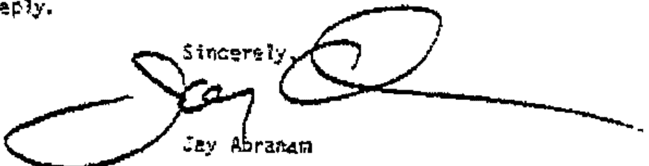

P.S. If you don't want to sell directories at a discount, we can also develop new subscriber ads and solicitations as well as create pieces to reactivate old buyers. I can also increase most publishers' renewal rate by as much as 40%.

P.P.S. There are also numerous synergistic products and services we could cross-sell to your current and expired subscriber base without jeopardizing the viability of those names. We can explore these more exotic profit opportunities when we talk.

## 如果你有大批目录册积压在库房
这里有个很棒的方法，能让你在 6 周内
快速把它们变成现金

亲爱的目录册出版商：

我将创作一个威力无比的空间广告以及/或销售信，来销售这些目录册，和正常售价相比，此次活动中，这些目录册的售价将会很吸引人。具体打几折，由你决定。通过在这些面向你最优质的潜在客户，以及过去已经购买过你的目录册的客户的空间广告以及/或强有力的直邮邮件中使用这个“销售”方法，我相信我们在几周时间内，很快就会将积压的 1000 份目录册（甚至更多）销售一空。

如果这个方法使你积压的产品能够非常有效地转化为现金，我将在你下期出版的刊物中使用一个非常完善的直接营销以及合同续订项目。

我在开发销售机会方面非常有天赋，到目前为止，我已经为美国一些最好的营销人成功地开发了价值将近 5000 万美元的销量——以及相应的利润。

我相信，我同样也可以给你带来巨大的销售额。而且，我的报酬将完全取决于是我给你带来的销售额。

原因如下：

我不会提前收取任何费用。相反，我会收取通过我的广告以及销售信给你带来的销售额的 25%。我只有 2 点要求：（1）你需要投入少量测试资金。（2）我们需要单独建立一个账号，来接收新进的销售额。

如果你能接受这两点合理的要求，我将为你研究一个突破性的广告方法，可以在相对短的时间内，为你清空所有库存。

如果你对我这个能帮你赚大钱的提议感兴趣，可以打电话，或写信给我。同时，寄给我一份你最近的目录册样本，以及最近的销售报表。还有，你曾经用过的比较成功的广告以及直邮邮件。

如果我们下个月开始这个计划，我可以在 11 月中旬之前，为你赚一大笔钱。

期待你的回复。

真诚的，

# 杰·亚伯拉罕

P.S. 如果你不想打折销售你的目录册，我们还可以研究一个新的订阅广告，吸引潜在客户订购，同时，促动老客户采取行动。我还可以使大多数订阅者的续订率达到高达 40%。

P.P.S. 还有很多同类产品和服务，我们可以将它们和你现在的产品进行交叉销售，同时又不危害你的客户。通过详谈，我们可以挖掘更多获取额外利润的机会。

## 笔记

## 4、杰·亚伯拉罕私信

JAY ABRAHAM
44 INDIAN HEAD ROAD, #112
ROLLING HILLS ESTATE, CA 90274

Dear Colleague:

I am writing this letter in an urgent attempt to reach you. Your response must be made within seven days. I am hoping this letter reaches you in time, because I have been unable to reach you by telephone.

In case you've forgotten, we're old friends. I'm the guy who introduced you to the financial newsletter you subscribe to — and I've been endorsed by almost every financial expert in the country including Howard Ruff, Gary North, Doug Casey, Lew Ealer, Brian Sith, Tom Phillips, Robert Ringer and dozens of others. If you haven't read about me in their publications you might have seen articles about me in USA Today, Success Magazine, MoneyWorld, OTC Stock Review, California Business, or Entrepreneur Magazine, to name just a few.

My business is making other people rich. Howard Ruff paid me $600,000 in one year alone — because I made him $2 million. I helped Icy Hot grow from $20,000 to $11 million in 18 months. I grew Entrepreneur Magazine from $800,000 to more than $8,000,000 in just over 9 months.

Through our past association I know you are intensely interested in achieving financial success. And because of the confidence you have placed in me in the past I feel a continued obligation to give you all the help I can.

Recently I have formed an association with three multi-millionaire business and marketing experts, and together we have developed a pilot program which will allow you to receive our help. Some of the participants who are chosen will be totally inexperienced, some will be intermediate, and some will be experts in real estate and/or entrepreneurial business. But all must be very serious about financial success. If you are chosen to participate in this pilot program, you will be given personal consulting assistance to help you, on a step-by-step basis, to establish and reach your financial goals during the next 6 months.

This consultation service will last for six months and will provide you with creative in-depth investment and marketing strategies which can be tailored to your particular needs.

I hope this letter reaches you in time, because it is critical that you respond immediately. If you have a serious interest in achieving financial freedom within the next 6 months through this pilot program, please contact me by using my toll-free number which I have installed right in my office for this purpose: 1-800-233-0025, ext.2000.

Sincerely,
Jay Abraham

## 杰·亚伯拉罕私信

# 杰·亚伯拉罕

印第安峰路 944 号
加利福尼亚州罗灵丘陵庄园

1-800-333-0025 转接 2000

亲爱的朋友：

我迫切的希望这封信能到达你的手中。你必须在 7 天内回复这封信。我希望这封信能及时到达你的手中，因为我打不通你的电话。

你可能已经忘记了，我们是老朋友。你订阅的金融时事通讯，就是我介绍给你的。国内几乎所有金融专家都为我背书过，包括霍华德·拉夫，盖瑞·诺斯，道格·凯西，欧勒，布莱恩·史密斯，汤姆·菲利普斯，罗伯特·林格，等等。如果你还没有在他们的出版物中看到过我的报道。那么，你也应该可能在《今日美国》，《成功杂志》，《金钱世界》，《OTC 股票评论》，《加利福尼亚商业》，或《企业家杂志》等知名杂志上看到过我。

我的工作是让别人变得富有。霍华德·拉夫有一年给我支付了 600000 美元——因为我帮他赚了 200 万美元。我还帮助冰热药用风湿膏的销售额，在短短 18 个月内，从 20000 美元涨到了 130 万美元。我让《企业家杂志》的销售额在 9 个多月的时间内，从 800000 美元，涨到了 8000000 美元。

通过我们之前的交往，我知道你十分想赚大钱。你之前对我的信任，让我感到我有义务向你提供力所能及的帮助。

最近，我和 3 位百万富翁以及营销专家一起成立了一个协会。我们一起开发了一个项目，通过它，你就能得到我们的帮助。被我们选中的人中，有的对房地产或创业一点经验也没有，有的有一些经验，还有一些，经验十分丰富。但是，所有人都非常想取得财务上的成功。如果你

被选中加入这个试行计划，你将得到个人咨询帮助，帮你在未来的 6 个月里一步步实现自己的目标。

这个咨询服务会持续 6 个月，会根据你的实际需求，教你一些有创意，有效果的投资，以及营销策略。

我希望这封信能及时到达你的手中，因为你需要立刻回复。如果你真的想在未来的 6 个月里，通过这个试行项目取得财务自由，请拨打我专门为这件事开通的免费热线，1-800-333-0025，转 2000。

真诚的，

杰·亚伯拉罕

## 笔记

## 5、一个害怕乘坐飞机的营销天才的惊人秘密

# Would you like to liberate your "hidden profits" and do it overnight?

# The Amazing Secret Of A Marketing Genius Who Is Afraid To Fly

Do your marketing efforts overlook the obvious? If you own or control a profitable business, you should probably talk to Jay Abraham. That's because Mr. Abraham is an absolute wizard when it comes to instantly increasing sales and producing an almost overnight boost in cash flow increase for nearly any type of owner-operated business.

However, Mr. Abraham is also an absolute coward when it comes to travel and this is apparently true when it comes to landing on airplanes. Therefore, if you wish to do business with Mr. Abraham, you must come to him. This is not because Mr. Abraham is autocratic, arrogant, rude, blind, or stubborn. Quite simply, the man is afraid to fly.

To most people especially people in business, this would be a major handicap. For Mr Abraham however, it seems to be no major liability, for a man who practically lives in an aircraft, his track record is literally astonishing. He has been written up in USA TODAY, THE NEW YORK TIMES, THE LOS ANGELES BUSINESS JOURNAL, THE MARKETING NEWS, several financial newsletters and many other publications.

> "Therefore, when it comes to money, I am forced to go right for the jugular!"
—Jay Abraham

## How Does He Work And Why Is He So Successful?

- He skyrocketed a tiny $20,000 a year company to $1,000,000 in sales in just 18 months.
- He pulled $57,000 worth of apparently needed cash out of a client’s small machinery in just 4 days
- He re-developed nearly 20 million investor leads for several of the largest stock broker age firms in the U.S.
- Because of his guidance, another client a little...

## 你想在一夜之间释放出你的“隐蔽利润”吗？

## 一个害怕乘坐飞机的营销天才的惊人秘密

你在营销过程中，是否忽略了显而易见的东西？

如果你拥有或控制着一家盈利企业，你应该跟杰·亚伯拉罕聊一聊。因为，在说到无论何种类型的企业，想要在几乎一夜之间，立刻提升销售额，增加现金流，亚伯拉罕先生绝对是一个奇才。

然而，在说到旅行时亚伯拉罕先生绝对是一个懦夫，尤其是坐飞机旅行。因此，如果你想与亚伯拉罕合作，你必须来找他。这不是因为他自负、冷漠、固执。

而是，因为他害怕坐飞机。

对大多数人来说（特别是生意人），这将是一个非常大的不利因素。但是，对亚伯拉罕来说，这似乎是一种资产。事实上，对于一个活动范围受到较大限制的人，他的业绩是十分惊人的。他曾被《今日美国》、《纽约时报》、《洛杉矶商业杂志》、《营销新闻》以及其他一些金融时事通讯和出版物多次报道。

在过去的14年中，他研究出了165个独立的营销策略，创造了数亿美元的营销额。他的许多客户，如今都已经家喻户晓。他帮助过著名的杂志，数一数二的股票经纪公司，价值数十亿美元的保险公司，互助基金，珠宝公司，时事通讯出版商，以及其他几乎各种类型的大型企业。另一方面，他的许多客户都只是中型企业，以及一些事实上很小的零售商。他说，“最关键的不是业务的规模，而是它的潜力。”

我们来简要回顾一下他的一些傲人的成就，你可能会感兴趣。下面是他的广告和营销魔法的一些例子。

- 在他帮助下，一个年营销额只有20000美元的小企业，在短短18个月内，营销额飙升到了13000000美元。

- 在短短 4 天的时间内，他帮助一个客户将 “积压很久” 的库存，变成了 570000 美元的急需现金。
- 他为美国几个最大的股票经纪公司吸引了将近 2000 万的投资者。
- 因为他的指导，另一个客户，一个小珠宝公司，在不到一周的时间内，使用他的巧妙方法，创造了将近 80000 美元的的销售额。
- 他用不到一年的时间，使一个中等大小的公司，年销售额从 800000 美元增长到超过 7000000 美元，而且使用的资金都是内部自筹。

> “因此，当涉及到钱的时候，我一定会一针见血！”
——杰 亚伯拉罕

事实是，他开发的一个闪电战营销项目，（以闪电般的速度）为各种规模的公司创造了数千万美元的额外利润。

## 他是怎么工作的，为什么他如此成功？

说实话，他有点像传奇。如果你问《拉夫时代》的出版者霍华德·拉夫，或吉姆·库克，稀有金属投资公司创始人，或《企业家杂志》的总裁蔡斯·瑞沃，或罗伯特·艾伦或阿尔伯特·洛瑞（他们是房地产方面最畅销书的作者），或约翰·吉尔伯特乔纳森洋服的创始人，或亚伯拉罕的其他许多过去的，以及现在的客户关于杰·亚伯拉罕的评价，你会得到一些奇怪的评论。

为什么？答案很简单。亚伯拉罕先生的工作方式有多种（有时很是不同寻常）。有些客户，他只提供电话咨询。有些客户，他会为其创作广告以及邮件。有时候，他会因为一场头脑风暴收到巨额费用！有时

侯，他会和客户进行秘密地面对面指导交流。

然后，不管他的工作方式如何，你跟他合作，肯定会是一次难忘的经历！

这个人可以帮你吗？例如，他能用不到 90 天的时间，也像其他人一样，让你的销售总额翻倍吗？是的，他可以。他能在不到 36 个小时的时间内，让你的现金增长 3 倍吗？

可能行。也可能不行。你可以打电话咨询一下。但是，在你花时间和金钱进行咨询之前，你应该考虑一下他可能无法帮到你的 6 个主要原因。亚伯拉罕先生坦率的承认，他无法帮助每个人或每个企业（在很多情况下，他是无法帮忙的）。你想要和亚伯拉罕联系得到帮助，你必须满足以下 6 个基本条件：

1. 你必须有足够的钱，来支撑一流的销售工作。
2. 你必须有一个符合道德的一流的产品和服务。（如果客户认为你的产品很劣质，那么，即使是最好的营销策略也无法帮到你！
3. 你必须有能力处理几乎一夜之间暴涨的销量。原因是，亚伯拉罕的咨询费非常昂贵。然而，他的大部分收入都通过增加你的现金流，抽取的佣金形式收取的。因此，如果你现在无法处理更大的销量，请不要给他打电话！
4. 你必须有一个开放的头脑。亚伯拉罕先生的方法至少可以说是独一无二的。正如他所说的，“我不会去迎合任何人的想法，不会顾及任何人所谓的自尊。当涉及到钱时，我必须去做我最应该做的事情。”
5. 你的业务，现在在一定程度上必须已经有些盈利。亚伯拉罕可以协助任何有潜能的客户，但是无法凭空创造利润！
6. 最后，不用说，如果你渴望和亚伯拉罕面对面交流，你必须去见他。否则，你就不得不通过邮件、电话、传真、电报，或信鸽等方式和他

联系了。

顺便说一下，还有一件事。如果你没有自己的公司，或者没有自己控制的业务，请不要打电话。如果你不能做出最终的决定，把电话给能做决定的人。

电话是（ 213 ）378-9323 ，所有电话都会由亚伯拉罕亲自接听。谢谢

## 笔记

## 6、在孩子还在学校的时候，教会他保持发型整洁的重要性

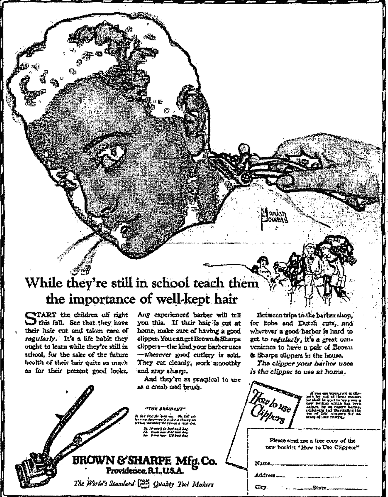

## 在孩子还在学校的时候
## 教会他保持发型整洁的重要性

帮助孩子在这个秋天有一个好的开端。确保他们上学之前理了发，并能在接下来的时间里，定期去理发。这是他们还在学校时，为了他们未来的头发健康，也为了他们容貌的整洁，应该学习的一个生活习惯。任何有经验的理发师都会这么说。

如果你是在家给孩子理发，请确保使用质量好的理发剪。你可以选择布朗&莎普理发剪——理发师们使用的的那种——任何好一点的刀具店都有卖。这种剪刀，经久耐用，剪的头发干净，而且不毛糙。

而且，使用起来非常简单，就像用梳子，刷子那么简单。

花那么长时间去理发店，剪波波头，或荷兰发型，还不能确保找到好的发型师，还不如在家备一个布朗&莎普理发剪，方便，快捷，理出的发型还时尚美观。

理发师使用的理发剪，就是你购买时，应该选择的理发剪。

如果你想详细了解理发剪的使用方法，可以剪下下面的优惠券，寄给我们，我们会立即给你发送一份新手册《如何使用理发剪》，赶快行动吧。

请给我寄一份免费手册《如何使用理发剪》
姓名____________
地址
城市____________州____________

布朗&莎普公司 普罗维登斯，罗德岛 美国
世界一级水平的工具制造商

## 笔记

## 7、联合太平洋铁路公司带你游览4个星级公园

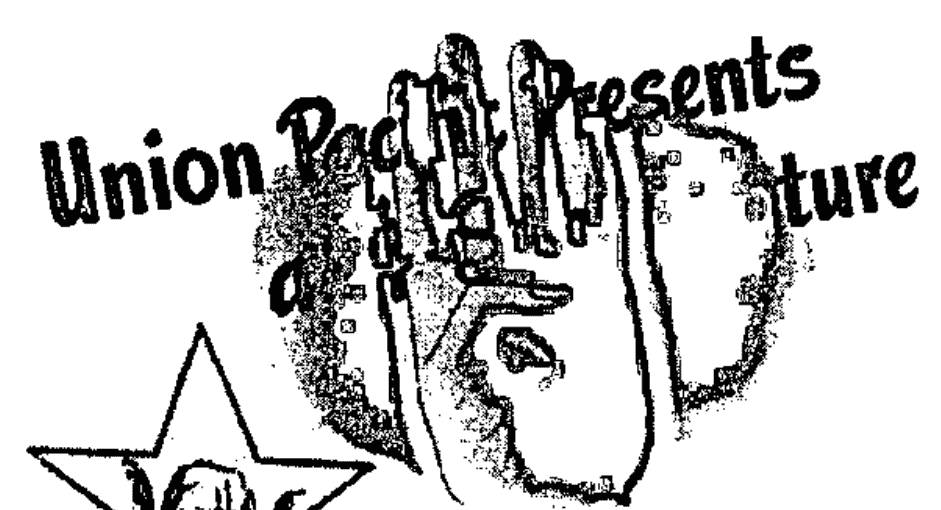

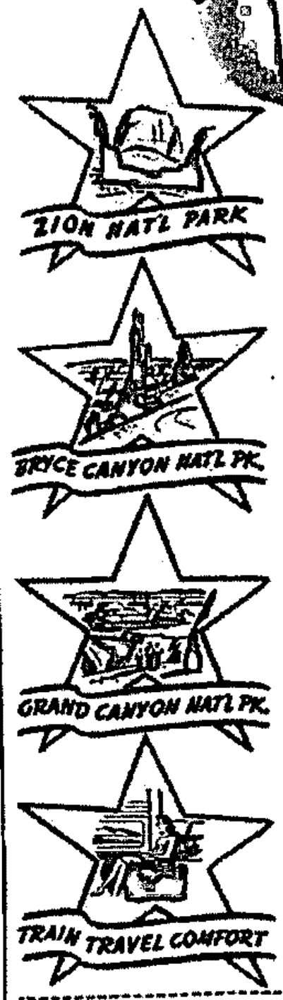

Grand Canyon National Park in Arizona, Bryce Canyon and Zion National Parks in Utah... so closely grouped that all three may be visited on one thrilling tour... comprise one of the world's greatest scenic attractions.

Magnificent in natural formations, brilliant in color, these regions offer vacationists an unparalleled experience.

As a fourth attraction, there is the enjoyment of traveling in air-conditioned comfort—by Union Pacific. Complete relaxation all the way.

If desired, the Southern Utah-Arizona National Parks may be visited as a "stop-over" enroute to or from California.

# UNION PACIFIC RAILROAD

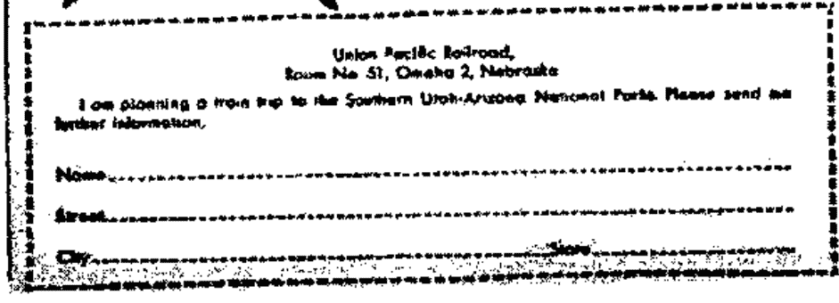

## 联合太平洋铁路公司带你游览4个星级公园

亚利桑那州的大峡谷国家公园，犹他州的布莱斯峡谷国家公园，以及锡安国家公园，这3个公园距离非常近，你一次就能全部游完……这3个公园组成了世界上最美丽的景观之一。

壮丽的自然景观，绚丽多彩，将带给你无与伦比的游览体验。

第4个景观，就是享受联合太平洋公司提供的舒适的空调列车。在路上享受完全放松，自由自在的惬意。

如果你愿意，你还可以在去加利福尼亚州，或从加利福尼亚州返回的路上，在南犹他州-亚利桑那州国家公园做短暂停留。

## 联合太平洋铁路公司
## 联合太平洋铁路公司

内布拉斯加州，奥马哈市，74号房间

我计划去南犹他州-亚利桑那州国家公园游玩。请给我发送详细信息。

姓名 ________________________
街道 ________________________
城市 ________________________
州 ________________________

## 笔记

## 8、同样的价格，游览更多的欧洲国家

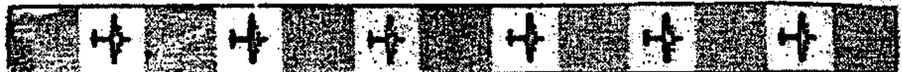

# Visit many extra cities in Europe at no extra cost

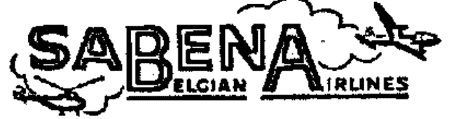

# Liberal Stop-Over Plan

Enables you to stay for indefinite periods in the big, interesting cities of Europe en route to your final destination at no extra transportation cost. Take as much as a whole year for your trip, if you wish. Or, go one way and return another, affording you even more stop-over points.

Examples:

# DESTINATION ATHENS:

15 cities in 8 countries you can visit on circular round trip from New York:

|  |  |  |
|---|---|---|
| Manchester | Rome | Stuttgart |
| London | Milan | Frankfurt |
| Paris | Zurich | Dusseldorf |
| Madrid | Geneva | Amsterdam |
| Nice | Munich | Brussels |

# DESTINATION ROME—(Marian Year There):

10 cities in 8 countries available on circular round trip from New York

Manchester
London
Paris
Geneva and Zurich
or
Madrid and Nice
Stuttgart
Dusseldorf
Amsterdam
Brussels
Milan

Almost any itinerary is possible, because the SABENA Network goes to all the key European cities. First Class (The Royal Sabena) and Tourist Class Super DC-6 Services over the Atlantic.
Consult your Travel Agent or SABENA. Mail coupon below for full information.

Please send me information on European stop-over and circular trip plans.
Name__________________________
Address__________________________
__________________________ San-3

SABENA Belgian Airlines, Dept. YN 422 Madison Ave., New York 17, Murray Hill 8-5757

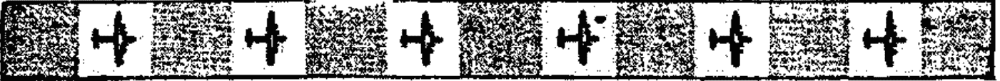

## 同样的价格，游览更多的欧洲国家

## 比利时航空公司 豪华自由欧洲行计划

在去往目的地的旅途，你可以在你感兴趣的欧洲城市任意停留，时间不限。也不用支付额外的旅行费用。如果你愿意，你可以在一年的时间内，尽可能多地去旅行。你也可以去的时候，选择一条航线，返回的时候，再选择一条航线，这样可以游览更多的景点。

比如：

## 目的地：雅典

从纽约往返，你可以游览 8 个国家，15 个城市：

| 曼彻斯特 | 罗马 | 斯图加特 |
| 伦敦 | 米兰 | 法兰克福 |
| 巴黎 | 苏黎世 | 杜塞尔多夫 |
| 马德里 | 日内瓦 | 阿姆斯特丹 |
| 尼斯 | 慕尼黑 | 布鲁塞尔 |

## 目的地：罗马

从纽约往返，你可以游览 8 个国家，10 个城市：

| 曼彻斯特 | 斯图加特 |
| 伦敦 | 杜塞尔多夫 |
| 巴黎 | 阿姆斯特丹 |
| 日内瓦以及苏黎世， | 布鲁塞尔 |
| 或马德里以及尼斯 | 米兰 |

几乎任何航班都可以让你访问这么多国家和城市，因为比利时航空公司的网络覆盖了欧洲所有主要城市。此外，飞跃大西洋的航线上，还设有头等舱（皇家比利时）以及经济舱超级 DC-6 服务。

立刻咨询旅行机构或比利时航空公司吧。邮寄下面优惠券，可以获得详细信息。

请寄给我欧洲旅行以及航班行程的详细信息。
姓名________________
地址________________

比利时航空公司，YN 部门，麦迪逊大街422 号，纽约17，莱莉山 8-5757

## 9、万丈喷泉冲天而起

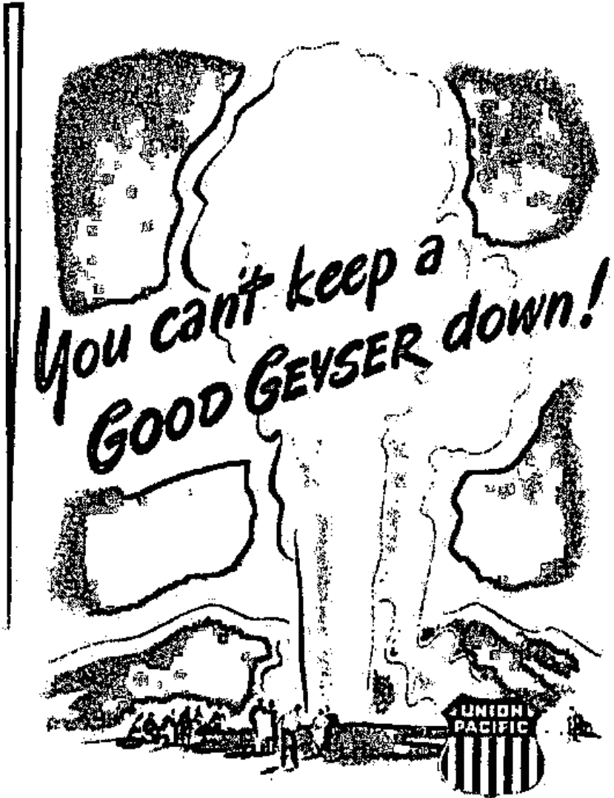

# Yellowstone

National Park again presents its star attraction, Old Faithful Geyser. Every 60 to 80 minutes, its steaming column soars skyward.

With its many geysers... its multitude of other fascinating spectacles... Yellowstone is one of America's greatest vacation regions. And you can add to the enjoyment of your trip by including nearby Grand Teton National Park, famous for rugged mountainous beauty.

Union Pacific takes you direct to the West Yellowstone entrance nearest to Old Faithful. Yellowstone-Grand Teton also can be visited as a side-trip enroute to or from the Pacific Northwest.

THE SEASONED TRAVELER GOES BY TRAIN

# UNION PACIFIC RAILROAD

ROAD OF THE Streamliners AND Challengers

Union Pacific Railroad Room No 74, Omaha 2, Nebraska
I'm interested in a train trip to Yellowstone, Grand Teton National Parks please send further info to
Name
Street
City

## 万丈喷泉冲天而起

黄石国家公园再一次展现它的最迷人的景观之一，老忠实泉。它是世界上著名的间歇泉呢，每 60-80 分钟喷发一次，每当沸腾冲天的水柱、滚滚的高压蒸气、伴随着地下隆隆的轰鸣，无数大大小小的喷泉在光怪陆奇，五光十色的火山岩中喷涌而出，构成世界火山喷泉群壮丽的喷发奇观。

黄石国家公园有很多间歇泉，以及自然奇观，是美国最美的度假胜地之一。你还可以去附近的大提顿国家公园游览，该公园以绵延起伏的山群著称。

联合太平洋公司的火车会直接把你带到黄石公园的西门……最接近老忠实泉的地方。顺路你就可以去大提顿国家公园。或者也可以从西北太平洋馆到那里。

有经验的旅行者都乘坐火车旅行

联合太平洋铁路公司

## 充满挑战和喷泉喷发美景的一次探索

联合太平洋铁路公司

内布拉斯加州，奥马哈市，74 号房间

我非常想去黄石公园和大提顿公园游玩。请给我发送详细信息。

姓名 ________________________

街道 ________________________

城市 ________________________

州 ________________________

## 笔记

## 10、你的牙釉质保护不如儿童

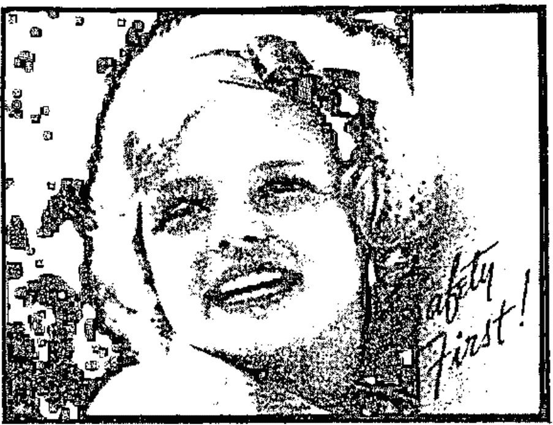

# Your teeth have
less enamel protection
than a child’s !

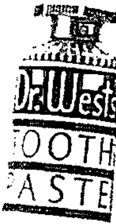

An adult’s teeth need Dr. WEST’s completely safe tooth paste even more than the teeth of this child!

Dr. West’s Tooth Paste ...
NO "TRICK" INGREDIENTS
NO MEDICATION
MONEY-BACK GUARANTEE ...
FAMILY SIZE 40¢ Also in Regular 25c size tube

# THE NEW Dr. West’s TOOTH PASTE

## 你的牙釉质保护不如儿童

成人的牙齿甚至比儿童更需要西医生牙膏的安全保护！

西医生牙膏是著名西医生防水牙刷的制造商，采用最高质量水准制造的一款牙膏。

从原材料，到成品，每一管都经过了158道纯度和安全安全测试。

不考虑成本，全部采用了最优质的成分。

西医生牙膏不包含任何药物，不包含任何不确定成分。它能给成人，以及儿童的牙釉质，以及牙龈提供完美的安全保护，带给使用者清新的口气，快乐的体验。

每管牙膏都经过了西医生著名防水牙刷制造商的严格检验。给牙龈以及牙釉质绝对安全的保护。

## 不含不确定成分

## 不含药物

退款保证：试用一管西医生牙膏。如果你有任何不满意的地方，你的经销商将会为你全额退款。立刻订购吧。

家庭装40美分
普通装20美分

## 笔记

## 11、现在，你可以保护他远离小儿麻痹症……为什么不去做呢？

# Now you can
protect him
from polio...
why don’t you?

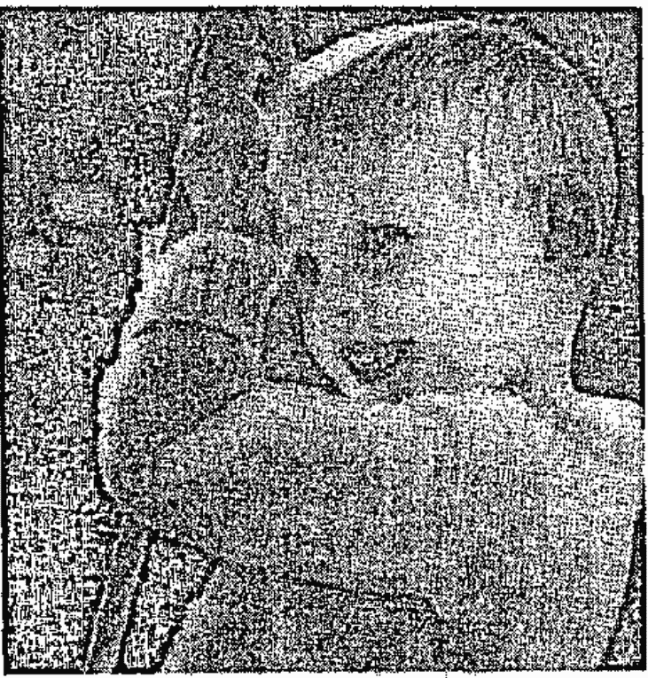

Perhaps no medical development was ever so eagerly awaited as the vaccine against polio.

But when the vaccine was perfected and supplies became plentiful, a strange thing happened. Millions of Americans failed to take it—or neglected to get the three injections needed for their protection.

In fact, more than 35 percent of our people under age 40—the period when most cases occur—have not had any shots; only half have had the full series. Of the pre-school children who are most susceptible, nearly one-third have not been vaccinated at all.

To help correct this situation, the U.S. Public Health Service, the American Medical Association, the American Academy of Pediatrics, the American Academy of General Practice and The National Foundation are spear-heading a drive for the conquest of polio.

You can strike a blow against polio!
If you have children, now's the time to protect them—well in advance of the polio season which is at its height during hot weather.

Three injections—properly spaced by your physician—are 85 to 90 percent effective against paralytic polio. If your children completed their series of three injections a year or more ago, it would be wise to ask your doctor about a fourth "booster" shot at this time.

Remember, it is especially important to protect children under age five. Polio injections can be started as early as six weeks of age.

If you are under 40, see that you, too, are vaccinated. Polio isn’t limited to children. Although it rarely strikes adults, it is usually severe when it does occur.

So, call your physician or clinic now—and arrange for your family’s injections.

If we all act immediately, there may be no polio epidemics this summer!

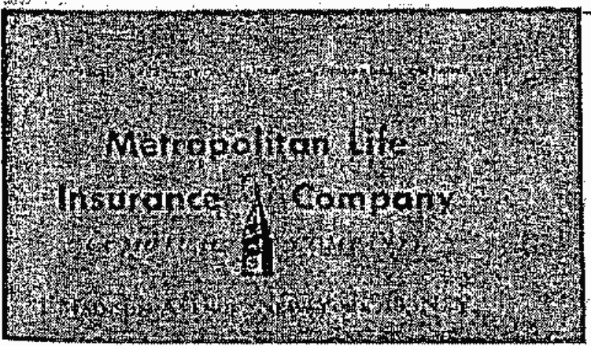

#59001

Metropolitan Life Insurance Co.
1 Madison Ave., N.Y. 10, N.Y.
Please send me the free booklet, "ABC's of Childhood Disease," 4-59-H.
公众微信：LBC333
Name ____________________ (PLEASE PRINT)
Street ____________________
City & Zone _______________ State ________

## 现在，你可以保护他远离小儿麻痹症......
为什么不去做呢？

也许从来没有哪种医疗进步，能比小儿麻痹症疫苗的出现更令人们期待的了。

但当小儿麻痹症疫苗日益完善，供应量日益丰富的时候，奇怪的事情发生了。无数美国人并没有去接种它——大部分人忽略了预防小儿麻痹症，需要接种3针疫苗。

事实上，40岁以下的人——这个年龄段，会出现各种健康问题，超过35%的人没有接种任何疫苗；只有一半人定期接种了规定数量的疫苗。最容易感染的学前儿童中，将近三分之一的人没有接种疫苗。

为了改变这种局面，美国公共卫生服务署，美国医学协会，美国儿科学会，美国综合医疗学会，以及国家基金会，联合控制小儿麻痹症。

## 你也可以对抗小儿麻痹症！

如果你有孩子，现在是时候保护他们了——在小儿麻痹症流行季节来临之前，夏天小儿麻痹症传播最快。

3针疫苗——医生会为你安排合适的间隔时间——对预防小儿麻痹症有85%—90%的效果。如果你的孩子在一年或数年之前，注射过3针，那么这时候你可以去问问医生，注射第4针进行巩固。

记住，对5岁以下的儿童进行预防非常重要。婴儿6周就可以开始接种小儿麻痹症疫苗。

如果你不到40岁，也需要确保接种疫苗。小儿麻痹症不仅限于儿童。成人也会感染，而且一旦感染，会很严重。

所以，立刻给你的医生打电话——为你的家人安排接种疫苗吧。

如果我们都立刻行动起来，那么这个夏天将不会再流行小儿麻痹症了。

版权所有1959——都是生活保险公司

## 都是生活保险公司

（一个互动公司）

麦迪逊大街 纽约 10 纽约

## 都是生活保险公司
麦迪逊大街 纽约 10 纽约

请给我免费寄一份手册《儿童疾病手册》
4-59-H

姓名：_______________________

街道：_______________________

城市：________州________

## 笔记

## "不要因为变老而苦恼，这是很多人都没有的特权。"

"Do not regret growing old. It is a privilege denied to many."

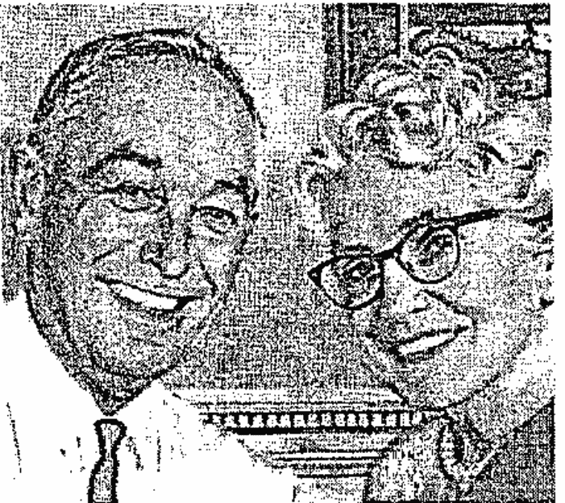

Although old age has certain drawbacks, the usual picture you may have of it is out of date. Today, many of our senior citizens—and there are more than 15 million of them aged 65 or over—enjoy travel, recreation, good health and many other satisfactions. Live usefully and happily after your retirement—you should start planning—long before your 65th birthday—for your health, economic security and the active role you'd like to take in affairs of your community. For a healthy old age, be sure to have regular physical examinations, eat sensibly, practice good health habits and develop interests for your leisure time. Regular medical check-ups can be your most important safeguard against the chronic or degenerative diseases which occur most commonly in middle and later years. Your check-ups will disclose trouble while it can still be "nipped in the bud"—or its progress delayed. Base your diet around a wide variety of foods.

Meat, milk, eggs, poultry, fish, vegetables, fruits, bread and cereals—in suitable amounts—will help keep your body in good repair and your weight in check. Always avoid fad diets.

Habits of exercise, sleep and recreation can make a big difference in how you act and feel. For instance, regular exercise is good for your muscles and your circulation. Your doctor can help you work out a plan for living to conserve your physical and mental resources.

Chances for happiness are slim at any age unless your leisure is occupied with worthwhile activities. So, develop hobbies or take part in community affairs to stimulate your mind and keep you in touch with people of all ages. One way to gain new interests is to enroll in adult education courses.

Your chances of living to a ripe old age are good. That's why you should look ahead and plan for the years to come. And as time slips by and "the future" becomes the present, you will find it is bright—you have made it so.

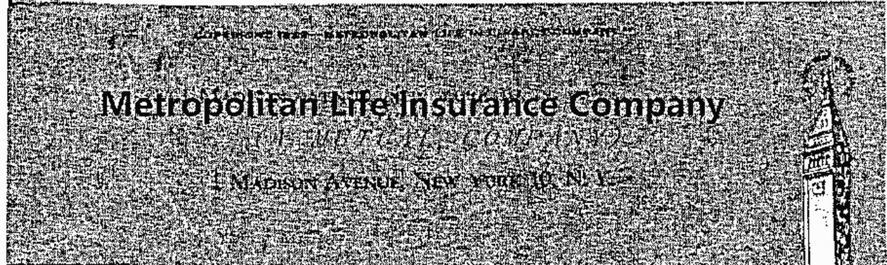

## "不要因为变老而苦恼，这是很多都没有的特权。"

虽然老年有一定的缺点，不过，你对老年的看法可能过时了。如今，很多老年人——超过1500万已经65岁，甚至年龄更大的老年人——享受着旅游、娱乐，身体健康，获得了许多满足。

想在退休后过得充实，幸福，你现在就应该开始计划了——在你过65岁生日之前，就应该开始计划——为你的健康，经济条件，以及你在社区内想扮演的积极角色。

对于一个健康的老人，一定要定期做健康检查，合理饮食，养成良好的卫生习惯，培养业余爱好。

定期体检，是及早发现中老年人通常会得的慢性或退化性疾病的最重要的途径。定期体检，可以“尽早发现问题”，“防患于未然”……否则，可能会错过最佳治疗时期。

饮食多样化。肉、奶、蛋、家禽、鱼、蔬菜、水果、面包和谷物食品都适量食用，能帮助你保持身体良好的新陈代谢，维持正常体重。时刻牢记远离垃圾食品。

规律的运动，良好的睡眠，定期放松娱乐，会对你的行为和心情带来很大的好处。比如，有规律的锻炼对提升肌肉力量，改善血液循环都有好处。医生会帮助你制定一个计划，帮助你拥有良好的身心状态。

如果你没有有价值的业余活动，任何时候，都不可能幸福。因此，培养爱好或参与社区事务，来活跃思维，让你接触到各个年龄段的人。培养新爱好的一种方法，就是参加成人教育课程。

你很有可能活到高领。这就是为什么你应该将眼光放长远，为未来的生活做好准备。随着时间的流逝，“未来”变成了现在，你会发现它

## 如此美好——这是你亲手打造的。

版权所有 1959——都市生活保险公司

## 都市生活保险公司

（一个互助公司）

麦迪逊大街 纽约 10 纽约

## 笔记

## 13、你能让心脏“跳动”更久吗？

## Can you help your heart "tick" longer, too?

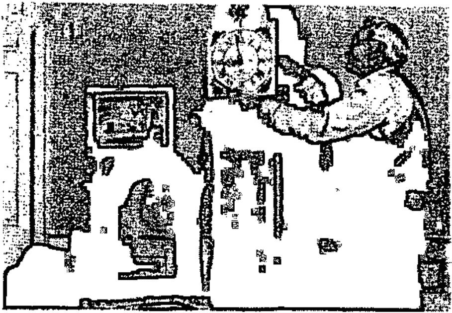

Sometimes a clock that has kept perfect time over the years will get temporarily out of order. With skilled attention, however, it can go on ticking again for years to come. The same is true of your heart.

There are a number of things that can happen to your heart. Among the more serious of these is the form of heart disease called coronary thrombosis.

The outlook for those who have had coronary thrombosis is good and is steadily improving. Studies show that four out of five recover from first attacks.

Today, the great majority of those who successfully withstand their first attack can, if the heart has repaired itself through rest and skilled medical care, safely resume activities with little or moderate restriction.

In fact, many of these people have not only been able to resume full-time work involving great responsibilities, but have continued at work for many years. Indeed, going back to work was actually "good medicine" for them.

Thousands of other people with various heart impairments are also living happily and filling useful places in life. We cannot be complacent, however, about heart disease, for it continues to be the leading cause of death in our country. So, if you are approaching middle age, now is the time to do these things to help protect your heart:

- Keep your weight down.
- Exercise regularly but moderately.
- Stop before you get overtired.
- Have periodic health examinations and follow your doctor's advice about diet and rest.

Remember, the normal heart is strong with a great reserve of power and has a wonderful capacity for comeback. Even an impaired heart can carry on and, with sensible care, usually be expected to do its job to a ripe old age.

If you want to know more about this subject, write for your free copy of Metropolitan's booklet entitled Your Heart.

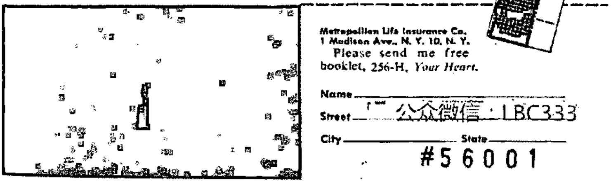

## 你能让心脏 “跳动” 更久吗？

有时候，一个准确走时很多年的闹钟，可能突然走时不准了。这时候，经过一番精心修理，它可能又会继续精准走时很多年。你的心脏也是如此。

你的心脏可能会遇到各种各样的问题。其中一种比较严重的心脏疾病，叫做冠状动脉血栓形成。

对冠状动脉血栓形成的治疗，前景很乐观，而且技术还在不断进步。研究表明，80%的患者，第一次患冠状动脉血栓形成后，都得到了治愈。

今天，绝大多数第一次患冠状动脉血栓形成并治愈的人，如果通过休息和合理的医疗，让心脏自我修复，之后的活动很少会受到限制。

事实上，这些康复后的患者，不仅能从事强度大的全职工作，而且又继续工作了很多年。其实，重新工作对他们来说，却是一剂良药。

许多心脏受损的人，经过治疗，依旧过着幸福，充实的生活。然而，对于心脏病的治疗，我们不能止步于此，因为它仍然是造成我国人口死亡的主要原因。所以，如果你已经快到中年，现在是时候做这些事情来帮助你保护心脏了：

保持你的体重。经常锻炼，但要适度。太累的时候，停下来歇歇。定期做健康检查，听从关于饮食和休息的医生的建议。

记住，正常的心脏，有很强的储备力量，和自我恢复能力。即使心脏受损，经过合理的护理，通常都能继续健康跳动很多年。

如果你想了解更多相关信息，可以来信免费领取都市生活手册《你的心脏》。

## 都市生活保险公司

（一个互助公司）

麦迪逊大街 纽约 10 纽约

## 都市生活保险公司

麦迪逊大街 纽约 10 纽约

请寄给我免费手册，256-H《你的心脏》

姓名 ________________

街道 ________________

城市 __________ 州 __________

## 笔记

## 14、老鹰一般犀利的眼睛……一些保护视力的方法

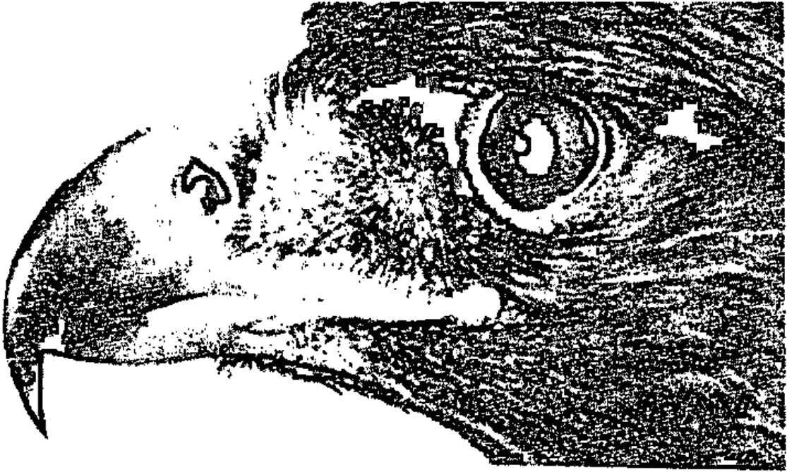

## The remarkable eyes of the eagle... and some sight-saving facts about yours

## METROPOLITAN LIFE

## 老鹰一般犀利的眼睛......
一些保护视力的方法

老鹰和其他鸟类的眼睛，都有犀利的眼神，能看得很远。事实上，一些鸟类甚至可以清楚地看到 100 码以外的一粒粮食。

我们的眼睛也能看很远。但是，看“近处”事物的能力，对我们大多数人来说，比看很远之外的小物体的能力，更加重要。

所以，考虑到我们对眼睛的特殊需求，拥有鹰一般犀利的眼神。我们一定不能拿我们的眼睛冒险......下面是一些可以用来保护自己的眼睛的方法。

意外—如果你工作，或一些其它活动，可能会给你的眼睛带来意外伤害，一定要佩戴防护眼镜。给孩子选择没有锋利边缘的玩具，保护孩子的眼睛。

感染—用脏手或脏布揉眼睛，都可能导致眼睛被感染。当眼睛被感染时，应该及时请医生治疗。

疾病—保护眼睛的最好方法是定期检查你的眼睛。权威人士建议，在孩子入学前，要对孩子的眼睛进行检查，之后每年检查一次。

如果你年过 40，患有青光眼的概率非常大。据估计，在美国，40 岁以上患有青光眼的人，有 125 万，但是他们之前却没有意识到。这是由于这种疾病发病非常缓慢，而且感觉不到疼痛。

通过简单的测试，尽早发现，青光眼就可以得到很好的控制和治疗。近年来，治疗青光眼，还有其它眼睛疾病的技术已经有了很大提高。

有人说过，如果我们所有人——和传说中的库克罗普斯一样——都只有一只眼睛，我们将会以最大的能力保护我们的眼睛。你有定期检查眼睛吗？

## 都市生活保险公司

一个互助公司・家庭办公室—纽约—自 1868

总办公室，圣弗朗西斯科—自 1901—总办公室，渥太华—自 1924，美国和加拿大共有超过 1000 家当地办公室

生活小启示

## 笔记

## 5. 给每个买车家庭的一封信

## A Payment from the Past Confirms this Widow's Faith in the Integrity of American Business

## A Message to Every Family Buying A Car

by Mrs. Elizabeth Patton
Pawtucket, Rhode Island

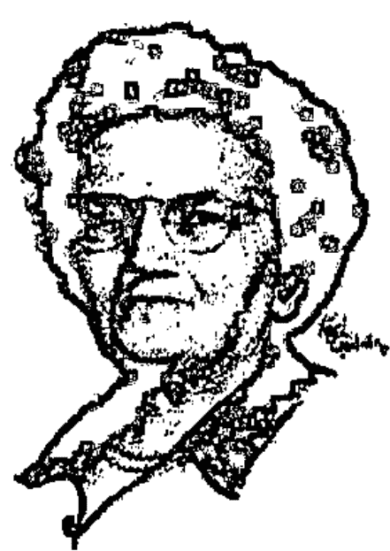

MY HUSBAND'S good judgment was proved once again months after his death. A few years ago he bought a new car. Quite a story developed around it. The dealer recommended financing the car through Universal C.I.T. My husband agreed because of the many benefits of the C.I.T. Time Purchase Plan and C.I.T.'s reputation as one of the largest auto finance companies.

A few months later my husband died. I must confess it became a struggle to keep up the car payments. Then, nine months and nine payments later, I got a call from the manager of the local C.I.T. office. He had good news that really confirmed my faith in the honesty of American business.

What happened was that the ninth check for the car payment had been drawn against "The Estate of Arthur Patton." A clerk noticed this and showed it to the manager. He called me at once.

The good news was that I not only did not owe any more payments—but

C.I.T. would quickly refund all the money I'd paid since Arthur's death! It seems the Credit Life Insurance that comes with the C.I.T. Time Purchase Plan had been overlooked or lost among our papers. Yet it was this insurance that would pay for the car if the purchaser died.

The result: C.I.T. gave me a clear title to my automobile plus a check for the $747.99 I'd paid following Arthur's death.

I've learned that any dealer can make arrangements for the C.I.T. Time Purchase Plan. From my experience, I'd recommend it to anyone buying a car, and always when family protection is needed.

See the following pages for other protections and services that are a part of the C.I.T. Time Purchase Plan.

一笔来自过去承诺的付款，更坚定了这个寡妇对美国商业诚信的信仰

## 给每个买车家庭的一封信

来自：伊丽莎白·巴顿太太
波塔基特，罗德岛

我丈夫良好的判断力，在他死亡后几个月，再次得到了证明。几年 前，他买了一辆新车。一个精彩的故事由此发生了。

汽车经销商向我们推荐购买通用 C.I.T.的保险，因为 C.I.T.时间采购计划的很多好处，以及 C.I.T 作为最大的汽车金融公司的良好声誉，我丈夫同意了。

几个月后，我丈夫去世了。我必须承认，从此以后，我一个人承担汽车贷款会很艰难。支付贷款9个月后，我接到了当地 C.I.T.办公室经理打来的电话。他给我带来了一个好消息，更坚定了我对美国商业诚信的信仰。我不得不抵押房屋，支付第9期汽车贷款，由阿瑟·巴顿房地产开具汇票。一个店员注意到了这点，把它拿给经理。经理看到后，马上打电话给我。

好消息是，我不仅不用再承担任何汽车贷款——而且，C.I.T.将会快速为我退还亚瑟死后，我支付的所有费用。我之前好像忽略了 C.I.T.时间采购计划的信贷人寿保险。然而，如果买车的人去世了，这种保险将会为你支付剩下的费用。

结果：C.I.T.给了我无负担权利，以及一张747.99美元的支票，这是我在亚瑟死后支付的全部费用。

我知道了任何经销商，都可以推荐顾客购买 C.I.T.时间购买计划。根据我的经验，我要把它推荐给任何购买车辆的人，以便享受保护。

请看下页 C.I.T.时间采购计划部分保护和服务条款

## 笔记

## 16、帮助你的家人，健康、快乐地度过冬季

## Help your family
to a healthy,
happy winter...

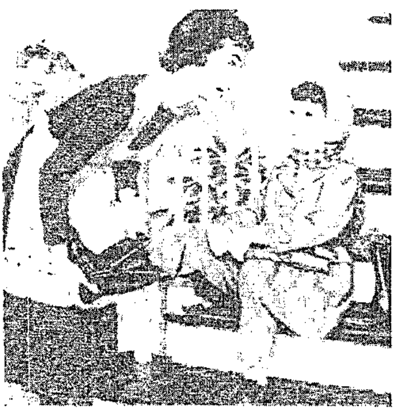

THERE IS, of course, no sure way to escape colds and other respiratory ailments this winter. But there are certain safeguards that you can take now to help you go through this season in better health.

Keep in top physical condition. If you’ve neglected to have a health examination in the past year, now’s the time to see your doctor. If you’re specially susceptible to colds, he may be able to advise you about how to avoid them.

Eat a well-balanced diet. What you eat has an effect on whether you catch colds easily and whether you recover quickly from an illness. Your meals—including a good breakfast—should be based on a wide variety of foods.

Get lots of rest and sleep. Fatigue can lower your resistance to respiratory diseases. Rest, sleep and recreation can help you avoid that “run-down” feeling that many people complain of during the winter.

Do not get too close to people who have colds.

第 5 9 0 0 1

Metropolitan Life
Insurance Company

When someone has a respiratory disease, it’s easy to pick up germs from the sick person. Be careful to protect young children from people who sneeze and cough carelessly.

Avoid drafts and chilling . . . and always wear clothing suited to weather conditions.

If you protect your health in these ways, the chances are that your resistance to colds, virus infections and pneumonia will be increased. In the event you develop one of these ailments, your ability to fight the infection and recover quickly will be greater.

Remember that the danger of the common cold lies mainly in other infections that may follow it. So, if your cold is accompanied by fever, a persistent cough, or a pain in the chest, face or ear, call your doctor promptly.

Metropolitan Life Insurance Co.
1 Madison Ave., N. Y. 10, N. Y.
Please send me the free booklet, "Help Yourself to Health," 1-44-H.
公众微信：LBC333
Name __________
Street __________
City __________ Zone __________ State __________

## 帮助你的家人，健康、快乐地度过冬季

当然，没有十分确定的方法，可以让你逃过冬天的感冒，以及其他呼吸道疾病。但是，你现在就可以采取一些保障措施，帮助家人更健康地度过这个冬季。

保持最佳的身体状况。如果过去的一年中，你忽视了健康检查。那么，现在是时候去看医生了。如果你特别容易感冒，他可能会给你一些预防感冒的方法。

均衡饮食。你吃的东西，会影响你对感冒的抵抗力，以及生病以后快速恢复的能力。你的饮食——包括营养丰富的早餐——应该多样化。

适当的休息，充足的睡眠。疲劳，会降低你对呼吸道疾病的抵抗力。休息、睡眠和娱乐，可以帮助你远离“疲惫”的感觉。冬季很多人会抱怨说感到疲惫。

不要过多地接近感冒的人。当有人患了呼吸道疾病，其他人就很容易受到细菌感染。保护儿童远离打喷嚏和咳嗽的人。

避免受凉......冬天，要根据天气情况，注意保暖。

如果你用这些方法增强体魄，那么你抵抗感冒、病毒感染和肺炎的能力将会增加。万一你感染了这些疾病，你也能很快康复，并拥有更健康的体魄。

记住，普通感冒的危险主要在于，伴随着它的许多其他感染。所以，如果你的感冒伴有发烧、持续咳嗽，或胸口、脸、耳朵疼痛，请立即打电话给你的医生。

## 都市生活保险公司

（一个互助公司）

麦迪逊大街 纽约 10 纽约

## 都市生活保险公司

麦迪逊大街 纽约 10 纽约

请给我免费寄一份《你的健康指南》手册 1-59-H.

姓名

街道

城市 州

## 笔记

## 17、让我们共同建立 1000 个新城市！

## Let's Build 1,000 New Cities!

> In the next 20 years the trucking industry can help us solve the pressing problem of overgrown, overcrowded cities.

by J. WARD KEENER, President, The B.F.Goodrich Company, a member of the American Trucking Associations Foundation, Inc.

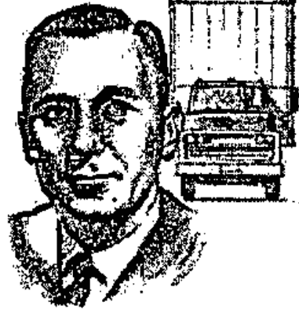

REMEMBER when advertisements carried the line "Prices slightly higher west of the Rocky Mountains"? Those were the days when most products were manufactured in the East, and shipping was slow and costly.

You rarely see that line today. Industry has spread throughout the country. Take the Pacific Coast, for example. At the turn of the century only 2.7% of all persons employed in manufacturing lived there—17.6% lived in New England. By 1955 the two areas were equal, each accounting for 8.9% of manufacturing employment.

What has made possible this mass movement of industry and population? Transportation—efficient, economical, flexible transportation is primarily the answer.

Although our population has been spread more evenly across the country, these shifts have resulted in large city areas growing even larger and more crowded. There is a solution: In the past 60 years, we have incorporated 3,000 new cities.

With the 3½ million miles of roads and the versatile 12 million trucks we have today, what better way to cut down urban congestion than by adding another 1,000 cities in the next 20 years?

Modern trucks have the unique advantage of flexibility—they can carry nearly anything wherever there’s a road. Thousands of miles of new roads are being built every year. Estimates point to 870,000 more trucks on the job by 1964.

The day will soon come when no area will be inaccessible. Manufacturers will be able to locate wherever they choose, yet be within easy reach of raw materials and markets. People can live where such things as climate and recreational facilities are to their liking.

We at B.F.Goodrich are proud of our long association with the trucking industry. We believe truck transportation can help solve the problem of urban congestion by facilitating the development of new communities. Then overgrown cities—like the need for "Prices slightly higher west of the Rocky Mountains"—will be a thing of the past.

## 让我们共同建立 1000 个新城市！

在未来的20年中，卡车运输业将帮我们解决城市人口拥挤的问题

来自：J.沃尔德 齐纳尔，古德瑞琦公司总裁，
美国卡车协会基金会公司成员

还记得“落基山脉以西的价格略高”这样的广告语吗？在大多数工厂都在东方，而且运输速度缓慢，价格高昂的那些日子里，确实如此。

如今，你很少见到这样的广告语了。因为，现在各种企业遍布全国各地。以太平洋海岸为例。在世纪之交的时候，所有从事制造业的工人，住在那里的只有 2.7%—— 住在新英格兰的人有 17.6%。到 1955 年，两个地区居住的工人比例持平，均占制造业就业人数的 8.9%。

是什么让这种企业和人口的大规模迁移成为了可能的？运输——高效，低价，灵活的运输可能是主要原因。

尽管现在全国人口分布更加均匀了，但是，这些变化导致了大城市地区人口的日益增长，使得大城市更加拥挤不堪。对这个问题，有一个解决方案。在过去的 60 年里，我们已经连结了 3000 个新城市，涵盖了 350万英里的公路。我们现在通用的卡车 1200 万辆。还有比在未来 20 年中，新建 1000 个城市，这个方法更能有效地解决城市拥堵问题吗？

现代卡车拥有独特的灵活性——只要有公路，他们就可以携带几乎任何东西。每 年，都有数千英里的新公路在建设。据估计，到 1964 年，将增加87万辆新卡车。卡车将能到达任何地区的日子很快就会到来。制造商的选址，可以在任何他们想去的地方，到任何市场以及原材料都将变得极其方便。人們可以选择住在气候好，娱乐设施齐全的地方。

我们古德瑞琦公司因为悠久的卡车制造历史，感到非常自豪。我们相信，卡车运输能够通过连结新地区，帮助缓解城市拥堵问题。过度拥挤的城市——像“落基山脉以西的价格略高”这样的事情——将成为历史。

## 笔记

## 18、相亲双方本来很尴尬——经过学习，轻松自如

## Both Are Embarrassed—Yet Both Could Be at Ease

THEY started out happily enough at the beginning of the evening. He was sure he had found ideal companionship at last. She was sure that she was going to impress him with her charm, her cultured personality. But everything seemed to go wrong when they entered the restaurant after the performance at the theatre. Instead of allowing her to follow the head waiter to their places, he preceded—and when he realized his mistake he tried to make up for it by being extremely polite. But he made another humiliating blunder that made even the disdainful waiter conceal a smile!

And now, at the table, both are embarrassed. He is wondering whether he is expected to order for both, or allow her to order for herself. She is wondering which fork is for the salad, which for the meat. Both are trying to create conversation, but somehow everything they say seems dull, uninteresting.

## How Etiquette Gives Ease

Are you always at ease among strangers, are you always calm, dignified, well-poised no matter what happens, no matter where your chances may be? Your can be—if you want to. And you should want to, for it will give you a new charm, a new power. You will be welcomed in every social circle, you will “make” well at every gathering, you will develop a delightful personality.

## The Book of Etiquette

Complete in Two Volumes. In the famous two-volume set of the Book of Etiquette the subject of correct form for every occasion is covered comprehensively, authoritatively. It is recognized as the most thorough and reliable book on that subject available today.

## Sent Free for 5 Days' Examination

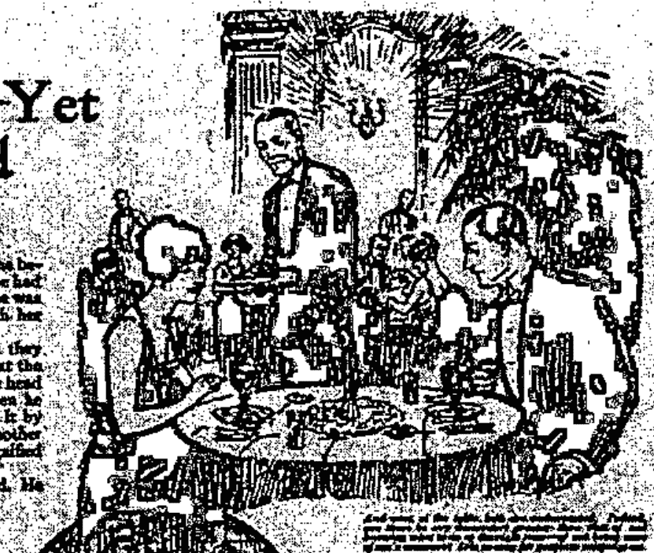

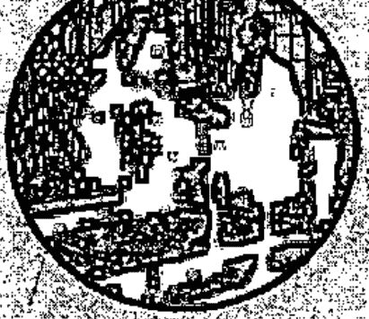

# 相亲双方本来很尴尬

## ——经过学习，轻松自如

夜幕降临，他们如约见到了对方，双方第一印象都很好。他确信他已经找到理想的伴侣。她确信，她一定能用她的魅力，以及她文雅的性格给他留下深刻印象。

但是，当他们看完电影，进入餐厅吃饭时，一切似乎变得不那么顺利了。他没有让她跟着服务员先落座，而是大大咧咧地走在了她前面，兀自向前走去。当他意识到自己的错误时，试图用接下来的谦恭有礼来弥补。但他很快又犯了一个尴尬的错误，甚至让一向庄重的服务员都忍不住抿嘴偷笑了！

坐在餐桌前，他们双方都觉得很尴尬。他不知道是应该点他们两个人的餐，还是让她自己点餐。她不知道哪个叉子是吃沙拉的，哪个是吃肉的。两个人 在试图寻找话题，但似乎什么都变的乏味，无趣。

他们无疑整个晚上都会感到不舒服，不自在。因为，只有真正明白什么是正确的，什么是错误的，才能使他们内心平静，有风度。但是，他们不知道对错。当他站在她的门前，准备离开时，她发现自己不知道该说什么——是欢迎他再电话联系，还是等他说些什么；是否应该邀请他进屋坐坐；是否应该感谢他让自己度过了一个愉快的夜晚。等等类似的尴尬问题，同样使他困扰不堪。

那个本可以非常开心的夜晚，本可以令双方展开一段快乐的夜晚，就这么被破坏了。当他离开后，可能松口气，而她可能哭着入睡。

## 礼仪让你感觉轻松

不论发生什么，不管你在那里，在陌生人面前你是否总能做到神态自如，心平如水，端庄优雅？如果你想，你就能做到。而且，你应该做到，因为它给你带来新的魅力，新的力量。在每个社交圈，你都将受到欢迎。在任何一个聚会中，你都能很快“混熟”，你将拥有令人愉快的个性。

礼仪会让你知道在什么时间，什么场合应该做什么，说什么，写什么，穿什么，掌握礼仪，会让你做到胸有成足，为你排除一切不确定因素。你将知道做什么是对的。不会再犯让你感到尴尬，羞愧的错误。人们会觉得你是一个有魅力，做事得体，有分寸，有礼貌的人。

在每天和各类男男女女接触的过程中，我们都会发现他们行为上的一些不当之处，这些问题，有教养的人都知道怎么解决。在饭店，酒店，在火车上，舞会上，在任何地方，任何时间，都会产生一些行为上的小问题。夹橄榄，是应该用叉子，还是用手指；如何支付行李员小费，女性如何在酒店登记入住，如何绅士地请女士跳舞——许许多多有关礼貌，以及优雅行为的问题。

你知道一切有关就餐礼仪、舞蹈礼仪、婚庆礼仪、茶话会、剧院、花园聚会上的各种礼仪吗？你知道如何撰写请帖，接收礼物，如何给一个名人写信吗？你知道去看歌剧，去参加正式的晚宴，化妆舞会，午餐时，应该如何着装吗？

## 礼仪之书

## 全套共两卷

在著名的两卷《礼仪之书》中，权威地说明了在每个场合的正确礼仪。它被认为是当今最全面，最可靠的礼仪之书。它的范围囊括广泛，就像一本百科全书。它以清晰、明确、有趣的方式回答每个可能困扰你的礼仪问题。没有遗漏任何一个问题。甚至还有很多古代习俗的起源，比如，为什么要在新娘身后泼大米，为什么黑色是悲哀的颜色，为什么通常会赠送茶杯给订婚的女孩。

有了《礼仪之书》的指导，你再也不会发生尴尬的错误。你可以确切地知道怎么做，怎么说，怎么写，以及怎么莅灶。你将以你渊博的礼仪知识，震惊你的朋友。

你的幸福，很大一部分取决于你让别人喜欢你的能力。有人曾经说过：“好的礼仪，让你结交好的朋友。”这么说，非常贴切。礼仪会帮助你成为一个“好朋友”——将帮助你获得吸引人的迷人个性。因为你很少让自己尴尬，和你相处的人也不会感到尴尬——你的翩翩风度和谦谦有礼，会赢得别人同样的对待，不管你到哪里，不管你和谁在一起，都能赢得软佩和尊重。

## 来信申请 5 天免费验证

《礼仪之书》对你意义重大。它已经为许许多多缺乏风度和魅力的人，展示了获取方法，打开了成功之门。

让我们为你寄出这本著名的两卷《礼仪之书》，你可以免费验证 5 天。亲自阅读几章——你肯定会特别喜欢 “游戏和运动” 以及 “单身汉的娱乐时间” 这 2 章。如果你不满意，你可以在 8 天之内退回此书，你就不用支付任何费用。如果你觉得满意——其实，阅读过这本书的每个人，都觉得很满意——那么支付我们 5.50 美元，这本书就是你的了。

不要错误地拒绝这份提议。这是一次机会，你可以零成本，零风险亲自验证这本书。立刻邮寄优惠券。纳尔逊梅德韦公司，254 部门，花园城市，纽约。

尼尔森·双日出版集团 254 部门，

花园城市，纽约。

你可以寄给我两卷《礼仪之书》，供我免费验证 5 天。我将在 5 天内退还此书，或全额支付 3.50 美元。如果我不满意，我不用支付任何费用。

姓名................................................................

地址................................................................

□ 如果你想要本书优美的皮革包装版，请支付 5 美元，并亲自验证 5 天，请勾选此框。（美国之外，接受现金订购。）

她应该邀请他进屋吗？她应该让他再打电话吗？她应该感谢他一个愉快的夜晚吗？这些问题在她的脑海里快速盘旋？不知道如何解决这些问题，是多么尴尬的事情！（图一）

现在，坐在餐桌上，两个人都尴尬。事实上，有什么事情比不知道怎么在对的时间，做对的事情更让人不适呢？这非常容易被人误会。（图二）

## 笔记

# 19、节省数百美元！用安全、简单的配方在家制作润肤液，面霜.....

# Save hundreds of dollars! Make your own after-shave lotion, cold cream, lemon oil furniture polish, deodorant, oven cleaner, mouthwash, drain cleaner and hundreds more with safe, easy recipes!

Now — the truth about how easy it is to make household and personal care products is yours in a remarkable new book. You'll not only save many hundreds of dollars each year... you'll have fun doing it! Here's the ultimate do-it-yourself for hard-pressed homemakers! Everyday consumers are paying far too much for dozens of items used for personal and household care. Inflation has hit everything from after-shave lotion to furniture polish — and consumers are bearing the extra burden onto family budget just like they normally do. Until recently there wasn't much you could do about it either. But, now there's it in an amazing book and simply, The Formula Book. Already this book is creating nothing short of a revolution in the homes and household budgets of thousands of homemakers here in the United States and Canada.

Look at savings you can make using The Formula Book
Store Home Savings
Auto windshield bug remover $1.28 .50 $1.08
Oven spray cleaner 1.29 .19 1.21
Mouthwash (Swedish type) 1.19 .02 1.17
After-shave lotion 1.79 .33 1.64
Window cleaner spray .50 .05 .50
Lemon oil furniture polish 1.52 .50 1.02
Liquid underarm deodorant 10.00 .43 9.57
Aluminum polish .39 .7c .32

The Formula Book SHOWS YOU HOW TO USE EASY-TO-OBTAIN INGREDIENTS TO MAKE YOUR OWN PERSONAL AND HEALTH CARE PRODUCTS, COSMETICS, CLEANING SUPPLIES, DETERGENTS, AUTOMOTIVE NECESSITIES, AND YARD AND GARDEN SPECIALTIES... simply, quickly and, most important, inexpensively.

## LEMON OIL FURNITURE POLISH

You will need some lemon extract, (it doesn't do any good except to make the oil smell like lemon) mineral oil and a plastic spray bottle (available at supermarkets or hardware and variety stores). Mix 10 drops of the lemon extract into 1 quart of mineral oil and transfer to bottle. Spray sparingly on furniture and polish with a soft cloth. The cost of making your own lemon oil furniture polish is approximately 10 cents per ounce. To determine your savings, divide the cost of your store-bought brand by the number of ounces it contains. Then compare the per ounce cost — you'll be surprised at how much you can save for so little effort.

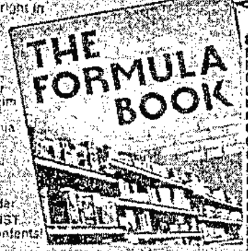

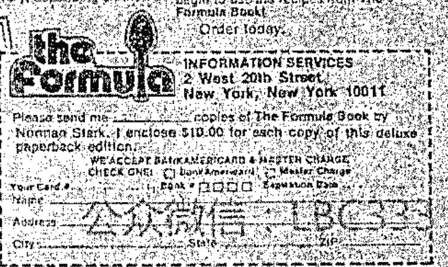

## 节省数百美元！

## 用安全、简单的配方在家制作润肤液，面霜，柠檬油家具亮光剂，除臭剂，烤箱清洁剂，漱口水，下水道清洁剂，等等！

现在——这本新书将告诉你制作家居和个人护理产品，是多么的简单。你不仅可以每年节省几百美元…你还会其乐融融！这是一本有关手工制作的终极书籍，它是经济紧迫的家庭主妇的救星！

每天，人们都要为许多家庭护理产品买单。通货膨胀已经影响到人们生活的方方面面，从润肤液，到家具亮光剂——和往常一样，消费者要为这些产品承担额外的预算负担。

直到最近，你都没有办法减少这类产品的支出。但是，现在，有办法了！这一切都源于一本叫做《配方》的神奇书籍。

这本书无疑为美国和加拿大家庭的家庭预算带来了革命性变化。

《配方》向你揭示了如何利用常见的原料，制作保健产品、化妆品、清洁用品、洗涤剂、汽车用品和庭院和花园用具…安全，而且最重要的是，便宜！

例如，你会惊讶地发现，一些很好的个人护理产品（润肤液、香水和各种保养品）的主要成分只不过是廉价的酒精。许多其他产品有水（是的，水）作为主要材料。水和酒精成本远低于制造商对那些花哨的包装瓶、广告、运输包装，以及许多其他货物成本的收价，而这些正是你平常购买的产品成本之一。

《配方》记录了在家制造安全，有效的家用产品的配方。

你将学到制作以下产品的简单配方：

- 控制痤疮乳液
- 须后水乳液
- 铝制品清洗液
- 美国漱口水
- 氨酚
- 解酸剂
- 蚂蚁去除剂
- 止汗药
- 紧肤水
- 治疗脚气的药

这还只是其中部分内容！

## 看看你用《配方》节能节省多少钱

| | 商店 | 自制 | 节省 |
|---|---|---|---|
| 汽车挡风玻璃除虫剂 | 1.98 美元 | 90 美分 | 1.08 美元 |
| 烤箱喷雾清洁剂 | 1.39 美元 | 18 美分 | 1.21 美元 |
| 漱口水（瑞典配方） | 1.19 美元 | 9 美分 | 1.10 美元 |
| 须后水 | 1.79 美元 | 13 美分 | 1.66 美元 |
| 窗户喷雾清洁剂 | 0.64 美元 | 6 美分 | 0.58 美分 |
| 柠檬油家具光亮剂 | 1.52 美元 | 50 美分 | 1.02 美元 |

|  |  |  |  |
|---|---|---|---|
| 腋下除臭剂 | 10 美元 | 43 美分 | 9.57 美元 |
| 铝制品清洗剂 | 0.99 美元 | 7 美分 | 0.92 美分 |

*这些价格来自市区西南部，不同地区，价格可能会有所不同。

制作这些东西，你不需要成为一名专业的药剂师。只要按照《配方》中的公式制作即可。下面本书作者诺曼·斯塔克，将向你解释如何制作自己的柠檬油家具亮光剂。

## 柠檬油家具亮光剂

你需要一些柠檬提取物（通过它，能让亮光剂具有柠檬的味道，除此之外，没有别的用处）。矿物油，以及一个塑料喷雾瓶（在超市或其它杂货店都能买到）。

将 10 滴柠檬提取物和 1 夸脱的矿物油均匀混合后，倒入瓶中。在家具上少量喷洒后，用软布擦拭。

在家制作一盎司柠檬油家具亮光剂，成本大约只要 6 美分。用在超市买的家具亮光剂的价格除以它的容量，你就可以算出节省的费用。通过对比每盎司的成本——你会惊讶地发现，举手之劳就能节省这么多钱。

注：材料成本的价格，基于国家药品零售网点，杂货店以及五金连锁店的售价。这些费用，会由于所处地域不同，而有所变化。如果你想大量制作，节省更多成本，你可以在化工用品公司购买（详见黄页）。

很简单对吗？没错。而且，这只是这本实用，可以帮你节省很多成本的书籍中超过 200 个配方中的一个。斯塔克先生对每个配方都进行了详细的描述，包括你需要的材料，以及如何配置产品的指导说明，简单易懂。他甚至为你提供了便利的实体店购买渠道，如果需要，他还提供了网购方法。

有了《配方》这本书，你不仅能节省从未想到的成本，你还会非常享受自己动手的乐趣，你制作的产品质量，会让你的朋友惊讶万分。

使用这本书几周收，你可能永远不会再购买铝制品清洗剂，漱口水或其他家用物品了。

## 关于作者

诺曼·斯塔克，1940 年创办了自己的公司，专门研究化学品的开发和制造。从那时起，他就开始了这项神奇的事业。他的第一个主要工作就是二战期间供士兵使用的能量片。

今天，斯塔克在亚利桑那州图森，拥有了自己的实验室…在该实验室中，他致力于分析所有产品，并创造新配方，并详尽地对产品进行全面测试。

想拥有这本《配方》，你只要剪下下面的优惠券，并将它和 10.00 美元邮寄给我们。你不用承担任何风险。如果因为任何原因，你觉得《配方》并没有我们说的那么好，你可以在 15 天内退还，我们会立即为你退款。不问任何问题。

相信我，当你开始使用《配方》后，你再也不想浪费那些你辛苦赚来的，本可以节省的钱了。

立刻订购吧！

《配方》 信息服务 西大街 20 纽约 10011

请为我邮寄__本诺曼·斯塔克的《配方》。我为每本支付了 10 美元。

## 我们接受美洲银行信用卡&万事达信用卡付费

请选择其中一个：□ 美洲银行信用卡 □ 万事达信用卡

信用卡帐号#...........................银行帐号，有效期.........

姓名

地址

城市__________ 州__________ 邮编__________

## 笔记

# 想在一夜之间减少杆数？

## 一位只有一条腿的高尔夫球手
发现了一个惊人的秘密
可以让你 Yet 发球距离增加 50 码
消除左曲球和右曲球......
几乎在一夜之间，让你的杆数减少 10 杆！

现在，你可以在几乎一夜之间，学会用你的自身能力以 200%的爆发力“应对”每个击球，打出你之前梦寐以求的距离…像上了发条一样的精准，指哪打哪，每球必中……如果你和大多数高尔夫球手一样，下次打球，你就能减少很多杆！你觉得不可能？如果你听了专业高尔夫球手，以及全球炙手可热的新晋业余爱好球手的一番谈论，你就不会这么认为 了……

亲爱的朋友：

如果你曾经幻想过以榴弹炮爆炸般的速度发球（为你的开球增加足球场一半长度的距离）……同时，以娴熟动作，超高的精准度，应对每个球道以及果岭……那么，这将是你读过最重要的消息。

内容如下：我是麦克·奥莱利博士，直到最近，对你来说，我还是个陌生人。我对高尔夫又爱又恨——有时候，我打的和专业人士一样，有的时候甚至能打出平标准杆数的成绩……然而，第二天下午，我的成绩可能就会糟糕透顶。我发誓，我已经气愤到站在湖的边缘，把高尔夫球包举过头顶，气愤得想扔掉所有高尔夫球器具，从此再也不去碰它。

高尔夫球是不是同样让你抓狂？虽然 12 年来，我经常打高尔夫，但我的成绩一点也不稳定。你无法预料每轮会是什么样的结果。并不是我不努力——我经常花几千美元，请高尔夫专家帮我分析，如何避免可怕的左旋球 可是我一无所获。如果我打球时，能随意扭动身体 180 就好了……

是的，对的。

## 幸运的是，我就是那种喜欢
向任何乐意倾听的人发牢骚的人！

于是，我找到了米尔特·华勒斯。我的生活立刻被永久地改变了。在听米尔特的建议短短几周后……

- 我的挥杆有力多了，我通过调动肌肉的力量，发球距离比之前增加了 50 码！（当我用 8 号铁，从 180 码外，打中了他们用 5 号铁都无法准确击中的球时，你真应该看看我那些朋友们脸上的表情！）
- 我的球道率和果岭率提高了 110%！（我以前的挥杆方式，击球 10 次，我能“成功” 4 次。而现在，击球 10 次，我能击中 8—9 次！这么高令人难以置信的准确性，甚至一些职业选手也不敢保证！）
- 还有令人难以置信的……

## 不到 4 个月的时间里，
我的障碍从 16 个，减少到只有 7 个！

而且，变得越来越好！我的“老年状态”完全消失了…我对球场变的无所畏惧，每次击球，我似乎都充满了神奇的力量。

但它绝对不是魔术！我从米尔特那里学到的，完全不受我个人条件的影响……从他那里学到的是神奇的挥球新方法，这是他多年研究的结果。他称之为“三圈挥球法”。他确定要努力研究这个方法，源于 15 年前。

当时他看到一位一条腿的高尔夫球手，把球放在球座上，打到了他见过的最长的距离。那时，米尔特已经是一名职业高尔夫手。从那时起，他的比赛——以及他作为严格的专属高尔夫教练对学生和自己的要求，永远地被改变了。

实际上，当米尔特看到那位一条腿的高尔夫球手把球放在球座上，准备发出第一个球时，他对他充满了同情……直到他看见他把球发出320码，几乎从球道的中间直冲而下直通球洞时，依然保持着优雅的身姿，让他那些两条腿的朋友都不敢相信自己的眼睛！想象一下，这个独腿人摆球，挥球时的样子。当时，米尔特想，这个可怜的人，肯定会摔倒。

但他没有。事实上，他的平衡是绝对无可挑剔的……而且，在那一瞬间，米尔特看到了真相：

## 这个独腿人绝对有一个
远胜于普通高尔夫球手的优势！

因为，他必须用一条腿保持平衡——所以，他能够通过自然的扭动张力，对他的挥球“增压”，然后爆发。但他仍能保持完美的平衡……能够重复击球，而且，10英尺内，他甚至能判断球会落在哪里。稍后，米尔特将会给你解释其中的物理原理，告诉你独腿人用的是哪条腿。

看完这位独腿人打球后，米尔特发明了“三圈挥球法”，非常简单，却又十分强大，任何人都可以使自己的高尔夫球游戏变成一个可预测的机械化武器。有两条腿，你的力量和准确性只会大大地增强…让你完全主导整个高尔夫球场……以及你的对手！

怎么使用这个简单的挥球方法呢？很简单……因为这个挥球新方法……

## 利用的是你自身的力量，为身体提供精确的扭矩，
确保每次都挥球精准，不脱离球道……就像撕下球套那么简单！

我向你释放这些信息，对你有绝佳的好处。你知道，这些年来，学习这个神奇的“三圈挥球法”的唯一途径，就是雇用米尔特·华勒斯做私人教练……而且，他的收费一直很高！事实上，10年来，他的收费一直是225美元一小时，一套课程必须至少包含6节—也就是说，学习这个挥球方法，你需要支付学费1350美元！这还是在你能预约到他的课程的前提下。因为他可能是……

## 国内最受欢迎的高尔夫球教练！

如果我不向米尔特算了一笔简单的经济账，他可能还只是接收私人课程，收取昂贵的费用（尽管他最近健康状况不佳）。我给他算的经济账是这样的：如果他允许我录制他的“三圈挥球法”课程……并以他课程费用的一小部分作为售价，出售这些录像带……我知道，一年内，全球很多人都会购买这个视频，米尔特就再也不用出去上私人课程了！和给几个富有的高尔夫球手做私人教练一个月，收取昂贵的费用相比，抽取部分销售提成的“零钱”，能让他过上更好的生活，同时还扩大他的观众群体。

米尔特同意了……但是是有条件的。事实上，他和我达成了一个协议：我们只能在少数地区“测试”这个低价提议，如果反馈比较好，我们可以继续销售。否则……

## 他会永久地将这个视频课程撤出市场，
继续他昂贵的私人课程！

也就是说，如果你看到了这个信息，说明这个协议现在还有效！这个提议真的是激励人心，令人难以置信……你不用冒一分钱的风险，在家就能验证！你将收到的是，最超值的，最好的米尔顿内容翔实的教学课程，全长1小时42分钟，使用的是圣地亚哥预定最火爆的视频工作室，选景是圆石滩南部最著名的高尔夫球场！这个激励人心的视频课程，解说吐字清晰，准确，采用了昂贵的模拟带格式……然后转化为“好莱坞品质”的非线性数字VHS格式，并在100000美元的刻录机刻录。……采用的是定制版索尼录像带！（你在任何零售商店都买不到比它品质更好的

录像带！）

这张神奇的录像带，包含了在尽可能最短的时间内，掌握“三圈挥球法”，你需要知道的所有东西。没有任何保留……你学到的内容，和米尔特在他昂贵的私人课程上教授的内容完全一样……你还有一个额外优势，那就是你拥有的是录像带，在遇到你喜欢的部分，你可以反复观看，直到彻底掌握！此外，你还将看到：

- 甚至职业高尔夫球手都会常犯的一个错误，在他们向下挥杆的时候，吞噬他们的力量……以及如何通过一个简单，轻松的方法“进行调整”，立刻提升你的力量 200%或更多！（想象始终能打出 300 码，从 150 码的距离，用 9 号铁轻松进球！）
- 如何在尽可能短的时间内，掌握这个新的挥球方法……同时提高现有击球水平！（你将学到那些富人花几千美元学到的东西！）
- 为什么“新手”能够用这个挥球方法快速超越经验丰富的高尔夫球手……即使他们并不是每周都打球！（事实上，你对所谓的“专家”教给你的东西了解得越少，你减少杆数的速度就越快，并且能更快地打出你梦寐以求的距离！）
- “秘诀”——臀部位置变化 5 英寸，就能为你在击球时转化成巨大的力量！（任何职业高尔夫球选手，都不敢怀疑这个简单的调整的威力！）
- 如何避免“经典”挥球中的力量波动问题——并保证击球准确，优雅，有力。而且，是你有史以来最舒服，最自然的挥球方式！
- 该“三圈挥球法”课程一共分为 6 个简单的部分，每部分结束时，你都可以立刻检查你的进步……以你意想不到的速度，快速掌握挥球方法！（而且，一旦学会，就能轻松自如地重复击出最漂亮的球，不会忘记要领，不会有任何犹豫！）
- 如何用秘诀“开启”你体内最大的力量！（传统的挥球方法，侵
怔了你的这种潜力——而“三圈挥球法”能让这种力量倍增！）
- 为什么这个新的“看似滞后”的挥球方法，你朋友乍一看会摇头……直到他们看到你不断发出 40 码，50 码，60 码的球！（我保证，他们会让你再用他们的球发一个球，只是为了确认你没有作弊！）
- 如何使用简单的“双重检查”法（如“可见关节”规则）立即确保你是否已经为任何击球做好准备……以便你在任何情况下，都能得到同样的结果！（即使你在一个奇怪的场地，阴雨天气，与你的伙伴——咳嗽不止，时不时掉落的包还在分散你的注意力！）
- “送球”背后的真相——以及为什么 99%的高尔夫球手在击中球后都会送球！
- 如何立刻诊断你挥球存在的问题——这样，你就不会一次次地重复覆盖了！（这是一个你可能最常犯的错误列表……一个在你打球时，能帮你自动纠正错误的“自动防故障”系统！）
- 如何在家里进行练习——使用不会多花你一分钱的道具——让你 的学习速度增加 10 倍！
- 如何使用“窒息”秘诀，掌握包中的所有球杆……不管你之前对它的掌握有多么糟糕！

此外：通过学习“高级指导”这一特殊部分，你将会看到一个经验丰富的高尔夫球手，如何改变他一生的习惯，采用这种新的挥杆方法，获取不可思议的新力量，打出前所未有的距离和准确率……以及，一个新手如何在 一夜之间看到自己的比赛能力飙升！

还不止这些：你还将得到一个详细的说明书，内含关于新挥球方法更详细的信息……所以，你将随时随地能看到正确的挥球参考！你可以把本手册带到你的高尔夫球场……它包含所有提升高尔夫水平最常见的障碍，及其解决方法。

这样一个简单的挥球，就能给你的比赛带来那么大的改变吗？当然可以！让我们听听这些经验丰富的高尔夫球手怎么说：

“因为观看了这个课程，我的击球距离比之前多了 50 码……我的整体水平增加了 90%！即使我有个球没有进洞，但是，完全不会影响我的状态。我永远摆脱了右曲球。” E.G. 雷伊，加州南部

“10 年前，我遇到了米尔特，看了他的教学方法，我感到非常好奇。我从来没见过哪位教练的课程比米尔特的方法，能让人们的击球更有力，更精准。” 乔·迈尔德，卡斯泰纳索高尔夫俱乐部首席教练，意大利博洛尼亚

“我刚开始打高尔夫的时候，95 杆左右，在仅一周的时间内，减少到了 70 多杆！而且，在棕榈泉高尔夫球场，我用 8 号铁打出了 200 码！这个挥球方法太神奇了！” 迪恩·梅西埃，电脑分析员

“只看了一次，我就改掉了之前错误的挥球方法——现在，我的成绩是平均 290 码，比我之前最好的成绩都远 70 码，而且我的准确性惊人。谢谢！” 约翰·汤普森，加利福尼亚州，诺沃克

“这个方法简单，上手快，而且易于重复。这是你获取最大的挥球力量的最快方法。” 泰德·哈里斯，金融顾问

“在短短 15 分钟内，米尔特完全改变了我的挥球方法——让我摆脱了右曲球，6 号铁打出了 185 码，5 号铁打出了 190 多码，这是我之前绝对无法做到的！而且方法非常简单，我随时都可以使用。” 梅尔·克拉克，银行副总裁，洛杉矶

“我都不敢相信我能打出这么远的球！最难打的球场，现在对我来说，也是小菜一碟。这个挥球方法是我用过的最简单的。非常舒服，完全没有压力。太神奇了。” C.M. 纳塞尔，生产工程师

“刚开始的时候，我增加的杆数是 15 杆——现在，使用三圈挥球法仅仅 4 个月，我增加的杆数减少到了 4 个！而且，这个挥球方法可以一
次次地精准重复。我几乎在一夜之间变成了一个致命的高尔夫球手。” 肖恩·桑松，商业用地评估师

“发生在其它高尔夫球手身上的变化，真的让我难以置信，他们就用了这么一个简单的挥球方法。最后，我终于忍不住了，也尝试了这个方法，很快，我看到了巨大变化——我可以真切地感受到我挥球的变化，大大改善我的水平。” T.A. 弗尔克，房地产经纪人

“这真的让人毛骨悚然……我从来没想过能打到 227 码！结果，我打到了 329 码。如果不尝试这个方法，你就太傻了。” 克里斯·阿尔瓦拉多，亚利桑那州，图森

“我曾经花费数千美元，请过 6 个不同的专业教练，每周练习 4 天，始终无法突破 90。然后，我学习了这个新的挥球方法，我的击球数几乎立即就减少了 8 杆！我能打出 150 码的球了。我的距离和准确度都提升了一个新的水平，我成了一个不同的高尔夫球手。” 迈克，加利福尼亚州，拉古纳山

“我真的认为你开始了高尔夫教学的一场革命。我可以准确击球，而且，距离比之前增加了 20 到 30 码。我用 4 号铁，打出了 235 码。我甚至用 7 号铁，打出了 150 码。你引领着高尔夫球新时代。” 弗兰克·考尔斯，加利福尼亚州

“在米尔特的专业指导下，前 30 分钟，我就能打出直球了。而且，距离也增加了，都来源于这个更简单的挥球方法……学习使用来自身体内的能量。” 坎迪·托马斯，高尔夫球冠军手，内华达州

“观看三圈挥球法一次之后，我第一次实现了‘一杆进洞’，这是我打高尔夫 45 年来第一次做到一杆进洞！这个方法的准确性令人难以置信。我都迫不及待地要去打下一场球了！顺便说一下，我的杆数是 79，这是我的历史最低！谢谢你让我过去 45 年的努力没有白费！” 休·斯图尔特，前温布尔登网球球员，夏威夷州

“过去 20 年中，我上过很多高尔夫学校，参加过很多高尔夫夏令营，但我的成绩几乎没有任何提高。米尔特，你，只有你给了我有效的方法，使我打出了更远的距离，准确度也比以前更好了。” 诺曼·海斯，汽车经销商，犹他州

这些高尔夫球手和你有什么不同吗？不，没有。他们里面有专业的，有业余的，有新手，也有经验丰富的老手，他们和你一样，对高尔夫球热爱，着迷。

他们做的唯一一件事，就是放下疑虑……尝试这个新的挥球方法。其中一些人，花费了几千美元，上的私人课程……这个课程绝对物超所值。

如果你也想暂时放下疑虑，亲自验证一下比你之前最好的成绩还远 50 码的感觉……对待 150 码，都轻而易举……快速减少杆数，让你的朋友惊讶于你的改变，甚至都不好意思再和你打球！

## 更棒的是，你还将获得一部分别人必须付费才能得到的指导！

听着：因为我和你分享了这个挥球的“秘密武器”，世界各地很多人都会生我的气……尤其是你现在享受的价格，连他们之前必须支付的一节课的费用都不到！

但事实还是很糟糕。这个秘密被保守得太久了。需要很长一段时间，你才能看到所有人都是用这个挥球方法——毕竟，大多数高尔夫球手，都会在现有的游戏上，投入过多的时间和金钱，而没有精力为新东西投入甚至一分钱……即使这个简单的挥球方法能改变他们的生活！这就是人类的本性。

但是——你看了这篇文章这么久，我想你肯定和其它高尔夫球手不同。所以，让我告诉你我的提议是什么：现在，拨打我的“高尔夫”办公室电话（记住，这个提议截止到今天！）1-800-316-5871（找 8585-G 部门），告诉接电话的人，你想要零风险“三圈挥球法”视频。价格仅为 69 美元，加 5 美元的运费和处理费（总计：74 美元），你可以使用信用卡支付。或者，如果你喜欢，你可以填写下面的简表优先订购单，并
把它和你的支票或汇票一起寄给我。

这个价格甚至连米尔特常规课程的 15 分钟都买不到——过去 10 年，人们请他做私人课程，收费要好几千美元。然而，现在，一个不实用的乡村俱乐部，一个果岭费，就够你拥有米尔特的挥杆法了……而且，这个视频（加上手册）将向你揭示你将在私人课程中学到的一切知识！

我的朋友，这是送给像你一样的高尔夫球爱好者的最划算的交易。更重要的是，钱还是次要的，因为……

## 你同样享有 3 个月零风险 100%退款保证！

具体情况是这样的：现在订购专属你的视频，并使用它。如果，出于任何原因，或毫无理由，3 个月内，你感到不是完全满意（3 个月的时候，我已经将我的杆数减少了 11 杆！）——你只要退回这个视频和手册，在任何情况下，我都保证，你会立刻得到全额退款。不问任何问题。不用任何手续。不用填写任何表格。你一定能得到退款。

我怎么能承担得了这么慷慨的保证呢？很简单——到目前为止，我所知道的每一个学习了这个课程的人，都体会到了这个新挥球方法带给他们的成就，之后，他们就一直在用这个方法……取得了令他们难以置信的成就，正如你在之前的证言中看到的一样！

所以，我非常有信心，我坚信这个方法同样能带给你奇迹。想想看：你面带微笑站在那里，看着你的球沿着球道一直滚到很远，比你朋友最好的成绩，还要远出半个足球场……你一定会很激动，不是吗？

肯定会。而且，拥有这个特别慷慨的退款保证，你不会有任何损失！我是一个医生，我以我的声誉担保！可能更重要的是，和你一样，我还是一个高尔夫球手，我真的想与你分享这个神奇的新挥球方法，我不想让你担心被“拿走”任何东西。我之前也被不实在的东西“骗”过。找到一个你可以信任的人很难。这就是为什么我如此慷慨。

所以，立刻打电话吧。你不会损失任何东西……而且，你一定会在短时间内，体会到很大的快乐！

真诚的，

## Michael O'Leary

麦克·奥莱利博士

P.S. 请在你看到这个信息的时候，立刻打电话给我。没有任何风险，你没有任何理由不亲自尝试一下这个提议……这个提议可能不会再有了！所以，不要让这个将永远改变你的高尔夫的机会从你身边溜走！我办公室的电话是 1-800-316-5871（免费电话，不会花你一分钱）。谢谢。

## 要享受最快的服务，请使用你的信用卡付费，拨打免费电话

## 1-800-316-5871 （找 85-G 部门）

## 优先订单仅限《高尔夫大师》的读者！

是的！我已经迫不及待地想击出我有史以来最远的距离了，我要在一夜之间提升我的准确率，大幅减少杆数……只通过这个新颖，易于学习，100%可重复使用的挥球方法！我明白我没有任何损失，因为我完全受你的 3 个月退款的零风险保证保护。这个提议慷慨之极，没有任何风险。所以，请立即为我邮寄整个包裹；我想以以下方式支付：

□我想要以信用卡支付
请从我的下列卡中扣费：
□ Visa  □ 万事达卡  □ 美国运通
□ 发现
账号：________________
有效期：__________
签名：________________

□内附我的支票/汇票（收款人是 OHP），一共 74 美元（69 美元+5 美元邮费&手续费）
请快速把我的包裹寄到：
姓名：________________
地址：________________
城市：____ 州：____ 邮编：____

## OHP • 606 E. Acequla, 85-G 部门• 加利福尼亚州，93292

加利福尼亚州&维吉尼亚州居民请额外支付销售税。额外支付 10 美元，可以享受 2 天到货的海运服务，额外支付 15 美元，则可享受“隔夜到货”的快捷服务。国外订购者需要走其它运输渠道。请打电话(209) 732-5317 了解详细信息。

## 笔记

## 如何赢得朋友及影响他人

《读者文摘》用了 10 页的篇幅介绍这本书，因为，用他们的话说“《如何赢得朋友及影响他人》这本书，是卡耐基先生丰富的人生阅历的精华，里面富含各种奇闻轶事，以及处理人际关系的财富。”

## 本书共有 37 章；包括：

- 与人相处的基本技巧
- 6 种讨人喜欢的方法
- 成为一个左右逢源的人的简单方法
- 一个能给他人留下良好印象的简单方法
- 如何使他人对你发生兴趣
- 12 种获得他人认可的方法
- 一个肯定会让你树敌的错误做法——以及如何避免树立敌人
- 如何处理别人的满腹牢骚
- 如何与他人共事
- 一条屡试不爽的金科玉律
- 电视节目，广播节目都这么做。为什么你不试试？
- 9 个方法帮你改变他人的看法，而不会冒犯他人或引发不满
- 如何指出他人的不足之处——不要抗拒指出错误
- 如何激励他人取得更大的成功
- 如何使别人乐于接受你的意见
- 具有不可思议效果的信件

## 7条令你家庭生活幸福美满的准则

约翰·洛克菲勒曾经说过：“与人交往的能力，就如同糖或咖啡一样，也是可以购买的。如果可以的话，为了得到那种能力，我愿意付出更多的酬劳，购买它。”

你难道不认为，世界上的每一所高校，实际上也都应该开设一些能够带给学生这种不可估计价值的课程吗？据我们所知，还没有。

如何开发这种能力，是戴尔·卡耐基这本神奇的新书的主题。

几年前，芝加哥大学和美国青年联合会学校，曾经做过一项有关成年人实际上最需要什么的调查。这项研究耗资 25000 美元，总共花费了 2 年时间。这项研究显示，健康问题是人们关注的一个主要问题，其次便是如何与人相处、怎样才能使别人喜欢你，以及如何让他人赞同你的想法。

负责这个项目的委员会决定举办一些这样的课程，你觉得他们很轻松地就找到相关教材了吗？不，他们努力寻找着一切与其相关的书籍，但是却没有发现一本合适的。

他们寻找的这本书最近出版了——一夜之间成了畅销书。仅上周 3 天的时间内，就销售了 36000 册。迄今为止，已售出超过 500000 册！比如今美国任何一本书销量都高！

## 这本神奇的新书——以及它的作者

这本书叫做《如何赢得朋友及影响他人》——是由一个在这方面最有阅历，最有资格的人撰写的。

许多大企业家就有关如何与人相处，成功地和他们打交道，使别人乐于接受自己的意见这些方面，寻求戴尔·卡耐基的指导。在过去的 25 年里，他已经培训了超过 17000 名企业家，以及专业人士——其中不乏国内著名人士。

当他在海军准将酒店，或宾夕法尼亚酒店，或阿斯特酒店——纽约的第二大大厅——这些地方讲授公共演讲，以及《如何赢得朋友及影响他人》相关的课程后，这些地方都挤满了人。很多大型公司—如，纽约电话有限公司，西屋电气制造公司，等等其他公司，本也在其他地方都有提到——都请卡内基先生为自己的公司职员，以及公司高管做相关培训。

这本新书，《如何赢得朋友及影响他人》是从大量的实践经验中提取的精华。正如本广告顶端的内容所示，它是 24 年来，和各行各业的人的各种问题打交道时，得到的实实在在的成功经验。

## 迈克尔·奥尼尔的案例

迈克尔·奥尼尔住在纽约市。他的第一份工作是机修工，后来，又做了司机。

结婚后，他需要更多的资金。因此，他开始卖卡车。但是，他败得很惨。因为他的自卑吞噬着他。

在去见潜在客户的路上，他会紧张的直冒冷汗。到了客户办公室门口，他得来来回回徘徊很多次，才能鼓足勇气打开客户的门。

当他终于走进对方办公室后，在和客户沟通时，他总会陷入争执的怪圈，然后就被赶出了办公室。他都不知道为什么。

他非常受挫，只好再做回老本行，机修工。突然，有一天，他收到了一封邀请信，邀请他去参加戴尔·卡耐基的公开课。

## “它对你可能会有帮助，迈克。你需要它”

他不想去——他担心这个课程不适合自己——因为，那里会有很多比他学历高的人。但是，他绝望的妻子鼓励他说：“它对你可能会有帮助，迈克。你需要它。”

后来，他去参加了那个会议，也参加了其他与之相关的一些会议。他不再恐惧了。他学会了如何让自己的谈话变得迷人，变得令人信服，

如何让人们立刻喜欢上他，如何赢得朋友及影响他人。

如今，迈克尔·奥尼尔是国内一家最大的卡车制造商的明星推销员。他的收入飞涨。去年，在阿斯特酒店，他站在 2500 人面前，讲述了他取得今天的成就的故事。即使是专业演讲者，也很少有像他这么自信，或者说这么得体的人。

迈克尔·奥尼尔是一个销售员，但是他的问题和其他行业许许多多的人面临的问题一样——最基本的问题一致，与人相处。这个问题，只是戴尔·卡耐基为各行各业超过 17000 人解决的各式各样的问题之一。戴尔·卡耐基为他们做的事情，对你来说同样有效。请看本文的那些标题。它们表明了戴尔·卡耐基的书中，所包含的影响力巨大的无价信息。这本书的内容如此重要，因此我们邀请你零风险阅读。然后，由你决定是否想要拥有它。

## 如果你决定收下这本书，你只需支付 1.96 美元

## 戴尔·卡耐基

戴尔·卡耐基从事的职业，是人与人相处的实际教学。在过去的 2 年里，他已经培训了超过 17000 名企业家，以及专业人士——等等。

## 他培训过的大型企业包括：

- 西屋电气制造公司
- 纽约电话有限公司
- 宾夕法尼亚州贝尔电话公司
- 美国电气工程师协会，纽约
- 麦格劳-希尔出版公司，纽约
- 布鲁克林商会
- 费城商会

费城燃气工程有限公司

航空工程公司

费城人寿保险协会

都请卡内基先生为自己的公司职员，以及公司高管做相关培训。

这本新书是戴尔·卡耐基的直接经验，有史以来唯一一本帮助人们解决日常人际关系中存在的问题的书籍。

## 5天时间

## 零风险

## 尝试用这个方法和人们打交道吧！

这本书出版短时间内，销量就超过了其他所有书籍——小说或非小说！现在，出版商正在日夜连续工作，每天销量达到5000册。

当你收到这本书时，你只需要阅读；里面没有需要你做的“练习”。然后，用5天时间，尝试一下戴尔·卡耐基和人打交道的简单方法。自己亲自验证，在日常社交或商业生活中，说话，做事，想取得别人的支持，赢得朋友，影响他人——而不是引起别人的反感，摩擦，或其他负面反应，或完全无反应，是一件多么轻松的事情。

现在不用支付任何费用。你可以在收到《如何赢得朋友及影响他人》这本书后，再付款。这本书只要1.96美元，而且，不管任何时候，都可以全额退款。如果它和我们说的一样，那么，它带给你的收获肯定要比你读过的其他任何书都多。如果它不像我们说的那么好，我们希望你将它退回。我们为你全额退款。立刻邮寄下面优惠券吧。我们不希望你保留它。寄出这个优惠券。

## 西蒙和舒斯特尔公司，C-628部门

386号第四大道 纽约

## 西蒙和舒斯特尔公司，出版商

C-628 部门。386.号第四大道，纽约

请寄给我《如何赢得朋友及影响他人》。我将支付快递员 1.96 美元，以及几美分的邮费。我能免费阅读它 5 天，如果我认为它没有广告中说的那么好，我可以退回本书，并得到全额退款。

姓名..........................................................

地址..........................................................

城市...................................州......................

□ 如果你想使用此优惠券，并附上 1.96 美元，外加 4 美分销售税，我们会为你支付邮费。当然，你同样享受退款保证。

注：如果是纽约市居民，请自行增加 4 美分销售税。

## 笔记

## 22. 如何在医疗费，住院费，医药费，看牙费上省大钱

## Amazing report from U.S. Government and other authoritative sources shows you...
HOW TO PERFORM MAJOR SURGERY ON YOUR DOCTOR, DRUG, HOSPITAL AND DENTAL BILLS.
YOU CAN EASILY CUT THEM BY 30% OR MORE—GUARANTEED!

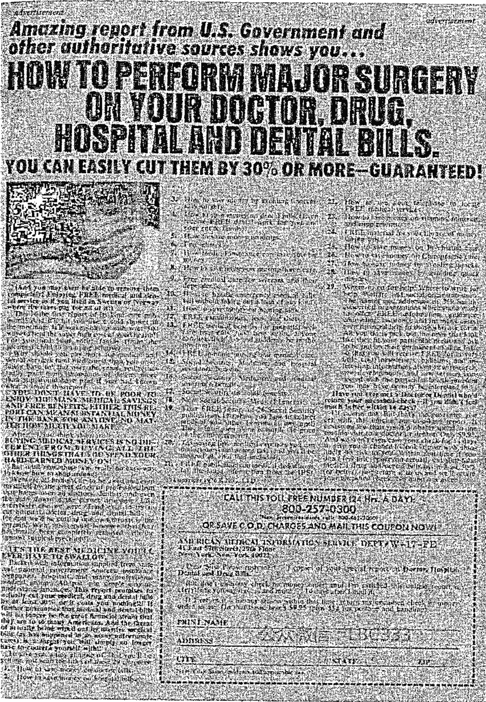

## 美国政府以及其他权威来源的惊人报告，将告诉你.....

## 如何在医疗费，住院费，医药费看牙费上省大钱

## 你可以轻松地节省 30%，甚至更多——保证！

（你甚至能够不用支付任何费用——享受免费医疗以及看牙服务，就好像住在医药费全部由国家税收支出的瑞典，或挪威一样！）

这样的报告，有史以来还是第一次被发表！它一定会让你精神为之一振。它包含了超过 500 种大幅削减高昂的医疗成本的方法！对你还有你的家人（从最小的孩子，到老人）都适用！

为什么要支付比实际所需更多的医疗费，牙科服务费（以及医药费呢）！但是，如果你了解了这封报告中的内容，你就会知道，这些年来，你支付的费用，已经比你实际需要支付的费用高出了很多。

你不一定非得是穷人才能享受许多医疗优惠和免费好处。这份报告能为任何人节省大量费用，不论你现在赚多少钱。

毕竟，你想想：用你辛苦赚来的钱购买医疗服务，与购买其他东西其实没有任何区别！

但是直到现在，也没有什么简单的方法，能让我们货比三家！

我们从小就对专业医生，牙医，甚至在街角药店的老板都心存敬畏，甚至觉得他们特别神秘。和其他一样，我们连试着削减一点医疗费，医药费，住院费，以及牙医服务费都不敢……因为我们害怕讨价还价会影响我们的治疗！然而，有了这个报告，你的这种担心将被完全消除！

这是你要服用的最好的药。

这本报告中都是来自国家、政府、保险公司、医院以及许多专业医疗集团提供的信息。所有内容通俗易懂。这封报告承诺将为你削减医疗费，药品费和看牙费至少 30%，有的甚至不需要任何费用！！！它还进一步保证,医疗费和看牙费，将不会像现在一样，给这么多人带来巨大的挤压力。而且，因为高昂的医疗费用，而无法得到及时治疗的惨剧（多人都遭遇了这种不幸），永远不会发生在你的身上！

为了让你初步了解你将会得到什么，我们列出了这封报告 29 章的标

1. 如何节省诊疗费
2. 如何节省住院费
3. 如何通过避免不必要的手术节省费用
4. 如何节省看牙费（甚至请医生为你，还有你的家人免费看牙）
5. 如何节省医药费
6. 免费就诊
7. 如何利用 医疗保险为你节省很多钱
8. 如何节省在疗养院护理的费用
9. 退伍军人及其家属享受免费医疗
10. 如何处理紧急医疗费用。(所有没有采取任何形式的贷款)。
11. 如何节省助听器的费用
12. 免费体检，化验，打针
13. 潜在福利受惠人的免费医疗福利。（再说一次，任何人都有可能突然失去工作，突然需要福利支持）
14. 免费家庭护理和医疗服务
15. 社会保障、医疗保险和住院保险
16. 社会保障、医疗保险和住院保险
17. 社会保障伤残抚恤
18. 新社保医疗福利
19. 26 本免费社保出版物。(向你展示如何在任何年龄段都能享受医疗优惠，以及其他好处！) 仅这些信息，就值整个报告的价格！
20. 节税技巧，你可以在收入所得税中抵扣的医疗费用（范围之广，一定会令你感到十分惊讶）
21. 关于医疗减免的免费出版物。(全部来自美国国税局的最新信息)
22. 如何通过电话定位免费医疗服务
23. 如何节省维生素、矿物质、和补剂的费用
24. 免费医疗的一些窍门。
25. 如何节省精神病护理费用
26. 如何节省按摩费用
27. 如何通过巧妙分辨庸医，节省费用
28. 如何通过避免使用不必要的器械治疗，而节省费用
29. 去哪里寻求帮助。写信到哪里求助。福利和社会组织。359 个医疗健康组织的名称和地址。这些组织随时会为你提供免费的信息，指导，咨询，和援助。

（在许多情况下）甚至会为有需求的人提供金融帮助。你要做的是，找出那些看起来符合你特殊需求的组织，然后，让他们把你加入他们的邮件列表中：这样你就能收到他们的免费（或者价格非常低廉）的简报、公告，以及你可能感兴趣的有关具体健康问题的最新研究成果，发展成果，最新服务的有益信息。

你有没有遇到一个，如果你在 14 天内没有感觉变好，就会为你退款的医生或牙医？

当然不会有。但是，有了这个独一无二的报告，你就能得到那样的保证。它的成本，可能还没有你去看一次医生或牙医的费用高。只要 9.95 美元。我们甚至在 14 天内，不会扣取你的费用，以便你零风险查验。在这 14 天内，如果你觉得这个报告并不能将你的医疗费、药品费或看牙费至少减少 30%（甚至更多），你可以把它退还给我们，我们会为你退回未兑现的支票。不问任何问题。

© 版权 1976 K.N.G. LTD.

## 请拨打免费电话（24 小时服务）

800-257-0300

（新泽西州居民请拨打：800-462-2000）
或选择货到付款，立刻邮寄下面优惠券！

## 美国医学信息服务部门# W-17-FE

41 东第 57 街，第 29 层 纽约 10022

亲爱的先生：请立即为我邮寄（）份有关医疗费、住院费、看牙费和药物费的特别报告。

但直到我认为这份报告和你说的一样好……甚至更好……否则，14 天内不要扣取我的费用。

如果我退回这份报告——不管是什么原因，请立即退还我没有兑现的支票或汇票。在此基础上，我寄给你 9.95 美元（加上 55 美分邮费和处理费）。

姓名 ________________________

地址 ________________________

城市 ___________ 州 ___________ 邮编 ___________

纽约市居民，请增加适当的销售税

## 笔记

## 23、印钞机

## THE MACHINE THAT PRINTS MONEY.

advertisement

One of the first things I learned as a boy was "You don't get something for nothing." Today I know a system where you do. I'm in a different because I make a living hand out of this thing almost everybody virtually ignores me

## WHO IS MIKE WARREN?

America's premier handscapper Mike Warren is well on his way to becoming a self-made millionaire at 31 because he picks ...

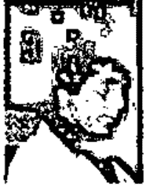

advertisement

## Sworn statement...

CLIP & MAIL TODAY FREE EXAMINATION OFFER
Mike Warren
The Baltimore Bulletin, Inc.
380 Madison Ave.
New York, N.Y. 10017

C. Bellow

## 印钞机

孩童时代，我学会的第一个道理就是：“不劳而获是不可能的。”

现在，我知道这个道理是错的！

我之所以这么说，是因为，我手里有个百美元钞系统——一个能印钱的机器！

我说的不是恶作剧，魔术表演，或一文不值的东西。这个方法也不是“想让你的朋友感到惊讶的”花招噱头。我说的是一个奇妙的新技术的投资——再投资的方法——你投资的钱能够从很少的数目增加到数千美元。

现在，你对我说感兴趣了吗？

好。因为我的方法和大多数人觉得反感的东西有关……是的，有些人甚至嘲笑它！人们对它的态度十分鲜明——要么支持，要么反对——所以，你听到以后，反应应该也会十分强烈。

它就是赛马！

我知道……我也听说有关赛马的一些言论。“你赌马不会获胜的。”，“那个傻瓜估计因为赌马，快要倾家荡产了。”，“与命运赌博，你会付出代价。”，“我有一个叔叔，因为赌马，失去了一些……”

我不想与任何人争论。如果一个人一心想自毁前程，他只要找个方法。酒、女人、高利贷、赌博、甚至毒品。不论你做什么或说什么，都无法改变结果。而那个陷入困境的人用来自甘堕落的方法，都不是问题。

多年来，赛马已经成为了很多人都会选择的一个方法。所有人都知道，赛马，要么会让人倾家荡产，要么会让人钵满盆盈，这是一项帝王的运动。最近，我和一个非常可靠的人聊天，他告诉我：“如果说赛马是帝王的运动，但是我在那里从来没有见过任何帝王！”

再说一次，我不想与任何人争论。因为我了解我说的东西。我知道，用我的秘诀，严格地遵循我的方法，就能让一个有一些钱来投资的人，赚到一笔非常可观的财富。这个我要详细说说！

我的秘诀很简单。如此简单，事实上，我相信一些所谓的赛车“专家”甚至都不加以尝试，就会嘲笑我的方法。毕竟，这是人类的本性。但实际上，我并不感到难过……为什么要难过？我有他们所没有的…没有一个人拥有。一台几乎可以印钱的机器的秘密！

我把我的秘诀称为“百元美钞系统”。如果你从未玩过赛马（事实上，如果你甚至都没去过赛马场！），那么这个挑选赢家，用2美元的赌注，赢回10美元、20美元、甚至50美元的常识性方法，一定会简单到令你大吃一惊。

我的这个系统包括4个简单的规则……4个你在家花短短一个小时，就可以读完并记住的规则。其中一个规则——4号规则——如此基本，你可以在任何赛场赢得比赛，赚大钱，就好像你已经是一个有20年经验的赛道专家！

当然，如果你经常赌马，“百元美钞系统”对你甚至会有更大的吸引力。有多少次，你在一个赛道上花了几个小时，观察了每个细节，计算了每个角度……却发现你以为会失败的马——因为你甚至记不住的一些原因——轻而易举地获胜了？（赢家赢了高达60美元！）或者，你姐夫说得天花乱坠，说某匹你知道的马会赢，结果它真赢了！

我不是来这里改变任何人的想法，或重新揭开任何人的旧伤口的。我在这里要做的就是，告诉你一个方法，一个简单至极的方法……一个能为你赚到很多钱……让你后悔没早遇到的神奇方法。

那么，这么久以来，“百元美钞系统”都在哪里呢？答案：在我的脑海里。我的 一生都在赛马场，有的时候赚钱多，有得时候赚钱少。 多年来，我变得越来越擅长我的工作：在赛马中赢钱。（去年，赛马让我赚了500000美元——是的，一半百万美元——我只有33岁！）

一天晚上，我无聊地看着电视，随手拿来一张纸，在上面写下了我认为在赛马时，至关重要的一些事情。你相信吗？我只想出了 4 件事——而且，都十分简单，12 岁的孩子，在 60 分钟内都能掌握！

就这样，“百元美钞系统”诞生了。那时候，我就决定，把这个系统告诉那些任何“想赢”的人——非常想出人头地的人。

你只需要少量资金——低至 20 美元——以及一点耐心。剩下的交给“百元美钞系统”。只要严格遵循这 4 个小规则（严格！），就能赚到大多数人做梦也想不到的大钱！

为什么，因为就在前几天，贝尔蒙特的一位朋友找到我，问我看好哪匹马。我在赛场上通常不提供建议，但是这个选手看上去真的好疲愈。

所以，我告诉他，我喜欢一匹名叫黑泉的马。他沉思了一会儿，然后说：“不可能。我最看好嘻姆比，它有很大优势，我想我会压它。不管怎样，谢谢你。”

长话短说，黑泉把第二名甩出很远，轻松夺冠。而嘻姆比的成绩，却连平均值都不到。黑泉为压它的人赢得了 24.40 美元，我的朋友跑过来告诉我，他永远不会再怀疑我了。确实是这样。有了“百元美钞系统”，他再也不需要任何建议，而且赚到了很多钱。

我意识到，世界充满怀疑，所以，我给出了这样的提议。你只要支付 9.95 美元，就能获得“百元美钞系统”，你可以在当地赛道上体验这个方法 15 天，确保严格遵守我的方法。去赢得你想要的——带着我的祝福！

最棒的是，如果你觉得我的方法不适合你，不像我说得这么神奇，你不用承担任何风险……因为，我会把你的原始支票寄还给你——未兑现的支票！（你只要把支票兑现日期推迟 1 个月。这样，在你验证这个方法有效性的期间，没有人可以兑现你的 10 美元。）

没有比这更公平的了吧？

你应该给自己一次机会，试一试这个“能印出钞票的机器”。我是迈克·沃伦……我在赛马界非常有名……这一点我可以很自豪地说。

立刻行动吧。否则，你会错过一个绝佳机会。

## 宣誓声明……

兹证明，所有本广告中的陈述都是真实有效的，是我这些年经验中的精华。迈克·沃伦是一位纯血马的专业裁判人员，在过去的 12 个月中，他的总收入超过 500000 美元。

## 谁是迈克·沃伦？

迈克·沃伦是美国首屈一指的裁判员。他白手起家，到 33 岁时，已经成了百万富翁……因为他在短到不可思议的时间内，赚到如此多的钱。所以，他的粉丝说……

> “你太棒了！！！绝对是最棒的！！！在大渡槽星期六，你给我选的赛马，全部赢得了比赛，我赢了很多钱。非常感谢……”——N.P., Los Angeles, Calif.

> “我必须告诉你……太神奇了。你推荐我的 2 匹马都赢了。第一匹，我赢了 35.40 美元……第二匹赢了 10.20 美元……打了一场漂亮的胜仗。”——E.A.S., Chicago, Illinois

## 立刻剪下该优惠券&邮寄吧

## 免费查验提议

## 迈克·沃伦

巴尔的摩公告公司 380 麦迪逊大道 纽约 10017 L-CR-2

亲爱的迈克：

好，我将尝试你的系统。请在回邮件时寄给我一份“百元美钞系统”。我明白，如果你的方法没有像你说的那样，帮我赚一大笔钱，我只要在一个月之内退还，你就会给我全额退款。

在此基础上，我寄给你 9.95 美元，兑现日期是一个月后。（如果你寄的是现金之类的，也同样享有退款保证）。

- 选用一级邮寄，请增加 50 美分（可以是现金，也可以是支票）

姓名________________

地址________________

城市________________

州________________ 邮编________________

支票抬头请写 “巴尔的摩公告”

## 笔记

## 24、 “送我一个爱阅读的人！”

## "Send me a man who reads!"

Do you read as much now as you did when you first got out of school? International Paper has conducted a study that compares the reading habits of young interns with very successful doctors. This is what we found.

We asked 100 interns at leading hospitals how many hours they spent reading magazines and newspapers during the previous week. Here are the averages: newspapers, 3-5 hours; medical journals and general interest magazines, 4.9 hours.

An identical survey taken among 100 top ranking doctors—Fellows of the American College of Physicians—revealed these averages: newspapers, 4.1 hour; medical journals and general magazines, 4.9 hours. The implication is as clear as print:

Great doctors keep on reading.

New reports of every kind are constantly coming off the press. This information has to be studied. One day it may save a life.

But doctors read beyond their specialty. They actually spend more total time than interns do reading general magazines, medical journals and newspapers.

Americans are relearning the importance of reading. Not only for business or profession but also for personal enjoyment.

The significant ideas, events and personalities of history await you on the printed page. You become a contemporary of greatness. You meet Shakespeare face to face.

## Do you have a library card?

If not, you're missing the biggest bargain in town: books.

Browse in quiet. Your choice is limitless. A two-volume biography is as free as a slim book of verse.

Here is another benefit. If you have had trouble finding good books, you can tell the librarian the names of some works you've enjoyed in the past. She will be able to find books of comparable quality.

Free Reprints. Write Box 5, Education Depart., International Paper, 220 East 42nd St., New York 17, N. Y., for free reprints of this advertisement

© International Paper Company 1941

## INTERNATIONAL PAPER

Manufacturers of papers for magazines, books, newspapers · papers for home and office use · converting papers · papers and paperboards for packaging · labels · folding cartons · milk containers · shipping containers · multiwall bags · grocery and specialty bags and sacks · pulps for industry · lumber, plywood and building materials

## “送我一个爱阅读的人！”

现在，你还和刚毕业的时候，读书一样多吗？国际报对年轻的实习生，和成功的医生的阅读习惯进行了一项研究。我们发现：

我们询问几家著名医院的 100 名实习生，他们上周花了多少时间阅读杂志和报纸。下面是我们得出的平均值：阅读报纸，3—5 小时；阅读医学期刊杂志，以及一般杂志，4—9 个小时。

我们又对国内 100 名一流的医生进行了同样的调查—美国医科大学研究员—我们得出的平均值为：阅读报纸，4.1 小时；阅读医学期刊，以及一般杂志，4.9 小时。结果不言而喻：

优秀的医生一直保持着阅读习惯。

刊物上各种新报告层出不穷。这些信息你必须明白。有**一天，它可能会挽救你的生命。**

而且，医生的阅读范围不仅限于他们的专业。他们花在一般杂志、医学期刊和报纸上总的阅读时间，实际上比实习生花的时间都长。

美国人再次了解了阅读的重要性。不仅为了业务，为了专业研究，还为个人娱乐。

历史上的重要思想、历史事件和人物都等待着你去了解。你能亲自了解历史，能与莎士比亚面对面交谈。

## 你有借书卡吗？

如果没有，你就错过了最划算的阅读方式：书籍。

在安静的环境中，阅读书籍。你的选择无边无尽。不论是传记，还是诗集，你都能免费阅读。

现在，还有一个好处。如果你找书不方便，你可以告诉图书管理员你要找的书籍的名字，以及你以前喜欢阅读的一些书籍。她就能为你找到类似书籍。

## 免费索取此广告复印件：

写信至纽约市 17 号 220 东 42 路国际报，教育部门，5 信箱。

©国际报公司 1961

## 国际报

杂志，书籍，报纸・家庭，办公室用纸・纸和包装纸板・标签・折叠纸盒・牛奶容器・集装箱・多层袋。杂货和特殊袋，普通纸袋・工业纸浆・木材・胶合板和建筑材料等的制造商

## 笔记

## 25、慷慨的，具有创意的商人想找一位幽默、性感火辣的女人！

### Are you more than just just another pretty face?
Generous Creative Businessman Wants to Find a Hot, Sexy Woman With a Good Sense of Humor

667-2620 ... 667-2620

### 7 Things Gary Does NOT Want From A Woman!

## 慷慨的，具有创意的商人想找一位幽默、性感火辣的女人！

你是一位温柔，性感，富有激情的美女吗？是否想兼职尝试下天堂般的生活呢？如果是的话，那就请继续往下看。

我的名字叫盖瑞，我想找一位很特别的女人，她愿意和我一起利用业余时间度过美好的时光，并能参加一些小冒险（但很精彩！）活动。你是那位美女吗？也许是。也许不是。最重要的还是取决于我自己。你也知道，如果我不是你喜欢的那种类型，那你也不会接受我的生活方式。

所以，就先说我吧。我的生活方式是这样的：

首先，我是一个喜欢早起的人，通常每天 6 点起床，吃一块水果，再喝一杯咖啡。然后通常在 6:30 的时候，会围着好莱坞湖慢跑几圈。至于我会跑多长时间，那就要看我当时的心情怎么样了。

当然，一般不会超过七英里，也不会少于三英里。跑完步之后，我会开着我的车去一个被我称为“痛苦之地”的地方（其实，这个地方的标牌是“文斯健身体育馆”），在那里有一个十足的虐待狂，乔装成一位健身教练。他强迫我使用哑铃，杠铃和其他我身体无法适应的残忍设备。

不管怎样，经过一个小时的这种训练之后，再进行自己的下一项安排。我会躺在我那张防紫外线的卡其色大床上，戴上立体声耳机听听那能抚慰人心的音乐（经常听罗德·斯图尔特和几米·巴菲特的歌），以便给我那受伤且疲惫的身体得以恢复。

在音乐疗伤之后，大约是上午 9:45。我下一步要做的就是回家，冲个澡，换上件新衣服，然后吃一顿清淡的早餐。最后，在这些活动结束后，我开始去工作。

哎，天哪，我是不是以前没工作过！我实在是太爱自己这份谋生的工作，而且必须得承认，我是一个实实在在的工作狂。

比如说，现在我正在参与有关金融、促销相结合方面的 10 部故事片的制作过程。我现在还在写两本书（一本是虚构小说，一本是非虚构的）。现在正在和别人合作一个影片剧本的创作；对自己经营的两单生意，还得过问其运营的相关细节；并且还过问几家公司的运营情况和几位个体经营者的情况，他们的名字已经是家喻户晓。

这是个不小的工作量。

我不工作的时候会干什么呢？自己疯狂地跑完步，接受强烈而残酷的身体健美训练，接着对身体进行放松，进行紧张的运动，去写作，对于生意上的事情进行思考、解决问题，工作方面进行创新，操心公司情况等等。这些繁琐的事情忙完之后，对自己最大的奖励是什么呢？

什么奖励都没有！什么都不干！真是这样。什么也不做，没有任何“激情时刻”！不使用消遣药物，没有性生活，没有任何精彩的消遣生活。

我甚至都不去喝一点酒，也不愿去听那些安静的古典音乐。

为什么呢？答案很简单。你也知道，在过去的三个半月里，我一直是在不停地生着闷气度过每一天的。

我为什么一直闷闷不乐呢？这个问题问得好。和上面说的一样，答案很简单。要知道，在三个半月前，我“消磨时间”的方式真是棒极了。因为有一位漂亮，性感，特别的女性出现在我的生活当中了，我以为我们的关系会持续下去。但是，这种关系现在结束了，终结于那些愚蠢而悲剧的，疯狂的令任何人都无法能控制的原因。

呃，这就是生活。不过事情发生就发生了，生三个半月的闷气对任何一个人来说都已经足够了。现在我应该从那个生闷气的生活当中走出来，重新寻找另一位特别伴侣的时候了。

那为什么要写一则广告呢？我为什么非得要登广告来找一位女伴侣？我是不是那种身上散发出难闻的气味，有口臭的怪物呢？

不，我不是。我是一位相当帅的（也许是中等帅？）白种男人，四十多岁拥有很好的性格（除非在我生闷气的时候性格不好），敏锐机智，一双摸上去令人感觉很踏实的手，一双明亮的双眼。

我的头发很短，是很好看的棕褐色；我的胡子是修剪整齐的暗褐色络腮胡，上面还有几处零星而“有趣的”黑色。我是中等身材，不高也不矮，不胖也不瘦。我拥有非常健康的身体。我不为赚钱而发愁，可以无所顾虑地在广场右厂区找到任何一位餐厅侍者总管来为我服务。

所以，再说一次，我为什么还要非得登广告来找女伴侣呢？呃，实际上，也不是非得要找伴侣。我结过两次婚，认真的谈过几次恋爱，当然，也有一夜情和一些短期恋情。我在少数几位优秀的女性的陪伴下度过过很美好的时光，所以我想能再次拥有那样的时光。

但你知道吗？我也遇到过那些并不是那么优秀的女性。实际上，我遇到不少女人，虽然她们拥有光鲜的外表，但在她们的内心深处却是十分的懒懒不堪！

想听一些例子吗？你真的想听吗？好吧，是你要求要听的。下面这些是按情节的深浅程度依次列举的。

## 塞尔达公主：

塞尔达是一位 26 岁的犹太女人。她当时轻佻的跳动着华尔兹舞步来到我的办公室里，并立即告诉我（在我没来得及说“你好”之前）说，她要让我为她写一则广告，并且愿意跟我上床。

这真是见鬼！在一段日子里我真是一个易于被控制的人。她会得到她想要的一切，而我必须得服从她，她让我经历了一次人生中最令人感觉糟糕的事情。

不幸的是，这件事不是发生在床上。不过，在床上发生的事也同样令人感觉不幸。你知道，塞尔达眼中美好的性生活就是一种残忍的暴行。

她希望那个男人在做爱的时候用手搂着她，并且要虐待她，羞辱她，在她身上疯狂地翻来滚去。不好意思，不过这种方式不适合我。我想和一个女人做爱，而不是进行做战。

## 雪利的悲剧：

雪利是一位秘书和摇摆舞者。她拥有完美的身材和极其漂亮的脸蛋，也很幽默。不幸的是，她不管走到哪儿都是个“事儿精”。她经常会由于对自己四岁小女儿照顾的疏忽而被控告，她的前男友是一名黑手党职业杀手（这是真的），他还想继续和雪利一块儿生活，并一直都在努力地找她。

我们有一段很短暂的恋情。

## “想成为妓女”的凯伦：

她是一位umatic的女人，在我们发生恋爱关系之后，她对我说，她想过妓女的生活。然后她跟我说想让我作为她的“第一个约翰”，和她上床的话就应该付给她钱。我拒绝她之后，她决定让我做她的主人和主宰者（皮条客），她会和其他人上床让他们付给她钱，然后再把得到的钱给我。

这同样也是一段很短暂的恋情。

## 克劳迪娅，一位女演员：

她外表惊艳，路人看到都会忘记行走。我曾把她的照片用在几个整版的广告上，通过做香水促销广告。我们开始外出约会，当时所有看见我们在一起的男性都羡慕不已。

除我之外。我当时一点都不羡慕自己。克劳迪娅目光短浅到了极致。她唯一可以集中精力去做超过10秒钟的事，只是她那珍贵的职业。

她是一个死气沉沉的人。我无法让自己对她产生兴趣，甚至和她上床。

我可以继续往下说，再往下说。所有的这些例子（除了里面的名字）都是真实的。这些例子并没有被夸张，事实上，这些事情已经被淡化了！

到目前为止，我还没讲述我认为最差劲的那种女人是什么样的呢。这些女人，我认为应该是真正被诊断为疯狂的人。你想知道我怎样去描述这样的女人吗？这很简单。你要知的是那些女人身上没有任何能让我拒绝的缺点，然而又由于某种无法解释的原因，我对她们却一点都不感兴趣。

你能想象得出吗？

不管怎样，这个广告中的想法，仅仅在搜索上加入了一点小小的科学。我不想把大量的时间花在一个对我不感兴趣，或者我不感兴趣（或者更糟糕）的女人身上。

我到底想要一个什么样的女人呢？好吧，我已经有一个不错的主意，但我必须承认，这个要求是可以灵活变通的。不过，我对不想交往的女性，有一个非常明确的想法，这个要求一点也不能改变。那么让我们就从这开始吧，这些就是…

## 盖瑞不想从这个女人身上看到的 7 件事！

第一：疾病或死亡：这是我第一个要说不的事情。听着，我从没和一个同性恋男人或是一个半性人、一个做过性移植手术的人或者任何这类人发生过关系。我从未靠近过圣诞莫妮卡百老汇，我曾经停留过的唯一一个地方就是巴尼的廉价餐馆。

即使是这样，我也从没吃过里面的乳蛋饼。

换句话说，我是个直男。我不是血友病患者，从未接受过输血。我更不是瘾君子，从未因吸毒往自己身体里扎过针。我更不是爱乱交的人，不和妓女们鬼混（几年前我试过和妓女经常在一起，不过感觉那样很无聊）；我从未去过非洲和海地。

这说明什么，当然是由于我自己的好运气（祷告感谢上帝），我不携带艾滋病。同样，据我所知，我也不会患有任何其它可怕的传染性疾病，包括梅毒，淋病，疱疹，肝炎，甚至鼠疫。

如果你不能说出同样的话的话，请千万千万不要回复这个广告。

## 第二：毒品上瘾者：

你喜欢偶尔喝一点酒，或者去某个地方嗨一下，以便于你能放松自己并疯狂一下吗？你喜欢这样吗？那很好！这意味着你和我可以一起找点乐趣。

但是请…再重新读一遍第一句话。看到那里写的是“一点”和“偶尔”吗？这些词对我来说很重要。但是，如果在你认为的“一点”和“偶尔”是指喝酒喝醉或者每天都这样，喜欢吸用或是注射可卡因，大把大把地吞食安定和安眠酮，并且不论你以哪种方式使用苯环呋哌啶或海洛因，塑形或怎样，那么我必须再次告诉你请不要回复这个广告。

## 第三：处于一种绝望的状态：

你是不是现在睡在自己的车里，因为你的租金已经超过半年没支付了？你的前夫是一个正在查找你的下落的执斧杀人犯，并且发誓要杀掉对你十分照顾的任何一个男人的人吗？你现在是否是急需钱，要给你那可怜而年迈的母亲进行肾脏移植手术，不然你的母亲就无法活下去吗？

很抱歉，我就是我。我只是一个再平常不过的好男人。我并没有超能力，更不是著名的商人李·艾克卡。对不幸处境的人我表示很同情也很理解，但是最近我已经退出了试图拯救世界的岗位。

所以，我没达到拯救你生命的资格。无论怎样，如果你允许的话，我或许可以在下面的叙述中增加点令人兴奋和充满浪漫气息的事。

## 第四：婚姻：

我结过两次婚，每一次都破坏了伟大的浪漫。我不想再结婚了，我也不想和你住在一起。你要知道，现在的我，不想再占有一個女人，我只是想尽情享受和她在一起的快乐。

如果你已经有自己的生活，并决定回复这个广告，那你很善良。我不想成为你的一切，我更愿意做那个能和你一星期见两、三次面，并能使你感觉良好的那个特别的人。

那样可以吗？

## 第五：我不想要一个喜欢乱搞男女关系的女人：

你晚上是不是会在A型房屋里参加放荡的狂欢？你是否是巴拉图会所终生的会员？你是不是拒绝称自己为妓女，即使自己在和每个男人上床之前都会收他们服务费？你是不是对自己的内裤有时间厌恶期，对购买胸罩会进行计录？

很抱歉，我们不可能在一起。

你要知道，即使我结过婚，四处走动，但是如果以南加利福尼亚那个地方的标准，我感觉自己仍然可以算是一个处男。比方说，一个人最近告诉我说，休·海福奈尔曾经和 3000 多个女人上过床。

这可能真的是吗？我不知道，但是如果这是真的的话，我个人认为这个男人应该令人怜悯而不应受到羡慕。不管怎样，我会重视质量胜过数量。

第六，我不愿意和一个在性方面故作矜持的女人在一起：你可能会想，我现在正处于某种压抑状态，是不是？你可能会想我那悸动不止的性欲已超越了我的生殖器官。

你可能还会认为如果你和凯莉·勒布洛克一起站在我门前，手里拿着一个装满从 TrashyLingerie（这家店位于 402N. La Cienga，他们销售城镇里面最性感的内衣。）里买来的令人看后就充满兴奋的内衣的手提箱，并且建议我们来个三角恋。我会扯着你们两个人的耳朵把你们两个人通通扔出去，然后再把你们交给杰里·法威尔。

你错了。你错了。你错了。你错了。

不用担心，我可能比较谨慎，但我并没有疯掉。

你们听我说，听着，就因为我不吸毒，在生活方面不够放荡，不和别人滥交，并不意味着我的欲望就彻底消失了。我不想和一个，不论在什么时候都穿着长裤睡觉的女人在一起，这也是事实。不过在另一方面，如果你是一个 35 岁的处女，认为性交前的爱抚，需要经历 112 小时的身体接触，并且认为“口交”时就像朋克乐队那样令人恶心的话，那么这些你就尽管放心好了，这种现象我也不会喜欢。

## 第七：我不能和一个不能忍受富有的女人一起：不要笑，我失去了我一生的挚爱，就是因为我周围的一切事情都“太美好”了。有些人就容易陷入纠结中，而不是感觉受到了奖赏。

我陷入了这两种境地。你也已经知道，我喜欢工作，但是没有回报的工作是没有意义的。很多女人（还有男人）的生活中仍然充斥着那些无休止的创伤和痛苦。我不这样。我想要在经受痛苦的时候能有所回报。

因此……

> “如果你只想要坏结果而不想要好的，请不要浪费你的时间来回复这则广告！”

天呐，这是老生常谈，是不是？

好吧，总之，这就是我不想从一个女人身上看到的清单，其实是自己面对这些事情不知道怎样处理。现在轮到最艰难的部分了。当我说自己很想得到什么的时候，自己真的感觉很尴尬。我担心如果描述的太 precision 的话，这会让人看起来我是一个正在从中文菜单上点东西，并且反应迟钝的点餐者。

另一方面，如果我没有定下一些准则的话，我担心会收到很多自己无法容忍的女人的来信。

所以，请给我一次制定准则的机会。尽管这些内容是要出版的，但我并不是非得要求你们必须完全符合这所有要求。请记着，下面的内容并非是像蚀刻在石头上的文字那样，没有任何可以更改的余地。

不管怎样，下面我们就开始吧。我心中的完美女性是那种健康，充满智慧，富有幽默感，并且当我看到她身穿细带比基尼的时候，会令我无法呼吸的女人。

对于年龄而言，如果你年龄在 25 到 35 岁之间，这样就挺好。如果你年龄稍微大一点或者稍微小一点，那也没太大关系。

我喜欢会照顾自己的女人。如果你拥有苗条健康的身段，纤细的腰围，相当丰满的胸部（天呐，这听起来就让人很兴奋，不是吗？），一张相当漂亮的脸蛋，还有很好的幽默感，那么坦白地说，对于我来说，你就是天女下凡般一样完美了。

就这么多的要求了。

如果现在读完上面所有的内容之后，你仍然很感兴趣的话，你想从我身上得到什么呢？那么，这篇广告标题的第一个单词就是“慷慨”，我仅仅是如此。然而慷慨并不意味着“容易受骗”。也不意味着我想为做爱付费。这很可笑，在洛杉矶任何一个男人想付钱上床的话，是不需要写广告的，他需要做的只是回复一个广告就可以，那种广告随处可见，甚至在黄色网站上都能看到。

这就是我原来所说的慷慨的概念。我喜欢给女人买礼物，喜欢带她们去看电影和戏剧；我喜欢送女人花，给女人买首饰和衣服，如果我真的陷入和一个女人的恋爱当中，我会很享受去帮助她的过程，并且很乐意去帮助她提升她自己的生活方式。

另外，我有充足的假期。我喜欢利用长周末去旅游（大约四天），去阿卡普尔科、夏威夷、劳德代尔堡、巴哈马群岛等等。乘坐飞机我只坐头等舱，我总是设法去住最豪华的酒店，在最高档的餐厅里就餐。

所有这些对你来说是不是很美好呢？我希望如此。这是一则诚实的广告，广告里面的每一个词都是真实的，尽管在描述的过程中，我适度尝试着让广告内容读起来更有意思，不过你要知道我当时是以一种很真诚的态度来写这则广告的。

你是否对回复一则私人广告心存疑虑？如果是这样，我不会怪你，我遇见这种请况也会有疑虑。在我决定写这则广告之前，我开始看其他人的“个人广告”，那些广告真是把我给吓坏了。我一直都在担心那些写个人广告的人是不是都是些性病患者，或是些彻底的失败者，又或者是一些相当危险的人在刊登那些广告。

我的意思是，你读过这类广告吗？这些广告通常是这样的：

“一位精神病患者白种女性想在丈夫满口流口水的观看下，被12个古巴卡车司机鸡奸，被一个蟒蛇兽奸。请拨打1-800-SICKY！ ”

或者是像这样：

“一位思想前卫，年纪为 96 岁的老太太，想和一位不抽烟的素食者讨论如何拯救鲸鱼，和怎样解决其它的生态问题。”

或者：

“体重 590 英镑的肥胖女性，寻一名能够照顾她和她 18 个可爱孩子，真诚、富有爱心的男士。”

等等。

我和那些发布广告的人不一样，真的，我保证和他们不一样。我是一个相当正常而且健康的男性，只是想和一位相当正常且健康的女性一起，能够共同给生活增添一点乐趣和浪漫气息。

如果你对所有这些都很感兴趣，或者只是对这些感到好奇，请写信给我，描述一下你自己，并注明怎样能联系到你。同样，也请邮寄一张你的近期全身照。

谁会知道呢，也许我们俩可以很合得来，并且一见如故，也许不会。但是至少你不会是在给某个精神病患者回信。也有可能，仅仅是可能，结果会很好。

来信请寄：

盖瑞，208 信箱，8033 日落大街，90046，洛杉矶

谢谢你的支持。

## 笔记

## 26、怎么变得比狐狸还聪明！

### HOW TO OUT FOX THE FOXES!

263 Secrets The Law And Lawyers Don't Want You To Know!

## 怎么变得比狐狸还聪明！

法律和律师不想让你知道的 263 个秘密！

- 律师是如何和你漫天要价的，以及如何避免......
- 避免被起诉的 5 个法律方法......
- 如何免费获取证词......
- 律师故意漏掉的 2 个条款，以便他们日后起诉......
- 能减少律师费的 6 个方法......
- 可以阻止政府诉讼的有效的方法......
- 如何让保险公司为你支付法律费用......
- 如何判断何时需要律师......
- 能够应付任何商业诉讼的一个有效方法......
- 获得好的法律援助的成本最低的方法......
- 如何通过伪证罪指控来阻止行政诉讼......
- 使用邮政法律阻止诉讼......
- 星期五和刑事诉讼的意义......
- 法律陪审团幕后操纵，及其操纵方法......
- 关于合同，你应该知道的，附有案例......
- 如何利用律师谈判，为你解决问题......
- 3 个打败讨债人的街头智慧......
- 如何避免政府机构拖欠费用......
- 这些做法会让你的合同无法被理解......

+   - 如何摆脱国税局联邦税收留置权通知.....
- 如何在破产后第 2 天成功申请信贷.....
- 等等，等等！

## 其中哪个方法能大幅削减你的律师费？

在《怎么变得比狐狸还聪明》中，你将学到 20 种降低法律费用的方法。比如，你将学会如何白纸黑字向你的律师证明，他收费过高了！（经过长期调查显示，大多数律师收费都过高。下面的方法将告诉你如何永远结束这种局面！）

## 如何废除高昂的预付费用！

律师喜欢预付费用，这已经不是秘密了。这些预付款，一定让你感到头疼。但是，现在你将学到一些能在几乎所有情况下，消除那些令人头疼的预付款的方法！在这章中，你还将学会在雇用“狐狸之前”的 3 个重要的问题。

## 判断你的律师是否出色的 2 个独特方法

不要再想着向另外的律师或朋友寻求建议了。他们也不会知道！本书中的 2 个独特的方法，以及雇用本地最好的律师的方法，一定会让你感到吃惊！

## 如何阻止控诉！

你将学会如何阻止控诉，甚至在这些控诉发起之前，成功阻止！你将发现已经证明有效的神奇方法，来阻止监管机构对你发起控诉！

比如，如果监管机构 A 和你产生了冲突，你可以去律师事务所最繁忙，人最多的办公室。在那里雇用律师，并把案件交给他。如果这件案件正常进行，你至少可以极大地缓解冲突，极大地减少诉讼对你的企业的影响！

## 如何摆脱致命的律师！

企业最大的障碍已经不再是政府了，而是律师。很简单，这些人经常把很多事情搞得一团糟，而且耗费了更多人更多的时间和金钱，远远不是这几页纸能描述得清的。

这就是为什么我们为你提供这14个单独的方法，让你充分利用律师。致命的律师将成为过去！你会发现你突然拥有了很多支箭，将这些鸟儿一只只都射下来。

## 如何免受任何债权人的干扰

在这个问题上，不要被那些承诺可以保护你的资产的人误导。下面是一个内容完整的报告，它将告诉你如何正确地保护自己免受任何债权人的干扰——即使对方已经提起诉讼，即使判决对你不利！

为什么要支付昂贵的医疗事故保险？为什么为担心债权人或潜在诉讼而失眠？本书将在一小时内教会你那些大人物，以及精明的投资者保护自己的方法。美国最富有的家庭为了这个秘密的方法，都会支付数十万美元。现在，你只要支付本书的成本，就能得到它！

用这个惊人的方法，你可以永远摆脱债权人和诉讼者了！你将学会如何使用它，或者什么样的律师最好，以及如何将成本压到最低。

## 如何神不知鬼不觉地提出破产！

你将学会申请破产的明智方法。是的，你可以在申请后的下一个工作日顺利拿到现金，并控制或使用你的大部分资产！

这是游戏的玩法。《怎么变得比狐狸还聪明》将告诉你具体怎么玩！

你将学会什么时候申请，以及为什么现在申请破产就和毕雷(Perrier)矿泉水一样受欢迎。此外，你将学会怎么让少之又少的朋友，或同事，知道破产的事情。

## 为什么在内华达州合并是明智的选择！

在内华达州，公司合并主要有4个原因。包括税收，负债，资产保

护以及降低成本。

你将会看到如何在内华达州实现公司合并的详细步骤——不管你现在在哪里。你将学会最简单的方法，包括必要的电话号码列表。你会得到开始公司合并所需要的一切东西，包括如何利用税收政策，以及该州提供的匡扶政策。

这些方法有多好？你只要花几秒钟快速查看我们的地址，你就能看到我们用的这些方法。让幸运的人利用州所提供的便利条件，以及体制漏洞，大干一场吧。除了拥有庞大的企业优势以外，还不用缴收入所得税。另外，内华达州是唯一不与美国国税局交换数据的地方。内华达万岁！

## 减免所得税的终极合法手段！

阅读短短 20 分钟，你将学会如何消除所有所得税。这样下来，一年能节省多少钱呢？如果你正在阅读这个广告，你很可能会节省 5000 美元或更多！

由于严格缜密的国税局法规，税收漏洞几乎是过去的事了。但仍有一个明显的漏洞，他们现在还没有改。事实上，他们是无法改！你可以将它当成你的优势！

很多人为了这套避税系统，支付了数千美元，但是，现在，你将用不到 150 元的成本学会如何亲自建立这套系统。你将学会如何注销乡村俱乐部会员，甚至包括如何设置孩子的教育基金系统，从而节省大部分资金。

## 成本还不到咨询律师 15 分钟的费用！

如果你必须学习本手册记载的许多秘诀和方法，它将耗费你数千美元。现在，你有机会只需 50 美元的成本就能学会，不到 “好” 律师 15 分钟的咨询费。

我们保证你不仅会被本手册的有效建议而震惊，而且还会让你超出

想象的满意。这个产品远比它的广告中说的好。

## 100%退款保证！

我们对这本书的优点十分自信，所以，我们提供 100%退款保证。也就是说，如果你不是完全满意，不论任何理由，或没有理由，你都可以获得全额退款（没有任何花招，也不扣取任何费用）——你只要提出请求，就能快速获得全额退款。

你可以立刻放心订购，让这些信息宝库为你服务。今天打电话，我们会立刻为你寄出手册。

## CTI 出版有限公司

2533 卡森城 130 部门 卡森城，内华达州

是的，我想学习如何变得比狐狸都聪明，用律师自己的方法打败他们。请立即给我寄__份《如何变得比狐狸还聪明》，我明白，如果我不是十分满意，我将随时退回这本手册，并得到全额退款。

我已经附上了 49.95 美元，外加 2.95 美元的运费和手续费（内华达州居民请增加 3 美元的销售税）。

□支票或汇票内附（支票由泰尔信用验证）

## 信用卡支付免费热线
1-800-748-5843，分机号 130

通过信用卡支付  □维萨卡      □万事达卡

卡号________________________ 有效期________

姓名________________________________________

地址________________________________________ _________

城市________________________________________

州________________________ 邮编________

## 笔记

## 27、你是否想过，当你拥有“一笑千金”的笑容时，会怎样？

## Have You Ever Wondered What You Would Look Like With A "Million Dollar Smile"?

About Dr. Thomas Gileg...

现在，你不用花一分钱，就能得到它了！

## 你是否想过

## 当你拥有 "一笑千金" 的笑容时

## 会怎样？

你知道吗？你的笑容的质量，比其他外表特征，更能直接影响你的人际关系（以及商业关系）。

事实上，北美 88% 的人都说，他们总是对有特别迷人的微笑的人印象深刻。不仅如此，75% 的人都认为，没有吸引力的微笑，会严重影响一个 人赚大钱的机会。也许，这就是为什么美国超过一半的成年人都希望改变自己的笑容。一些人想纠正他们从小开始存在的问题，比如牙齿发黄，不整齐等。还有一些人，想修复时间给牙齿带来的一些问题，比如，牙齿裂缝、受损，龅齿等。这么做，有一个很好的理由，因为…

## 你的笑容能让你成功，也能让你失败！

几百年来，从《蒙娜丽莎》到今天的封面女郎，是否有灿烂的微笑，通常都有着重要的意义。笑容，是一个人幸福感的外在反应，对一个人的健康、自尊…以及…人际关系和商业关系有着重大影响。

下面我们来看一个鲜为人知的事实：参与微笑的面部肌肉和大脑直接相连。因此，每次你微笑的时候，大脑就会释放一种能让你拥有好心情的化学物质。不仅如此，这些化学物质还会通过你的血液，到达你身体的每一个器官，给你带来幸福的感觉。因此…..

微笑的同时没有使自己的情绪变好，这不可能！

而且，微笑还能使别人的心情变好。它能让你更吸引人，让人们更喜欢你。更渴望与你做生意。更愿意在你需要帮忙的时候，帮助你。

所以，既然微笑这么重要，为什么更多的人没有微笑……为什么他们更多地展示自己的微笑呢？

答案很简单：他们对自己的牙齿感到羞愧！

人们不喜欢自己的牙齿外观，原因有很多：例如，有些人的牙齿太小或太歪。有些人的牙缝太大，或有虫牙。有些人的牙齿有污渍，变色。有些人的牙齿有龋齿，断裂。还有些人的牙齿不整齐。而且，几乎所有人都希望他们的牙齿变得更白！

这是坏消息。好消息是，每个问题，技术熟练的整形牙医只需要 2 次，就可以为你纠正。当然，并不是所有的牙医可以做到这一点。事实上，绝大多数的牙医的专业领域都在牙科的其他方面，比如，牙齿矫正，安装假牙，植牙等等。

然而，如果你仔细寻找（你知道你需要什么），你就可以找到一个能熟练，快速地为你解决上述问题的牙医……平均只需要 2 次，最终你会拥有灿烂的微笑。此外，达拉斯 / 沃思堡至少有一位这样的专业牙科医生。

稍后，我们会讲到这位特别的牙医。但首先，让我们来谈谈人们对牙齿最常见的担忧…就是…他们的牙齿有多白……或者更确切地说，是他们的牙齿是不是有点黄。你知道珠宝商怎么评估钻石吗？他们通过钻石的切面、净度和颜色（越白越好）来判断…他会把真钻石和一组有颜色标号的假钻石对比，看那种色度的假钻石和这颗真钻石的色度最相近。

牙医也一样。几乎每个牙医都有一组假牙（通常有 16 颗不同色度的牙齿），他可以用这些假牙来匹配你的牙齿颜色，看看你的牙齿和他手中的哪个“阴影等级”相配。

下面是牙医手中假牙的 16 个“阴影等级”……以及，我对每个阴影等级的牙齿的描述。现在，你需要记住：我不是牙医，所以，你看到的是，这些不同等级的牙齿，在我眼中的样子。我将制作一张小表格，向你展示从最差的 1 级到最好的 16 级不同牙齿的样子。我们开始吧：

| 等级 | 牙齿编码 | 我的描述 |
|---|---|---|
| 1 | C4 | 暗棕色。看起来像用尼古丁和泥浆制成的牙膏刷过一样。 |
| 2 | A4 | 几乎和 C4 一样糟糕。看起来像是用含尼古丁稍微少一点的牙膏刷过一样。 |
| 3 | B4 | 稍微好点了。可能这个人用的牙膏中含有的尼古丁更少了……含有的泥巴也少一点。 |
| 4 | D4 | 有一小块白色部分。但是，总体来说仍然是棕色的。但看起来可能是用廉价牙膏刷过。 |
| 5 | A3.5 | “3.5”级的怎么样？可能是我的眼睛的原因，我看起来上一级（D4）看起来可能比这个更好。至少我看起来是这样。谁知道呢？我一直认为牙医有点奇怪。 |
| 6 | C3 | 看起来和前面的差别很小。也许牙医在为你检查牙齿时，会使用特殊的照明灯，但是，在台灯灯光下，我觉得 D4 看起来更好。嘿，这是一个自由的国家，这仅仅是我的看法。 |
| 7 | D3 | 哈，这个等级的牙齿看起来就不错了。虽然看起来仍有一点点棕色，但是变色不是很明显。 |
| 8 | B3 | 16 个等级中最中间的一个等级。我敢打赌，拥有 B3 等级牙齿的美国人，比任何其他 15 个等级都要多。这种牙齿看起来最普通，任何一个人只要正常护理牙齿，不用做过多的护理都会这样。 |

9 A3 仍有一丝棕色……但是比棕色要淡很多。我想，到这个等级开始，人们就可以认为对别人笑时，自己的牙齿看起来还可以了。

10 C2 可能又是我的眼睛或者灯光的问题。A3 在我看起来，更好。

11 D2 现在看起来很好了。这个等级的牙齿，看起来和定期刷牙的牙齿一样，大多是白色，但仍然有一点点的棕色。

12 B2 我最好还是去检查一下眼睛。这个牙齿看起来挺好，但是，对我来说，上一级 D2 感觉更好一些。

13 A2 比 B2 看起来略好，但我还是觉得 D2 更好。

14 C1 到这个等级，你就会很开心自己拥有这么漂亮的牙齿，并且愿意经常微笑了。

15 A1 看起来非常好！如果你的牙齿看起来这么好，你就可以上电视做广告了。（当然，前提是你愿意做这个工作）。

16 B1 看起来很棒！我敢打赌，电影电视明星在护理牙齿时，肯定要求这个等级！

现在，你可能会问自己：“如果一个人要护理牙齿，那么为什么不都选择 A1 或 B1 呢？ 答案很简单：你看，有些人觉得他们只需要护理一颗牙齿（可能是不小心磕坏了之类的），他们一般都会把这颗新修护的牙齿做成和其他牙齿一样的色度。

但是，万一你（像我一样）想拥有最漂亮的牙齿，该怎么做？如果你很聪明，走进一家牙医诊所，说“我想要 B1 级别的牙齿”这将会很有趣。你知道为什么吗？因为如果你买一颗钻石，轻微的颜色差异，价格就会发生巨大的变化。但牙齿不这样。

假设，出于某些奇怪的原因（比如，你就想让自己的牙齿看起来和一天抽 3 包烟的人一样），你想要 C4 等级的牙齿，那种暗黄的感觉。而，你后面的那个人，想要拥有能展示最迷人的微笑的牙齿，（所有的牙齿都要 B1 等级）。那么，谁支付的费用更多呢？答案可能会令你大吃一惊。

## 你们支付的价格一样多！

牙齿和钻石不一样。修复牙齿的材料，不论是变色牙齿，还是畸形牙齿，成本完全相同。不管你是想做成丑陋的棕色，还是耀眼的白色！

想得到“一笑千金”的微笑，方法很多。当然，最好的方法是，天生拥有完美的牙齿…然后…在日常生活中，给予恰当的护理即可。这样的人，不到 1%。

对于我们其余的人，其中一个方法就是植牙。也就是让牙医为你的每一颗旧牙都制作一颗全新的牙齿……在你的颚骨上做个手术……然后，把这些全新的牙齿用螺丝植入到颚骨上。这个工作技术含量高，牙齿看起来也好。大约需要 6 个月的时间，花费通常为 50000 美元到 60000 美元。

或者，你可以镶牙。这需要把你的牙齿大幅度打磨变小。也需要大量的时间，以及不少的费用。

但是，在我看来（记住我不是牙医）对许多人来说，最好的选择是陶瓷镶饰。在 80 年代初，许多好莱坞明星最开始使用陶瓷镶饰，来让自己上镜时，拥有完美的微笑。陶瓷被用某种方法附着到牙齿上，来改善牙齿的颜色，形状和排列。我认为陶瓷镶饰对很多人来说，是一个很棒的选择，原因如下：

- •陶瓷结实，耐脏！它具有和天然牙釉质一样的半透明的光泽，可

可以给你带来健康，年轻的炫白美丽牙齿。

- 使用陶瓷镶饰，你可以保留自然牙齿的强度和结构。你的牙医要做的工作，就是在你的牙釉质表面做轻微的修改，只要将牙齿减小½毫米…隐形眼镜的厚度！
- 镶饰可以缩小牙齿缝隙，调整牙齿！
- 镶饰可以让牙齿变直！
- 镶饰可以用来将长歪的牙齿调整好，缩小牙齿之间的空隙。如果你的牙齿空隙大，长得歪歪扭扭，让你不能舒心地微笑，镶饰就是上天赐给你的礼物。事实上，几乎所有这些常见的问题……去看牙医，两次就能解决！
- 因为上面的那些问题，在许多情况下，戴牙套几个月或几年可能都无法调整错位的牙齿，或使牙缝变小！

现在，你想知道什么才是最好的消息吗？好，你还记得我之前说到牙齿的第 16 个等级，也就是医生说的你能得到的最好级别的牙齿 B1 级吗？

现在你有更好的选择了。有一种新的陶瓷镶饰，叫做“纤巧”（一个品牌名），可以让牙齿达到 B1+。它是 B1 等级的镶饰，又增加了 25% 的白色修饰因子，可以让你的牙齿看起来更自然，更炫白！

有趣的是：你知道为什么很多人负担得起牙齿美容，却没有做陶瓷镶饰吗？是因为自卑。出于某些原因，他们觉得自己不“值得”拥有这么好的牙齿。如果是这样，那真是太遗憾了…因为…你真的值得变得越来越好，你可以拥有提升你的自尊的迷人微笑。

人们不去追求“一笑千金”的另一个原因是，他们觉得需要的时间太长了。可能以前确实需要很久，但是现在不是了。现在你可以在看过牙医 2 次后，就拥有灿烂的微笑。换句话说，你可以从现在开始，短短的 10 天内，让牙齿变得漂亮！

也许你是一个害怕疼痛的人。我也是。我个人对疼痛的容忍度很低。我不想听到，“只有一点点疼。”之类的，不，这对我来说，还不够好。我需要…

## 一点都不疼！

事实上，大多数牙医看牙，都不会引起太多的疼痛。但是，有一些牙医，可以做到让你几乎没有任何疼痛。我一直讨厌牙医拿着看起来像织补针东西，给你打麻醉，但是，现在有一个方法（许多牙医不知道），可以几乎 100% 无痛为你注射麻药！在我撰写这篇文章之前，我了解了无痛注射技术，非常好的技术。它包括粘膜渗透，局部麻醉，采用 2%的利多卡因，5%的丁哌卡因，以及 4%的盐酸丙胺卡因。

所有这些对我来说，都像是古希腊文字。我都不懂。但是，我知道它的工作原理。我长途跋涉来到乔治亚州的的一位牙医韦瑟斯这里，做根管治疗，过程全被录下来（路途非常遥远，因为我住在佛罗里达州迈阿密滩。）。不管怎样，我被选中是因为我（或者说以前）非常害怕牙医。但你知道吗？这次，我没有感觉到一点疼痛！我甚至不知道他什么时候给我注射的麻药。我非常放松，在做根管治疗时，几乎睡着了！

当然，还有费用。牙齿美容非常昂贵。然而，如果你找到对的牙医……技术娴熟的牙医，那么，你就不会因为为了得到你一直想要的“一笑千金”的美丽牙齿，而耗费巨大了。事实上，它的费用，可能要比你买一辆破旧的二手车的费用还低……而且还有分期付款计划，让你和修复牙齿一样，毫无压力地支付！

你想了解真正的内幕吗？内幕就是，不做牙齿美容的成本，要比你做牙齿美容的成本还高！我不知道我说的“一笑千金”笑容具体值多少钱……但是……我敢打赌，它是手术成本的 1000 倍。在生意场上，看起来真的很重要。你不一定非要拥有电影明星般的容貌，或比基尼模特般的身材……但是……如果你不满意自己的牙齿，而不微笑，我相信，你付出的成本（在一生的职业生涯中）……将会非常高。

就我个人来说，看到迷人的微笑，会让我感到精神为之一振。

我想其他很多人也是如此！

听着：几年前，我有一些非常不好的看牙经历（其中一次，是在德国，简直是一场噩梦）。这就是为什么我很多年都不再去看牙医。后来，我必须 peran 看牙了。

所以，我去了我所在的迈阿密滩的一家牙科。体验非常糟糕。所以，大概 3 年前，我决定研究牙医。如果我要看牙，我一定要找最好的牙医。这就是为什么我长途跋涉到达乔治亚州的格里芬，找韦瑟斯（Kit Weathers）医生为我做根管治疗。对我来说，这是值得的。我没有感到任何疼痛，牙齿做的非常好。

这就是为什么，在我决定要拥有“一笑千金”的微笑时，我一路奔波到达得克萨斯州的克利威尔，找到 Gleghorn 医生。如果你和我一样，你也应该去找他：第一次去，他会检查你的牙齿，他热情的妻子会给你做 x 射线。然后，他会定期为你拍一张你微笑着的照片。之后，他会处理照片，让你看到牙齿美容后，你的笑容将会有什么变化。所有这一切都需要大约 45 分钟……而且……

## 全部免费！

甚至 x 射线拍摄都免费。他是我知道的唯一一位不收 x 射线拍摄费用的牙医。因为从实验室拿回 x 射线拍摄结果，并处理照片，需要几天时间。

所以，他会和你再约一个时间。第二次去的时候，他会解释你需要做哪些修正，怎么做，以及费用是多少……他会给你提供许多适合你的不同支付方式。如果你决定做，他会立即开始。他会为你的牙齿制作模型，然后雕刻镶饰，确定每颗牙齿的形状……所以 100% 不会有任何疼痛！

与此同时，他将为你选择具体的色度等级。（就我个人而言，我当时看牙时，我没有给他任何选择。我坚持要最好的…B1+！）

## 现在，最棒的消息来了！

只要大约 1 个星期，你的镶饰就能准备好。所以，你只要看一次牙医，就能全部做好！而且，会使用蚀刻溶液，每颗牙齿都会被处理得非常好。做好镶饰后，Gleghorn 医生会用大概 60 秒的时间，为其做特殊的抛光处理。最后的抛光做完后…

## 你照镜子，就能看到一个全新的笑容！

可能会有一点痛（也可能没有），因为他知道我前面描述的几乎 100% 无痛注射技术……不用漫长的等待……你的生活就可能永远改变，这是无价的！

顺便说一下，Gleghorn 医生只做牙齿美容，他的办公室在得克萨斯州的克利威尔，你可以拨打下面的电话，和他预约……

817-514-8899

如果你感兴趣，你应该尽快打电话。Gleghorn 医生非常繁忙……因为……他不仅是美国最好的牙齿美容医师之一，他还花很多时间教（通过写作和演讲）其他牙医如何使用他的技术。

再说一件事：你知道 Gleghorn 医生在给我做牙齿美容时，做了什么吗？他让我戴了一双特殊的眼镜，上面有一个小电视屏幕（但是，当你戴上眼镜后，屏幕看起来很大）和一个小耳机。在我看牙时，我观看了乔迪·福斯特主演的电影《接触》，令我生气的是，在电影还没结束时，我的牙齿就做好了，哈哈。

好吧，我想什么事情都不是那么完美的。

## Thomas Gleghorn 医生简介……

Gleghorn 医生毕业于休斯顿德克萨斯大学的牙科学院。虽然他是一个全科牙医，但是自 1994 年以来，他就只专注于牙齿美容。Gleghorn 医生后来投入牙齿美容专业学习的时间，超过 500 小时，包括贝勒牙科学院美学牙科的研究生课程，Ⅰ级和Ⅱ级，以及贝勒的高级审美学。他发表过几篇有关高级牙科手术的文章，是堪萨斯城密苏里大学美学牙科研究生项目的客座讲师。除了在其他牙齿美容公司开展研讨会，Gleghorn 医生还是几家牙科公司的评估者。他是美国牙科协会，德州牙科协会以及全科牙医学会会员。

版权© 1998 盖瑞 C. 亥尔波特

## 笔记

## 28、致基维斯特每个想拥有更好的性爱，而不想感到内疚的人的一封公开信！

## An Open Letter To Every Man And Woman In Key West Who Wants To Have Better Sex Without Feeling Guilty!

> "...seven 'very specific' secrets a man can use to take a woman completely 'over-the-top'..."

> "...the single biggest sexual complaint women have about men... and... how men who do not make this mistake... can have almost any woman they want!"

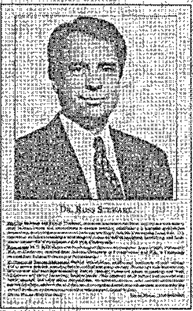

## 致基维斯特每个想拥有更好的性爱，而不想感到内疚的人的一封公开信！

来自：罗斯·斯图尔特博士
达拉斯，德克萨斯州

我叫罗斯·斯图尔特，是得到许可的婚姻和家庭治疗师。我的诊所位于德克萨斯州达拉斯，我的国家认证号码是 00469。

我有两个不同的大学的学位，我致力于帮助人们解决各种各样的情感问题。正因为如此，我在这个世界上想做的最后一件事就是冒犯所有人……或……让人从心理上感觉不舒服。我告诉你这些，是因为……

## 接下来的内容全部和性有关！

如果这个话题让你觉得尴尬……或者……如果你之前的信仰告诉你，性是可耻的……如果拥有美妙性爱的想法冒犯了你……请……立刻停止阅读。

然而，如果你想找到鲜为人知，惊心动魄的性秘密（10000 个人中，知道这些秘密的人不到 1 个）……那么……这将是你读过的最令人兴奋的消息。

原因如下：因为新一轮的性“开放”风潮席卷全国，现在许许多多的人，都和你一样，渴望更多地了解（性），这很正常。过去几年中，所有人（至少所有心理健康的人）都想拥有……并值得拥有……激情四射的性生活这个观念，已经被人们所接受。社会各阶层的人，和你一样，渴望把性生活推向高潮。

如果你的“动物直觉”正常，那么，你内心深处一定知道，美妙的性生活是幸福美满生活的基础！

只有一个小问题：当你最终决定要去寻找幸福的性生活秘诀时，你

## 能相信谁？事实上，创造更好的性生活，是一个新兴领域，大多数所谓的“性专家”……都不知道……顶级的性技巧，真正令人惊讶不绝的性生活是什么样的。

这让我很生气。

我 在市场上看到的几乎所有“性信息”产品，只不过是……

## 愚蠢地试图把不好的色情信息，当作真正的性技巧！

大多数你在电视上看到的，以及听到的所谓的“专家”……对如何使用真正高级的性技巧，给伴侣带来持续的，最大的快乐一无所知。事实上，他们对改善性生活唯一的建议就是，“增加”和伴侣之间的“沟通”。

这个方法也不错。但是，它不会带来很大的效果……因为……

## 如果因为缺乏技巧，持续性生活不和谐，就不会有真正的沟通！

任何人都可以自称“性专家”。但是，许许多多的专家，在青少年时期之后，就再也没有学习过新的性知识。由这些专家向公众传递不良信息，只会使这个国家始终处于性黑暗时代！

拍摄色情电影的人是最糟糕的。它们和真正性快乐的共同点很小很小。任何相信能从这些所谓的“成人”电影中，学到真正好的性技巧的人，大错特错。如果……你真的想提高你的能力和你的快乐，那么这些使用“教育”作为幌子的色情产品，不过是在浪费你的时间。

性教育市场一片混乱：无数人渴望获得真正的方法，来提高性技巧，然而，他们用自己辛苦赚来的钱，换来的却是一堆垃圾。

这很不公平。然而，现在出现了……

## 多年来，最激动人心的性知识！

事情是这样的：大约10年前，我花费了大约相当于今天65000美元

的资金，去北加利福尼亚州，参加了别的医生举办的研讨会。这个研讨会主题就是，如何增加人类性高潮的频率和质量。简而言之，就是如何让人们拥有完美的性爱。开始几天，医生们只是向观众们“灌输”知识。他们非常详细地解释了男性和女性的生理结构。然后，他们解释了如何拥有更好的性生活。然后，他们请出了一个男人和一个赤裸的女人……然后……

## 他们演示了如何获得性高潮！

使用他们的方法，女性可以持续获得高潮超过 1 小时……男性可以获得高潮长达 15 分钟。

结束后，我回到了家中。

我觉得很震惊，也很兴奋。在过去的 10 年中，我利用所有的业余时间，改进并完善我在研讨会上学到的这些神奇的方法。经过这些年的研究，我现在了解到了以前想都想不到的东西。下面，我说说我的一些令人惊奇的发现：

首先，我了解到，99.9%的人在 19 岁左右停止研究自己的性行为。这意味着，大多数成年人……尽管有多年的性经验……但是，性技巧和青少年时期相比，并没有提高！

其次，我发现，大多数人学到的性技能……并不比我们的父母和祖父母知道的多。这是真的，尽管出现了所谓的“性革命”，尽管出现了很多色情影片。事实上，几乎所有人对性的了解水平，仍处于相当“无知”的水平！（注：我的很多认为自己是很“出色的”爱人的客户，惊讶地发现，和真正技艺高超的人相比，自己只是比一般水平高出一点点。）

第三，我了解到，因为男人和女人不同的（非常不同）性需求……很多性建议……实际上是有害的！

最后，我发现只有少数人……已经学会了如何将性生活提升到可能存在的最高水平。这些人当中，很多都是医生和专业研究人员……但是……他们只能在小型“地下”教学机构揭露他们的秘密。然而，那些在自己的性生活中，学习并应用了这些技巧的情侣和夫妻们，收获了另一个意想不到的巨大优势。那就是……

## 拥有了新的自信，

## 生活的其它方面，似乎也充满了平静和快乐！

换句话说，令人兴奋的性秘密，还可以作为改变你生活其它方面的基础。提升性生活质量……就像是一个跳板……可以让你体会到生活其它方面，你之前从未体会到的满足和快乐。

那么，为什么这些……令人难以置信的炙手可热的秘密……之前没有泄露到其他国家呢？这就是人性：少数知道了这些秘密的幸运儿，不想让其他人知道。毕竟，成为最好的性伴侣……真的……在生活的所有方面，给了这些人令人难以置信的优势！

正如我之前说的，大多数人都以为他们已经“足够”了解性。

这不是真的。你知道，作为人类，高度渴望性，是我们动物的自然天性。事实上，人类的性欲，几乎是与我们最接近的哺乳动物的 12 倍。想想看：例如黑猩猩，1个月对性的渴望只有1次。但是，作为人类，我们能享受一天24小时的性爱。无论世俗如何教导我们，但是我们知道……在我们的内心深处……

## 拥有健康的性生活，

## 保持良好的健康的伴侣关系，是我们与生俱来的权利！

你也知道，如果你的性生活比较悲惨，你生活中的其它事情，也会受到不好的影响。幸运的是，现在是20世纪90年代，最终……我们不需要再为想得到更好的性爱感到歉疚了。但是，我们大多数人迫切需要的是……我们可以信任的……信息和建议，来引导我们不要受外面那些无稽之谈影响。

这就是为什么我创造了这个神奇的视频，来揭示性的秘密。这些秘密，你在其它地方永远不可能找到。这个新视频将教你如何在 Zl 一夜之间，立即将你的性能力提升到一个新的水平……

## 现在以这样的方式呈现，人们已经没有什么借口了！

内容很清晰……而且……比你之前看过的任何相关视频，都要详细100倍。在这个视频中，你不会看到任何实验室装置；你不会看到任何“没有意义的”胡言乱语。你看到的是……真实的性生活……健康的火辣性生活指导，以及任何别的地方都看不到的现实生活技能。让我们一窥该视频的火辣内容吧：

- 如何每次都能和爱人“享受”完美的性爱！
- 想达到真正令人兴奋的性高潮，女人必须遵守的头号规则！
- 90%的男性在做爱时都会犯的笨拙的错误……以及……如何快速学到最令人满意的+++++的“内部”秘密！
- 如何保证你的每一个想法，你的爱人以及你充满快乐和兴奋+++++对下一次充满热烈的期待！
- 能立即扭转你的性生活的一个“20分钟秘密”！（它如此简单，你不假思索就能做到。）
- 送给那些给自己的女人“爱的养分”，让她们一整天，每一天都沉浸在爱里的男人的“秘密奖励”！（知道这个让人极度快乐“暖昧不爽”的秘密的男人不到千分之一，他们几乎从来不和别人分享这个秘密，即使是他们最亲密的朋友）
- 为什么男人总是无法理解女人的“生理信号”…即使已经结婚多年。（仅通过学习这个秘密，就能让你的生活发生巨大变化。）
- 女人对男人最大的不满…以及…男人如何克服这种不满，得到任何一个他喜欢的女人！
- “触摸”女人的哪里，以及如何“触摸”，能保证让她欲仙欲死！（这个方法非常简单……但是鲜为人知…甚至 75%的女性都不知道。）
- 鲜为人知的“技巧”，永远结束伴侣的指责！
- 女人真正想从男人那里得到的是什么！（90%的男人都被+++++ 难倒了……因为他们完全没有头绪。）
- 为什么男人几乎从来看不到他们的女人将要离开他们的“危险信号”预警！（女人很难相信男人在这方面如此愚钝……但是，他们如此愚钝真的是情有可原……一旦夫妻双方知道了其中缘由……神奇的事情就会立刻发生。）
- 大多数女人迫切想从一个男人那里得到的东西…但几乎从未得到过！（任何懂得如何给予女人这样东西的人，生活都能立即得到改变。）如何和爱人建立亲密的关系……并永远保持！（你再也不会感觉孤单了。）
- 百忧解如此受欢迎的真正原因！（几乎没有人…甚至医生…了解性对人的惊人影响。）
- 7个“非常具体的秘密”可以让男人完全“征服”女人……以及为什么，有了这些令人难以置信的性技巧……女人会获得纯粹的性快感！
- 如何在今晚就拥有欲仙欲死的性爱……超级的，世界级的性爱技术的简单技巧，立刻实现！
- 关于“G点”你应该知道的！
- 为什么你的指甲可能会无意识地让你的爱人不悦！
- 第一幅详细的女性身体剖析图……清晰，明确地标出了能引发她快感的具体位置！
- 如何通过女人的 4 个“目标语言”……永远抓住她的芳心！

这还不是所有内容……远远不止这些！这个不可思议的视频，会让你的生活充满激情，令人兴奋到几乎难以形容。它会给你成为性爱大师，为你的爱人带来完美性爱所需要的一切。

然而，这个材料并不适合所有人。其中一个原因是，这个视频的创作费用很高。它是超过 10000 小时的研究成果……而且，它由 4 位世界上最有魅力的美女担任主演。事实上，其中一个是尼娜·西西里，据一些业内人士所说，她就像……

## 20 世纪 90 年代的玛丽莲梦露！

因此，我的视频，比你在影碟商店里能买到的那些无用的色情录像要贵得多。正如我之前说的，我的视频内容非常直率。如果正面裸体……以及……非常真诚而且开放的性指导让你觉得自己被冒犯了……请不要购买这个视频。

可能还有其它原因，让你不想购买这个视频。这些原因涉及到别人的隐私，我不方便在此描述。因此，我做了一个 3 分钟的录音，在你决定购买我的视频之前，请听一听。你应该做的是打电话，听听这个录音。然后，如果你觉得不喜欢这个录音，你直接挂断电话就可以了。

另一方面，如果读完以上信息……然后，听完我的录音……如果你还想订购我的视频，你只要拨打下面的电话……我们将会有 24 小时服务的工作人员处理你的订单。我们接受万事达信用卡，维萨卡，以及美国运通支付。

如果你想邮寄支票，我们的工作人员会告诉你应该怎么做。

总之，感谢你阅读这封信。我真诚地希望我没有冒犯你……我的电话是……

1-305-534-7577

再次感谢阅读。

注：想在订购之前，更多地了解我的背景，请阅读我的照片下面的信息。

## 罗斯·斯图尔特博士

简介：婚姻和家庭治疗师、顾问、企业顾问和教练，开过私人诊所，建立过一个商业咨询公司，开发了新的评估工具，创造了新的面试技巧。包括对很多客户提供咨询，以及分析、确定、改变公司与公司之间，以及个人之间的关系。

教育：印第安纳州立大学,指导和心理服务博士学位；宾夕法尼亚州印第安纳大学咨询硕士学位；以及宾夕法尼亚印第安纳大学心理学学士学位。

职业成就：为儿童、成年人和家庭关系进行临床治疗，以及私人指导，提供个人和团体治疗。提供危机干预；关系和婚姻咨询；家庭治疗；药物滥用咨询；以及工作调整和职业咨询。负责多个行业，以及学术机构的危机干预，包括大公司，大学，中小学，和成人，青少年和儿童治疗中心。为公众，就相互依存和其他相关心理主题，组织安排教育研讨会。

办公室电话 (215) 702-7932
家庭电话 (214) 386-0204

## 笔记

## 29. 盖瑞·亥尔伯特创造的营销奇迹！

## The Amazing Marketing Miracles Created By Sir Gary of Halbert!

> "...Gary loves to create winners for the so-called 'little guys'..."

## What Others Say...

## 盖瑞·亥尔伯特创造的营销奇迹！

来自：布雷德·托马斯
CTV 总裁

> “势不可挡的赚钱创意和策略，以及赚钱新方法！”——泰德·尼古拉斯《如何用不到 50 美元的成本，在没有律师的情况下，成立自己的公司》的作者 特拉华州，威灵顿

> “我赚回的钱是我支付的一百倍！”——罗伯特·艾伦 房地产畅销书《零首付》的作者 加利福尼亚州，卡尔斯巴德

> “盖瑞·亥尔伯特带给我们的优势，对别人来说几乎是不公平的！”——山姆·菲什拜因 凯茜精品家具店老板 科罗拉多州，丹佛

> “在学习了盖瑞·亥尔伯特的策略，‘明星代言，价格并没有那么高昂’后，我雇用了奥林匹克游泳冠军马克·施皮茨作为我的全国代言人！”——朱迪·A. 格兰主 太阳能产业公司总裁 佛罗里达州，惠灵顿

> “让我的收入翻了三番！”——瑞克·尼斯旺格 密苏里州，圣路易斯

> “因为你（亥尔伯特）的方法，我做了 11 个项目，每月现金收入 50000 美元！”——理查德·H. 斯瓦德，牙科学博士 科罗拉多州，彼尔得

> “盖瑞·亥尔伯特让我在 1990 年赚了 180000 美元！”——唐·阿尔姆 俄勒冈州，罗斯堡

> “仅盖瑞·亥尔伯特的一个策略，就让我在过去的 8 个月内，赚了超过 150000 美元！”——劳伦斯 E. 尼尔森 伊利诺伊州，帕洛斯

> “我终生从商，我可以告诉你，盖瑞·亥尔伯特的所有方法，都是绝对有效的！”——托尼·塔拉西诺（托尼上尉） 佛罗里达州，基韦斯特

## 市长

“如果我们能克隆盖瑞·亥尔伯特，并把他搬向美国各地，那么今天，甚至永远都不会有经济萧条了！”——南希·琼斯 佛罗里达州，拉戈

“仅第一个策略，就为我带来了 40000 美元的收入！”——迈克·钱特里 英国，肯特郡，达特

“如果一定要我推荐一个适合创业者的信息来源，那么，我一定会推荐盖瑞·亥尔伯特！”——约翰·B. 劳恩斯伯里 碧灵，纽约

“谢天谢地，在大学泯灭我的思想之前，我遇到了盖瑞·亥尔伯特！——弗兰克 E.史蒂芬森 吉尔伯特，亚利桑那州

“盖瑞的策略帮我销售了超过价值 2500 万的宝石！”——弗莱德·罗伊 肯塔基州，格林维尔

洛杉矶一在那里，我第一次见到了盖瑞（他通常也被称作“广告王子”），当时我是《企业家杂志》的广告部主任，去聘请他做外围顾问。

《企业家杂志》非常著名，是世界上领先的商业出版物之一。在那里工作，使我有机会见到世界上一些最聪明的商人，以及营销专家，但盖瑞·亥尔伯特远胜这些人。至少可以说，当我第一次和他谈话的时候，就发现他的思维不同于一般人。而且，他非常有说服力，我决定至少测试一些他的建议。

感谢上帝，我这么做了！几天之内，他教会了我们如何让销量翻番，如何将退款率减少到几乎为零，如何极大地增加我们的利润。他的一些“激进的”想法，至今仍被很多杂志使用，而且回报非常丰厚。

## 和博格宁一家的冒险！

后来，我有机会与他一起工作，当时他受雇于欧尼斯·博格宁，以及他的妻子托娃。当时，他们的一家化妆品公司正濒临破产的边缘。欧尼斯托娃最初十分怀疑盖瑞坚持要他们作出的一些改变。但是，当他在

短短半年多一点的时间里，让他们的公司‘Tova9’收入达到了每月 20000 美元到超过 800000 美元时，他们的疑虑彻底消失了。你可能还记得他给他们创作的第一个著名广告，这个广告运行了多年，它有一个最著名的标题，那就是……

## 罐子里的神奇去皱膏，不想做整容手术的好莱坞明星都在用！

这个广告带来了数百万美元的销售额，但是，我觉得盖瑞给博格宁写的另一个广告，是广告史上最强大的标题。那时候，博格宁太太想开始推广他们的一款叫做“托娃 Tova”的新香水（现在，市场上仍在销售），她想在贝弗利山一个朋友的精品店进行销售。她的朋友是坎迪·斯派林，著名电视制片人艾伦·斯派林的妻子，那个精品店，据我估计，可能只能容纳 150 人。

盖瑞听说后，勃然大怒。他告诉托娃，如果要按照他的方式，推广这款香水，就需要更大的店面，比如整个世纪广场酒店的第一层！托娃也很生气，但是，当她平静下来后，她允许盖瑞用自己的方法进行推广，吸引了 7000 人来到世纪广场领取香水样品。如果你有一丁点的营销才能，你只要看标题，就能知道他这则广告的威力，他的标题是……

## 托娃·博格宁发誓，她的新香水中绝对不含非法性兴奋剂！

顺便说一下，那则广告的“副标题”是“著名电影明星的妻子同意赠送 10000 份她的新款香水样品，只是为了证明，喷着这种香水去公众场合，十分安全。”就我个人而言，我永远忘不了那则广告。当时我的工作，是协调好该酒店的秩序，酒店里当时人山人海，水泄不通，人几乎无法挪动。但是，我们的人数没有超过 7000 人，因为消防警察不再允许其他人进入酒店了！

## 一个 30000000 美元的成功故事！

盖瑞在洛杉矶短暂居住的时间里（他以前的办公室位于曼哈顿的麦迪逊大街 595 号），他还与其它一些名人一起工作。其中一位是声名大噪的杰弗里·斯科特（他曾饰演琳达·埃文斯前夫，克里斯塔尔），他撰写

的广告给盖瑞的客户带来了 3000 万美元的收入。盖瑞还总结了十几个成功的“专题广告”，开头是，你可以看起来更年轻吗？广告中销售的产品是，维姬·拉莫塔的化妆品，她曾经嫁给过拳击手杰克·拉莫塔，她是花花公子杂志年龄最大的裸体女模特。（顺便说一下，我听说，她现在看起来依旧很棒！）

盖瑞还做过一些简短的（通常是 2 分钟）电视广告，其中最令人难忘的一个是，由出演《苏兹的世界》、《望族》以及其他著名电影电视的明星南西·库万主演的一则广告。就我个人而言，我特别感兴趣他与经常为花花公子拍广告的模特，B 级片女王，贝奎合作的广告。而且我知道，他最近又和玛尔戈·海明威（欧内斯特·海明威的孙女）签订了合同，来宣传他的新书，暂时起名为……

## 如何得到你想要的一切，即使你配不上它！

盖瑞的另一位有趣的客户，叫做乔治·赞戈斯，他是举世闻名的举重运动员，他曾经靠邮寄盖瑞给他写的一张明信片，每投入 100 美元成本，就能收到 1000 美元的收入。尽管他给同样的列表，邮寄了 5 次。

直邮正是盖瑞的强项。他的一个 8 页的“杀手”文案，使霍华德·罗夫的《罗夫时代》实时通讯订阅量翻了一番。他还帮计算机娱乐系统公司撰写了一封销售信，使它们的总收入从 300 万美元每年增长到超过 1300 万美元。他还为《个人理财通迅》、《道格·凯西的信》、《避税文摘和预测》撰写直邮推广邮件。他为罗伯特·艾伦（畅销书《零首付》的作者）撰写的销售信，帮助艾伦召开了一次研讨会，我听说，通过那次研讨会，他获得了每年 7500 万美元的收入。

但是，请……不要误以为盖瑞只为大公司、名人或“大人物”撰写销售信。他的许多销售信，都是为小零售商撰写的，为他以及零售商赚了很多钱。就客户而言，盖瑞的座右铭是……

## 企业的大小并不是很重要……重要的是潜力的大小！

盖瑞喜欢为所谓的“小人物”撰写广告，因为他从来没有忘本，他
清楚地记得自己刚开始创业的时候。顺便说一句，盖瑞的营销生涯始于1968年，他成立了一家名为“盖瑞公司”的企业。（今天仍然存在），公司出售盾形徽章，以及手绘族徽。盖瑞为这些徽章撰写的销售信，成了历史上最为广泛地被邮寄的销售信。现在，他的公司已经发展成为一个资产数百万美元的国际大公司。（顺便说一句，盖瑞还为出售了1/2的授权而自责不已）不管怎么说，那封信和它的改编版本，每周依然会被大量邮寄……

## 超过500000000封这样的销售信，被寄了出去！

盖瑞卖掉自己的公司后，他成立了另一个名为“好消息”的公司。公司办公室分别位于北坎顿，俄亥俄州和在纽约麦迪逊大街。该公司主要出售“如何”类自学书籍，像《如何得到美国政府欠你的东西》、《如何不动一刀一枪抢劫银行》，以及其他同样引人入胜的文章。

有时候，这些书的利润简直是天文数字。例如，盖瑞为一本名为《如何在任何年龄获取社会保障》的书籍撰写的一条广告，刊登在杂志上后，最终创造了5500万的发行量。其中一个是《游行》，一本报纸分销杂志。当时，发行量为17546168份。亥尔伯特在《游行》发行广告的成本是33214.37美元，他们从那本杂志得到的总收入是228492美元。最终，仅通过这本书，他的公司创造了超过1000000美元的净利润！

嘿，你想让他给你创作一个这样的成功广告吗？

不幸的是，尽管盖瑞在营销方面非常成功。但是，他在公司管理方面做得非常糟糕。当他的公司逐渐扩大后，他开始头疼了。所以，好消息公司逐渐扩大后，他卖掉公司，搬到了洛杉矶。当他到达那里后，他把一些营销时间投入到了写书上。他利用那些时间，撰写了几本投资书籍。其中一个是关于，如何通过美国邮票赚钱，它的标题是《感谢上帝，不是所有由美国政府印刷的东西都失去了它的价值》。还有一本是关于如何利用期货赚钱的。

除此之外，他一直休息到感到极其无聊，之后，他决定为几个客户
撰写销售信，我见到了他……这些都是后话。

如果，通过阅读这篇文章，你认为我是盖瑞的粉丝，恭喜你，你说对了。但不只是我。亥尔伯特现在住在佛罗里达州，他在基韦斯特的办公室每天都会收到许多感谢信，感谢他给自己带来了大量利润。在这封信的前面，你可以看到一些摘录。

亥尔伯特的营销简报现在遍布 29 个国家，这无疑是世界上阅读量最大的营销出版物。大概 4 年前，他停止接收任何新客户。但现在，他说，他正在寻找一些新的挑战。总之，我能说的是：如果有任何产品或服务要销售，如果你能让亥尔伯特有兴趣和你合作。那么，你不和他联系，你绝对是疯了。

顺便说一下，如果你有任何类型的零售商店，这点尤其重要。如果你怀疑，你一定要读一读上面山姆·菲什拜因的一段话，他和自己的妻子莱斯利，拥有科罗拉多，丹佛的所有凯茜精品家具店。

有一件事是肯定的：既然现在盖瑞又开始接收客户了，那么，他的 日程一定瞬间就会被排满，这点毋庸置疑！所以，如果你有兴趣和这个我还有许多其他人认为的“最好的营销人”合作的话，我强烈建议你立即与他取得联系。他的基韦斯特办公室号码是 (305) 294-305，东海岸的时间，周一到周五从早上 9 点到下午 5 点，你可以随时拨打。

不管怎样，最后，我想说，有机会与盖瑞一起工作；是我此生最大的幸运之一。如果你能和他合作，你肯定会得到不可思议的结果，能学到很多你永远也不会忘记的营销知识！

## 笔记

## 30、拉斯维加斯神秘人的神奇 21 点秘密！

## Now! Revealed For The First Time Ever!

## The Amazing Blackjack Secret Of A Las Vegas Mystery Man!

Have you ever wondered why there is always so much excitement about winning money playing the casino game of blackjack? Well, I’m going to tell you why. In fact, I’m going to tell you some things about this amazing gambling game that you’ve probably never heard before. Things that could possibly win you a lot of money. And some things that just might stop you from ever gambling again. So, please read these words carefully. Every word is true and it has taken me the better part of my lifetime to discover what I am now going to reveal to you. Read on!

As you probably already know, blackjack is the only game that can truly be beaten. You see, unlike craps, roulette, slots or any of the other popular casino games, blackjack is based on what is known as "Dependent Trials." This means that the result or outcome of any given hand depends on what cards are still remaining in the deck.

On the other hand, Craps, Roulette, slots etc., are games of chance based on "Independent Trials." Now, Independent Trials means that every time you roll the dice, spin the roulette wheel, or pull the slot handle, the chances of any particular number (or combination of numbers), coming up is always the same. The previous spin, roll or pull has no influence on what the next outcome will be.

That sounds simple enough. But, here is what it really means. It means that the only way to win at these casino games, is to truly be lucky. And when I say you must be lucky, I’m not kidding. You need to have God, the magic Leprechaun, your rabbit’s foot, horseshoe and every other imaginable good luck charm working for you because the odds of winning are truly stacked against you. Let’s look at a few examples:

In the game of Craps, the average house advantage is approximately 7.22% (sometimes it’s a bit higher and sometimes it’s a bit lower. It all depends on how you roll). And, in Roulette, the house advantage is set at 5.26%. Now, this small advantage may not seem like a lot to you, but it is! In fact, it is the reason the casinos are so successful! But, Blackjack is different. Here’s why:

To win at blackjack, you simply need to pay attention to the game and develop skillful ability to play good cards. That’s why blackjack is the most popular of the casino games. It is a game of skill and, if you are good enough, you can honestly win a bundle of money!

For this reason, blackjack systems and strategies have been sold for as little as $10 and as much as $10,000. I know I have purchased them all. Many of these systems are extremely complex. They have been developed by scientists, mathematicians and college professors with high-tech, computer-like minds.

In practice and research I’ve discovered that to successfully use these systems you need to either have a photographic memory, or a computer to perform the constant calculations required. And, I might add, that’s crazy! No casino in the world will allow you to play blackjack with a computer. And, those people fortunate enough to be born with a photographic memory usually end up with some kind of "super-job" that gives them all the money they’ll ever need. So, for the average person, many of these systems are not even worth the paper they’re printed on.

That’s why I developed my own simple blackjack system. Actually, it took me several years and lots of money to make it a sure-fire winner, but it was worth it! I took all the expensive and complex systems available on today’s market and created a simple, easy-to-follow system that quite honestly was like crazy! There are no weird hair-brained formulas to use and no mathematical theories to apply. It is simple and straight-forward. It tells how to play, how to bet and how to win.

## What About Counting Cards?

Some systems say that you don’t need to count cards. Other systems say that the only way to win is to count cards. The truth is that you do need to count! But not every single card! You see, I also discovered the easiest way in the world to count cards (All you really need to know is if the deck is rich or poor in 10 cards (face cards). And, if you can add 1 and subtract 2 you already know how to count cards!)

Just think how great it would be if you had a system like this that would easily win you a bundle of money anytime you want it! You could end your money problems forever and have all the wonderful things that money can buy: new cars, expensive jewelry, European vacations and much, much more!

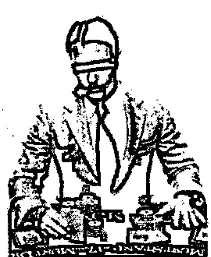

## It’s FREE!

Would you like to try this amazing money making blackjack system? Would you like to see for yourself it is as easy and as profitable as I say it is? Since you would! And now, here’s the best part of all. This system is FREE!! Yes, it’s true, this system will not cost you anything (except $3.00 to cover the cost of printing, postage and handling).

How can I make such an offer? The answer is simple. You see, aside from being a professional blackjack player, I’ve also become involved in the travel business. And, I’m currently putting together discount travel packages to gambling destinations around the world.

All I’m hoping is that once you use my system and see how easy it is to win, you’ll make your future travel plans through my service. You can’t lose! But you sure can win. All you have to do is answer the 5 questions at the bottom of this page, print your name and address on the shipping label, include $3.00 and the system is yours! That’s all there is to it. When I receive your questionnaire I’ll clip off the shipping label and tape it to the package that the system comes in (By the way, the system is 24 pages long and it will come to you in a while, unmarked, in a 9" x 12" envelope.)

NOTE: Only one system allowed per address. If you want extra copies, please make them yourself. Thank you.

## QUESTIONNAIRE

## Shipping Label

+ 1. Approximate age □21-34 □35-49 □50-65+
2. Sex □Male □Female
3. Favorite Casino Game : Blackjack · Poker · Roulette · Craps · Keno
   □Slot Machines · Sports · Other
4. Approximately how many times a year do you travel for pleasure
5. If you could travel to any of the following destinations at a substantial discount, which would you choose first? □Mount Casino □Las Vegas City □Bali □Bali Springs □Las Vegas □Australia □Sydney □Austrailia
(Note: Make all checks payable to VIP Travel Systems. 8276 Wilshire Blvd. Suite 8000 Beverly Hills, CA 90211)

## 有史以来，首次揭露真相！

## 拉斯维加斯神秘人的 “神奇 21 点” 秘密！

你可曾想过，为什么总是有那么多人热衷于通过玩 21 点赌场游戏赢钱？好，我将告诉你为什么。

事实上，我要告诉你的这些关于这个神奇的赌博游戏的事情，你可能从来都没听说过。这些信息，可能会让你赢很多钱。我还会告诉你一些事情，这些信息可能会让你再也不去赌博。所以，请仔细阅读下面的内容。我说的每一个字都是真的，为了得到这些信息，我投入了很多时间。现在，我要把我知道秘密揭露给你。请继续阅读！

可能你已经知道，21 点是赌场中惟一不是完全靠运气的赌法。和掷骰子赌博，轮盘赌，老虎机或其他受欢迎的赌博游戏不同，21 点赌博是基于 “依赖性试验” 的。这意味着，任何结果都取决于桌子上剩下什么牌。

另一方面，掷骰子赌博、轮盘赌、老虎机等，都是基于 “独立性实验” 的游戏。独立性试验，意味着每次你掷骰子，每次你旋转轮盘，或拉下老虎机，各个数字（或数字的组合）出现的概率都是一样的。前面 的投掷，旋转，或拉动，对接下来的结果没有任何影响。

听起来很简单。但是，它的意思正在于此。这意味着，在这些赌博游戏中取得胜利的唯一方法，就是运气。所以，当我说你一定会好运，我可是认真的。你需要好运气，魔法小妖精，幸运符，马蹄铁吉祥物(被认为能带来好运气)，等等能为你带来幸运的东西，因为获胜的几率真的很小。让我们看几个例子。

在掷骰子游戏中，庄家的平均优势大约为 7.22%（有时会高很多，有时又会低很多。一切取决于你如何赌）。在轮盘赌中，庄家的平均优势大约为 5.26%。现在，这个小小的优势在你看来，可能不多，但事实上，算多的了！它是在赌场上取得成功的原因！但是，21 点则不同。

原因如下：

要赢得 21 点，你只需要集中注意力，形成熟练的打牌技巧。这就是为什么 21 点是赌场最受欢迎的游戏。它是一种游戏技能，如果你的技能足够熟练，你可以稳稳地赢一大笔钱！

因为这个原因，21 点系统和策略的售价开到了从 10 美元到 3000 美元不等。我知道，因为我购买过所有策略和系统。这些系统中，许多都极其复杂。它们通常是由科学家、数学家和大学教授结合高科技、智能化系统研发出来的。

在实践和研究中，我发现，要成功使用这些系统，你需要强大的图形记忆能力，或者，一台电脑，来执行所需的常数计算。我要说这太疯狂了！世界上没有任何一个赌场允许你用电脑玩 21 点。所以，那些足够幸运的，拥有强大的图形记忆能力的人，通常会得到一份非常好的工作，赚到他们所需的所有钱。因此，对于普通人，许多系统甚至都不值他们印在纸上。

这就是为什么，我自己研发了一个简单的 21 点系统。事实上，为了确保这个系统绝对有效，我投入了好几年的时间和大量资金，但这是值得的！我购买了现在市场上存在的所有价格高昂的复杂系统，利用它们研发了一个简单，浅显易懂的系统，让你赢得锅满瓢满！这个系统中没有难于记忆的奇怪公式，没有应用数学理论。它言简意赅，浅显易懂。它会告诉怎么玩，怎么选择和怎么赢。

## 如何算牌？

有些系统说你不需要算牌。还有一些系统说赢得 21 点的唯一方法就是算牌。事实是，你确实需要算牌！但不是每一张牌！我还发现了世界上最简单的算牌方法（你只需要大概知道，桌面上剩下的 10 张牌，是大牌还是小牌。如果你知道简单的加减法，你就知道如何算牌）。

想想如果你有一个这样的系统，能让你在任何时候，轻松地赢得你需要的任何钱，那将有多棒！你可以永远摆脱金钱的困扰，拥有一切金钱可以买到的美好事物：新款汽车，昂贵的珠宝，欧洲度假，等等！

## 免费！

你想试试这个神奇的 21 点赚钱系统吗？你希望看到自己像我说的一样，轻松赚钱吗？你肯定想！最棒的是：现在这个系统是免费的！是的，这是真的。这个系统不会花费你任何成本（除了 3.00 美元的印刷费，邮费和手续费）。

我怎么会提出这么一个提议呢？答案很简单。我不但是 21 点游戏的专业玩家，我还有自己的旅游业务。我现在打包出售折扣旅行套餐，让你能在世界各地的赌场游玩。

我所希望的是，在你使用了我的系统后，了解了赚钱有多么轻松，你肯定会让我为你服务，规划你未来的旅行计划。你不会有任何损失！而且，你会赢很多钱。你要做的是，回答这封信中的 5 个问题，并在邮寄标签上打印上你的姓名和地址，再附上 3.00 美元，这个系统就是你的！就这么简单。当我收到你的问卷后，我会剪下邮寄标签，将其粘在邮寄包裹上。（顺便说一下，该系统长达 24 页，我会放到白色，没有任何标志的 6″x 9″信封里。）

注意：每个地址只邮寄一份。如果你还想多要几份，请自己做。谢谢。

## 调查问卷

（请立即填写并邮寄！）

请完成这张调查问卷，以及邮寄标签，并支付 3 美元。这个系统就会立刻通过邮件寄给你。

- 1. 大概年龄： 21-34  35-49  50-65+
- 2. 性别： 男  女
- 3. 最喜欢的赌博游戏： □ 21 点  □ 扑克  □ 轮盘赌  □ 掷骰子赌博  □ 基诺游戏  □ 老虎机  □ 运动  □ 其他
4.你一年旅行游玩大约几次？
5.如果有机会到下面任意地方旅游，而且费用有很大的折扣，你第一个想去的地方是哪里？
- □蒙特卡洛 □大西洋城 □巴哈马群岛 □ 拉斯维加斯 □澳大利亚 □斯里兰卡 □ 奥地利

（注意：支票以及汇票受益人请写：VIP 旅行系统。）请剪下来，并寄到 VIP 旅行系统 8306 威尔希尔大街 3000 栋 比佛利山庄，加利福尼亚州 90211

## 重要提醒：请清晰打印

这个系统会按照邮寄表上的地址寄给你

## 邮寄标签

来自：VIP 旅行系统

8306 号威尔希尔大街 3000 栋

比佛利山庄，加利福尼亚州 90211

邮寄到： ________________________

姓名 ________________________

地址 ________________________

城市 ________________________

州 __________ 邮编 ________________________

## 笔记

## 31、前5年最热门投资的惊人秘密

Who else wants to make a bundle?

## The Amazing Secret of The Hottest Investment of The Last 5-Years!

## A STROGGERING 457%-APPRECIATION!

TO INVESTMENT LIABILITIES INCORPORATED

GENTLEMEN, Yes, I want to receive a FREE copy of your revealing 2-part report "The Amazing..."

公众微信：LBC333

## 还有谁想大赚一笔？

## 前 5 年最热门投资的惊人秘密

你是否想过，过去 5 年中，投资什么利润最高？

答案可能会让你感到惊讶。事实上，你可能会感到震惊！这项投资在过去的 5 年中，利润如此之好，达到了几乎仅次于它的竞争对手利润的 2 倍！不仅如此，这项投资在过去 15 年，甚至 30 年中，利润一直遥遥领先！

利润究竟有多高？让我们一起看一看。下面是过去 60 个月中，“X”产品的投资表现和其他“热门”投资产品的投资表现的对比：

| 投资产品 | 升值百分比 | 投资 “X” 产品 |
| --- | --- | --- |
| 黄金 | 237% | 214%更佳！ |
| 白银 | 250% | 202%更佳！ |
| 房地产 | 145% | 311%更佳！ |
| 纽交所股票 | 257% | 264%更佳！ |
| 长期国债 | 163% | 277%更佳！ |
| 基金 | 178% | 253%更佳！ |

是的，这是真的。在过去 5 年中，投资 “X” 产品，不仅比其他任何一种投资利润增值率都高，而且，它的增值率一度达到：

## 令人震惊的 452%！

超高的利润！非常值得注意的是，在过去的 60 个月中，投资 “X” 增值率高达 452%！

而且，你猜怎样？根据所罗门兄弟公司的研究证明，在过去的 73 年中，投资 “X” 产品，总通货膨胀率只有 27.1%！

那么，这种神奇的投资，究竟是什么？别担心。我马上就会告诉你。然而，在我告诉你之前，请允许我告诉你一些事实，说明一下为什么这项投资是可行的。

可行性：这种特殊的投资，在未来几年的可预见的经济形势中，都占有稳定的位置。经济衰退、通货膨胀、投资市场崩盘——不管发生什么，这种投资都能为你的资金提供一个 “安全港”，就像过去的 73 年那样。

盈利能力：如前所述，这种投资的盈利能力，接近对手的 2 倍，根据所罗门兄弟所做的研究，从 1911 年开始，它的总通货膨胀率只有 27.1%！

隐私：这是一种非常独立的投资。它可以传递或转移。这是一个合法，而且秘密的投资。

流动性：这种投资市场广阔，几乎每个城市，乡村都有。无论何时，只要你准备好出手，保证会有无数急切的买家！

增长潜力：据一位专家透露，市场上，投资这款产品的人数，是上一个十年的 3 倍。想想吧！

下跌保护：有一个明确的限制。机会是有限的，但是想要投资的人数却是无限的。

负担能力：你可以以不到 1000 美元的资金开始投资，你还可以自由搭配投资组合，可以选择收益缓慢的，也可以选择受益快速的。

还有更多。但是我不想再吊你的胃口了。我要告诉你的这种投资，就是稀有的美国金币。

没错，这是真的。就盈利能力而言，美国金币绝对是过去 73 年中，最好的有形投资！你感到惊讶吗？其实不止你一个人觉得惊讶。许多人

都隐约感觉稀有的美国金币投资可能是有利可图的。但是，很少有人知道，这种投资利润有多高。

然而，这一切即将改变。1984 年 3 月 6 日，大约 350 万人将在《华尔街日报》和其它主要金融出版物上读到我们的新闻。而且，每个人都将有机会获得免费的 24 页报告，告诉他们如何充分利用这个令人兴奋的新机会。

你猜会发生什么？市场将会爆炸？不好说，因为我们也无法确定。但有一件事是肯定的：这个令人振奋的信息的广泛传播，肯定会让美国稀有的金币市场一片繁荣！

你感兴趣吗？我当然希望如此，因为如果你感兴趣，你将在其他无数投资者得到这个消息之前，提前 90 天获得一个免费的报告。

90 天的 “先机” 会产生很大影响吗？你知道一定会。特别是在媒体十分发达的今天！

这完全取决于你。如果你想提前得到这本极其宝贵的小册子，你需要做的就是拿起电话，拨打 1 - 800 - 328（800），转 133 分机。接通后，直接告诉接听人你的姓名，告诉他，你想得到这份报告中提到的免费小册子。

仅此而已。你没有义务购买，你不会受到强行推销。你将通过回复邮件收到一个免费的信息小册子，你将比其他 350 万投资者大约提前 3 个月得到它！

P.S.如果你愿意，你可以通过填写并邮寄下面的优惠券，获得小册子。谢谢！

## 零义务申请表
（请立刻填写并邮寄）

至：稀有金属投资公司

## 一棵苹果树广场

## 明尼苏达州，明尼阿波利斯市

先生：是的，我想要这本免费的神奇报告《最好中的最好》。我明白，我不用承担任何义务。而且，我不会被强行推销。

姓名 ______________________________

地址 ______________________________

城市 ______________ 州 ______________ 邮编 ______________

公司电话 ______________________________

家庭电话 ______________________________

## 笔记

## 32、新哈雷彗星 “银鹰” 独一无二，纯银制成！

## Get It Now, It Only Comes Once-In-A-Lifetime!

## New Halley’s Comet “Silver Eagle” Is Totally Unique And Made Of Pure Silver!

## It Won’t Be Seen Again For 76-Years!

## The Authentic Halley’s Comet “Silver Eagle”

You may now acquire, direct from the Burton Mint of Beverly Hills, a first-edition Halley’s Comet Commemorative — the authentic “Silver Eagle” Series “SE” — honoring the forthcoming once-in-a-lifetime appearance of Halley’s Comet.

## Pure Silver!

Each specimen is mint-perfect and contains one full ounce of pure .999 silver and will be accompanied by a Certificate of Authenticity to that effect from the Burton Mint.

## Very Limited Series

Much rarer than any common U.S. coin now in circulation, the Halley’s Comet Commemorative is uncirculated and guaranteed to be absolutely mint perfect! Not more than 1,800,000 will ever be minted in the “SE” Series and thereafter the dies will be completely destroyed. That means that fewer than 1% of all Americans will ever have a chance to own this permanent rarity.

## Only Once Every 76-Years

The coming of Halley’s Comet is a unique historic event that only occurs every 76-years. Therefore, the Halley’s Comet “Silver Eagle” issue has been commissioned and struck by the Burton Mint as a unique and historic commemorative medallion and has never been nor intended to be designated or circulated as currency. As stated earlier, it is guaranteed to be uncirculated and mint perfect and, because of this, we recommend storage in its protective sleeve to protect against mishandling.

## Price Guaranteed Only For 30-Days

The price of pure silver is subject to rise dramatically without notice (it was $35.00 an ounce a short while ago) and, therefore, we can only guarantee the price quoted in this announcement for the next 30-days. Orders received after this deadline are subject to refusal.

## Only One Per Customer

This is an extremely limited offer and there is a strict limit of only one (1) commemorative per address at this price. There are no exceptions. Also, since many collectors desire a low Certificate of Authenticity serial number, we suggest you order your Commemorative promptly.

## Extra Bonus!

The Burton Mint has acquired a very small number of B&W photographs taken of Halley’s Comet the last time it appeared which was 76-years ago in 1910. These photographs are quite valuable and suitable for framing and we will send one free (as long as they last) with every order we receive within the next 30-days.

## Speed Is Important

It is easy to get your Commemorative but, in order to avoid disappointment, we suggest you respond as fast as possible. Since this offering is limited, please respond promptly by using the toll-free number below or by mailing the coupon. Either way, your Commemorative will be sent immediately (within 48-hours’ by return mail. Thank you.

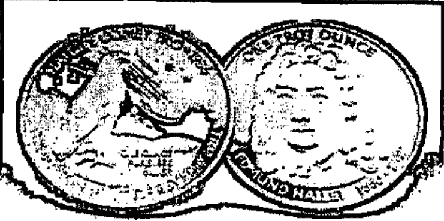

## 一生仅此一次，立刻拥有吧！

## 新哈雷彗星 “银鹰” 独一无二
纯银制成！

## 接下来的 76 年，都不会再见到它！

哈雷彗星很快就会到达这里了！现在通过望远镜已经能够看到它，而且，很快（在 12 月份），你用肉眼就能够看到它。耐心等待吧，你一定能看到它！它真的很神奇。用肉眼看，它有四、五英里宽，而且有一条几乎 1 亿英里长的尾巴。千万不要错过它，因为你一生中只能看到一次，它要 76 年后，也就是 2061 年，才会再次来到这里。此外，千万不要错过获得哈雷彗星 “银鹰” 的机会，它独一无二，而且由纯银制成！

## 真正的哈雷彗星
“银鹰”

现在，你可以直接向贝弗利山的伯顿铸币厂，购买哈雷彗星的纪念币第一版——真正的 “银鹰” 系列 “SE” ——纪念即将到来的千载难逢的哈雷彗星。

## 纯银！

每一块都做工精美，包含整整 1 盎司纯度为 999 的白银。每一块都有一个伯顿铸币厂印制的防伪证书。

## 限量发行

哈雷彗星纪念币极其罕见，它和当今流通的常见的美国硬币不同，它不会进行流通，绝对是完美的珍藏币种！ “SE 银鹰” 系列硬币，总共不超过 1000000 枚。这意味着，只有不到 1% 的美国人有机会拥有这么罕见的珍藏币。

## 每 76 年才能见到一次

哈雷彗星的到来是一个非常特殊的历史事件，因为，每 76 年才会发生一次。因此，伯顿铸币厂将哈雷彗星“银鹰”的打造，视为一个独特，具有历史纪念意义的事件。所以，不打算将其作为货币流通。如前所述，它做工精美，保证不会流通，正是出于这个原因，我们建议使用保护套进行封存；防止保存不当，造成损失。

## 这样的价格，只保证 30 天

纯银的价格一直在大幅上涨（不久前还是 55 美元一盎司），因此，我们只能保证在接下来的 30 天内以这个价格出售。过了截止期限之后，你就无法以这个价格买到了。

## 一位客户仅限购买一枚

因为“银鹰”供应量极其有限，因此，每位客户只能以这个价格购买 1 枚。没有例外。而且，因为许多收藏家都想要序列号靠前的防伪证书。所以，我们建议你立刻订购属于你的纪念币。

## 额外福利！

伯顿铸币厂在 76 年前，也就是 1910 年哈雷彗星出现的时候，得到了它的少量 8 x10 的照片。这些照片很有价值，适合装裱，任何人在未来 30 天订购，我们都会免费赠送一张（送完为止）。

## 订购速度很重要

在我们这里购买很方便，但是为了避免被一抢而空，令你空手而归，我们建议你尽快回复购买。因为数量有限，所以，请及时拨打免费电话或邮寄优惠券订购。无论哪种方式订购，你的纪念币都会被立即寄出（48 小时内）。谢谢！

## 零风险优惠券

寄至：贝弗利山伯顿铸币厂
威尔希尔大街 8306，3000 大厦
加利福尼亚州，贝弗利山，90211

想要走加急件，你可以通过电话订购！拨打 1-818-957-5011
找约翰·托马斯
周一到周五上午9点到下午5点任何时段都可以拨打
请准备好维萨卡或万事达卡

先生：

是的，我想订购哈雷彗星“银鹰”纪念币，我已经附上全额费用 39.95美元，外加 3 美元邮费（共计 42.95 美元）。我知道，每人严格限制只能购买一枚纪念币，30 天之后，便不再接受任何订单。我还知道，如果我不是 100%满意，6 个月内，我可以随时退回纪念币，并得到全额退款。在此基础上，我下订单购买：

## 请确定支付方式

- □ 万事达
- □ 维萨
- □ 支票
- □ 汇票
- □ 现金

卡号____________________有效期____________________

姓名________________________________________________

地址________________________________________________

城市____________州____________邮编____________

注意：支票和汇票受益人请写伯顿铸币厂，加利福尼亚州居民请额外支付 6.5*%的销售税（2.6 美元），总额为 45.55 美元。

P.S. 30 天内订购的人，还将收到本销售信中提到的 8x10 的照片一张。

接受全球订购

## 笔记

## 33、不想整容的好莱坞明星都在使用这种神奇的“罐子里的整容术”

## NOW AT LAST YOU CAN GET IT TOO!

## The Amazing “Face-Lift-In-A-Jar” Used by Hollywood Stars Who Don’t Want Plastic Surgery

> “I have not had a facelift. The only reason I look younger today than I did 10 years ago is because of what my wife has discovered.”
— Ernest Borgnine
November 3, 1981

Have you seen Tova Borgnine lately? She really looks great! In fact, according to her husband Ernest, Tova now has the skin of a teenager!

And what about Ernest himself? His friends are all saying he looks younger now than he did 10 years ago. Actually, he looks so good many of his co-stars have accused him of having a face-lift.

But Ernest has not had a face-lift and neither has his wife Tova. Both of them, however, do have a certain little secret.

Fortunately, for the rest of us, this “little Hollywood secret” isn’t so secret anymore. Soon it will be in stores all over the country and even now you can get it by mail! Officially, it’s called TOVA 9 but everyone in Hollywood simply refers to it as “Tova’s Face-Lift-in-A-Jar.”

It is certainly not cheap but the stars who use it say it works like magic. The more others take only half an hour and insiders say there is nothing like it for anybody who wants to look years younger than their actual calendar age.

It is easy to use. All you do is apply the cream in your face and wait. “The cream is pink when you apply it, and gradually it turns white,” says Tova. “After fifteen minutes it should be removed. One of the great things about it is that there is no guess work. It knows what to do by itself.”

Mrs. Borgnine says the secret of this remarkable looking treatment was first discovered by the Aztec Indians centuries ago. She says it comes from the root of a very rare cactus plant and that it is 100% natural, pure and while Tova came into the picture, it was only a little able in certain very remote areas in Mexico.

But what about the results? Does it really work? Here is what others say.

— “The results are astounding!” — Brenda Vaccaro

“… My skin loves them…” — Jeanne Waters

“TOVA 9 has a fresh just showered feeling…” — Courtney Stevens

“I couldn’t be more pleased with the results…” — Maureen O’Hara

“I am amazed with the texture of my face…”

“… Tova’s cream has something for everyone…” — George Reynolds

“… A tone-beauty treatment as well as an enlivening pomposite tonic” — Tomme & Jo Kauride

My complexion is not only very important to me correct, but it is considered me best feature. Consequently, I guard it with my life—newsmen, national media, prayer request and the use of marvelous products such as TOVA 9.”
— Jayne Meadows

It seems an and A complete list of even body who uses TOVA 9 would fill up this entire page and it would read like a virtual “Who’s Who in Hollywood.” Actually, many of your favorite movie and TV stars absolutely swear by it. In fact, author Harold Robbins, the Carpetbaggers says flatly, “I won’t travel without it.”

Would you like to try this remarkable discovery? Would you like to have the luxury of youth without the expense and heart of other methods? If so, here’s how you can try TOVA 9 without any risk at all. Simply go ahead and order “Tova’s Secret Weapon” by mail or telephone. Then, it’s sent out in the convenience of your home, and take a closer look at the amazing change you will see in your mirror. After that, if you are not 100% satisfied, simply send back the empty container and Mrs. Borgnine will personally see to it that you get a surprise refund with no questions asked.

Remember! You can take more than you can lose from your appearance!

It’s ready to order. Just fill out the coupon below and send it to Mrs. Borgnine with your payment. If you wish to order by Visa or Mastercard, you can call this 424-2434, phone number (800)... 722-... Operator 471. Dept. 128. Either way, your order will be promptly processed and you’ll receive a free sample.

TO MRS. ERNEST BORGININE c/o TOVA-9 Corporation 9333 Cerritos St, Dept 395 Commerce, CA 90040

Dear Mrs. Borgnine

Yes, I want to try your amazing TOVA 9 discovery that all the stars are raving about. “Tova’s Face Lift in a Jar.” I am enclosing $35 for a 2 oz. container and understand I must be 100% satisfied or that after 30 days I can return the empty container for a complete refund with no questions asked.

NOTE: Check here if you wish to order by credit card. Name of card...

Card Number _______________ Expiration Date _________

Print Name _____________________ X ________________

Address ___________________________________________
City _______________ State ______ Zip _____
P.S. Checks and Money Orders should be made payable to TOVA 9 and California residents must add 6% sales tax. 5% service charge. Money orders 29 days. All orders received within 14 days will receive a personal letter and a free gift voucher. Borgnine. Thank you.

## 不想整容的好莱坞明星都在使用这种
神奇的“罐子里的整容术”

> “我没有做过整容手术。我今天看起来比10年前年轻的唯一原因是，我的妻子发现了一样宝贝。”---欧尼斯·鲍基尼 1981年11月3日

你最近见过托娃·鲍基尼吗？她看起来棒极了！据她丈夫欧尼斯说，托娃现在的皮肤看起来像婴儿一样！

那么，欧尼斯·鲍基尼呢？他的朋友都说，他看起来比10年前更年轻了。事实上，他看起来状态比之前和他合作的明星状态都好，以至于他们都说他整容了。

但是，欧尼斯并没有整过容，他的妻子托娃也没有。然而，他们都有一个小秘密。

幸运的是，对我们来说，这个“好莱坞小秘密”已经不再是秘密了。很快，它将出现在全国各地的商店柜台上，现在你甚至可以通过邮件得到它！它的官方名称是“托娃TOVA9”，但是，好莱坞的人都称它为“托娃罐子里的整容术。”

它当然不便宜，但是，用过它的明星都说，它就像魔法一样。整个过程只要半小时，据知情人士透露，对那些想让自己比实际年龄看起来年轻好几岁的人，没有什么产品比它效果更好了。

它使用起来非常方便。你只要把它涂抹在脸上，等待它变白。“这种膏状体刚开始的时候，看起来是粉红色的，当你涂抹在脸上后，会逐渐变白，”托娃说。“当它变白后，揭下来就可以了。最棒的事，你什么都不用管。它“知道”自己在做什么！

鲍基尼太太说，这种让人看起来年轻的治疗方法的秘密，是几百年前被阿兹特克印第安人发现的。她说，它的原料来自一种非常罕见的仙人掌的根，100%天然纯和，直到托娃发现之前，它仅在墨西哥某些非常偏远地区使用。

结果如何？它真的有效吗？我们来听听客户反馈：

“......效果非常明显！” --布伦达·瓦卡拉

“......我的皮肤非常爱这款产品！” --杰西卡·瓦尔特

“用了托娃9，皮肤像刚洗过澡一样水嫩！” --戚妮·史蒂文斯

“这个结果，简直让我太满意了......”！ --莫林·迪恩

“我的皮肤好得让我感到惊讶......”--杰骆·艾伦

“......托娃让每一个人都收到了惊喜！” --谢比·雷诺

“......一次彻底，奢华的美容spa！” --汤米&乔·莱塞尔达

“我的容貌不仅对我的事业来说，至关重要，而且它是我对自己的身体最得意的部分。所以，我一直小心翼翼地保护它——不敢晒太阳，严格控制饮食，充足的睡眠，以及使用像托娃9这种了不起的产品。” --杰恩·梅多斯

这样的评价还有很多很多。所有使用过托娃 9 的客户评论，估计这一整页都写不下，看起来就像是 “好莱坞名人录”。事实上，许多你喜欢的电影和电视明星都极其信赖这款产品。事实上，《投机者》的作者哈罗德·罗宾斯直截了当地说，“不带着它，我不出门！”

你想试试这款了不起的产品吗？你想不花大钱，不费太多时间，就拥有年轻时都没有的美貌吗？如果是这样，你可以试试托娃 9，没有任何风险：只要通过邮件或电话订购 “托娃的秘密武器”。然后，在家里试试它，仔细照照镜子，你就会看到惊人的变化！试用过后，如果你不是100%满意，只要把空盒子寄回来，鲍基尼太太就会亲自负责为你全额退款，不问任何问题。

## 记住！你不会损失一分钱，只会让自己看起来年轻好几岁！

订购很容易。只要填写下面的优惠券，寄给鲍基尼太太，并附上你的费用。或者，如果你想通过维萨卡或万事达卡支付，你可以拨打（800）824-7888（加利福尼亚州居民请拨打 1(800)852-7777），转接 471 接线员，220 部门。无论哪种方式，你的订单都会被立即发出。谢谢！

## 零风险优惠券

至：欧尼斯・鲍基尼太太

托娃 9 公司
5933 科尔维特大街 390 部门
加利福尼亚州 90040

## 重要提示！

可以通过电话来处理信用卡订单。请拨打（800）824-7888，加利福尼亚州居民请拨打(800)852-7777，转接 471 接线员，220 部门。

记住这是免费热线！

亲爱的鲍基尼太太：

是的。我想试试你的神奇托娃 9—所有明星都在使用，并称之为“罐子里的整容术”的产品。我已经附上了 39.00 美元，外加+2.75 美元的邮费和手续费（总计 41.75 美元），我明白如果我不是 100%满意，我可以在 30 天内退回空盒子，并得到全额退款。

注意：□如果想通过信用卡订购，请勾画此处。

姓名___________________________________________

卡号 _____________________ 有效期________

地址___________ 城市 __________ 州 __________ 邮编 ________

P.S. 支票及汇票受益人请写托娃 9，加利福尼亚州居民必须额外支付 6.5% 的销售税（2.54 美元），总计 44.29 美元。14 天内下单的客户，都将收到来自鲍基尼太太和鲍基尼先生的一封信，以及免费礼物。谢谢。996

## 笔记

## 科学终于仿造出了完美的钻石！

## 成千上万的珠宝商和典当行都被愚弄了
——它能切割玻璃！

## Van Ple 仿钻

科学家利用在 5000 华氏度下才能融化的一种外来矿物粉尘，创造出了这种神奇的仿钻。 多年来，一直阻碍 Van Pler 的研发的问题在于，没有火炉能够承受这么大的高温。最后，一个年轻的科学家想到了一个方法，他用之前实验时受到污染的 Van Pler 材料做熔炉。结果成功了！现在，你可以拥有完美无瑕的仿钻了。它有 57 个切割面，可以用抛光钻石的设备进行抛光。

在《钻石世界》，大卫•科斯夫说道，“......当这种钻石展出时，几乎大部分著名的纽约钻石交易俱乐部的成员都没有认出来它是仿钻。”

典当行和珠宝商误以为这些漂亮的珠宝是真钻石，为此损失了数千美元。如果珠宝商一定要进行测试，来判断手上的究竟是 Van Pler 仿钻，还是真钻石。那么，你或你的朋友肯定都无法区分真假。

超级富豪，是第一类购买我们的珠宝来替代昂贵宝石的人。原因是，保险公司要求投保人在不使用宝石的时候，一定要存放在银行金库。然后，每次佩戴时，必须通知保险公司，并支付额外的高费用。

## ABC “20/20” 节目新闻团队
愚弄了纽约钻石集市专家

全国性电视节目 “20/20”，采访了纽约著名的第 47 街钻石集市，寻找专家评估一批 “钻石”。 几位专家用放大镜看了看这些宝石。没有任何怀疑，他们在数百的电视观众面前，给了 Van Pler 仿钻数千美元的估价。当他们得知真相后，一定会觉得自己有多愚蠢。

## 高级经济学家说，现在消费者购买真钻石，可能会受骗！

一位受人尊敬的钻石、黄金、白银、硬币，以及其他珍贵的宝石（被称为“硬通货”）的权威专家 J.C.瑞沃最近表示，“如果你购买的是一颗小钻石——少于2克拉——并期望它升值，你一定会失望的。”

经济学家指出以下几点原因：1、转售二手钻石的人很少；2、如果你向珠宝商或其他经销商转售二手钻石，他们将支付只有当前零售价值大约30%的费用；3、新 Van Pler 仿钻，即使没有真钻石好，在视觉上也没有区别，而价格只有价格虚高的真钻石的一小部分。

“浪费辛苦赚来的钱，购买高价钻石，真的没有任何实在意义，简直就是在浪费钱。”瑞沃说道。

## 将会成为年度最热门的圣诞礼物！

公司的一位发言人在上周的一次采访中表示，这种宝石在欧洲市场的接受度非常高，所以，美国人民也一定会喜欢。“我相信，每个看到这款奇妙宝石的人，一定会赠送一颗给自己爱的人。”

## 比真钻石更坚实——终身保修

Van Pler 和真钻石不一样，它比真钻石更坚实，因为它是在令人难以置信的，超过5000华氏度高温下制成的。最坚硬的钢铁在2786华氏度下就会融化。

Van Ple 仿钻会保存一生一世。事实上，有任何缺陷，你都会享受终身保修。

## 笔记

## 35、极地探险邀请信

EDWARD C. BURSK

Please reply to me in care of:
Transpolar Expedition
Admiral Richard E. Byrd Polar Center
18 Tremont Street
Boston, Massachusetts 02108

September 3, 1968

Mr. Richard N. Archer
121 Corties Ave.
Pelham, N.Y. 10803

Dear Mr. Archer:

As Chairman of the Admiral Richard E. Byrd Polar Center, it is my privilege to invite you to become a member of an expedition which is destined to make both news and history.

It will cost you $10,000 and about 26 days of your time. Frankly, you will endure some discomfort, and may even face some danger.

On the other hand, you will have the rare privilege of taking part in a mission of great significance for the United States and the entire world. A mission, incidentally, which has never before been attempted by man.

You will personally have the chance to help enrich mankind's fund of knowledge about two of the last earthly frontiers, the polar regions.

I am inviting you to join a distinguished group of 50 people who will fly around the world longitudinally, over both poles, on an expedition which will commemorate Admiral Richard E. Byrd's first Antarctic flight in 1929.

Among the highlights of this transpolar flight - the first commercial flight ever to cross both poles and touch down on all continents - will be stopovers at the American military/scientific bases at Thule, Greenland, and McMurdo Sound, Antarctica.

Because this expedition has the interest and support of much of the Free World, you and your fellow members will be honored guests (in many cases, even celebrities) at state and diplomatic receptions throughout the itinerary. You will have the opportunity to meet and talk with some of the world's important national leaders and public figures, such as Pope Paul VI, the Emperor of Japan, General Carlos Romulo, and many others who are already a part of history.

By agreeing to join this expedition, you will, in a sense, establish yourself in history too. For you will become a founding Trustee of the new Admiral Richard E. Byrd Polar Center, sponsor of the expedition.

Your biography will be recorded in the Center's archives, available to future historians. The log, photographs and memorabilia of the expedition will be permanently displayed in the Center. And your name will be inscribed, with those of the other expedition members, on a bronze memorial tablet.

## 极地探险邀请信

波士顿马萨诸塞州 02163
士兵场路
爱德华 C. 巴斯克

编者
哈佛商业评论

回复地址：
极地探险
上将理查德 E.伯德 极地中心
特里蒙特街 18 号
波士顿，马萨诸塞州 02108
1968 年 9 月 3 日

理查德 N.阿切尔先生
克里斯大道
佩勒姆，纽约 10803

亲爱的阿切尔先生：

作为上将理查德 E.伯德极地中心的主席，我很荣幸地邀请你成为这次注定会登上头条，载入史册的探险活动的一员。

它将花费你 10000 美元，以及 26 天左右的时间。坦率地说，你将需要忍受一些不适，甚至可能面临一些危险。

另一方面，你将有非常难得的特权，参与这个对美国，对整个世界都具有重要意义的任务。顺便说一句，这个任务从未有人尝试过。

你将为丰富人类对两极的认识做出贡献。

我邀请你加入一个由 50 位杰出的人组成的队伍，我们将飞过世界各地，到达两极，进行探险，纪念海军上将理查德 E.伯德 1929 年的首次南极飞行。

在这个穿越极地飞行的亮点是——有史以来首次将在所有大洲降落的商业极地飞行——将在极北之地，格陵兰岛，以及麦克默多海峡，南极洲的美国军事 / 科学基中转。

因为这探险受到了自由世界的大力支持，你和同行的人，在整个行程中将受到外交贵宾级别的礼遇（在许多情况下，甚至是名人的礼遇）。你将有机会见到一些重要国家的领导人和公众人物，如教皇保罗六世、日本天皇，卡洛斯·罗慕洛将军等，并与之交谈。

同意加入这次探险，从某种意义上说，你将让自己的名字载入史册。因为你将成为建立自己的历史。你将成为新理查德 E.伯德极地中心，此次探险的赞助者的创始人董事。

你的档案将被记录在该极地中心的档案里，共未来的历史学家参阅。探险队的日志、照片和纪念品将永久地保存在极地中心。你的名字，与其他探险队成员一起，将会被铭刻在青铜牌位上。

这次参加的人数有限制，不要错过这么难得的机会，请抓紧时间回复！

## 笔记

## 36、为什么他们的平均估价是正常价格的 6 倍？

## Why Was Their Average Guess Six Times The Actual Price?

Here is a bargain in books that some book-lovers estimated was worth as high as THIRTY times the actual price; the AVERAGE of 884 estimates, made by intelligent book-lovers, was SIX TIMES the price. NOT A SINGLE GUESS was too LOW. What would be YOUR guess!

## A value that seems too good to be true

What 884 Book-lovers Guessed

| 估价区间 | 数量 |
|---|---|
| 140 estimated from $4.50 to $9.50 |  |
| 132 " " 10.00 |  |
| 268 " " 14.00 to 15.00 |  |
| 71 " " 16.00 to 20.00 |  |
| 99 " " 21.00 to 25.00 |  |
| 115 " " 30.00 |  |
| 34 " " 35.00 to 50.00 |  |
| 3 " " 90.00 to 100.00 |  |

If you are a book-lover. If you like to have good books around you, you unquestionably know what good books should sell for. Here, is the new de luxe edition of a set of World's Masterpieces—the value of which we ask you to estimate. You will find in this set the finest works of such immortal authors as:

+ Kipling Elizabeth Irving
Shaw Browning Plato
Barre Deems Poe
Balzac Lamb Turgenev
Ibsen Whitman Longfellow
Wilde Whitier Thoreau
Maeterlinck Dostoevsky Elbert Hubbard
Yeats Shakespeare James Allen
Browning Emerson Thomas Moore

Each one of these inspiring books is complete; they are NOT extracts.
In making your estimate of their value, be guided by these facts. There are almost 3,000 pages in the set. The binding is a beautiful replica of hand-tooled leather, tinted in an antique copper and green. The paper is the same as that used in books usually selling for $1.50 to $3.00 per volume. The type is clear and easy to read. These volumes are pocket-size; they can be carried conveniently in a pocket wherever you go, for spare-time reading while traveling.
Samples of these books were sent to 884 book-lovers, people who owned libraries. We asked them to guess what this set of 30 books was worth. Here are their estimates (shown in the panel), AFTER EXAMINING A SAMPLE. The signed estimates are on file in our office for inspection.
Please make your guess now—write it, if you will, on the margin of this page. Our price is quoted on the coupon. Then compare your estimate with our price.

## How it can be done

Please note carefully that the price shown in the coupon is ALL YOU PAY FOR THE ENTIRE THIRTY VOLUMES. This publication would not allow us to advertise here unless every statement we made were true. There is no secret as to how this extraordinary offer can be made. These books are printed in editions of nearly a MILLION at a time. That is the whole story—quantity production. Close to THIRTY MILLION of these volumes have already been purchased.

## Send no money

It is impossible in the printed page to do justice to the beauty and character of these books. You must SEE them—so we ask you to let me send you a set for examination. You need not send any money now. Simply mail the coupon or write a postal card at letter. When the books arrive pay the postman, then examine the set. Ask some of your friends to guess what these books are worth. Decide in your own mind their value. If you have the slightest doubt of your bargain, return them any time within 30 days and your money will be refunded at once without question or quibble.
ROBERT K. HAAS, Inc., Publishers (formerly Little Leather Library Corporation)
218 West 40th St. Dept. 1216 New York, N. Y.

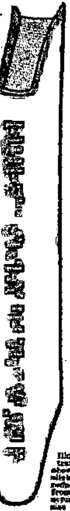

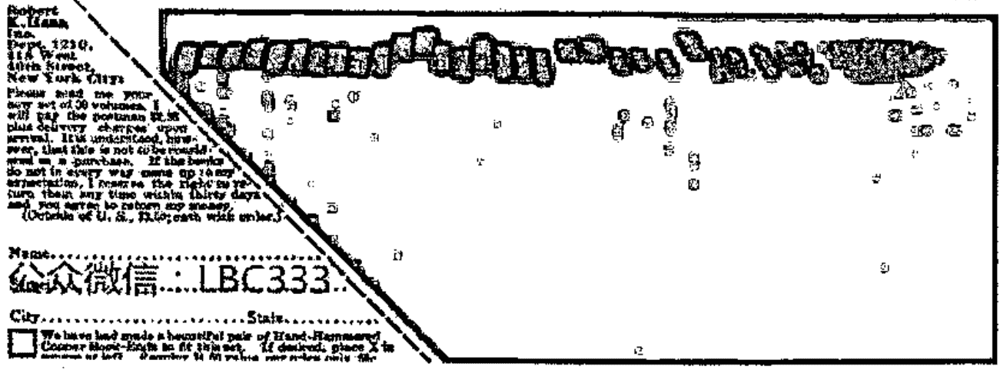

## 为什么他们的平均估价是正常价格的 6 倍？

这套书绝对物超所值，一些爱书者对它的估价高达它实际售价的 30 倍：884 位读书爱好者对它的平均估价达到实际售价的 6 倍。没有一个人的估价过低。你的估价是多少呢？

## 价值高到让人难以相信它是真的

884 位读书爱好者对 140 本价格为 4.5 美元到 9.5 美元之间的书籍的估价

| 数量 | 估价 |
|---|---|
| 132 | 10.00 美元 |
| 288 | 14.00 美元 ——15.00 美元 |
| 71 | 16.00 美元 ——20.00 美元 |
| 99 | 21.00 美元 —— 25.00 美元 |
| 115 | 30.00 美元 |
| 34 | 45.00 美元 —— 60.00 美元 |
| 5 | 90.00 美元 ——100.00 美元 |

如果你也是一个读书爱好者，如果你的身边有一些好书，那么肯定知道好书的价值。这是一套全新的世界杰作的豪华版套装——请你估计一下它的价值。在这套合集中，你会发现很多不朽的作者最优秀的作品，如：

- 吉卜林 伊丽莎白 欧文
- 肖恩 勃朗宁 柏拉图
- 巴里 杜马斯 坡

| 巴尔扎克 | 兰姆 | 屠格涅夫 |
| 易卜生 | 惠特曼 | 朗费罗 |
| 怀尔 | 惠蒂尔 | 丁尼生 |
| 梅特林克 | 但丁 | 阿尔伯特·哈伯德 |
| 叶芝 | 莎士比亚 | 詹姆斯·艾伦 |
| 布朗宁 | 爱默生 | 托马斯·摩尔 |

这些书，每一本都是完整版的；而非摘录。

为了帮助你估计这些书的价值，你需要知道下面的事实。这些书一共大约有 3000 页。该书采用精美的纯手工皮革包装，呈现古董铜色。采用的纸张和每卷售价 1.50 美元—2.00 美元的书籍采用的纸张一样。印字清晰，易读。这些书籍都采用了袖珍版；方便携带，无论何时何地，你都可以利用业余时间，进行阅读。

这些书的样本之前被送到 884 位爱书者手中。他们拥有很多书。我们让他们猜一猜这套 30 本书合集的价值。上面就是他们看完样本书后的估价。

你也来猜猜这套书的价值吧——如果你愿意，可以将你的估价写到本页边缘。我们的价格就印在优惠券上。然后，把你的估价和我们的价格对比一下。

## 怎么可能这么优惠

请注意，优惠券上的价格，是所有这 30 卷书籍的价格。除非我们做的每个声明都是对的。否则，本刊物也不允许我们在这里做推广。

我们能提供这么优惠的价格，也没有什么秘诀。是因为，我们印刷了近一百万。仅此而已——“批量生产”。现在已经销售了近 3000 万卷。

## 不用支付一份钱

仅通过照片，无法看到这本书真正的美。你必须看到实体书——所以，请你允许我们送一套给你试阅。你现在不用支付任何费用。只要把优惠券寄给我们，或写一张明信片，或一封信。收到书后，再给邮递员支付费用，然后试阅。你可以请你的一些朋友，猜一猜这套书的价格。如果你心存任何疑问，那么，请在 30 天内的任何时间退回此书，我们会立刻为你退款，不问任何问题。

## 罗伯特 K. 哈斯公司，出版商

（原小皮革图书公司）

## 罗伯特 K. 哈斯公司 210 部门

# 第 40 街 218 号西 纽约

请给我寄一套你的 30 卷合集。我收到书后，将支付邮递员 2.98 美元，加上运费。我知道，这并不是购买。如果这套书没有达到我的期望，我有权在 30 天内任何时间退回此书，并得到全额退款。

（美国以外的地区，费用为 3.50 美元，只接受现金。）

姓名....................................................

街道....................................................

城市....................................州......................

我们还制作了精美的手工铜书立。如果你需要，请在右边打 X。正常售价 1.50 美元，我们只收 69 美分。

## 笔记

## 37、丰富，柔和，多汁的鸡粉鲐鱼片

## The Tastiest Ocean Treat from Gloucester

plump, tender, juicy
CHICKEN SALT
MACKEREL
FILLETS

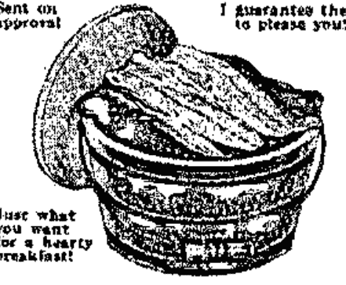

## TASTE THEM AT MY EXPENSE

You'll never know how delicious fish can be until you serve some of my mackerel fillets prepared the Down East way. It will be the recent talk of your table for a month. Take one of my new, small, meaty, late-caught mackerel fillets. Fry them in its own juices to a tempting brown, until the rich, tender meat falls apart at the touch of your fork. Serve piping hot. Your mouth will water at its appetizing aroma. You'll smack your lips over its wonderful flavor.

## What Makes My Mackerel Fillets So Good?

But you must get the right kind of mackerel fillets—the pick of the new late catch is what you want—to get this real food joy. That's the secret of the tempting goodness of my mackerel fillets. I send you the choicest fillets that are carefully sliced from the fat, tender sides of the new late-caught mackerel. Practically boneless, no waste parts whatever, these mackerel fillets are so tender and full bodied that they just melt into juicy mouthfuls.

## Send No Money Now — unless you wish to

Just send the coupon below or write me a letter, and I'll ship you a pail of 18 small, tender mackerel fillets—each fillet suitable for an individual serving. My fillets come to you all cleaned and ready for cooking, with no fat or body bones—no waste whatever. Just hefty fillets packed in new brine in a wax-lined wooden pail. Taste, one—broiled the Down East way. If not satisfied it's the finest mackerel you ever tasted, return the balance at my expense. Otherwise, send me only $2 within 10 days. 200,000 people buy from me in this 'prove-it-yourself' way. I've been doing business this way for 40 years and I must say that this is the lowest price for this size pail of mackerel fillets I've ever offered. Send your coupon today for this real Gloucester treat.

Frank E. Davis, The Gloucester Fisherman
134 Central Wharf, Gloucester, Mass.

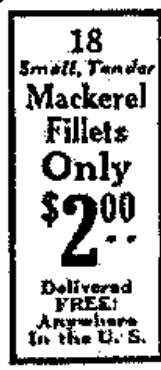

Mr. Frank E. Davis, The Gloucester Fisherman
134 Central Wharf, Gloucester, Mass.
Please send me, without charge, one pail containing 18 small, tender mackerel fillets. After trying a few fillets, I am not entirely satisfied, I will return the rest at your expense and you owe me nothing. Otherwise, I'll send you $2.00 within 10 days.
Name......
Address......
City...... 公众微信：LBC333

## 来自格洛斯特最美味的海味

## 丰富，柔和，多汁的鲑鱼片

## 试用装

## 保证你会喜欢！

## 这正是一顿丰盛的早餐所需要的！

## 零风险品尝它吧

除非你品尝过我用东部方法制作的鲑鱼片，否则，你将永远不知道鱼可以做得多么美味。

这将是你最近见过的最稀有的美味。取出一个新鲜，小巧，多肉的鲑鱼片。用清水冲洗干净。不用加任何佐料，直接用它的汁液进行烘烤至棕色，直到用叉子触碰，肥嫩的鱼肉能分开为止。此时，面对热腾腾的鱼，你一定会被它的香气诱惑的直流口水，急切地想要品尝，你一定会因为太烫而气急败坏。

## 是什么让我的鲑鱼片如此美味？

但是，购买鲑鱼片，你一定要选对——挑选最新鲜的——才能品尝到这种真正的食物乐趣。这就是我的鲑鱼片如此诱人的秘密。我会发给你最精挑细选的鲑鱼片，从肥美，鲜嫩，最新捕捉的鲑鱼上切下来的。几乎没有任何大的鱼骨，没有无用的部分，全是完全可以食用，鲜嫩，多汁的鲑鱼片。

## 现在不用支付任何费用——除非你自愿

只要邮寄下面的优惠券，或写信给我，我会立刻给你邮寄一桶含有18片小份的鲑鱼片——每一份都适合单独食用。而且全部是处理过的一一没有头——没有尾——没有大的鱼骨——没有不可食用的部分——只有用新鲜盐水浸泡，用蜡密封在木桶中的鲑鱼片。品尝一片——用东部方法烹饪。如果你不认为这是你品尝到的最美味的鲑鱼，你可以把剩下的寄给我，你不用支付任何费用。否则，在 10 天内，向我支付 2 美元即可。通过我这个“亲自验证”的方法，从我这里购买海鲜的家庭，已经有 200000 户了。我用这种方法销售鲈鱼，已经有 4 年，我必须说，这次是我这么多年来，同等数量的鲈鱼片，销售价格最低的时候。立刻邮寄优惠券，获取鳖鳖的格洛斯特最美味的鲈鱼片吧。

弗兰克E.戴维斯，格洛斯特的渔夫
134 中央码头，格洛斯特，马萨诸塞州

## 弗兰克E.戴维斯，格洛斯特的渔夫

134中央码头，格洛斯特，马萨诸塞州

亲爱的戴维斯先生：请寄给我，所有费用均为预付，含有 18 片小份，鲜嫩的鲈鱼片，而且全部是处理过的，没有头，没有尾，没有大的鱼骨。如果食用过几片后，我不是特别满意，我会把剩下的退还给你，我不用支付任何费用。否则，我会在 10 天内支付你 2.00 美元。

姓名..........................................................
地址..........................................................
城市....................................州..................
银行或支付方式........................................

*如果你现在通过支票全额付款，我会赠送你价值 25 美分的精美烹饪术，里面有 136 中海鲜烹饪菜谱。同样，如果你不满意，你会得到全额退款。

## 笔记

## 38、16 节舞蹈课 1 美元，你会支付吗，如果——

## Would You Give $1 for 16 Dancing Lessons If —

learning to become a good dancer made you so popular that everyone would be anxious to have you attend their social affairs,—and if learning to dance the Murray Way gave you poise, ease, self-confidence and helped develop your personality,—would you be willing to pay $1 for 16 dancing lessons from America’s foremost authority on social dancing?

Arthur Murray, instructor to the Vanderbilts and many other fashionable people in America and Europe, has perfected a wonderful new method by which you can learn any of the latest dance steps in a few minutes—and all of the dances in a short time.

Even if you don’t know one step from another—or whether you already know some of the steps—through Arthur Murray’s method you can quickly and easily master any dance without a partner and without music, right in your own home,—or the lessons won’t cost you a cent. More than 60,000 have learned this new easy way. Your own success is guaranteed.

- Do You Know
The Correct Dancing Posture
How to Gain Confidence
How to Follow Successfully
How to Avoid Embarrassing Mistakes
The Art of Making Your Best Look Attractive
The Correct Walk in the Pair Test
The Basic Principles in Walking
How to Walk Backward
The Secret of Leading
The Closes in the Fox Trot
The Forward Waltz, Step, Sing
How to Leave One Partner to Dance with Another
How to Learn and Also Teach Your Child to Dance
What the Advanced Teacher Should Know
How to Develop Your Sense of Rhythm
Etiquette of the Ballroom

Proof You Can Learn at Home in One Evening
To show you how easily any one can learn to dance at home without music or partner, Arthur Murray has consented to send, for a limited time only, his 16 Introductory Lessons for $1.00. Don’t send any money now—just this coupon. When the postman hands you the 16-lesson course just deposit $1.00 with him, plus a few cents postage, in full payment.
Keep the course for 5 days, and if within 5 days you are not perfectly satisfied in every way, return it and Mr. Murray will return your dollar promptly without question. Learn in private—surprise your friends. Act Now and be a good dancer soon.
16 Introductory Lessons $1.00
Arthur Murray, Studio 507, 100 Fifth Avenue, N.Y.

Arthur Murray, Studio 507, 100 Fifth Ave., New York
To prove that you can learn me to dance in one evening at home, you may send the 16-lesson new course in plain cover, and when the postman hands it to me I will deposit $1.00 with him (plus the few cents postage) in full payment. If within five days I decide to return the course, I may do so, and you will refund my money promptly and without question.
Name:…
Address:…
City:… State:…
If apt to be put where postman calls, send one dollar and we will pay postage. (Price outside U.S., $1.10 cash with order.)

## 16 节舞蹈课 1 美元

## 你会支付吗，如果—

通过学习，让你舞姿更美，让你更受众人瞩目，让每个人都想邀请你参加他们的聚会——如果学习默里的方法，能让你更有风度，更自信，能帮助你培养更好的性格——那么，你愿意为这出美国交谊舞权威老师的 16 节课支付 1 美元吗？

## 你知道吗

- 正确的舞态
- 如何变的更自信
- 如何成功跟上对方的舞步
- 如何避免尴尬的错误
- 让你的脚看起来更迷人的艺术
- 如何正确地走狐步舞步
- 华尔兹的基本原则
- 如何走向后华尔兹步
- 领舞的秘诀
- 狐步舞里的追步
- 如何走向前华尔兹步
- 如何离开一个舞伴和另一个舞伴跳舞
- 如何学习，并教自己的孩子跳舞
- 一个高级的舞蹈老师需要知道什么
- 如何培养节奏感
- 舞厅礼仪

阿瑟·默里，是范德比尔特以及美国和欧洲许多其他时尚人士的老师。他创造了一个奇妙的新方法，能让你在几分钟内，学会任何最新的舞步——在很短的时间内，学会所有舞蹈。

即使你不会任何舞步——或者，你已经知道一些舞步——但是，通过阿瑟·穆雷的方法，你可以快速、轻松地掌握任何舞蹈，不用舞伴，不用音乐，在自己家就能做到——不花费一分钱。超过 60000 人学会了这个简单的新方法。你也肯定能学会。

## 你在家，一晚上就能学会

为了让你看看一个人不用音乐，不用舞伴，在家学习跳舞是多么简单，阿瑟·穆雷同意，在有限的时间内，推出 1 美元 16 节推广课程。现在不用支付任何费用——只要邮寄优惠券即可。当邮递员把这 16 节课程交到你手中后，你再支付 1.00 美元给他，加上几美分的邮票费，这就是全部费用。

你可以保留这个课程 5 天，5 天内你有任何不满，都可以退回它，穆雷会立即为你退款，不问任何问题。私下学习，到了舞厅，惊艳你的朋友。立刻行动，你将很快成为一个好的舞者。

## 16 节推广课程 1 美元

## 阿瑟·默里，工作室 507，第五大街 100 号，纽约

为了证明你可以用一个晚上的时间，让我在家就能学会跳舞，我同意你邮寄 16 节推广课程给我，收到后，我会支付邮递员 1.00 美元（加上几美分邮票费）。如果在五 5 天内，我退回你的课程，我可以立刻得到全额退款，没有任何问题。

姓名.................................................

地址.................................................

城市......................................州..................

如果邮递员到你家时，你可能会外出，你可以支付 1 美元给我们，我们为你支付邮资，并寄出。（美国以外的客户，需要支付 1.10 美元现金。）

## 笔记

## 39、 “2.98 美元，买到世界上最伟大的 30 本名著”

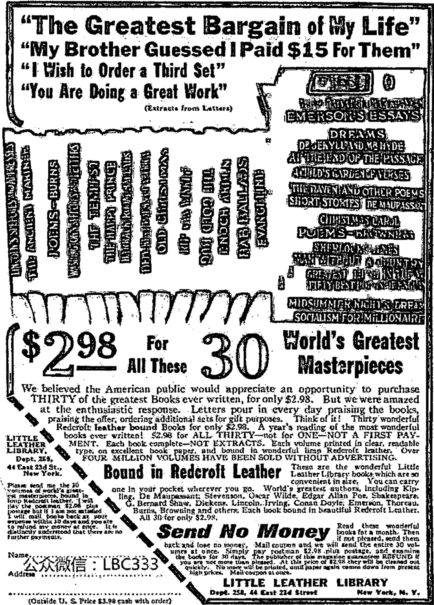

## “有生以来，我买到的最划算的东西”
“我弟弟还以为我花了 15 美元买的”
“我还想再买 3 套”
“你做的太棒了”

（摘自信件）

## “2.98 美元 买到世界上最伟大的 30 本名著”

我们相信，美国公众一定会感谢这次机会，让他们能以 2.98 美元购得 30 本最伟大的著作。但是，收到这么热情的回应，确实出乎我们的意料。我们每天会收到许多信件，有的赞美这些书籍，有的赞美这么低的价格，有的要多买几套，送给朋友，等等。

想想吧！30 本精美红色柔软皮革包装的著作，只要 2.98 美元。有史以来最精彩的书！只要 2.98 美元——不是一本书的价格——也不是首付价。每本书都是完整版本，而不是节选。每本印刷都十分清晰，方便阅读，纸张质量也非常好，采用的是红色柔软皮革包装。没做任何广告，就已经销售了 400 万册。

## 红色的柔软皮革包装

这些精美的小皮书，体积不大，方便携带，无论何时间何地，你都可以利用业余时间，进行阅读。世界上最伟大的书籍，包括吉卜林、莫泊桑、史蒂文森、奥斯卡·王尔德、埃德加·爱伦·坡、莎士比亚、茱伯纳、狄更斯、林肯、欧文、阿瑟·柯南·道尔、爱默生、梭罗、彭思、布朗宁等等。每本书都是精美的红色软皮革包装。30 本，只要 2.98 美元。

## 不用提前付款

这些书你可以免费试读 1 个月。如果不满意，把它们寄回来，你不会损失一分钱。邮寄下面的优惠券给我们，我们会立即把 30 本书寄给你。等你收到书后，只要给快递员支付 2.98 美元，还有快递费，然后查收就可以了。如果你有一点点不满意，出版商都承诺会立即为你退款。

这些书售价 2.98 美元，相信很快就会被抢购一空。你可以和其他售价比我们高的直邮营销人卖的书对比一下，自己决定哪个价值更高。如果想购买，请立即邮寄优惠券给我们。

## 小皮书书店
258 部门 第23 街道44 东 纽约

## 小皮书书店

258 部门 第23 街道44 东 纽约

请给我一套世界上最伟大 30 本杰作，红色柔软皮革包装的。我会给快递员支付 2.98 美元+邮费，但如果我不满意，我会在 30 天内把书退回去，你会立即给我退款。我非常清楚，你不会再加收任何费用。

姓名................................................................

地址................................................................

（美国以外的地区，请支付现金 3.98 美元）

## 笔记

## 40. 一场轰动！

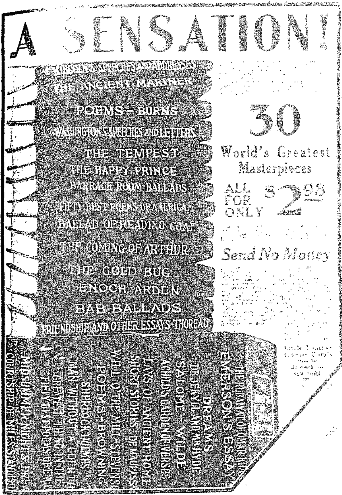

## 一场轰动！

有史以来最精彩的书籍，够你阅读 1 年！30 本，只要 2.98 美元——不是一本，也不是首付。每本书都是完整版本，而不是节选。每本印刷都十分清晰，方便阅读，纸张质量也非常好，采用的是红色柔软皮革包装，看起来比真皮更好。而且，没做任何广告，就已经销售了 400 万册。

## 30 本世界上最伟大的名著

## 只要 2.98 美元

免费试阅这些精彩的书籍一个月。如果不满意，立刻退回来，你没有任何损失。人们都说这是“他们一生中购买的最划算的东西”、“这套书价值至少 15 美元”、“请给我来 5 套”。

## 不用提钱付款

只要邮寄优惠券，或写信就可以订购。这些精美的小皮书，体积不大，方便携带，无论何时何地，你都可以利用业余时间，进行阅读。世界上最伟大的书籍，包括吉卜林、莫泊桑、史蒂文森、奥斯卡·王尔德、埃德加·爱伦·坡、莎士比亚、萧伯纳、狄更斯、林肯、欧文、阿瑟·柯南·道尔、爱默生、梭罗、彭思、布朗宁等等。每本书都是精美的红色软皮革包装。30 本，只要 2.98 美元。

邮寄下面的优惠券给我们，我们会立即把 30 本书寄给你。等你收到书后，只要给快递员支付 2.98 美元，还有快递费，然后查收就可以了。你可以试阅 30 天。该出版商承诺，如果你有一点点不满意，会立即为你退款。这些书售价 2.98 美元，相信很快就会被抢购一空。请立即邮寄优惠券给我们吧。

## 小皮书书店

3810 部门 第 4 大街道 354 纽约

## 小皮书书店

## 3810 部门

## 第 4 大街道 354 纽约

请给我一套世界上最伟大 30 本杰作，红色柔软皮革包装的。我会给快递员支付 2.98 美元+邮费，但如果我不满意，我会在 30 天内把书退回去，你会立即给我退款。我非常清楚，你不会再加收任何费用。

姓名..................................................................

地址..................................................................

（美国以外的地区，请支付 3.5 美元现金。）

## 笔记

## 41、“每月读书会”是什么～为什么成立这个读书会？

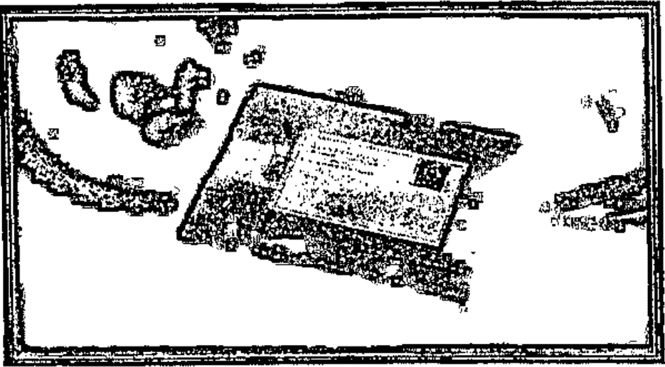

## What’s the “book-of-the-month” this month ~ and why?

It is a very remarkable new book, not yet published, chosen by the distinguished group of five critics who compose our Selecting Committee, as the outstanding work among the many books that were submitted last month, in advance of publication, by the publishers of this country.

If you were a subscriber to the Book-of-the-Month Club service, you would not only receive a full report about this book, but you would make sure of getting it, if you decided after reading our Committee’s report, that it was a book you would not care to miss reading.

You would not be obliged to take it, however, unless it appealed to you. You are given the opportunity of choosing some other important forthcoming book. For instance, last month there were some twenty books about which our Committee reported to members. You might have preferred one of these, in place of the “book-of-the-month;” and if none of them appealed to you—you would not have had to take any!

Moreover, if you take any one of the Books recommended by our Committee, and find you have been misled by the report, you may exchange it for another at the same price. This “guarantee of satisfaction” completely protects you in your book purchases.

Through this unique and complete service, you need never miss any book you are particularly keen to read. How often now, through oversight, do you forget to obtain outstanding books you intend to read, and then have to confess, months afterwards, that “you never got around to it?”

Over 90,000 of the most notable people in the country—in every line of endeavor—now guard themselves against missing the new books they want to read, by belonging to the Book-of-the-Month Club. They are people of your tastes and standards. They don’t receive any book, unless they want it; but they do make absolutely sure, by this service, that they get and read the books they are anxious not to miss.

Why not try it yourself? The service does not cost you anything! There are no dues, no fees, no extra charges of any kind. You pay only for the books you decide to take, and the same price as if you got them from the publisher himself by mail!

Surely, among the 150 or more books our Committee will report upon in 1929, there will be several you will be very anxious not to miss. Find out how this valuable service will absolutely prevent you from missing them. Mail the coupon below for full information. Your request will involve you in no obligation.

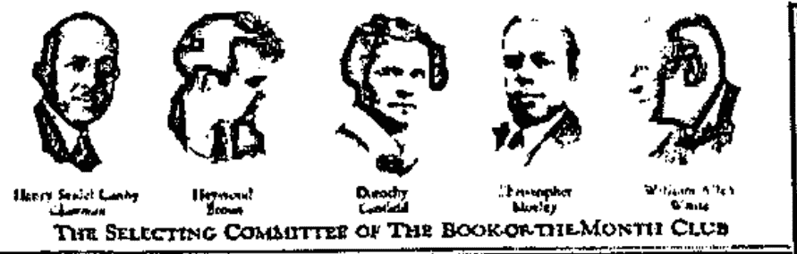

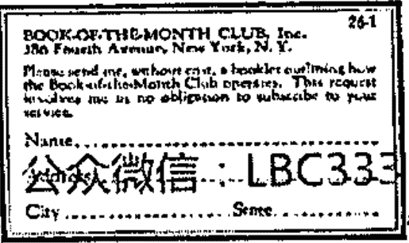

## "每月读书会" 是什么 ~ 为什么成立这个读书会？

这是一本非常了不起的新书，现在还没有发表。这本书是我们图书精选委员会的 5 个知名评论家，从上个月出版商们提交的许多待出版书籍中，精挑细选选出来的。

如果你是每月读书会俱乐部的订阅者，你将不仅得到这本书的完整报告，而且，读过我们精选委员会的报告后，你肯定会想得到这本书，你一定不想错过这本书。

然而，你并没有义务购买这本书。你还可以从其它一些将要出版的好书中，选择其它你喜欢的书籍。比如，上个月我们的精选委员会报告给会员的书籍，有大约 20 本。你可能会喜欢其中的一本，而不是 “我们精选出来的那本”；如果其中任何一本你都不喜欢——那么，你就不需要购买任何一本！

此外，如果选择了我们精选委员会推荐的任何一本书，结果发现你不是特别喜欢这本书，你想把它换成等价的其它书籍。那么，“满意保证” 会绝对保护你挑选书的权利。

通过这种独特的、全面的服务，你将永远不会错过任何一本你特别想读的书。有多少次，你因为疏忽，忘记了购买你想阅读的杰出书籍。几个月之后，你还是没有读到它，因为你 “从来没有想办法去购买？”

国内超过 90000 位名人——各行各业——为了不错过自己想读的书籍，现在，都成了每月读书会俱乐部的会员。他们和你一样，都是爱书人。除非他们喜欢，否则，我们不会强行卖给他们任何一本书；但是，他们通过这种服务，确保自己不会错过任何一本他们想要的书。

你为什么不亲自试一试呢？这个服务不会花费你任何成本！没有年费，没有会费，没有任何额外费用。你只需支付你决定购买的书籍的价

格即可。和你向出版商购买的价格一样！

当然，在我们的精选委员会将要推出的 1929 年的 150 本，甚至更多的书籍中，肯定有几本你不想错过。快来看看这个服务多么有价值吧。立刻邮寄下面的优惠券，获取完整信息。你不用承担任何义务。

## 每月读书俱乐部公司

第 4 大街 386 号 纽约

请寄给我有关月读书俱乐部的详细介绍，我不用支付任何费用。发送这个请求，我也没有任何义务购买订阅服务。

姓名....................................................

地址....................................................

城市....................................州.........................

## 笔记

## 42、有生以来，你买到的最划算的东西

## THE GREATEST BARGAIN OF YOUR LIFE

## $2 98 FOR ALL THIRTY WORLD'S GREATEST MASTERPIECES

We believed the American public would appreciate an opportunity to purchase THIRTY of the greatest books ever written, for only $2.98, but we were amazed at the enthusiastic response. Letters pour in every day praising the books, praising the offer, ordering additional sets. Think of it. Thirty wonderful Books for only $2.98.

## Flexible Redcroft Binding

A year's reading of the most wonderful books ever written for $2.98 for ALL THIRTY—not for ONE—NOT A FIRST PAYMENT. Each book complete—NOT EXTRACTS. Each volume printed in clear, readable type, on excellent book paper, and bound in wonderful, flexible Redcroft—looks and wears better than leather. Over FOUR MILLION VOLUMES HAVE BEEN SOLD WITHOUT ADVERTISING.

## SEND NO MONEY

Just mail coupon or letter. These are the wonderful little Leather Library books which are so convenient to size. You can carry one in your pocket wherever you go. World's greatest authors including Kipling, De Maupassant, Stevenson, Oscar Wilde, Edgar Allan Poe, Shakespeare, Lincoln, Irving, Conan Doyle, Emerson, Thoreau, Byron, Henry Drummond, Orr, Kipling, Bulwer Lytton and others. All 30 vols together $2.98. Mail coupon and we will send the entire 30 volumes at once. Simply pay postman $2.98 plus postage, and examine the books for 10 days. The publisher of this magazine guarantees REFUND if you are not more than pleased. At this price of $2.98 they will be cleaned out quickly. Mail coupon or copy it in a letter at once.

LITTLE LEATHER LIBRARY CORP'N Dept. 384 354 - 4th Ave. New York City, N. Y.
Little Leather Library Corp'n Dept. 384 354 - 4th Ave. New York City, N. Y.
Please send me the 30 vols of world's greatest masterpieces, bound in Flexible Redcroft. I will pay the postman $2.98 plus postage, but if I am not satisfied I will mail the books back at your expense within 30 days and you agree to refund my money at once. It is distinctly understood that there are no other payments.
Name...
Address... 公众微信： LBC333

(Outside U.S. Price $3.98 cash with order.)

- WASHINGTON'S SPEECHES AND LETTERS
- THE TEMPEST
- BALLAD OF READING GAOL
- POEMS - BROWNING
- SHERLOCK HOLMES
- MAN WITHOUT A COUNTRY
- GREATEST THING IN THE WORLD
- FIFTY BEST POEMS OF ENGLAND
- MIDSUMMER NIGHT'S DREAM
- FRIENDSHIP AND OTHER ESSAYS - THOREAU
- THE ANCIENT MARINER
- LINCOLN'S SPEECHES AND ADDRESSES
- THE HAPPY PRINCE
- BARRACK ROOM BALLADS
- POEMS - BURNS
- FIFTY BEST POEMS OF AMERICA
- SALOME - WILDE
- WILL-O'-THE-MILL - STEVENSON
- THE GOLD BUG
- ENOCH ARDEN
- BAB BALLADS
- LAYS OF ANCIENT ROME
- THE RUBAIYAT OF OMAR KHAYYAM
- EMERSON'S ESSAYS
- DREAMS
- DR JEKYLL AND MR HYDE
- GILBERT AND SULLIVAN STANDISH
- NASH'S GARDEN OF VERSES
- THE COMING OF ARTHUR
- SHORT STORIES - MAUPASSANT

# 有生以来，你买到的最划算的东西

## 2.98 美元

## 买到世界上最伟大的杰作

我们相信，美国公众一定会感激这次机会，让他们能以 2.98 美元购买 30 本最伟大的杰作。但是，收到这么热情的回应，确实出乎我们的意料。我们每天会收到许多信件，有的赞美这些书籍，有的赞美这么低的价格，有的要多购买几套，送给朋友，等等。想想吧！30 本精美红色柔软皮革包装的杰作，只要 2.98 美元。

## 红色柔软皮革包装

有史以来最精彩的书籍，够你阅读 1 年！30 本，只要 2.98 美元——不是一本，也不是首付。每本书都是完整版本，而不是节选。每本印刷都十分清晰，方便阅读，纸张质量也非常好，采用的是红色柔软皮革包装，看起来比真皮更好。而且，没做任何广告，就已经销售了 400 万册。

## 不用提前付款

只要邮寄优惠券，或写信就可以订购。这些精美的小皮书，体积不大，方便携带，无论何时何地，你都可以利用业余时间，进行阅读。世界上最伟大的书籍，包括吉卜林、莫泊桑、史蒂文森、奥斯卡·王尔德、埃德加·爱伦·坡、莎士比亚、萧伯纳、狄更斯、林肯、欧文、阿瑟·柯南·道尔、爱默生、Kre...、彭思、布朗宁等等。每本书都是精美的红色软皮革包装。30 本，只要 2.98 美元。

邮寄下面的优惠券给我们，我们会立即把 30 本书寄给你。等你收到书后，只要给快递员支付 2.98 美元，还有快递费，然后查收就可以了。你可以试阅 30 天。该杂志的出版商承诺，如果你有一点点不满意，会立即为你退款。这些书售价 2.98 美元，相信很快就会被抢购一空。请立即

邮寄优惠券给我们吧。

## 小皮书书店

3810 部门 第4 大街道354 纽约

## 小皮书书店

3810 部门 第 4 大街道 354 纽约

请给我一套世界上最伟大 30 本杰作，红色柔软皮革包装的。我会给快递员支付 2.98 美元+邮费，但如果我不满意，我会在 30 天内把书退回去，你会立即给我退款。我非常清楚，你不会再加收任何费用。

姓名................................................

地址................................................

（美国以外的地区，请支付 3.5 美元现金。）

## 笔记

# 43、给病人的 6 本书

## DEPARTMENT OF PROGRESSIVE ADVERTISERS

## Six Books for the Sick

## What I Learned After 30 Years

+ Which shall I send?
Book 1 on Dyspepsia.
Book 2 on the Heart.
Book 3 on the Kidneys.
Book 4 for Women.
Book 5 for Men (sealed.)
Book 6 on Rheumatism.

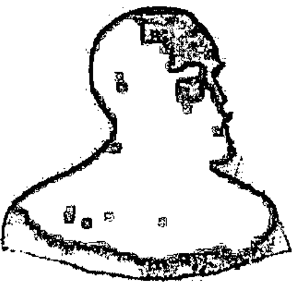

No money is wanted. Simply select the book you need. It is my experience as a specialist of 30 years. In the book I tell how at last I found a way to reach difficult, deep-seated diseases. Thirty years of earnest, arduous trial in hospitals and at bedside made it possible for me to write these books. The books tells how I perfected my prescription —Dr. Shoop's Restorative. Blow by scientific experiments I traced out the causes that bring on chronic disease.

I found invariably that where there was a weakness, the nerve nerves were weak. Where there was a lack of vitality, that the vital nerves lacked power. Where weak organs were found, I always found weak nerves. Not the nerves commonly thought of, but the vital organs' nerves. The inside—the invisible nerves. This was a revelation. Then my real success began. Then I compounded ingredients that would strengthen—that would vitalize these nerves. That prescription I called a restorative. It is known the world over now as Dr. Shoop's Restorative. After that I did not fail to cure one in each hundred. In the extremely difficult cases, my failures for five years were only one in each forty treated. I found cancer incurable. Cancer is for surgery, not medicine. That how to get this prescription to the sick and everywhere, was my thought. I must advertise it in the public press. But, thought I, will they realize the real truth of my discovery—the real power of Dr. Shoop's Restorative? That it way came to me—like an inspiration. “I will offer it to the sick on trial,” said I. “Then they will know I am sincere.” I wrote a notice to drugists in each city and village in America. I got their agreement to co-operate with me.

## Now by any sick one

## Dr. Shoop's Restorative

Can be taken at my risk.

For a full month I will let you use it heartily at my risk. Send no money. Just write me for the book you need. When I send it I will tell you of a draught near you who will permit the month's trial. Take the Restorative a month. Then decide. If you say to the druggist, “It did not help me,” that will relieve you of any expense whatever. He will bill the cost to me. This is my way of clearing your mind of all doubt as to what Dr. Shoop's Restorative can do. No matter how prejudiced you cannot dispute this absolute security I offer. You cannot resist an offer like this if you are at all sick. If you have a weakness, write me. If you can't do things like you used to do them, tell me about it. Write in confidence. As a physician I will tell you a way to help. Get my book now—to-day. Address Dr. Shoop, Box 541 Racine, Wis. Mild cases not chronic, are often cured by one or two bottles. At druggists.

公众微信：LBC333

## 给病人的 6 本书

## 我 30 年的经验

## 我应该送给你哪一本呢？

书 1 消化不良

书 2 心脏健康

书 3 肾脏健康

书 4 女性健康

书 5 男性健康（密封）

书 6 风湿病

不收取任何费用。

你只要选择自己需要的书籍。

这些都是我 30 年的专业经验。在书中，我阐述了如何诊疗疑难杂症，根深蒂固的疾病的终极方法。30 年在医院认真，热忱的辛勤工作，以及丰富的临床经验，使得我能够写出这些书籍。

这本书讲述了我如何不断完善药方——苏珀医生的恢复疗法。以及，我如何通过科学实验，找到慢性疾病的根源。

我发现一个不变的真理，身体衰弱的部位，与之相对应的神经肯定脆弱。

如果哪个器官缺乏活力，那么与之相对应的神经肯定缺乏力量。

如果哪个器官衰弱，那么与之相对应的神经肯定衰弱。

这些都是相关的。

由此，我取得了成功。

然后我结合能强化神经的成分—激发这些神经。

这个处方我称为恢复疗法。现在苏珀医生的恢复疗法在全世界已经众所周知。之后，用我的方法治疗的人，康复率百分之百。对极其困难的病例，5年来，每40个病人中，只有1个没有治愈。我发现这个方法无法治愈癌症。癌症是外科手术，无法用药物治疗。

之后，我一直在思考，如何让世界各地的病人，都得到这个处方。

我必须在公共媒体上宣传。但是，我想，他们能真正意识到我的发现的重要性吗——他们能看到苏珀医生康复疗法的真正威力吗？然后，一个方法——就像灵感一样突然出现在我的脑海。

“我要让病人试用。”我说。“这样他们就会知道，我是真诚的。”

我为美国的每个城市和乡村中所有可靠的药剂师，都写了一封信。

最终，他们同意和我合作。

## 现在，任何一位病人都能零风险试用

## 苏珀医生的康复疗法

我将零风险让你试用它整整一个月。不用支付任何费用。你只要写信告诉我你需要的书。我就会把它寄给你，并告诉你附近药剂师，让他允许你试用一个月。试用恢复疗法一个月。然后，决定是否要购买。如果这些对药剂师说，“它没有帮到我，”那么你不用支付任何费用。我会支付费用给他。

这是消除你对苏珀医生的恢复疗法的疑虑的方法。无论你多么偏见，你都一定会认同我的方法的安全性。如果你是一个病人，你肯定不能拒绝我的提议。如果你觉得哪里不舒服，请写信给我。作为医生，我会告诉你该怎么做。

立刻写信获取我的书吧。

地址：苏珀医生，5231 信箱，威斯康星州

非慢性疾病的普通疾病，通常一两瓶就可以治愈。在药剂师那里购买。

在写信给本广告中的地址的时候，记得提及《国家杂志》。

## 笔记

# 44、在美国，谈论这款优质汽车的人，比其它任何车都多

## WILLYS OVERLAND FINE MOTOR CARS

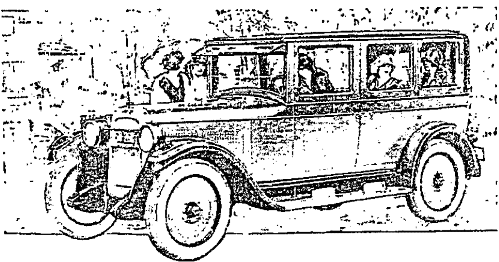

## More people are talking
about this Fine Car than
any other Car in America

From the very first, thousands of far-seeing motorists predicted that the new Overland Six would be the outstanding automobile of the year. It was the unrivaled hit of all the Automobile Shows—the great favorite of the crowds—and its success has grown to proportions never before attained by any other automobile in comparable time. ¶ People who know automobiles unhesitatingly call the new Overland Six an engineering masterpiece. It is beautifully designed … wonderfully balanced … beautifully built… beautifully finished and a brilliant performer on the open road, in traffic, on hills. ¶ It gives you hair-trigger action when you touch the throttle. It gives you speed … and smoothness … and economy you'd never expect with six-cylinder performance. Reclined seats and long flexible springs give delightful riding comfort. A demonstration is a revelation! Don't fail to see the new Overland Six! Willys-Overland, Inc., Toledo, Ohio—Willys-Overland Sales Co., Ltd., Toronto, Canada.

## The Fine
New OVERLAND
With Six Cylinders

STANDARD SEDAN, $985; DE LUXE SEDAN, $1150, F.O.B. TOLEDO

## 威利斯越野公司优质汽车

## 在美国，谈论这款优质汽车的人
比其它任何车都多

从一开始，无数有远见的车主就预计，6 个气缸的全新威利斯-奥佛兰汽车，将是一款十分出色的汽车。它无与伦比，在所有汽车秀一展风采——备受人们喜爱——它的成功，是之前任何其他可与之匹敌的汽车都无法相比的。

了解汽车的人，毫不犹豫地称 6 个气缸的全新威利斯-奥佛兰汽车是一个杰作。它设计精美……完美的平衡性……漂亮的结构……精美的做法工，无论在公路，铁路，还是山路，都有杰出的表现。

它易发动，一触即发。它的速度，流畅性……经济型，都是你在 6 个气缸的车上想也想不到的。下弯的座椅，长而有弹性的弹簧，能带给愉快的舒适性。看过演示你就能明白一切！千万不要错过！威利斯越野公司，托莱多，俄亥俄该州——威利斯越野公司销售有限公司，加拿大多伦多。

## 拥有 6 个气缸的全新威利斯-奥佛兰汽车

标准轿车，985 美元；豪华轿车，1150 美元；托莱多离岸价

## 笔记

# 45、你会根据票价来判断一场表演的好坏——还是会根据你看到的表演来判断？

## Do you judge a play by
the price of the ticket—
or by the performance
you see?

Do you judge a sack of flour by the cost—
or by the quality of the bread it makes?

Do you judge a suit by the tailor's bill—
or by the fit and finish of the clothes themselves?

Do you judge a hotel by the rate per day—or by the service you get?

Does low price give you as much satisfaction as good quality?

Then why judge a motor car by its price?

You cannot get something for nothing.
You get exactly what you pay for.

You can't get Chalmers Quality at less than Chalmers price.

## Chalmers Motor Company
Detroit, Michigan

+ New Six-40 $1400
Light Six-48 $1650
Master Six-60 $2400

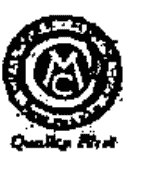

公众微信：LBC333

## 你会根据票价来判断一场表演的好坏
——还是会根据你看到的表演来判断？

你会根据价格判断一袋面粉的质量——还是根据它做出来的面包质量进行判断？

你会根据裁缝的收价，判断一套服装的价值——还是根据衣服是否合身进行判断？

你会根据酒店的评价判断一个酒店——还是根据你享受到的服务进行判断？

低价格能带给你和高质量一样的满足感吗？

那么，为什么要根据汽车的价格判断它的价值呢？

你无法不劳而获。你付出多少，才能得到多少。

你不能以低于查尔姆斯的价格，得到查尔姆斯的质量。

|  | 查尔姆斯汽车公司 密歇根州，底特律 |
|---|---|
| 新型六—40 1400 美元 轻型六—48 1650 美元 专业版六—60 2400 美元 | 质量第一 |

## 笔记

# 46、如何为汽车估值

## THE SATURDAY EVENING POST

## Overland

## How To Make
An Automobile Valuation

DETERMINING the value of an automobile is exactly like finding out the worth of any other staple article of necessity, the real value of which you do not feel capable of passing judgment on yourself. If you wanted a new heating system installed in your home, your first move would be to write several responsible concerns and invite them to make bids. These bids you would analyze and see exactly what each firm offered and at what price. You would check each list of specifications—one against the other. If all the propositions specified about the same standard equipment, but varied in price, you naturally would give the job to the lowest bidder. Having satisfied yourself as to quality it would come right down to a matter of dollars and cents.

Analyze an automobile in the same way. It's merely a case of simple comparisons. Merely a case of seeing what is offered you at a given price—just a simple checking up of the specifications—and finding out something about the concern that made the car—whether or not they are large manufacturers or just assemblers—whether or not many of their cars are in use—if so, how many? And get some facts about the car's record, about its ability to "stand up." In other words, put the facts of one car against the other, and then you can determine for yourself which is the best to buy at a given price.
A comparison of the Overland Model 52 at $1690 with any $2500 car on the market will show you how sixteen hundred dollars will go as far as twenty-five hundred. Just take the specifications of any $2500 car. Start with the wheel base and go on through with the rear—horse power—size of wheels—transmission—tires, etc. Check up the whole equipment and see if the $1000 Overland won't last once with the $2500 machine. A car should not be judged by its price. It's the worth of the car you are paying for—the actual facts determine its intrinsic value. Facts are the only things you can base your valuation on.

You know that the greater the manufacturing facilities of a plant the more economical is its finished product. The Overland plant are the largest and most economically operated in the world. They employ 4000 of the most skilled men known to the trade. They operate more automatic machinery than other manufacturers. Here you will find more modern methods for reducing manufacturing costs, and this is only possible by our enormous annual output. This year we will build 20,000 cars. Any business man knows that a plant making 20,000 cars can naturally produce them for less cost—car for car—than the manufacturer making but three or four thousand.
Go to our dealer. Get an Overland catalogue. Do the same with other dealers. Take them all home. Make the simple comparisons we pointed out and rely on your own common sense. Of course, if you know something about a motor car, so much the better. In that event, you'll buy an Overland quicker than ever. If you will send us your name and address we will gladly mail you an Overland Book. This gives you the facts you want. Ask for Catalogue A-26.

## The Willys-Overland Company, Toledo, Ohio

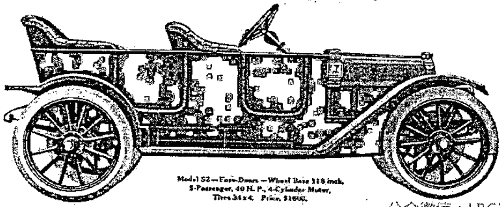

## 威利斯-奥佛兰汽车

## 如何为汽车估值

确定一辆汽车的价值，就像其它许多你无法亲自判断其价值的必需品一样。如果你想要在家安装一套新的供暖系统，你首先要写一些你可能会关心的事项。然后，根据这些事项要点进行对比。

通过分析，你确定了每家公司提供的产品和价格的大概情况。然后，你根据列表上的数据进行逐一对比。如果所有的好几家的产品品质都一样，但是价格不同，你自然会购买价格低的那一家。在确定好自己满意的产品质量后，接下来，就只需要考虑价格了。

分析汽车的价值也是一样的方法。首先，是一个简单的比较。看在特定的价格下，你能买到什么样的车——简单对比一下参数——以及你对车的其它一些要求——他们是大厂家，还是只是组装商——现在开这种车的人多吗——如果多，有多少？查看有关这辆车的某些纪录，查看它的实用性。换句话说，把这辆车的参数和别的车进行对比。之后，你自己就能确定在特定的价格下，购买哪辆车最好。

把 1600 美元的威利斯-奥佛兰 52, 和市场上 2500 美元的车进行对比，你将会看到这台 1600 美元的车，和那些 2500 美元的车性能几乎一样。我们随意抽取任何一辆 2500 美元的车的规格做个对比。首先是将轴距，然后是发动机——马达——轮胎尺寸——传动装置——内外饰件，等。

将 1600 美元的威利斯-奥佛兰 52 的这些参数与之一一对比，看威利斯-奥佛兰 52 是否在哪个方面无法与 2500 美元的车匹敌。买车，不能根据价格判断它的品质。而要看你购买的车的价值，事实，以及真实的数据才能决定它的内在价值。事实是评估一辆车的价值的唯一标准。

你知道，生产商越大，它的成品价格就越经济。威利斯-奥佛兰是世界上最大的汽车生产商。他们雇佣了 4000 位最懂贸易的人。他们的汽车销售量比其它任何生产商都高。下面，你将看到降低汽车生产成本的一

些更加现代的方法，只有我们年产量这么高的厂家，才能做到。今年我们将生产 20000 辆汽车。任何一个商人都知道，生产 20000 辆汽车的厂家，生产成本，要远低于那些生产三四千辆汽车的厂家。

去我们的经销商那里看看吧。试驾一下威利斯-奥佛兰。然后，再看看别的品牌的经销商。根据我们说的要点，以及你自己的常识做一些简单的比较。当然，如果你知道一些关于汽车的知识，那就更好了。在那种情况下，你会更快地选择威利斯-奥佛兰。如果你愿意，请给我们留下你的姓名和地址，我们将很乐意给你寄一本有关威利斯-奥佛兰的手册。里面有一些你可能想要了解的事实。请索要目录册 A-26。

## 俄亥俄州托莱多市，俄亥俄州，托莱多市

型号 52—四门—118 英寸轴距，可载五位乘客。
40 马力，拥有 4 个气缸，轮胎尺寸 34x4。
价格 1600 美元

## 笔记

# 47、如何保护自己，不被侵扰生活的人体寄生虫干扰！

## How to Defend Yourself Against the HUMAN PARASITES Who Want to Rule Your Life!

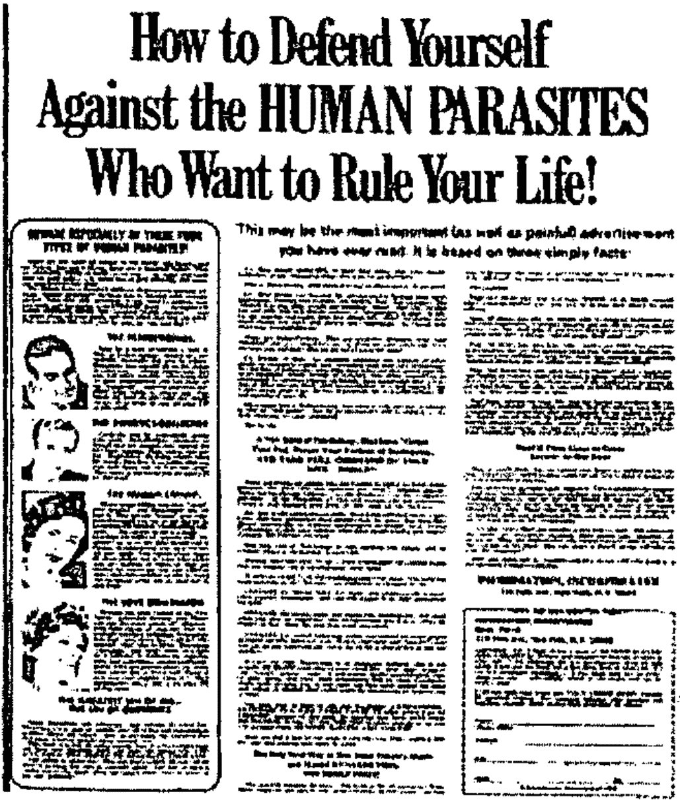

## 如何保护自己

## 不被侵扰生活的人体寄生虫干扰！

这可能是你阅读过的重要（最令人心痛）的广告。此广告基于 3 个简单的事实：

（1）大多数人花费 90% 的时间，做别人想让他们做的事——而不是他们自己内心想做的事。

这是机器人式的 生活。有一个方法可以永久地打破它。

（2）大多数人都被一种自己无法理解的自我毁灭感困扰着——这种感觉让他们感到恐惧，压抑。例如：总是担心别人比自己“好”。或者，现在总觉得自己是，而且以后也将一直是一个“二等公民”。或者，无论你赚多少钱，总觉得自己“穷”，无论你有多大的成就，总觉得“做得不够”。

这是机器人式的感觉。这些都是你童年时留下的阴影。到了成年，极大地扰乱着你的生活。很快，你将学习如何永远摆脱这些情感。

因为这 2 种极其有害的压力——别人可能会想尽办法不断利用你，加上你自己内心的自我毁灭——你（像其他大多数人一样），一生将活在情感的监狱里，丝毫感受不到快乐。你让自己被敌人，而不是朋友包围着。你只能完成真正想达成的目标的一小部分。你离真正的快乐，真正的成就，生活的真正意义越来越远。

再说一次，这是机器人式的 生活。只有一种方法改变这种状态。不是通过“意志力”。不是通过精神分析。也不是通过挖掘童年的记忆。

而是：

一种新的心理学，它的理念是
“忘记过去，忘记你的不足，活在当下！”

忘却的心理习惯，让你自动放大别人的付出，你会逃离他们的统治。

摆脱之前每次结识一个新的重要陌生人时，总觉得自己十分渺小的心理习惯——做到这点，你开口的第一句话，就能给他留下难以忘怀的印象。

摆脱之前总期望着别人施舍一点爱，一点尊重，一点快乐和“成功”的心里习惯——明天你就可以走出去，寻找自己的快乐，得到任何自己想要的东西！

事实上，这种新的心理学十分特别，它能重新改变你对“爱”、“尊重”和“成功”这些词语的理解。它会告诉你“爱”、“尊重”和“成功”这些词语中致命的心理陷阱，这些陷阱驱逐着你追逐虚假、空虚的生活目标。它将向你展示别人如何假借将会剥夺你的“爱”、“尊重”和“成功”，来威胁你，控制你的一举一动。

这个简单的新心理学观念的主要目标就是“释放”——让你从这些假的恐惧，假的朋友中释放出来！为了这个目标，现在为你推荐一本新书，里面介绍了这个心理学——我们邀请你从头到尾零风险阅读一遍——这本书就是《超越成功和失败》。

当然，有一些人被这种双重压力困扰得痛苦不堪，他们的生活几乎被压力压得像是一场灾难。使得他们因为压力变得要么得了慢性病——要么酗酒——要么赌博——要么，和许许多多的男男女女一样，不断地被迫进食，直到他们胖的像气球一样膨胀起来。

最重要的一点是:这些自我毁灭——主宰了这些人的生活许多年——普通心理治疗几乎束手无策——在这些人尝试一种新的负面自我疗法时，似乎就会失去它们的攻击力。

这种新心理学十分新奇，而且简单，有效。从本质上说，它的理念是:

要永远逃离这种双重压力——你不用学习任何东西!不用遵守任何规

则——不用记忆任何公式，不用上任何课程。

相反，你要做的只有这个！摆脱之前一直奴役着你的心理习惯！

下面是在你打开它的第一晚，就能帮助你摆脱的几个陷阱：

## 赢得别人的赞同和关心的唯一方法！

## 先满足自己！

然而，我还需要警告一下：这本书充满了矛盾。里面的观念（比如上面的那个）最初看起来可能有点可笑——甚至有点可怕。但是，随着你的深入阅读，你会发现，里面全是深奥，巧妙的真理。

比如：

第 215 页将告诉你，为什么当别人轻视你时，不要尝试去澄清自己。以及如何不费吹灰之力摧毁他们的攻击。

第 66 页，将告诉你为什么想在地位上压你一头的人，实际上是在向你乞讨一样他们用所有金钱都买不到的东西。以及他们为什么会这样。如果你知道如何正确的对待这件事，你就会真正的发现这些 “虚荣的人”。

第 24 页，将告诉你，为什么恐惧、仇恨、焦虑并不是你真正的情感，而是你童年时的一种隐藏的情感的伪装。以及，为什么当你揭开心底这种童年时的情感错觉后，这些恐惧就会在一夜之间消失。

第 178 页，将告诉你，为什么当你因为某个坏习惯 “感到罪恶感” 时，它会以加倍的威力让你继续重复这个坏习惯。以及第 181 页，将向你证明，再强的意志力，在这些坏习惯面前都没用。以及，为什么如果你想摆脱这些坏习惯，就要先放松自己。

然后，从第 194 页开始，你将被迫面对那些把你的生活变得一片混乱的，所谓的 “无法解决的” 个人问题——并学习如何不费吹灰之力解决它。再说一次，你将看到一个悖论，这些问题困扰你时间越长——你越 “糟糕” ——这个方案解决你问题的速度就越快。一旦你停止对抗这些问题，

这些问题就会开始自己解决自己！

## 完全零风险从头到尾读完它！

此外还有很多很多，无法在这里一一全部介绍。这本书非常值得一读——我们请你零风险，从头到尾读完它！

我必须再指出一点：这可能是你读过的最简单——最美的心理学书籍。这个新的心理学理念认为，我们完全可以不受过去的影响，我们可以立刻摆脱它——只要我们有勇气去遵循几个简单的规则。这些规则6岁的孩子都能理解。而且，非常轻松地就能掌握，并在生活中运用。

它们真的非常有效。它们其实是一种新的方式，一种可以克服别人给我们设置的痛苦，具有破坏性的情境。它们切合实际，非常具有实用性。如果你有勇气试一试，它们从明天开始，就能给你的生活带来惊人的改变。

为什么不立刻寄出优惠券，亲自验证呢——一切零风险我们承担，立刻行动吧！

信息公司
PA-15 部门
119 第5大街，纽约，10003
尤其当心这4种人类寄生虫！

世界上 有两种人：给予者和索取者。对于每一个给予者，就有100个相应的索取者。这些人总是试图抓住你……不停地向你索取。

索取者有100种不同的伪装形式——100种不同的“隐藏策略”，来迫使你成为他们永远的仆人。因此，如果你想实现自己，而不是他们的目标，你的第一个任务就是揭露他们……揭露他们隐藏在“高尚的动机”下面的自私……永远摆脱他们的控制！这本书会一个一个地揭露类似的伪装，比如：

## 完美主义：

可能是男性，也可能是女性——可能是妻子或老板或同事。永远都会给你设定一些不可能的标准。然后，按照这个标准，评价你的生活……总是说你永远也不会成功——你取得的每个成就，都会略低于他的“标准”——你必须不断地努力讨好他。用一个简单的方法，你就能打破他的看法。请见第 190 页。

## 不公平主义者

通过让你觉得内疚来控制你。他会制造事件，让你觉得你伤害了他的感受。然后，通过让你做一些他想让你做的事情，来求得他的“宽恕”。这个陷阱如此微妙，你只能通过一个方法打破它。这个方法就在第 132 页。

## 困境不断者：

永远不停地告诉你自己多“软弱”，多“被动”，多“依赖别人”。而你正是“最坚强”的那个——直到你试图让他做一些改变。然后，他什么也不做……什么都懒得做。他会找各种各样的理由，拒绝改变——直到最后，你在失望中，一次又一次地为他做事。你不能把身边所有这样的人都赶出你的生活——因为，这些人中，有可能有你的妻子，或和你关系很亲密的人——但是，你可以用第227页的方法，让他们最终学会独立。

## 利用爱主宰你：

也许是危害最大的。首先“喜欢”你——然后摧毁你。让你为他对你的“感情”，不断付出。这种喜欢，有几个变种，包括：永远无法长久的，伤人的友谊；扼杀了自己的孩子的家庭。充满激情的“恋情”。仅这个人，就可以让你的整个生活变成地狱。只有藀真正的解决方法。见第 105 页。

## 所有罪恶中，最严重的一个——服从的罪恶

这些剥削者非常普遍：每个人都会受它的困扰。因此，每个人自出生以来，就面临着这样一个问题：如何撇开这类人对你的禁锢！

这本书的目的就是解决这类问题。而且，一旦你知道了哪些原因导致他们有了支配你的权力后，你就会发现解决方法远比你想象得简单得多！

选择权就在你手上：你可以享受生活，和别人快乐相处，也可以让他们毁掉你的生活。关键就在于这本书。为什么不立刻零风险从头至尾读一遍呢！

## 立刻邮寄零风险优惠券

信息公司

PA-15 部门

119 第 5 大街，纽约，10003

先生：是的，我想零风险试试威拉德和玛格丽特·比彻撰写的《超越成功和失败》。我附上了 5.98 美元。我将零风险试用这本书整整 30 天。如果我不满意，我只要退回这本书，就能获得全额退款。

[ ] 如果你想货到付款，请勾画此处！希望你附上 1 美元的保证金。收到产品后，请支付给邮递员剩余费用，以及邮费和手续费！当然，你同样享有退款保证。

姓名

地址

城市

州 邮编

©信息公司 1968

## 笔记

## 48、立刻放松！

## AT LAST!
INSTANT
RELAXATION!

## 终于来了！

## 立刻放松！

现在！著名心理研究员将向你展示如何——在几秒钟内，通过简单的自我暗示——使自己完全放松——即使是在你面临的最紧张的情况下。

是的！那些让你崩溃的紧张状况，现在，使用这些简单的自我放松技巧，就能将其完全控制在你的手中。

比如——

## 你很容易因为别人的冒犯而伤心不已？别人的无礼，故意，会让你整天心烦气躁？

那么，请翻到沙利文博士革命性的新书第 145 页。你就会看到和即使是最难应付的人打交道有多么轻松——从粗鲁的售后服务人员，到服务员，再到同事以及警察。告诉自己，你可以用绝对的自信做护盾，让他们立刻安静下来……从而完全掌控局面……让你满意地微笑着离开——没有一丝压力！

这还只是开始——

## 你入睡是否困难？你是否多梦，噩梦连连，以至于第二天清晨醒来感到疲惫，不清醒？

那么，请翻到第 179 页。你会发现 4 个简单的步骤，让你在任何时候，都能很快进入深度睡眠。不用任何药物或镇静剂——只靠激发你睡觉的欲望。

你将学会在任何时候，通过“小憩”补充精力，只要 10 分钟——你就能得到充沛的精力。

在你学习完这个神奇的简单系统后，你将学会 2 个“神奇的”词语，每当你重复它们时，你就会感到昏昏欲睡！

（本书中的方法非常有效，它们让失眠症患者拥有了深度睡眠，以及恢复精力的小憩；它们对任何人都有有效。你可以亲自去证明，不用花一分钱）。

这还只是开始——

## 你是不是因为害怕犯错误，而拖拖拉拉不敢花钱？

那么，请详细阅读第 169 页。你将会发现一部分专门为了将你摆脱购房—购车—或者其他任何购物时的焦虑和担心，而设计的内容。

你会发现一个特殊的方法，让你做决定的时间比平时减少一半——而且，让你出错的几率几乎为零！

## 是否有一些聚会或社交活动，让你觉得不用收到他们的邀请函就好了？

你会惊讶地发现，很多人都和你一样。但从此，你再也不必在任何聚会上感到不舒服，尴尬，不自在了。第 229 页描述的一个简单方法，将让你学会在进门的一瞬间立刻放松下来。

足够的，你将学会如何放松……自由表达自己的思想……让人立刻喜欢上你……给人们留下深刻，温暖，兴奋的印象——即使 1 小时前，你还不认识聚会上的任何人！

## 你想一夜之间提高你的运动表现力吗？

大多数人因为在关键时刻——或别人看着自己的时候，感到紧张，而使动作变得不协调，失去力量。

如果你可以消除紧张——如果你能发挥体内的所有力量和协调能力——那么，你在你拿起球拍，球杆或球之前，就比竞争对手拥有了巨大的优势！

本书一共有 2 个部分——从第 228 页以及 239 页开始——告诉你如何保持冷静，保持最佳状态——不管从事哪种运动——不管压力多大！

同样的方法还可以用于打扑克……投资股票……或在工作或业务上与对手竞争，它们将是你的无价之宝。

## 说到业务，你是否在需要做关键决定——或参与决策……或像上司或同事表达自己的观点时，感到十分紧张？

那么请看第 194 页。一共有 6 页，只这 6 页的精彩内容，就超过了这本书的价格。它给你提供了一种做决策的新方法—快速—没有焦虑—让你可能是有生以来第一次感到，任何事情都胜券在握。

仅这个秘诀—让重要的决定事半功倍——就可以为你树立起刚毅果断的形象，仅这个形象就值一大笔钱。

然后，再翻到第 61 页，学习如何在你开始寻求别人赞同自己的观点之前，自动排除焦虑。让你在不论是面对一群人做演讲时，还是在某个人的办公室试图说服他时，都感到轻松自如。

此外，当然还有一个激动人心的概念 “心理柔道”，向你展示了如何赢得别人的赞同，不论他们之前有多么反对你的观点。仅这点的价值，就超过了本书的价格！

## 是的——甚至还包括如果你在看牙医或医生之前，感到焦虑。或牙医的电钻的声音让你感到刺耳，难受！

那么，请查看第 91 页。这里有 6 个简单的步骤——最有价值自我暗示法——可以让你不再受几个小时的痛苦折磨。我们可以向你保证，这些方法十分有效，让你轻松自在地接受治疗，并学会只关注让你放松的事情！

你可以亲自验证这些信息，不用承担任何风险。具体方法如下——

## 一本完全不同的书籍，让你拥有彻底放松的力量。

但是，这依旧还只是开始。

这本书不只局限于让你在 “大压力” 之前学会放松。它还将告诉你

如何 authority... 如何在生活中点点滴滴的小压力前——每天不断堆积，让你在下班时感到疲惫无比的小事上，完全放松。

例如，下面是让你在开车时感到完全放松的方法，即使遇到了最严重的交通拥堵。如何在吃饭时候放松——不论是在拥挤的餐厅，还是在家与孩子共同用餐——让用餐从折磨变成乐趣。

你将学会人们在娱乐时经常会犯的一个大错误——让他们比娱乐之前更疲劳——以及，如何在几秒钟内改掉这个错误。

你将学会从孩子那里获得更多乐趣——不会让任何紧张感破坏你们之间的关系。

你将学会如何在电视机前度过一小时——不耗费你的精力——而是让你更加精力充沛！

你会在起立时，坐在公共汽车或火车上时，在办公桌前工作时令人吃惊的放松秘诀。其中任何一个方法都可以提高你的效率，让你加倍享受每一天！

## 从头到尾零风险阅读！

这本革命性的新书叫做《从紧张到放松》。只要 5.98 美元——价格远低于内容没有它好的书。它的作者是著名心理学家 M.W.沙利文博士，下面有对他的介绍。

沙利文博士的这本书，完全不同于你读过的其他任何书。这本书，可以让为你还原让你有压力的场景，并教会你用简单的方法，瞬间改变你的处理方式，让你彻底排除压力！让你完全控制局面！

你不是在阅读这本书——而是在感受它！它采用了美国武装部队，如名大公司，以及世界各地的大学采用的神奇的编程学习法——可以让学习事半功倍......让你轻松地自动记忆......能改变你之前认为永远也无法改变的习惯！

你肯定从来没有读过这样的书。你不用冒一分钱的风险，就能从头到尾阅读它。立刻邮寄优惠券吧！

## 重要提示！

要想在拿起本书短短 5 分钟的时间内，立刻获得这本革命性的新书带给你的生活各个方面的好处，你不用绞尽脑汁学习它，或按部就班地从头至尾阅读它，甚至不用花费任何精力，你只要在闲暇的时候，每天浏览 5 到 10 分钟，你一定会为之兴奋！

这不是一本教科书！也不是一本学习手册！里面没有说教——没有需要死记硬背的空理论！

相反，这本书是有史以来第一个革命性的新系统，能自动带给你放松的力量，除了几个难以置信的自我暗示词汇，不需要其他任何东西！

我们不希望你像读普通书籍一样，阅读这本神奇的书！相反，我们希望你：

把它放在你的床头柜上，零风险试阅 10 天！每天睡觉前浏览几页！如果你喜欢，你还可以跳过一些章节！但是，一定不要有意识地努力“学习”这本书，“研究”这本书，甚至不需要记忆你看到的任何一个方法！

相反，在这最初的 10 天内，你将会有惊人的发现。仅通过翻阅其中几页，你就会立刻感受到本书为你创造的奇迹！你将能毫不费力地自动应用这些方法！

自然而然——随着时间的推移，一天又一天，一周又一周——你会发现自己放松，自信，与人打交道，提升业绩，提升运动表现力等等的力量在不断增加。最后，你将能在转瞬间轻松自如地运用这些方法！

所有这一切——只要每天短短几分钟！享受浏览，运用本书的快乐！

亲自去证明吧——风险完全由我们承担！你只要投入一些时间！我们承担一切成本！立刻零风险邮寄优惠券吧！

## 关于作者

除了博士学位，M.W.沙利文还攻读了 2 个硕士学位，2 个学士学位。他曾经还任教于乔特大学，波多黎各大学，马德里大学，耶鲁大学，马奎特大学和霍林斯学院。

沙利文博士是卡耐基公司授权的自动化教学媒体的主要研究者之一。他还管理 2 个国防教育的下属机构。

他写过 3 本书，7 个编程课程，以及许多其他出版物。沙利文博士现在是一个致力于设计培训材料的研究机构的总裁。

## 立刻邮寄优惠券吧！

信息公司 FW7-17 部门

119 号第 5 大街 纽约 10003

先生：是的，我想试阅一本非凡的新书《从紧张到放松》——不承担任何风险。我已经附上了 5.98 美元，我知道这是你们极低的推广价格。我将零风险试读这本书整整 10 天。如果我不是完全满意……如果这本书没有你说的那么好，我将退回这本书，并得到全额退款。

[ ]如果你希望货到付款，请勾画此处！并附上 1 美元的信誉款。等收到书后，支付邮差剩余的费用，以及邮费和手续费。当然，你同样享有退款保证！

姓名____________________

地址____________________

城市__________州____邮编__________

©信息公司 1966

信息公司 119 号第 5 大街 纽约 10003

## 笔记

## 49、数百万人都知道，立可舒可以达到药物无法达到的效果，并且 50 美分的瓶装免费

## Millions Know

## That Lignozone Does What Medicine Cannot Do. A 50c Bottle Free.

There are at least 5,000,000 homes in America which know from experience the value of Lignozone. Some of those homes use it simply to keep well, as we do. But tens of thousands have lives that were saved by it.

Yet some remain sick with a germ disease while all of those millions know that Lignozone cures. Some still cling to drugs for what drugs never can do. They are wronging themselves. Their own friends—their own neighbors—can tell them the way to get well.

## Not Medicine.

## We Paid $100,000

## Germ Diseases.

## 50c Bottle Free.

## CUT OUT THIS COUPON

## 数百万人都知道，立可舒可以达到药物无法达到的效果，并且 50 美分的瓶装免费

美国至少 3000000 户家庭通过经验知道了立可舒的价值。其中一些家庭，使用立可舒就是为了日常卫生。但是，还有很多人的生命都是立可舒救回来的。

然而，还有一些人遭受着细菌疾病的困扰。还有一些人依旧依赖药物治疗，虽然药物并没有效果。他们用了错的方法。他们询问朋友——邻居，就能知道什么对他们有效。

我们请这些病人给我们写信。我们会给每个来信的病人买一瓶立可舒，费用由我们来出。我们欢迎每个人来免费尝试我们的产品。根据效果再决定自己是否要继续使用。

不要试图用药物杀死身体内部细菌，因为药物无法做到这点。不要采用父亲们的老办法。让我们向你证明一个新方法。

## 不是药物

立可舒并不像药物那样是通过酸性物质和药物混合而成的，也不含任何酒精。立可舒的优点完全来源于气体，大部分由最好的氧气生产商制造。里面除了气体，什么都没有。为了制出立可舒，我们花了 14 个昼夜。在这期间，我们投入了巨大的设备，技术和人力。两个星期后，我们从 1250 立方英尺的气体中，提取出了 1 立方英寸的立可舒。制作立可舒，20 多年来一直是科学家和化学家的研究主题。

最主要的结果就是先溶解在液体中，然后进入血液，是一种强有力，却不会造成任何伤害的杀菌剂。并且，这种产品对于任何状况下的人都很帮助，甚至是一个身体健康的人都能立刻感觉到它的效用。

立可舒，是过去两年迅速风靡全球的一款治疗细菌引发的疾病的产品。现在，有 9 个国家不同地方的患者，医生和医院都在使用它。数以百万计的美国家庭的常备药。

## 我们支付了 10 万美元

立可舒在美国，以及在其它国家的销售权，都是以相应比例的金额进行购买的。我们之所以要提及这个事实，就是想要表明立可舒的价值——对你的价值。之前从来没有人为购买某种治愈疾病的发明投入这么多资金。

我们不需要再向您赘述，我们在购买立可舒之前，已经证实过它的效果了。因为，多年以来，它已经通过美国和其它国家的医生和医院试验过了。它在细菌疾病的每一个阶段都可以使用，在最严重的情况下也都能实现其效果。通过成千上万个曾经被认为无法治愈的康复病人，我们便可以证明，立可舒可以做到药物无法做到的事情。这样，只有这样，我们所支付的价钱才是值得的。

从那时以来，我们已经花费了将近 200 万美元来使立可舒为世人所知。我们购买第一瓶之后，将它免费送给每一位我们知道的病人。这些人会告诉其他人，而其他人又会告诉其他的人。最终的结果是：现在，立可舒的使用率已经比其它任何药物都高了。并且，没有人会质疑立可舒为病人带来的效果，它要比所有药物混合在一起使用的效果都大。

## 杀死内部细菌

立可舒最大的价值，在于它在杀死体内细菌的同时，不会杀死健康组织。没有其他任何方法能做到这点。任何能杀死细菌的药物都是毒药，不能内服。因此，药物对任何细菌引起的疾病几乎都束手无策。

立可舒是杀菌剂，这点毫无疑问，所以，我们敢在每个立可舒瓶子上都印有：如果有一种细菌我们无法杀死，我们会赔偿 1000 美元。它不仅无害，而且还具有神奇的好处——这些好处，世界上任何其他杀菌剂都无法带给你。一个 人，不论他有多么健康，都可以从这款产品受益。

原因是，细菌都是植物性的；立可舒——就像浓浓的氧气——对植物性有致命的伤害。这就是立可舒优于其他药物的价值所在。没有任何其他方法，能直接根除细菌性疾病的根源。

## 细菌疾病

现在已知的细菌疾病，都是因为细菌或细菌产生的毒素引起的。这些疾病并不适合用药物治疗，因为药物无法杀死内部细菌。

所有那些说能够治疗细菌疾病的药物，都是一些滋养品，帮助身体打败细菌。但是，这些效果都不是直接的，而且也很不确定，因为它取决于病人的身体状况。使用的药物是否有疗效，很难确定，并且有些细菌疾病药物永远也无法治疗。

|  |  |
|---|---|
| 哮喘 | 甲状腺肿—痛风 |
| 脓肿——贫血 | 枯草热 |
| 支气管炎 | 肾脏疾病 |
| 血毒 | 流行性感冒 |
| 布赖特氏病 | 肝脏疾病 |
| 肠道问题 | 疟疾—神经痛 |
| 咳嗽—感冒 | 多种心脏问题 |
| 肺痨 | 痔疮—肺炎 |
| 疝气—义膜性喉炎 | 胸膜炎—扁桃腺炎 |
| 便秘 | 风湿 |
| 粘膜炎—癌症 | 淋巴结核 |
| 痢疾—腹泻 | 皮肤疾病 |
| 头皮屑—水肿 | 胃病 |

消化不良 喉咙疾病
湿疹—丹毒 肺结核
发烧—胆囊结石 肿瘤—溃疡
妇科疾病

所有因为发烧引起的疾病—所有炎症—所有黏膜炎—所有感染性疾病—所有由于血液感染引发的疾病。

对神经衰弱，立可舒能振奋精神，起到任何药物都无法达到的效果。

## 50 美分的瓶装立可舒——免费

如果你需要立可舒，而且之前没有用过它，请邮寄下面的优惠券给我们免费索取一瓶。我们会给你邮寄一瓶立可舒的订购单—50美分装，你可以去当地药店免费领取，费用我们支付。这个优惠只限购买第一瓶立可舒的人，当然也包括从未使用过立可舒的人。

接受这份提议，你不用承担任何义务。我们只是希望让你相信它的效果；让产品自己告诉你它的效果。之后，你就会根据效果来决定是否会继续使用它。

这个提议本身就能向你说明，立可舒能达到我们说的效果。如果我们对它的效果有任何怀疑，我们肯定不会购买一瓶，免费赠送给你。你想要这些结果；你想摆脱疾病，永远健康。那么，请接受这份提议吧。让我们花钱。

立可舒有两种价格装，分别是 50 美分，以及 1 美元装。

请剪下这张优惠券

因为这个提议可能不会再有了。请立即填表，并把它邮寄给我们。芝加哥沃巴什大街 458-464 立可舒公司。

我的疾病是________________

我从未尝试过立可舒，但是如果您愿意免费提供给我 50 美分瓶装的试用品，那么我愿意尝试一下。

请写明详细地址。

## 笔记

## 50、我们将为你买一瓶 50 美分的立可舒供你试用

## WE WILL BUY

A 50c. bottle of Liquozone and Give it to You to Try.

Liquozone—liquid oxygen—is the only product that can kill germs in the body without killing you. No man knows any other way to destroy the cause of any germ disease. It is new to America, and millions who need it don't know of it. For that reason we make this remarkable offer. We will buy the first bottle and give it to you if you need it. We will do it willingly, gladly, to convince you at once and forever that Liquozone does kill germs.

## We Paid $100,000

for the rights to Liquozone for the United States. We tested this product for years in the most difficult germ diseases; then we bought these rights for the highest price ever paid for a scientific discovery. We paid that price because Liquozone does what all the skill in the world cannot do without it. Any drug that kills germs is a poison to you and it cannot be taken internally. The best physicians, the world over, employ Liquozone alone for germ troubles; and any physician who doesn't is almost helpless in any germ disease.

## Just Oxygen.

Liquozone is simply liquid oxygen—no drugs, no alcohol in it. It is the discovery of Paull, the great German chemist, who spent 20 years on it. His object was to get such an excess of oxygen in staple form into the blood that no germ could live in any membrane or tissue.

Liquozone does that. The results are so certain that we publish on every bottle an offer of $1,000 for a germ that it cannot kill. Yet oxygen is Nature's greatest tonic—the very source of your vitality. Its effects are exhilarating, purifying, vitalizing. But germs are vegetables; and this excess of oxygen—the very life of an animal—is deadly to vegetable matter. We spend 14 days in making each bottle of Liquozone, and the result is liquid oxygen—the best thing in the world for you, yet certain destruction to disease germs, wherever the Liquozone-laden blood goes.

## Germ Diseases.

These are the known germ diseases. All that medicine can do for these troubles is to help Nature overcome the germs, and such results are indirect and uncertain. Liquozone kills the germs, wherever they are, and the results are inevitable. By destroying the cause of the trouble, it invariably ends the disease, and forever.

+   Asthma,
Abscess—Anaemia,
Bronchitis,
Blood Poison,
Bright's Disease
Bowel Troubles,
Coughs—Colic,
Consumption,
Colic—Croup,
Constipation,
Catarrh—Cancer

+   Hay Fever—Influenza,
Kidney Diseases,
La Grippe,
Leucorrhea
Liver Troubles,
Malaria—Neuralgia,
Many Heart Troubles,
Piles—Pneumonia,
Pleurisy—Quinsy,
Rheumatism,
Skin Diseases.

+   Dysentery—Diarrhea,
Dandruff—Dropsey,
Dyspepsia,
Eczema—Erysipelas,
Fevers—Gall Stones,
Goitre—Gout,
Gonorrhea—Gleet

+   Scrofula, Syphilis,
Stomach Troubles,
Throat Troubles,
Tuberculosis,
Tumors—Ulcers,
Varicocèle,
Women's Diseases.

All diseases that begin with fever—all inflammation—all catarrh—all contagious diseases—all the results of impure or poisoned blood. In nervous debility Liquozone acts as a vitalizer, accomplishing what no drugs can do.

## 50c. Bottle Free.

If you need Liquozone, and have never tried it, please send us this coupon. We will then mail you an order on your local druggist for a full-size bottle, and we will pay your druggist ourselves for it. This is our free gift, made to convince you; to show you what Liquozone is, and what it can do. In justice to yourself, please accept it today, for it places you under no obligations whatever. Liquozone costs 50c and $1.

## CUT OUT THIS COUPON

Use this offer may not appear again. Fill out the blanks and mail it to the Liquozone Co., 221-229 E. Kinzie St., Chicago. My disease is ______ I have never tried the new Liquozone, but if you will supply me a 50c bottle free I will take it. ______ ______ LK Give full address—write plainly.

Any physician or hospital not yet using Liquozone will be gladly supplied for a test.

## 我们将为你买一瓶 50 美分的立可舒
供你试用

立可舒——液体氧——是唯一一种既能杀死你体内细菌，又不会伤害你的产品。没人知道杀死细菌疾病的其它方法。

这在美国，还是新产品，数百万需要它的人，还不知道这款产品。正因如此，我们给出了这么好的提议。如果你需要，我们会给你购买第一瓶立可舒，并把它送给你。我们很高兴，通过第一瓶立可舒，让你体验到它的杀菌效果。

## 我们支付了 100000 美元

立可舒在美国，以及在其它国家的销售权，都是以相应比例的金额进行购买的。我们用最难对付的细菌疾病对这款产品测试了很多年。我们支付的价格，是之前所有科学发现中最高的。

我们之所以支付这么高的价格，是因为它是人们不可或缺的。目前，任何能杀死细菌的药物，都不能内服。而且，对你来说，就是毒药。世界上最好的医生，都会使用立可舒治疗细菌疾病，而不用立可舒的医生，通常无法治愈细菌引起的疾病。

## 只有氧

立可舒除了液体样，别的什么都没有——里面不含药物，不含酒精。它是伟大的德国化学家保利的发明，他研发这款产品，花了 20 年时间。他的目标是让大量的氧气进入血液，让细菌在任何组织都无法生存。

这就是立可舒的效果。我们对它的效果如此确定，因此，如果它有一种细菌无法杀死，我们就会为你赔偿 1000 美元。然而，氧气是大自然最优质的滋补品——是生命力的源泉。它的效果令人振奋，纯净，充满活力。但是细菌是植物性的；这么多的氧气——动物赖以生存的物质——

对植物性生物来说，是致命的。

我们每制作一瓶立可舒，需要 14 天时间，14 天才能得到液体氧——世界上对你最重要的东西，细菌的天敌，只要血液到达的地方，细菌就无处可藏。

## 细菌疾病

下面是现在已知的细菌疾病。所有那些说能够治疗细菌疾病的药物，都是一些滋养品，帮助身体打败细菌。但是，这些效果都不是直接的，而且也很不确定。而立可舒可以杀死所到之处的所有细菌，而且绝对有效。通过摧毁这些疾病的根源，它可以永远根治这些疾病。

- 嗅喘 甲状腺肿—痛风
- 脓肿——贫血 枯草热
- 支气管炎 肾脏疾病
- 血毒 流行性感冒
- 布赖特氏病 肝脏疾病
- 肠道问题 疟疾—神经痛
- 咳嗽—感冒 多种心脏问题
- 肺痨 痔疮—肺炎

所有因为发烧引起的疾病—所有炎症—所有黏膜炎—所有感染性疾病—所有由于血液感染引发的疾病。

对神经衰弱，立可舒能振奋精神，起到任何药物都无法达到的效果。

## 50 美分的瓶装立可舒——免费

如果你需要立可舒，而且之前没有用过它，请邮寄下面的优惠券给我们免费索取一瓶。我们会给你邮寄一瓶立可舒的订购单一 50 美分装，你可以去当地药店免费领取，费用我们支付。目的是为了

向你展示什么是立可舒，以及它的作用。由你亲自判断。请接受我们的赠与，因为你不会因此承担任何义务。

立可舒的价格为 50 美分，或 1 美元。

## 请剪下这张优惠券

因为这个提议可能不会再有了。请立即填表，并把它邮寄给我们。

芝加哥沃巴什大街 458-464 立可舒公司。

我的疾病是________________

我从未尝试过立可舒，但是如果您愿意免费提供给我 50 美分瓶装的试用品，那么我愿意尝试一下。

请写明详细地址。

我们愿意给没有用过立可舒的所有内科医生或医院提供测试装。

## 笔记

## 51、通过报纸，大幅提高孩子的成绩

## Use Your Newspaper
to Boost
Your Child’s Grades

Five minutes every Sunday with this paper could be one of the greatest gifts you will ever give your youngster

By EUGENE M. SCHWARTZ
Author of "How to Double Your Child’s Grades in School"

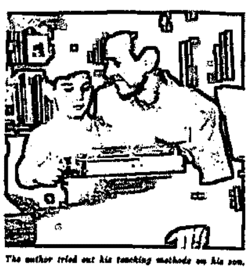

How much will your son earn in his lifetime? What kind of career will he carve out for himself? Will he be a winner or a loser in life’s deadly serious competition for money, position, self-respect? The answers to these questions depend overwhelmingly on your child’s ability to absorb facts and figures and to put them to use. And girls need this facility as much as boys. This article is designed to help you help your child increase that priceless ability—using only this newspaper, five minutes of your time every Sunday, plus a few thought-provoking questions listed below. How to Increase Your Child’s Vocabulary Words are compressed ideas. They are solidified thoughts which enable your child to think better, reason logically, express his own ideas with a force and drama that persuades other people to follow his point of view. Therefore, the more words your child learns, the better. 1. "Let’s learn to build a stronger sentence." Pick up any page of this paper. Take a headline or sentence at random and read it to your child. For instance: "American Troops Advance Against Reds." Now ask your child whether he can take this same idea and build a stronger sentence around it. For example, your child might say, "American Troops Cut Through the Jungle After Firing Reds." Encourage him to use vivid words that activate the interest of the listener; urge him to use larger, more complex words that he may have just learned so he won’t forget them. Use this game two or three minutes every Sunday. 2. "What does this newly learned word really mean to you?" Now teach him to recognize new words instantly by breaking the words down into their Latin parts and then seeing how the total meaning of the Latin parts adds up to the total meaning of the new word. Get a good dictionary or any other book that lists the meaning of these Latin parts. skim through your paper for a minute or two every Sunday and pick out some words which are new to your child and which are primarily composed of these Latin parts. For example, in this article I have used a number of Latin-derived words. Let’s take one of these words, and break it apart. Facility denotes from the Latin word-part fac, which means (in English) do. Therefore, facility means the ability to do something. But why stop there? Once your child has learned a new word-part, ask him to explore it further. What other words can he think of that have this word-part, fac, in them? How about factory—a place where you do things with machinery. Or the adjective facile—an facile person is a person who can do things easily. Or even the frightening word facile— which is nothing more than a person whom you hire to do something for you in your absence. You can see immediately how fascinating this can become. Why not learn one or two new word-parts each Sunday—and start your child on the road to a great vocabulary!

How to Increase Your Child’s Reading Speed and Skill The child who cannot read cannot learn. The child who cannot read fast, and well, and remember what he reads, is forever crippled in life’s race for achievement and success. Above all other goals, you should work with your child at least a few minutes every week to improve his reading skill. For instance: 1. "What would happen if you bit a pencil while you read?" Some children move their lips when they read and this means, literally, "lip reading" means your child is slowing his reading speed down to normal talking speed—or only about one-third of his true potential. But you can help him correct this bad habit. Hand him this newspaper and ask him to read a short news story to himself. Time him, then take an ordinary wooden pencil, put it between his teeth, and ask him to bite it! Now have him read another story of the same length. Time him again—this time with the pencil between his teeth to prevent his lips from moving. I think you will be delighted with the new speed he automatically picks up from this simple trick. And keep it up—keep him biting—until he can read even the hardest textbook without moving his lips in the slightest. 2. "Let’s see if you can read this story in one minute flat—by asking the right questions." Good reading is essentially a search for the main thoughts of a story. And your child can find the main thoughts by asking the magic questions: what? why? where? when? who? how? Your child should memorize these six tiny keys to knowledge and use them every day. They offer him a "road map" to any news story or feature. Now he can simply skim through the story—flashing over unimportant details—concentrating on the answer to his "main thought" questions. He should be able to finish the story in about one minute. And you can test his retention of the important facts of the story by asking him questions about it when he has finished.

How to Increase Your Child’s Ability to Handle Figures Now turn to the advertisements in this paper. Here you have all the material you need for a quick (and fascinating) three-minute drill in practical, everyday mathematics. Take a supermarket ad, for instance, hand your youngster a piece of paper and a pencil, and ask him a question like this: "If I went to the supermarket tomorrow and bought a roast for $6.49, a chicken for $3.27, and some vegetables for $8.16, how much money would I have spent? How much change would I get from a $20 bill?" Now watch him put those figures down on the paper. No matter how bad your math is, you can always check two vital points at a glance. First, does he make each number clear and sharp? Or does he make 4, for example, look like a 9 or a 7? If so, he’ll make careless mistakes with these numbers the rest of his life. Drill him over and over again till each figure is as sharp and precise as if he wrote it with a typewriter. Second, are his addition columns perfectly straight? Are the 1s under the 1s, the 10s under the 10s, the 100s under the 100s? Can you draw a line between each column with a ruler without touching a single figure? If not, he is again in trouble. Research in schools has shown that correcting these two small mistakes—and nothing else—has increased students’ grades in math by as much as 25 percent overnight. That’s one-fifth higher grades for your child for just a few minutes of your time. If he’s in the higher grades, of course, make the questions harder. For example: "If a roast is marked down from $6.30 to $4.87, what percentage of my money do I save?" Again check neatness and accuracy in copying down the problem and pre- (Continued on page 15)

## 通过报纸，大幅提高孩子的成绩

每个周日，花5分钟时间阅读这份报纸，
将会成为你送给孩子的最好礼物

你的孩子此生能赚多少钱？他是否能够事业有成？

在这个竞争激烈的社会中，他是打败竞争者，赢得财富，地位，荣耀，还是 miglioramento？
还是Roy？
还是 一败涂地？

这些问题的答案，绝大多数取决于孩子对信息和数据的吸收，以及运用能力。和男孩一样，女孩也同样需要这种能力。

本文的目的在于，协助你帮助孩子提高这种无价的能力——只需要每个周日使用这份报纸5分钟，再加上下面几个发人深省的问题。

## 如何提高孩子的词汇量

文字是思想的浓缩。它锲镂有力，能让孩子更理性地思考，让他更好地表达自己的思想，更有力地说服别人认同他的观点。因此，孩子学习的单词越多越好。

“让我们学习撰写一个更强有力的句子”

翻到任意一页。随机选择一个标题或句子，读给你的孩子。例如：

“美国队进攻曼联队。”然后，问你的孩子，看他是否能用更强有力的句子，表达同样的意思。

例如，你的孩子可能会说，“美国队把曼联队打得落荒而逃”。鼓励他使用生动的词语激发听众的兴趣。敦促他经常使用刚学到的更有力、更复杂的词汇，从而将它们牢记于心。每个周日，花2—3分钟时间，来做这个游戏。

“这个新学到的词语，对你来说有什么意义？”

现在，教他通过分解单词，来认识新单词，并通过拉丁词根的意思，

理解新单词的含义。

买一本好词典，或其他任何列有拉丁词根意思的字典。每个周日花一两分钟时间浏览报纸，并为孩子找一些含有拉丁词根的新单词。

比如，在本文中，我使用了大量源自拉丁语的单词。现在，我们选取其中一个单词，将它拆分开。“ Facility（设备）”来自于拉丁语 Fac，意思是做。因此，设备意味着做一些事情的能力。

除此之外，我们还可以更深入一点。一旦你的孩子学习了这个新的词根，你就可以教他更多东西。他还可以学习其它由这个词根组成的词。

比如工厂——你用机器做事情的地方。或形容词“灵巧”——用灵巧形容一个人，说明这个人做事灵活，机敏。甚至看起来更难的词，家务总管，指的是你不在的时候，雇佣来帮你做事的人。

## 如何提高孩子的阅读速度和阅读能力

不会阅读的孩子，就无法学习。一个孩子，如果不能快速，高效地阅读，并记住他所读的东西，那么，在人生的道路上，就会困难重重，难以取得成功。现在，最重要的事情是，每周至少花几分钟时间，来提高孩子的阅读技能。例如：

> “当你阅读时，咬铅笔，会发生什么？”

有的孩子阅读时，嘴巴会跟读，这个习惯很不好。“跟读”会降低孩子的阅读速度，将阅读速度减慢到正常的说话速度——或者只能发挥真正阅读速度潜能的约三分之一。

但是你可以帮助他改正这个坏习惯。递给他这份报纸，要求他阅读一段新闻，并计时。然后，将一根普通的木制铅笔放在他的牙齿之间，要求他阅读另外一段和之前长度相同的故事，并计时。这次，用铅笔防止他移动嘴唇。

我想，你一定会非常高兴地发现，这个简单的方法，让孩子的阅读速度有了很大提高。坚持让他咬住铅笔，直到他甚至可以一点也不动嘴
唇地阅读完一本最难的教科书。

> “通过问正确的问题，
让我们看看你是否能在1分钟内阅读完这个故事。”

良好的阅读，本质上是寻找故事的主要思想。你的孩子通过询问这些神奇的问题，就能找到故事的主旨：什么？为什么？在哪里？什么时候？谁？如何？你的孩子应该记住这 6 个关键的小知识，每天使用它们。

在阅读任何新故事或新文章时，这些小问题都能给他提供一个“地图”。现在，他知道自己要找什么。他只要浏览故事——跳过不重要的细节——把关注点放在这些“中心思想”的答案上。

他应该能够在大约 1 分钟的时间内，完成这些故事。当他完成后，你可以通过询问一些相关问题，查看他阅读的文章在他脑海里留下多少。

## 如何提高孩子处理数据的能力

现在来谈谈本报纸上的广告。这里有快速（有趣）做 3 分钟练习所需的所有材料，还有每日数学练习。

比如，超市广告，递给孩子一张纸和一支铅笔，问他一个问题：“如果明天我去超市，买一份烤肉 5.49 美元，一只鸡 3.27 美元，一些蔬菜 8.14 美元，我一共花了多少钱？我支付 20 美元，收银员要找给我多少钱？”

然后，看着他把这些数字写在纸上。不管你的数学多差，你都可以通过 2 个要点来检查孩子。首先，他写的数字是否清晰？还是 4 看起来像 9 或 7？如果是这样，他以后就会因为这些细节，犯一些粗心的错误。一遍遍地督促他练习，直到他能准确、清晰地书写每个数字，就像用打印机打印的一样。

第二，他的添加列直吗？是个位对个位，十位对十位，百位对百位吗？你能在每一列画一条线，而不碰到任何一个数字吗？如果不能，那么，他就又遇到了麻烦了。

通过对学生的研究表明，修正这 2 个小错误——其它不做任何改变

——能在在一夜之间，提高学生的数学成绩高达 20%。也就是说，你只要花几分钟时间，就能让孩子的成绩提高五分之一。

当然，他的年级越高，你的问题就可以更难。例如：“如果烤肉的价格从 6.98 美元降到了 4.87 美元，我能节省的费用的百分比是多少？”再次，请检查孩子算数草稿的整洁性，以及书写数字时的准确性。不用检查孩子的计算方法或答案；这些交给他的老师。通过这种方法，不论你的数学有多差，你都能帮助孩子提高数学成绩。

## 如何提高孩子的考试成绩

现在到了获取回报的时候了——这是孩子展示自己所学知识，并灵活运用的关键时刻。在生活中，和在学校一样，我们的孩子会面临一系列考试。有的是书面的，有的是口头的，还有一些是有关于经济或社会或道德的。所以，让他总是能发挥自己的最佳才能，是非常重要的。

影响考试发挥的最大因素是紧张。研究表明，考场上紧张的主要原因是，对大多数测试问题的描述不熟悉。孩子对这些问题的形式越熟悉，他的成绩就会越好。

因此，在周日，你的任务之一就是，利用这份报纸，花一两分钟的时间，让你的孩子熟悉这些问题格式。要达到这个目的，你可以让他学习一个新单词，或读一个故事，或做一道我们上面描述的数学题。然后，对他做的作业，提出问题。

但是，你提问这些问题的方式，要和学校考试时的方式一样。让孩子像在考场上一样，回答这些问题。

考试常用格式有判断对错题，选择题；连线题；填空题（“家务总管指的是_____样的人”）列举题（“列举 4 个使用拉丁词根‘工厂’的词语”）。

还有排序题（“按顺序列举双子座 11 飞机要完成的任务”）；类比题（“家务总管对代理人，就好像工厂对： a.熟练的人； b.制造厂； c.

获得技能”）；文章（“用一两个句子描述双子座 11 飞机要完成的任务，以及什么样的太空飞机将跟随它”）。

这些问题看起来非常棘手。但是，你用这些问题格式给孩子更多的练习，它们就会变的更简单。

因此，这是一个专门为提高孩子成绩而设计的周日训练计划。一周可能只需要你几分钟时间，还可以让你和孩子度过一段有趣的时光。

在他生活的竞争激烈的世界中，这可能是你能给他的，除了爱以外最好的东西。

## 笔记

## 52、新充气短裤™提供充气支持+按摩，能帮助你减掉想减部位的脂肪！

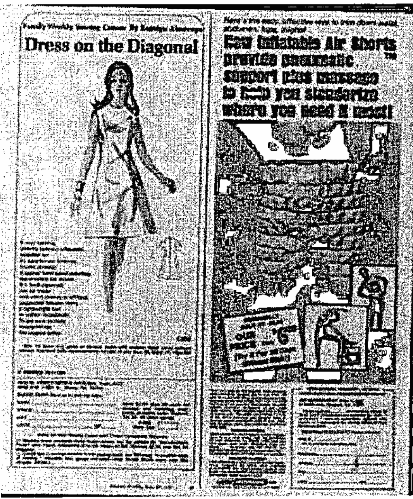

## 一个能有效的减少腰部、腹部、臀部和大腿脂肪的方法！

## 新充气短裤™提供充气支持+按摩

## 能帮助你减掉想减部位的脂肪！

## 正常售价 9.99 美元
我们现在只卖 6.99 美元

这很可能是你试过的最简单、最舒适的减肥方法。你要做的，就是穿上这条神奇的短裤，用我们提供的小手泵为其充好气。然后做一些简单的运动，家务，或任何做日常活动。接下来发生的事情，一定会让你感到惊讶。你身上那些贴身、舒适的充气口袋，能为你提供温和的气动支持，加上有效的按摩，给身体带来额外的热量。

## 保证效果！

你会发现 4 个重要部位几乎立刻得到了改变。我们保证！充气短裤一定会帮你减去腰部、腹部、臀部和大腿的脂肪。一定会让你看起来更苗条，更年轻，更充满活力——效果一定会让你难以置信——否则，你会得到全额退款！

## 为你节省 3 美元！立即来信吧！

充分利用这个零风险的机会吧。充气短裤之前售价 9.99 美元。我们直邮价格只要 6.99 美元。（你将节省 3 美元！）有适合任何男女的尺寸。

## 立即邮寄优惠券！

## 保证让你看起来更苗条，更年轻——否则，全额退款！

## 立刻邮寄零风险优惠券！

杰·诺里斯集团 585 M 部门

世纪商业行会大道 31 号，自由港，纽约 11520

请立刻给我邮寄_____条充气短裤，每条 6.99 美元，加每条 1 美元邮费以及手续费。我明白，如果我对结果不是完全满意，我可以在 30 天内退回，并得到全额退款。

内附[ ]支票或[ ]汇票

总额: _________ 美元

（纽约居民请附加销售税）

姓名__________________

地址__________________

城市__________________

州__________________ 邮编

杰·诺里斯集团 585 M 部门

世纪商业行会大道31 号，自由港，纽约 11520

## 笔记

## 53、 罗伯特·G·艾伦 1 美分课程信

Robert G. Allen
CHALLENGE SYSTEMS, INC.
2013 Jimmy Durante Blvd./Suite 224
Del Mar, CA 92014

8:20 a.m., Thursday
December 22, 1988
Del Mar, California

Dear Friend,

As you can see, I have attached a penny to the top of this letter for two reasons:

+   1. I have something very important to tell you and I needed some way to catch your attention.
2. Since what I am writing about concerns money, I thought a little "financial eyecatcher" was especially appropriate.

My name is Robert Allen. On March 13th, my staff hand-selected and taught 189 people from all over the country my secrets to wealth. Within 60 days, those people had profited an average of $12,916 per person.

This same staff will be in Southern California January 5th thru 14th and, if possible, they would like to meet with you on a personal basis.

On those days, a brand new way to make some very serious money in the 1989 real estate market will be revealed to a select group of people, utilizing two almost unknown advantages "hidden" in the new tax law.

With the changing economic climate that follows a presidential election, right now is the best time to buy real estate. If you're interested in high cash flow real estate, spending the day with these specialists could be worth a virtual fortune to you. In fact, we personally guarantee your success. Not only will you learn the latest techniques of real estate investing from us...

> "You Must Make $10,000 Or More In The Period Of One Year Or We Will Refund Your Tuition!"

This intense training is not for everyone. It is only for those people who are serious about having or controlling huge sums of money. When you meet with us, you will receive FREE a special collection of four reports containing information not included in my two best-selling books: "Nothing Down" and "Creating Wealth".

Here are the titles of those reports:

+   1. A Hidden Twist In The New Tax Law That Once Again Makes Real Estate The Number One Investment In America Today
2. An Amazing Secret That Lets You Talk To Owners Of Bargain Properties Before Anyone Else
3. 12 Telephone Numbers That Can Double Your Income In The Next 12 Months
4. A Simple 4-Paragraph Letter That Helps You Flush Out Motivated Sellers

These reports alone are worth the $59 cost of tuition. Yet they reflect only a sampling of the money-making information that will be shared with you.

I have enclosed a ticket to reserve your seat and FREE reports. All you have to do is call and confirm your reservation. Pre-register with your MasterCard or Visa when you call, and the cost of tuition is only $39. Call and pre-register before January 4th, and you'll receive FREE this additional bonus:

All The Forms You'll Ever Need To Profit
In The New 1989 Real Estate Market

We'll meet from 9 a.m. until 3:30 p.m.; the check-in desk will open at 8 a.m. Location details are included on the enclosed ticket.

Please call now. Because of the extremely low tuition, we have an idea this meeting will fill up fast. (We turned away 169 people last time!) Call toll-free:

1-800-345-DO IT (3648), ext. 230
or 1-619-755-5501, ext. 260

Sincerely,

Bob

Robert G. Allen

P.S. Please let us know even if you cannot come so the reports reserved for you can be released to someone else. Thank you.

罗伯特·G·艾伦
挑战系统公司
吉米杜兰特大街 2010，224 栋楼
德尔马尔，加利福尼亚州 92014

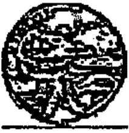

加利福尼亚州，德尔马尔
1988 年 12 月 22 日
星期四，9:20 a.m.

亲爱的朋友：

正如你看到的，我在这封信的上方附上了 1 美分，原因有 2 点：

+   1. 我有重要的信息要告诉你，我需要一个方法来吸引你的注意力。
2. 因为我写的东西和钱有关，我想“用一点点钱来吸引人的注意力”用在此处，非常合适。

我是罗伯特·艾伦。在 3 月 13 日，我的员工从全国各地亲自挑选了 189 人，并向他们传授了我的致富秘诀。在 60 天内，这些人每人平均获利 12916 美元。

我的这些员工在 1 月 5 日——1 月 14 日，将会在南加利福尼亚州再次挑选学员，如果可能，他们愿意一一接待你们。

在这段时间里，我们将会向被选中的一些人，透露 1989 年让房地产赚得锅满钵满的 2 个“隐藏”在新税法中几乎不为人知的优势。

随着新总统选举，经济形势的不断变化，现在是投资房地产的最佳时机。如果你对回报率丰厚的房地产感兴趣，那么，你可以花一天向这些专家学习，你一定会受益颇丰。事实上，我们保证你肯定会成功。我们保证在我们这里你不仅可以学到最新的房地产投资方法……而且……

“你将在未来一年赚到 10000 美元，甚至更多，否则，我们会全额退还学费！”

这种强化训练并不适合所有人。它只适合那些真正想拥有或控制大量金钱的人。如果你来咨询，你就可以免费获得 4 个特殊的报告，上面包含了我在 2 本最畅销的书《零首付》和《创造财富》中都没有提到的信息：

下面是这 4 个报告的标题：

+   1. 新税法中隐藏的 1 个信息，再次让今天美国房地产的投资成为人们首选的投资项目
2. 让你抢在所有人之前，跟房地产所有者讨价还价的一个惊人的秘密
3. 在未来 12 个月内能让你的收入翻番的 12 个电话号码
4. 一个简单的 4 段神秘纸条，可以帮你甄选好的卖家

仅这些报告就价值课程的收费 59 美元。然而，这些报告只是课程将要揭示给你的赚钱秘诀的冰山一角。

我为你内附了一张为你预留的听课证以及免费报告。你只要打电话来，确认预定课程即可。在来电时，通过你的万事达卡或维萨卡预订课程，课程收费只要 39 美元。在 1 月 4 日之前预订，你将得到免费报告。

我们的课程内容将包涵你在 1989 年房地产市场上投资房地产赚大钱需要的所有方法。

会议时间是上午 9 点——下午 3 点 30 分；前台登记处上午 8 点开放。具体会议地点在内附的听课证上。

请立刻打电话吧。因为这么低的学费，我们认为课程肯定很快就会爆满。（上期我们拒绝了 169 人！）立刻拨打免费热线：

1-800-345-（3648）
转接 280

或 1-619-755- 5501
转接 280

真诚的，

鲍伯

罗伯特·G·艾伦

P. S. 如果你不能如约参加，请告我们，这样我们可以把预留给你的报告转送给别人。谢谢。

## 笔记
