# 539档案第八期

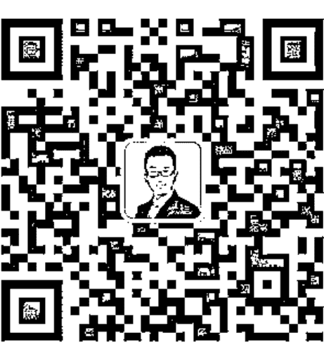

# 前言

《539 档案》已申请了版权，恭喜你拥有了它！这是一部真正的宝典，汇集了有史以来最经典的 539 篇广告文案，它是你必须收藏进“点子文档库”里的重量级文案素材。

这 539 篇经典文案，每篇在入选前，都必须满足五个条件：

+   1. 它必须有强力的标题（大卫·奥格威曾说“标题可以让你广告效果提升 500%！”。在这里，你将得到数百个强有力的广告标题，略加修改，就可以应用到自己的广告中。）

+   2. 它必须引人注目，言简意赅，内容充实（因为为你销售产品的是文案，而不是欲壅的照片，哗众取宠的口号，或华而不实的设计）。

+   3. 它必须是社论式风格（根据盖瑞·亥尔波特所言，这种风格“有时可以使反应率增加 2200%。”如何让反应迅速倍增？让我们看看撰稿专家们是怎么做的。）

+   4. 它必须销售的是优质的产品，或者是曾经非常有名的产品，或者是直至今天仍久盛不衰的产品（无需多言……很可能你家现在就拥有其中一款产品）。

+   5. 它必须是纸上的推销术（阿尔伯特·拉斯克尔，洛德-托马斯广告公司领导人，据说是广告界赚钱最多的人，就因为约翰·E·肯尼迪 1904 年曾经告诉他广告的实质是——纸上的推销术）。

你可以看到，经过 5 层过滤，筛选出的文案，不仅能迅速抓住人们的注意力，可读性强，还能确保这些文案是通过市场验证的，而且还杜绝了强势广告的推销，但又能促使顾客行动。

显而易见，这才是真正的经典。

《539 档案》有选自大品牌公司的经典文案，还有帮助中小企业持续卖货的攻心文案。这些文案一共创造了数万亿美元的销售额。

来自大品牌公司，比如：

+   - 华尔街日报
- 大都会人寿保险公司
- 通用电气
- 萱诺士
- 宝洁
- 联合利华
- 象牙皂
- 家乐氏
- 美国运通
- 纽约证券交易所
- 桂格麦片
- 固特异轮胎
- 苏格信息公司
- 绿巨人公司
- 通用食品公司
- 理诺公司
- 贝尔通助听器公司
- 李施德林漱口水

还有很多....来自其它不同行业，不同产品的有数百篇...

《539 档案》里的经典文案时间跨度从 1910——2015 年（大多数是 50 年前的经典）……他们没有掉进“形象广告的陷阱”，而是促使大众记住他们的名字，并购买他们的产品。

这些并不是过时的旧广告。用到如今的移动互联网传播上，效果会倍增！每篇文案的言辞都是实实在在，不夸大，不隐瞒欺骗，更加真实，但又能促进顾客采取行动的广告文案。

它们是有史以来最有威力的、创造了数万亿美元的 539 篇经典文案。这些经典文案出自：克劳德·霍普金斯，尤金·斯瓦茨，大卫·奥格威，马克思韦尔·萨其姆，约翰·卡普尔斯，盖瑞·亥尔波特，乔·卡伯，本·苏瑞兹，约翰·卡尔顿，杰·亚伯拉罕，丹·肯尼迪，杰夫·保罗，约瑟夫·休格曼……等等数百位世界顶尖撰稿人之手。（其中，盖瑞·亥尔波特撰写的经典广告文案就有 29 篇！！）

你要做的是标注，改编，提取，复制，粘贴你需要的精彩广告，并把它们直接应用到你的销售中——迅速增加你的文案反应率，业绩提升 300%-2000%是完全有可能的事（这些经典文案 10 年，20 年后都不会过时。如有不明白的可以咨询李炳池，微信：zixun8）。

在这里，你可以看到顶尖文案撰稿人撰写的已经证明有说服力，让人无法抗拒的广告文案...

在这里，你可以看到已经成功销售数亿美元的产品与服务的广告文案...

在这里，你可以看到成功塑造了当今知名品牌的广告文案...

在这里，你可以看到为原本很小的公司带来成千上万的忠诚客户，最终使其成为大企业（其中一些已成为跨国企业）的广告文案...

在这里，你可以看到影响你购买厨房，浴室，卧室以及客厅用品的广告文案....

最终，你将得到...

+   一、99 篇减肥，健康&美容用品经典文案
二、17 篇家居用品经典文案
三、77 篇专业书籍经典文案
四、29 篇药品经典文案
五、13 篇服装经典文案
六、97 篇食品经典文案
七、55 篇汽车经典文案

# 八、53 篇信息产品及研讨会经典文案

# 九、42 篇保险经典文案

# 十、19 篇零售经典文案

# 十一、38 篇赢取奖品的经典文案

虽然行业有分类，但是你可以借用不同行业的广告文案手法，超越竞争对手，而不是一味的使用本行业的操作方式，造成同业同质化。

这些经典文案原本都是零散的文案，经过我们的用心归类（见精装版），行业细分，你读起来会更加方便，使用起来会更加便捷！

你只需……把这些广告文案略加修改，直接套用到你自己的产品或服务上即可。

它们能帮你创造出新的灵感，它们能帮你撰写出攻心的广告文案...它们能帮你节省数万，数十万，甚至数百万的广告费用...它们能让你的产品销量、利润滚滚而来，滚滚而来...

不仅如此，经常抄写这些经典文案，它们会烙印在你的大脑中，成为你的一部分，即使不看任何模板，文案范本，你都可以信手拈来，写出杀手级的文案。

注：每篇文案的后面都留有空白页，你可以记下你的笔记。本册是第七期，按照计划每 45 天出一期，共计 10 期，目前根据进度可能会提前完成。最后，你还拥有一套行业细分的精装版，供你珍藏留念。

李炳池
微信：zixun8
2016 年 11 月 7 日

# 1、当我坐到钢琴旁时，他们笑了...但是，当我开始演奏时！~

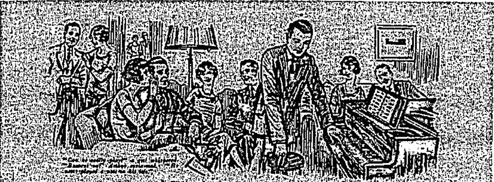

## They Laughed When I Sat Down
At the Piano
But When I Started to Play!—

“他真的可以弹钢琴吗？”一个女孩儿悄悄地问道。
“根本不可能！”亚瑟叫道。“他从来没有弹过一个音符。”

## 当我坐到钢琴旁时，他们笑了

## 但是，当我开始演奏时！~

亚瑟刚弹完“The Rosary.”。房间里响起了雷鸣般的掌声。我觉得，对我说这将是一个戏剧性的时刻，因为接下来，我要开始我的处女秀。我自信地大步走到钢琴前，坐了下来，这让我所有的朋友都感到万分惊讶。

“杰克要要花样了，”有人暗笑道。众人都笑了。他们都确定我连一个音符也弹不出来。

“他真的会弹琴吗？”我听到一个小女孩问亚瑟。

“根本不可能！”亚瑟叫道。“他从来没有弹过一个音符……你看着吧，有好戏看了。”

我决定充分利用这种情 模仿钢琴家们的做法，我拿出一 条丝绸手帕，轻轻拂了拂钢琴键。然后，我起身把钢琴凳转了四分之一圈，就像我在杂耍表演中看到的帕代雷夫斯基的模仿者那样。

“你们觉得他会表演什么？”一个声音从剧院后面传来。

“我们很看好他哦！”有个人说到，然后整群人哄堂大笑。

## 然后我开始弹奏

整个紧张的场面立刻安静了下来。正在嘲笑我的人，变得沉默了。我弹奏了几段贝多芬不朽的著作，月光奏鸣曲。我听到了惊讶的喘息声。我的朋友都安静了下来，听得入了迷！

我开始弹奏，忘记了周围的所有人。我忘了时间，忘了周围，忘了惊讶地不敢呼吸的听众。我生活的小世界似乎开始消退——似乎变得暗淡——变得不真实。只有音乐是真实的。只有音乐和它带给我的幻想。幻景非常美丽，以前带给作曲家灵感的轻拂的风，皎洁的月光，飘荡的云彩。就好像作曲家在和我交谈——通过音乐的媒介——不是通过语言，而是通过音符。不是以句子的方式，而是以优美的旋律！

## 彻底成功！

当月光奏鸣曲最后一个音符消失的时候，房间里突然响起了雷鸣般的掌声。我发现，我被一群兴奋的人包围着。他们握着我的手——疯狂地祝贺我，热情地拍打我的背！每个人都开心地惊呼——迫不及待地问我问题……“杰克！你为什么不告诉我们你可以弹钢琴呢？”。“你在哪儿学的？”——“你学多久了？”——“你的老师是谁？”

“我从未见过我的老师，”我回复到。“不久前，我连一个音符也不会弹呢。”

“别开玩笑了，”亚瑟笑道，他是一个小有成就的钢琴家。“你应该学了很多年了。我能看出来。”

“我只学了一段时间，”我坚持说道。“我一直没告诉你们，是为了给你们一个惊喜。”

然后，我告诉了他们事情的整个过程。

“你听说过美国音乐学院吗？”我问道。

我的几个朋友点了点头。“那是一个函授学校，对吧？”他们问道。

“对，”我回答道。“他们发明了一个简单的新方法，可以通过邮件，教你自己学会演奏？”

## 我是如何没有老师教的情况下，学习乐器的

然后，我说了我多年来一直想学钢琴的愿望。

“几个月前，”我继续说道，“我看到了美国音乐学院的一则有趣的广告——一种全新的学习方式，每天只要几美分！广告中说了一个女士，利用业余时间，在家学会了弹钢琴——完全没有老师教！最棒的是，她使用的神奇的新方法，不需要艰苦，枯燥的练习。广告听起来如此有说服力，我填写了优惠券，上了免费演示课程。”

“我很快就收到了免费书籍，当天就开始学习演示课程。用这种方式学习演奏，让我感到非常惊讶。然后，我申请了课程学习。”

“当收到课程后，我发现，它和广告中说的一样——就和 ABC 一样简单！而且，随着学习的深入，课程越来越简单。在我发现这些特点之前，我就能演奏我最喜欢的曲目了。一点障碍也没有。我可以非常轻松地弹奏民谣，或古典乐曲，或爵士乐！而且，我对音乐一点天赋也没有！”

* * * *

## 弹奏任何乐器

现在，你也可以自学成为一个出色的音乐家——而且全靠在家自学——用平常的一半时间。用这个简单的全新方法，你一定能学会，就像其他用这个方法已经学会自己最喜欢的乐器的 350000 人一样。忘记如果你想弹奏乐器，就必须有天赋的陈旧观念。你只要阅读列表中的工具，确定你想学习哪个乐器，剩下的交给美国音乐学院。

记住，无论你选择哪种乐器，每天成本只要几美分。不管你之前是一点乐器也不会，还是已经能演奏得不错，你一定有兴趣了解这个简单而且美妙的新方法。

## 来信获取免费手册和演示课程

无数已经取得成功的学生，从未梦想过自己还能弹奏乐器，直到看到他们“音乐能力测试”的结果。这些内容，都在我们有趣的免费小册子中，你不用投入任何成本。

如果你真的想玩你最喜欢的乐器，如果你真的想要获得幸福，让自己更受欢迎，——那么，立刻来信获取免费小册子和演示课程吧。没有任何成本——没有任何义务。现在我们为新学生提供了有数量限制的特别课程。立刻填写并寄送优惠券吧——在名额截止之前。我们也可以为你提供乐器，如果你想买，可以通过现金或信用卡购买。美国音乐学院，1844 年布伦瑞克，纽约

## 挑选你的乐器

+   - 钢琴
- 大提琴
- 风琴
- 和弦乐器
- 小提琴
- 拉琴
- 鼓
- 视唱乐器
- 尤克里里琴
- 班卓琴
- 吉他
- 高音萨克斯
- 班卓琴
- 钢吉他
- 夏普琴
- 单簧管
- 短号

长笛   短笛

萨克斯   长号

## 声音和语言文化

自动手指控制

钢琴   手风琴

美国音乐学院，1844 年布伦瑞克，纽约

请寄给我你的免费书籍《你自己家里的音乐课程》，还有弗兰克博士的介绍，演示课程，还有你的特别优惠。我对下列课程感兴趣：

..................................................

你有以上乐器吗？ .........................

姓名..................................................

（字迹要清晰）

地址..................................................

城市..........................州.....................

## 作业

# 2、打破一切规则，让你在 50-60-70-甚至更大年纪时，依然有 35 岁的身体！

## Now! A World-Famous Trainer of Champions says:
Break All the Rules,
and Win a 35-Year-Old Body
at 50-60-70-and Beyond!

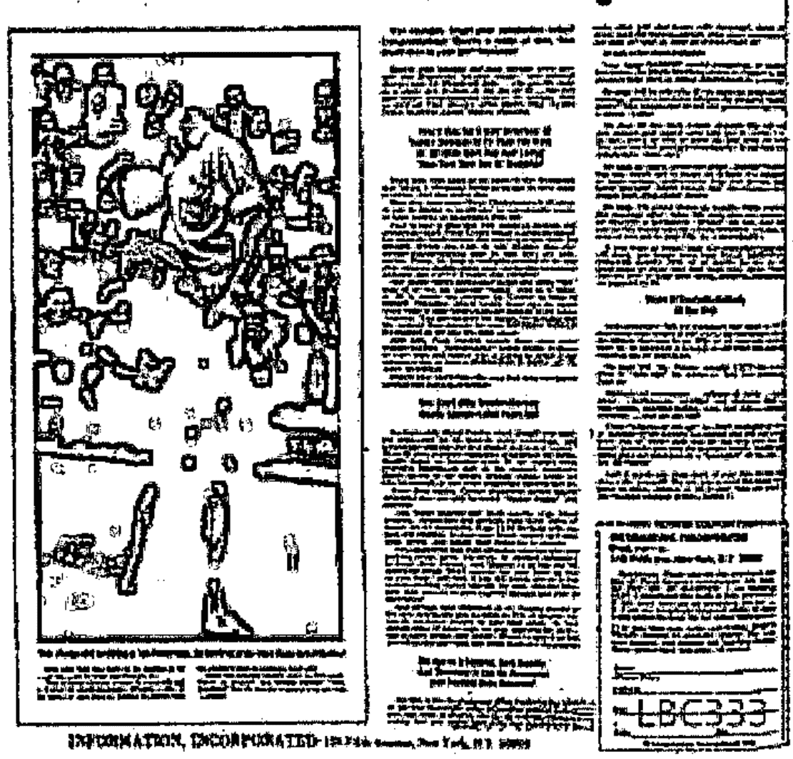

现在！世界著名冠军教练说：

## 打破一切规则，
让你在 50-60-70-甚至更大年纪时，
依然有 35 岁的身体！

这位 70 岁老人，把 196 磅的人，像棉花一样举了起来！

谁说你在 50 岁……或 60 岁……或 70 岁后，体能一定比 30 岁时差！图中的珀西——现在 70 岁了，是世界冠军运动员教练——他在 43 岁时健康状况很差，甚至不能从事普通的办公室工作！

阅读本页他离奇的健康故事。亲自验证他神奇的“打破传统”的健康秘密——完全零风险！

比如：今天忘记做健美操了？恭喜你！健美操只会浪费你的时间。现在的状态已经很好了？胡说！

满足你的本能，让自己一年一年变得更强壮，这位拥有 35 岁身体的 70 岁“身体奇迹”创造者如是说……他在 55 岁时，依旧可以一天跑步 101 英里……现在是世界冠军运动员教练，他告诉自己的学生，要打破规则，她让医生感到震惊，她把年龄像水一样挤出了自己的身体！

## 年轻的新定义是什么？
在 70 岁时，比 30 岁的时候更强壮！
比你儿子或女儿更有精力和活力！

现在，我们再看看这位 70 岁老人的照片，他能把 196 磅重的朋友像棉花一样举起来。然后，你就会意识到：

这个人——珀西——43 岁时，健康状况非常差，他甚至无法从事普通的办公室工作！

面对疾病的痛苦和随时可能来临的死亡，珀西开始绝望地寻找能让他找回力量，科学健康的秘密。2 年的实践中，他变得比以往任何时候都强壮——看起来更年轻——感觉比他 10 年前还年轻。今天，经过医学证明，他的身体就像一个充满活力，健康的年轻人——体能可以轻松超越比他年轻 50 岁的普通人！

让这个垂死的 43 岁“老”男人，变成如今 70 岁依旧充满活力的“年轻”状态的健康秘密，非常简单，也宝贵之极，珀西不能独享。因此，大约 20 年前，他在他的家乡澳大利亚，开始使用这些秘诀培训世界冠军运动员。他的学生仅在过去的几年里，就打破世界纪录超过 15 次，通过这点，你就能看出他的方法有多么成功！

现在，珀西将向你——向每一位想每天花几分钟时间，就能在 70 岁，甚至更大年纪的时候，拥有 35 岁身体的人——揭示这些创造奇迹，“打破规则”的健康秘密。

你将发现——当你第一眼看到这本惊人的新书时：

## 你就开启了有 4000 年历史的神奇健康秘诀！

首先，珀西想为什么现代人——有这么先进的医疗条件，技术，和医学知识——却不能让人们在 70 或 80 岁时，比同龄的澳大利亚原始居民更年轻！他立即开始深入研究世界上最原始的居民——以及动物的本能，自然的健康秘密（比如，动物的性交过程持续时间，是现代男人的 4 倍！）。

通过研究，珀西发现某些自然法则，简直是“健康魔法”，比如：

——他坚信，剧烈的运动，只会带给你伤害。因此，他决定彻底放弃剧烈运动。阅读第 11 章，找出最有益于你身心健康的简单到令人难以置信的锻炼方法——如果你通过这个只需要几秒钟的神奇练习来锻炼内部肌肉，你的外部肌肉自然而然就会变好！

最重要的是，令珀西满意的一个发现，人体95%的疾病，来源于摄入的食物。事实上，有些食物——摆在超市货架上——会毒害你的健康系统。（阅读第8章，找出这些食物——然后，尽量少摄入。）

## 珀西说年老是一种疾病，
因此，它可以预防，甚至逆转！

但这只是开始。现在珀西把研究方向转向了广阔的现代医学，利用现代医学的科学发现，来为人提供80岁以后，依旧能比大多数年轻人体能都好，依旧能游泳、打高尔夫球和网球，骑马，跳舞跳到天亮，甚至去爬山！

## 让我们再多看一些例子：

当然，你的肺无法自我修复。但遵循第3章的简单建议，你就可以让它们永远健康有力地运行！

144页，他将告诉你，如果你早上醒来的时候昏昏沉沉，为什么要比很多每天早晨起来像打鸡血似的兴奋无比的“健康瘾君子”好得多！

64页，你将学到一个基本原则，它将为你赢得支持和尊重——帮你控制恐惧。事实上，你可以将恐惧为你所用。你可以立即使用这个原则！它每天将帮你无数次！

82页，你将看到2个简单，明显的“真理”，它们可能让你预防冠状动脉和心肌梗塞——甚至帮助你预防高血压！（虽然它们显而易见——但大多数人却还没有意识到！）

136页，你将看到一个简单练习，不用努力锻炼，每次不超过一分钟——甚至是一个很好的放松方式。你几乎可以在任何地方做这个简单的练习！（事实上，一旦你看到136页，马上就可以试一试。）

如果你想延长寿命——活的更开心——活过100岁，你只要保证4

个关键器官健康。90%的死亡都是这4个人体重要器官出现问题引起的！

41页到49页，将告诉你如何确保这些器官强壮有力，健康运行。

## 亲自验证吧——切风险我们承担

记住——这个革命性的新书，不仅能帮你预防像90%的人那样在30岁以后自然衰老，体能下滑。它的主要目的是帮你驱除年龄带来的身体恶化！

154页，珀西列举了他希望帮你消除的“老年”症状。比如：

行动缓慢……关节僵硬……皮肤暗淡无光，过早出现皱纹……静脉曲张……慢性疲劳……等等！

这些70岁甚至年龄更大后，因为“年老而带来的瘟疫”不是不可避免的！珀西已经证明，他可以避免一切！他也可以帮你避免！事实上，能让你70岁，甚至更大年纪时，依然拥有35岁年轻人体般充满活力与力量的健康体魄！

这难道不值得你花短短1周时间亲自验证吗？我们请你一页一页地阅读本书，风险完全由我们承担！为什么不立刻邮寄优惠券呢？

## 立刻邮寄零风险优惠券吧

信息公司 FW-10部
纽约 119 大街 10003

先生：请立刻给我邮寄一本珀西的革命性新书，《要么健康，要么死！》·我附上了5.98美元。我知道这本书享受零风险保证。如果这本书不像你说的那么神奇……如果我30天内有任何不满意，我会立即退还本书，并得到全额退款。

[ ] 如果你想货到付款，点击此处！并附上1美元保证金。费用

支付给邮递员即可，包括邮费和手续费。你同样享有退款保证！

姓名____________________

地址____________________

城市____________________

州____________________ 邮编

©信息公司，1968

信息公司 119 第五大街 纽约 10003

## 作业

## 你的身体比你想象的年轻2倍

这5个“减龄动作”在短短一周内，就能向你证明它的效果！

这篇文章会对你产生很大冲击——因为它会直言不讳地指出，你过去所说的自己“老了”或“很累”或“青春不再”的说法，都是一派胡言！

这篇文章指出，如果你能释放出束缚在体内的力量和精力，以及尽情享受生活的能力——你就可以：

看起来年轻20岁——变得更苗条，更壮实，比之前梦想的更有魅力……

每天几分钟，预防困扰你的朋友们的某些中老年疾病……

为你的生命增加40年的健康生活——40年充满活力,生机勃勃的生命……

减少日常精神紧张——赶走“总是累”的感觉——从这个星期开始，更好地吃，更好的工作，更好地玩乐，更好地休息！

换句话说，为你的人生增加10年…20年…甚至40年充满活力健康体魄！

而且，这一切——不需要大量吃药，吃补品……不需要强迫自己做无用的健美操……不需要逼迫自己放弃自己喜欢的食物，饮料——只要立刻释放你被束缚的力量，非常简单；

## 减龄动作#1——每周用不到3分钟的时间，为你身体的每一部分，注入新的力量和活力！

这个动作，是一个全新的运动方式，每天只要几秒钟，却能让你在第一个星期就看到惊人的结果！

它包括胳膊和腿的6个简单动作。每个动作只需不到10秒钟。不需

要任何技巧。不需要重复，不需要计数，不费力，无危险，不流汗。

这些动作非常轻柔，80 岁的老人也可以做。它们非常有效，可以让 30 岁的男性背部更直……肩膀更宽……让腹部变小……有时候，前几周就可以减小多达两三英寸！

或者，如果你是女性，它们会让你身体变得更笔直——每周投入不到 3 分钟！

这还只是开始！

## 减龄动作#2——促进心脏提供更多动力！帮助预防中老年多种致命·疾病！

这个简单的方法能为你的人生增加 40 年的健康生活！

这可能是目前为止，抵抗心脏病，中风，高血压，动脉硬化等最有效的武器。

然而，这一切只需要你的双脚，在每天早饭前做几个“唤醒身体”的动作。

你甚至穿着睡衣都可以做！再说一次，不费力，不流汗！

但是，在你意识到之前，你的肺以及血液循环已经被注入了新的动力！你的整个身体感觉充满了活力！让你无论是白天工作，还是晚上狂欢，都精神抖擞！让你轻松击败年轻人！

这还只是开始！

## 减龄动作#3——消除丑陋的脂肪！在尽可能最短的时间内，让你变苗条！让你在未来的人生中，身体处于最健康，体型处于最苗条的状态！

这个简单的动作是一个全新的减肥方法——你可以每天吃零食，每周吃大餐！

它可能是你尝试过的最吸引人的减肥方式。它可以让你每周放纵大吃一次！

它让你在减肥期间；经常放开胃口吃你喜欢的所有食物——意大利面、奶酪、蛋糕、馅饼、冰淇淋、巧克力等！

然后，当你回到其余6天的正常饮食中后，你还可以每天吃一些美味的“小零食”，避免过分压抑你的食欲！这个方法可以让你比之前尝试的任何方法，减肥速度更快，体形保持更久。

当你的朋友在大街上拦住你，乞求你告诉她你的减肥方法时，请不要感到惊讶！

而且，这还只是开始！

减龄动作#4 以及#5——将告诉你如何培养更强大的自制力——如何更好地抵抗压力——更容光焕发——性欲更强——呈现更好的精神面貌！保护你远离损害健康，折损寿命，普通人甚至很难认识到的错误！

这就是回报！现在，你将开始把你新发现的生机与活力，变成你梦想的生活！

这是一个肯定会让人为之着迷的课程，内容是让人长寿的最新医学发现，只需要一晚上时间——任何一个规则，都可能让你更健康，为你的未来增加许多充满快乐与活力的时光！

下面是有关于饮酒的一些你可以信任的事实，饮酒不再是为了运动和心脏健康而需要永久禁忌的东西——确保自己健康生活的安全方式——如何吸烟并健康生活——如何保证每晚8小时的睡眠——即使一个5秒钟的呼吸放松锻炼，都能加倍提升你的精力，等等！

## 你亲自验证，我们承担风险！

一点也不夸张地说，这五个简单动作，可以让你的外貌至少年轻20岁——同时，可以为你增加40年的健康生活！

就我们所知，这些方法从来没有完整地出现在一本书中！现在，在克莱门特·G·马丁医学博士的努力下，这些方法终于汇集到了《如何活到100岁》这本书中。

这本神奇的书中的原则，得到了27家美国主要报纸的刊登……NBC监播电台以及美国新闻面向全国的报道……以及医学杂志上的报道，传递给了整个医学界！

## 重要提示！

不需要任何学习，不需要从头到尾读完，甚至不需要你刻意阅读，你只要在闲暇时间，每天花5到10分钟时间，就能获得这本革命性新书带给你的生活方方面面的所有好处——在你拿起这本书的短短5分钟内，你就能感觉到！

这不是一本教科书！不是一本学习手册！整本书中都没有演讲，没有“高深”的理论需要你记忆！

相反，有史以来第一次，这本书为你带来了革命性的方法，为你的人生新添40年健康生活——让你看起来至少年轻20岁——所有这一切，只需几个简单到令人难以置信的方法，你第一次阅读时，就可以轻松使用！

因此，我们不希望你像对待一本普通书籍一样，对待这本书！我们需要你：

把它放在你的床头柜上，零风险试用10天！每天晚上休息前阅读几页！如果你愿意，你甚至可以大致浏览一下！要格外注意第55页神奇的性能力提升练习……95页令人尖叫的长寿饮食法，以及你可以吃的小零食，还有每周的放纵大餐！

每一页都是满满的实操内容，操作性强，易于理解，你当场就可以使用！每一页都是权威有效的方法——每天只需要你短短几分钟时间——不费脑力，不用记忆！这一切都等待着你的验证！这本最吸引人，最

通俗易懂的书，现在就是你的！每天你只要花短短几分钟的时间去浏览即可！

你亲自验证，一切风险我们承担！除了时间，你不用付出任何东西！我们承担所有费用！立刻邮寄零风险优惠券吧！

现在，这些方法正等待你去验证，在家就可以做，除非你觉得有效，否则你不用支付一分钱！

这本革命性的新书，售价仅为 4.98 美元。你可以亲自去验证——享有零风险保证。立刻邮寄优惠券吧！

## 立刻邮寄优惠券吧！

执行研究所有限公司，FW-8 部门
纽约第五大街 119 号，纽约 10003

先生：请快速为我寄一本马丁医生的革命性新书，《如何活到 100 岁》。附件中是全额费用 4.98 美元。我知道这本书有充分保证。如果它不像你说的那样……如果我在 10 天内，对这本书不是特别满意，我会退回这本书，立刻获得全额退款！

[ ] 如果你想货到付款，只要在信封中附上 1 美元诚意金。向邮递员支付余额，以及收取费即可。当然，你同样享有退款保证！

姓名_____________________
地址_____________________
城市_____________________
州_________________ 邮编

©执行研究所有限公司，1966

## 克莱门特·G·马丁医学博士

前伤亡医疗保险公司医学主任……美国老年病学会会员……美国营养家学会会员……《美国铁路协会》杂志医学编辑，美国科学促进协会成员，美国心脏协会、航天医学协会，以及其他许多主要社会科学和医学学会会员。革命性新书《如何活到 100 岁》作者。

执行研究所有限公司

## 作业

如果你有决心遵循这个世界著名医生的终极减肥方案，你将

## 每年减重多达 100 磅

## ——永不反弹！

这是一则完全不同的广告——一则有关一本完全不同的减肥书的广告。如果你有决心学习这个永久减肥法的真相，并严格遵循，那么这将是你的最后一本减肥书……最后一款减肥产品……最后一个你绝对不能错过的终极的减肥方法！

这则广告没有任何不实之言。它不向你承诺任何不可能实现的梦想。而是给你提供了一些永久减肥的事实——关于成功减肥，且永不反弹的事实——虽然它们要求比较苛刻，但却也是激动人心；让人乍听起来，可能很难相信的。

让我们在这里，再次陈述一下这个重要的事实：

如果你遵循这个终极减肥方案，你将想减多少减多少……20 磅，50 磅，60 磅，80 磅——甚至 100 磅……而且永不反弹。

在这个广告中，我们将一次次重复这个事实，你肯定不会忽略它。

如果你遵循这个终极减肥方案，你将每年减重多达 100 磅……而且永不反弹。

这是一个关键的事实。现在，我们一起看看详细 信息——

在开始，我们先介绍一下这个令人困惑的事实。

在这本书中，你将得到一个严格精确的饮食方案——它科学地，严谨地控制你的吃饭时间——但是，却有惊人的效果，能让你的许多减肥问题变得比之前想象的简单许多！

## 这个方案，
已经在 10000 名患者身上得到了医学证明。
它会带给你一个新的身材，一个新的生活
——如果你严格遵守它，它会告诉你什么时候吃东西，
甚至在要你感觉不饿的时候吃东西！

下面是你在本书中将看到的一些“惊喜”：

当然，尽管这个减肥方法要求你总体上少吃一些，但可能会让你在一天的某个时间段内要多吃。比如，如果你和大多数肥胖人士一样，你就要在早晨多吃一些，不管你是否想吃。这个减肥方法，允许你吃 30 多种不同种类的零食——每餐之间，你可以吃一种，每天睡觉前，你还可以吃一种。

你再也不用为了减肥，让自己挨饿了。因为，如果你遵守这个终极减肥饮食方法，正常情况下，你将减去多达 100 磅……而且永不反弹。

当然，有些食物是禁止吃的。但是，还有一些食物，一些令人惊讶的食物却可以吃。比如，一周你可以吃 3 次冰激凌。（看到你吃着美味的冰激凌——却依旧能减肥，你的朋友一定会大跌眼镜！）

同时，你在午餐时，还可以吃三明治，如果你想，还可以在正餐前喝一杯鸡尾酒。换句话说，这个饮食方案一点也不会让你痛苦——只会教你科学的饮食。

而且，非常重要的一点是，如果你有一天犯错了。（这位医生知道你肯定会犯错），吃多了。他不允许你减少第二天的饮食，来“弥补”前一天的过错！这是大多数减肥的人都会犯的错误，这会毁了他们的减肥计划。相反，他会强迫你第二天按照计划正常吃，原谅你自己，继续减肥。

## 你的体重是否分布不均匀？
你是否担心节食会让你的脸看起来苍老？
在聚会上，你是否会习惯性地暴饮暴食？
本书将会告诉你解决所有这些问题的医学方法

再重复一次——如果你遵循这个终极减肥方案，你将想减多少减多少……20 磅，50 磅，60 磅，80 磅—甚至100 磅……而且永不反弹。

现在，让我们一起来看看这个减肥方法带给我们的一些意义非凡的副作用吧——一些世界上任何快速减肥法都不能带给你的额外好处。

首先，因为这个减肥方法的科学性，很多案例都表明，它对脂肪主要堆积在腰部或腰以下部位的男性及女性，特别有效。它能使这些人一一其中有一些人一直备受堆积在臀部，大腿和小腿的丑陋的脂肪的折磨——能够减去这些部位丑陋的脂肪！

其次，因为这个减肥方法不是快速减肥法，也不会让人倍受折磨。所以，它不会像其他快速减肥法一样，造成你的脸部皮肤下垂，起皱纹。

相反，如果你严格遵循这个终极减肥方法，甚至从第一周开始，你的脸就逐渐变的更年轻。你将每年减重多达100 磅。而且永不反弹。

而且，你能减去这么多，并继续保持体重，虽然你也去参加聚会——商务宴会或俱乐部宴会——虽然你也和我们大家一样，每周都必须参加很多“社交性饭局”。但是，你依旧能保持体重！

因为，这是你看到的第一个为你提供的独特的，教你处理每一个“食物陷阱”的减肥方法。这个减肥法，能满足你的身体，满足你的食欲，以及你的同伴——丝毫不会让他们感觉你在减肥，在不知不觉中，你就减了很多体重，而你的朋友却涨了很多！

是的，即使你每天都要参加生意上的聚会，但是，如果你严格遵循这个终极减肥方法，你将减肥多达100 磅……而且永不反弹。

## 事实上——

很多肥胖患者发现，这个方法如此有效，
让他们减去了之前希望减重的 2 倍！
请看下面他们是如何成功减肥的，
以及你也可以做到的原因。

这个减肥方法是否有效，当然要从它带给你的结果来看。这就是为什么我们会提供零风险保证，让你从头到尾阅读它，你不用冒一分钱的风险，就能免费试用整整 30 天。

让我们说的再清楚一点：当你收到这本书后，第一件事就是在里面写下你想减去的确切体重。可能是 10 磅—20 磅—40 磅或更多。想减多少都没有关系。

然后，你就可以开始实施这个减肥方法了。但是，你要记住：

在你之前，用这个方法减肥成功的 10000 人，每个人都写下了自己想减的数量。但是，一旦他们开始了——一旦他们学会了这些新的饮食习惯——很多人减的都比他们当初认为减掉多少，身材就很“完美”了的体重多很多。

比如，有位女士，本来想减 10 磅，希望身材像 5 年前一样。但是，开始用这个方法后，脂肪一直在消失，她决定继续减，最后减了 20 磅，身材和她结婚时一样了！

为什么这些肥胖患者会减去很多，很多，甚至还可以继续减很多？他们的原因都一样，因为他们一斤都没有反弹！因为他们严格遵循这个减肥方法，学会了新的饮食习惯。其实，他们在减肥的同时也满足了自己的食欲！不同的是，他们打破了原来让他们多年来一直肥胖的饮食模式！

这一点也不简单——但是他们做到了，你也可以做到！一旦你做到

了，你就不能再回到以前你习惯的让人变胖的饮食方法！

一旦你严格遵循了这个终极减肥方法……一旦你开始用这种科学的新饮食习惯，让自己变得越来越健康，越来越漂亮……那么你将减掉多达100磅……而且永不反弹。

## 我们承担一切风险——你可亲自验证

现在，决定权就在你手里。你可能尝试过时尚减肥法，轻松减肥法，神奇减肥法，也可能减了一些体重。但最后又反弹了！

## 你想永远变瘦不反弹吗？

没有任何衣服会比它让你看起来更迷人。没有任何药物会比它让你变得更精力充沛，充满活力，或让你变得更长寿。

决定权就在你手里。这是一本送给说到做到的人的书。如果你能说到做到，请剪下这张优惠券，并寄给我们——我们承担一切风险！

## 在这本书中你将看到的一些惊人的医学事实：

- 让大多数人变得肥胖（占肥胖人数的90%）的一个致命错误是，不是你吃了什么，而是你怎么吃。见19页。
- 一个简单到令人难以置信的秘诀，让同样数量的食物看起来有2倍多。见第20页。
- 解决紧张性进食的唯一有效方法。见第22页。
- 如何处理戒烟后，饭后还想吃东西的冲动。换句话说，如何戒烟后，还不变胖。见第25页。
- 如何制作更好的人造甜味剂。见第125页。
- 27种你可以适量吃的垃圾食品。见第130页。
- “脱脂美食”——美味，能满足人的食欲，不含脂肪的小零食。见第 114 页。
- 食用这种美味的食物，或许它能立即消除你对甜食 “无法抑制的渴望”。见第 122 页。
- 如何和客户（或朋友）喝酒，却永远不会让他注意到你在减肥。见第 164 页。
- 科学减肥表——通过这个减肥方法，你每个月可以减去的确切数额。为什么如果你第一周或第二周减肥数额达到了你预期的 2 倍或 3 倍——通常都会发生这种事情，你就必须把它当作额外奖赏，防止下周松懈，而不再遵循这个减肥法！

这是一本严肃的书籍中的严肃的减肥方法？是的！但是，它很有效果！它会让你摆脱减肥，反弹，减肥，反弹的不断循环！它会带给你意想不到的帮助，帮你科学减肥。亲自去验证吧？？？一切风险我们承担！

## 关于作者：

## 莫顿·B·格列医生

格列医生，是美国营养学院院长。他担任过 U. N. 的医疗顾问，以及大纽约食品和营养委员会会长。除了他的私人诊所，他还担任着莫里萨尼亚营养诊所、荷兰籍纽约人医院肥胖科主任，纽约市卫生署主任，远离肥胖诊所主任，以及纽约市卫生部门主任。

## 今天就邮寄优惠券吧！

信息公司 PA-21 部门

119 第五大街 纽约 10003

先生：请快速为我寄一本神奇的新书，《如何变瘦，且永不反弹》。附件中是全额费用 5.98 美元。我知道这本书有充分保证。如果它不像你说的那样……如果我在 30 天内，对这本书不是特别满意，我会退回这本书，立刻获得全额退款。

[ ] 如果你想货到付款，只要在信封中附上 1 美元诚意金。向邮递员支付余额，以及手续费即可。当然，你同样享有退款保证！

姓名

地址

城市

州                  邮编

©信息公司 1966

## 作业

## 5、 “你可能正遭受着，使无数人的身体虚弱和疲倦的一种秘密疾病”

## A noted physician says:

## “You May Suffer From This SECRET SICKNESS That Makes Millions Of People Weak And Weary All Their Lives.”

一位著名医生说：

## “你可能正遭受着
使无数人的身体虚弱和疲惫的
一种秘密疾病”

这种秘密疾病就是，低血糖。它是慢性疲劳，以及其他一些现代医学至今都很難识别的病痛的潜在诱因。现在，你可以通过非常简单，而且几乎都意识不到和正常饮食有何不同的饮食方法，摧毁这个秘密疾病！

当你听到有一种秘密疾病困扰着许许多多的人，是否感到惊讶？

它会伪装成肝脏和肾脏类疾病，糖尿病，慢性消化不良，记忆力衰退，以及其他严重的疾病的症状。即使中等程度的低血糖，都会让你遭受几十年的疼痛，亚健康以及其他病痛的折磨。

当这种疾病的影响及症状被彻底揭开时，很多医生甚至比你都惊讶！

我对这种秘密疾病<低血糖>做了一次特别研究。它对你的影响：它剥夺了你血液里的自然血糖——这种糖是你的身体绝对不可或缺的燃料。

现在，你应该明白低血糖隐藏的可怕威力了吧。它阻止你的身体正常为身体“提供燃料”。因此，你的身体无法拥有正常的活力，而变得疲惫无力。

这不是你的错。

这不是你的错，但是，你可能患有头痛、背痛、骨痛、肌肉疼痛一一并进行治疗——但，你得到的治疗方法可能是错的！你需要的可能只是治疗低血糖后，这些痛苦的症状就可能消失！

这不是你的错。

……但是，没有人为你解释，为什么你所谓的“均衡”饮食，在你患有低血糖的情况下，可能并不均衡。或者，为什么可能对于你，以及其他很多人来说，一些价格低廉的食物，会刺激你的腺体，给你带来多年来一直想做的改变！

## 这不是你的错——

…但是，用前美国卫生局局长路德·特里博士的话说：“今年…如果我们不能把已经掌握的知识应用起来，100万个可以避免的伤残就会出现。”所以，我希望这个无价的健康新知识为大众所知，而不仅限于少数健康研究者。我希望普通人能识别自己的低血糖症状（尽管在某些情况下你应该去看医生）。最重要的是，我想告诉每个人这个已经一次次被证明有效的饮食方案，它可以平衡人体重要的血糖——它已经帮助许多人变得更加健康，有活力——即使你没有低血糖，你也一定会想遵循这个饮食方案！

## 我想寄给你，让你零风险阅读，包含你需要知道的有关低血糖，以及如何摆脱低血糖的重要信息：

首先，你将看到你可以放心地吃肉，蛋，鱼，奶油，最喜欢的水果和蔬菜，甜点等每个人都喜欢的美食。在许多情况下，你需要的只是在任何超市都能买到的简单食物！

## 你是否超重？

你身体超重的原因，可能是低血糖。阅读（书籍第7页）雪莉的故事，你可能会意识到，你的肥胖是对低血糖的一种适应。你想变苗条，不在于疯狂锻炼或挨饿。很可能在于良好的营养，它将使你的血糖保持平衡！

## 你是否衰老过快？

衰老过快，可能也是由于低血糖。当你得到我的书籍后，翻到第五章。这章中，我把已经测试过的饮食原则，和我终生从事的老年研究工作结合在了一起。这章的内容，对任何 50 岁以上的人，都是无价之宝。它将让你的朋友和家人问你，“是什么让你最近看起来这么年轻呢？”而且，你自己也会感觉越来越年轻！

## 你是否失眠？

失眠，可能也是由于低血糖引起的。我想告诉你拥有香甜睡眠的一个简单的方法，这个方法非常自然，对你的健康能带来长期的好处，每天只需要 2 分钟！阅读第 135 页，低血糖的“床单”信号。阅读睡眠新发现，你将感觉好像重生！

## 为了保持健康，你必须戒掉小甜点或酒？

这个问题也可能是低血糖引起的。你可能需要零食——以及治疗低血糖的饮食，其中包含两餐之间特殊的零食和睡前零食，所以你不必挨饿。当美味的零食不再是“罪过”，而是“良药”后——你就会知道，你已经找到一种新的饮食方式，它不仅是一种健康的饮食方式，同时也是一种良好的生活方式！

## 你是否有大脑反应迟缓，脑力衰竭，甚至严重精神症状吗？

如果你紧张，急躁，或记忆经常出错，那么很有可能低血糖了。阅读第 21 页——神经学症状。是的，如果得不到适当的营养，你的大脑也会痉按，或者至少严重受阻。给你的大脑提供一个“补充燃料”的机会，你可能会发现，事实上，很多人已经做到了，你几乎可以立即开始一个新的生活！

## 零风险尝试吧！

你有 30 天的时间，来确保你获得书中承诺的每一个好处，健康、充满力量和活力。如果你认为这本书不能改变你的生活，你将得到全额退款。

## 克莱门特·G·马丁，医学博士

伊利诺伊州，芝加哥卢克圣老医院，临床胃肠病门诊前负责人。前伤亡医疗公司医学主任，芝加哥伊利诺斯州中心医院内科咨询医生。医院主任助理。U.S.V. 制药公司，百时美施--贵宝公司医疗产品主任，医疗服务提供者。

而且，他是《简报》《独立调节器》医学板块的编辑；他一直积极参与许多专业社团，包括美国老年病学会、航空航天医学协会、美国医学作家协会、美国营养学院、美国心脏病协会、美国科学促进会、和工业医学团。

## 立刻邮寄零风险优惠券吧

格陵兰岛书籍公司
4500 西北 第 135 街道 佛罗里达州，迈阿密 33054

先生：请快速为我寄一本克莱门特·G·马丁医学博士的新书《如何吃走疲愈》。我知道这本书只要 5.98 美元。此外，我知道这本书有充分保证。我可以零风险验证 30 天。如果我在 30 天内，对这本书不是特别满意，我只要退回这本书，就能立刻获得全额退款。

内附支票或汇票$__________

你可以通过我的万事达信用卡扣取费用

卡号___________________________________

同业银行卡号________ 在你的姓名下方）

卡号有效期___________________

或者，你也可以通过我的[ ] 大来卡

[ ] 美洲银行信用卡 [ ] 美国运通卡扣款

卡号________________

姓名________________

地址________________

城市________________

州________________ 邮编________________

格陵兰岛书籍公司 4500 西北 第 135 街道 佛罗里达州，迈阿密 33054

## 作业

# 6、你可以全靠自己治愈几乎所有疾病,除了那些非常严重的病

## Let me say this bluntly—
YOU CAN MANAGE ALMOST ALL
BUT THE MOST GRIEVOUS ILLNESSES
ENTIRELY BY YOURSELF

## 坦白地说——

## 你可以全靠自己治愈几乎所有疾病
除了那些非常严重的病

不吃药……不花钱……不用做痛苦的手术……（除非在很罕见的情况下）几乎不用医生的任何服务！

按摩医生，马什·莫里森说到。

怎么做呢？主要通过学习如何停止对身体自身生命力的干扰——非常简单：

是的，亲爱的朋友——

再次坦白地说，根据我从事医生 40 年的经验来说：

人体系统不能受干扰！

人之所以生病，是因为他们的身体某些机能出现了问题——脊髓神经受阻，或受到挤压，使得身体自我治愈的力量，无法被传送到其他一个或多个重要的身体器

如果这些机能故障——如果这些神经受阻一直持续——那么，这些疾病就会持续多年！如果这些人——身心倍受病痛折磨——试图用医生开具的药物进行治疗，那么很多情况下，正如我过去 40 年中看到的许许多多病例一样！这些人还会继续遭受病痛折磨！

但是，如果你遭遇下列任何疾病的折磨，我可以真诚地告诉你：

你可以完全依靠自己，疏通这些受阻的神经！

一旦你知道了方法，你在家中，不用依靠任何医疗辅助，就能疏通一直受阻的神经！让它们能再次将自我治愈的力量，以及“重新恢复正常”的力量传送到那些生病的器官！

是的，让所有痛苦的疾病恢复健康的方法都简单得可笑……几乎毫不费力……自然，有效……（我必须一遍又一遍地重复）除非一些非常特殊的情况，否则，你根本不用看医生！

比如：

我说的更好的神经系统，对治疗秃顶，效果非常显著，在我经手的很多案例中（在此，我举个实例），它让一个完全秃顶的人，长出了浓密的头发！在我的新书第24页，我将给你提供完整的细节信息，来证明这一点！

我说的更好的神经系统，对治疗肩膀和上臂神经炎、滑囊炎几乎万无一失。在我的新书第34页，我将给出完整证明——包括一些即时指导！

我说的更好的神经系统——根据我告诉你的方法，你在家里就能学会的一个简单的身体机能调整——能让身体自我治愈的力量，再次被传送到身体最重要的器官……心脏！这是“新心计划”中几乎毫不费力的第一步，这个计划最终将为你带来额外的脉动力，使那些已经被缩小甚至完全阻塞的血管重新畅通无阻！

是的，我说的更好的神经系统——轻松，安全，无痛苦地解除你全身受阻的神经——是摆脱腰痛，坐骨神经痛，髋胯关节，背痛，背弯，腰椎间盘突出，背伤等病痛的关键。（见第49页）。……在短短20天内，激活消化系统活力，防止因体内毒素导致的皮肤问题或关节炎等问题（见第79页）……立即治愈三叉神经痛，听力受损，面部皮疹，眼睑下垂，眼睛和脸频抽搐，特别是几乎任何类型的头痛，包括任何其他方法都不治愈的偏头痛！

疏通受阻神经，仅仅是恢复你身体健康的第一步！还有另外4个步骤——同样简单——同样有威力——都最大限度地应用了你自身的治愈力量！

它们包括简单之极的 “奇迹创造者”，把毒素从你的血液清除…… 用天然食疗，代替了危险的药物的效果，却不会有这些药物带来的副作用；因此，只要通过享受美食，就能征服许多痛苦的疾病……甚至是一种特殊走路方法，都能逆转重力带给你的影响，使你实现逆龄！

利用这些简单，自然，毫不费力的方法来治疗疾病——不需要成本，不需要药物，不需要医生——我已经创造了以下立竿见影的效果！你也可以。

使得腰椎间盘突出自动重新恢复正常，没有任何痛苦！

为听力衰竭的人，提供了显著的帮助——仅通过躺在床上的一个巧妙方式！

纠正视力问题——比如散光和近视——能大幅提升视力，让你觉得现在的眼镜度数已经过高！

一个简单到惊人的方法，助你摆脱鼻窦疼痛！

一个巧妙的小方法，强化喉咙肌肉，使它们拥有抵抗喉咙痛的能力！

如何成功地应对肺气肿！强化呼吸肌！增加肺活力！

## 如何增加你身体的氧容量！

## 燃烧身体中的毒素！改善所有缺氧引起的病状 ——如哮喘、花粉症、支气管堵塞！

一旦你知道一些事实——你就知道哮喘很容易控制。知道了这些你必须遵守的简单规则，你就不用再服用肾上腺素，以及其他治疗支气管痉挛的药物了！

> （我清楚地记得，一个病人呼吸困难，需要费很大功夫才能呼吸！然后，只过了一会儿，在我的帮助下，她就可以像婴儿一样平稳地呼吸了！见第 167 页详细步骤指导。）

## 如何缓解背部脊椎问题，避免上年纪后弯腰驼背

如何让一刻钟彻底的放松——我的方法——相当于几个小时的香甜睡眠带给你的能量。

为什么我从来没有见过一个消化器官的神经系统能自由，毫不受阻地工作的人，患有皮肤问题。以及，如何通过改善神经系统，来改善你的皮肤——方法很简单。

## 如何重获你的肝、肾脏、胰腺和胆膀胱的全部潜能
——享受“完全活着”的感觉！

是的，我们现在已经知道如何治愈大部分肝脏，肾脏和胆囊疾病。以及如何通过自然方法治愈——不用昂贵的医治方法，而是在家就能实施的明智且有效的调理方法！

事实上，我们常见的胆管堵塞甚至完全阻塞，在大多数情况下都不用做手术！详情见第92页！

一个普通，常见，而且便宜的食物——用正确的方法食用——糖尿病患者就不用注射胰岛素了！

如何利用阳光增加你的性活力！在家如何在几分钟内减轻前列腺硬化，甚至不用碰它！或者，如果发炎了，而且面积非常大，如何在15分钟内减少发炎面积，使排尿变得轻松！

如何通过克服静脉曲张，扁平足，坐骨神经痛，和类似的问题，迅速恢复双腿和双脚的青春活力。(例如，全靠自己使足弓下陷重新恢复！)

如何减轻膝盖痛……让腿型变好看……通过饮食，赶走腰痛！

一个普通的冰块如何立刻止打嗝停止！

如何控制泄漏膀胱。全靠你自己！处理失眠。。全靠自己，没有药物减轻你的鼻窒。全靠你自己！

## 如何看出你是否不必要地“流失”能源！并全靠自己关闭能源流失！

如何用自然的方式，改善上臂肉下垂……改善胃部形态，减小突出的腹部……用10天的时间，改善子宫脱垂……用最无痛，最有效的方式治疗痔疮，便秘……甚至，用自然的方式治疗疝气！

## 我的文件里塞满了奇迹般的案例……下面，我列举几个！

## 肺气肿得到缓解——帕特里克先生患有严重的肺气肿很久了。有

天，他咳嗽得厉害，假牙松动了，差点窒息。我给他看了一个简单的秘诀——得到了立竿见影的效果。突然间，他可以自由轻松地呼吸了。他说，他甚至想去徒步旅行——这是他多年没有的感觉！

## 严重的心脏疾病得到缓解——惠特尼先生患有严重的心脏病，心源性的残疾。他走路都喘。我做的第一件事是，扔了他所有的药。然后，

我告诉了他一个治疗心脏的特殊秘密——调理身体的一个神奇方法……从而，调节通向心脏的受阻神经，使它们能自由传输力量。“我特别喜欢这个方法，”惠特尼先生热情的说道，“我不喘了……我可以更轻松地呼吸了。”最后，他觉得自己甚至可以做俯卧撑了！

“我高兴得都要跳起来了！”他兴奋地说。“和我在医生那里花的那么多钱比，这简直就是奇迹。”

## 折磨人的腿疼得到了缓解——R 博士，是大学教授，患有严重的坐骨神经痛。疼痛非常严重，有时疼的直流汗。他站起来都难，更别说走了。医生给他的药，使他感到昏昏沉沉的。我给他展示了如何缓解坐骨神经的压力——坐骨神经摩擦坐骨——他立刻得到了缓解。“这个方法很有效。”他说。“我第一次感到没有一点疼痛！”

## 哮喘和静脉曲张得到缓解——海伦·B 身体壮实，但在 40 岁时患了慢性支气管哮喘和静脉曲张。我很快地像她展示了 2 个神奇的秘诀，让她的腿部问题得到了治愈。她的哮喘甚至缓解了——或许是最简单的。当她又犯哮喘的时候，我给她展示了有一个神奇的秘诀，使她立刻得到了缓解，使她大松了一口气！

## 一个对你有效的奇迹！！！

对我来说，都很常见。我每天都看到它。而对其他人来说，这就是一个奇迹。但不是我的奇迹。我不能宣称我的方法是真实有效的一一也没有医生能做到这点。但是，身体是诚实的。你要做的就是按我说的方法去做——让身体自我治愈！

如同所有的自我治疗的方法一样，如果莫里森医生新书中的指导建议，一段合理的时间过后，不能如你所愿缓解你的病痛，我们建议你去咨询你的医生。——按摩师对马什·莫里森特医生的评价

> “说你的方法很神奇，已经是很保守的说法了。我从事这方面工作20年了，真希望早点遇到它。”——贝茨 H.J.医生，俄克拉何马州，伊妮德

> “从事脊椎指压治疗47年，我投入了很多时间和金钱学习技术，我认为莫里森博士是最实用的，比其他所有方法加起来都有效。”——埃尔默·b·希普利医生，印第安纳州，特雷霍特

> “按摩知识的精髓。多年来，我寻找更多的方法帮助病人康复得更快。这个周末我的梦想和欲望已经成为现实。”——弗雷德里克·道奇——洛杉矶新奥尔良

> “我的慢性症状立刻得到了缓解。”——珍妮·盖尔博士，亚利桑那州，华盛顿特区凤凰城

> “从事物理康复学20年……按摩15年。我学习过很多课程。但这绝对是最棒的。”——F.J.普瑞，华盛顿

> “用了莫里森医生的技术6个多月了。我强烈地建议我们行业的每个医生都学习它。”——阿诺德·C·赛克斯医生，北卡罗来纳州，康科德

> “方法很简单，但很有效…像魔法一样。莫里森医生，你真是一个“按摩大师！”——科恩·切斯特医生，阿肯色州

“你的方法很有效，像魔法一样，但是能马上学会。我的按摩技术比以前更好了……”——约翰·赫尔曼医生，伊利诺伊州，芝加哥

是的，人体系统不能受干扰！
你全靠自己……就能做到！
让我向你证明它……你不用冒一分钱的风险！

所以，当你可以在家快速而有效地疏通身体自我治愈的力量，消除所有这些疾病时，你就不用再在不必要，而且无效的药物……专利药……甚至医生身上浪费你辛苦赚来的钱了。不要再浪费一分钟时间了，立刻邮寄优惠券吧！

## 立刻邮寄零风险优惠券

改善图书有限公司 9580 部

佛罗里达州 33059 奥帕洛卡 西北第 45 大街 13490 号

先生：请立即给我邮寄一份马什·莫里森医生的《马什·莫里森医生调理身体，重获健康的奇迹方法》# 80137！我将全额支付 7.98 美元。此外，我知道，我可以零风险验证这本书整整 30 天，不满意即可获得全额退款。

内附支票或汇票 xx 美元________________

你可以通过我的

[ ] 万事达信用卡 [ ] 美洲银行信用卡 扣取费用

卡号________________________________

同业银行卡号____ （在你的姓名下方）

信用卡有效期________________

姓名________________________________

地址________________________________ 请打印

城市________________________________

州________________________ 邮编___________

纽约&佛罗里达州 请加适当销售税

## 作业

# 7、你几乎可以立即缓解身体的任何疼痛！

## 现在！通过简单的足部反射疗法！

## “你几乎可以立即缓解身体的任何疼痛！”

> “当所有希望似乎都破灭的时候——我用这个方法给无数病人带来了缓解——看到了它们重获健康和活力后的快乐！”

> “让我告诉你，如何用这个方法让某个部位或器官恢复正常功能。”

——米尔德里德·卡特，专业足疗师

亲爱的朋友：

我是米尔德里德·卡特。我不是医生，但14多年来，我一直在用一种方法——这种方法，你也可以使用——叫做足部反射疗法，帮人们明显缓解全身各处看似无望治愈的疼痛。

足部反射疗法，是一种治疗全身的方法。如果你脚部曾经遭受过病痛，你应该知道，脚会使整个身体疼痛。通过温和地按压脚部某些区域，我可以向你展示，你几乎可以立刻缓解身体其他部位的病痛！

为什么？因为足部包含条件反射，就像电话线一样，通向身体各个部分。按压这些穴位，有助于病痛区域血液循环恢复正常，获得健康。没有人可以保证它能治愈任何疾病，而且也不能代替医疗，但是：

+ - 我见过它缓解了因关节炎疼痛，而造成的手脚伤残，使患者的身体能够伸直，并恢复正常！
- 它几乎可以立即缓解痔疮！
- 用这个方法，大多数患者的头痛症状都立即消失了！
- 我见过它减轻了肝脏和胆囊病痛！
- 我见过它几乎立刻缓解了鼻窦炎！

+ - 我见过它几秒钟内减轻了背痛！
- 我见过它快速缓解了胃病！
- 我用这种方法给静脉曲张患者带来了持久缓解。对腿部抽筋和疼痛患者也起到了同样效果！
- 我见过它缓解了膀胱疼痛，第一次治疗就得到极大缓解——灼热或瘙痒的感觉似乎完全消失了！
- 这个简单的方法，可以缓解许多困扰女性患者多年的妇科疾病！
- 我用这个方法，给患前列腺炎的男性带来了极大缓解！

……这只是开始！在我的新书中，你将看到这个神奇疗法的全部细节，这本书就是《通过足部反射疗法，自我治愈》。我将告诉你如何快速得到它，但首先，我想告诉你一些有关这本书的更多内容！

## 治愈很多患者！

足部反射疗法是一种安全、自然、而且廉价的方式，能让你身体各个部位的血液循环恢复健康。

你是否注意到，当把干净的水注入污水中，污水变清的速度有多快吗？足部反射疗法对加强体内血液循环有着同样的作用。 多年来，血流速度减慢。自然，腺体和器官功能就会变得迟缓。刺激新鲜血液流向这些“疲惫”的地方，为这些部位带来新的生命，清除腺体等其他器官多年积累下来的废物。

治愈，缓解各种身体不适，在我的书中提到的所有病痛，在足部反射疗法的帮助下都得到了治愈。

## 内容摘选：

胆囊治疗 “许多病例中，针对肝脏和胆囊的足底反射疗法，使患者

免去了手术的痛苦。经过几次治疗后，结石消失了。”——引用自第1章

## 贫血

“任何患有贫血的人都会发现……足底反射疗法对治疗贫血，效果如此之快，十分惊人。对于恶性贫血，见效会比较慢，但是，身体会用新的血液细胞逐渐代替旧细胞。”——引用自第11章

## 有助心脏健康

“无论是由什么原因引起的，都可以用这种方法辅助……我可以给出许多用这个科学的反射疗法按摩，而取得显著效果的心脏病案例。”——引用自第13章

## 减轻腿部疼痛

“我相信我治愈的腿部疼痛患者，比其他任何疗法治疗的都多，而且大多数是由坐骨神经引起的。许多人受腿部疼痛折磨多年，没有得到任何缓解。这个方法如此简单地就能在短时间内消除所有该神经引起的炎症。许多情况下，经过一次治疗，疼痛就能得到缓解。”——引用自第22章

## 静脉曲张

“我通过反射按摩疗法，疏通了血液循环，给静脉曲张患者带来极大缓解。这个方法对腿部抽筋，或其他形式的疼痛，都有同样的效果。”——引用自第16章

## 缓解痔疮

“痔疮只不过是静脉拥堵（也称静脉团）。这实际上是直肠上的一个静脉瘤。它会变大，突出，给病人造成不便，带来痛苦，而且在许多情况下会出血。虽然痛苦，但他们通常都默默忍受。然而，用反射疗法按摩，是治疗痔疮最快的方法之一。本章，我们将学习如何使用反射疗法按摩，快速缓解痔疮！”——引用自第21章

## 如何利用反射疗法返老还童

“你想变年轻吗？你想满怀期待地走向未来，享受全新的体验，拥有充满活力的身体吗？我们并非注定要变老……反射疗法可以给腺体和细胞带来新的生命，使整个身体返老还童。自然情况下，腺体和细胞运行会逐渐变得迟缓。反射疗法能刺激新的血液流向这些疲惫的区域，清除腺体和细胞积累的废物，给它们带来新生命！——引用自第3章和第24章

## 你将发现……

- 反射疗法缓解了一位患者的鼻窦炎。“第一次治疗后，他突然可以用两边的鼻孔呼吸了”，他觉得又恢复了健康。
- 一位脊柱受伤的女性患者，非常痛苦，她曾经给骨骼专家打电话，进行放射治疗，仅经过反射疗法治疗一次，她的病情就得到了极大舒缓——她可以起床工作了。她感觉好多了，事实上，她取消了 x 射线放射治疗，并宣称她已经完全恢复了。
- 一个患有驼背的人——很大，很丑的驼起——接受了完整的反射疗法治疗。现在，他完全摆脱了痛苦，“可以站直了”。他的驼消失了。“看起来一点也不畸形！”
- 一位患有溃疡，肾脏疾病，花粉热，和便秘的患者，经过反射疗法治疗，得到了彻底缓解。“所有疾病症状都消失了，”现在，他每天晚上可以睡的像婴儿一样！
- 一个心脏病患者经过反射疗法治愈了。医生一直警告他，他没办法和其他人一样正常工作和生活。但是，用这个方法，“他的心脏恢复了正常，他可以自由地做任何想做的事情。痊愈后，10 年来，他一直保持着强壮和健康的身 体。”

## 神奇的真实体验！

“正确应用，反射疗法将让你远离疾病，痛苦，以及对疾病的恐惧。”

“我还可以说出很多很多由放松按摩治愈的案例故事，我想一次全部说完。我亲眼看到反射疗法取得的了不起成就，很多时候，医生认为无法做到的事情，反射疗法做到了，让我倍感惊讶。”

“这个方法如果对别人有效，那么，对你也会有效！我已经用我的经历，证明了这个疗法的有效性。亲自尝试一下它的效果吧！

## 使用安全！

更重要的是，足部反射疗法绝对安全。它不用药物，不用锻炼，也不需要任何昂贵的设备，就可以让人变得更健康。它如此简单、自然，因此，对任何人，包括老人和小孩，都绝对安全。事实上，它可以帮助你返老还童，让你年轻好几岁！

## 仔细从头到尾阅读一下吧，享有 30 天零风险保证！

我已经亲自实验，证明了这种方法的有效性。所以，为了自己，你也应该尝试一下它的效果，风险由我们承担！是不是特别棒？立刻邮寄优惠券吧！

Mildred Carter
米尔德里德·卡特

## 重要提醒

如果你认真尝试了足部反射疗法，却没有得到想要的效果，请咨询你的医生。你不会伤害自己。而且，在亲自尝试的过程中，你心理上会有很多成就感。

## 真实照片向你展示这个方法操作起来有多简单

对身体各部位都有效的足部反射疗法

- 胰腺
- 膝盖
- 甲状腺
- 脾脏
- 头痛
- 肺
- 鼻子
- 结石
- 关节炎
- 心脏
- 阑尾
- 静脉曲张
- 胃
- 头
- 肠
- 感冒
- 肾脏
- 结肠
- 痔疮
- 肝脏
- 膀胱
- 痔疮
- 脚趾
- 前列腺
- 溃疡
- 腿
- 眼睛
- 耳朵
- 直肠
- 便秘
- 胃子
- 性器官
- 美颜
- 喉咙
- 脊椎
- 胎腺
- 静脉塞
- 手指

我是米尔德里德·卡特。

我不是医生，但我一直在帮人们显著缓解看似无望治愈的疼痛！

## 一位理疗师说：

> “在我 48 年的理疗师职业生涯中……我在自己的康复诊所里，有机会观察到手动按摩惊人的好处。作为一种康复手段，在治疗身体创伤方面，它在医疗记载中排名很高。
> 
> “卡特夫人的书中所描述的方法，已经被反射按摩领域的专家们不断发展，提高，我们毫不犹豫地向你推荐他们……因为；我们不知道其他还有什么方法，能如此有效地缓解疼痛。”

—克拉伦斯·R·摩罗

注册技师，理疗师

## 立刻寄出没有任何风险的优惠券吧！

发展书籍公司，9261部
佛罗里达州 33059 奥帕洛卡 西北第 45 大街 13490 号

先生：请立即给我邮寄一份米尔德里德·卡特的《通过足部反射疗法；自我治愈》#80027！我将全额支付 7.98 美元。此外，我知道，我可以零风险验证这本书整整 30 天。如果 30 天内，我有任何不满意，只要退回这本书，即可获得全额退款。

内附支票或汇票$__________

你可以通过我的

[ ] 万事达信用卡 [ ] 美洲银行信用卡扣取费用

卡号________________________________________

同业银行卡号____ （在你的姓名下方）

信用卡有效期________________

姓名________________________________________

地址________________________________________ 请打印

城市________________________________________

州________________ 邮编________________

纽约&佛罗里达州 请加适当销售税

## 作业

## 好莱坞整形医生的一本神奇新书
揭示了任何超过 30 岁的女人
在短短 10 天
就可以比实际年龄年轻好几岁
身材更苗条！

从加州的好莱坞，传来一则让人变美的消息，这可能是我们时代最激动人心的消息。

从现在开始，忘记你之前听过，或读过的任何关于“岁月”肯定会在你的容貌上留下印记的言论。忘记任何你曾经认为自己在 30 岁……40 岁……50 岁……甚至 70 岁一定会看起来“显老”的想法。

因为一从现在开始一你将进入一个全新的美丽世界！在这个世界里，普通的容貌也会变成不生皱纹的美丽脸庞。在这个世界里，每天做一个简单的下巴运动，就可以让你的颈部和下颚年轻好几岁。在这个世界里，一个 6 秒的呼吸方式，就可以让你的臀围，腰围立刻变小变细。

你可能做梦也想不到竟然有这么神奇的小技巧——除此之外,还有其他 70 多个小技巧。但是现在，你不用承担任何风险，就可以亲自去验证它们。这些技巧的研发者，花了 20 年的时间，专门帮助美国最具有魅力的一些女性对抗自然…控制衰老…让她们的容貌看起来比实际年龄年轻很多！年轻到让大多数人无法置信！

当一个年龄挺大的影星看起来特别年轻，
你肯定想知道：“她是如何让自己看起来这么年轻的？”
为什么不去问问她的医生呢？

这位医生是，国际知名整形外科医生，罗伯特·艾伦·富兰克林博士。

尽管你之前可能从来没有听说过他，但是，你在电影或电视剧中，可能看到过他的方法带来的惊人效果。

从第二次世界大战时，那些星光璀璨的的歌星，现在在电视上还经常看到——你知道她的年龄确实不小了，可是她看起来怎么还这么年轻，这么苗条，这么优雅。她的脸上怎么没有一丝皱纹，如此容光焕发？摧毁女人容貌的岁月，怎么在她身上没有留下一丝痕迹？

## 下面将揭露激动人心的谜底

这位世界著名的演员兼运动员，多年来似乎从未变老。而且，随着岁月的流逝，看起来却越来越英俊，越来越有活力，越来越迷人了。他是如何实现逆龄，没有被时间摧残的呢？

## 下面将揭露激动人心的谜底

或者，那个让你在报纸上看一眼，就能记住的令人着迷，可爱的全国选美比赛冠军。她是如何保持身材的？她是怎么做到不让自己变胖的？是什么阻止了岁月对她肌肤的摧残？

## 下面将揭露激动人心的谜底

是的—许许多多让你看一眼就能记住的名人都—都在寻找这些让美丽和年轻永存的秘诀！

现在，这本书，将给告诉你许多名人走遍世界想学到的永葆青春的知识。这里有超过 70 种方法，可以让你减少时间对你容貌的影响……让你的外貌不受年龄的影响……让你的身体和脸庞重回青春！

## 比如：你可以—

仅在第一个小时，你就会被带入一个天然化妆品新世界——这些化妆品不可思议的成分，实际上已经被用于治愈伤口领域！

比如，这可能是化妆品第一次运用大自然真实的容颜修复力量，来对抗让人产生皱纹的干燥……帮助消除皮肤皱纹，为肌肤提供至关重要
的水分，人到 30 或 35 岁后，皮肤水分流失就会特别快。

这些化妆品是用纯天然的鲜花和水果提炼而成。其实，它们几乎没有什么成本。用家中任何容器，在几分钟内就可以完成。它们的效果如下！

它们可以让你不用任何洗面奶，就能把皮肤清洗干净——几秒钟就可以快速增加清洁蓄在晚上带给你的好处。

它们可以在你的皮肤上形成看不见的保护层，保护皮肤不受阳光，风沙，以及空气中其他元素的破坏——让你的皮肤一整天看起来都像刚运动完，或在室外待了一天那样可爱，健康。

它们可以让你只用常规洗发水，就能拥有一头靓丽的秀发——可以让漂白或彩色的头发看起来容光焕发。

它们可以让你快速拥有一个纯天然美颜面膜，让你在 15 分钟内得到完全放松，帮你清洁深层肌肤杂质，让肌肤在短短 15 分钟内，变得水嫩，有光泽。

它们可以让你以全新的方式，享受太阳浴，拥有一个全新的夏天——再也不用花那么多时间，去专业美黑了——太阳浴可以让你的黝黑肤色更持久，而且不会产生脱皮，雀斑，皱纹或色斑。

而且，这只是化妆品能为你脸部肌肤带来的好处——在自己家就能轻松完成——不用担心浪费钱。

## 当你尝试过——

## 5 个简单的面部动作

## 将给你带来整容般的效果

现在，这本奇书将教你一些非常简单的面部动作，每个动作只要30秒，就能让你松弛的下巴重新变的紧致……让你有一个紧致的下巴……紧致，光滑的颈部……甚至，如果有必要，还能帮助你改善面部下垂的轮廓，这些问题困扰了很多随着年龄增长，皮肤出现问题的女性！

此外，专业好莱坞化妆秘诀，可以让你第一次使用后，就让你的丈夫感觉喜出望外。如何打影，尤其是眼睛下方。如何让鼻子变的不那么宽，或如何让下巴变小。打造迷人的高颧骨。让你看起来更阳光，更自然。

此外，还有一个全新的洗澡方式，可以帮你抚平每一根神经……让你的皮肤变得柔软和光滑……甚至可以帮你消除脚底，以及脚后跟上让人不舒服的死皮。

此外——可能也是最重要的一点——内容非常丰富翔实的一部分，可以帮助你重新找回和做新娘子时一样苗条，年轻，优雅的身材——甩掉可能囤积在臀部，腰部，大腿的厚厚的，松松垮垮的脂肪。

## 如何让你在短短 10 天
年轻好几岁

全新的自然饮食法——很多好莱坞名人保持身材的秘密。几乎可以消除饥饿感……让你在短短几天中，就能喜欢上，并坚持下去的一种减肥方法。

外加一些你可能做梦也想不到的，营养丰富，健康美味的“好莱坞明星饮食食谱”。新型的肉面包、蔬菜糙米饭，香馥葡萄叶……新式俄式牛柳丝，港式百花香开胃点心……奶酪和核桃面包甜点，等等——许多令人馋涎欲滴的丰盛晚餐，都是为了让你拥有好身材而专门设计的。

此外，还有 10 秒腹部紧致法——可以让你拥有迷人的腹部线条——使用一周，就能让你的丈夫惊讶至极。

此外，还有“毛衣女孩”运动。可以瘦臀……帮助你改善四肢轮廓，

特别是穿上泳衣后，让你显得特别难看的大腿内侧肥肉。

此外还有，一整套有关坐姿，走姿，站姿的方法，可以让你看起来像好莱坞顶级时装模特那样精神饱满，优雅美丽......还有好莱坞声音教练的一些发声技巧，会让你说话更加动听......整整 250 多页内容——详细罗列了激动人心的理念，让你在家轻松阅读，不用承担任何风险！

从今天起，这本国际知名整形医生的奇书，将向你展示 77 种让你的脸部看起来更年轻，身材更苗条，拥有前所未有更漂亮的方法。

而且，这些方法你经常可以使用，不需要别的，只需要普通的水，你的 10 个手指，还有你冰箱里的东西。

我们承担风险，你来阅读！
我们承担风险，你来验证！

研究这些方法，花了富兰克林博士超过 20 年的时间。它们当中大部分方法，你可能完全不熟悉。一旦你开始使用这些方法，结果可能是非常令人震惊的——你外表发生的变化，可能让你自己都觉得难以置信！

富兰克林博士这本书的名字是《保持年轻的艺术》。它的成本只要 4.98 美元。你不用承担任何风险。你收到书后，10 天内，如果感到任何不满意，只要退回书籍，你就能获得全额退款。

你不会损失任何东西。一个全新的美丽世界。今天就邮寄下面的零风险优惠券吧。

今天就邮寄优惠券吧！

三兄弟图书。FW 部，125 东 41 号街，纽约 17

先生：是的，我想零风险尝试罗伯特·富兰克林的奇书《保持年轻的艺术》。我只要内附 4.98 美元的推广价就能获得。我将在 10 天内，零风险使用这本书。如果我不是完全满意，只要退回这本书，就能得到全额退款。

姓名________________
地址________________
城市__________ 区 __________ 州__________

## 作业

## 9、注意力不集中！

## Scatter-brained!

No wonder he never accomplishes
anything worthwhile!

HIS mind is a hodge-podge of half-baked ideas. He thinks of a thousand "schemes" to make money quickly—but DOES nothing about ANY of them. Thoughts flash into and out of his brain with the speed of lightning. New ideas rush in pell-mell, crowding out old ones before they have taken form or shape. He is SCATTER-BRAINED.

His mind is like a powerful automobile running wild—destroying his hopes, his dreams, his POSSIBILITIES! He wonders why he does not get ahead. He cannot understand why others, with less ability, pass him in the prosperity parade. He pities himself, excuses himself, sympathizes with himself. And the great tragedy is that he has every quality that leads to success—intelligence, originality, imagination, ambition.

His trouble is that he does not know how to USE his brain. His mental make-up needs an overhauling. There are millions like him—failures, half-successes—slaves to those with BALANCED, ORDERED MINDS.

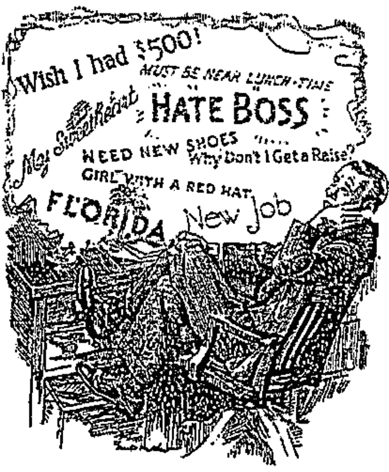

Sir Harry Lauder, Comedian. Baroness Orczy, Author. W. L. George, Author. Prince Charles of Sweden.

## THE PELMAN INSTITUTE OF AMERICA
Approved as a correspondence school under the laws of the State of New York
19 West 44th St. Suite 512 New York City

## 注意力不集中！

## 难怪他从来没有取得过重大成就！

他的思想只是不成熟构想的一个大杂烩。

他想了无数个快速赚钱的“计划”——但是，从来没有去落实过。

他每天都有很多不同的想法。在旧想法还没有成熟落实的时候，又有新的想法出现。

他是注意力不集中。

他的思想就像马力十足的汽车，到处乱撞，摧毁着他的希望，他的梦想，他的一切可能！

他想知道为什么自己总是停滞不前。他不明白为什么别人，没有他能力强，却赚钱比自己多。

他自怨自艾，为自己找借口，觉得上天不公平。

最大的悲剧在于，他有成功的一切品质——智慧，创意，想象力，雄心壮志。

他的问题在于，他不知道如何使用自己的大脑。

他的思想需要改变。

有很多人和他一样——失败，半途而废——被思想有条理的人所奴役。

大家都知道，我们大多数人的大脑，只使用了 1/10。另外 9/10 被无数零碎，不切实际，总不付诸行动的想法占据着。

我们只利用了自己拥有的东西的 1/10 赚钱。我们有几百马力的动力，最终只开发交付了 10 马力。

## 怎么办？

大多数人没有得到他们梦寐以求的东西，没有过上他们想要的生活，是因为他们的思想没有被充分利用，已经萎缩了，就像人的肌肉一样。

比如，如果你在床上躺一年，当你站起来时，你就会瘫坐在地上；因为你的腿部肌肉，长期没有使用，无法支撑你。

别人那令你羡慕的超常智力也是如此。其实，你也有这样的智力，只是它们几乎萎缩了，和不使用的肌肉一样，因为你用得太少，所以逐渐萎缩。

对自己要诚实。你内心知道你失败了，败得很惨，你离你的梦想还很远。

那么雄伟的抱负真的难以实现吗？还是只是你出了一些问题？去分析自己，你就会发现，在你心底，有一个弱点。

你怎么了？

你可以通过佩尔曼记忆训练寻找原因；然后开发你缺乏的特定智力，你可以轻松地开发它；佩尔曼记忆训练会教你怎么做；550000 佩尔曼记忆训练用户，他们中大多户人都被和你一样的问题所困扰，他们会告诉你，佩尔曼记忆训练真的可以协助你。

## 这些人包括：

- T.P. 奥康纳《下议院之父》
- 国家战争劳动会前主席弗兰克 P. 沃尔什
- H. 瑞德·哈葛德爵士，著名小说家
- 杰罗姆 K 杰罗姆，小说家
- 童子军运动发发起者 罗伯特·巴登将军
- 弗雷·德里克·莫里斯将军

## 帝国总参谋部军事行动指挥者

- 本 B 林德赛法官，丹佛少年法庭创始人
- 海军上将贝雷斯福德勋爵
- 哈罗德·兰黛，喜剧演员
- 奥希兹女爵，作家
- W.L. 乔治，作家
- 瑞典查尔斯王子
- ——等等，这类名人，数不胜数。

佩尔曼记忆训练是应用心理学科科学，它以宗教的力量席卷世界。它使世界范围内个体力量觉醒，他们所拥有的，之前他们做梦也想不到。

有一本很了不起的书《科学思维训练》就是讲佩尔曼记忆训练的。现在，你可以免费得到它。然而，许多人读了这声明，确实需要这本书，却不来信索取。“没用，”他们会说。“这对我来说，没什么帮助。”有些人会这么想。还有一些人会说；“都是胡说八道。”

但如果他们用心想想，他们就会知道，胡言乱语的东西，帮不到人，佩尔曼记忆训练一定有独到之处。因为有那么多人受益于它，有那么多和上面列表中一样的名人为其见证。

如果你不想一直受制于人——如果你刚又受过一次挫折——如果你 的灵魂里还有独立的星星之火，请来信免费索取本书。它将告诉你佩尔曼记忆训练是什么，以及它给别人带来了什么，它又能给你带来什么。

取得成功的首要原则是，有目的地去做一些正确的事情。你没有时间去犹豫，做白日梦，因为这样你很快就会再次陷入沮丧的泥潭。让佩尔曼式记忆训练帮助你找到你自己。如果你强烈地想做出改变，请立刻邮寄下面优惠券吧。

## 美国佩尔曼学院

受纽约法律

批准函授学校

19 第 44 大街西，512 大楼 纽约

## 美国佩尔曼学院

19 第 44 大街西，512 大楼

纽约

我想看看佩尔曼式记忆训练给 550000 多人带来了什么变化。请给我邮寄你的免费书籍《科学思维训练》。我不用承担任何责任。

姓名....................................................

地址....................................................

城市.................................州..........................

## 作业

## 10、打字新方法

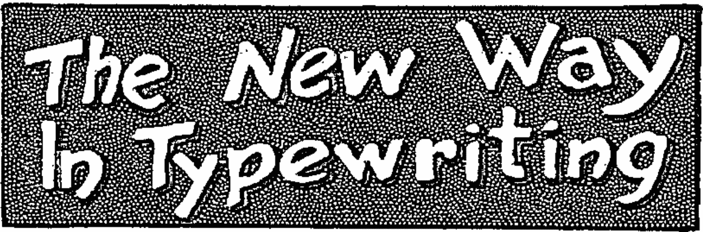

A revolutionary new method, totally different from anything known heretofore, is doubling and trebling salaries of typists in all parts of the country. Already, hundreds formerly earning but $8 to $15 a week, are drawing $25, $35 and even $50 weekly and their work is easier than ever before. A wholly new idea. Greatest step since invention of typewriter itself—based on Gymnastic Finger Training!

## Amazing Speed — Easy For All

Results felt from first day’s use. Entire system quickly learned at home in spare time. No interference with regular work. Speed and accuracy are what business men want and they will pay worthwhile salaries only to those who have them. This new system enables anyone to write

## 80 to 100 Words a Minute

blindfolded without a single mistake.

So certain are results that we offer the entire course on trial. Costs nothing unless you’re fully satisfied.

Send for big illustrated 48-page book explaining system, telling all about the wonderful Gymnastic Finger Training and containing letters from hundreds of graduates whose salaries have already been increased $300, $500 and up to $2000 yearly.

Write for free book today—a postal will do—no obligation—we’ll send it by return post. But don’t delay, this announcement may not appear again.

THE TULLOSS TYPEWRITING SCHOOL
4490 College Hill, Springfield, Ohio.

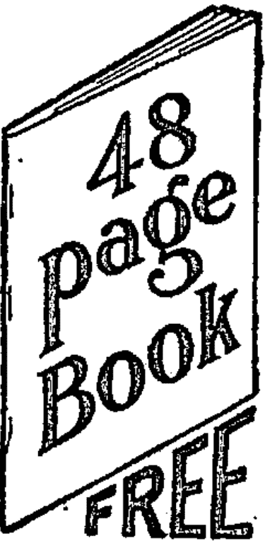

## 打字新方法

一个革命性的新方法，和迄今为止我们知道的打字方法完全不同，能让全国各地的打字员工资翻 2—3 倍。之前每周收入 8—15 美元的人，现在每周收入能达到 25 美元，35 美元，甚至 50 美元，而且他们的工作比以前轻松多了。一个全新的理念。是打字机发明以来最大的一次进步——手指体操训练！

## 神奇的速度——每个人都能轻松掌握

通过第一天学习，你就能快速看到效果。整个系统只要利用业余时间，在家就能快速掌握。不会干扰正常工作。速度和准确性是商人们想要的，他们只会为拥有速度和准确性的打字员支付工资。这个新系统，可以让任何人：

## 一分钟打字 80—100 字
盲打，而且不会有任何错误

我们对它的效果十分确定，因此我们愿意让顾客试用整套课程。除非你特别满意，否则不用支付任何费用。

来信索取 48 页详细课程，里面包含所有手指体操训练内容，以及无数已经毕业的学生的来信，他们的薪资已经涨到了每年 300 美元，500 美元，甚至高达 2000 美元。

今天就来信索取免费书籍吧——你不用承担任何义务——收到你的来信，我们会立刻回寄。不要犹豫了，这个提议可能随时会撤销。

## 图罗斯打字学校

4490 大学，俄亥俄州，斯普林菲尔德市

## 作业

## 11、劳斯莱斯销售信

Dear Friend,

Please take a look at the photograph I am sending you with this letter.

What you are looking at is a picture of a Rolls Royce Silver Shadow that I can sell you so cheaply that you will find it hard to believe!

Why is this car so inexpensive? Actually, there are three reasons and each of them is equally important: First of all, I am not a "used car dealer" in the usual sense of the word. No. What I do is specialize in absolutely nothing but pre-owned Rolls Royces and I have developed a remarkable way to get these cars into the country at a cost so low that it will take your breath away!

And secondly, if you so desire, I have worked out a way to finance cars over a period of four to five years at a very favorable rate of interest.

And thirdly, I am not overwhelmingly greedy. That's important. You see, many people in the car business are only in it for the money, but that's not true with me. And, as a matter of fact, it's not true of anybody that is really in love with the Rolls Royce motor car.

A Rolls Royce is different. It is more than just a car, it is a legend. When you drive one, everybody knows you are special. You are admired by women and envied by men. Quite frankly, there is nothing else in the entire world that will give you the instant status as sitting behind the wheel of your very own "Queen of the road".

Let's face it. As the owner of a late model automobile, you already know the value of owning and driving a fine motor car, so my question to you is:

Why not go all the way?

With the unbelievably low price I can offer plus the 100% financing I can arrange, it might even be cheaper to drive a rolls than the car you now have!

Please call me as soon as you read this letter. Right now, I only have five of these wonderful bargains and they won't last long!

My number is 213/398-2125

Sincerely,
Giorgio E. Scala

P.S. A Rolls Royce lives forever. The one you drive today could be driven by your grandchildren.

P.P.S. There is another "mystery reason" why I can sell these Rolls Royces so cheaply, but I would prefer not to reveal it until we talk on the phone. Thank you.

## （劳斯莱斯销售信）

亲爱的朋友：

请看看我寄给你的这封信里的照片。

你看到的是一辆银色劳斯莱斯的照片，我可以把它卖给你，价格会便宜到让你难以置信！

为什么这辆车这么便宜？实际上，有 3 个原因，每个原因都很重要：首先，我不是传统意义上的“二手车经销商”我只专注于二手劳斯莱斯，我发现了一种十分特别的方式，可以让人们以低到让人无法呼吸的价格得到它们！

其次，如果你很想要这样的车，我开发出一套方法，可以让你以异常低的利息，分期购买。

第三，我不贪婪。这很重要。你知道，很多从事汽车行业只是为了钱，但我不是。事实上，并不是任何人都真的喜爱劳斯莱斯。

每辆劳斯莱斯都不尽相同。它不仅是一辆车，更是一个传奇。当你开着劳斯莱斯，大家就知道你是特别的。无论是男人，还是女人都羡慕你。坦率地说，世界上没有任何东西能像它一样，让你坐在“马路女王劳斯莱斯方向盘后的那一刻，立刻身份倍增。

让我们坦然面对。作为最新型号汽车的主人，你应该已经知道拥有并驾驶一辆好车Curve，所以，我的问题是：

## 为什么不一步到位呢？

我可以以难以置信的超低价格出售劳斯莱斯，并且可以让你以超低的利息分期付款，它甚至可以比你现在的汽车还便宜！

当你读到这封信时，请立刻打电话给我。现在，我只有 5 辆这样的超值劳斯莱斯，它们很快就会被销售一空！

我的电话是 213/396 - 2125

真诚的

Giorgio E Scala

乔治 E 斯卡拉

P.S. 劳斯莱斯寿命很长。你现在的车，可能百年后，你的孙子还能开。

P.P.S. 我可以以如此低的价格，出售这些劳斯莱斯，还有另外一个“神秘的原因”，但是，我不想在这里透露它们，除非你打电话给我。谢谢。

## 作业

## 12、棕榈剃须膏 5 大乐趣等你体验

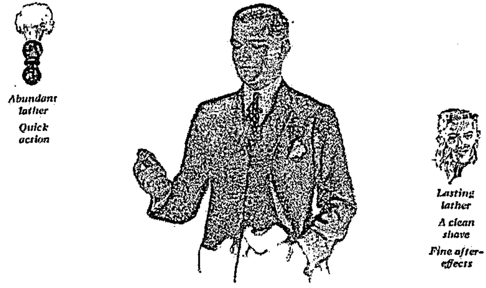

## Five New Joys
Await you in Palmolive Shaving Cream

By F. K. Cassidy, Chief Chemist

GENTLEMEN:
Let us show you five new joys we have brought to millions in Palmolive Shaving Cream.
This offers you a Ten-Shave Tube to try.

## A very unique creation

Three years ago most men were wedded to some other soap or cream. Then came Palmolive Shaving Cream, made by famous experts. The final result of 60 years of soap study.
A test was offered which countless men accepted. The users were amazed.

To add the final touch to shaving luxury, we have created Palmolive After Shaving Talc—especially for men. Doesn't sting. Leaves the skin smooth and fresh, and gives that well-groomed look.

The results men like
Palmolive Shaving Cream multiplies itself in lather 250 times.
It softens the beard in one minute.
It maintains its creamy fullness for ten minutes on the face. Its extra strong bubbles support the hairs for cutting.
The palm and olive oil blend makes the after-effects delightful.

Try it as a courtesy to us. We made up 10 formulas in seeking the perfect it. Now judge the result for yourself. Clip this coupon. Mail it, at your leisure for a Ten-Shave Tube.

## 5
Reasons why

- 1 Multiplies itself in lather 250 times.
- 2 Softens beard in one minute.
- 3 Maintains creamy fullness for 10 minutes.
- 4 Strong bubbles hold hairs erect for cutting.
- 5 The palm and olive oil content brings fine after-effects.

## PALMOLIVE
SHAVING CREAM

THE PALMOLIVE COMPANY (Del. Corp.)
364 North Michigan Ave., Chicago, Ill.

10 SHAVES FREE
and a can of Palmolive After Shaving Talc
Simply insert your name and address and mail to...
Address for residents of Wisconsin... Address for residents of other... The Palmolive Company (Del. Corp.), 3702 Irv School, Chicago, Ill., Dept. B-29-42.

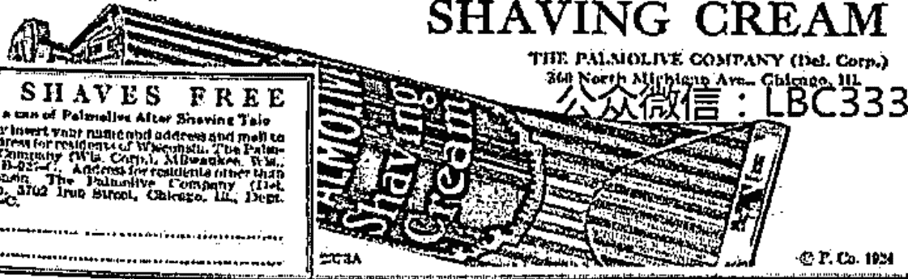

Abundant lather
Quick action

Lasting lather
A clean shave
Fine after-effects

- 泡沫丰富
- 快速见效
- 泡沫持久
- 奶油状膏体
- 效果持久

## 棕榈剃须膏 5 大乐趣等你体验

来自：V.K. 卡萨迪 首席化学家

先生：

让我们给你展示棕榈剃须膏给数百万人带来的 5 大新乐趣。

本提议，为你提供 10 次量试用装。

## 一个非常独特的创造

3 年前，大多数人一直用香皂或其他剃须膏。然后，出现了由著名专家研发的棕榈剃须膏。它是 60 年来，专家们对香皂不懈地研究的最终成果。

之后，无数人接受了试用测试。他们对结果感到非常惊讶。

为了让奢华的剃须体验锦上添花，我们研发出了剃须后使用的棕榈滑石粉。它没有油光感，能使皮肤看起来光滑，白嫩。

## 人人喜欢的效果

棕榈剃须膏能产生 250 倍的丰富泡沫。

能在 1 分钟内，使胡须变软。

它丰富的泡沫能在脸上保持 10 分钟。它格外强大的泡沫，能支撑胡须，以备剔除。

棕榈和橄榄油混合，能给使用者带来愉快的用后感受。

请出于礼貌试一试我们的棕榈剃须膏。为了研发完美的剃须膏，我们研发了 130 种配方。现在，请你亲自验证效果。立刻剪下优惠券，并在你闲暇的时候，寄给我们，索取 10 次量试用装吧。

## 为什么索取的 5 个原因

- 1、产生 250 倍的丰富泡沫
- 2、在 1 分钟内，使胡须变软
- 3、泡沫能持续 10 分钟
- 4、格外强大的泡沫，能支撑胡须，以备剔除
- 5、棕榄和橄榄油混合，能给使用者带来愉快的用后感受

## 棕榈剃须膏
棕榈公司

北密歇根大街 360 号，芝加哥，伊利诺伊州

© P. Co. 有限公司 1924

## 10 次量免费试用装

## 以及一罐供剃须后使用的棕榈滑石粉

只要填上你的姓名和地址，威斯康星州的居民，

邮寄到威斯康辛州的棕榈公司（威斯康星州公司）密尔沃基，威斯康星州 B-927-C 部门。威斯康星州以外的居民邮寄至棕榈公司(Del 公司)，3702 号街，芝加哥，伊利诺伊州，B-927-C 部。

## 作业

## 13、怎么会有如此令人难以置信的提议？

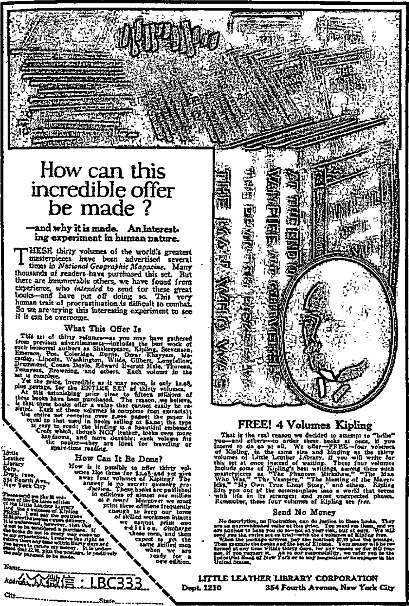

How can this incredible offer be made?
—and why it is made. An interesting experiment in human nature.
THESE thirty volumes of the world's greatest masterpieces have been advertised several times in National Geographic Magazine. Many thousands of readers have purchased this set. But there are innumerable others, who have found from experience, who intended to send for these great books—and have put off doing so. This very human trait of procrastination is difficult to combat. So we are trying this interesting experiment to see if it can be overcome.
What This Offer Is
This set of thirty volumes—as you may have gathered from previous advertisements—includes the best work of such immortal authors as Shakespeare, Kipling, Stevenson, Emerson, Poe, Coleridge, Burns, Omar Khayyam, Macaulay, Lincoln, Washington, Wilde, Gilbert, Longfellow, Drumond, Conan Doyle, Edward Everett Hale, Thoreau, Tennyson, Browning, and others. Each volume in the set is complete.
Yet the price, incredible as it may seem, is only $2.98, plus postage, for the ENTIRE SET of thirty volumes.
At this astonishing price close to fifteen millions of these books have been purchased. The reason, we believe, is that these books offer a value that cannot easily be replaced. Each of these volumes is complete (not extracts); the entire set contains over 3,000 pages; the paper is equal to that used in books selling at $1.00; the type is large and easy to read; the binding is a beautiful embossed cloth which, though NOT leather, looks even more handsome, and more durable; each volume fits the pocket, they are ideal for traveling or spare-time reading.
How Can It Be Done?
How is it possible to offer thirty volumes like these for $2.98 and yet give away four volumes of Kipling? The answer is a secret, quantity production. These books are published in editions of several millions at a time! Moreover, we must print these editions frequently enough to keep our force of skilled workmen intact; we cannot print one edition, discharge these men, and then expect to get the same skilled men when we are ready for a new edition.

FREE! 4 Volumes Kipling
That is the real reason we decided to attempt to "bribe" you—and others—to order these books at once, if you intend to do so at all. We offer—FREE—four volumes of Kipling, in the same size and binding as the thirty volumes of Little Leather Library, if you will write for this set at once instead of waiting. These four volumes include some of Kipling's best writings, among them such masterpieces as "The Phantom Rickshaw," "The Man Who Was, "The Vampire," "The Messing of the Mavericks," "My Own True Ghost Story," and others. Kipling lifts you out of the commonplace into a world that teems with life in its strangest and most unexpected phases. Remember, these four volumes of Kipling are free.
Send No Money
No description, no illustration, can do justice to these books. They are an unprecedented value at this price. You send see them, and we are anxious to have you do so—not at your risk, but at ours. We will send you the entire set on trial—with the 4 volumes of Kipling free.
When the package arrives, pay the postman $2.99 plus the postage.
Then examine the books and the lot of Kipling. Your money will be returned at any time within thirty days, for any reason or for NO reason, if you request it. And, for any responsibility, we refer you to the Industrial Bank of New York or to any newspaper or newspaper in the United States.
LITTLE LEATHER LIBRARY CORPORATION
Dept. 1210
354 Fourth Avenue, New York City

## 怎么会有如此令人难以置信的提议？

--为什么做出这个提议？以及有趣的人性实验。

这 30 卷世界上最伟大的杰作，已多次被刊登在《国家地理杂志》上。许许多多的读者都购买了这套书籍。但根据我们的经验发现，还有无数人——想要购买这些伟大杰作的人，还在犹豫不决。这种犹豫，很难战胜。所以，我们做了这个有趣的实验，来看看它是否可以克服。

## 这个提议是什么

这套含有 30 卷杰作的书籍——正如你之前可能在广告中看到的一样——包含不朽作家，如莎士比亚，吉卜林，史蒂文森，爱默生，坡，柯勒律治，彭斯，欧玛尔-卡亚姆，麦考利，林肯，华盛顿，王尔德，吉尔伯特，朗费罗，德拉蒙德，柯南道尔，爱德华·艾弗雷特·海尔，梭罗，丁尼生，勃朗宁等人最好的作品。每卷都十分完整。

然而，价格似乎很令人难以置信，整整 30 卷，加上邮费，只要 2.98 美元。

这样的价格，使这套书籍销售了将近 1500 万套。我们相信，销量如此之高的原因是，这些书籍提供了令人难以抗拒的价值。每套内容都十分完整（而不是摘要）；整套书籍包含超过 3000 页；这套书籍使用的纸张就值 2.00 美元；而且，内容通俗易懂；包装精美，采用的是美丽的宽绒浮雕，虽然不是皮革，但看起来更精美，更耐用；每卷书籍都适合放在口袋里，在旅游或业余时间阅读。

## 怎么有这么好的提议？

怎么可能以 2.98 美元的低价，出售这么珍贵的 30 卷书籍，还赠送吉卜林的四卷书籍？答案显而易见：批量生产。这些书一次出版将近 100

万本！而且，我们必须雇佣熟练工人一次全部完成印刷；我们不能印刷完一卷，解散工人。然后，等新的一套要出的时候，再要召集技术同样熟练的人，很难。

## 免费！4卷吉卜林的书籍

让你一次性订购所有书籍（如果你本身就有全部购买的打算，何不一次性购买了），是我们用它来贿赂你——以及其他人的真正原因。如果你立刻来信购买整套书籍，就能获得我们免费提供的 4 卷吉卜林书籍，大小和那 30 卷小皮革书一样。这 4 卷书，包含吉卜林的一些最好的作品，其中包括《幻影车》，《邪人》，《吸血鬼》，《达拉斯会议》，《我真正的鬼故事》等杰作。吉卜林会让你跳出平凡的世界，进入充满着最奇怪和最意想不到的事情的生活。记住，这 4 卷吉卜林书籍是免费的。

## 免费获取

没有描述，没有插图，使这些书的价值能充分发挥。它们的价值远超实际售价。你一定要阅读，我们迫切地希望你去阅读——你不用承担任何风险。我们会为你寄去整套书籍，供你试阅——还有 4 卷免费的吉卜林书籍。

当包裹到达时，请支付邮递员 2.98 美元，以及邮资。然后检查这套书籍，以及吉卜林书籍。30 天内，你有任何不满，或者没有任何理由，退回这本书，我们都会立即为你退款。出于责任，我们会向你推荐银行，或杂志，以及报纸。

## 小皮书书库公司

1210 部门 354 号第四大街，纽约

## 小皮书书库公司

1210 部门

354 号第四大街

纽约

请寄给我 30 卷精装小皮书，（以及吉卜林的免费 4 卷书籍）。我将支付邮递员 2.98 美元，以及邮资。我知道，这并不是购买。如果这套书在任何方面没有达到我的预期，我有权在 30 天内退回，并得到全额退款。我也知道，2.98 美元，以及邮费，是我要交付的全部费用。

姓名...................................................

地址.........................................................

城市....................................州:................................

## 作业

## 14、"我和上帝进行过一次交谈"

## "I TALKED WITH GOD"

(Yes I Did = Actually and Literally)

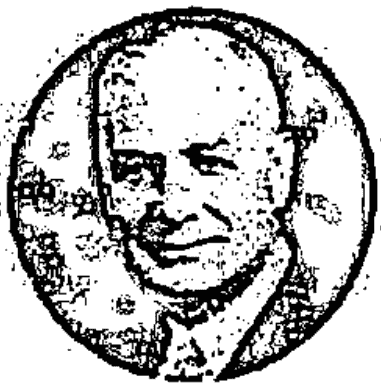

DR. FRANK B. ROBINSON Founder "Psychiana." Moscow, Idaho

and as a result of that little talk with God, a strange Power came into my life. After 82 years of horrible, dismal, sickening failure, everything took on a brighter hue. It's fascinating to talk with God, and it can be done very easily once you learn the secret. And when you do - well - there will come into your life the same dynamic Power which came into mine. The shackles of defeat and fear which bound me for years went ...

and when you do, if there is poverty, arrest, unhappiness, ill-health, or material lack in your life, well - this same Power is able to do for you what it did for me. No matter how unhappy or how helpless your life seems to be - all this can be changed. For this is not a human power. I'm talking about - It's a God-Power. And there are no limitations to the God-Power, are there? Of course not. You probably would like to know how you, too, may talk with God, so that this same Power which brought these good things to me, might come into your life too. I have written the strange, almost unbelievable story in two booklets, and I have given away literally millions of copies of them. As a matter of fact, the story has been told in 57 foreign countries, and in every city, town, village and hamlet in America. It has been written up by such outstanding periodicals as Time, Newsweek, Magazine Digest, and scores of other internationally known publications. I want to give you these two booklets. I want to give you also illustrated circulars, and copies of letters which tell what in being accomplished over the world through this new strange Teaching. If you will send me your name and address on a post-card or in a letter, these two booklets will come to you free of charge. This experience may sound unbelievable, but it's true or I wouldn't tell you it was. The address is Dr. Frank B. Robinson, Dept. 479 Moscow, Idaho.

## THERE'S REAL POWER HERE

"Psychiana" is a non-profit religious organization. The Movement was born in Moscow, Idaho in 1918. It is unquestionably home of the largest religious Movement in the world operating entirely by mail. Our conception of God is positive and dynamic. Over 118,000 ... Copyright, 1940, Psychiana, Inc., Moscow, Idaho. 公众微信：LBC333

## "我和上帝进行过一次交谈"

## （是的，真正的谈话）

经过那次和上帝的短时谈话，一种奇怪的力量进入到了我的生活。

经过 42 年令人痛苦不堪的可怕失败，一切都呈现出了明亮的色调。与上帝交谈很令人陶醉，一旦你学会这个秘密，它就可以轻松完成。

当你和上帝谈过话后，你的生活也会拥有同样的力量，就像我一样。失败和恐惧的枷锁紧紧的束缚了我多年——现在呢？现在，我是新闻审查出版公司总裁，我们公司目前的午后新闻，是北爱达荷州发行量最大约。我拥有我们城市最大的办公大楼。我有 2 辆漂亮的汽车。我买了漂亮的房子，有漂亮的风琴，我还为家人买了足够余生幸福生活的保险。这一切成为可能，要源于大约 12 年前的某一天，那天我和上帝进行了交谈。

你也可能会遇到那股来自与上帝交谈后，奇怪的神秘力量。当你感受到了这股神秘的力量，如果你的生活也遭遇着贫穷，动荡，忧郁，健康不佳，温饱问题。那么，帮助我的那股力量，也会帮助你。

不管你的生活看起来多么无望或无助——所有这一切都可以改变。因为，我所说的不是人类的力量——它来自上帝。上帝的力量无所不能，不是吗？当然是。你可能想知道如何与上帝交谈，并获得这样的力量，拥有和我一样的生活上的改变。

我在 2 个小册子里，撰写了几乎令人难以置信的神奇故事，我把它送给了许许多多的人。事实上，这个故事已经传遍了 67 个国家，以及美国的每个城市，乡镇，农村。它已经被《新闻周刊》，《杂志文摘》以及其他许多国际知名出版物所刊载。

我想给你这 2 个小册子。我还想给你说明函件，以及客户来信，内容

容是世界各地利用这种奇怪的新方法，所取得的成就。

如果你用明信片，或信件把你的姓名和地址给我，我就会把这 2 个小册子免费送给你。这样的经历听起来令人难以置信，但这是真的，否则我不会告诉你。我的地址是弗兰克·B·罗森博士。爱达荷州莫斯科，479 部门。

## 这里有真正的力量

## 作业

## 15、用我的13条要点,你一定能赚7500美元...否则,你不用支付一分钱！

## 用我的 13 条要点，你一定能
## 赚 7500 美元...否则,你不用支付一分钱！

哈辛托·瓦斯凯，罗恩·特科特，以及弗兰克·赖特都称我为“顶级赛马分析师”——现在，我将分享一些保证让你成为赢家的一些秘密。

土耳其咖啡在高架架赛马场支付了 9.6 美元。如果你之前一直使用《获胜系统》，你这场比赛肯定早已成功了——包括同一天其他 3 场！

来自：麦考斯
© 1975，获胜系统

是的！这是提供给赛马粉丝有史以来最强大的保证。如果你根据我的“获胜系统”一步步操作，你一定会赢得至少 7500 美元——否则，你不用支付一分钱！

你想想。

在每天仅 1 场 的比赛中，你知道“哪匹马肯定会赢”，对你来说，价值多少？

不多——也不少！

每天只有一个赢家。

一年的时间，你就可能存 5000 美元！

有可能 10000 美元！

有可能 25000 美元！

想像一下，成为最后的最大赢家，会怎样……

◆ 你的生活会变得安乐富足——有能力购买最好的东西，购买所有你需要的，想要的，还有应该有的东西；每年换一部新车，

全款购房，彩电，舒适的度假！

+   ◆ 你从此可以高枕无忧，再也不用担心还不起账单了——因为你永远不会再有未偿还的账单！
◆ 你是定期赢得比赛的幸运者之一——你有钱购买任何奢侈品——直到你老到无法享受！

是的，我保证——我还可以做出更多保证！

不论你是否从未参加过赌马比赛！不论你是否认为自己运气好！不论你之前是否每赌必输！

我的“获胜系统”会让你成为赢家，否则你不用支付一分钱。

有可能你会说：“你怎么可能保证我赢 7500 美元呢？”答案很简单。

我已经找出了 13 个一定会赢的比赛的要点——我将和你分享它们——让你赚大钱！

## 一个不可能的梦？不！

让我解释一下：

此时，你应该知道“运气”和赢马没有关系。此时，你应该已经发现，某些人总是赢得比赛，而某些人总是输。此时，你应该已经意识到，你需要“内幕”消息，才能赢大钱。此时，你明白，你要赢得赌马，你需要一个系统。

我是麦考斯，我不会进行任何兜售。

世界上一些著名赌马师称我为“顶级赛马分析师”。

哈辛托·瓦斯凯，肯塔基赛马会愚悦协会专家——罗恩·特科特，指导秘书赢得了一次次的比赛——乔·特罗瓦托培训出了出色的女赛马师，莱尼·古德曼，巴埃扎的经纪人，和弗兰克·赖特，教练，比赛的电视报道名人——他们都肯定了我的能力。

事实上，从鲍伊的赛马电视报道中——一天内，从4位赛马手中，我猜出了3位赢家。看这场比赛的赛马迷超过500000人，他们都能证实这一点！

多年来我一直在挑选赢家——为自己，还有我的几个朋友。现在，我要和你分享这些胜利的秘密。

它如此简单，之前竟然没有人发现，这让我感到很惊讶。我可以向你保证，我从来没在别的刊物中见过我的13个要点。

现在，你我都知道，想出能赢得所有比赛的方法的人，一定会赚很多钱。

我做到了——现在，我真的像拥有一座金矿。

我已经写下你成为赢家需要的所有知识。内容简单，易于操作，易于理解——语言通俗易懂，没有赛马专业术语。我已经打印了少量副本——非精装——里面有你需要的所有事实和内部信息。它就是“获胜系统！”

为什么我要和你分享这些秘密？因为我要大赚一笔。如果每204位赌马者中，有一位购买我的“获胜系统，”我就会赚100多万美元。（结果比我亲自赌马甚至会更好！）而且，最重要的是，你会成为一个大赢家——否则，你不用支付一分钱！

测试“获胜系统”，不用承担一分钱的风险！

在你确信我的“获胜系统”确实有效之前，你不用支付一分钱。你只要使用“确定会赢”方法赌马几天——亲自验证你能赢多少钱。

## 现在，你可以得到它了！

只有一个办法能验证我说的是是否正确，那就是通过邮件订购你的零风险保证手册《获胜系统》——立刻订购。现在，任何书店、报摊或赛马局，以任何价格都买不到这样的手册。它已经得到美国政府版权保护，防止被剽窃，盗版。

要想得到零风险手册《获胜系统》，只要填写，并邮寄下面的优惠券，附上支票，现金或汇票10美元——你没听错——不是25美元，不是50美元，只要10美元。

不要再犹豫了。听从内心对成为大赢家的渴望。立刻订购吧！

麦考斯

（麦考斯）

P.S.如果 ricostru 你知道了走向成功的秘诀，却没有成功——那么，下次你失败的时候，就不应该责备任何人，除了你自己！

## 7500 美元
保证！
你能获得

## 100%零风险，双重保证

+   1. 如果你收到《获胜系统》后，觉得不喜欢，可以立刻退货，并得到全额退款——不问任何问题。

+   2. 坚持使用《获胜系统》一年。使用我的13条要点，你一定能赚7500美元——否则，下一年退回《获胜系统》。你会得到全额退款——不为难，不问任何问题。

支票收款人请写下面内容，并将其邮寄至此：

麦考斯获胜系统
964 第3大街
纽约 10022

是的，我想做赢家！请立即为我邮寄一本零风险保证的《获胜系统》！这是我的 10 美元。我完全享受 100%零风险双重保证。感谢这个让我成为大赢家的机会！

内附现金，支票或汇票 XX 美元

你可以通过我的下列信用卡扣费：

+   - □ 万事达信用卡
- □ 美洲银行信用卡

卡号________________

同业银行卡号________________

（万事达信用卡同业银行卡号在姓名上方）

信用卡有效期________________

签名________________

先生

女士

姓名 ________________

地址________________

城市________________

州______________ 邮编______

□ 我想尽快收到书籍。所以额外支付 2 美元（总共 12 美元）。请走空运。

## 作业

## 16、如果经济衰退来临，你没有采取这4个自我保护步骤 那就只能等上帝救你了！

## God Help You If The Crash Comes, And You Haven't Taken These Four Initial Steps To Protect Yourself!

Before you do another thing, check them off below.

COMPARE THE PRICES INFLATION SURVIVAL LETTER (Regular Rate) $36 ...

SO EVEN IF THE CRASH COMES, YOUR CHOICES ARE BRIGHT INDEED — IF YOU MAKE THE HARD FACTS WORK FOR, AND NOT AGAINST, YOU ...

Get Fortune-Saving, Life-Saving Information Like This—Month After Month After ...

## 如果经济衰退来临，
你没有采取这 4 个自我保护步骤，
那就只能等上帝救你了！

## 对比价格
《通货膨胀-经济衰退生存手册》（正常价）…36 美元

预测 75 美元                  戴恩斯投资咨询 150 美元

巴克斯特的世界经济服务 80 美元       玛雅的金融和能源 170 美元

鲍威尔货币分析 95 美元      国际财经 180 美元

道琼斯理论 95 美元     国际哈利舒尔茨财报 250 美元

林奇国际投资调查 100 美元      银行信贷分析表 275 美元

霍尔特投资咨询 144 美元      精选世界货币报告 300 美元

## 在你做另一件事之前，请三思……

比如，如果明天，或明年，所有的纸币，股票以及银行存款，养老金，保险政策突然间变得一文不值，你会怎么办？你会就此破产，还是繁荣兴盛！

你会看着你一生的积蓄一夜之间全部消失——还是会利用令人难以置信的方式，使你在经济复苏时，成为百万富翁？

你会陷入争夺食物的骚乱——还是被安全、舒适地保护起来，任何暴民，强盗都无法侵犯你？

如果你立即行动的话，选择权都在你。但是，如果你犹豫片刻，你此生可能永远再也无法选择了！

这听起来像扭曲的噩梦？那么，请你阅读一下冰冷，却又真实的记

录：

1973年，历史上第一次，政府还有我们个人所欠的贷款，数额其实远超过我们的资产价值！换句话说，我们欠的债，比我们得到的值多！

去年，我们只在支付公共债务的税上就花了超过280亿美元！它会在多大程度上恶化我们本已经陷入困境的经济？

为什么我们债台高筑？原因之一：当社会保障和福利计划开始时，我们国家每143名工人中，只有一个受益人！今天每3名工人中，就有一个受益人！

如果目前大规模资金流向阿拉伯等国家的状况一直持续，那么，到1980年，他们可能欠美国的债务，比我们国人还要多！

粮食短缺已经成为每日新闻！大规模的“食物短缺问题”，可能是我们面临的“年代危机”中最大的一个。

难怪著名的《华尔街日报》的在头版新闻上，报道了全球经济萧条的可能性！

难怪休伯特·汉弗莱说：“我们正处在经济衰退中，我之前从来没有这么说过，我们处在大萧条的危险边缘。”

难怪洛杉矶警察正在接受平息粮食暴乱的培训！

难怪在最近的一次盖洛普民意调查中，超过50%的美国人认为大萧条来了！

这些都是事实！你亲自判断它们的真假吧！现在，请验证拯救生命的信息的推荐——不仅能在最糟糕的状况发生时拯救你，以及你的家庭，还能为你创造全新的光明未来！

## 获得这样的拯救金钱，拯救生命的信息

比如：

+   - 没有保障 VS 坚固的通货膨胀防护措施
- 为饥饿的未来准备充裕的食物
- 在雷电灾害中，保存食物的聪明的方法
- 在通货膨胀的环境下购买或出售房地产的陷阱和机遇
- 在瑞士和其他外国银行存款的安全和隐私
- 你是否应该投资艺术，古董，珠宝，邮票以及钻石
- 看专家如何投资外国货币
- 购买乡村的房地产
- 避税天堂以及它对小投资者的帮助
- 纪念奖牌的利润和快乐
- 在美国能安全居住的地方
- 补充性收入
- 如何降低你的税
- 应对紧急情况的项目
- 硬币的投资
- 隐藏贵重物品的安全地方
- 黄金和白银的高利润
- 赖以生存的肉类

有 4 个简单、合理、谨慎的自我保护措施。我们希望把它们都送给你，这可能将是你有生以来收到的最有价值的免费礼物——绝对不可或缺的《通货膨胀-经济衰退生存手册》，现在你只要零风险验证 “在通货膨胀中生存”。

下面的内容，从本质上讲，是《通货膨胀-经济衰退生存手册》给你的一些生存方式：

## 步骤 1. 现在，给自己买一些“生存的钱”，这样，在你想购买东西时，就可以看到它们，不像你周围的许多人那样要去乞讨！

这个简单的第一步，不用任何成本——只要把你现在不断贬值的纸币，转换成始终可以流通的“硬通货”就可以了，这么做有两大优势：增加了价值（基于过去的趋势），增值速度甚至会超过 2 位数的通货膨胀！最重要的是，如果危机来了，它会让你拥有食物，而其他人（掌握着已经不值钱的钱）挨饿！

## 步骤 2. 然后，一旦你确保自己未来不会挨饿，就可以购买一些“黄金”！

因为生活中美好的东西——世界上美好的东西——那些，你喜欢了多年，却一直买不起的东西，那就是在经济动乱中，最合适的钱！“黄金”！如果你知道“黄金交易”的“内部”秘密，并立刻存储甚至少量的黄金。那么，当动乱的日子来临，你会发现，目前一美元的黄金，到那时，价值 100，甚至 1000 美元！

## 步骤 3. 然后你就真的可以赚大钱了，很多，很多钱！

在每次经济危机的时候，都会有很多普通人破产，而一些有远见，勇敢的人，就会开始实现自己从来想都不敢想的梦想。撼动社会核心力量的人，将是特定的几个人——不管他们之前多么贫穷——此时，都能赚取数百万！

少量资产——现在用正确的方式转换的——可以利用失控的通货膨胀，大赚一笔可能再也赚不到的大钱！举个例子（在这本《通货膨胀-经济衰退生存手册》中，给出了 99% 的人都不知道的“便士黄金股”！这些“永不衰退的黄金”股票售价低至每股 2 美分……其中一些已经比原来的售价增长了 1000 多倍！

步骤4.也许最重要的是：如果社会规则在短时间内崩溃…如果暴徒接管了这座城市——必须保证你和你的家人不受他们的迫害——安全地等到社会秩序重新恢复正常！

这么做的成本是什么——现在？上万美元？完全不用！《通货膨胀-经济衰退生存手册》将向你证明，只用一点钱——少到你做梦都想不到的数量，你就可以…

…和朋友，或专业人士联合，在必要的时候，将自己置于“堡垒”之中，不受暴民的打扰！

…在数小时内撤退到“小岛天堂”，你在这个世界上最美丽的海洋小岛上，得到64英亩的农场，只要6000美元（不是6000美元起，而是全部只要6000美元）！在那里，你可以用1美分买到4根香蕉……可口可乐5美分，糖10美分一磅。市中心停车费2美元1个月。或一个装修豪华的2居室，配有保安——1个月只要170美元！

所以，即使危机来临，你的选择都是光明的——利用好艰难的时光，而不是让它折磨你！

但还有一个比其他人都略胜一筹的步骤！你必须为自己建立一个“预警系统”，让你及时了解最新信息！让你能确切判断下周或下个月，这个国家将处于什么阶段！然后告诉你该做什么——在你的公务员邻居还不知道最终的战役将要打响之前！

据我们所知，在美国或全世界，只有一个这样的刊物。它就是《通货膨胀-经济衰退生存手册》。

《通货膨胀-经济衰退生存手册》，涵盖了200多个投资咨询服务及每月相关出版物的内容……它的来源有政府，金融和全球范围的工业……有我们这个时代有远见的基金经理总裁（如哈利布朗，亨利·黑兹利特，哈里·舒尔茨，汤姆·霍尔特等等）的会议。

它有一个目标，只有一个目标：帮助你把可能的金融和个人灾难变成机遇！帮助你在如今几乎肯定会发生的通货膨胀中生存——并过得舒适，赚大钱——让你拥有远超你在通货膨胀之前的金钱！

我们如何向你证明呢？用这 2 个简单的方法：

首先，你可以零风险阅读《通货膨胀-经济衰退生存手册》。只要你不满意，我们将退还订阅费中未使用的部分，不问任何问题。

其次，免费额外赠送你上述手册《通货膨胀-经济衰退生存手册》的注解！你只要附上订阅费，就能免费得到这个福利。

## 现在试阅《通货膨胀-经济衰退生存手册》
你可以节省三分之一的订阅费！

这个拯救生命的信息，每周三发行一次。试推广期间（仅供新用户）24 美元一年（一共 26 期间）——只是大多数类似出版物收费的一小部分。

现在行动，你能获得所有，却不会损失分毫！

在这个经济衰退的通货膨胀中；你停留在原地，就相当于退步！开始做些什么吧！立刻邮寄试推广订单吧！

## 《通货膨胀-经济衰退生存手册》
410 第一大街，S.E. 华盛顿特区 20003

节省 33%的推广价，推广期时间有限。享受无条件零风险保证。

我在订单上附了 24 美元。请记录我的订阅时间为一年（26 期）——和正常售价相比，节省 33%。而且还免运费。

姓名_______________________
地址_______________________
城市/州_____________________ 邮编__________

## 作业

## 17、这本书（让我们安乐富足的同时）可能会把我们送进监狱

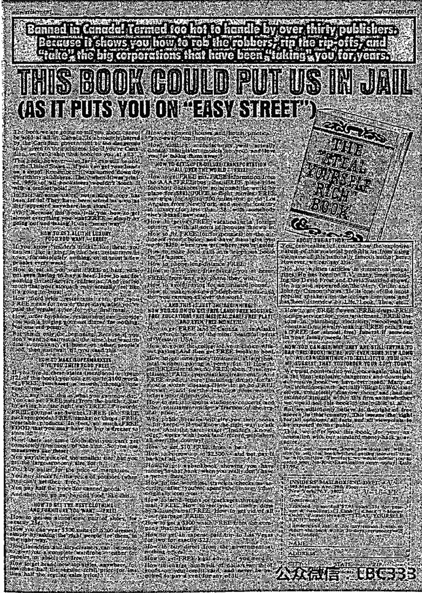

加拿大禁止销售！30多家出版商都不敢接手，他们称其为烫手的山芋。因为它向你展示了如何抢劫劫匪，如何偷小偷，如何“剥削”多年来一直“剥削”你的公司。

## 这本书（让我们安乐富足的同时）

## 可能会把我们送进监狱

## 关于作者

当然，你可能会意识到这个爆炸性信息，使得我们不敢公布这位著名作家的名字。不过，我们可以这样说：

“他为许多杂志撰写文章。他多次参加电视节目，包括福斯特访谈，大卫·萨斯坎德秀。他还参加过格里芬和约翰尼·卡森秀。他是大学校园里最受欢迎的演讲者之一，曾被《生活》，《视角》，《时代》等杂志纷纷报道。”

我们将要告诉你的这本书，在加拿大禁止销售。加拿大政府认为这本书太危险，不适合给国民看，因此严令禁止销售。

然而——到目前为止——这本书在美国依旧可以销售……如果你够幸运，也许能买到！记住，它曾被30多家出版社拒绝。现在，它出版了，95%的书店根本买不到！

事实上，在一些州，一本也不允许售卖！一旦，它们出现在书店货架上，就会被没收！

为什么？因为这本书告诉了你如何几乎不花一分钱，得到所有东西——想要什么，去拿什么，以“聪明的方式”！

## 如何免费获取你想要的丰盛食物！

如果你知道这些‘内幕技巧’，你就可以在城里最好的餐厅吃得像皇帝，而且不用支付一分钱；或者每周最多仅需几个便士！

如何在大吧免费畅饮，不用花一分钱。如何免费吃自助餐。吃到彻底满足！

如何在首次正常付费享用定价餐馆菜肴后，让其免费为你继续提供2天，或3天餐点。

如何让电话订餐餐馆为你免费提供丰盛的晚餐。不要花你一分钱。

但，这还只是开始！因为如果你不想一直在外就餐，想用别人的食材，自己做顿丰盛的美食，你只要继续阅读……

## 如何让超市免费为你提供他们的食材！

如果你住在这些州（本书第121页会提及），就可以通过一个简单的手段，免费获得一张有效期一个月，价值100美元购物券。

或者，在任何国家，你都可以：用恰当的询问方式，从肉铺那里得到免费的肉。得到免费的慢转唱片。免费的美味三明治。免费的鱼。免费礼物。免费牛排或猪排。免费的蔬菜。事实上，你可以得到的免费食材如此多，你肯定吃不完，必须用冰箱存储呢！

有些食物，你大多数时间无法完全免费获取。因此，你可以使用以下方法：

+   - 你支付最小量的产品价格，却能获得超大经济装。
- 你可以以人造黄油的价格买到真正的黄油。
- 你可以以土豆的价格，购买牛排。（当你无法免费获得的时候。）
- 你可以以半价购买罐装食品。
- 除了食物，你还可以：

## 如何免费获得你想要的衣服和家具！

如何以 25 美分的价格，获得一双几乎全新的鞋子。

如何用正确的方法，向对人，免费穿到 300 美元的套装（或 200 美元的裙子）。

如何在干洗店，以及洗衣店用几便士，或完全免费清洗你所有衣物。

如何以不到正常零售价格一半（或正常销售价格的一半）的价格，在任何地方，获得全新的风格。

如何让公寓以及酒店“白送”顶级家具给你。

如何让服装制造商给你他们最新款服饰，并愉快地请你立即带走。

## 如何免费获得全球范围的奢华旅行！

如何获得免费的天然气，AAA 的免费信息，免费乘坐大巴。免费短距离飞行（或 88 美元乘飞机环游世界）。免费电影。免费汽车旅行多达 500 英里（或用不到 8 美元，从纽约到洛杉矶，开着别人的新车，奢华的旅行）。

如何获得国外免费度假——享受各种福利。如何免费飞行（或只花几便士），航班随你选，并且当你到达时，让他们给你 250 美元。

如何用公用电话，花 2 美分，拨打当地电话。

如何免费拨打长途电话。

如何让朋友从任何他们想用的付费电话上，免费给你打电话。

如何避免为未入册的手机付费。

如何制作自己的电话信用卡，让你可以在全球范围内使用。

## 这只是开始！

## 现在你可以获得免费土地！免费房屋！免费教育！
免费医疗！免费游玩！甚至免费的钱！

如何在加拿大……阿拉斯加……甚至在美国西部最美丽的地方，获得免费土地。

## 如何免费上你想上的大学！获得免费书籍。

如何不花一分钱，在任何医院得到紧急治疗。如何免费看牙。获得免费照片，免费眼镜。免费精神治疗。以及十多种疾病的免费医疗（包括医药）。如何免费看电影——抢在朋友面前，看到最新大片。

如何支付正常价格的一小部分，就能免费观看运动会，音乐会，以及其他娱乐活动。

为什么以正确的方式询问，公共图书馆就会送给你他们的书籍——让你保管。同样的“内部消息”也适用于全国各地出版商。

如何从银行免费得到 10 美元。

## 如何借到多达 2500 美元——而且不用偿还。

如何得到有余额的银行存折，即使你在他们那里没有存过一分钱。

如何花有限的钱，使用价值无限的旅行支票。

如何通过邮件，免费邮寄信件或包裹。如何让洗衣店免费为你洗衣。如何让你家的垃圾免费被清理掉。

如何从钟表制造商免费得到 300 美元的手表。

如何用 23 美元获得拉斯维加斯双人豪华游。

如何不花钱直接向政府购买。

如何得到免费法律建议，当然，如果你需要的话。

## 如何用信用卡买数百美元的东西，而且永远不用偿还！

如何得到免费鲜花。免费药品。免费装修设计。免费水管，电路，木工，建筑，珠宝设计等的课程。免费宠物。甚至免费（或几乎免费的）葬礼，如果你有家人需要的话。

现在，你应该明白他们想禁止这本书的原因了吧！
我们甚至不确定我们还能销售这本书多久！
我们建议你立即订购这本书！

我们必须再一次告诉你，这是我们读到过的，最具爆炸性，最危险，最彻底地颠覆性书籍。里面的很多方法都是合法的。我们公司内部展开了是否向公众销售这本书的激烈讨论。

但是，我们依旧坚信国人享有言论自由权。这就是说，享有对任何看法，事实，观点的知情权。

因此，我们向你提供这本书，让你在我们的零风险保证下，验证它。

然而，我们不知道还能销售这本书多久，不知道什么时候会因此沾上法律官司。因此，我们建议你立刻订购有零风险保证的这本书。只要 7.95 美元。

内部人员邮箱 # V 部 麦德逊大街 595 号 29 层 纽约 10022 V-16-FE

先生：内附 7.95 美元（外加 55 美分的邮费&手续费） □现金 □ 支票 □ 汇票 我明白，如果出于任何原因，我想退货，只要在 30 天内寄回本书，我就能得到全额退款。

姓名 _________________________
地址 _________________________
城市 __________ 州 _______ 邮编 ____

纽约居民请支付合适的税费 681

## 作业

## 投资大师透露的秘密！

每年都有超过 5000 人成为百万富翁，在美国，有将近 200000 名百万富翁，每 1000 人中，就有 1 位是百万富翁。现在你可以成为投资大师了！

钱是你最大的问题——对吗？——像大部分美国人一样，你需要更多钱，而且立刻就需要。

此时此刻，你正处在有生以来最重要的发现边缘！为你开启成功的大门，赚取你做梦都想不到的财富的关键就在此处，而且等待着你去使用！

你觉得富人是如何变得富有的？是因为他们比你聪明吗？不是！是因为他们生而富有吗？不是！是因为他们比你幸运吗？不是！

人的好运有自己创造！为什么每年都有超过 5000 位新百万富翁？根据邓百氏公司调查显示，每年都有穷人以这样的比例变为百万富翁！如果他们并不比你聪明，幸运，也不是生而富有，那原因是什么呢？

我将告诉你。

内部人士的金钱秘密。你可能不信，这些成为百万富翁的人都是内部人士。这里说的内部人士是什么意思？在金融界里，有一些关于商业原则的严格保守的秘密。内部人士都知道，并且一直在使用它们。例如：

作为商业顾问，邮购订单总负责人，我帮助过很多像你一样的人，他们为了各种各样的目的，筹集到了大笔资金。我以业余邮购业务起家，逐渐看着它成长为一个专业的出版公司，用的就是我说的金钱秘密，它也将帮助你取得成功！

我一直在应用收取大量咨询费的专业内部信息，我现在将首次公开。

现在，你也可以一窥最新，内部人士最讳莫如深的金钱秘密了。这是你用它赚钱的一个好机会。看看这张列表，你就会发现，你的财富和梦想变得唾手可及！

神奇的 360 A 计划。这个计划非常棒，任何人用它每周都能赚取 1000 美元。该计划的创作者对它的效果深信不疑，他说：

如果你严格遵循这个计划，每周没有赚到 1000 美元，你使用它期间，我将每周支付你 5000 美元。（这不是诡计花招——而是单纯的事实）

富人利用税法来躲避过多的税收。是的，利用避税项目避税，是躲避几千美元税收的合法手段。本书中，你将学到一个独特的计划，可以帮助你用“富豪们”都在使用的漏洞，减少你的个人所得税。这个计划，非常适合 8000 — 25000 美元收入的人，这是避免高税收的一个完全合法的方式。

当天借钱当天还，同时你还拥有了你需要的资金。听起来不可思议，不是吗？这是真的。即使是那些以前拒绝了你的人，也会非常想帮助你。

征用土地。在美国、加拿大等地，鲜为人知的免费征用政府土地的方法。

三重 AAA 信用评级。遵循一个简单规程，你就可以在短短 30 天内，拥有三重 AAA 信用评级。可以和银行和信贷机构建立起最好的信用评级。不管你以前的信用评级如何。

筹集创业资金。如果你需要一笔钱，来将一个想法投入运行，去创业，扩充业务，或收购业务；那么，金钱秘密将会告诉你，如何从私人投资者，信托、赠款、经纪人那里获得资金。它将给你提供一系列姓名和地址，以及指导，告诉你如何专业地筹集资金。这些聪明的资金筹集技巧，不论是创业新手，还是久经商场的老手，都能使用。

612 秘密计划。这个计划可能一直是被最严格保密的赚钱计划，这个计划并不新鲜，但一直以来，却仅被内部人士使用。它太神奇了，仅详细了解它的内容，并不能充分看出它的威力，一定得亲自投入使用。

如何开始自己的投资业务。这个显著的内部方法，在为你的业务拉升威力，财富，威望方面，绝对无可匹敌。完整的一步步计划，包含所有细节，样例和程序，你一定能成功应用。

如何在通货膨胀中保护你的钱。这个信息非常重要，仅这条信息的价值，就是本书售价的几百倍。你必须学会在货币贬值的时代，保护自己的金钱。在这本《投资大师的秘诀》中，列出了一个特殊的部分，这是在未来几年中，价值有望增加 3 倍的黄金股票！（是的，里面给出了这些黄金股票的名字，及其购买理由！）

这仅仅是《投资大师秘密》能带给你的回报的一个小样本！它还包括以下几点：

- 如何免费获得一切，包括如何免费居住，免费旅行，获得免费商品和服务，等等！
- 获得投资 100% 的回报！
- 如何利用一个邻居的名字获得 150 美元！
- 如何保证获得生活收入！
- 如何保证获得 21% 的分红！
- 如何利用定期存款，获得 22.8% 的利息！
- 如何不花一分钱，“接管”一个业务！
- 不花一分钱，建立一个数百万美元的公寓！
- 不用花钱，偿还你的贷款！
- 开曼群岛的避税项目！
- 购买 41000 美元的房屋，如何节省 32000 美元！
- 赢得终生稿酬！

## 如何从今天的经济危机中获得利润！

## 你可以在家开展的 3 个神奇事业！

## 房地产让你致富的 4 个方面！

## 如何让人每天给你寄钱！

## 还有更多......等等！

我知道我在这里列举的一些信息如此不同寻常，可能让人觉得难以置信。所以，我们来听听《投资大师的秘密》这本书的一些读者怎么说：

> “《投资大师的秘密》是个超级赚钱机器；它给每个人都带来了一个赚钱方法” 某注册会计师

> “黄金股票投资计划绝对可以让你赚钱” 某股票经纪人

> “谢谢你把我带上了赚大钱之路” 某销售员

> “如今人人都在寻找的‘红利’真的出现了” 某退休人员

> “你的资料如此珍贵，我想做经销商，进行直销” 邮购经销商

如果你今天走进我的办公室，恐怕同样的信息，你需要支付数千美元。但是，如果你现在立刻行动，一切仅需 15.00 美元。想想吧！价值一百万美元的信息，耗费了我无数脑力，数千小时的研究和规划，只收 15.00 美元！

## 尊贵客户奖励方法 1 现在，我们已经排除任何可能的损失，我还会为尊贵的客户们锦上添花。我获得一个令人难以置信的赚钱计划，几乎任何人都可以快速利用它赚数千美元，不费吹灰之力。（只要打几个电话）这个聪明至极的方法，100%合法。事实上，你做的事情对当事人相当有利，他会为你自愿付费。保证任何有常识的人都可以做到这一点，不用投资一分钱！

## “双重红利”（合作伙伴的利润）2 我偶尔会接到邮购经销商，想启动邮购业的人，或者想在空暇时间兼职赚一些外快的人的请求。

非常多的人都在寻找赚外快的方法。现在，你不但可以幫助他们，同时还可以获取高额利润。《投资大师的秘密》会通过邮寄销售。现在，你眼前就有一個轻松赚大钱的机会，你只要用本广告推广我们的书，或者你也可以把我们订单手册上我的姓名，换成你的。当收到订单后，你抽取佣金10美元，把5美元，还有客户的姓名地址寄给我。我就会将手册寄给你的客户。

如果你已经在做邮购业务，只需要把我的小册子广告添加到你的邮件中，你的利润会迅速提升。假设只有5%的回复率（保守估计，测试显示的数据远高于5%），每一千封邮件中，你能收到50个订单。每个订单，你的利润是10美元，你的总利润就是500.00美元减去约140美元的邮寄费用。那么，你的净利润为360.00美元。你通过这个方法赚到的利润，和你在上面投入的时间成正比。

如果你是一个真诚，果断的人，认识到摆在你面前是一个真正的黄金机会。那么，我的合伙人利润计划将会让你的梦想成真，就像我一样！你每周兼职通过这个计划，就一定能赚到500—1000美元。购买《投资大师秘密》，就能免费享受合伙人利润计划，前提是要使用手册附带的特殊申请表。（没有例外！）因此，你一定不能再犹豫了。现在是时候实现财务自由了。只有浪费时间，会让你成为一个失败者！机会不等你。

## 退款保证

如果你对《投资大师的秘密》这本书有任何不满意，都能获得全额退款。请试阅整整2个星期，如果你不是十分满意，只要退回本书。我会立即为你全额退款，不问任何问题！

## 全国促销公司 立刻邮寄本订购单 1976 版

C-2 部门
1547 邮箱
布卢姆菲尔德，新泽西州 07003

内附 15 美元。请立即为我邮寄一本《投资大师的秘密 &资源》。如果我不是十分满意，只要在两个星期内退回本书。我会立即获得全额退款。

姓名.................................................

地址.................................................

城市...................州.........邮编............

P.S.我还知道，如果在两个星期内退回奖励方法#1 和/或双重红利#2，我还会免费得到两个方法。

© 1975 全国促销公司

## 作业

## 19、"我想让你变得富有！"

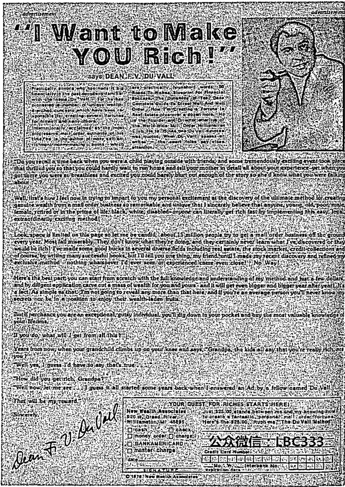

## “我想让你变得富有！”

## 迪恩·F.V. 杜瓦尔说

实际上，在过去十年中，赚了大钱的人，对杜瓦尔的名字都十分熟悉。因为，他开创了独特的财富概念。这些概念，给他本人，以及许多其他人赚了大钱。

杜瓦尔被国际上誉为最先进的邮购权威，他是多本致富书籍的作者，几乎家喻户晓：《通往致富的 50 条道路》，《经济成功的蓝图》，《直邮邮件和邮购指南》，《我在房地产上是如何创造财富的》，还有很多。他是全球邮购百万富翁俱乐部创始人和名誉董事。他 35 岁。引用杜瓦尔一个粉丝的原话就是，当杜瓦演说或写作时——聪明的人都会密切关注。

“你还记得，孩童时期和朋友在外面玩耍，获得一些非常令人兴奋的消息，你迫不及待地跑回家，想详细地告诉你的妈妈，在说到精彩部分时，你激动的喘不过气来，兴奋地不知道该怎么表达，以至于妈妈不知道你在说什么吗？

这就是我现在迫切地想和你分享我的一个发现的心情。这是一个通过独特出众的邮购业务，创造真正财富的终极方法，我相信，任何人，无论是年轻人，老年人，无论贫穷还是富有，无论男女，退休在家，还是健康强壮，无论是黑人，还是白人，亦或是残疾人——任何人都能通过这个方法快速致富，这是一个简单，合法，令人兴奋无比的方法！

你瞧，本页篇幅有限，我无法一一详细描述；每年约 1500 万人试图做邮购业务。最终都惨遭失败。他们不知道自己在做什么，他们当然从来没有学习过我发现的方法，否则，他们一定会致富！我已经在很多不同领域，包括房地产、股票市场，收取信贷款，当然，还有撰写很多成功的书籍，赚了很多钱。但是，我的朋友，我要告诉你一件事，直到我最近发现并改进我的独家方法——我从来没有见过或经历过如此强大的

方法！从来没有！

最好的；全面认识并了解了我的方法后，你只要几美元，就可以重新开始，聪明地运用它，你就可以为自己和家人赚取大笔财富——而且，随着时间的增长，这笔财富会越来越大！这就是事实。简单之极。在这里，我不会过多阐述。如果你是一个普通人，你就永远不会知道我的秘密，也不能够享受它们带给你的财富。

但是，如果也许你注定不平凡，勇于尝试，你就会掏钱购买你一生中最有价值的知识。

如果你购买了，我能得到什么？

多年后，当你的孙子爬上你的膝盖，问，“爷爷，小伙伴都说你很有钱，是吗？”

“是的；他们说的是真的……”

“你是怎么变富有的，爷爷？”

“让我想想……我想这一切都源于几年前，我回复了一个叫杜瓦尔的人的广告……”

这就是我的回报。

真诚的，

## 迪恩·F.V. 杜瓦尔

你追求财富之路从这里开始！

新财富联盟
920 W. 格兰德河
威康姆斯，MI 48895

- □ 现金 □ 支票
- □ 汇票 □ 信用卡支付:
- □ 美洲银行信用卡
- □ 万事达信用卡

日期________________

签名

在我和如何创建一个美妙的，个人邮购财富之间，只有 25.00 美元。请立即给我邮寄一本 “杜瓦尔致富法”

________________________________

________________________________

________________________________

信用卡卡号________________

__年 月__

同业银行信用卡卡号________________

有效期________________

© 1976— 新财富联盟

## 作业

## 谁在赚大钱？

我们西海岸的新编辑制作办公室，全国唯一小型商业信息银行

我们一直在想，什么人能快速地赚大钱。我保证——大笔大笔赚钱的人，肯定不会告诉别人。

可能每个人都好奇，一个企业究竟能赚多少钱——确切的数值。你肯定也有想了解的公司。

而且，你可能问过自己：创立那样的公司，（最少）需要多少钱？需要什么样的知识和经验？他们从哪里获得自己的客户？他们从哪里进货？地理位置，资金状况，等等是怎样的？

## 知道谁在赚大钱
以及他们的业务是如何操作的
是我工作的一部分

在过去的 18 年里，我一直通过为投资者，银行，贷款机构，研究和调查各种业务谋生。我调研过几乎所有业务，从爆米花小摊贩，到多层次消费者，以及制造企业。

在这段时间里，我自己创立并取得成功的业务，有 14 种。显然，有了这些内部信息，我就可以从中只选择最有利可图的业务。

## 我的朋友都变得富有

我大部分朋友和熟人都经常问我信息。我敢肯定，你和他们一样，也一定想要我过去多年获取的信息。

只要有一些常识，一点钱，一点遵循指示的能力，你就可以根据我的经验赚钱。如果你是一个积极能干的人，你可能比我赚的钱还多（7

## 不考虑低利润的业务

这些经验都在我的双月刊《内幕报告》中，揭示了每个利润颧丰的小业务的内幕细节。我从来不在利润低的业务上浪费精力。我专注于小业务（像通用汽车这么大的企业，我一般不涉足），我喜欢足够小，任何普通人都能进入的行业。如果你没有赚钱技巧，我在报告中都会讲到。

## 没有假计划

如果你对模糊、快速致富计划，或者琐碎、未经证实，而且闻所未闻的赚钱噱头感兴趣，那《内幕报告》不适合你。我的报告中，只有脚踏实地，而且已经证明有效的业务。

换句话说，几乎每一个你能想到的问题，报告中都给予了详细回答。我通过细心，认真地准备，才赢得了我的声誉。《内幕报告》不是一个2页的简报，而是和杂志大小的手册，每期平均超过50页。

我已经为你准备好。当我决定介绍某类利润非常高的业务时，我的工作人员首先会收集出该类型业务发展的最佳模式。

## 什么人赚钱——怎么赚，如何赚？

我们研究了该领域最成功的案例，并找出其中的原因。我们找出什么样的地理位置是最好的，以及其中缘由；谁拥有最好的销售方法；谁有最有效的广告噱头；谁有最好的内部控制系统，等等。

因此，每本手册描述的业务，大部分都是已经证明有效，有利可图 的成功方法的合集。

每一期我都会介绍4种业务，以及各种有新闻价值，可以用在任何业务中的项目。在这4种业务中，其中2种都是针对那些没有大量现金，预算小的人的。投资范围从100美元到2000美元不等。迄今为止，净利润最高的已达15000美元。

另外2种，投资范围在2500美元——25000美元，年净利润从20000美元—235000美元。

这是进入业务的聪明方法。只要坐下来，阅读各种有利可图的领域特性，或者引发你感兴趣的项目。当你找到一个你喜欢的业务，一切都已经为你准备就绪——开启业务需要的东西。《内幕报告》的成本每个业务只要1.16美元（订阅2年的话）。

## 为什么给你这么有价值的信息？

你可能想知道为什么我愿意把这么有价值的信息，以如此低的价格释放给你。首先，我凭自己的精力，肯定无法身兼所有业务。目前我有5个业务。事实上，有时候我希望我没有那么多业务，因为我有时因为业务需求紧迫，没时间打高尔夫、钓鱼、打猎或划船。

## 亲自验证

事实上，如果你住在洛杉矶，或正在那里游玩，可以来我圣莫尼卡的办公室，一起喝杯咖啡。否则，在你当地的消费者保护组织，如到商业局索取报告。

当你收到第一期，以及额外赠送的报告后，如果你不满意，只要30天内，寄回来，我将立即为你全额退款。

只要填写下面的订购表格，寄给我你的订阅费。或者，你可以通过美洲银行信用卡或万事达信用卡付费。*你将立即得到当前期刊，每隔一个月，你还会收到新的报告。祝你好运！

真诚的，

约翰·c·雷维尔
商业调查管理顾问
《内幕报告》出版商

*如果你通过信用卡付费，可以拨打(213)451-213，找订单职员代码 180，即可得到更快捷的服务。

## 每个《内幕报告》都包含*

## 你启动业务所需要知道的一切信息：

- 1. 陷阱—如何避免它们
- 2. 利润—你的期待值应该是多少
- 3. 建立，开张，运行的确切成本
- 4. 设备——买什么样的设备，以及去哪里买
- 5. 在设备，固定装置上节省成本的方法
- 6. 房租——需要支付多少费用
- 7. 地理位置——如何挑选最佳位置
- 8. 租赁——如何就要点进行谈判
- 9. 执照和许可证——都需要什么，以及如何获得它们
- 10. 商品——买什么，如何买，去哪买
- 11. 如果零售——如何布置店面，如何陈列商品
- 12. 快速，廉价，令人印象深刻的装饰理念
- 13. 标记——需要多少，多大，放在什么位置，需要什么内容
- 14. 员工——招聘什么样的人，薪酬多少，以及如何考核绩效
- 15. 广告——怎么做，在哪里，什么时候，以及用多少成本做广告
- 16. 推广——最好的最详细的推广噱头
- 17. 保险——你需要什么保险，以及多少数额
- 18. 知识——去哪里获取，购买或租赁
- 19. 金融——如何筹备开张成本
- ——如何筹备销售成本
- 20. 顾客—如何吸引顾客，并留住顾客
- 21. 定价——你的产品或服务应该如何定价

## 其他许多小细节

## 免费*奖励报告

No.500. “创业技巧和角度。” 帮助你成功穿越创业迷宫的必要步骤——法律选择，执照，联邦，州和地方许可，隐藏的银行业务问题，租赁清单，和地理位置谈判，税收问题，保险，簿记，设备租赁和购买，宣传，如何雇佣员工，就业，成功的关键：陷阱以及如何避免它们，迅速获得信贷和可靠的方式，无论你现在的信誉如何！

#210. “每年有 100 万美元潜在利润的业务” 这是推广者的梦想业务——不需要口齿，或特殊人才。案例显示，每年 10000 美元的投资，能获得超过 1500000 美元的税前利润。几乎每个城市都开放有这样的业务——你甚至可以以几百美元的低成本开始。简单，不需要任何产品或库存，员工也需要的很少。

No. 400. “最热门，最赚钱的业务（低投资）” 这样的业务更是多不胜数。开始创业只要几百美元的投资，利润更是令人难以置信。你可以在任何地方开始。

No. 150. “最热门，最赚钱的业务（中等投资）” 一个老问题的新解决办法，表现出令人难以置信的增长潜力。一个运营商在一个位置，3 年内增加 20 倍。得益于能源危机和经济衰退，这个市场目前几乎空白。启动：需要资金不到 4000 美元。

No. 200. “谈判技巧：如何在任何情况下，做最好的交易。” 由专业谈判大师科林·布鲁尔指导，他是著名的企业合并谈判大师，顶级交易谈判大师。科林以买牛开启了自己的职业生涯，之后拓展到了谈判的各个领域，最终成了顶级大师。他讲述了从家庭主妇，到老板都能使用的心理技巧。

## 我们的订阅者怎么说

我们有无数封订阅者主动写给我们的信。我们应顾客要求，复印其中一些出来。这些人都支付了自己的订阅费，并在阅读完报告后，自愿撰写证言。如果你来我们的办公室，你还可以亲自查看所有证言。该出版物的用户更新率是出版领域最高的出版物之一。

## 其他读过我们报告的人

除了和你一样的人，许多律师，业务顾问，都把我们的报告提供给了自己的客户，他们的这些客户都在寻找新的有利可图的业务。银行家们阅读我们的报告，对他们的借贷业务有了更好的理解。寻求多元化发展的公司，开始寻求我们的信息。工商管理学校，将我们的报告作为实际应用的例子，用于他们的教学理论。

*根据订购量而定

《内幕报告》
第 5 大街 1445 号
加利福尼亚州，圣莫尼卡 90401

如果你通过信用卡付费，可以拨打(213)451-213，找订单职员代码 180，即可得到更快捷的服务。

姓名______________________________

地址______________________________

城市____________州____________邮编______________

使用航空邮件，每年加12.00 美元邮资

## 请输入订阅我的《内幕报告》：

- 半年，包括特殊报告 NO.500，《创业技巧及角度》 16.7美元
- 1 年，包括特殊报告 NO.500，以及特殊报告 NO.400，《1975 年最热门的低成本投资业务》28.00 美元
- 2 年，包括特殊报告 NO.500，NO.400，以及特殊报告#210，《最新的最赚钱的业务，有 100 万美元的潜在利润》45.00 美元
- 3 年,包括特殊报告 NO.500,NO.400,NO.210,以及特殊报告 NO.150,《1975 年最热门的中端业务》58.50 元

- 美洲银行信用卡
- 万事达信用卡

信用卡卡号________________

__年 月__

同业银行信用卡卡号________________

有效期________________

RC____AM____AG____EX____SH____SLP____.CL____EN:NM: AD:CK   X________________

（签名）

## 作业

## 21、如何快速赚钱！

## How to Make Money Fast!

## Financial Columnist Makes Unique Discovery!

My name is Alan Feinstein. I write a syndicated newspaper column on ways to make money. I'm forever examining all kinds of so-called money-making opportunities. Most of them turn out to be gimmicks. Or lots of hard work. Then, out of the blue — a bombshell! Something so different, so outstanding I could hardly believe it was true. I just had to put up $1,000 to try it for myself. The next morning, my $1,000 was worth $1,500. That's 50% gain on my money. Overnight! "Damn it, you can't make money this easily," I told myself. "There has to be a catch." And I threw myself into a study to find it. But the more I studied, the more excited I got. Why, this was just the beginning! Oh, what an opportunity I'd found ... A fantastic easy way to make money ... From just a few minutes a week, without even leaving your home ...

But don't take my word for it. I want you to see this for yourself — FREE — at my expense! That's right, without you risking a penny! Here's what I've done: 1, I've laid out exactly what this is and how to profit from it — right now! 2, I've gotten coupons, (worth $54.00) which will bring you everything you need to make this discovery work automatically for you. 3, I've put this together into a simple 26-page Guide. So easy to read and understand ... you can finish it in 20 minutes and put it right to use! And I mean "right to use." If it's long learning or hard work you want, this isn't it. There's no study or sweat here — all you have to do is let "This Work For You!" And everything you need is right here in this Guide! I know it's hard to believe. It was for me, too. And that's why I want you to see it, free, for yourself. The cost of this amazing Guide, including all the coupons, is $12.95. But, as a special pre-publication offer it is now only $9.85. And as I promised, you can examine it right now absolutely free, without your paying one cent. Here's how:

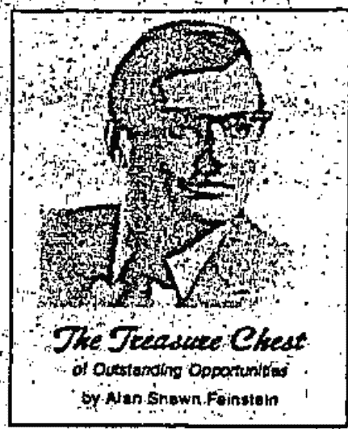

When you make out your check at the special $9.85 price, date it one month ahead, so it can't be cashed before you've had time to get and judge this for yourself. Then if you're not convinced this is the most unique and worthwhile opportunity you've ever seen, simply return it within the month. Your check which still can't be cashed by anyone will be sent right back to you. You haven't risked a thing. I wish I could show you the letters people are already writing me about this ... And, remember, I'm not asking you to buy this — I'm just asking you to see it, at my expense. If you don't find it totally different from anything you've ever seen ... more valuable than anything you've ever read — simply return it and it hasn't cost you a penny.

Now, could I ever make such an offer unless I knew how valuable this was? ... Unless I knew that most people, after seeing this, wouldn't part with it for anything. Don't take my word for it. See for yourself! But act now! I don't know how long this free-examination offer can last. I've promised that if the number of readers of this Guide ever reach a point where they may start diluting its value, I'll immediately end all free examinations AND sales of it on the spot. Don't let this pass you by. A wise man once said: "There is so little that's really new and worthwhile in the world that if you do find something, don't let it get away." The opportunity is here. Now. To see and judge for yourself. Without your risking a penny. Mail this coupon below today. Sincerely yours, Alan Shawn Feinstein P.S. Made $3,900 in just 3 weeks!

> Sworn Statement: "As the registered representative who handled this transaction I can verify the above in every respect." (Name and address given in order)

## FREE EXAMINATION OFFER

Alan Shawn Feinstein 41 Alhambra Circle, Dept. CR-76-1 Cranston, R.I. 02905 Alan, this I have to see for myself. Please send me a copy of How to Make Money Fast (Without Working), which includes complete proof, of your claims, at the special pre-publication price of only $9.85. If I don't find this to be everything you say, and more, all I have to do is return it within a month and my uncased check will be sent right back to me. On that basis, here is my check for $9.85 dated one month from now. If you are enclosing a money order which cannot be dated ahead, you have the same money back guarantee. □ For immediate first class shipment add 50c (in coins or stamps, please). Name Address City State Zip 公众微信：LBC333

## 如何快速赚钱！

金融专栏作家的独特发现！

## 绝佳机会的百宝箱
来自：阿兰·肖恩·范斯坦

我是阿兰·肖恩·范斯坦。我写了一个关于赚钱方法的专栏，被多家报纸刊登。

我一直在验证各种所谓的赚钱机会。结果证明，大多数都只是噱头。或者很多都需要付出巨大努力。

然后，我有了重大发现！一些与众不同，绝佳的机会，我几乎难以相信它是真的。

为了亲自验证其真假，我投入了 1000 美元。第二天早晨，我的 1000 美元，就变成了 1500 美元。收益 50%。一夜之间！

我想“赚钱不能这么容易吧，肯定有陷阱。”我开始研究它。

但是，我研究的越多，我越兴奋。为什么呢？因为它只是一个开始！我发现了绝佳的机会……一个每周只要几分钟，不用出家门，就能赚到钱的简单方法……

但是，不要只听我说。我希望你亲自——免费验证——一切风险我承担！对，你不用承担一分钱的风险！

我已经为你做了：

- 1. 我已经整理出了这个机会的内容，以及如何立刻用它赚钱的方法！
- 2. 我还为你准备了优惠券（价值 54 美元），它将带给你使这个方法自动为你赚钱所需要的一切。
- 3. 我已经把这些内容写入了一个简单的 28 页指南中。内容简单易懂……你可以在 20 分钟内完成，并立即投入使用！

我是说“立即投入使用。”如果你认为学习要花很久，或赚钱很辛苦的话，你就错了。你不用花任何精力去学习，你需要的只是让“它为你赚钱！”而且只需这本指南！

这本神奇的指南，包含所有优惠券，只要 12.95 美元。但是，现在，作为预售，只要 9.95 美元。而且，按照我的承诺，你可以立即免费验证它，不用支付一分钱。方法如下：

当你开具特价 9.95 美元的汇票后，兑现日期延迟一个月。这样，在你收到这本书，并亲自验证它之前，任何人都无法将其兑现。之后，如果你觉得这不是你见过的最独特，最有价值的机会，只要把它在一个月内退回来。你的汇票（任何人都依然无法兑现）会立即寄还给你。你不用承担一分钱风险。

由于版面有限，我无法向你展示人们给我的反馈信息……记住，我不是要你买这本书——我只是要你，在我的担保下，亲自验证。如果你觉得不是不同于你之前见过的任何机会……不比你之前读过的任何内容都有价值——你只要退还给我，不会花你一分钱……

如果我不知道它的价值，我就不可能做出这样的提议……之所以做出这样的提议，是因为我知道绝大多数人看到它后，都会对它视若珍宝……

不要只听我说。亲自验证吧！

立刻行动吧。我不知道这个免费提议能持续多久。我已经承诺，如果本指南的阅读人数达到一定数量，影响到之前订阅者的收益时，我会立即停止这个免费提议，及销售。别让这个机会与你擦肩而过。

一位智者曾说：“世界上新鲜、有价值的东西少之又少，如果你遇到了，千万不要错过。”

机会就摆在你面前。现在，亲自验证吧。不用承担一分钱风险。

立即邮寄优惠券吧。

真诚的，

阿兰·肖恩·范斯坦

*P.S. 3周内销售额2900美元！（订单证明）

誓词：

> “作为这笔交易的注册代表人，我证明以上所有信息属实。”
（既有订单上的姓名和地址）

## 提供免费验证

阿兰·肖恩·范斯坦
阿尔罕布拉都 CR-76-141
罗德岛克兰斯顿 02095

阿兰，我需要亲自验证。请寄给我一本《如何快速赚钱》（不用工作），内含你提议的完整证明，预售价只要 9.95 美元。

如果我觉得内容并不像你说的那样，我只要在一个月内退回去，我尚未被兑换的汇票就能立刻被退回来。在这样的前提下，我现在付给你从现在开始，一个月后可兑现的9.95美元的汇票。（如果你内附的是立即可以兑换的汇票，同样享受退款保证。）

□ 要使用一级邮寄方式，请加 50 美分（请使用硬币，邮票）

姓名________________
地址________________
城市______________州________邮编______

阿兰·肖恩·范斯坦专栏，百宝箱，在全国各地很多报纸上都得到转载。他还在去其他国家旅行时，写了好几本书，并荣登“东部风云人物”榜单。

## 作业

## 22、银行秘密的关键

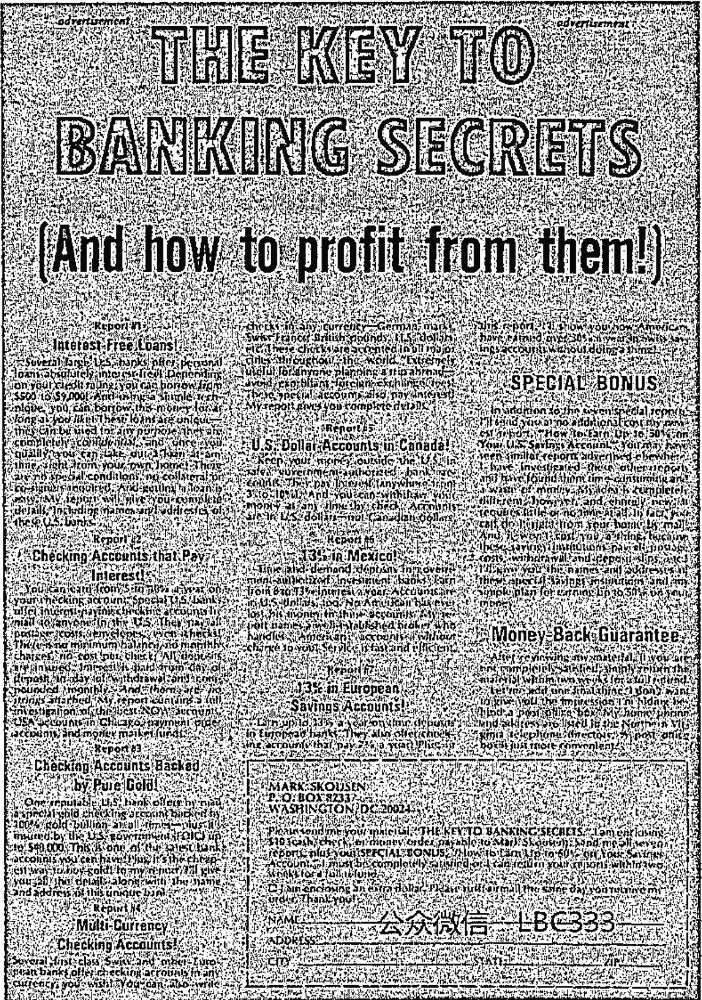

## 银行秘密的关键

## （以及如何利用它们获利！）

## 报告#1

## 无利息贷款！

一些大型美国银行提供个人贷款，而且不收取任何利息！根据你的信用评级，你可以得到 500 美元—9000 美元的借款！用一个简单的方法，你就可以长期借用这笔钱！这笔贷款很独特——你可以用來做任何事情，一旦你符合资格，你在家就可以借出这笔贷款！没有特殊情况，没有抵押品或不需要担保人。贷款很轻松。我的报告将告诉你完整的细节，包括这些美国银行的名称和地址。

## 报告 #2

## 支票账户支付利息

通过支票账户，你一年可以赚 5%—10%。一些特殊的美国银行，会通过邮件向美国的任何人提供支付利息的支票账户。他们支付所有邮资成本，信封，甚至支票成本！没有最低储蓄额，没有支票成本，没有月费。所有银行存款都有保险。从存款第一天起，就开始支付利息，直到取款那天。而且，利息每月都会增长。没有附加条件。我的报告里，包含所有目前最好的账户，芝加哥的美元账户，付款单帐户和货币市场基金。

## 报告#3

## 黄金储蓄账户！

美国某著名银行提供了一个特殊的黄金账户，100%的黄金账户，它由美国政府（FDIC）投保高达 40000 美元。这是 nationales 最安全的银行账户之一。

另外，这是购买黄金最便宜的方法！在我的报告中，我将告诉你所有细节，以及这种独特的银行的名称和地址。

## 报告#4

## 多币种支票账户

一些一流的瑞士和其他欧洲银行，为你提供你想要的任何币种的支票帐户！你也可以填写任何币种的支票——德国马克，瑞士法郎，英镑，美元等。这些支票，在世界各地的主要城市都会被接受。对计划出国旅行的人非常有用——避免了过高的外汇费用！这些特殊的帐户也支付利息！我的报告会告诉你完整的细节。

## 报告#5

## 在加拿大的美元账户！

确保你的钱存在了美国以外安全的政府授权银行账户。他们会支付利息（3到10%）。你可以在任何时间取出你的钱。账户是美元——而不是加元。

## 报告#6

## 在墨西哥银行储蓄账户里赚 13%！

在政府授权银行中，满足一定时间和要求，就能每年赚取 8 - 13%的利息。账户也是美元。从来没有美国人在这些帐户里损失资金。我的报告中介绍了一位信誉非常好的代理，他会负责免费为你处理美国账户！服务非常快速，高效。

## 报告#7

## 在欧洲银行储蓄账户里赚 13%！

每年在欧洲银行储蓄账户里定期赚 13%。他们还提供支票帐户，每年支付 7%！另外，在这份报告中，我将向您展示如何不做一件事，就能在瑞士储蓄账户上赚超过 30%！

## 特别奖励

除了上述 7 个专题报告，我还将寄给你我的最新报告，《如何让现有储蓄增长 50%》。你可能在别处见过类似的报告广告。那些报告我都买过了，看完之后，我觉得它们不过是在浪费时间和金钱。然而，我的方法是完全不同的，全新的。它需要很少或根本不需要花时间。事实上，你可以从你的家里邮寄！它不会花费你任何成本，因为这些储蓄机构会为你支付所有邮资成本，取款和存款单成本，等等！我将给你这些特殊储蓄机构的名称和地址，以及让现有储蓄增长 50% 的计划。

## 退款保证

收到我的材料后，如果你有任何不满意，只要在 2 周内退还你的报告，你就能得到全额退款。

再说最后一件事。我不想让你觉得我就是躲在邮箱后面的一個空幻的人。我的家庭电话和地址在北弗吉尼亚电话目录册中都可以找到。不过，邮箱更方便我们联系。

马克·史库森

8233 邮箱

华盛顿 20024

请寄给我你的材料《银行秘密的关键》。我付了 10 美元（现金、支票或汇票，支付给马克·史库森）。把这 7 个报告，以及额外红利《如何让现有储蓄增长 50%》都寄给我。如果我有任何不满意，只要在 2 周内退还你的报告，我就能得到全额退款。

□ 我支付了额外费用。请在收到我订单的当天，用航空邮寄方式立刻邮寄给我！谢谢！

姓名__________

地址__________城市__________州__________邮编__________

## 作业

## 23、寒冷的冬天，你会生病吗？

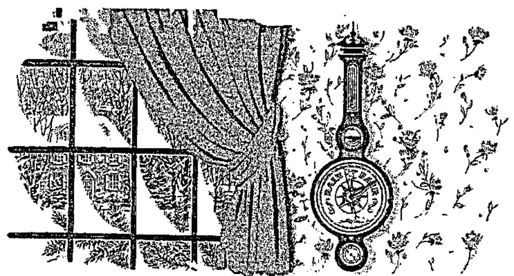

## Will you "weather the winter" in good health?

During the stormy, disagreeable winter months, colds, pneumonia and influenza may strike with increasing frequency. And this winter brings another variety of influenza — "Asian flu."

The symptoms of "Asian flu" are much like those of other "grippy" colds ... fever, marked tiredness, and aching. Should these symptoms occur, call your doctor, go to bed ... and stay there until he tells you that the likelihood of complications is over.

"Asian flu," like a severe cold, can lead to pneumonia. Medical science, however, has become increasingly skillful in treating pneumonia. Today, all but a very small proportion of pneumonia cases are saved. But treatment must be started promptly to bring pneumonia under control quickly.

How you combat any respiratory disease depends a lot on your physical condition. While it is wise to maintain your general health in every way, it is equally wise to take preventive measures against all respiratory infections.

- Keep away from crowds as much as you can.
- Cover coughs and sneezes with paper tissues.
- Dispose of used tissues immediately.
- Wash your hands thoroughly before eating.
- Isolate any member of your family who has cold or flu-like symptoms.
- Your doctor may also advise vaccination against "Asian flu."

Metropolitan's new Home Nursing Handbook explains what you can do for a sick person's comfort, contentment and recovery. Use the coupon below for your free copy.

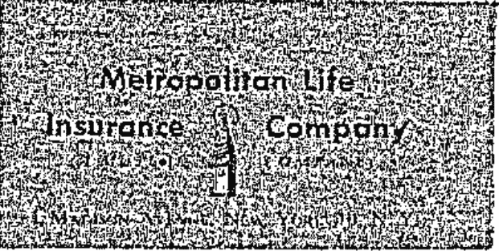

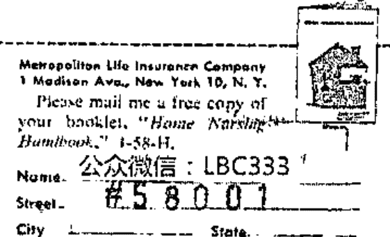

## 寒冷的冬天，你会生病吗？

在暴风雨天气，以及寒冷的冬天，感冒、肺炎和流感可能会越来越频繁地侵袭你。这个冬天，还出现了另一种流感——“亚洲流感。”

“亚洲流感”的症状和其他流行性感冒症状一样……发烧、疲劳、疼痛。一旦发生这些症状，请立刻打电话给你的医生，上床休息……直到医生告诉你产生并发症的可能性消失。

“亚洲流感”，和重感冒类似，会导致肺炎。然而，今天的医学在治疗肺炎方面，技术已经非常成熟。今天，大部分肺炎患者都能被治愈。但是，一旦染上肺炎，就需要立刻严格控制并治疗。

如何应对呼吸道疾病，在很大程度上取决于你的身体条件。明智的做法是，保持健康，并及时预防呼吸道感染。

- 尽量远离人群。
- 咳嗽，或打喷嚏时，垫上一张纸巾。
- 立刻处理掉用过的纸巾。
- 饭前，好好洗手。
- 家中有感冒或类似流感症状的患者，做好隔离措施。
- 你的医生也可能建议你接种“亚洲流感”疫苗。

都市生活，新家庭护理手册上面，说明了如何给病人安慰，满足，并帮助其康复。使用下面优惠券，免费领取。

版权所有 1959——都市生活保险公司

都市生活保险公司
（一个互助公司）
麦迪逊大街 纽约 10 纽约

## 都市生活保险公司

麦迪逊大街 纽约 10 纽约

请给我免费寄一份手册《家庭护理》， 1-58-H

姓名________________

街道________________

城市___________州____

## 作业

## 24、"心脏病？我确实有心脏病"

## "Heart attack?
Sure I had one"

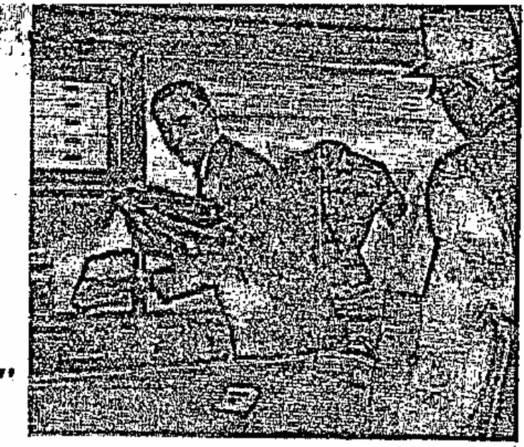

"Here I am—working almost the same as before my heart attack. Close up shop a little earlier and take things easier, of course. And I watch my diet and weight pretty carefully. Like my doctor says, I've learned to live within the capacities of my heart."

TODAY, in your community—where you buy gasoline, or groceries, or clothing—you're likely to find people at work who have recovered from heart attacks, commonly caused by coronary thrombosis.

While this disease causes much loss of life, there is much about it that justifies an optimistic outlook today. For example, 80 percent of those who have a "coronary" survive their first attack... and most go back to work and enjoy many useful years. Moreover, those who make a good recovery face few or only moderate restrictions.

If they observe sensible safeguards about work, activity, diet, weight control and rest, they can generally live as comfortably as if their hearts had never been in trouble.

The recovered coronary patient can often worry unnecessarily. That is because he may worry about having another attack, or how much he will have to change his accustomed ways of living.

Naturally, the doctor is the best person to ease the patient's mind. But questions that worry the patient often arise when the doctor isn't around. Or, questions may come up which the patient hesitates to ask.

To help fill this need, Metropolitan has prepared a new booklet called "After a Coronary." It answers many questions often asked by those who have had a heart attack. You will find it a helpful booklet reflecting optimism for today's coronary patients. Use the coupon below for your free copy.

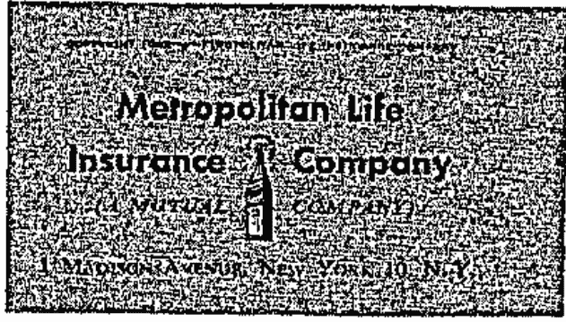

Metropolitan Life Insurance Co.
1 Madison Ave., N.Y. 10, N.Y.
Please send me the free booklet, "After a Coronary," 3-58-H.
Name #58001
Street 公众微信: LBC333
City State

## "心脏病？我确实有心脏病"

“我——现在可以和患心脏病之前一样正常工作。当然，营业关门的时间会比以前早一些。我非常仔细地控制我的饮食和体重。我已经学会了在我心脏的承受力内生活。”

今天，在你的社区——在你买汽油，或购物，或工作的地方——你可能会发现很多因冠状动脉血栓引起的心脏病恢复健康后，并正常工作的人。

虽然这些疾病会导致死亡，但是今天心脏病被治愈的可能性已经非常大。例如，80%“冠心病”患者在第一次心脏病发作时，都抢救过来了……大多数都能回去正常工作，又接着过了很多年幸福的生活。此外，那些恢复得很好的患者，生活都没有受到太大影响。

如果他们遵守合理的饮食，作息和工作强度，并控制好体重，通常都可以舒适地生活，就好像心脏从来没有出现过问题一样。

都市生活，新家庭护理手册上面，说明了如何给病人安慰，满足，并帮助其康复。使用下面优惠券，免费领取。

都市生活保险公司
麦迪逊大街 纽约 10 纽约

请给我免费寄一份手册《家庭护理》，1-58-H

姓名 ____________________
街道 ____________________
城市 __________ 州 ______

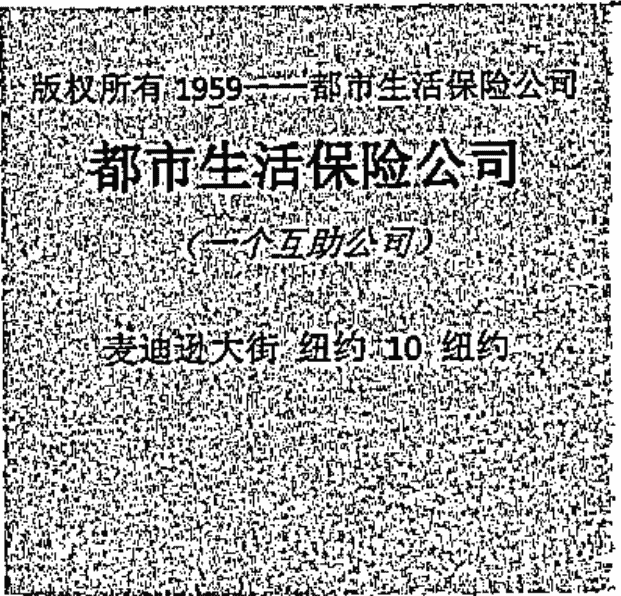

## 作业

## 25、国际报采访了一位一年赢得 400 万美金的人，让我们看看他是怎么做到的

## International Paper asks the man who awards $4 million a year in scholarships how to win one

John Stalnakier is president of the National Merit Scholarship Corporation. Here is why he feels reading is the key to winning a scholarship.

National Merit Scholarships have paid for a good part of nearly six thousand college careers since 1955.

Last year, over half a million high school juniors took the qualifying examination. Only 3041 of these candidates won Merit Scholarships.

That’s almost twice the number of scholarships as when the program began. But last year there were nearly ten times as many candidates competing!

How to win a scholarship
"National Merit’s examination is actually a reading test," says Mr. Stalnakier. "The best way to prepare for it is reading—broad, omnivorous reading."

Mr. Stalnakier advises parents: "Encourage your child to read as soon as he shows an interest. And don’t be afraid that he is ‘sticking too close to the books.’ Even the best students find time for other activities.

"In fact, over 20 percent of the National Merit Scholars graduating from college in 1960 were varsity lettermen, class presidents, or editors of major student publications."

To date, 5932 hard-working students have become National Merit Scholars. Each of them is living proof that men who read more achieve more.

Free reprints
For free reprints of this advertisement, write today to: Box 65, International Paper, 220 East 42nd St., New York 17, N.Y.

INTERNATIONAL PAPER

## 国际报采访了一位
一年赢得 400 万美金的人
让我们看看他是怎么做的

约翰·斯托纳克，国家优秀奖学金公司总裁。他认为阅读是获得奖学金的關鍵，原因如下：

从 1955 年起，国家奖学金已经为近 6000 名大学生支付了相当大的一笔奖学金。

去年，超过 100 万高二学生参加了资格考试。其中只有 1041 个候选人赢得了奖学金。

这个数字几乎是国家奖学金刚开始设立时的 2 倍。但是，去年，竞争者几乎是刚开始时的 10 倍！

## 如何赢得奖学金

“国家奖学金考试实际上是一个阅读测试，”斯托纳克先生说。“备考的最好办法就是广泛地阅读。”

斯托纳克先生建议父母们：“一旦发现孩子有阅读的兴趣，就立刻鼓励他大量阅读。不要担心他过于埋头读书。即使最好的学生，也会找出时间去做别的事情。

“事实上，1960 大学毕业的国家奖学金获得者中，超过 20% 的人都是校运动员，班干部，或学校主要出版物的编辑。”

到目前为止，5932 名勤奋的学生已获得国家奖学金。他们每个人都是活生生的证明：阅读更多的人，成就越大。

## 免费复印

免费: 写信至纽约市 17 号 220 东 42 路国际报, 教育部门, 27 信箱, 免费索取这个广告的复印件。

## 国际报

杂志, 书籍, 报纸・家庭, 办公室用纸・纸和包装纸板・标签・折叠纸盒・牛奶容器・集装箱・多层袋。杂货和特殊袋, 普通纸袋・工业纸浆・木材・胶合板和建筑材料等的制造商。

## 作业

## 26、想玩音乐...但没时间上课？

## Want the Fun of Playing Music ...but no time for lessons?

TRY THE HAMMOND ORGAN YOU CAN PLAY IN 30 MINUTES!

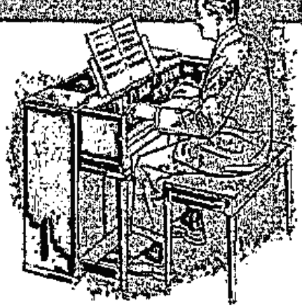

You play the tune with one finger of the right hand, on the Hammond Chord Organ. You are easy "Picture Music" that anyone can follow, or standard music if you read notes.

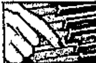

You play chords with one finger of the left hand. Glorious chords that take 3 to 5 fingers on other organs! No tiresome scales and exercises. You progress by playing the songs you like.

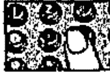

No lessons to take! In 30 minutes you'll play a complete selection on the Hammond Chord Organ, even if you know nothing about music. Thousands have. And in a few weeks you'll master all kinds of pieces from popular to classic.

Imagine the good times your family can have with the Hammond Chord Organ. It will be the life of all your parties, a constant joy and inspiration. And now there's a new marvel ...

## Now! Percussion tones added

Now you can play any piece with hundreds of intriguing percussions like guitar, piano, marimba, chimes, and others. No organ has ever been built with percussions even remotely comparable in tonal variety.

But only your own ears will convince you. So hear the astonishing "Musical Kaleidoscope with the Hammond Chord Organ" at your dealer's soon. And mail coupon for further information.

LOW AS $97.50 DOWN at most dealers. Often 3 years to pay. $973 f.o.b. Chicago, in Walnut finish. Mahogany or Ebony slightly higher.

## Hammond Chord Organ

by the makers of Hammond Organs

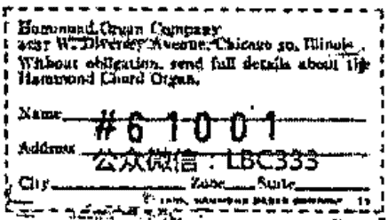

## 想玩音乐...但没时间上课？

试试哈蒙德电子琴吧

你在 30 分钟内，就 可以轻松掌握！

你用一根右手手指就能在哈蒙德和弦电子琴上奏出美妙的曲调。你可以使用任何人都能看懂的简单“图片音乐”，或者如果你能看懂乐谱，也能使用标准乐谱。

你用一根左手手指就能弹和弦。而在其他乐器上，和弦需要 3 到 5 根手指！没有繁琐的识谱和练习。通过抒弄你喜欢的乐曲，你就能不断取得进步。

不用参加任何课程！即使你对音乐一无所知，那么在 30 分钟内，你就能在哈蒙德和弦电子琴上弹出很多乐曲。很多人都做到了。在几周内，你就能掌握各种各样的乐曲，从流行到经典。

想象一下，你弹着哈蒙德电子琴，和家人相处的美好时光。它将为你的聚会带去快乐和灵感。现在，还有一个新的奇迹……

## 增加了打击乐器的音调

现在，你可以奏出数百个打击乐器，如吉他，钢琴，马林巴琴，编钟等等演奏的乐曲。现在，还没有任何其他电子琴拥有打击乐器的特色。

你的耳朵会说服你。所以，快去经销商那里体验“哈蒙德电子琴音乐万花筒”吧。邮寄优惠券，即可获得为进一步的信息。

在大多数经销商那里，售价只要 95.50 美元。可以分期 3 年支付。胡桃木琴身的电子琴，在芝加哥离岸价为 975 美元。金木或乌木价格略高。

## 哈蒙德牌和弦电子琴

## 哈蒙德电子琴制造商

哈蒙德电子琴公司
4237 W.花样大道，芝加哥，伊利诺斯州 39

免费邮寄哈蒙德电子琴的详细信息。

姓名 ____________________

地址____________________

城市____区____ 州______

## 作业

## 27、牙刷戏剧性的新发展，由加利福尼亚牙医开创

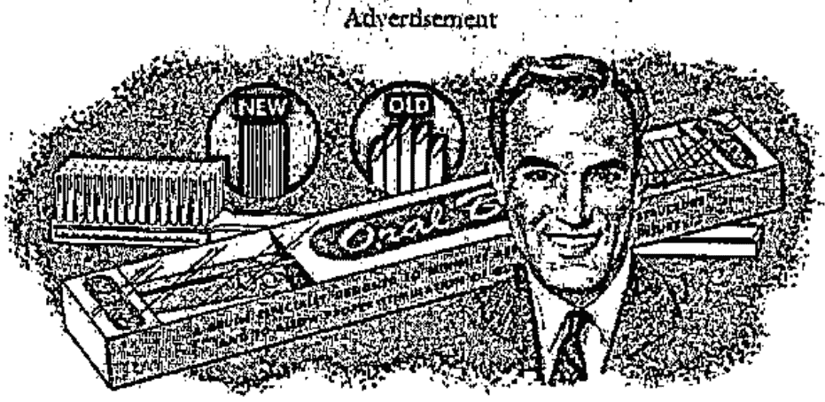

Advertisement

## Dramatic new development in toothbrushes pioneered by California dentist

> The high rate of tooth loss due to neglected gums sparked an idea which is revolutionizing toothbrush design.

Over 3,000 years ago, ancient people cleaned their teeth with small, pointed instruments of metal or wood.
By 1780, socially conscious Europeans were using bone-handled brushes fitted with stiff hog bristles. Brush design then remained very much the same, even when nylon bristles were introduced in 1938.
Shortly after World War II, a dentist* in San Jose, California, was concerned over a serious problem in dental care. Research indicated that gum troubles are the cause for over one-third** of all teeth lost. Proper daily care was being neglected simply because the stiff, pointed bristles of ordinary brushes injured sensitive gum tissues so easily.
To solve this problem, the dentist developed a completely new brush.

The big difference was 2500 very slender nylon bristles with smooth tops—three times more than an ordinary brush. As a result, it could massage gum tissues safely and also clean teeth more effectively. Out of this double-protection feature came the trade name "ORAL B"—or "mouth brush." Thus, 1949 marked the most important change in toothbrush design for over 160 years.
Professional friends of the dentist were so enthusiastic about the new brush that he produced a small quantity for sale at popular prices. The news spread rapidly from coast-to-coast as more dentists recommended the gentle-action ORAL B tooth brush to their patients.
Today, the recognized importance of daily gum care helps millions of Americans protect their teeth.

*Name furnished on request **The American Dental Association reported 37% of all teeth—53% after age 35.

## 牙刷戏剧性的新发展

## 由加利福尼亚牙医开创

由于忽略牙龈护理
导致的很高比例的牙齿脱落问题
激发了牙刷设计的改革

3000多年前，古代人用小而尖的金属或木制器具清理牙齿。

到1780年，有社会意识的欧洲人，使用骨柄牙刷，用僵硬的猪毛做成的刷毛刷牙。之后的牙刷设计一直沿袭这个风格，即使在1938年尼龙刷毛引入后，也没有做改变。

第二次世界大战后不久，圣何塞，加利福尼亚州的牙医，认识到了牙齿护理的一个严重问题。研究表明，牙齿脱落超过三分之一的原因，都是由于牙龈问题引起的。正确的日常护理被人忽略了，因为僵硬，尖锐的普通刷毛很容易损伤敏感的牙龈组织。

为了解决这个问题，牙医发明了一种全新的牙刷。和旧款牙刷相比，它最大的区别在于，采用了2500根非常纤细的尼龙刷毛，毛尖光滑柔软——刷毛数量是普通牙刷的3倍。因此，它也可以按摩牙龈组织，更安全、更有效地清洁牙齿。鉴于这种双重保护特点，该牙刷被起名为“奥拉尔B”——“牙刷”。因此，1949年标志着牙刷诞生160多年来产生的最重要 的变化。

该牙医的同行朋友，对这款产量很少，价格低廉的牙刷热情度很高。这个消息很快就传遍了大江南北，更多的牙医开始向病人推荐这款温和的奥拉尔B牙刷。

今天，人们认识到了牙龈护理的重要性，帮助了许多美国人正确保护他们的牙齿。

- 如果有要求，我们将提供这位医生的名字。
- 美国牙齿协会指出35岁以后，37%-53%的牙齿都会出现问题。

## 作业

## 28、一个发明家的梦想，让你在家就能精确量体重

## Doing the impossible may depend upon faith

## An Inventor's Dream
Gave You Weighing
Accuracy at Home

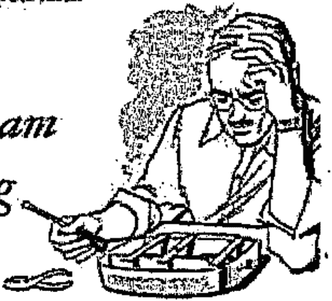

Years back, only the doctor's beam scale enjoyed full trust in its accuracy. A familiar question in the average home was: "How much off is your bathroom scale?" Weighers got different answers in different weighings—and their "weight" varied as they changed position on the platform. No one could be "sure" of his weight. In 1936, an inventor named William Greenleaf became interested. He had solved various "impossible" problems while working for George Borg, the "Mr. Clutch" of automobile fame, and this weighing problem intrigued him. He found that bath scales used a "second class" lever system, in which the weigher stood (as on a plank) between the fulcrum or support point, and a weighing spring. The spring stretched in weighing, and the constant flexing "fatigued" it. "OK", he thought, "I'll use a first class lever system, as in analytical balances, with the support point between weigher and spring, like it is on a child's 'teeter-totter.'" It couldn't be done, some told him.

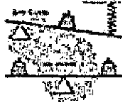

For so sensitive an instrument needed microscopic perfection in each part. For example, so little as a 2/10,000" variation in "pitch" on one part caused a one-pound error in the weighing. There being no choice, Greenleaf sized every part to the close tolerances used in delicate instruments. It took Greenleaf two years to build a perfect working model. But his victory was sweet, for his scale gave accurate weight every time, day after day, and no matter where or how the weigher stood. Now everyone could know "exactly" what he weighed, and see the very first pound of change! Originally created as an inventor's dream without thought of cost, in time modern machinery permitted his scale to be sold for as little as $7.95 retail. Now you can have this watch-like scale in your home, to guide dieting, figure control and guard family health ... a scale precise as your doctor's under normal circumstances, sold everywhere under the name "Borg".

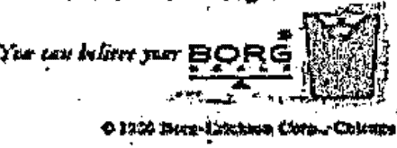

## 一个发明家的梦想

## 让你在家就能精确量体重

以前，人们只相信医生的称。一般家庭经常讨论的一个问题就是：
“你家的体重秤差多少？”

人们在不同的体重秤上，称的体重千变万化——移动一下体重秤，他们就会得到不同的“体重”。没有人能“确定”自己的体重。

1936 年，一个名叫威廉的发明家对体重秤产生了兴趣。他在为乔治·伯格——汽车离合器著名生产商，工作时，解决了各种“不可能”的问题。在这里，称重问题激发了他的兴趣。

他发现，家用秤采用的是“二级”杠杆系统，被称量者站在（称板）上的支点和称重弹簧之间。弹簧秤在称重时，会被拉伸，持续拉伸，弹簧秤会变得“疲劳”。

“OK”，他想，“我将在体重秤上支点和弹簧之间，使用和小天平秤一样的一级杠杆系统，就像孩子的‘跷跷板’那样。”

有些人告诉他，这根本无法实现。因为这么敏感的一个器械，每一部分都要求做到完美极致。比如，一个部分只有 2/10000 的变化，会让整个体重秤产生一磅的误差。

为了把称做得精准，格林利夫把每个部分的公差都控制在了精密仪器的公差内。

格林利夫用了 2 年时间，才制造出了一个完美的体重秤模型。他的付出取得了回报，因为他的称每次称量的重量都十分精准，不管称放在哪里，都不会出现差错。现在，每个人都能“准确地”知道自己的体重，从而更好地控制自己的体重！

最初，发明者只是为了追逐梦想，没有考虑成本，在现代化的生产

规模下，这个称的零售价可以低至 7.95 美元。

现在，你可以在家里放置这样一个钟表一样大的体重秤，来指导饮食，控制体重，保护家人健康…和医生的体重秤一样精准的伯格体重秤，现在在全国各处都有销售。

你可以信任 BORG 伯格体重秤。

©1956 伯格—埃里克森公司，芝加哥

## 作业

# 29、购买任何自动洗衣机之前，你都应该知道的一些事实

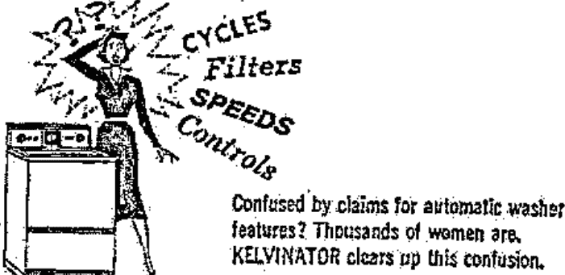

## Plain Facts You Should Know Before Buying Any Automatic Washing Machine

IN THOUSANDS of homes today, women are still hand-scrubbing clothes, even though they own shiny new automatic washers.

Why? First, because their machines can't get out ground-in dirt without hand-scrubbing. Secondly, many women won't trust fine fabrics to a jerky, back and forth agitator action.

Is it impossible, then, for an automatic washer to get clothes really clean with complete safety?

Kelvinator engineers knew that clever features could not make up for a lack in the washing action itself. Research proved the answer must include an automatic pre-scrub... something impossible in existing agitator washers because they're too rough on clothes.

More research, more experiments, developed a new rotating agitator motion that met every cleaning test and safety standard and ended hand pre-scrubbing.

They call it EnerJETic Action. This thorough yet gentle washing action provides an automatic pre-scrub known as the "Magic Minute Dirt Loosener"... the most effective way

to get out ground-in dirt ever known.

For one minute, clothes are first pre-scrubbed in a small amount of water, with the full amount of detergent to loosen all dirt, grease and grime before regular washing starts.

Then the water fills to the normal level and EnerJETic Action keeps turning clothes over and over... while thousands of jet streams shoot suds deep into every fibre. As a result, Kelvinator gets out every bit of soil... and it washes filmy lingerie, new "synthetics," even Wash-Wear fabrics in perfect safety.

Today, there are many washers studded with many features. The truth is: Kelvinator has every one of real convenience... like the automatic lint filter, different cycles, and rinse additive dispenser. However, Kelvinator alone has developed the kind of washing action homemakers need for cleaner, easier, safer washing.

And Kelvinator owners can't have a $70 repair bill for replacing a worn-out or leaky gear drive mechanism... because EnerJETic Action, unlike all other washing actions, is built without gears. KELVINATOR, Detroit 32, Michigan.

对自动洗衣机宣传的各种功能感到困惑？很多主妇都是如此。开尔文洗衣机将为你扫除困惑。

## 购买任何自动洗衣机之前
## 你都应该知道的一些事实

如今，很多家庭主妇虽然家中有崭新的自动洗衣机，却仍然坚持手洗衣服。

为什么？首先，因为只靠机器无法洗掉顽固污渍。其次，很多主妇不放心把上好的面料，放到来回搅动的傻瓜式洗衣机内清洗。

那么，自动洗衣机有可能把衣服洗的干净，而且不伤衣物吗？

开尔文工程师知道，洗衣机一些看似小聪明的性能，并无法弥补洗衣机清洗的时候的缺点。研究证明，自动洗衣机必须包含自动提前搓揉功能……这是现有的搅拌洗衣机无法具备的，以为它们对衣物的磨损太大。

经过更多的研究，更多的实验，开尔文终于研发出了一种新型滚筒洗衣机，它通过了所有清洁测试和安全检测，结束了用手搓洗的时代。

他们称之为能量清洗方式。这种彻底却温和的清洗方式，使自动提前搓洗被称作“神奇一刻污垢松动机”……能最有效地清除顽固污渍。

只要一分钟的时间，用少量的水、洗涤剂，衣服上的污垢，油脂，在正式清洗开始之前，就能得到全部预先清洗。

然后，将洗衣机内的水添加到正常水位，能量清洗方式就会反复清洗衣物……无数肥皂水柱就会深入到每个纤维中。因此，开尔文洗衣机能洗掉每一粒污垢……无论是清洗轻薄的内衣，还是新型“人工合成面料”，甚至只能手洗的面料，它都能十分安全地清洗干净。

今天，很多洗衣机都增加了各种各样的功能。事实是：开尔文洗衣机拥有所有真正便捷的功能……比如，自动除尘过滤，不同的清洗周期，冲洗加时。而且，开尔文还独自开发了家庭主妇需要清洁方式，让清洗更轻松，更安全。

而且，开尔文洗衣机用户，不需要支付70美元的更换磨损或漏水的齿轮传动机维修费……因为，能量清洗方式，和其他清洗方式不同，不需要齿轮传动机。开尔文洗衣机，密歇根州底特律32号。

## 作业

# 30、致 10000 个在接下来 30 天内，即将购买小型立式风琴的家庭

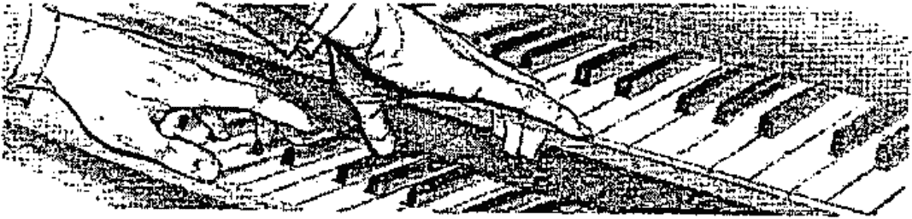

## To the 10,000 families who will buy a spinet organ in the next 30 days

You are about to experience a new kind of pleasure and relaxation. You—and an estimated 100,000 other families this year. Before you buy, the Conn Organ Corporation suggests you ask these 5 vital questions:

1. Is the electronic organ easy to master? The feeling of musical achievement arrives quickly, because each note develops and holds its own rich tone. However, organs that feature "gadgets" produce a limited number of effects, for a limited repertoire of music...and are soon outgrown. In marked contrast, the Conn Organ is extremely easy for a beginner to play...yet offers tonal quality and versatility to thrill a concert artist.

2. What is the most important quality to seek in an organ? Tone truly indicates an organ's superiority. Only the Conn Organ has a complete, individual tone generator for each and every note, resulting in a precise, identifiable, lovely tone. And nobody knows tone like Conn! The Conn Organ is the product of almost a century of musical tradition. It is made by the world's largest manufacturer of orchestra and band instruments—specialists in tonal research.

3. Is the organ fully electronic? Some are not. Some use vibrating reeds or mechanical discs to reproduce tone. The Conn is fully electronic. Starting at just $995,

Conn is the only popular-priced organ whose range of musical color is not restricted to one single type of tone. This means the Conn has greater versatility and tonal contrast...with the "full orchestra" sound of a mighty pipe organ.

4. Will its size fit gracefully into my home? The Conn Organ takes up as little space as a drop-leaf table! Because it is all-electronic, the Conn is smaller, with more music built in!

5. Will its styling be easy to live with? The Conn Organ is designed for enduring beauty by Raymond Loewy, in modern or traditional styles, in a wide range of fine woods and finishes.

When you visit your Conn dealer for a demonstration, you'll find there is a noticeable difference in a...

## CONN ORGAN

CONN ORGAN CORPORATION
Elkhart, Indiana. Dept. D-1
Please send me your free booklet, "How To Choose The Organ For Your Home."
Name________________
Address # 5 8 0 0 1
City________ Zone____ State____

致 10000 个在接下来 30 天内 即将购买小型立式风琴的家庭

你即将经历一种新的快乐和放松。你——预计今年还有其他 100000 个家庭。在你购买风琴之前，康恩风琴公司建议你问下列 5 个至关重要的问题：

1. 这种电子琴容易掌握吗？你很快就能感受到音乐的成就感，因为每个曲调都丰富饱满。然而，“小型”乐器只能弹奏数量有限的乐曲曲调……而且很快就会被淘汰。形成鲜明对比的是，康恩风琴，对初学者来说，非常容易上手……而其音质和多样性会让音乐家都感到兴奋。

2. 风琴中，最重要的性能是什么？音色代表着乐器的优越性。康恩风琴拥有完整，独立的音色发音器，使得每个音符都精确、清晰、迷人。没人比康恩风琴更懂音调！康恩风琴是将近一个世纪音乐传统的产物。它由世界最大的管弦乐器制造商……音调领域专家制造。

3. 风琴是纯电子的吗？有些不是。有些通过芦笙或机械振动盘发音。康恩风琴是纯电子乐器。起价只要 995 美元，是唯一一款音色不局限于单一曲调的大众化乐器。这意味着康恩风琴音色丰富，音调广……有着完整的、独立的音调音符。

4. 其大小能优雅地融入我的家居环境吗？康恩风琴的活动翻板设计，使其占地空间很小！因为它是纯电子乐器，所以，乐曲更丰富，体积更小！

5. 它的样式好看吗？康恩风琴由雷蒙·洛伊威设计，外观十分漂亮，具备现代或传统风格，选用优质木材，做工精良。

去康恩风琴经销商那里观看演示，你就会发现明显的差异……

## 康恩 风琴

康恩风琴公司 印第安纳州，埃尔德哈特 D-3 部门

请寄给我免费手册《如何为家人选购乐器》

姓名________________________

地址________________________ 城市_______ 区____ 州____

## 作业

# 31、一位晨起背部疼痛患者，对 Koylon 泡沫床垫的评价

> "What one C.M.B.A. (Chronic Morning Back Ache) thinks about the Koylon foam mattress"

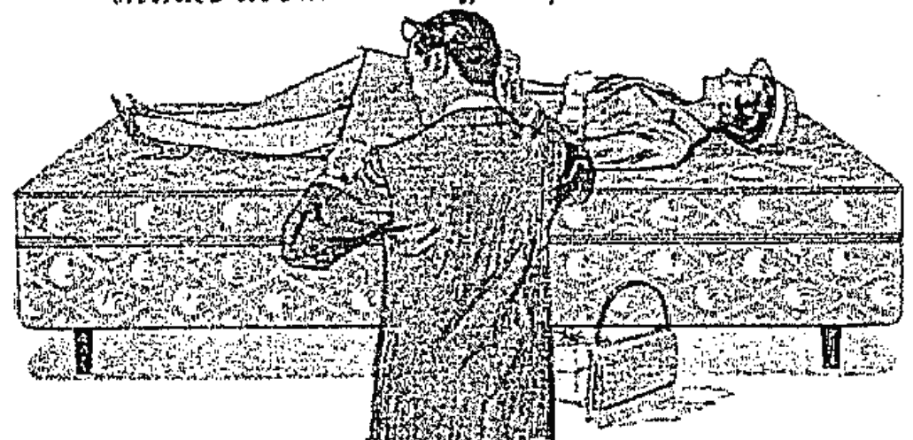

THE makers of the Koylon mattress get a lot of letters. But none are more grateful than letters from people with back trouble—like Mrs. John C. Houlihan, wife of the Mayor of Oakland, California.

"For years," she wrote, "I slept on an expensive well-known brand mattress. Then an old back injury caught up with me and Doctor suggested the board treatment. Later, I decided to get an orthopedic-type mattress.

"However, regardless of the advertisements showing the perfect spine position while on your back or side—every time I lay on my side, I felt as if I would break in the middle.

"Finally, I tried a Koylon, testing it for almost an hour (to the clerk's amusement) before I took it.

"Now, I've been sleeping on Koylon for almost three years. I find that when I sleep on my side, my shoulders and hips sink into the mattress—but that wonderful Koylon buoyancy supports the area between, keeping my spine as straight as it was meant to be. How wonderful to get up in the morning without the old C.M.B.A."

What makes everyone so enthusiastic

about the Koylon mattress?

A whole new kind of sleeping comfort!

On a Koylon, you almost literally float on air. This finest of foams has millions of air cells that "give" to your weight so perfectly, you are hardly conscious of Koylon's gentle presence. Yet it provides the firm support you need, back troubles or no. (It's also light and easy to handle, non-allergenic and odor-free.)

Let your family enjoy the remarkable Koylon. But insist on Koylon: don't settle for anything "just as good" or "just like it." There isn't anything like it.

Clip this coupon for a free brochure on how Koylon helps you to better sleep, and the name of a dealer nearest you.

U. S. Koylon Bedding, Dept. D
United States Rubber Company
1230 Avenue of the Americas
New York 20, New York

Please send me the free brochure on the Koylon mattress, and the name of my Koylon dealer. (I understand no one will call on me.)

My name____________________________________
Street____________________________________
City_____________Zone_____State_______

## 一位晨起背部疼痛患者
对 Koylon 泡沫床垫的评价

Koylon 床垫的研发者收到很多来信。但是，没有哪封信比像约翰·C·胡莉太太，加利福尼亚州奥克兰市市长的妻子这样，背部经常疼痛的患者的来信，更充满感激之情的了。

“多年来，”她写道，“我用的都是昂贵的名牌床垫。后来，背部旧伤复发，医生建议我更换床垫。最终，我决定换一个矫正类的床垫。”

“然而，虽然广告上说当人平躺，或侧躺在这样的床垫上时，脊椎会呈现完美的姿势——每次我侧躺时，我都感觉腰要断了。

“最后，我尝试了 Koylon，在我购买前，我测试了将近一个小时（店员非常热情地邀请我亲自体验）。

“现在，我使用 Koylon 床垫将近 3 年了。我发现，当我侧躺时，我的肩膀和臀部都会陷入床垫——但是，肩膀和臀部之间的部位得到了完美的浮力支撑，使我的脊椎保持直挺。每天早晨起床，背部没有任何疼痛的感觉，简直太美妙了！”

是什么使大家对 Koylon 床垫如此追捧？

一种全新的舒适的睡眠体验！

在 Koylon 床垫上，你会觉得几乎是漂浮在空中。这种优质的泡沫，拥有数以百万计的空气泡，能完美，温柔地“支撑”你的体重，让你几乎意识不到 Koylon 的存在。然而，它却为你提供了你需要的支撑力，不论你是否有背部问题。（而且，它很轻便，容易搬运，防过敏，无气味）。

让你的家人享受卓越的 Koylon 吧。一定请坚持选择 Koylon：不要选择其他“和它一样好”或“和它一样”的东西。没有这样的东西。

剪下这个优惠券，寄给我们，就可以帮助有关 Koylon 如何帮你拥有

更好的睡眠的免费小册子，以及离你最近的经销商的名字。

美国 Koylon 床垫部门
美国橡胶公司
1230 年美洲大道
纽约

请给我邮寄有关 Koylon 床垫，以及经销商名字的免费小册子。（我知道没有人会主动打扰我。）

姓名________________________
街道________________________
城市______区______州__________

## 作业

# 32、西尔斯为你购买的家电提供高效服务，无论你住在那里——或搬到哪里

## How Sears gives efficient service on appliances wherever you live—or move

Sears, Roebuck and Co. operates the world’s largest service organization. Read how it brings prompt, efficient service to your door at low Sears prices—no matter where you live or move.

Suppose for example, you bought a Sears Kenmore washer in Toledo, then moved to Seattle. Your Sears store in Seattle will give you the same dependable service on your washer as you received before you moved.

The fact is, you can get service on a Sears appliance no matter where it was bought—or where you live in the United States.

NOTE: If you’re planning to move, call the Sears store in your new town. They will arrange for a serviceman to come to your home and install your Sears appliances promptly.

Today, there are 5,500 Sears service specialists who go out on call. When one comes to your house, he’ll bring everything he needs to complete practically any repair job in one visit. His service truck carries about $1,500 worth of tools, testing instruments and replacement parts.

HINT: If one of your appliances won’t start, check to make sure it’s plugged in. Sound ridiculous? One Sears service manager reports, “Our men make an average of 40 calls a week in Chicago, only to discover the customer’s appliance is simply unplugged.”

Maintaining a service organization in all 50 states is a costly operation. But it is a necessary investment if Sears is to keep its promise to you: “We service what we sell.”

The appliances in this photo can be bought at low Sears prices with no down payment. Satisfaction guaranteed or your money back.

## 西尔斯为你购买的家电提供高效服务 无论你住在哪里——或搬到哪里

西尔斯罗巴克公司拥有世界上最大的服务组织。
阅读下文，看其如何以极低的价格，为你提供快递，高效的服务的 不管你住在哪里。

比如，假设你在托莱多的西尔斯购买了洗衣机。然后你搬到了西雅图。那么，在西雅图的西尔斯商店，就会为你提供和你没有搬家之前一样可靠的服务。

事实是，不管你是在哪里购买的西尔斯产品——或者不管你住在美国什么地方，你都可以得到西尔斯高效的服务。

注意：如果打算搬家，给你新住所的西尔斯商店打电话。他们会立刻为你安排西尔斯服务人员，上门为你安装西尔斯家电。

如今，西尔斯每天都有 5500 位服务专家随时待命。当他们上门为你服务时，他会带着维修需要的所有工具。他的服务卡车上载有价值 1500 美元的维修工具，测试仪器和替换零件。

提示：如果你的设备无法启动，请确认电源是否正常接通。听起来很滑稽，是吧？但是，据某西尔斯服务经理说：“我们芝加哥的服务人员平均每周接到的 40 个需求电话，都是因为客户的设备电源没有插好。”

在全国 50 个州设立维修服务机构，成本非常高。但是如果西尔斯要信守承诺：“我们为我们销售出去的任何东西提供服务”，他们就必须这么做。

这张照片上的电器，你在西尔斯能以极低的价格买到，首付没有最低限额。你享有不满意退款保证。

## 作业

# 33、你的圣诞节礼物，让他失望...还是让他高兴？

Ideal gift for any man:
an electric shaver.
These facts will help you choose wisely.

## Will Your Christmas Gift

## Disappoint Him...Or Delight Him?

Today, there are two completely different kinds of electric shavers. Most of them operate by clipping action—a back-and-forth motion of two comblike metal parts.

Now, a totally new principle has been perfected using rotary blades, which revolve under stationary skin guards and actually shave the beard instead of pinching off the whiskers. This new principle is found in the new Norelco Speedshaver. Its rotary blades are also self-sharpening.

A remarkable device, it even looks like the totally new invention, it is. It resembles the comforting bowl of a meerschaum pipe, and it fits into a man’s hand with the same pleasant

"belongingness" you’d expect from a much-loved, much-fondled pipe.

The new Norelco has another highly unusual feature—a push-button flip-top, which makes cleaning superlatively easy. A further nice point: you don’t have to make special adjustments on the Norelco. It shaves all beards, light or heavy.

In its gleaming gray and white housing, the Norelco makes a gift that will delight any man at Christmas. Look on the shaver itself for the name "Norelco"...the rotary-blade shaver that really shaves.

There’s nothing else like it, which may help explain why it is the largest selling shaver in the world. With DeLuxe Travel Case, $29.95.

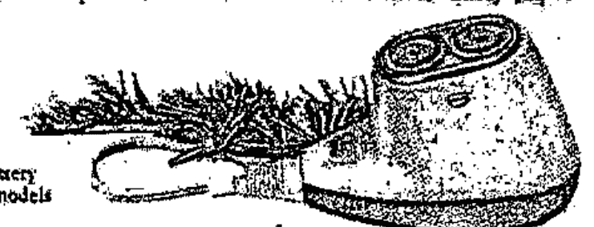

Also available in battery shavers and ladies' models

Norelco is known as Philishave in Canada and throughout the rest of the free world. North American Philips Company, Inc., 100 E. 42nd Street, New York 17, N.Y.

任何男人都会喜欢的理想礼物：电动剃须刀。下面信息会帮你更好地挑选剃须刀。

## 你的圣诞节礼物

## 让他失望...还是让他高兴？

如今，市场上有 2 类完全不同的电动剃须刀。大多数都是 2 个和梳子一样的金属片来回活动。

现在，旋转刀片的应用，使剃须刀的一个全新的部件得到了彻底完善。这种刀片可以在静止的皮肤上旋转，彻底地刮掉胡须，而不是夹掉它。新型劲峰剃须刀就采用了这种部件。它的旋转叶片还可以自动磨锐。

一个神奇的装置，它看起来就像一个全新的发明。它的外形和海泡石烟斗一样，手感非常舒适。

新型劲峰剃须刀还有一个极不寻常的特征——翻转式按钮，使其非常容易清洗。还有一个很棒的特征：你不用对劲峰剃须刀做任何特殊调整。它可以剃掉任何胡须，不论稀疏还是浓密。

劲峰剃须刀包装有闪亮的灰色，以及白色，使得它会成为令任何男人都兴奋不已的圣诞节礼物。能够真正实现剃须的旋转型刀片刀身上刻有“劲峰”二字，购买时请进行查看。

没有哪种剃须刀比它更好了。这就是它成为世界上销量最大的剃须刀品牌的原因。它还有豪华旅行套装，只要 24.95 美元。

也有女款电动剃毛刀。

劲峰剃须刀在加拿大和世界其他各地还被称为飞利浦剃须刀。

北美飞利浦公司 100 E. 第 42 街道 纽约 17

## 作业

# 34、漂亮至极的机器上蜡地板

Sales are booming on home floor polishers.
And now comes another advance: a new wax just made for electric buffers. Now you, too, can enjoy

## Those marvelous
machine-waxed floors

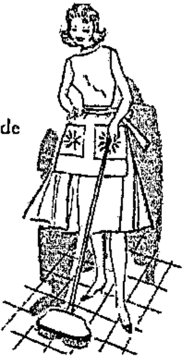

It has long been known that a machine-waxed floor is far superior to one that you wax by hand. In office buildings, schools, stores—wherever traffic is constant and heavy—they’ve been using electric polishers for years. Less work. A smoother job. Fewer waxings.
Why couldn’t the housewife enjoy these advantages right in her own home? The answer is, she can. More than five million women now have their own electric polishers. Sales are booming, they may double in the next two years.
One big reason is that the job has now become easier than ever. The Simoniz Company has just come out with a new wax especially made for home buffers. Its name: Simoniz Electric Polisher Floor Wax.
Liquid waxes of the “general purpose” variety simply can’t do the job. They lack the body, the high wax content, to stand up under high-speed buffing. Paste waxes? They’d be fine—but as any housewife knows, applying a paste wax to a broad area can amount to quite a chore. More important, paste wax should not be used on the popular asphalt or rubber-tiled floors.
So this new wax is welcome news. Only now can the woman match in her home the finest professional job—with very

little effort—and with a polisher and wax that are well within her budget. It will come as no surprise to her that this breakthrough appeared in the research laboratories of Simoniz. America’s “old hand” in the wax business. And an old friend of the American housewife—she knows the name Simoniz, and she knows it’s the best.
As a housewife yourself, you’re going to be delighted with this new floor wax. It couldn’t be easier to use. Simply spread and it works the same wonders on every floor in your house: wood, tile, terrazzo, linoleum—even concrete porch and basement floors.
Once it’s on, this new Simoniz wax just lasts and lasts. All you do is damp-mop now and then, and the original shine buffs back time after time.
Like to give this new wax a try? Well, you couldn’t pick a better time! Because right now Simoniz makes you a special introductory offer—25¢ off on the first can you buy. Simply tear out the coupon you’ll find on the other side of this page, take it to your favorite store, and the 25¢ saving is yours.

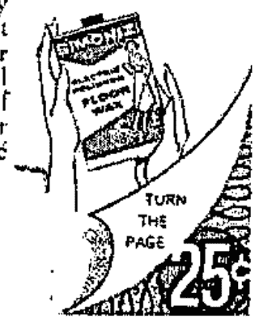

家庭地板抛光的销售正蓬勃发展。

现在，出现了另一个先进技术：一种全新的专为电动系统研制的地板蜡。现在你也可以拥有：

## 漂亮至极的机器上蜡地板

人们早就知道，机器上蜡的地板，要远优于你用手工上蜡的地板。在写字楼、学校、商场——任何人流量大，而且稳定的地方——多年来，地板一直都采用机器上蜡。更少的工作量，更轻松的工作任务，使用更少的蜡。

为什么家庭主妇们在家无法享受这些好处呢？答案是，可以。现在，超过 500 万的家庭主妇都有自己的电动抛光机了。销量一直上涨，在接下来的两年中，还会翻倍。

其中一个原因就是，电动抛光，比以前简单多了。赛蒙斯公司刚推出一个款新型蜡，专为家里的地板研制。它的名字是赛蒙斯电动抛光地板蜡。

“通用”的液体蜡无法用于电动抛光。它们缺乏在高速抛光下，独立成型的特性，高蜡含量。粘贴蜡？会好一点——但是，任何家庭主妇都知道，在面积比较大的地方，应用粘贴蜡，相当繁琐。更重要的是，粘贴蜡无法在流行的沥青或橡胶地板上使用。

所以，这种新型蜡非常受欢迎。只有现在，家庭主妇可以在家里使用最专业的方法——投入最少的精力——在她的预算内，使用抛光机和地板蜡。

这种突破性的新型蜡，出现在赛蒙斯研究实验室——美国汽车蜡“悠久品牌”，一点也不足为奇。美国家庭主妇——她知道赛蒙斯，她知道他们的蜡最好。

作为一个家庭主妇，你一定会非常喜欢这种新型蜡。它使用起来非常非常方便。只要铺开即可，而且适用于任何材质的地板：木质、瓷砖、

水磨石、油毡——甚至混凝土门廊和地下室地板。

一旦打上这种蜡，它就会永久耐用。而且偶尔用湿布擦拭，它就会变得和刚打蜡一样焕然一新。

想尝试这种新型蜡吗？现在是最好的时机！因为，赛蒙斯现在推出了一个特殊推广提议——第一次购买可节省 25 美分。只要撕下本页的优惠券，到你最喜欢的商店购买，你就能节省 25 美分。

## 作业

## 35、除味剂真的可以去除体味——却不“堵塞”毛孔吗？

## Research chemist answers the question:

## Can a deodorant really stop odor—
without "stopping up" pores?

As more and more deodorants crowd the market place, many containing new synthetic chemicals, thousands of men and women are wondering whether it is truly necessary to use these strong deodorants. They wonder whether it's sensible to depend on products that change the natural functions of the pores. They want to know, "Is it possible to stop odor effectively—without stopping up pores?"

"The answer to this question is 'Yes,' says Dr. Paul M. Borick, Research Scientist in Charge of Bristol-Myers' Microbiological Laboratories. "It is possible to stop underarm odor in a more natural way. For many thousands of people, the most desirable deodorant is one that stops odor while letting the skin 'breathe'... while letting natural vapors and fluids freely pass out."

Surprisingly, there is only one leading deodorant today that lets the skin "breathe" this natural way. All other leading creams or sprays, roll-ons or pads do "stop up" pores in a way nature never intended.

This one exception is a deodorant with an old and famous name, but a completely new formula: new sheer Mum.

New sheer Mum gives you lasting deodorant protection without "stopping up" the pores. It's easy to understand why, when you know that there are no aluminum salts, no harsh chemicals in Mum. Instead, Mum works with gentle hexachlorophene that lets the skin "breathe."

So—if you want more natural protection—try new sheer Mum. It stops odor all day. Without "stopping up" pores. And it's softer, fluffier, lighter. A pleasure to use.

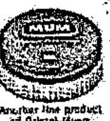

## 化学研究家回答了这个问题:

## 除味剂真的可以去除体味——却不“堵塞”毛孔吗？

随着市场上各种各样的除味剂越来越多，包含许多含有新合成的化学物质的除味剂，许多人开始思考，是否真的有必要使用这些强大的除味剂。他们想知道，依赖这种改变自身毛孔功能的产品，是否明智。他们想知道，“是否有可能有效地除去体味——却不堵塞毛孔？”

“这个问题答案是，‘是的’，负责百时美施-贵宝公司微生物实验室的科学研究人员，保罗·M·博瑞克博士说，“用一种更天然的方式，除去腋下的气味是可能的。对许许多多人来说，最理想的除味剂，可以除去气味，还能让皮肤正常‘呼吸’……而让体内水汽和液体自由散发。”

令人惊讶的是，目前只有一种著名除味剂，能让皮肤“自由呼吸”。所有其他著名体霜或喷雾剂，都会阻碍毛孔呼吸，虽然这并不是它们的本意。

这种特别的除味剂，全新的配方，却有一个古老而著名的名字：新贴心妈妈®。

新贴心妈妈，能持久除味，却不会阻塞毛孔。原因一点也不难理解，因为它不含铝盐，没有刺激性化学物质。相反，它里面含有柔和的六氯酚，能让皮肤“自由呼吸”。

——如果想要更多的天然保护，请尝试新贴心妈妈。它会清除气味，而不“阻碍”毛孔自由呼吸。它轻柔，清新。会给你带来愉快的体验。

百时美施-贵宝公司的又一优质产品。

## 作业

## 36、动摇了一个巨大产业的微小爆炸

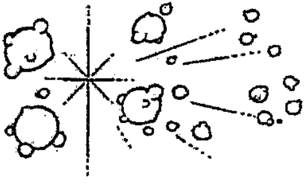

## The Tiny Explosion
That Shook A Giant Industry

No one heard it—in fact, only those who peered through a microscope could even see it—but it was there. The microscope’s eye pointed out a tiny explosion that released a burst of fruit-like flavor.

For years scientists had searched for a method of capturing the taste of sun-ripened fruit fresh from the tree, and imprisoning it in a gelatin. The answer lay in a process basically as simple as a child’s bubble pipe. Royal’s Research Laboratory discovered that fresh-fruit flavor could be combined with artificial flavors in a rich juice. This rich juice is then blown into bubbles, each one so tiny that the eye can’t see it. As they descend through a tall air-drying tower these miniature flavor bursts fall in a jewel-like shower.

Inside every flavor burst is the very essence of fresh fruit... and this fresh-fruit flavor is enhanced further with artificial flavors. It is all held fast until the moment it’s released in an infusion of boiling water. Each of the millions of bursts could be compared with a berry that contains its natural juices sealed in a skin of flavor.

Now Royal brings you ‘flavor-burst’ gelatin—and only Royal gives you ‘Fresh-Fruit Vitamin’—C. Other gelatins contain the old-style flavor elements—rough uneven flakes and crystals that release much of the flavor long before the package is opened.

Next time, don’t just reach for any gelatin, reach for Royal. You’ll notice differences in Royal the moment you pick up the colorful package. See how easily the end snaps open. See how smoothly the mix pours, without the lumps you find in ordinary gelatins. And when you add it to hot water Royal’s flavor bursts explode and give out a delicious fruit-like aroma.

Then, when you mold it, just look at the texture. It’s summery and tender, never turns rubbery as other gelatins do. Then comes the really big difference: that wonderful flavor like fresh-picked fruit that you’ll find only in Royal Gelatin. Remember... only Royal brings you ten different fruit-like flavors, all made the flavor-burst way. Only Royal brings you ‘Fresh-Fruit Vitamin’—C. And only Royal brings you the two brightest, newest flavors ever... Watermelon and Peach.

## 动摇了一个巨大产业的
微小爆炸

没人听到爆炸声——事实上，只有在显微镜下才可以看到这种爆炸——但爆炸真的发生了。显微镜下，你能看到一次小爆炸，它能释放出水果的味道。

多年来，科学家们一直在寻找一种方法，来捕捉刚从树上摘下来的自然成熟的新鲜水果的味道，并把它封存在胶制品中。这个过程，基本和孩子的泡泡管一样。皇家研究实验室发现，鲜果味可以和人工制造的香甜果汁相结合。这种丰富的果汁会被吹入泡泡中，肉眼根本看不到。当它们从高高的吹干塔落下时，这些微型味道就像一场宝石的淋浴。

每一种口味的爆炸内部，都是新鲜水果精华…这种鲜果味道，能使人工香料的风味进一步增强。只要把它放入沸水中，它就能快速释放味道。数百万细胞的每次爆炸，都和用新鲜的浆果挤出来的果汁味道一样。现在，皇家研究实验室为你带来了美味爆炸的果冻粉——也只有皇家研究实验室才能带给你“鲜果维生素”——C。其他果冻粉包含老式风味元素——早在包装打开之前，就会释放出很多粗糙，不均匀的颗粒。

下次，购买果冻粉，请认准皇家牌。当你拿起彩色的果冻粉包时，你就会注意到皇家果冻粉和其他果冻粉的不同。而且包装很轻松地就能打开。之后，你能看到均匀混合的粉末，这和你在其他普通果冻粉中看到的粉块不同。当你将它添加到开水中后，味道就会突然爆炸，散发出美妙的水果香气。

当你搅拌时，你仔细观察，就能看到细腻，浓柔的果汁，这和其他果冻粉完全不同。然后，就是最大的区别：皇家果冻粉美妙的新鲜水果味道。记住…只有皇家果冻粉才会带给你 10 种不同的水果口味。只有皇家果冻粉才会带给你“新鲜水果维生素”——C。只有皇家带给你 2 个最新口味…西瓜味和桃子味。

## 作业

## 37、现在，你有机会验证并评估著名的博物馆收藏品 15 天，没有任何费用或义务

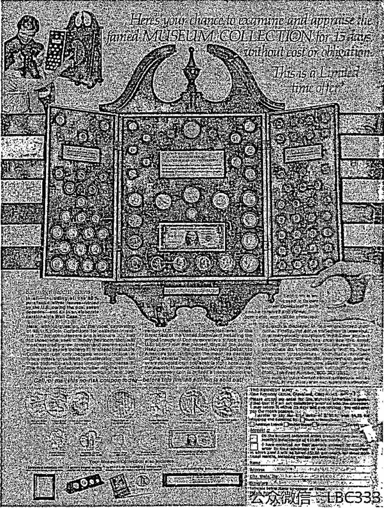

## 现在，你有机会验证并评估著名的博物馆收藏品 15 天，没有任何费用或义务
限时提供*

## 85 枚精致的硬币

其中——90%为过去 70 年来，美国铸造的纯银硬币——均为精心设计的精美硬币。每枚硬币都有独立的精致包装，因此，你可以取出来，鉴赏双面，还不会损坏硬币。

毫无疑问，这对于硬币收藏家……鉴赏家和历史学家……以及那些想收集一些能随着时间的增长，越来越珍贵，越来越有价值的传家宝的人来说，是美国硬币收藏中，最有吸引力的。是的，我们相信这些已经有收藏价值的硬币，在未来几年中，一定会变得更加珍贵——甚至会让那些明智地收藏了这些硬币的幸运者感到难以置信。

博物馆收藏，都是很少见到的 20 世纪美国的整套硬币…甚至包括美国国徽，包括美国造币厂铸造的珍贵的总统就职纪念币。包括早期印有印第安人头像的一分钱硬币，著名的摩根美元，美国第一次登上月球时的纪念币，还有珍贵的“艾克”美元，每一枚非黄金硬币。在这里，你都能在这个一流的博物馆中找到。

当然，因为每枚硬币本身都是一件珍贵的艺术品，都有自己的利基市场。最后，整套硬币采用的是奢华，精美的雕刻包装，你可以骄傲地向朋友展示。

你一定要亲眼看看这套豪华限量版收藏品，亲眼欣赏它的美和未来增值的可能性。你可以 15 天，零风险，零义务，验证并评估这套博物馆收藏品。今天就来信申请收藏或拨打我们的 24 小时免费电话，

800-321-1031 吧。

*当我们有限的几套销售完毕后，都不会再以任何价格，买到这样的限量版了。

在限量版销售完之前，立刻打电话，或发邮件申请吧，保证没有任何风险

## 肖尼迪造币厂

俄亥俄州，克利夫兰，肖尼迪公司 44142 CR-1

请接受我对这套博物馆收藏品的申请。我知道如果我不是完全满意，我只要在 15 天内退回，就不用支付任何费用。你甚至会退给我我的邮资。

我愿意以以下方式支付 299.92 美元 + 4.50 美元的运费和处理费：

- □ 通过汇票支付
- □ 通过美国运通卡支付 □ 通过万事达信用卡支付 □ 通过美洲银行信用卡支付 □ 全权委托

账号________________ 有效期________

- □ 请允许我用上面的账户每月分期支付 51.00 美元。
- □ 我随信附上了我使用 “分期付款计划” 的第一期月度付款 51.00 美元，接下来，我每月都会为你支付 51.00 美元的邮资和手续费。

姓名________________________

地址________________________

城市 __________ 州 ______ 邮编 ______

签名________________________

请打印

## 作业

## 钱！

## 超越你的梦想...

有没有想过自己创业？你肯定想过！但是，如今创业的启动资金需要很多。，而且还要冒大风险，最后可能还赚不到钱。对吗？错！！！

请花 2 分钟时间读一读这个广告。它可能会改变你的生活！

100 美元，再加一部电话，你就不用再早八点，晚 5 点地去上班了。很久之前，我辞掉了每周 40 小时的工作，现在我给自己当老板。我想做什么做什么。我可以根据自己的心情，想休息几天，或几周都可以！很多时候，我都能睡到中午（大部分时间，我确实睡到中午）。而我的业务却可以一天运营 12 小时，一周运营 7 天。

在不到 2 个月的时间里，我每周收益都普遍超过 1000 美元，这还只是开始！！听起来好得令人难以置信？不会的！

## 我用 100 美元和一部电话开启了创业生涯…

当我开始我的业务时，纽约锡拉丘兹整个城市都没有这样的业务。6 个月之后，出现了其他 3 个做同样业务的人，都取得了很大成功！

今天，我自己开了公司当总裁。我的办公室位于城市最繁忙的街道，别人都觉得我的办公室“非常豪华”。我雇佣了 3 位接待员，每周要接听无数电话。不包括我接听的电话。在进一步深入之前，我想清楚地说明：

## 这不是乞求或欺骗之类的电话！

每个能赚钱的电话，都是别人主动打进来的！我收到了来自几乎各个州的支票，为我支付服务费。

## 我不销售任何物质产品！

我提供的是几乎每个人在生活中，都肯定会需要几次的服务。一种没有任何特殊技能，或受过任何特殊教育的人，在家里都能实施的动态服务！人们会迫切地寻求你提供的独特服务，向你支付服务费！

不需要大量的资金投入（我只用了 100 美元），你甚至可以以更少的资金开启你的业务！你不需要离开现在的工作，但是，很快你就可以离开它。事实上，你可以明天开始，然后一天赚比你之前工作一周还多的钱！！！

我保证你启动业务的第一天，就会有成百上千的人请求你的服务。我必须提醒你：这不是任何形式的电话请求。这不是任何形式的电话骚扰。这不是什么神秘的“力量”。这不是一个任何形式的邮购计划。这不是特许经营。也不是要冥思苦想的业务。

你将收到的，只是一个机会，一个一步一步指导你开始自己的业务，取得成功的计划。

这个赚钱的想法是非常独特的，我可以断言：

## 之前从未向公众提供过！没有以任何价格销售过！

当你决定开始你的业务时，你就不是一个人在战斗了！我会随时为你提供个性化的指导和专业咨询。

我将给你赚钱的机会…超乎你的想象！

绝对没有风险！我将在回信中，为你邮寄创业点子和指导，只要 10.00 美元（成本价）！让你免费阅读 10 天。亲自验证这个令人难以置信的创业点子的潜力，之后，在你方便的时候，再寄给我剩下的 9.95 美元！如果你不认为我们的点子值成本的 100 倍，你只要退回它。你之前支付的 10 美元，以及邮资，将会及时退还给你。不问任何问题！你对我没有义务，你只欠自己一个机会。

## 不请自来的证言

亲爱的盖瑞，这是我购买的第一个实用手册，就它包含的信息来说，价格已经极低……W.L. 查尔斯顿先生，弗吉尼亚州。

我刚阅读了你的手册，特别棒！…谢谢你的机敏。L.S. 阿伦戴尔先生，新泽西州。

你的点子非常好。与时俱进，是人们真正需要的服务…你的点子就是一个赢家！J.J.P.希弗德先生，纽约

这是我们操作业务的第一个星期！效果非常棒！兰辛 D.W.C.先生，密歇根州。

盖瑞，我已经把我的业务，从我的公寓搬到了主要街道上。人们迫切地需求我的业务！L.S.帕塞伊克先生，新泽西州

立刻申请 10 天零风险购买！
克里斯汀路 FE-2，G.R. PARO-101
北锡拉丘兹，纽约 13212

姓名 ________________

地址________________

城市________________

州________________ 邮编________________

好，盖瑞。今天就寄给我你的点子和指导吧！

- 我已经附上了 19.95 美元
- 我已经支付了最低费用 10 美元，验证完手册，完全满意后，我会邮寄剩下的 9.95 美元。

一次支付全款 19.95 美元，可以为我节省邮费和手续费，我将为你通过航空邮件邮寄！

对不起，不支持货到付款——纽约居民请增加销售税。

## 作业

## 39、做一个好的汽车广告很容易，但想制造一辆名副其实的汽车，很困难

It is Easy to make advertising claims for cars; but to make cars that will make good the claims is hard.

We ask automobile buyers to do this: After the advertisements have attracted your attention, then in fairness to yourselves and all the manufacturers, compare the cars point by point. That is all we ask.

There are Chalmers dealers in all parts of the United States—more than 200 of them. We suggest that you get in touch with the one nearest to you at once. Let us send you his name if you do not know him.

## Chalmers "30" $1500

Judged by price alone you might as well buy some other car as a Chalmers; $1500 is simply $1500—no more in one bank than in another, no more in bills than in coin, no more in your pocket than in another man's.

It is only when you begin trying to buy something with your money that the sense of value enters your mind.

Your $1500 is worth more than another man's $1500, if at all, only because you are able to buy more with yours than he can buy with his.

We believe that when you buy a Chalmers "30" your $1500 becomes worth more than $1500 invested in any other car. Careful investigation will convince you of this fact.

Please remember you are not buying a price or an advertisement: you are buying a car. Therefore examine the car on its merits.

If you investigate thoroughly a Chalmers will be your first choice, if you are able to get a delivery in your territory.

It is difficult to get more in a car, at any price, than you can get in a Chalmers "Forty" at $2750. The "Forty" has all the power one can want, the quality to endure, beauty of line and luxurious finish. Seats for seven if desired. Catalogue "K" on request.

## Chalmers Motor Company
Licensed under Selden Patent
Detroit, Mich., U. S. A.

Chalmers "30" Touring Car and Roadster, $1500
Pony Tonneau, $1600   Inside Drive Coupe, $2100   Limousine, $2750

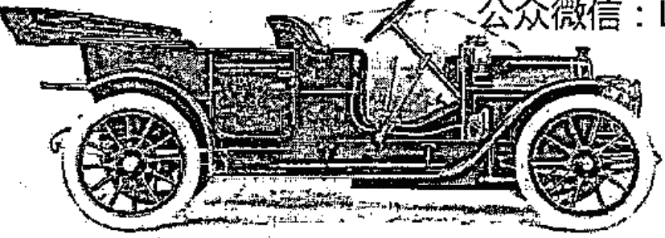

## 做一个好的汽车广告很容易

## 但想制造一辆名副其实的汽车，很困难

我们要求汽车买家这样做：当汽车广告吸引了你的注意力后，出于对自己以及所有汽车制造商的公平，请将这款汽车和广告描述逐点比较。这就是我们要求的全部内容。

美国各州都有查尔姆斯经销商——总数超过 200 家。我们建议你和最近的经销商联系。如果你不知道它的名字，我们可以寄给你。

## 查尔姆斯 “30” 1500 美元

只通过价格判断，你也可以买到其他和查尔姆斯一样的汽车：1500 美元只是 1500 美元——放在一家银行，和另一家银行，不会有任何区别，换成硬币，也不会有任何区别，放在你的口袋里，和放在别人口袋里，数量也没有任何区别。

只有当你开始试图用自己的钱买东西时，价值感才会显现在你的头脑中。

你的 1500 美元，比别人的 1500 美元价值要高出很多，只因为你可以用同样的钱，买到比别人更多的东西。

我们相信，如果你用 1500 美元购买了查尔姆斯 “30”，那么，你的 1500 美元价值就超过了用 1500 美元买的其他任何车。经过仔细的调查，你就会信服这个事实。

请记住，你购买的不是价格或广告：你买的是车。因此，根据车的优缺点进行比较购买。

以 2750 美元购买的查尔姆斯 “40”，以同样的价格，很难买到比这更好的车。“40” 拥有一人希望的所有动力，质量，线条和奢华的配置。如果需要 7 乘车。可以申请目录册 “R”。

## 查尔姆斯汽车公司
塞尔登专利局批准
美国，密歇根州，底特律

查尔姆斯 “30” 房车和跑车，1500 美元
小马加长版，1600 美元 内驱动跑车，2100 美元 豪华轿车，2750 美元
