目录 封面 扉页 版权 前言 第一章 短线看盘实战技法入门 1.1 短线操作基础 1.1.1 认识股票投资 1.1.2 短线盘口术语 1.2 盘面基本常识 1.2.1 股市行情的查看方法 1.2.2 窗口项目的切换技巧 1.2.3 走势图窗口的使用方法 1.3 短线看盘要点 1.3.1 观察五档盘口情况 1.3.2 观察量比指标情况 1.3.3 观察内外盘情况 1.3.4 观察涨幅榜情况 1.3.5 观察换手率情况 第二章 手机短线操盘实战技法 2.1 手机短线操盘技巧 2.1.1 使用手机观察股指的走向 2.1.2 通过涨跌排名看市场人气 2.1.3 使用手机查看个股行情 2.1.4 使用手机查看个股资讯 2.1.5 手机看个股盘面的技巧 2.1.6 使用手机分析基本面 2.1.7 手机一键添加自选股 2.2 手机短线炒股技巧 2.2.1 对比分析多个走势窗口 2.2.2 使用手机进行股票开户 2.2.3 使用手机进行交易买卖 2.2.4 模拟炒股增加短线经验 2.2.5 做好短线炒股价格预警 2.2.6 手机查看个股诊断信息 2.2.7 手机短线选股有高招 第三章 短线看盘选股实战技法 3.1 基本面短线选股技巧 3.1.1 选择经济政策股 3.1.2 选择行业前景股 3.1.3 选择板块龙头股 3.2 心理面短线选股技巧 3.2.1 短线炒股的心理准备 3.2.2 选择具有投资价值的个股 3.2.3 不同市场中的选股技巧 3.3 市场面短线选股技巧 3.3.1 选择炒作题材股 3.3.2 选择热点事件股 3.3.3 选择股本适中的股票 3.4 技术面短线选股技巧 3.4.1 通过 K 线走势对比发现强势股 3.4.2 选择均线多头排列的股票 3.4.3 通过形态分析选择强势股 3.4.4 选择走上升趋势的股票 第四章 短线分时图实战技法 4.1 大盘分时图和个股分时图 4.1.1 大盘分时走势图 4.1.2 个股分时走势图 4.2 炒短线必用的均价线分析 4.2.1 辨别多方与空方市场 4.2.2 股价在均价线上方运行 4.2.3 股价在均价线下方运行 4.2.4 股价与均价线横向运行 4.2.5 股价与均价线过度分离 4.3 超短线必杀技——分时图 4.3.1 早盘走势分析 4.3.2 盘中走势分析 4.3.3 收盘走势分析 第五章 短线 K 线图实战技法 5.1 短线必知：K 线图的基本知识 5.1.1 日 K 线图 5.1.2 大盘 K 线走势图与个股 K 线走势图 5.1.3 K 线图分析要点 5.2 单根 K 线图短线操作技巧 5.2.1 大阳线 5.2.2 大阴线 5.2.3 下影阳线 5.2.4 下影阴线 5.2.5 上影阳线 5.2.6 上影阴线 5.2.7 十字星 5.2.8 一字形 5.2.9 T 字形 5.2.10 ⊥形 5.3 多根 K 线组合短线操作技巧 5.3.1 两根 K 线形态 5.3.2 三根 K 线形态 5.3.3 多根 K 线形态 第六章 短线技术形态实战技法 6.1 K 线组合整理形态 6.1.1 三角形 6.1.2 矩形 6.1.3 旗形 6.2 K 线组合转势形态 6.2.1 双重顶底 6.2.2 头肩顶底 6.2.3 三重顶底 6.2.4 潜伏顶底 6.2.5 圆弧顶底 6.2.6 V 形顶底 6.2.7 岛形顶底 6.3 如何看 K 线缺口 6.3.1 什么是 K 线缺口 6.3.2 K 线缺口的分类 6.3.3 K 线缺口的实战意义 第七章 短线技术指标实战技法 7.1 移动平均线 MA 7.1.1 什么是移动平均线 7.1.2 移动平均线的分类 7.1.3 短线看盘常用的几种移动平均线 7.1.4 利用移动平均线看盘的技巧 7.2 指数平滑异同移动平均线 MACD 7.2.1 什么是 MACD 7.2.2 MACD 的基本应用方法 7.2.3 MACD 的买入形态分析 7.3 随机指标 KDJ 7.3.1 什么是 KDJ 7.3.2 KDJ 指标的短线买入法 7.4 顺势通道指标 CCI 7.4.1 什么是 CCI 7.4.2 CCI 的短线操盘技巧 7.5 多空指标 BBI 7.5.1 什么是 BBI 7.5.2 BBI 的短线操盘技巧 7.6 相对强弱指标 RSI 7.6.1 什么是 RSI 7.6.2 RSI 看盘研判标准 7.6.3 RSI 指标的短线买卖讯号 7.7 布林线指标 BOLL 7.7.1 什么是 BOLL 7.7.2 BOLL 指标看盘研判标准 7.7.3 运行“喇叭口”形态操作 7.8 指数平均线 EXPMA 7.8.1 什么是 EXPMA 7.8.2 EXPMA 指标的运用 第八章 散户短线看盘实战技法 8.1 短线顶部看盘技巧 8.1.1 黄昏之星，夕阳西下 8.1.2 空方炮，多头衰弱 8.1.3 乌云盖顶，空头大雨 8.1.4 黑三兵，下跌强劲 8.1.5 阳孕阴，空头增加 8.2 短线底部看盘技巧 8.2.1 早晨之星，上涨之星 8.2.2 曙光初现，太阳升起 8.2.3 一阴盖三阳，及时进场 8.2.4 阳包阴，空头衰弱 8.2.5 阴孕阳，孕育新机会 第九章 短线反弹追涨操作技巧 9.1 短线抢反弹操盘技法 9.1.1 金针探底反弹信号 9.1.2 待入线反弹信号 9.1.3 抱线反弹信号 9.1.4 三川线反弹信号 9.1.5 启明星线反弹信号 9.1.6 红三兵线反弹信号 9.1.7 均线反弹信号 9.1.8 OSC 反弹信号 9.2 短线追涨操盘技法 9.2.1 第一个涨停板的追涨技巧 9.2.2 大盘股强势涨停的追涨技巧 9.2.3 突破前期高点的追涨技巧 9.2.4 高开快速封板的追涨技巧 9.2.5 突破压力线的追涨技巧 9.2.6 短暂封板试盘的追涨技巧 第十章 短线看盘控制风险技巧 10.1 做好短线风险控制 10.1.1 短线风险控制的原则 10.1.2 短线资金管理的原则 10.2 短线如何止损止盈 10.2.1 短线止损的原则 10.2.2 短线止损的方法 10.2.3 短线止盈的方法 10.3 熊市解套操作技巧 10.3.1 采用主动性换股解套 10.3.2 把握热点行业解套机会 10.3.3 摊平投资成本进行解套 

  
  

全彩图解版

7 天学会短线炒股技巧　卖在最高点

龙飞　著

  
  
  
  
  

人民邮电出版社

北京

图书在版编目（CIP）数据

7 天学会短线炒股技巧：卖在最高点：全彩图解版/龙飞著.--北京：人民邮电出版社，2015.10

ISBN　978-7-115-40297-4

Ⅰ.①7…　Ⅱ.①龙…　Ⅲ.①股票投资—基本知识　Ⅳ.①F830.91

中国版本图书馆 CIP 数据核字（2015）第 215877 号

内容提要

超简单！理论结合实战，通过 120 多个知识精讲，助读者快速精通短线操作！

全图解！以图展示文字，通过 360 多张图片注解，让读者一看就懂短线操作！

本书共分为 10 章，具体章节内容包括：“短线看盘实战技法入门”“手机短线操盘实战技法”“短线看盘选股实战技法”“短线分时图实战技法”“短线 K 线图实战技法”“短线技术形态实战技法”“短线技术指标实战技法”“散户短线看盘实战技法”“短线反弹追涨操作技巧”“短线看盘控制风险技巧”。

本书结构清晰、案例丰富、实战性强，不仅适合刚入门的股票用户，同时还可以作为证券、投资公司的培训、指导教材。

◆著　龙飞

责任编辑　恭竟平

责任印制　周昇亮

◆人民邮电出版社出版发行　　北京市丰台区成寿寺路 11 号

邮编　100164　　电子邮件　315@ptpress.com.cn

网址　http://www.ptpress.com.cn

北京方嘉彩色印刷有限责任公司印刷

◆开本：700×1000　1/16

印张：15.75　　2015 年 10 月第 1 版

字数：297 千字　　2015 年 10 月北京第 1 次印刷

定价：45.00 元

读者服务热线：(010)81055296　印装质量热线：(010)81055316

反盗版热线：(010)81055315

广告经营许可证：京崇工商广字第 0021 号

# 前言

Preface

■写作驱动

做短线的时间成本最少，获利也最快，但这需要投资者具备扎实的基本功，特别是对盘口动向的判断能力。本书涵盖看盘选股、K 线、技术图、技术指标、分时图以及风险控制等短线操盘细节的要点；120 多个知识点对应 90 多个实战案例，让知识点和应用完美结合；本书精选股市中的实用案例，目的是让读者在真实的股市环境中实战学习，举一反三，让股民在学习相关方法后能够真正运用到实际的股市投资中，并获得收益。

■主要特色

【知识精简，结构清晰】

本书精挑细选了股票投资中与短线操作相关的最实用方法和技术进行重点讲解，先是基础入门篇，后是核心技能篇，再是能力提高篇，在描述过程中，尽量以最简单易懂的方式进行描述，并配合图示讲解，整个知识结构清晰明了。

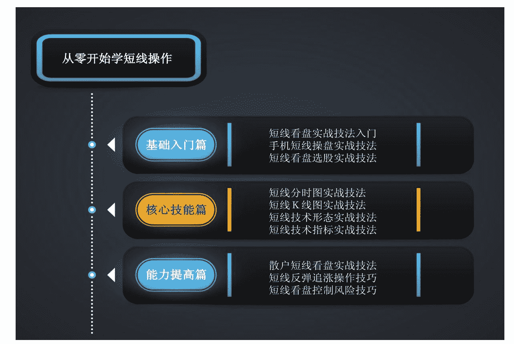

【案例实用，彩色图解】

彩色图片比黑白图片更真实、醒目，可以让读者对整个分析过程有一个清晰的把握，并方便阅读和图文对照。

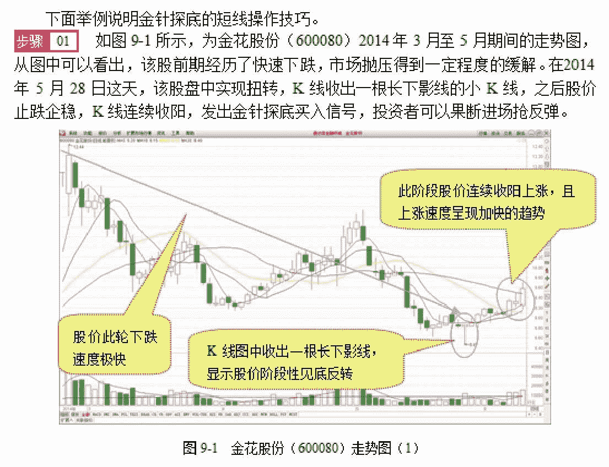

【手机看盘，随时随地】

目前市场上的图书，95%以上的内容都是针对 PC 电脑版的，手机炒股的书极少，本书对使用手机 APP 进行短线操盘和炒股的应用技巧讲解非常全面，帮助读者现学现用，不错过每一个短线买卖的时机。

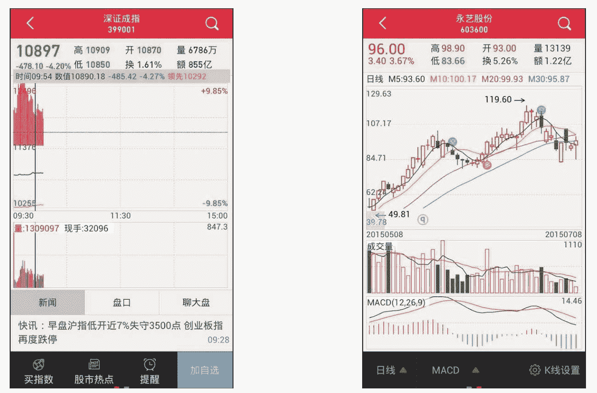

■本书学习的注意事项

股票投资的技巧和方法不计其数，本书罗列的技术和方法比较全面，股民不需要全部掌握，可针对性地挑选几种技术深入学习并不断总结，在实战中进行综合运用即可达到很好的效果。

读者在阅读中还应结合实际情况灵活变通，举一反三，养成勤思考的好习惯，形成良好的归纳总结能力。

■作者售后

本书由龙飞著，参与具体编写的人员还有谭贤、苏高、柏慧等人，在此表示感谢。由于作者知识水平有限，书中难免有错误和疏漏之处，恳请广大读者批评指正，联系邮箱：itsir@qq.com。

# 第一章 短线看盘实战技法入门

学前提示

看盘俗称盯盘，是股票投资者重要的日常工作。股票市场每时每刻都在变化，股票投资者尤其是短线投资者要掌握股票市场的动向，就要观察和分析股市行情的变化，学会看盘。

要点展示

短线操作基础

盘面基本常识

短线看盘要点

## 1.1 短线操作基础

随着我国股票市场的不断发展与完善，越来越多的人开始参与到股市投资中，初入股市的短线投资者，首先要掌握和了解一些基本概念、基本术语。

### 1.1.1 认识股票投资

熟悉股票的基本概念和相关定义是投资者炒股的前提，下面将具体介绍。

1．股票与投资者的含义

股票和投资者是股票市场中最常听到的词语，那股票和投资者到底是什么呢？其相关定义如图 1-1 所示。

图 1-1 股票和投资者

例如，假设一家股份公司有 100 个股东，每个人出资 10 万元，则每人拥有该公司 1%的所有权（股权）。股份公司经主管机关核准后，可以印制股票，交于投资者持有，作为代表所有权的凭证，这就是股票的原始意义。

股票一般可以通过买卖方式有偿转让，股东能通过股票转让收回其投资，但不能要求公司返还其出资。股东可以在股票市场上买卖这些股票，这样就形成了股票在不同投资者手中的流通以及所有人和持有份额的变更。

股票像一般商品一样，有价格，能买卖，可以作为质押品。拥有这些股票的人都可以成为公司的股东。股东与公司之间的关系不是债权债务关系，股东是公司的所有者，以其出资额为限对公司负有限责任、承担风险、分享收益。

因此，股票是股份公司发给投资者用以证明其在公司的股东权利和投资入股的份额，并据此获得股利收入的有价证券。

2．股票的特征

股票作为一种有价证券，与储蓄、债券以及基金相比有着独特的特点，主要表现为如图 1-2 所示的几个方面。

图 1-2 股票的特征

专家提醒

股民不能直接进入证券交易所买卖股票，只能通过证券经营机构买卖股票，并凭交易密码或证券账户向券商下达买进或卖出股票的指令，这个过程称为委托。委托的内容包括要买卖股票的代码、数量及买进或卖出股票的价格。委托买入股票的数量必须是 100 的整倍数，但委托卖出股票的数量则不受该限制。

买卖股票的方式主要有以下 4 种。

（1）远程终端交易。 通过与证券柜台电脑系统连网的远程终端或互联网（如手机、家用电脑等）下达买进或卖出指令。

（2）电话自动交易。 通过电话拨打证券营业部柜台的电话自动委托系统，用电话上的数字和符号键输入想买进或卖出股票的代码、数量和价格，从而完成委托。

（3）柜台递单交易。 股民利用身份证和账户卡到开户证券营业部柜台填写买进或卖出股票的委托书，然后由柜台的工作人员审核后执行相应的操作。

（4）电脑自动交易。 股民可在证券营业部大厅里的电脑上亲自输入买进或卖出股票的代码、数量和价格，由电脑来执行委托指令。

3．股票涨跌的颜色标识

为了直接查看股票的涨跌情况，在我国股市中，红色代表该股票的当前状况为涨，绿色代表该股票的当前状况为跌。

图 1-3 所示为 2015 年 7 月 7 日股票涨幅最高的前 10 只股票，图 1-4 所示为 2015 年 7 月 7 日股票跌幅最高的前 10 只股票。

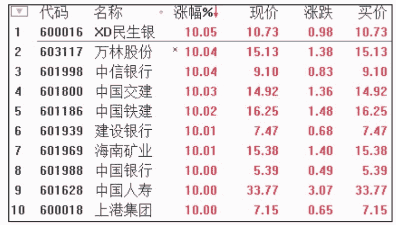

图 1-3 股票上涨的颜色

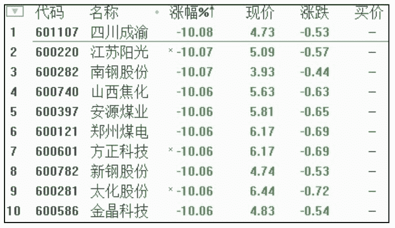

图 1-4 股票下跌的颜色

### 1.1.2 短线盘口术语

投资股票是一门高深的学问，要想充分认识它，就需要对它的特有术语非常熟悉，表 1-1 为大家列举了一些常用的股票术语。

表 1-1 盘口术语

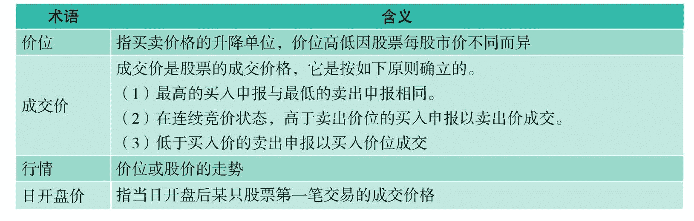

续表

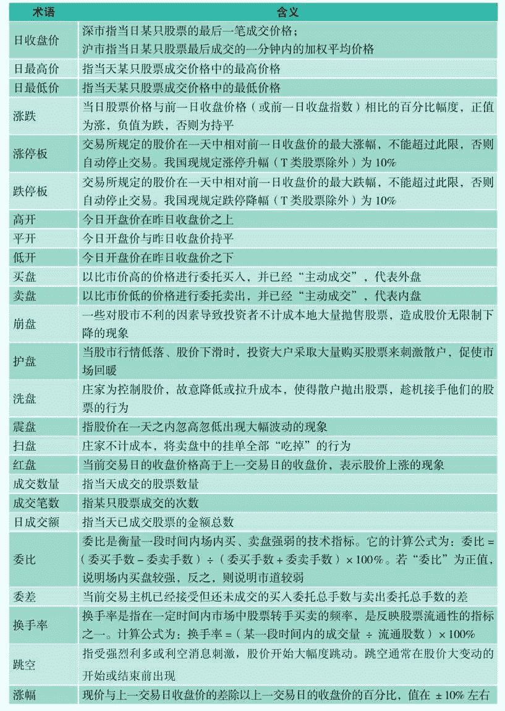

专家提醒

股票是一种虚拟资本，它本身没有任何价值。股票的价值就是用货币的形式衡量其作为获利手段的价值，包括股票面值、净值、清算价值、市场价值以及发行价 5 种。

（1）股票面值。 用于表明每一张股票所包含的资本数额，以元/股为单位。

（2）股票净值。 也称账面价值或每股净资产，是指用会计的方法计算出来的每股股票所包含的资产净值。

（3）股票清算价值。 指股份公司关闭后，所清算出的每股股票的实际价值。

（4）股票市场价值。 股票在交易过程中交易双方达成的成交价，即通常所说的股票价格。

（5）股票的发行价。 上市公司为了确保自身利益和上市成功率等因素，重新制定一个较为合理的价格来发行股票。

## 1.2 盘面基本常识

如今，很多投资者都选择网上炒股，网上炒股的网站和软件很多，本节以通达信为例，介绍一些股票盘面的基本常识。

### 1.2.1 股市行情的查看方法

登录炒股软件之后，投资者即可开始查询各类行情信息。

启动炒股软件，首先会看到行情列表窗口，该窗口列举了所有股票的基本信息，如股票代码、股票名称、当日涨幅情况、现价、日涨跌、买入价、卖出价等，如图 1-5 所示。

在行情列表窗口中，点击对应的表头名称，可根据指定字段对股票进行升序和降序排列，从而方便查看数据，如图 1-6 所示，分别为按现价的降序顺序和买价的升序顺序查看股票行情。

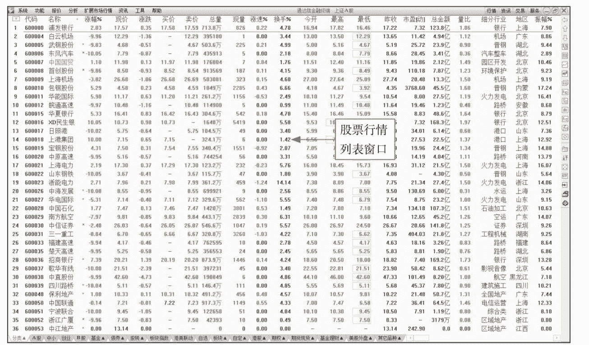

图 1-5 行情列表窗口

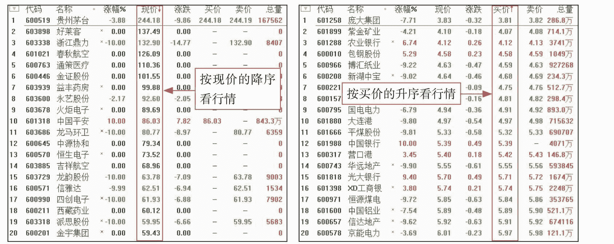

图 1-6 对行情列表进行降序和升序排列

默认情况下，点击表头名称后，系统会自动按降序排列股票行情，再次点击表头名称即可切换到升序排列。

### 1.2.2 窗口项目的切换技巧

在行情列表窗口下方，系统根据股票的所属类型将其归到不同的选项中，如 A 股、中小企业股、创业板块股、B 股等，点击对应的选项卡即可切换到相应类别的股票行情列表窗口中，图 1-7 所示为中小企业股的行情列表窗口。

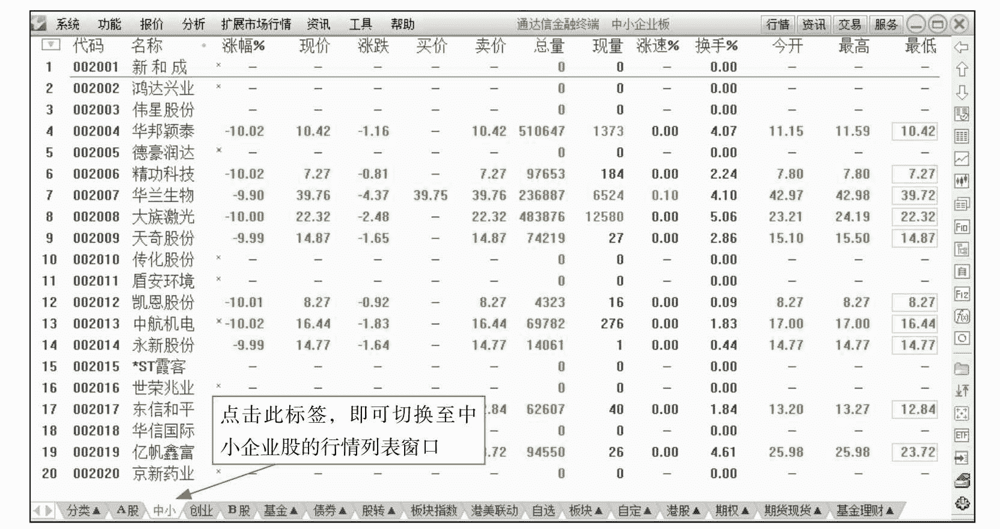

图 1-7 查看中小企业股的行情

如果项目对应选项卡右侧有一个三角形，则说明该项目下包括其他子项目，点击相应标签，在弹出的菜单中选择对应的选项即可切换到相应的股票行情列表窗口，如图 1-8 所示。

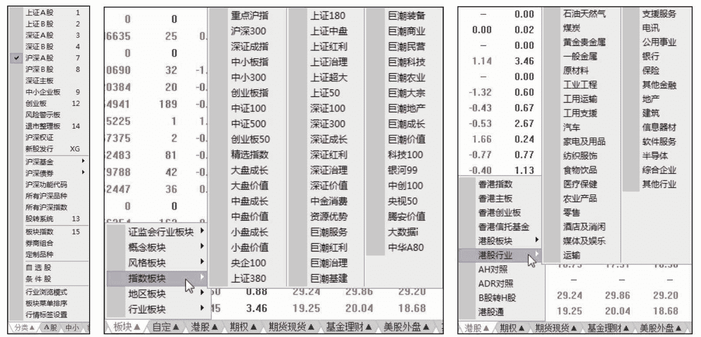

图 1-8 项目子菜单

### 1.2.3 走势图窗口的使用方法

在行情列表窗口中，使用鼠标左键双击某只股票进入其走势图窗口，它是分析盘面的主要窗口之一。默认情况下，系统将显示两个窗口，分别是日 K 线图窗口和成交量窗口，图 1-9 所示为神州高铁（000008）的日 K 线窗口和成交量窗口。

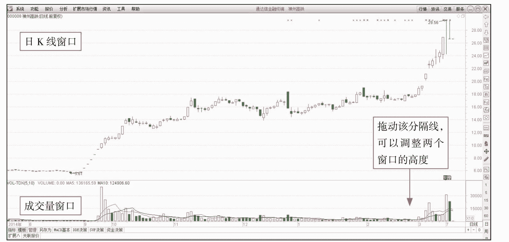

图 1-9 神州高铁（000008）的日 K 线窗口和成交量窗口

对于日 K 线图窗口，用户可以根据需要更改其显示周期，方法是：在日 K 线窗口中点击鼠标右键，在弹出的快捷菜单中选择“分析周期”选项，在弹出的子菜单中选择对应的选项更改 K 线显示周期，图 1-10 所示为神州高铁（000008）的周 K 线窗口和成交量窗口。

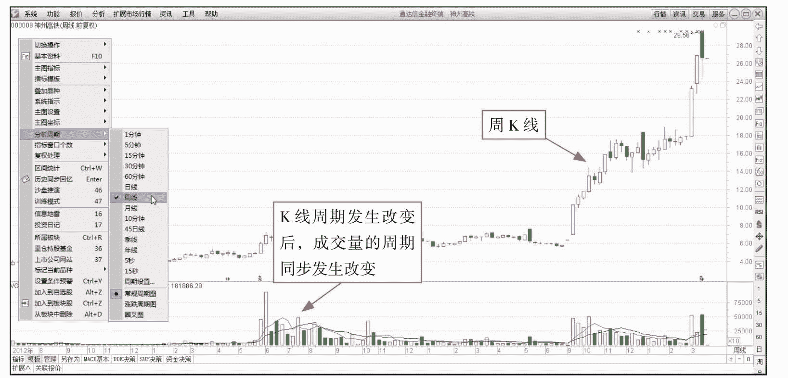

图 1-10 神州高铁（000008）的周 K 线窗口和成交量窗口

专家提醒

K 线是对股市过往情况的记载，股市中的酸甜苦辣、涨涨跌跌都会凝聚成阴阳交错的 K 线。它直观、立体感强、携带信息量大，能充分显示股价趋势的强弱、买卖双方力量平衡的变化。

阳线和阴线都是一个周期内价格的变化表现，因此 K 线与周期是密切相关的。而这个周期可以是任意的，可以是一年，也可以是一个月、一个小时、一分钟等。炒股软件为了满足各类投资者的需要，设置了多个常用的时间周期选项，可以由投资者自由选择。例如，庄家做一只股票往往需要一年甚至两年以上的时间，如果遇上大市低迷，潜伏时间就会更长。所以，在日 K 线图上查找庄家行踪往往是一叶障目，只得片面结论；而从周 K 线图上去分析，则可以清楚地看出庄家建仓、洗盘、拉抬、出货等过程，可谓一目了然。可以说，周 K 线图是黑马的放大镜，可令黑马无处遁形。

另外，用户也可以自定义显示走势图窗口中的窗口个数，方法是：在窗口的任意位置点击鼠标右键，在弹出的快捷菜单中选择“窗口个数”选项，在弹出的子菜单中选择对应的选项更改窗口个数，图 1-11 所示为神州高铁（000008）的 3 个窗口同步显示效果。

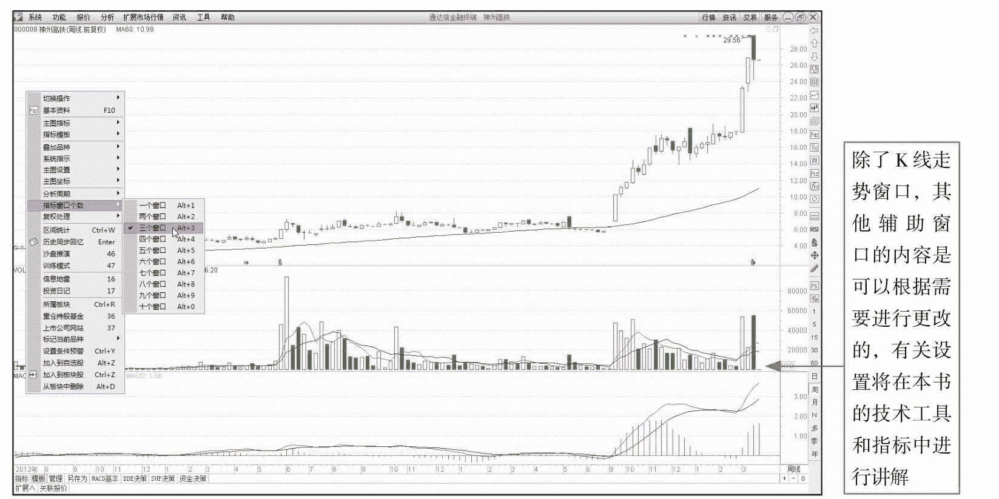

图 1-11 神州高铁（000008）多窗口显示

## 1.3 短线看盘要点

K 线窗口右侧即为盘口，该窗口透露出很多盘面信息，它直接反映了委比、委差、量比、涨幅、股本等信息，如图 1-12 所示，在短线炒股过程中具体盘口信息有非常重要的分析价值。

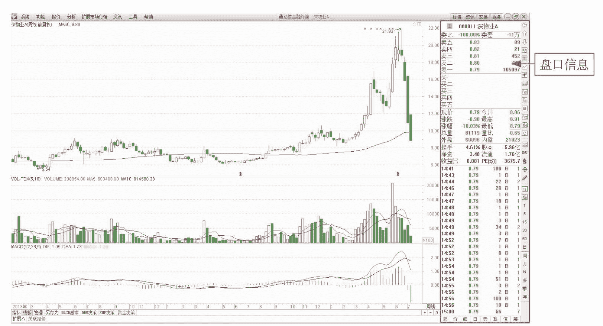

图 1-12 盘口信息

### 1.3.1 观察五档盘口情况

五档盘口包括两个基本组成部分，即卖盘和买盘，各盘包含的具体内容如下。

（1）卖盘： 包括卖一、卖二、卖三、卖四、卖五 5 个委托卖出价格，其中卖一为当前的最低审卖价格，如图 1-13 所示。

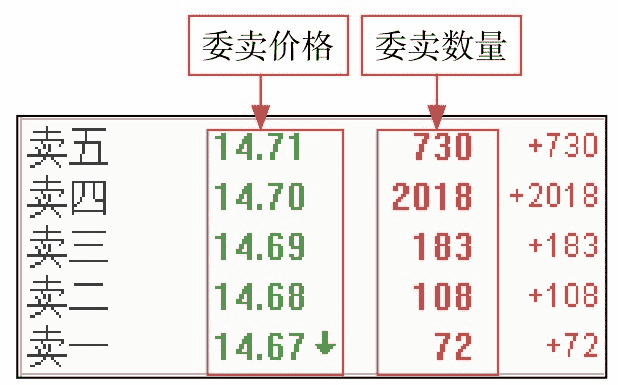

图 1-13 委卖盘口

（2）买盘： 包括买一、买二、买三、买四、买五 5 个委托买入价格，其中买一为当前的最高审买价格，如图 1-14 所示。

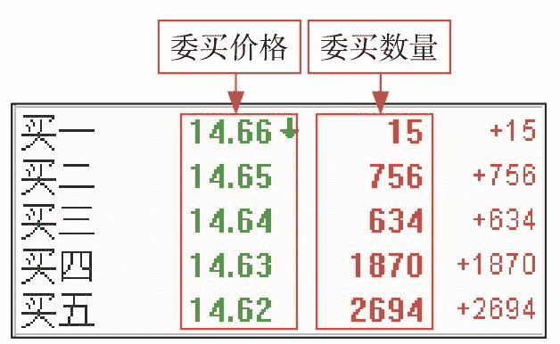

图 1-14 委买盘口

专家提醒

委买手数是指当前买盘中的 5 个委托数量的总数。

委卖手数是指当前卖盘中的 5 个委托数量的总数。

如果股票当日涨停或跌停，可以直接由委比数据反映出来。

（1）涨停板委比： 涨停板委比值为 100%，委托盘全是买盘，图 1-15 所示为 XD 民生银（600016）2015 年 7 月 7 日的涨停板委托盘。

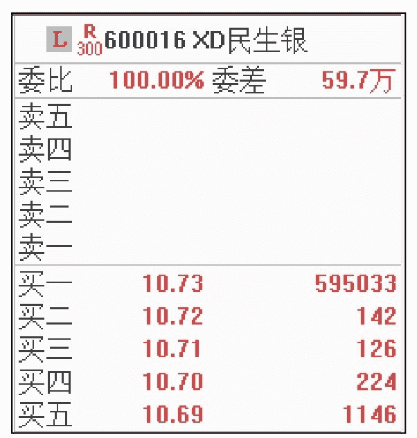

图 1-15 涨停板委托盘

（2）跌停板委比： 跌停板委比值为-100%，委托盘全是卖盘，图 1-16 所示为四川成渝（601107）2015 年 7 月 7 日的跌停板委托盘。

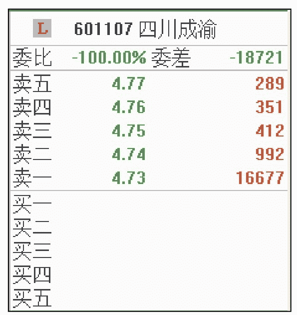

图 1-16 跌停板委托盘

委比指标指的是在报价系统之上的所有买卖单之比，是实盘操作中衡量某一时段买卖盘相对强度的指标。委比的计算公式如下：

委比＝（委买手数-委卖手数）÷（委买手数＋委卖手数）×100%

委比的取值自-100%到+100%，+100%表示全部的委托均是买盘，涨停的股票的委比一般是 100%，而跌停是-100%。委比为 0，意思是买入（托单）和卖出（压单）的数量相等，即委买∶委卖＝5∶5（比值为 10 的情况下）。

委比就是还没有交易成功，是通过系统委托显示出来的一个参考数字。成交明细是指已经交易成功的分时成交量与及成交价。成交明细显示的是一个真实数据，而委比却是一个虚假的数字，委比上的挂单是随时可以撤的。一般来说，委比指标说明了买入和卖出意愿的不平衡程度，但它并不能反映股票的活跃程度，活跃程度还是要看股票的换手率，同时需注意，委比数值是时时都在变化的。

专家提醒

委差是指委买委卖的差值，是投资者意愿的体现，一定程度上反映了价格的发展方向。委差为正，价格上升的可能性就大，反之，下降的可能性就大。之所以加上“某种程度上”，是因为其中包含了大量人为因素的干扰，比如主力制造的假象等。

### 1.3.2 观察量比指标情况

量比是指当天成交总手数与近期成交手数平均的比值，量比指标主要用于观察最近 5 个交易日成交量的活跃度。如图 1-17 所示，中集集团（000039）2015 年 7 月 7 日的量比为 0.85。

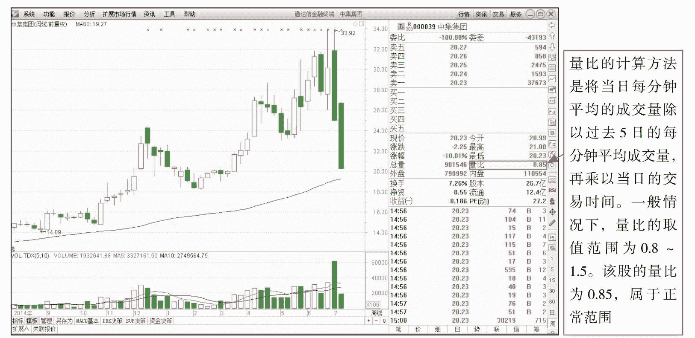

图 1-17 中集集团（000039）2015 年 7 月 7 日的量比正常

量比数值的大小表示近期此时成交量的增减，大于 1 表示此时刻成交总手数已经放大，如图 1-18 所示；小于 1 表示此时刻成交总手数萎缩。

不同的量比值反映出来的市场意义也不同，常用量比值市场意义如表 1-2 所示。量比值的大小体现了当前的盘口状态，投资者可以根据量比值的大小来确定成交量的大小以及买卖盘口的时机。

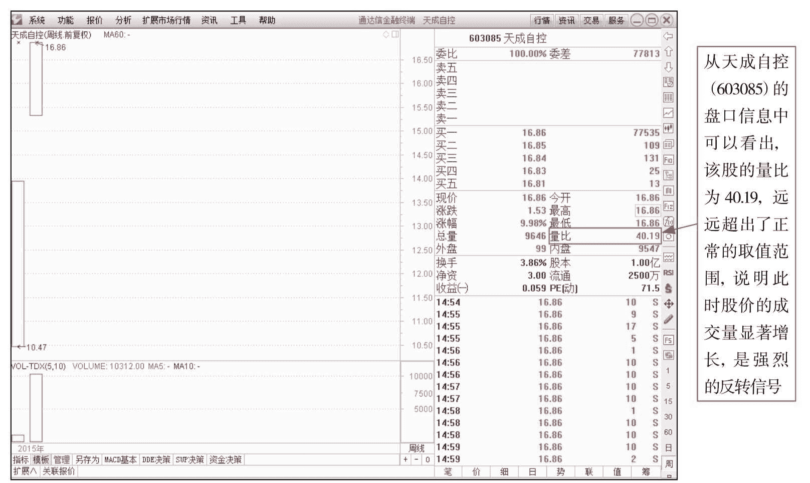

图 1-18 天成自控（603085）的量比值异常

表 1-2 量比值的市场意义

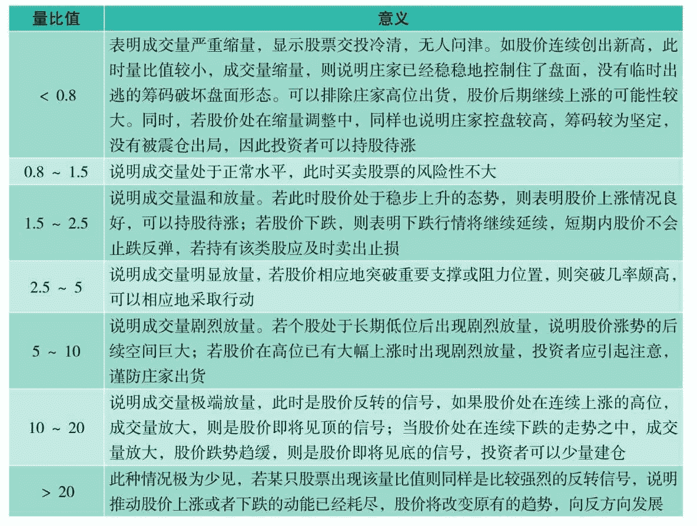

既然量比值的不同可以反映股票的交投热度和市场的冷热程度，那么投资者就可以通过量比值来筛选出当前交投较为活跃、成交量能高的个股，从而进行买入操作来获取丰厚的利润。

下面举例分析通过量比值筛选个股的方法。

步骤 1 如图 1-19 所示，应用交易软件中的量比排名设置为由高到底排序，此时可剔除掉量比过高的个股。经过设置按高低顺序排序后，系统将 2015 年 6 月 3 日当天的股票按量比高低排序，从图中可以看出，量比排名前 4 名的个股量比值都达到 10 以上，甚至都超过了 20，达到天量的水平。

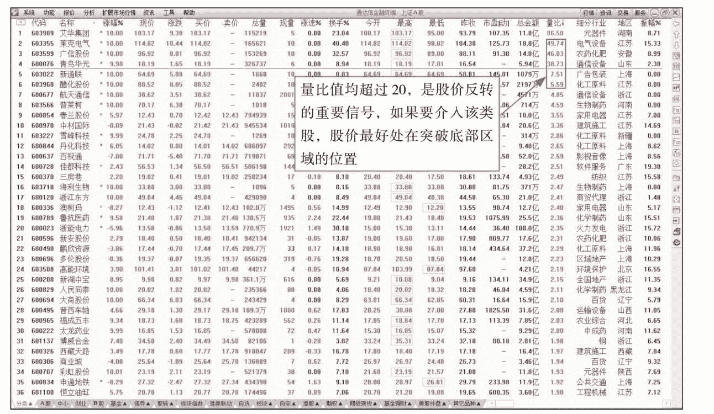

图 1-19 量比排名

步骤 2 分别查看前 4 名股票的 K 线图，观察期股价处于什么位置。以艾华集团（603989）为例，如图 1-20 所示。从图中可以发现，该股属于新上市不久的个股，股价遭遇疯狂炒作，走势极不稳定，后市不明朗，技术不娴熟的投资者不宜参与操作该类股。

步骤 3 把量比排名的上限定为 10 以下，在此基础上继续进行观察。图 1-21 所示为华东电脑（600850）的走势图，从图中可以看出，股价从 46.20 元低位开始拉升，股价多次连续收出阳线，表现十分强势，至 2015 年 6 月 2 日，股价见顶 99.95 元。到 3 日当天，股价跳空下跌，走出一根阴线，量比值达 1.58，成交量温和放量，这是股价反转下跌的信号，即使不下跌，也是一波凶狠的洗盘。因此，不建议在此时介入该股，应待后市明朗后，再考虑进行操作。

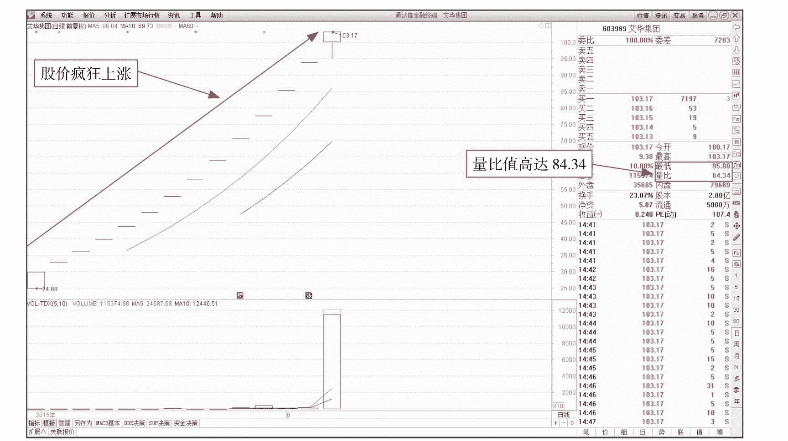

图 1-20 艾华集团（603989）走势图

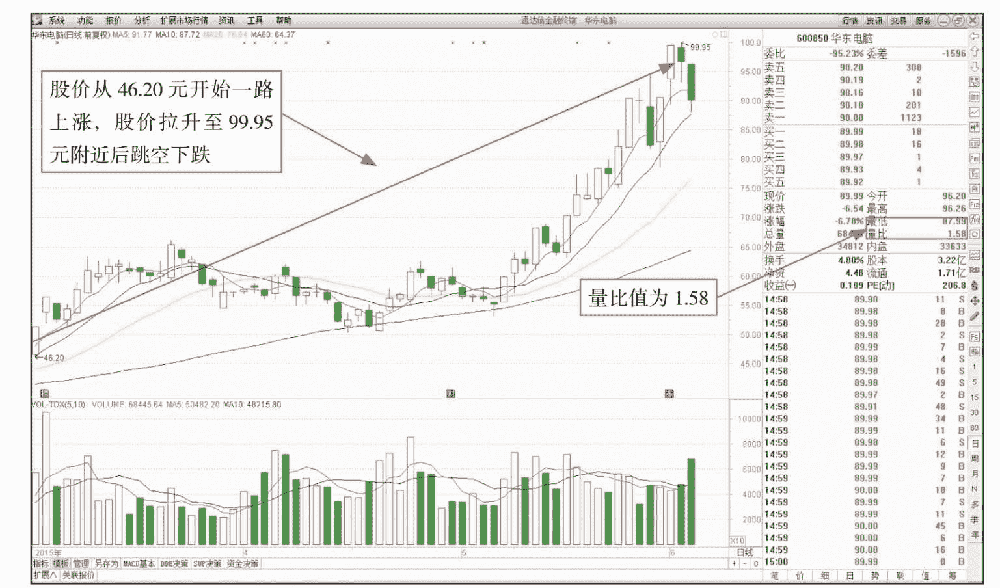

图 1-21 华东电脑（600850）走势图

### 1.3.3 观察内外盘情况

打开个股走势图，在窗口的右边会显示个股的外盘和内盘情况，如图 1-22 所示。投资者可以通过对比外盘和内盘的数量大小及比例，从中发现当前行情是主动性的买盘多还是主动性的卖盘多，这是一个较有效的短线指标。

（1）外盘。外盘就是股票的买家以卖家的卖出价买入而成交，成交价为申卖价，说明买盘比较积极。当成交价在卖出价时，将成交数量加入外盘累计数量中，当外盘累计数量比内盘累计数量大很多时，表示很多人在抢盘买入股票，这时股价有上涨趋势。外盘是以卖方卖出价成交的交易，卖出量统计加入外盘。

（2）内盘。内盘就是股票在买入价成交，成交价为申买价，说明抛盘比较踊跃。当成交价在买入价时，将现手数量加入内盘累计数量中，当内盘累计数量比外盘累计数量大很多且股价下跌时，表示很多人在强抛卖出股票。

“外盘”和“内盘”相加为成交量，分析时卖方成交的委托纳入“外盘”，如“外盘”很大，则意味着多数卖的价位都有人来接，显示买势强劲；而以买方成交的纳入“内盘”，如“内盘”过大，则意味着大多数的买入价都有人愿意卖，显示卖方力量较大；如内外盘大体相当，则买卖双方力量相当。

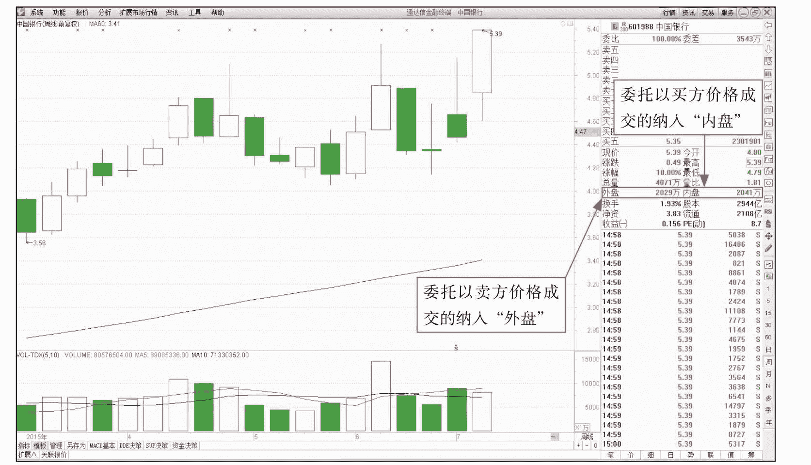

图 1-22 内盘外盘

投资者在使用外盘和内盘时，要注意结合股价在低位、中位和高位的成交情况及该股的总成交量进行观察，如表 1-3 所示。因为外盘、内盘的数量并不是在所有时间都有效，许多时候外盘大，股价并不一定上涨；内盘大，股价也并不一定下跌。

表 1-3 据股价位置分析外盘内盘

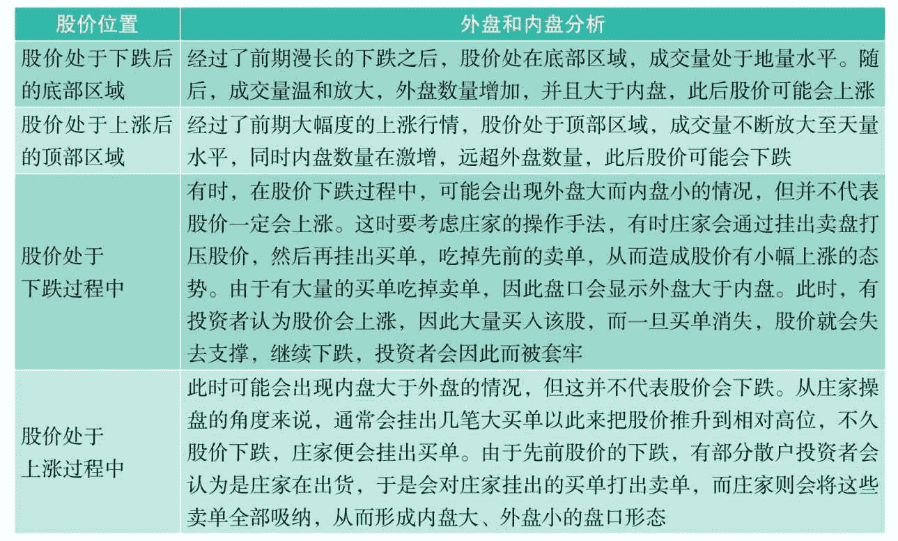

下面举例分析内盘和外盘。

步骤 1 图 1-23 所示为中国人寿（601628）2015 年 7 月 7 日的分时走势图。从图中可以看到，对于某些涨停盘而言，当日内盘远大于外盘，如果此时股价后市上涨的决心相当坚定，投资者就不能仅凭内盘大于外盘就判断该股走势欠佳。

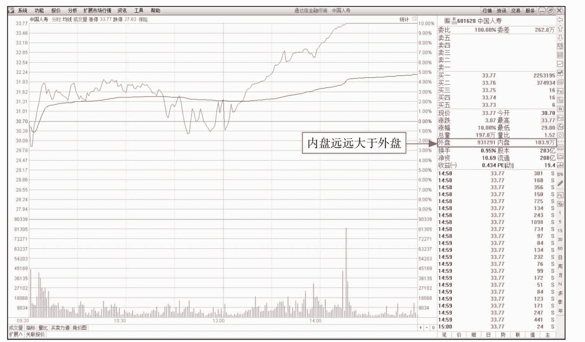

图 1-23 中国人寿（601628）走势图

专家提醒

现手是指某一股票的即时成交量。股市最小交易量是 1 手，为 100 股，一只股票最近的一笔成交量叫现手。

例如，如果 A 下单 5 元买 100 股，B 下单 5.01 元卖 300 股，当然不会成交。5 元就是买入价，5.01 就是卖出价。

此时，有 C 下单 5.01 元买 200 股，于是 B 的股票中就有 200 股卖给 C 了（还有 100 股没有卖出去），这时候，成交价是 5.01 元，现手就是 2 手（即 200 股），显示 2，显示的颜色是红色。

如果 D 下单 5 元卖 200 股，于是 A 和 D 就成交了，这时候成交价是 5 元，由于 A 只买 100 股，所以成交了 100 股，现手是 1，颜色是绿色。

因此，主动去适应卖方的价格而成交的就是红色，叫外盘。主动迎合买方的价格而成交的就是绿色，叫内盘。

步骤 2 图 1-24 所示为江苏阳光（600220）2015 年 7 月 7 日的走势图。从图中可以看到，对于某些跌停盘而言，当日外盘远大于内盘，如果此时股价后市下跌的趋势比较强，投资者也不能仅凭外盘大于内盘就判断该股走势强劲。

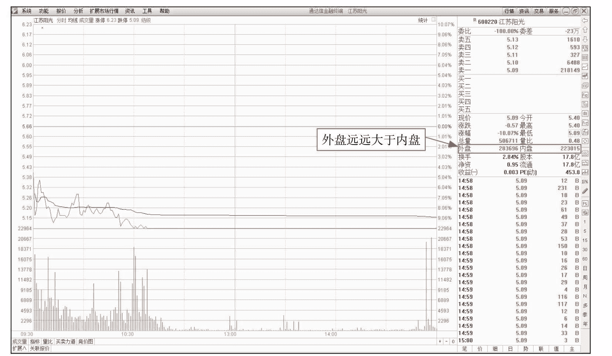

图 1-24 江苏阳光（600220）走势图

### 1.3.4 观察涨幅榜情况

涨跌又称涨跌值，用“元”做单位表示价格变动量。涨跌是以每天的收盘价与前一天的收盘价相比较，来决定股票价格是涨还是跌。

涨跌的计算公式为：涨跌＝今日收盘价－昨日收盘价。

一般在交易台上方的公告牌上用“＋（正号）”和“－（负号）”表示涨跌，正值为涨，负值为跌，否则为持平。

涨幅就是指目前这只股票的上涨幅度。涨幅的计算公式如下：

涨幅＝（现价－上一个交易日收盘价）÷上一个交易日收盘价×100%

下面举例分析分时图中的涨跌、涨幅与振幅。

步骤 1 在五档盘口窗口下方的区域中，投资者可以直接获取当前股票的涨跌情况和涨跌幅度，其中，涨跌数据和涨幅数据为红色，则表示当前股价相对于上个交易日的收盘价上涨，如图 1-25 所示，上海普天（600680）2015 年 6 月 3 日的股价相对于 2 日的股价上涨 3.02 元，涨幅为 10.00%。

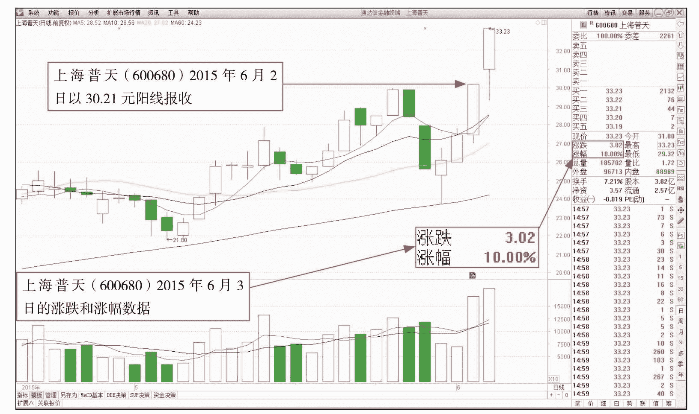

图 1-25 上海普天（600680）2015 年 6 月 3 日股价上涨

步骤 2 如果涨跌数据和涨幅数据为绿色，则表示当前股价相对于上个交易日的收盘价下跌，如图 1-26 所示，柯利达（603828）2015 年 6 月 3 日的股价相对于 2 日的股价下跌 6.32 元，跌幅为-10.00%。

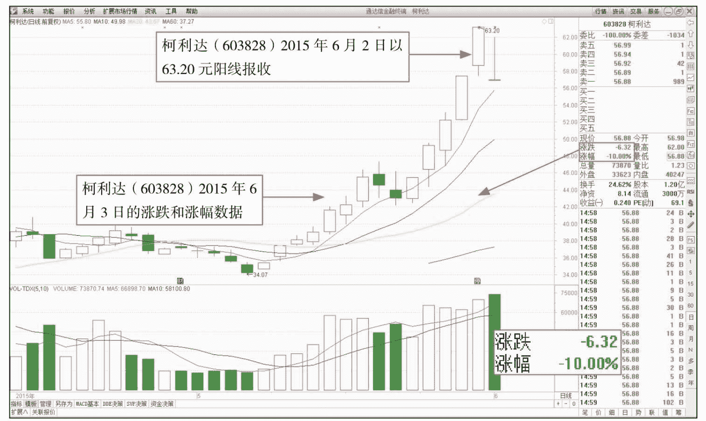

图 1-26 柯利达（603828）2015 年 6 月 3 日股价下跌

步骤 3 如果涨幅为 0，则表示今天股价没涨没跌，价格和前一个交易日持平。图 1-27 所示为捷成股份（300182）2015 年 6 月 3 日的走势图，从图中可以看到，现价为 68.50 元，上一个交易日收盘价为 68.50 元，因此，涨幅为：（68.50 元－68.50 元）÷68.50 元×100%＝0.00%。

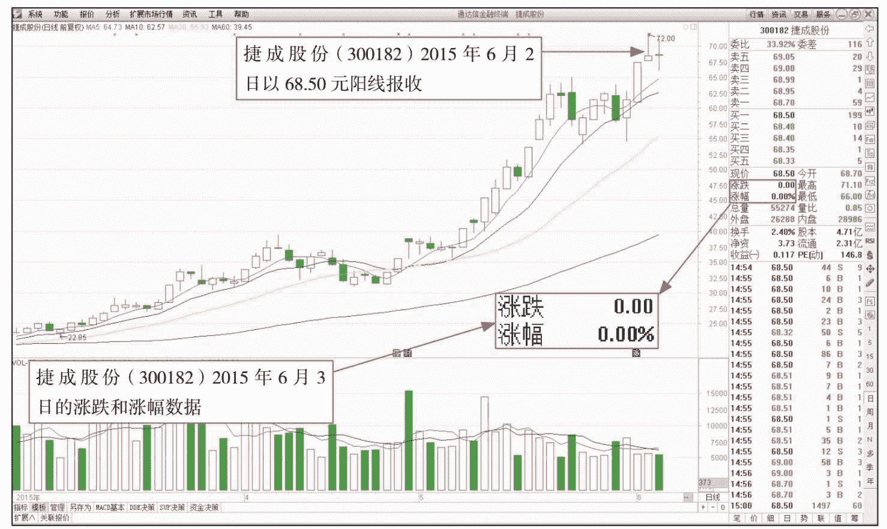

图 1-27 捷成股份（300182）2015 年 6 月 3 日股价涨跌为 0

步骤 4 股票振幅就是股票开盘后的当日最高价和最低价之间差的绝对值与前日收盘价的百分比，它在一定程度上反映了股票的活跃程度。如图 1-28 所示，万好万家（600576）2015 年 6 月 2 日的收盘价是 71.61 元，3 日最高上涨到 75.50 元，最低到过 65.03 元，那么日振幅为：（75.50－65.03）÷ 71.61×100%＝14.62%。周振幅分析、月振幅分析以此类推。

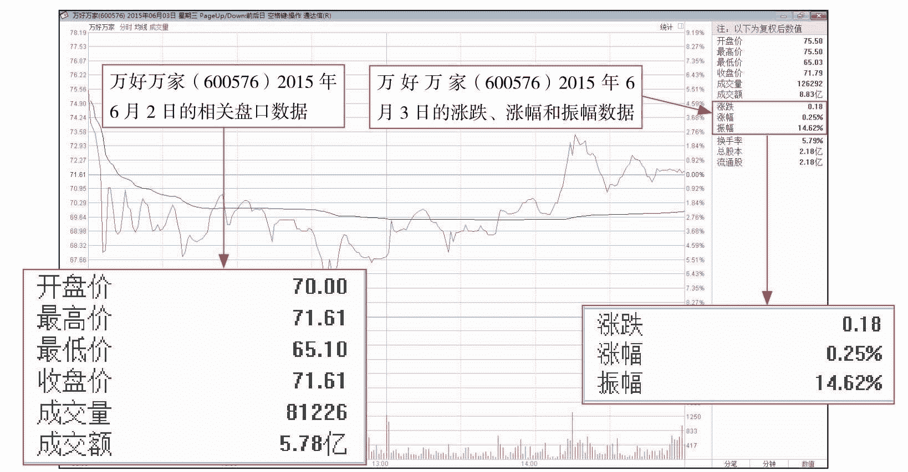

图 1-28 万好万家（600576）的分时图

专家提醒

股票振幅的数据分析对考察股票有较大的帮助，是反映市场活跃程度的指标。个股振幅越大，说明主力资金介入的程度就越深，反之，就越小。但也不能一概而论，要结合具体的股票价格波动区间进行分析。如果在相对历史低位出现振幅较大的市场现象，说明有主力资金在介入；反之，在相对历史高位出现上述现象，通常预示有机构主力资金在出逃。

### 1.3.5 观察换手率情况

挖掘领涨板块首先要做的就是挖掘热门板块，判断是否属于热门股的有效指标之一便是换手率。换手率也称周转率，指在一定时间内市场中股票转手买卖的频率，是反映股票流通性强弱的重要指标之一。换手率高，意味着近期有大量资金进入该股，流通性良好，股性趋于活跃。

换手率的计算方式如下：

换手率＝成交股数÷流通股数×100%

例如，某只股票在一个月内成交了 5000 万股，该股票的总流通股数为 50000 万股，则该股票的换手率就为 10%。

下面举例分析换手率中的信息。

步骤 1 图 1-29 所示为世茂股份（600019）2015 年 7 月 7 日的分时走势图，该股当日的换手率为 2.31%，在 3%之下，属于正常情况下的换手率。一般情况下，除了新上市的股票以外，个股的换手率均在 3%以下。

专家提醒

一般情况下，大多数股票的每日换手率在 1%～25%（不包括初上市的股票）。70%的股票换手率基本在 3%以下，3%就成为一种分界。

●当一只股票的换手率在 3%～7%之间时，该股进入相对活跃状态。

●当一只股票的换手率在 7%～10%之间时，则为强势股的出现，股价处于高度活跃当中。

●当一只股票的换手率在 10%～15%，属于机构密切操作个股。

●当一只股票的换手率超过 15%且持续多日的话，此股成为黑马的可能性很大。

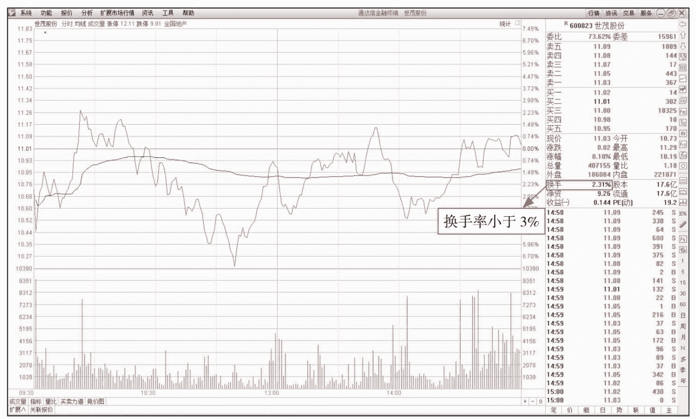

图 1-29 世茂股份（600019）分时走势图

步骤 2 新股刚上市，必然会成为市场炒作的热点，往往都会有一波不错的涨幅，经常出现连续涨停的行情，换手率自然也会很高。图 1-30 所示为派思股份（603318）2015 年 6 月 3 日的走势图，该新股从发行价 9.39 元一路连续以一字线涨停，不久股价低开，当日换手率高达 34.63%，说明有大量筹码再次转手买卖，可见该股被炒作的热度之高。换手率排行榜是大资金进场运作与否的重要标志，只有大资金进场推动，股价才有可能大幅上升，这是最起码的常识。

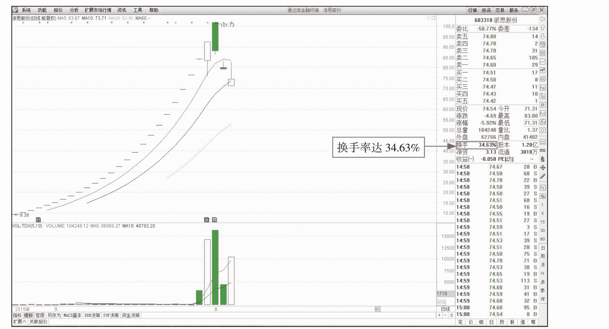

图 1-30 派思股份（603318）走势图

步骤 3 除了要观察出现高换手率时股价所处的位置，即股价最好处于突破底部的区域外，还要观察出现高换手率持续的时间。如果当日出现高换手率，全天成交量都保持在较高水平，并且维持频繁换手的状态，则说明此时的股价上涨会更加可靠。图 1-31 所示为国海证券（000750）2014 年 12 月 5 日的分时走势图，该股当天股价稳步上涨，换手率高达 14.87%，并且成交量持续放量，在早盘和尾盘尤为突出，而盘中则有所萎缩。

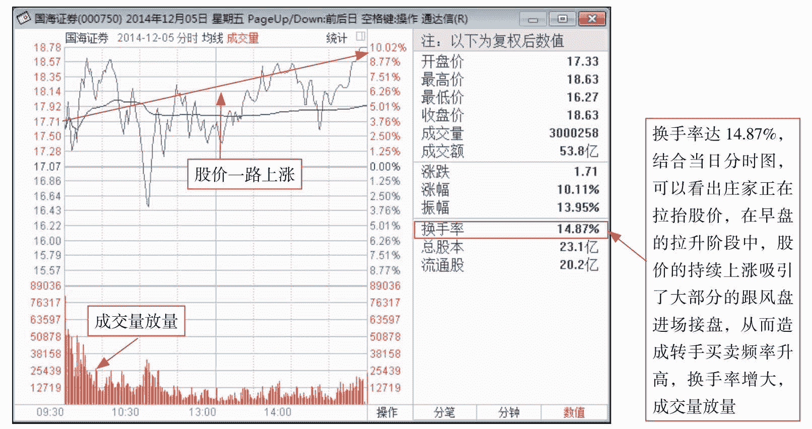

图 1-31 国海证券（000750）分时走势图

步骤 3 图 1-32 所示为深物业 A（000011）的 K 线走势图，该股股价从 2015 年 2 月份开始缓缓拉升，3 月 27 日走出一根中阳线，当日换手率放大，成交量持续放量，此后股价更加强势地上涨，一直涨至 16.32 元的高点。

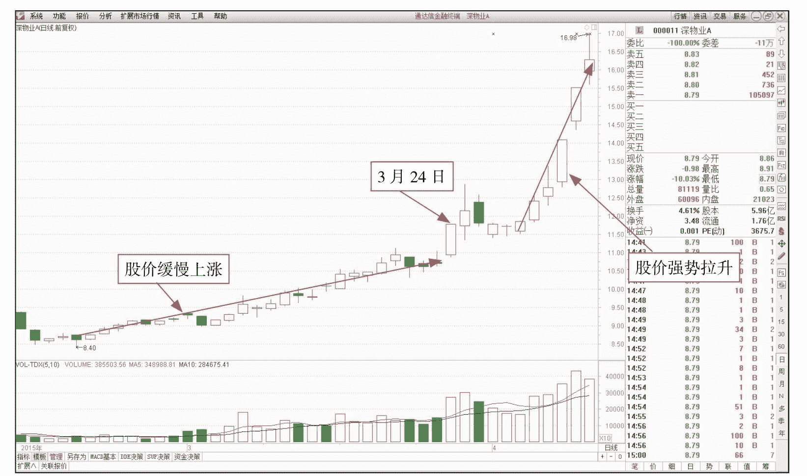

图 1-32 深物业 A（000011）K 线走势图

专家提醒

我国的股票分为可在二级市场流通的社会公众股和不可在二级市场流通的国家股和法人股两个部分，一般只对可流通部分的股票计算换手率，以更真实和准确地反映出股票的流动性。观察换手率的主要作用如下。

（1）发掘热门股。换手率越高的股票，说明其交易越活跃，人们购买该股的意愿越高，属于热门股；反之，股票的换手率越低，则表明该股票少有人关注，属于冷门股。

（2）体现变现能力的强弱。换手率高一般意味着股票流通性好，进出市场比较容易，不会出现想买买不到，想卖卖不出的情况，具有较强的变现能力。值得重点注意的是，换手率越高的股票，往往也是短线资金追逐的对象，投机性较强，股价起伏较大，风险也比较大。

（3）判断股价走势。将换手率与股价走势相结合，可以对未来的股价做出一定的预测和判断。某只股票的换手率突然上升，成交量放大，可能意味着投资者在大量买进，股价可能会随时上扬。如果某只股票持续上涨了一个时期后，换手率又迅速上升，则可能意味着一些获利盘的回吐需求，股价可能会下跌。

# 第二章 手机短线操盘实战技法

学前提示

目前已进入移动时代，人人皆有手机，手机就是电脑，就是炒股利器，本章主要以手机同花顺为例，重点讲解运用手机 APP 进行短线操盘和炒股的技巧，同时也适用于平板电脑、iPad 等智能移动设备，帮助短线投资者随时随地掌控股票投资，实现资金的快速增值。

要点展示

手机短线操盘技巧

手机短线炒股技巧

## 2.1 手机短线操盘技巧

有数据显示，中国的股民中有 90%的人无法经常到证券营业厅看行情并进行交易，电话委托交易的费用较高还时常占线。而且电话委托和网上交易终端的固定性决定了不能随时随地进行交易，手提电脑又不能老带着，手机炒股克服了以上种种不足，这也是其受青睐的主要原因。本节将以同花顺 APP 为例，介绍使用手机操盘的相关方法和技巧，帮助短线投资者随时掌握股市行情变化。

### 2.1.1 使用手机观察股指的走向

使用手机观察股指走向的具体操作方法如下。

步骤 1 打开同花顺手机交易软件，登录主界面，点击“大盘指数”按钮，如图 2-1 所示。

图 2-1 同花顺手机交易软件主界面

步骤 2 执行操作后，进入“市场行情”界面，显示国内外的常用指数，如上证指数、深证成指、创业板指、沪深 300、中小板指、恒生指数、日经指数、道琼斯、纳斯达克等，如图 2-2 所示。

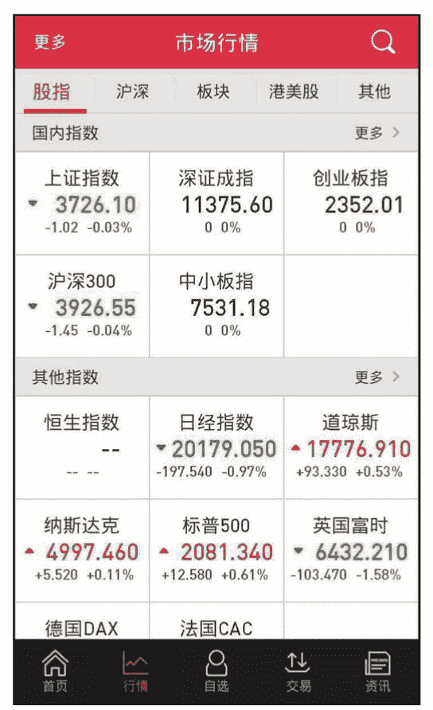

图 2-2 “市场行情”界面

步骤 3 选择某种大盘指数后，点击进入其分时走势页面，如图 2-3 所示。

步骤 4 在分时图上可点击显示与移动光标，并以浮动框显示光标时间点的分时数据信息，如图 2-4 所示。

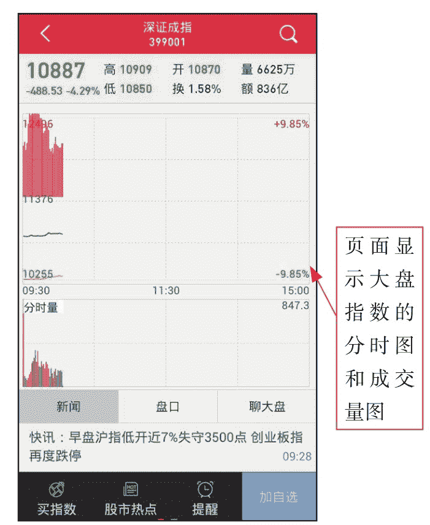

图 2-3 大盘分时页面

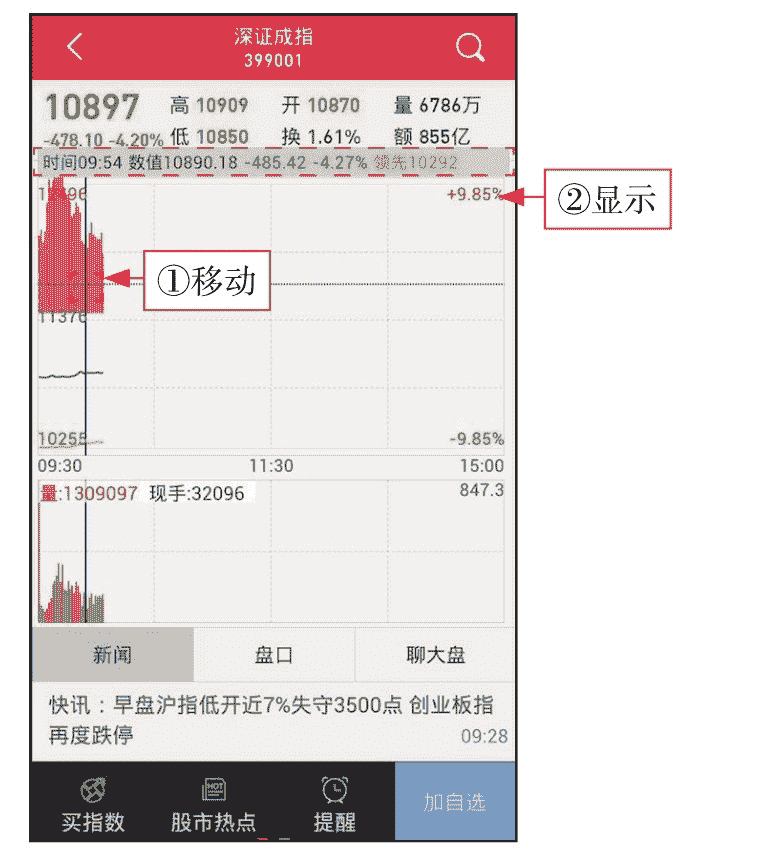

图 2-4 显示相关信息

步骤 5 用户也可以结合 K 线图走势进行分析，以提高预测准确度。按住屏幕向右翻动，即可进入大盘 K 线图页面，如图 2-5 所示。

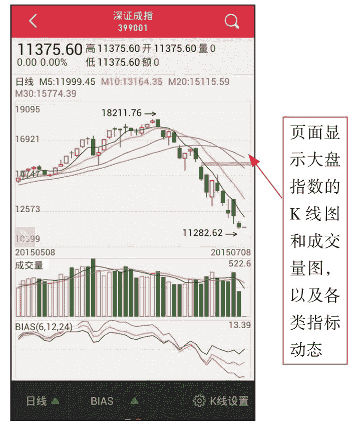

图 2-5 大盘 K 线图页面

步骤 6 在 K 线图上点击显示光标，可以查看光标时间点的相关数据信息，如图 2-6 所示。

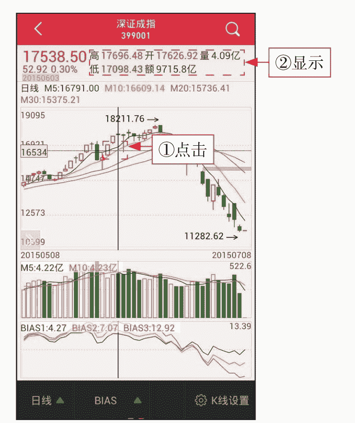

图 2-6 显示相关信息

步骤 7 点击右下角的“日线”按钮，在弹出的菜单中可以选择 K 线周期，如图 2-7 所示。

步骤 8 点击下方的指标名称，在弹出的菜单中可以选择 K 线图的辅助指标，如图 2-8 所示。

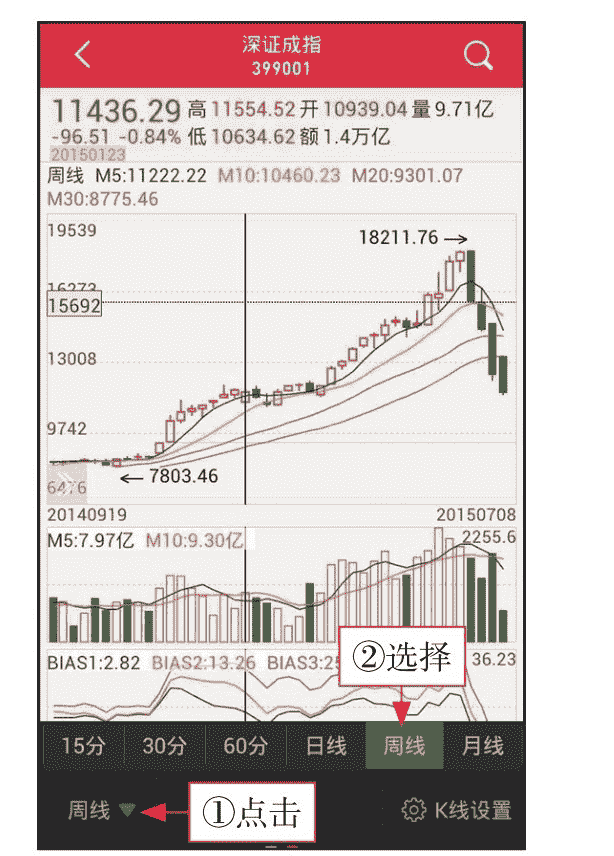

图 2-7 设置 K 线周期

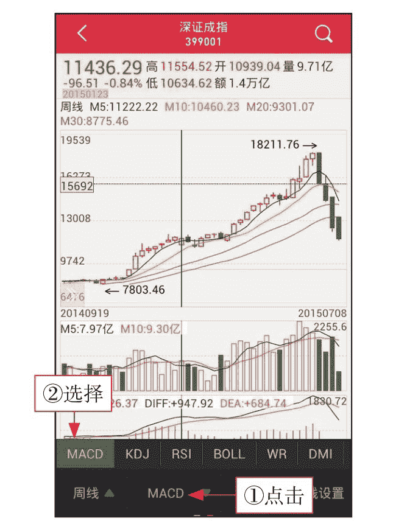

图 2-8 设置辅助指标

专家提醒

同花顺手机炒股票软件的行情交易速度快、数据全、支持券商多，其主要功能如下。

●全面的市场行情：权证、沪深行情、基金、实时港股、美股、全球股指、期货、外汇等，及时提供专业证券资讯，还能看热度和评论。

●行情数据快，在线交易安全：行情数据实时快速刷新，安全快速在线委托交易；海量专业资讯及时更新，让投资者的投资决策、下单买卖先人一步。

●更多的券商支持，可以模拟炒股：同花顺手机炒股软件支持全国 90%的券商，支持多品种券商行情查询；另外，新进用户可以免费获得 20 万元模拟炒股资金，快速学会炒股要点。

●免费的特色服务：智能选股、股价预警、主力买卖、成交统计、MACD、问财选股、云参数选股等特色服务免费使用，多平台云同步，随时掌握自选股信息。

### 2.1.2 通过涨跌排名看市场人气

通过手机炒股 APP 中的涨跌排名看市场人气的具体操作方法如下。

步骤 1 在同花顺主界面点击“涨跌排名”按钮，如图 2-9 所示。

图 2-9 点击“涨跌排名”按钮

步骤 2 执行操作后，进入“市场行情”界面，默认显示“沪深”模块的涨幅榜，如图 2-10 所示。

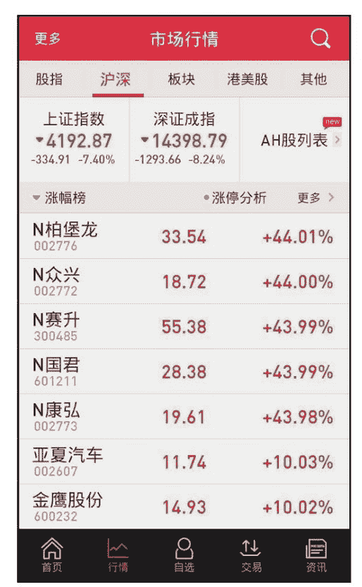

图 2-10 “市场行情”界面

步骤 3 点击顶部的不同标签，用户可以切换查看股指、沪深、板块、港美股以及其他市场行情，图 2-11 所示为板块的市场行情。

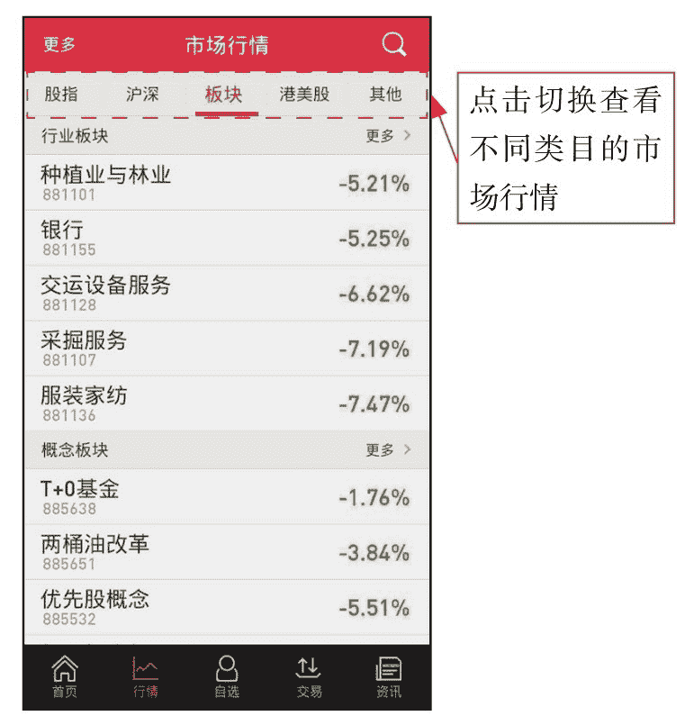

图 2-11 板块的市场行情

步骤 4 在“沪深”模块中，向上滑动屏幕，还可以查看沪深股票的跌幅版、快速涨幅榜、量比排行榜、成交额排行榜等数据，如图 2-12 所示。

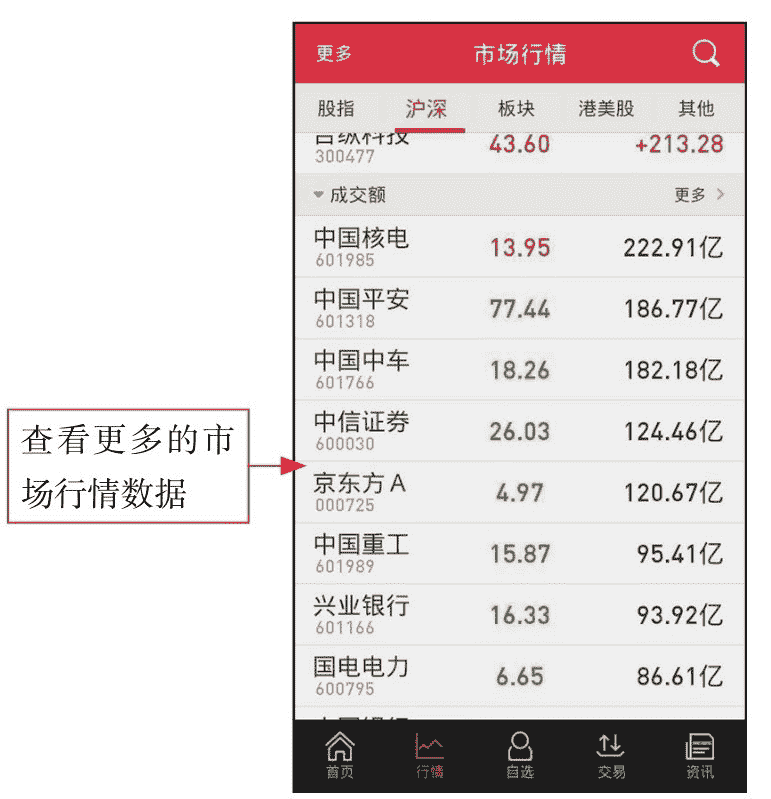

图 2-12 成交额排行榜

步骤 5 点击“更多”按钮，可以查看更多股票的涨跌幅信息，如图 2-13 所示。

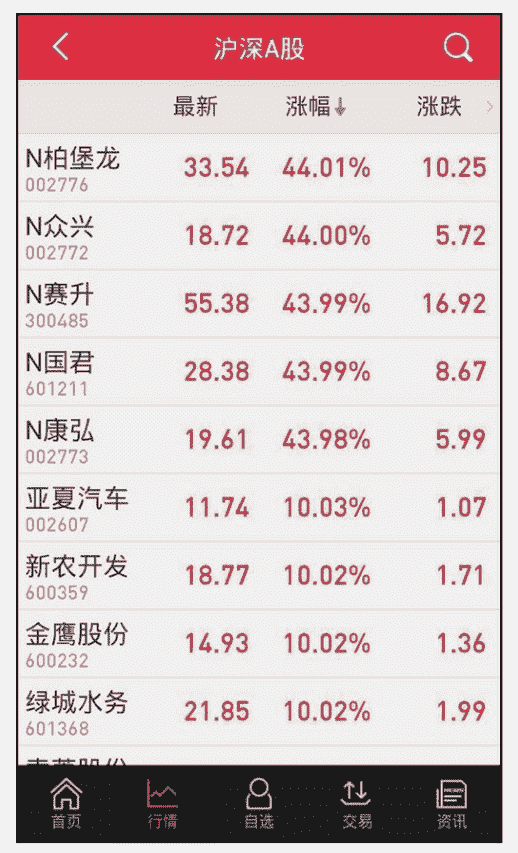

图 2-13 更多股票的涨跌幅信息

步骤 6 点击“涨幅”或“涨跌”标签，可以切换至查看相应的升序或降序排列方式，图 2-14 所示为“涨跌”的降序排列。

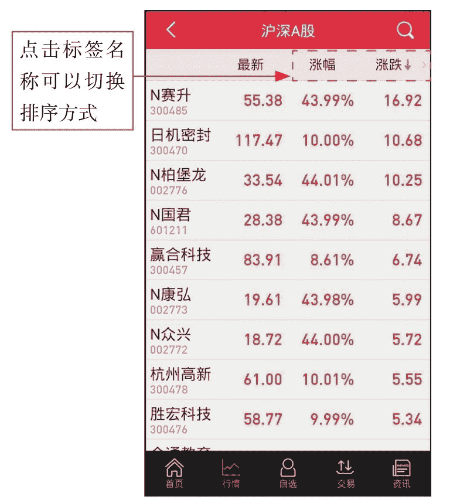

图 2-14 “涨跌”的降序排列

步骤 7 在数据区域左右滑动屏幕，还可以切换查看涨速、总手、换手、量比、现手、市盈（动）、市净率、振幅、金额、总市值、流通市值等排行数据，如图 2-15 所示。

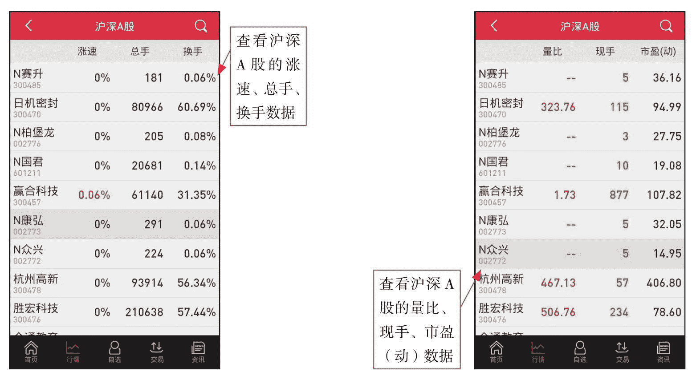

图 2-15（1） 涨速、总手、换手、量比、现手、市盈（动）的详细数据

图 2-15（2） 市净率、振幅、金额、总市值、流通市值的详细数据

步骤 8 返回“市场行情”界面，点击“AH 股列表”按钮进入其界面，可以查看 AH 股的涨幅和溢价率，如图 2-16 所示。

图 2-16 “AH 股列表”界面

步骤 9 返回“市场行情”界面，点击“港美股”按钮进入其界面，可以查看港股（主板、创业板）和美股（热点中概股、热点美股、中概股涨幅榜、中概股跌幅版）的相关行情，如图 2-17 所示。

图 2-17 “港美股”模块

步骤 10 返回“市场行情”界面，点击“其他”按钮进入其界面，可以查看现货市场、全球市场、基金、个股、债券的相关行情，如图 2-18 所示。

图 2-18 “其他”模块

步骤 11 点击其中任何一个按钮，都会显示出按钮所代表的市场，如点击“沪深国债（放贷宝）”按钮，将显示沪深国债的理财产品，如图 2-19 所示。

图 2-19 沪深国债

步骤 12 如点击“天津贵金属”按钮，将显示相关的市场报价，如图 2-20 所示。

图 2-20 天津贵金属市场

### 2.1.3 使用手机查看个股行情

通过手机炒股 APP 查看个股行情的具体操作方法如下。

步骤 1 在同花顺主界面点击右上角的搜索按钮，如图 2-21 所示。

图 2-21 点击搜索按钮

步骤 2 执行操作后，进入“股票搜索”界面，在搜索框中输入相应的股票代码或名称，如永艺股份的股票代码“603600”，如图 2-22 所示。

图 2-22 “股票搜索”界面

专家提醒

股票代码是沪深两地证券交易所给上市股票分配的数字代码。这类代码涵盖所有在交易所挂牌交易的证券，熟悉这类代码有助于增加投资者对交易品种的理解。

（1）上交代码。 上海证券交易所上市的证券通常采用 6 位数编制方法，前 3 位数为区别证券品种，例如 600000 浦发银行、600004 白云机场等。

（2）深交代码。 深圳证券市场的证券代码由原来的 4 位数统一升为 6 位数，例如 0696 ST 联益、0896 豫能控股等。

另外，S 开头表示未进行股改；ST 开头表示连续两年股东收益为负；\*ST 开头表示有退市风险；XD 开头表示该股票今天除息。

步骤 3 输入完成后，系统会自动切换至永艺股份的分时走势图界面，如图 2-23 所示。

步骤 4 点击下方的“分时量”图表，可以在“分时量”“量比”“净量”“金额”等图表中切换，如图 2-24 所示。

图 2-23 切换至分时走势图界面

图 2-24 切换副图指标

步骤 5 点击右侧的“五档”“明细”等标签，可以切换查看相应的盘口数据等，如图 2-25 所示。

图 2-25 切换查看盘口数据

步骤 6 按住屏幕向右翻动，即可进入 K 线图页面，如图 2-26 所示。

图 2-26 K 线图页面

步骤 7 点击“日线”按钮，在弹出的菜单中可以选择 15 分、30 分、60 分、日线、周线等 K 线周期，如图 2-27 所示。

图 2-27 选择 K 线周期

步骤 9 点击“K 线设置”按钮，进入“指标设置”界面，即可设置 K 线指标，如图 2-28 所示。

图 2-28 “指标设置”界面

步骤 9 点击相应的指标右侧设置图标，可以设置指标参数，如图 2-29 所示。

图 2-29 设置指标参数

步骤 10 在“指标设置”界面点击“添加指标”按钮可以添加 ASI、ARBR、DPO、TRIX、神奇电波、MACP 云参数、KDJ 云参数等指标，如图 2-30 所示。

图 2-30 添加指标

### 2.1.4 使用手机查看个股资讯

使用手机炒股软件，通常在走势图界面中就可以查看当前股票的相关新闻，具体操作方法如下。

步骤 1 在同花顺 APP 中，进入相应个股的走势图界面，点击底部的“新闻”按钮，如图 2-31 所示。

图 2-31 点击“新闻”按钮

步骤 2 向上滑动屏幕，执行操作后，即可查看最新的个股财经新闻列表，如图 2-32 所示。

图 2-32 最新的财经新闻列表

专家提醒

股市作为目前最大的投资市场，长期以来都占据着人们投资理财的重要地位。随着移动互联网技术的进步和市场的发展，如今人们开始使用手机查阅各种股票信息。新手投资者看到股市盘面后，常常会被复杂的数据与各种曲线弄得头昏脑胀。实际上，投资者可以通过手机 App 快速了解这些内容，轻松看懂各种盘口信息，进一步帮助读者更准确地找到股价的运行方向。

同花顺手机炒股软件的最大特点就是操作非常简便、用户使用体验优秀，同时具备非常强大的行情资讯功能，在移动互联网时代，帮助手机用户掌握主力和机构动态以便在股市中获利。

步骤 3 点击相应新闻标题，即可查看具体内容，如图 2-33 所示。

图 2-33 个股新闻内容

步骤 4 点击内容页中的相关链接，即可查看相应内容，如图 2-34 所示。

图 2-34 相关链接内容

### 2.1.5 手机看个股盘面的技巧

使用手机炒股软件查看个股盘口动态信息的具体操作方法如下。

步骤 1 在个股分时图界面，点击底部的“盘口”按钮，如图 2-35 所示。

图 2-35 点击“盘口”按钮

步骤 2 向上滑动屏幕，执行操作后，即可查看个股所属板块、今日资金流向和盘口数据，如图 2-36 所示。

图 2-36 “盘口”界面

### 2.1.6 使用手机分析基本面

使用同花顺手机炒股软件，用户不但可以快速评价个股，还可以及时查看个股的公告、简况、财务以及研报等基本信息，具体操作方法如下。

步骤 1 进入个股分时图界面，点击底部的“论股”按钮，如图 2-37 所示。

图 2-37 点击“论股”按钮

步骤 2 向上滑动屏幕，即可查看其他投资者对该股的评论，如图 2-38 所示。

图 2-38 “论股”界面

步骤 3 向上滑动屏幕，在下方的文本框中输入评论内容，如图 2-39 所示。

图 2-39 输入评论内容

步骤 4 点击“发送”按钮，即可发表评论，如图 2-40 所示。

图 2-40 发表评论

步骤 5 切换至“公告”界面，可以查看该股的相关公告，如图 2-41 所示。

图 2-41 查看个股公告

步骤 6 切换至“简况”界面，可以查看该股的主要指标、概念题材以及公司资料等基本信息，如图 2-42 所示。

图 2-42 简化界面

步骤 7 点击相应区域右侧的按钮，即可查看相关详情，如图 2-43 所示。

图 2-43 查看相关详情

步骤 8 切换至“财务”界面，即可查看个股的财务状况，如图 2-44 所示。

图 2-44 个股的财务状况

步骤 9 点击主要指标区域右侧的按钮，即可查看个股指标的最新详情，如图 2-45 所示。

图 2-45 主要指标详情

步骤 10 点击底部菜单栏中的“年报”按钮，即可查看上一年的年报数据，如图 2-46 所示。用户还可以查看中报、一季报、三季报等。

图 2-46 查看年报数据

步骤 11 切换至“研报”界面，即可查看个股的研报信息列表，如图 2-47 所示。

图 2-47 研报信息

步骤 12 点击相应的研报标题，即可查看资讯正文，如图 2-48 所示。

图 2-48 查看资讯正文

### 2.1.7 手机一键添加自选股

手机炒股看行情成为了热门趋势，投资者无需再时时守在电脑旁边，即可做好股票交易。那么，自选股即投资者自己关注的股票应该如何添加到手机软件中去呢？下面介绍使用同花顺手机炒股软件添加自选股的具体操作方法。

步骤 1 打开同花顺手机交易软件，登录主界面，点击“涨跌排名”按钮，如图 2-49 所示。

图 2-49 点击“涨跌排名”按钮

步骤 2 进入“市场行情”界面，选择感兴趣的股票点击打开，如图 2-50 所示。

图 2-50 选择感兴趣的股票

专家提醒

自选股，顾名思义，就是自己选择的股票，即把自己看好的股票加入到自己选定的自选股股行中，用时可以看多个股票。在每个交易软件里都有“自选股”项目，将自己选择的股票代码输入后，该股票的各种数据由软件自动生成，这样用户就不用再在其他地方分散找，调阅起来很方便。

步骤 3 执行操作后，即可打开股票走势界面，点击右下角的“加自选”按钮，如图 2-51 所示。

步骤 4 执行操作后，即可将当期选择的股票加入自选股，如图 2-52 所示。

步骤 5 或者直接点击“自选”界面右上角的搜索图标，如图 2-53 所示。

步骤 6 在搜索框中输入自己关注的股票代码和名称，点击左侧的“＋”号加入自选股，如图 2-54 所示。

图 2-51 点击“加自选”按钮

图 2-52 添加自选股

图 2-53 点击搜索图标

图 2-54 点击“＋”号

## 2.2 手机短线炒股技巧

同花顺 APP 还具有多窗看盘、股票开户、快速下单、模拟炒股、股票预警、手机诊股、问财选股等短线炒股的实用功能，本节将分别进行介绍。

### 2.2.1 对比分析多个走势窗口

同花顺手机炒股软件具有综合分析功能，用户可以在手机上打开多个分析窗口进行对比，综合查看股票行情，具体操作方法如下。

步骤 1 在同花顺 APP 中，进入相应个股的走势图界面，点击底部的“计算机应用”按钮，如图 2-55 所示。

图 2-55 点击相应按钮

步骤 2 执行操作后，弹出一个小窗口，显示与该股（真视通）相关的行业板块（计算机应用）的分时走势图和成交量信息，如图 2-56 所示。

图 2-56 行业板块窗口

专家提醒

手机炒股软件除了券商自主研发设计的还有第三方提供的，在市面上流行的手机炒股软件也有很多种，如最早和证券商合作的同花顺手机炒股软件。在选择手机炒股软件的时候，需要注意以下 3 个方面。

●方便：操作方便，上手快，是选择手机炒股软件不可忽视的一个因素。看盘要方便，K 线图要清楚及时，还有就是能不能直接做交易等。

●速度：反应速度快，及时了解大盘的走势。

●安全：安全问题往往是交易者使用交易平台时的一个关注点。

步骤 3 点击“沪”按钮，切换至“上证指数”窗口，显示上证指数的分时走势图和成交量信息，用户可以对比查看个股与上证指数的走势，如图 2-57 所示。

图 2-57 “上证指数”窗口

步骤 4 点击“深”按钮，切换至“深证成指”窗口，显示深证成指的分时走势图和成交量信息，用户可以对比查看个股与深证成指的走势，如图 2-58 所示。

图 2-58 “深证成指”窗口

步骤 5 点击“创”按钮，切换至“创业板指”窗口，显示创业板指数的分时走势图和成交量信息，用户可以对比查看个股与创业板指的走势，如图 2-59 所示。

图 2-59 “创业板指”窗口

步骤 6 点击创业板指的走势图，可以放大显示走势详情，如图 2-60 所示。

图 2-60 放大显示走势详情

### 2.2.2 使用手机进行股票开户

使用同花顺手机炒股软件开户的具体操作方法如下。

步骤 1 切换至“首页”的第二页，点击“股票开户”按钮，如图 2-61 所示。

图 2-61 点击“股票开户”按钮

步骤 2 选择相应的券商，点击“立即开户”按钮，如图 2-62 所示。

图 2-62 点击“立即开户”按钮

步骤 3 提示用户下载专用开户 APP，点击“确定”按钮，如图 2-63 所示。

图 2-63 点击“确定”按钮

步骤 4 下载完成后，点击“安装”按钮，如图 2-64 所示。

图 2-64 点击“安装”按钮

步骤 5 安装完成后直接点打开，稍后进入主界面，继续选择需要开户的证券商，如图 2-65 所示。

图 2-65 “同花顺股票开户”主界面

步骤 6 进入“手机验证”界面，输入自己的手机号码，点击“获取验证码”，接收到短信后将验证码输入验证码框内，点击“下一步”按钮，如图 2-66 所示。

图 2-66 “手机验证”界面

步骤 7 进入“上传身份照片”界面，根据提示添加相应照片，点击“下一步”按钮，如图 2-67 所示。

图 2-67 上传身份照片

步骤 8 之后系统会自动识别个人信息并补全，确认无误后，点击“下一步”按钮，如图 2-68 所示。

图 2-68 核对并完善资料

步骤 9 进入“选择营业部”界面，系统会自动选择营业部，点击“下一步”按钮即可，如图 2-69 所示。

图 2-69 选择营业部

步骤 10 进入“20 秒视频见证”界面，点击“开始检测”按钮，如图 2-70 所示。之后，证券商客服人员将通过视频对用户进行身份确认，验证过程中客服会进行逐一提示，用户只需要按照要求回答相关问题即可，验证完成后请按要求进行操作（安装证书、银行卡信息填写、回答问卷），然后等待券商审核之后即可获得券商资金帐号。

图 2-70 点击“开始检测”按钮

专家提醒

同花顺股票开户的流程非常简单，3～5 分钟即可完成，包括上传身份证信息、视频见证、风险测评等。用户需要准备的资料有：本人身份证原件、一张银行卡，另外手机需要通过 3G、4G 或 Wi-Fi 访问互联网，以保证视频见证的通畅。

已经开过户的客户，可以先使用同花顺股票开户 APP 选择相应的券商办理转户手续，之后需要在交易时间到现在的营业部去办理相应转户手续。

### 2.2.3 使用手机进行交易买卖

使用同花顺手机炒股软件下单的具体操作方法如下。

步骤 1 进入个股分时走势图界面，点击底部的“下单”→“买入”命令，如图 2-71 所示。

图 2-71 点击“买入”命令

步骤 2 执行操作后，进入“A 股交易”界面，点击“券商设置”按钮，添加开户券商，如图 2-72 所示。

图 2-72 选择相应开户券商

步骤 3 设置开户券商后，输入交易账号和密码，点击“登录”按钮，如图 2-73 所示。

图 2-73 点击“登录”按钮

步骤 4 设置买入数量后点击“买入”按钮即可下单，如图 2-74 所示。

图 2-74 点击“买入”按钮

### 2.2.4 模拟炒股增加短线经验

使用同花顺手机炒股软件模拟炒股的具体操作方法如下。

步骤 1 进入同花顺 APP 首页，切换至第二页功能区，点击“模拟炒股”按钮，如图 2-75 所示。

图 2-75 点击“模拟炒股”按钮

步骤 2 执行操作后，进入“模拟交易”界面，用户可以直接进行模拟买入、卖出、撤单、持仓、查询等操作，还可以订阅 T 策略、参加模拟炒股大赛以及查看股票交易规则详解，如图 2-76 所示。

图 2-76 “模拟交易”界面

专家提醒

炒股就是买卖股票，靠做股票生意而牟利，买了股票其实就是买了企业的所有权。模拟炒股就是根据股票的交易规则，基于一种虚拟的平台，实现股票买卖的一种炒股手段。同花顺 APP 的模拟炒股系统是一种利用移动互联网技术，根据股市实盘交易规则设计的模拟仿真操作的系统，股票投资者通过模拟炒股系统可以进行系统的锻炼或学习操盘技术。

步骤 3 点击“买入”按钮，进入“买入”界面，点击“股票名称”文本框，如图 2-77 所示。

步骤 4 执行操作后，输入相应的股票代码，并点击右下角的“确定”按钮，如图 2-78 所示。

图 2-77 点击“股票名称”文本框

图 2-78 输入相应的股票代码

步骤 5 执行操作后，即可添加股票名称，并设置相应的买入数量，然后点击“买入”按钮，如图 2-79 所示。

图 2-79 点击“买入”按钮

步骤 6 执行操作后，弹出“买入委托”对话框，显示用户买入股票的相关信息，确认无误后点击“确认买入”按钮，如图 2-80 所示。

图 2-80 点击“确认买入”按钮

步骤 7 弹出“系统信息”对话框，点击“确定”按钮，如图 2-81 所示。

图 2-81 点击“确定”按钮

步骤 8 切换至“查询”界面，点击“当日成交”选项，如图 2-82 所示。

图 2-82 点击“当日成交”选项钮

步骤 9 进入“当日成交”界面，显示了用户的当日成交明细，如图 2-83 所示。

图 2-83 “当日成交”界面

步骤 10 切换至“卖出”界面，设置相应的股票名称、价格和数量后，点击“卖出”按钮，即可委托卖出所持有的股票，如图 2-84 所示。

图 2-84 “卖出”界面

步骤 11 切换至“持仓”界面，显示了用户的人民币账户（美元账户、港币账户）的总资产、总盈亏、总市值、可取资金、可用资金等数据，如图 2-85 所示。

图 2-85 “持仓”界面

步骤 12 切换至“撤单”界面，此处显示了用户已提交的买入或卖出委托单，如图 2-86 所示。

图 2-86 “撤单”界面

步骤 13 点击要撤销的委托单，弹出“撤单信息”对话框，如图 2-87 所示。

图 2-87 弹出“撤单信息”对话框

步骤 14 确认无误后点击“确定”按钮，弹出“系统信息”对话框，点击“确定”按钮，如图 2-88 所示。

图 2-88 点击“确定”按钮

步骤 15 执行操作后，即可撤单，如图 2-89 所示。

图 2-89 完成撤单操作

步骤 16 在“模拟交易”界面点击“T 策略”选项进入其界面，用户可以在此筛选相应的投资高手进行跟踪，如图 2-90 所示。

图 2-90 “T 策略”界面

步骤 15 点击“看持仓”按钮，即可查看其持仓详情，如图 2-91 所示。

图 2-91 查看持仓详情

步骤 16 在“模拟交易”界面点击“模拟炒股大赛”选项进入其界面，用户参加各类模拟炒股大赛，不但可以提高实盘经验，还有机会获得大奖，如图 2-92 所示。

图 2-92 “模拟炒股大赛”界面

### 2.2.5 做好短线炒股价格预警

股票预警是用来在交易时间帮助投资者在瞬息万变的股市上监控股票价格变动的情况。投资者可以通过手机 APP 自己定义价格涨跌、幅度甚至是高手买卖等一系列的预警条件。

股票预警有如下意义。

投资者无需每天守在电脑前盯着盘面而耽误处理其他事情。

外出或者开会以及遇到一些特殊事情时，投资者可第一时间知道股票的涨跌情况以及买卖点。

投资者不会因为时间不够等原因耽误操盘。

满足投资者心理预期—自己的股票终于涨到了某个价位。

使用同花顺手机炒股软件设置个股价格预警的具体操作方法如下。

步骤 1 在个股分时图界面，点击底部的“提醒”按钮，如图 2-93 所示。

图 2-93 点击“提醒”按钮

步骤 2 执行操作后，弹出相应菜单，点击“预警”选项，如图 2-94 所示。

图 2-94 点击“预警”选项

步骤 3 进入“添加预警”界面，同花顺提供了“程序预警”和“短信预警”两种方式。例如，选择“程序预警”选项，在下方的“预警条件”选项区中设置相应的条件，如图 2-95 所示。点击“完成”按钮，即可完成预警设置。

步骤 4 另外，用户也可以在“提醒”菜单中点击“笔记”选项，进入“股市笔记”界面，添加相应的笔记，记录自己的感悟、选股心得等点点滴滴，并可添加定时提醒，如图 2-96 所示。

图 2-95 “添加预警”界面

图 2-96 “股市笔记”界面

投资者设定一只股票的涨跌预警价格或幅度后，当股价运行到预警价位或幅度时，用户将自动收到提醒信息，内容通常包含股票代码、名称、预警信息等。

短信示例如下所示。

预警未达到条件：今日金龙汽车（600686）未达预警点 10，收 9.27 涨-2.11%开 9.35 高 9.45 低 9.32。【浙江同花顺】

预警达到条件：中海发展（600026）该股 14 点 48 分的股价 13.30 元，低于下破价格 13.30 元。【浙江同花顺】

专家提醒

股票预警最常用的方式有以下 3 种。

●实时的软件弹出预警消息，多种软件都提供这功能。

●股票短信预警，即实时收到预警短信，网上有免费的股票短信预警网。

●股票电话预警，即实时收到预警电话，但这种方式比较少见。

### 2.2.6 手机查看个股诊断信息

个股诊断通常从基本面、技术面、机构认同度三方面入手，为投资者关心的股票提供准确科学的诊断结果，有效测评股票内在的投资价值及市场价值。

使用同花顺手机炒股软件查看个股诊断信息的具体操作方法如下。

步骤 1 在个股分时图界面，点击底部的“诊股”按钮，如图 2-97 所示。

图 2-97 点击“诊股”按钮

步骤 2 执行操作后，进入“诊股”界面，显示该股的综合诊断评分、排名、操作建议、技术面分析、资金面分析等，如图 2-98 所示。

图 2-98 “诊股”界面

步骤 3 点击“点击展开更多”按钮，即可展开技术面分析区，如图 2-99 所示。

图 2-99 展开技术面分析区

步骤 4 点击相应的技术分析项目，即可查看该股的历史详情，如图 2-100 所示。

图 2-100 个股技术分析详情

步骤 5 向上滑动屏幕，还可以查看个股的资金面分析、消息面分析、基本面分析等内容，如图 2-101 所示。

图 2-101 其他分析项目

步骤 6 例如，点击资金面分析中的相应分析项目，即可查看该股的资金流向详情，如图 2-102 所示。

图 2-102 资金流向详情

步骤 7 点击“诊股”界面底部的“专业诊股”按钮，用户可以还购买同花顺的手机诊股工具（需要付费），获得更加专业的诊断建议，如图 2-103 所示。

图 2-103 手机诊股工具的核心功能

### 2.2.7 手机短线选股有高招

“问财选股”是同花顺旗下专业的选股问答平台，致力于为股民提供主力追踪、价值投资、技术分析等各类选股方案，该功能也被移植到手机 APP 中，帮助手机用户选出想要的股票。

使用同花顺手机炒股软件“问财选股”功能的具体操作方法如下。

步骤 1 进入同花顺 APP 首页，切换至第二页功能区，点击“问财选股”按钮，如图 2-104 所示。

图 2-104 点击“问财选股”按钮

步骤 2 执行操作后，进入“问财选股”界面，同花顺列出了一些常见的选股条件，如图 2-105 所示。

图 2-105 “问财选股”界面

专家提醒

“问财选股”涵盖基本面问句，如净利润增长大于 100%、每股收益前 10 名的股票等；消息面问句，如近期有政策优惠的股票、近一个月有股权激励的股票等；技术面问句，如 MACD 金叉、MACD 上穿零轴、KDJ 金叉等；概念类问句，如阿里巴巴概念等，旨在为客户选股全面地服务。

步骤 3 例如，点击“2015 中报高送转的股票”选项，即可自动筛选出符合该条件的 19 只股票，如图 2-106 所 示。

步骤 4 另外，用户还可设置多个条件，可以使用“消息面+技术面+基本面”，随机组合，自由搭配，例如，选择基本面中的“非亏损”选项后，系统又会重新筛选出 18 只股票，如图 2-107 所示。

图 2-106 自动筛选股票

图 2-107 根据条件筛选股票

步骤 5 点击“回测”按钮，可以用来快速测试自己的选股策略，马上得出最大成功率和最大预期年化收益，测试的数据最早至 2008 年，如图 2-108 所示。

图 2-108 回测功能

步骤 6 点击“背景介绍”按钮，可以查看相应选股条件的具体含义，如图 2-109 所示。

图 2-109 背景介绍

# 第三章 短线看盘选股实战技法

学前提示

每个投资者都想在茫茫股海中选到一只赚钱的好股票。其实挑选好股并没有想象得那么难，只要掌握一定的技巧，赚钱的好股便会手到擒来。本章介绍了诸多短线看盘选股的技巧，投资者掌握了这些技巧，并在实践中加以灵活运用，定会获益匪浅。

要点展示

基本面短线选股技巧

心理面短线选股技巧

市场面短线选股技巧

技术面短线选股技巧

## 3.1 基本面短线选股技巧

股价常因一些特定经济指标、经济政策、全球经济形势、国内外突发事件等基本面宏观因素的起伏而变化，对这些因素的分析是判断股市当前行情以及选择好股票的主要依据。

基本面包含外交和政治、金融和经济、汇率和利率、国情和人气、社会需求和市场供给、经济周期和股市趋势、管理机构和上市公司、行业前景和产品结构、董事长和管理层、老与新和大与小、企业成长性和市场占有率、负债率和利润率、资源结构和市场容量等。要想全部了解和熟悉绝非易事，短线投资者只有在平常边操作边学习，才能使得资本和学识、经验同步增长。

### 3.1.1 选择经济政策股

经济政策是国家为了增进社会经济福利、改进国民经济状况、达到一定的政策目标而有计划地运用政策工具制定的解决经济问题的指导原则和措施。

要做好一件事情，尤其是关系到自己生存和发展的大事，一定要遵守国家政策。股市基本分析方法无论有多少种，作为中小投资者都要首先学会根据政策来选股。

步骤 1 2015 年 1 月 13 日，财政部发挥财政政策引导作用，创造有利于新能源汽车发展的政策环境，推动新能源汽车产业加速发展，如图 3-1 所示。

图 3-1 新能源汽车概念股

步骤 2 受此影响，华电能源（600726）全年净利预增 7 至 11 倍，开盘瞬间涨停，如图 3-2 所示。

图 3-2 华电能源（600726）分时图

步骤 3 后市分析：从华电能源的 K 线图分析，公司业绩向好，未来或可持续增长，该股股价后市有望继续走强，如图 3-3 所示。

图 3-3 华电能源（600726）K 线图

随着国家经济形势的不断变化发展，国家的经济政策自然会不断地作出相应的调整。国家经济政策对股价的主要影响如图 3-4 所示。

图 3-4 国家经济政策对股价的影响

专家提醒

在通货膨胀时期，若物价涨幅过大，居民实际资产会缩水，引起市场不稳定，为控制通货膨胀，国家将推动利率上涨，市场中流动资金将减少，从而使股价下跌。

因此，短线投资者必须深刻了解国家的重大经济政策，并认真贯彻在整个股票买卖的过程中，投资才能获得成功。如果投资者能根据政策来选股，同时又花功夫通过市场调查来了解上市公司的基本面，再学会用技术分析选好买点，那就不愁在股市中赚不到大钱。

### 3.1.2 选择行业前景股

投资者在选择股票时，一定要看重两个条件：一是行业发展趋势好，在可预见的时间内能够有持续向上的景气度；看当期业绩往往容易错失牛股，因此抓行业拐点需要对行业有较高的敏感度。利用行业发展前景选股，即对上市公司的基本情况进行分析，包括公司的经营情况、管理情况、财务状况及未来发展前景等，从研究公司的内在价值入手，确定公司股票的合理价格，进而通过比较市场价位与合理定价的差别来确定是否购买该公司股票，如表 3-1 所示。

表 3-1 利用行业发展前景选股

通常人们在选则个股时，要考虑到行业因素的影响，尽量选择高成长行业的个股，而避免选择夕阳行业的个股。例如，我国的通信行业是典型的朝阳行业，通信类的上市公司在股市中备受青睐，其市场定位通常较高，往往成为股市中的“高价贵族股”，如图 3-5 所示。

图 3-5 通信设备指数走势图

### 3.1.3 选择板块龙头股

在同一板块股票整体上涨的过程中，涨幅最大、表现最活跃的股票被称为板块龙头股。龙头股对整体板块来说起着火车头的作用，往往是先板块之动而动，后板块之落而落。投资者炒作龙头股，不仅可以获得巨大的收益，还可以避免较大的风险，是短线投资的绝佳品种。龙头个股的识别，要求投资者具备丰富的实盘经验，从实践中总结出两个特征识别龙头个股，如图 3-6 所示。

图 3-6 识别龙头个股

## 3.2 心理面短线选股技巧

选股心理是短线投资者选择目标时对股票价值进行的心理预期活动。培养良好的选股心理，投资者应该注意以下几个方面：一是顺势而为，只有顺应牛市态势来选股，才能获大利，相反则可能要损失；二是组合投资，通过选择不同类型的目标股进行组合投资来把握市场机会，校正不良的选股心态。

### 3.2.1 短线炒股的心理准备

股市如战场，一个没有硝烟的战场能使投资者成为盖世英雄，同样也能使投资者伤痕累累。对于想进行短线炒股的投资者来说，首先要做好心理准备，如图 3-7 所示。

图 3-7 短线炒股的心理准备

### 3.2.2 选择具有投资价值的个股

“比价效应”（Price Comparison effect）就是指与同类型公司之间通过诸如经营业绩、流通股本、募集资金所投入项目等方面进行直观比较后，来影响二级市场中的股价最终定位。具体主要有以下几方面。

与同一地域板块间的个股比价，选择股价较低的个股，如图 3-8 所示。

与同一行业间的个股比价，选择股价较低的个股，如图 3-9 所示。

图 3-8 同一地域板块间的个股比价

图 3-9 同一行业间的个股比价

与同一炒作题材股间的个股比价，选择股价较低的个股，如图 3-10 所示。

图 3-10 同一炒作题材股间的个股比价

与相同流通股本规模的个股比价，选择股价较低的个股，如图 3-11 所示。

图 3-11 相同流通股本规模的个股比价

选择质优价低的股票进行中长线投资“比价效应”是推动证券市场不断变化的一个最主要的市场动因。例如，1999 年上市的福日电子集团，上市初总股本 25600 万股，流通盘 7000 万股，1999 年预测业绩是 0.17 元，公司主要从事电视机的生产，属于家电行业，由于在 1999 年长虹等家电类公司已经沦落为市场中的“没落贵族”，因此对于这么一个同样以家电生产为主、未来没有太大发展前景、经营业绩又比较差的公司，投资者普遍抱以嗤之以鼻的态度，上市首日股价就呈现出了一路走低的局面，两天内按开盘计算跌幅达到将近 30%。

然而，市场投资者却同时忽视了一个最为关键的因素——“比价效应”。1999 年家电类股票的股价仍基本定位在 10 元以上，当时长虹最低为 12 元，康佳最低为 15 元，厦华最低为 11 元，即使进入 ST 的熊猫和黄河也都停留在 8 元以上，平均价格达到 10 元以上，这表示当时股价才 5 元出头的福日电子集团显然价格被低估了，日后其股价在 2 个月内越过 10 元，实现翻番，如图 3-12 所示，该股的成功炒作可以说是点对面比价效应的最佳典范。

图 3-12 福日电子上市初期的价格走势

### 3.2.3 不同市场中的选股技巧

股市行情随时在变动，短线投资者应该学会在不同的市场中如何购买股票，利用各时期的特点，综合分析、实践操作。

1．在牛市中选股

“股市就是这样，牛市之后是熊市，熊市之后是牛市，是不断循环的。现在是熊市，说明牛市也不远了”。杨百万的这段话很简单地概括了牛市和熊市持续循环的特点。那么，如何在牛市中选股成了重要的问题。

在理性投资者的理念中，“在股市中比的不是谁今天赚得多，比的是谁在股市中生存的时间长”。如果比谁赚得多，股市中有太多大喜大悲的案例，有很多曾在股市中叱咤风云的人物早已消失，倒在了牛市形成之前。谁生存的时间长，就意味着谁获得市场赐予的机会多。

投资者可以关注短线选股的“三高”理论，如图 3-13 所示。

2．在熊市中选股

在熊市中选股的难度远远大于牛市，大盘在不断下跌，大部分个股的走势也逐级向下，只有极少数个股逆势上扬。虽然在熊市中选股难度很大，但也有一定的方法可循。

图 3-13 牛市选股技巧

（1）选择基本面情况发生重大变化、业绩有望突升的个股。无论是在牛市还是在熊市，这类个股都是受追捧的对象。由于基本面发生了好转，或早或晚必然会反映到股市上。当然，在选择时需要注意时机，不要等到股价已经上涨到高点时再买进。

（2）选择具有长期良好发展前景的个股。具有良好发展前景的公司是大多数人选股时追求的目标，这类公司发展前景光明、经营稳健，被许多人看好，在牛市中股价可能高高在上，业绩被提前预支。但是在熊市中可能随着大盘大幅下跌，尤其在暴跌时，便为投资者提供了一次很好的买入机会，他们可以用很低的价格得到一只优质股票。同时要注意，选择这类个股应立足于中长线，不能指望短期内获得高额利润。

（3）选择主力机构介入的个股。股市中的主力机构实力强大，不是一般的中小投资者可以比的，但是这种股票也有进出不灵活的弱点，一旦介入一只个股，就要持有较长时间，尤其是在熊市中，除非认输出局，否则就要利用每次反弹机会伺机拉升个股。中小散户只要介入时机合适，成本价在庄家之下或持平，且不贪恋过高的利润，就会有较大的获利机会。

（4）选择在熊市后期超跌的个股。在熊市后期或熊市已经持续较长时间，一些个股总体跌幅已深，综合基本分析和技术分析，下跌空间已经有限甚至已经无法再跌。即使大盘继续下跌，这批个股也会提前止跌，率先反弹。

下面举例说明在熊市中选股的方法。

步骤 1 图 3-14 所示为二六三（002467）2013 年 12 月至 2014 年 1 月期间的走势图。从图中可以看到，该股在此阶段出现了一轮下跌走势，股价从 30.59 元以上下跌到 17.98 元附近。股价整体在下跌过程中连续形成地量成交，表明市场筹码已被主力有效控制。

图 3-14 二六三（002467）走势图（1）

专家提醒

成交量连续出现地量成交，这不仅说明市场交投氛围冷清、市场人气极度低迷，还可能说明蕴藏着主力完全控盘的信息。

步骤 2 当后市股价强势上攻时，发出主力拉升信号，如图 3-15 所示。从图中可以看出，该股连续地量成交之后，主力突然强势拉升股价。下跌后期的连续地量成交已经表明主力高度控盘，之后股价强势拉升更发出主力强势做多信号，短线买入信号非常明显，投资者要积极跟随主力资金买入股票。

总结可知，熊市中重要的是关注大盘走势、了解盘中热点以及政策的转变等。投资者只选不买，为将来在牛市中选择做好准备。

图 3-15 二六三（002467）走势图（2）

## 3.3 市场面短线选股技巧

股价的巨大波动性成为股票具有较高报酬的原因之一。从市场股票的涨跌幅度可以寻找出盘面上的强势股及弱势股。一般而言，股价为市场基本面的领先指针，亦即当消息未传出市场前，股价可能已经开始反应了。所以观察股价的波动性有助于预测市场的实际变化。

因此，短线投资者一定要学会理解市场行为，做“聪明的小羊”，不要有个体恐惧效应，要有破釜沉舟的觉悟，学会根据市场面选股。

### 3.3.1 选择炒作题材股

题材是指炒作股票的借口，用来激发市场人气的工具。有些题材确有实质性内容，而有些则纯粹是空穴来风，甚至是刻意散布的谣言。另外，大部分题材对上市公司本身有多大好处不能随便确定，具体情况要具体分析。但股市的特点是只要有题材，市场就乐于挖掘和接受，而题材的真实作用反而被忽视了。

股市题材具有正反两方面的作用，在利用题材寻找最佳投资机会和选股时，操作上要注意如表 3-2 所示的问题。

表 3-2 利用市场炒作题材选股

专家提醒

长期价值投资选股，一般都要选择价格低于价值的股票，也就是通常说的“花 4 毛钱买价值一块钱的股票”。凡是这样的股票，一定是普遍不被市场看好的股票，所以才会有低价格。而短期投机炒作题材股就完全相反，一般不管什么价值和价格而主要看此股主力是否控盘、是否具有庄股的特点以及题材的想象空间是否够大，然后根据 K 线的走势，判断此股价格是在顶部出货阶段还是在底部开始拉升阶段。

### 3.3.2 选择热点事件股

热点事件就是某一特定时间内在走红的板块或股票，这些在特定时间内走红的股票，常常被当时的股民称之为“热门股”。如果投资者查看股票涨跌排行榜，就会发现在涨幅榜的前列大多是它们的身影。

下面以同花顺炒股软件为例，介绍利用市场热点选股的方法。

步骤 1 在工具栏中，点击“热点事件”按钮，如图 3-16 所示。

步骤 2 执行操作后，进入热点事件板块，如图 3-17 所示。

步骤 3 在“事件驱动”下拉列表框中，可以查看近期的股市热点事件，如图 3-18 所示。

步骤 4 点击相应事件右侧的“查看”超链接，用户可以查看事件的具体内容，如图 3-19 所示。

图 3-16 点击“热点事件”按钮

图 3-17 热点事件板块

图 3-18 “事件驱动”列表

图 3-19 查看事件的具体内容

专家提醒

中小散户投资者可以贴近市场热点选择相应股票。热点选股，趋势选时，积小利成大利，继而演变成一种稳健的盈利模式。

步骤 5 在“事件评分”窗口中，可以查看该热点事件的炒作次数、赚钱效应、大盘环境以及综合评分，如图 3-20 所示。

图 3-20 查看事件评分

专家提醒

需要注意的是，股市并没有什么恒定不变的热点，同理也没有恒定不变的强势股和弱势股。正所谓“风水轮流转”，某一时期的强势股、强势板块，在另一时期就可能变为弱势股、弱势板块，反之亦然。

因此，短线投资者应时刻保持清醒头脑，善于根据市场面的强弱变化，及时调整自己的投资策略，以便及时抓住市场新热点。

### 3.3.3 选择股本适中的股票

投资者都清楚股市离不开资金的炒作，而流通股本的大小直接影响到主力资金的选择。通常情况下，相对于大盘股，主力资金更青睐于小盘股，对于主力来说，这种类型的股票炒作所需的资金量比较少、股价较为活跃，便于操作。

下面举例说明选择股本适中的股票的方法。

步骤 1 2010 年 10 月开始的一波上涨行情使得多数股票都有不俗的表现，其中煤炭板块的表现相当抢眼。图 3-21 所示为中国神华（601088）2010 年 9 月至 11 月期间的走势图，该股的流通股本为 163 亿股，为大盘股。从图中可以看到，中国神华的上涨动力明显不足，在上涨了 30%后直接进入下跌走势。

步骤 2 图 3-22 所示为兖州煤业（600188）2010 年 9 月至 12 月期间的走势图，该股的流通股本为 3.6 亿股，为中小盘股。当行情启动初期，两只股票都出现上涨走势，但是兖州煤业因为流通盘较小且股价较为活跃，出现连续涨停走势，而且涨幅一度超过 80%，股本优势尽显。

图 3-21 中国神华（601088）走势图

图 3-22 兖州煤业（600188）走势图

## 3.4 技术面短线选股技巧

在股市中，只了解行情是站不稳的，还要有足够的技术分析判断能力。技术分析就是为了预测市场的变动趋势，可用各种常用技术指标对市场动向进行分析。技术分析的目的是为了预测市场的变动趋势，技术分析可以应用数学和逻辑上的方法，从价格、成交量和时间周期等方面进行判断，挑选出优质股。

### 3.4.1 通过 K 线走势对比发现强势股

K 线图是股票分析的基础手段，能够让投资者全面透彻地观察到市场的真正变化。从 K 线图中既可以看到行情整体的趋势，也可以了解每日股市的波动情形，是目前最为流行的股票技术分析方法。

在大牛市行情中，经常可以看到连续拉升的品种，其短期的表现异常突出，收益也相当可观。在近期市场中，此类个股更是层出不穷，其中的机会值得关注。图 3-23 所示为天健集团（000090）于 2014 年 5 月份至 2014 年初的走势。一般而言，这些短线机会都是进行追涨的操作，因此需要寻找到超强的持续上涨品种，以确保参与的个股有充足的短期获利机会，而这从 K 线上可以寻找到相应的痕迹。

图 3-23 天健集团 K 线分析

选股重在对选股时机的把握，要遵守一个重要的原则——不在下降途中抄底（因为不知何时是底）。只选择趋势确立时的股票，在趋势确立的股票中，发现走势最强、涨势最好的股票进行操作。

从 K 线上进行分析，那些持续上扬的个股一般都有两种情况：一是离历史高位较远，目前价位远远低于该股的平均市场成本，上涨阻力极小；二是股价正处于历史新高，而且技术上盘整较为充分，筹码已经被大资金掌握，急拉后快速脱离成本区域。

专家提醒

市场通常的运行规律是：如果某只股票创了新高（或近期新高），那么未来一段时间里再创新高的可能性很高；相反，如果某只股票创了新低（或近期新低），那么在一段时间里再创新低的可能性也很大。投资者需要记住一点：下降通道中的股票只会让你赔钱或输掉盈利的时间。

### 3.4.2 选择均线多头排列的股票

移动平均线（Moving Average，MA）原本的意思是移动平均，由于我们将其制作成线形，所以一般称之为移动平均线，简称均线，它是将某一段时间的收盘价之和除以该周期，如图 3-24 所示。

图 3-24 移动平均线

移动平均线常用线有 5 天、10 天、30 天、60 天、120 天和 240 天的指标。其中，5 天和 10 天的短期移动平均线是短线操作的参照指标，称作日均线指标；30 天和 60 天的是中期均线指标，称作季均线指标；120 天、240 天的是长期均线指标，称作年均线指标。

投资者选股时可以把移动平均线作为一个参考指标，移动平均线能够反映出价格趋势走向，所谓移动平均线就是把某段时间的股价加以平均，再依据这个平均值作出平均线图像。投资者可以将日 K 线图和平均线放在同一张图里分析，这样非常直观明了。

移动平均线最常用的方法就是比较证券价格移动平均线与证券自身价格的关系。当证券价格上涨，高于其移动平均线，则产生购买信号。当证券价格下跌，低于其移动平均线，则产生出售信号。之所以产生此信号，是因为人们认为移动平均线的“线”是支撑或阻挡价格的有力标准。价格应自移动平均线反弹。若未反弹而突破，那么它应继续在该方向上发展，直至其找到能够保持的新水平面。

周期较小的移动平均线在周期大的移动平均线上方，并且向上发散的均线排列就是多头排列，如图 3-25 所示。该形态说明市场短期介入的投资者的平均成本超过长期持有投资者的平均成本，市场做多气氛浓厚，股价上涨有力，投资者可以积极追涨，并由此获得短线操作的收益。

图 3-25 乐凯胶片（600135）K 线走势图

专家提醒

短期移动平均线组合主要用于分析和预测个股短期的行情变化趋势，主要组合分析方法如下。

●5 日均线为多方护盘中枢，否则上升力度有限；10 日均线是多头的重要支撑，当有效跌破该均线时，市场就可能转弱。

● 30 日均线是衡量市场短、中期趋势强弱的重要标志，当向上运行时短期做多；当向下运行时短期做空。

### 3.4.3 通过形态分析选择强势股

形态分析是技术分析领域中比较简明实用的分析方法，把股价走势中若干典型的形态作出归纳，并命名之。形态分析是通过将几天的 K 线组合扩大到几十天甚至一段时期，这些众多的 K 线就组成若干不同的轨迹形态，通过研究股价走过的这些轨迹来分析多空双方力量的对比变化，并做出相应的判断指导实际操盘。

下面介绍利用形态分析选股的方法。

步骤 1 在菜单栏中，点击“智能”→“形态选股”命令，如图 3-26 所示。

图 3-26 点击“形态选股”命令

步骤 2 执行操作后，弹出“形态选股方案”对话框，默认进入“实际形态”界面，用户可以在列表框中选择相应方案，点击“执行选股”按钮，如图 3-27 所示。

图 3-27 点击“执行选股”按钮

专家提醒

形态选股的关键是能抓取到反转或加速上扬的走势形态，包括像头肩底、W 底、矩形突破、三角形突破等传统的反转形态，当然投资者也可以根据经验，借助软件工具抓取自定义的形态模型。

步骤 3 执行操作后，弹出“选股结果”对话框，系统会自动计算出选股结果，如图 3-28 所示。

步骤 4 如果用户对选股结果不满意，可以点击“设置”按钮，弹出“形态方案设置”对话框，用户可以设置形态匹配度、形态匹配条件等选项，点击“重新选股”按钮，如图 3-29 所示，就能重新匹配出更符合要求的股票。

图 3-28 计算出选股结果

图 3-29 点击“重新选股”按钮

步骤 5 “形态选股方案”对话框中切换至“自绘形态”选项卡，点击“自绘形态”按钮，如图 3-30 所示。

图 3-30 点击“自绘形态”按钮

步骤 6 执行操作后，即可新建一个自绘形态，用户可以在右侧的图形上绘制需要的形态，如图 3-31 所示。

图 3-31 自绘形态

专家提醒

形态分析是一门重要的技术分析理论，其核心思想是利用历史相似的后期走势来预测当前股票未来的股价走势。股价的形态是对股票一切信息的合成。每一根 K 线都是由资金堆砌而成，能真实地反映公司的基本面和主力的操盘意图。如果投资者能掌握形态理论的精髓，洞察趋势反转先机，就能在这个市场上赚得盆满钵满。

步骤 7 点击“执行选股”按钮，即可计算出选股结果，如图 3-32 所示。

图 3-32 计算出选股结果

步骤 8 使用鼠标左键双击相应的股票名称，即可查看相似形态的具体走势，如图 3-33 所示。

图 3-33 查看相似形态的具体走势

步骤 9 用户也可以利用“形态预测”功能，点击“智能”→“形态预测”命令，该功能主要用于预测当前个股未来可能的走势，如图 3-34 所示。

图 3-34 形态预测

### 3.4.4 选择走上升趋势的股票

趋势线就是用图形的方式显示数据的预测趋势并用于预测分析，也叫作回归分析。运用趋势线可以在图表中扩展趋势线，即根据实际数据预测未来数据。

炒股有一个重要原则就是“顺势而为”，而不能“逆势而动”。其中，“势”就是大的方向和趋势，即股票价格市场运行的方向。通常情况下，趋势的方向有三种：上升趋势、下降趋势、水平趋势（无趋势）。

在股市中，投资者炒股只有通过低买高卖才能赚钱，所以选取具有上升趋势的个股尤为重要。也就是说，在选股的时候，要选取 K 线图形中每个后面的峰和谷都高于前面的峰和谷（即一底比一底高）的股票，如图 3-35 所示。

图 3-35 利用趋势线选股

将具有上升趋势的股票两个相连的低点依次相连，就可得出上升趋势线。通常，上升趋势线对股价起一定的支撑作用；上升趋势线一旦形成，股价将在趋势线上方运行一段时间。根据这一原理，短线投资者可选取在上升趋势线上方的个股。

# 第四章 短线分时图实战技法

学前提示

在股市中，分时图是一种特殊的语言，不同的分时图形态具有不同的市场含义。分时图背后反映的是投资者的心理变化，分时图本身所具有的意义、特性以及功能等，尤其值得短线投资者重视。

要点展示

大盘分时图和个股分时图

炒短线必用的均价线分析

超短线必杀技——分时图

## 4.1 大盘分时图和个股分时图

分时走势图又称即时走势图，是指把股票市场的交易信息适时地用曲线在坐标图上加以显示的技术图形。分时走势图是股市现场交易的即时资料。

在实战研判过程中，分时图有着重要的作用，它可以动态反映大盘和个股的实时走势。分时图分为大盘指数分时图和个股即时分时图，其中坐标的横轴是开市的时间，纵轴的上半部分是股价或指数，下半部分显示的是成交量。

### 4.1.1 大盘分时走势图

大盘指数即时分时图是指大盘指数在一天内每分钟的动态走势图，它反映了大盘指数一天内的运行情况。大盘指数即时分时图由买盘比率、卖盘比率、加权指标和不加权指标共 4 个部分组成。图 4-1 所示为 2015 年 5 月 11 日上证指数（000001）的大盘分时图。

图 4-1 上证指数（000001）的大盘分时图

加权指数：即证交所每日公布媒体常说的大盘实际指数。

不含加权指标：大盘不含加权的指标，即不考虑股票盘子的大小，而将所有股票对指数的影响看作相同而计算出来的大盘指数。

红绿柱线：在红白两条曲线附近有红绿柱状线，是反映大盘即时所有股票的买盘与卖盘在数量上的比率。红柱线的增长缩短表示上涨买盘力量的增减，绿柱线的增长缩短表示下跌卖盘力度的强弱。

黄色柱线：用来表示每一分钟的成交量，单位是手。

专家提醒

红绿柱线是股票买盘和卖盘的比率：红线柱增长，表示买盘大于卖盘，指数将逐渐上涨；红线柱缩短，表示卖盘大于买盘，指数将逐渐下跌。绿线柱增长，指数下跌量增加；绿线柱缩短，指数下跌量减少。

### 4.1.2 个股分时走势图

个股即时分时图显示的是个股每分钟价格变动的动态图，是研判个股当天走势的重要参考依据。个股即时分时图分别由成交价曲线、平均价曲线和成交量柱线共 3 部分组成。图 4-2 所示为顺发恒业（000631）2015 年 7 月 8 日的即时分时图。

图 4-2 顺发恒业（000631）即时分时图

成交价曲线：在个股分时走势图中，波动频繁的曲线是成交价曲线，又称分时线。

平均价曲线：在个股分时走势图中，比较平滑的曲线是平均价曲线，又称均价线。

成交量柱线：与大盘分时走势图相似，在个股分时走势图下方的黄色柱线代表每分钟该股的乘积手数；并且，移动鼠标光标也可以查看指定时间的成交手数，如图 4-3 所示。

图 4-3 成交量柱线

## 4.2 炒短线必用的均价线分析

与 K 线图上以每天收盘价作为统计依据的均线不同，分时图中的均价线是以盘口总成交额除以盘口总成交量的运算方式来测算当前每一股的平均成交价，十分精确地统计出当前所有参与者的综合持仓成本。因此，有了这条均价线，投资者就可以在盘面上做一些简单推理。超短线投资者往往可以根据均价线交易获得很好的收益。

### 4.2.1 辨别多方与空方市场

在股票市场或者别的证券市场上，都有多头和空头之分：所谓多头，是指投资者看好市场的走向为上涨，于是先买入，再卖出，以赚取利润或差价；所谓空头，是指投资者或投机者看到未来的走向为下降，所以就抛出手中的证券，然后再伺机买入。其中，买入的叫多头方，卖出的叫空方。短线投资者想要有稳定的获利，就必须分清多空双方的力量，而均价线就是一个不错的工具。

下面举例分析均价线中的多空阵营。

步骤 1 图 4-4 所示为飞力达（300240）2015 年 2 月 27 日的分时图，从图中可以看到，均价线稳定地向上移动，而且股价从盘整结束后开始稳定上行，而成交量伴随着股价的上行也给出了放大的走势，这就说明多方的能量已经占据明显优势，场外和场中做多的资金非常充足，因此后市将在很大程度上会延续上涨的行情，投资者可以寻找低点进场做多。

图 4-4 飞力达（300240）走势图（1）

步骤 2 图 4-5 所示为飞力达（300240）2015 年 6 月 12 日的分时图，从图中可以看到，当天股价的走势是向下的，而分时图中的分时线也是向下延伸的，股价在稳定地向下推进，说明空方的力量非常强大，股民此时应该尽快离场，已经离场的投资者应持币观望。

图 4-5 飞力达（300240）走势图（2）

专家提醒

多方想让价格上涨，就会积极地向上推升股价，此时分时线会不断上行，均价线也会不断上行，因为均价线代表了此时的平均持股成本。股价在均价线上方运行，说明多方依然控制着整个市场。

如果股价下跌，则不仅分时线会向下运行，而且代表平均持股成本的均价线也会向下移动，这就说明当前市场空方占据绝对优势。因此，投资者只要及时查看均价线的走势，便可以清楚地洞察当前的股市行情。

### 4.2.2 股价在均价线上方运行

当股价保持在均价线上方运行时，表明市场中买盘活跃，股价表现强势，市场看多，投资者可以趁机介入。

下面举例分析股价在均价线上方运行的情况。

步骤 1 图 4-6 所示为中直股份（600038）2014 年 6 月 30 日的分时图，从图中可以看到，股价不断上行，而代表平均成本的均价线由于股价的上扬也会逐渐走高，均价线对股价又有促进上涨的作用，因此股价稳定向上移动，短时间内很难发生方向逆转。

图 4-6 中直股份分时图（1）

步骤 2 图 4-7 所示为中直股份（600038）2015 年 5 月 12 日的分时图，从图中可以看到，股价稳步推升，而分时线也在震荡向上延伸，尽管股价在上升过程中偶尔出现了回调，但是回调的低点也逐渐抬高，由此可以看出，均价线对股价的上涨起到了一定的支撑和促进作用。

图 4-7 中直股份分时图（2）

由于均价线代表了平均的购买成本，均价线的不断上扬也标志着投资者购买股票的平均成本在逐步提高，因此多方必须继续向上推升股价，才能给自己带来更多的利润。由此可见，在股价上升趋势中，均价线有促进股价上涨的作用。

专家提醒

分时图对整体行情的影响比较小，所以使用分时图只是作为观察盘中即时变化的工具，所有指标都要综合起来分析，才会减少操作中的判断错误。

同时，实战中的 K 线分析必须与即时分时图分析相结合，才能真实可靠地读懂市场的语言，洞悉盘面股价变化的奥妙。K 线形态分析中的形态颈线图形以及波浪角度动量等分析的方法原则也同样适用即时动态分时走势图分析。分时图对喜欢短线操作的投资者尤为重要，是其主要的分析工具。

### 4.2.3 股价在均价线下方运行

当股价保持在均价线下方运行时，表明市场看空，卖盘比较活跃，股价表现弱势，可能继续下跌，投资者宜持币观望。

下面举例分析下跌趋势中的均价线。

步骤 1 图 4-8 所示为四川路桥（600039）2014 年 9 月 16 日的分时图，从图中可以看到，股价在稳定下跌，均价线也会向下延伸，由于均价线代表了平均持股成本，因此短时间内股价不会快速反转。

图 4-8 四川路桥（600039）分时图（1）

步骤 2 图 4-9 所示为四川路桥 2014 年 12 月 22 日的分时图，从图中可以看到，由于均价线促进股价下跌，因此股价稳定地向下移动，最终收在跌停板上。

图 4-9 四川路桥（600039）分时图（2）

### 4.2.4 股价与均价线横向运行

如果均价线处于横盘整理阶段，则代表多空双方力量均等。此时，投资者应该离场观望，待方向明朗后再作出交易决策。

下面举例分析横盘趋势中的均价线。

步骤 1 图 4-10 所示为浙江广厦（600052）2015 年 3 月 11 日的分时图，股价在尾盘前始终窄幅波动，股价围绕均价线上下运动。

图 4-10 浙江广厦（600052）分时图（1）

步骤 2 图 4-11 所示为浙江广厦（600052）2015 年 4 月 30 日的分时图，股价在开盘后快速上冲，均价线开始走平，股价波动范围也开始放缓。

图 4-11 浙江广厦（600052）分时图（2）

### 4.2.5 股价与均价线过度分离

均价线是超级短线实战的一个重要研判工具，它与分时线走势交叉错落、如影随形，临盘运用因人而异。下面介绍两种特殊走势中的均价线分析。

1．均价线远低于股价

当均价线远低于股价时，说明股价上涨过快，已经远远超过了平均的持股成本，因此会有一部分投资者获利出场，股价也常常会出现向下的回调甚至出现反转。

下面举例分析均价线远低于股价。

步骤 1 图 4-12 所示为江苏阳光（600220）2015 年 6 月 9 日的分时图，从图中可以看到，股价在开盘后几乎没遇到任何阻力就快速上行，由于涨幅过大，在图中标注的位置已经远远高出了均价线，从而开始小幅回落调整。

步骤 2 图 4-13 所示为江苏阳光（600220）2015 年 3 月 19 日的分时图，从图中可以看到，股价两次在高位开始回落，而这两次高位的共同特点就是均远远高出均价线。因此，短线投资者甚至超短线投资者可以根据均价线来选择时机卖出股票。

图 4-12 江苏阳光（600220）分时图（1）

图 4-13 江苏阳光（600220）分时图（2）

专家提醒

特别当一轮极端炒作的主升浪行将结束之时，盘口拉高的股价突然一改强势上攻个性，击穿均价线后大幅回落，此后如果均价线失而复得，得而复失，则是超短线出局信号。

2．均价线远高于股价

在股价下跌趋势中，如果下跌速度过快，出现均价线远远高于股价的情况，就说明目前股票价格被严重低估，一些激进的投资者会选择入场，因此很有可能会发生反弹的走势。对于超短线投资者来说，这也是选择进场时机的常见规律。

图 4-14 所示为重庆啤酒（600132）2015 年 5 月 21 日的分时图，从图中可以看到，股价开盘后快速下跌，在反弹的过程中受到了均价线的压制而未能成功，此后股价进入整理阶段，并在尾盘出现强劲的反弹。

图 4-14 重庆啤酒（600132）分时图

## 4.3 超短线必杀技——分时图

对于短线投资者而言，分时图也是分析股票走势的一个重要工具，它能即时把握多空力量转化和市场变化的根本，如果要利用分时图分析行情和预测走势，需要对分时图有一个全面而系统的了解。本节主要介绍早盘、中盘和尾盘的看盘方法和技巧。

### 4.3.1 早盘走势分析

根据看盘时间的不同，早盘看盘可以分为集合竞价、开盘 5 分钟、开盘半小时 3 个看盘阶段。

1．集合竞价的看盘要点

投资者在开盘时关注的数据之一就是集合竞价，这是分析开盘走势时的重要数据之一。集合竞价是指在股票每个交易日上午 9∶15～9∶25，由投资者按照自己所能接受的心理价格自由地进行买卖申请。集合竞价的撮合原则如图 4-15 所示。

图 4-15 集合竞价的撮合原则

到当天 9∶25 分以后，就可以看到各股票集合竞价的成交价格和数量。有时某种股票因买入人给出的价格低于卖出人给出的价格而不能成交，那么，9∶25 分后该股票的成交价一栏就是空的。当然，有时有的公司因为要发布消息或召开股东大会而停止交易一段时间，那么集合竞价时该公司股票的成交价一栏也是空的。

因为集合竞价是按照最大成交量的价格成交的，所以对普通投资者来说，在集合竞价时间，只要打入的股票价格高于实际的成交价格就可以成交，当然如果按涨停价买或按跌停价卖则保证优先成交。所以，散户如果希望在集合竞价时优先买到股票，通常可以把价格打得高一些，目的是获得优先成交权，因为你的成交价是较低的集合竞价。另外，散户买入股票的数量不会很大，一般不会对该股票的集合竞价价格产生什么影响。

2．开盘 5 分钟的看盘要点

我国股市 9∶30 开始开盘，因此 9∶30 以后一天的股票交易盘就正式拉开序幕。在此时间内，由于刚刚开始交易，因此一般情况下多空双方的交易并不是十分活跃，投资者一般应该多看少参与。在此段时间内，尽管交易的人数不多，但是参与资金雄厚，因此价格波动的范围相当大。

尤其是股价开盘后前 5 分钟内的分时走势，往往决定了股价当日的主基调。根据涨跌情况和股价所处位置的不同，开盘前 5 分钟的盘面分析意义也不同。

（1）根据股价所处的位置不同，开盘 5 分钟之内的盘面分析有如图 4-16 所示的两种情况。

图 4-16 根据股价所处的位置不同分析开盘 5 分钟的走势

专家提醒

如果前一天收盘后有重大消息出现，则投资者可在第二天开盘前 15 分钟内积极入场交易。因为此时受到前一天重大利空或者利多消息的影响，股价往往会在开盘后出现大幅跳水或者拉升。

（2）根据开盘 5 分钟内的股价涨跌趋势不同，可以分为如下两种情况。

开盘 5 分钟上涨：如果股价在开盘 5 分钟内上涨超过 3%，则当日股价走势比较强势，尤其是高开之后迅速走高，意味该股要冲击涨停。

开盘 5 分钟下跌：如果股价在开盘 5 分钟内下跌超过 5%，则当日股价走势比较疲弱，尤其是低开之后迅速走低，意味该股要冲击跌停。

专家提醒

主力由于拥有十分雄厚的资金，因此在开盘后数分钟内通常会对某只股票进行快速打压或者拉升，以此来欺骗投资者进行买入或卖出的操作。投资者如果能够做到冷静旁观，则可以规避很大的风险。

3．开盘半小时的看盘要点

每个交易日的开盘半个小时，是买卖双方交战最激烈的阶段，彼此都会用一些手段来达到自己的目的，因此，分析开盘 30 分钟的股价走势，对股价大势的研判有着十分重要的意义。按照间隔 10 分钟的时间划分，开盘半小时可以分为 3 个阶段，如图 4-17 所示。

图 4-17 开盘半小时的时间段分析

（1）9：30～9：40：此时是多空双方极为关注的时间段，当然也是投资者最应留心的时段。这 10 分钟之所以重要，是因为此时参与交易的股民人数不多，盘中买卖量不是很大，因此用少量资金量即可达到目的，花钱少、效益大。开盘第一个 10 分钟的市场表现有助于正确地判断市场走势的强弱。

强势市场：多方为了充分吸筹，开盘后会迫不及待地买进；而空方为了完成派发，也会故意拉高，于是造成开盘后股价的急速冲高。

弱势市场：多方为了吃到便宜货，会在开盘时即向下打压，而空头也会不顾一切地抛售，造成开盘后股价的急速下跌。

（2）9：41～9：50：经过第一个 10 分钟的搏杀，开盘后第二个 10 分钟多空双方会进入休整阶段。这段时间是投资者买入或卖出的一个转折点，一般会对原有趋势进行修正。

如果空方逼得太猛，多方会组织反击，抄底盘会大举介入。

如果多方攻得太猛，空方也会予以反击，获利盘会积极回吐。

（3）9：51～10：00：随着交易者逐渐增多，多空双方经过前面的较量已互相摸底，第三个 10 分钟的买卖盘变得较实在，因此可信度较大。这段时间的走势基本上可成为全天走向的基础。投资者应充分关注这段时间量价的变化，为自己的决策做好准备。

下面举例说明开盘走势分析。

步骤 1 图 4-18 所示为许继电器（000400）2013 年 11 月至 2014 年 2 月的 K 线走势图，股价一路上涨。

图 4-18 许继电器 K 线图（1）

步骤 2 在 2014 年 2 月 10 日，股票以 23.28 元的价格在阶段性高位高开，并在当日以高开高走盘面收盘，如图 4-19 所示。此种情况可以预测股价上涨的可能性不大，后市有可能迎来一段下跌行情，散户可以考虑在近期逢高卖出。

图 4-19 许继电器分时图（1）

步骤 3 2 月 18 日，股价在高位出现低开低走盘，如图 4-20 所示，预测主力有可能在高位出货，散户应及时卖出股票。

图 4-20 许继电器分时图（2）

步骤 4 2 月 18 日后，股价见顶回落，迎来一段下降行情，如图 4-21 所示。

图 4-21 许继电器 K 线图（2）

### 4.3.2 盘中走势分析

在实际交易过程中，盘中可以划分为 10：00～11：30 与下午 13：00～14：30 这两个时段，如表 4-1 所示。

表 4-1 盘中的看盘要点

下面举例说明盘中走势分析。

步骤 1 图 4-22 所示为南京港（002040）分时图在 2014 年 8 月 26 日的分时走势图。从图中可以看出，该股当日早盘横向运行，盘中回落至均价线之下，后市股价却大幅拉升，拉高收盘，投资者可在股价回落处介入。

图 4-22 南京港（002040）分时图中在盘中出现买入点

专家提醒

我国股市在中午要休息两个小时，而股票在 13∶00 开始开盘，下午的行情走势会受到中外盘走势以及午间市场中出现的新信息的影响。因此，13∶00 是下午股市开盘后的第一个重要时刻。

在下午复盘后的关注重点就在于，如果有投机性的投资者买盘进场，那么大盘走势可能会急剧冲高，即使出现回落也有向好趋势，可以借此机会买入。如果指数几乎不动，或者轻微上涨但幅度不大，那么可能是主力故意拉高以掩护出货。这时看盘，有一个问题十分重要，就是要把休盘前和复盘后的走势作为研判下午走势的一个整体，相互印证。

步骤 2 图 4-23 所示为南京港（002040）的 K 线走势图。从图中可以看出，股价从 7.50 元开始缓慢拉升，8 月 25 日分时线中买入点出现，投资者可在此上涨阶段中逢低介入，后市股价继续拉升，投资者获利丰厚。不过，此种买入方法比较大胆，类似于左侧交易，是指股价在均价线之下还未上穿时提前布局建仓，在股价处于底部阶段时，投资者可以先人一步抢到低价买入点。

图 4-23 南京港（002040）K 线走势图

### 4.3.3 收盘走势分析

在一个完整的交易日内，早上的开盘是一天的序幕，盘中的波动是博弈的过程，尾市的收盘才是当日股价的定论。尾盘中股价的盘口表现具有承上启下、趋利避害的作用，可以帮助投资者为下一个交易日的操作寻找到部分决策依据。

1．尾盘休整

尾盘休整是指股价在尾盘有小幅拉升或小幅回落，这其实无关大雅，常常是主力的刻意行为导致的。尤其是盘口在最后一刻突然出现比较大的单子，使股价大幅上升或下跌，这都是主力在刻意制造收盘价，使得当天股价按照他们的意图形成一定的 K 线形态。

在尾盘休整阶段，散户应对主力的行为做到心中有数，这种休整性的尾盘并无多大的实际意义。投资者此刻要做的是切记不要被庄家的手段迷惑，勿过早地进入市场买入股票。

图 4-24 所示为鸿特精密（300176）2014 年 11 月 14 日的分时走势图。从图中可以看到，股价在收盘前半小时突然快速拉升，这正是主力用一笔大单买入的办法来向上拉升股价造成的结果。而这也正是尾盘休整，投资者不必因为这种突然拉升而过早地进入市场。

图 4-24 鸿特精密（300176）分时图中出现尾盘休整

2．尾盘效应

尾盘效应是指股价在尾盘大幅上行或者大幅下挫时对后几个交易日可能造成的严重影响。下面举例说明尾盘效应的盘面分析。

步骤 1 图 4-25 所示为昊华能源（601101）2015 年 6 月 16 日的分时走势图，从图中可以看到，该股早盘小幅上涨后回落，而后进行长时间的横盘整理，到了尾市，股价大幅跳水，成交量放大，直至收盘。

图 4-25 昊华能源（601101）分时图中出现尾盘效应

步骤 2 图 4-26 所示为昊华能源（601101）的 K 线走势图。从图中可以看出，该股前期经历了一波较大幅度的拉升行情，6 月 16 日出现尾市压低收盘时的股价已经见顶，此时股价被压低，内涵不言而喻，庄家开始大规模出货，投资者应及时出局以避免更大的损失。

图 4-26 昊华能源（601101）K 线走势图

专家提醒

尾盘的重要性，在于它是一种承前启后的特殊位置，既能回顾前市，又可预测后市。可见其在操作中的地位重要性，因此投资者要格外重视尾盘效应，无论是机构还是散户都会密切注视尾盘的一举一动，但在分析尾盘时，散户也应该注意一些特定的技巧，这样会起到事半功倍的作用。

# 第五章 短线 K 线图实战技法

学前提示

利用 K 线图分析股票，是目前各种技术方法中最常用，也是最容易学习、最容易看懂和最有用的技术。经过不断探索和完善，对 K 线图的分析已经形成了一套科学的系统。股市的检验也证明，K 线图分析法对短线炒股有很强的实际操作性和指导性。

要点展示

短线必知：K 线图的基本知识

单根 K 线图短线操作技巧

多根 K 线组合短线操作技巧

## 5.1 短线必知：K 线图的基本知识

K 线作为一种力量巨大的技术分析工具，是投资者行走股市的指示灯。K 线能够把每日或每一周期的市况表现完全记录下来。根据 K 线的形态，投资者可以获知一定的短线投资依据，分析预测股价的未来走势，指导投资方向，从而在股市中赚取巨额的投资回报。

### 5.1.1 日 K 线图

日 K 线图又称阴阳烛，最初是日本米商用来表示米价涨跌状况的工具，后来被引入股市，并逐渐风行于东南亚地区。K 线图以其直观、立体感强的特点而倍受投资者欢迎。实践证明，精研 K 线图可以较准确地预测后市走向，也可以较明确地判断多空双方的力量对比，从而为投资决策提供重要参考。

K 线是一条柱状的线条，由影线和实体构成。影线在实体上方的部分叫上影线，下方的部分叫下影线。而实体则分为阳线和阴线两部分。其中，影线表明当天交易的最高和最低价，而实体则表明当天的开盘价和收盘价。

通常，根据每只股票当日的开盘价、收盘价、最高价、最低价四项数据，可以将股价走势图画成如图 5-1 所示的 K 线图。

图 5-1 K 线图的构成

在 K 线图中，阳线、阴线与十字线的主要特征如表 5-1 所示。K 阳线的顶端为最高价，底端为最低价。上影线与矩形实体的连接点为阳线收盘价，下影线与矩形实体的连接点为阳线开盘价。K 阴线与 K 阳线完全相反，上影线连接的是阴线开盘价，下影线连接的是阴线收盘价。

表 5-1 各种 K 线形态的特征

### 5.1.2 大盘 K 线走势图与个股 K 线走势图

新手炒股，首先要做的就是对 K 线图的判断理解，学会通过 K 线图来分析股票走势。

专家提醒

K 线用简单的图形完整地记录每日的股市行情和股市买卖双方的“战斗”情况，并把它们按时间顺序把包括开盘、收盘、最高及最低价位在内的 K 线图逐日展现在价格和时间为轴的二维平面图上，使人们能清楚地看到过去几日、一周、一个月、一年和数年的股价历史走势，提供给人们一种判断股市未来走势的统计数据的图形表示方法。

通常情况下，市场上最主要的 K 线分析周期为日 K 线，而周 K 线、月 K 线常用于研判中期行情。周 K 线是指以周一的开盘价、周五的收盘价、全周最高价和全周最低价来画的 K 线图。月 K 线则以一个月的第一个交易日的开盘价、最后一个交易日的收盘价和全月最高价与全月最低价来画的 K 线图，同理可以推得年 K 线定义。对于短线操作者来说，众多分析软件提供的 5 分钟 K 线、15 分钟 K 线、30 分钟 K 线、60 分钟 K 线和 120 分钟 K 线等也具有重要的参考价值。

例如，在通达信炒股软件中，投资者可以通过点击“分析”→“大盘走势”命令，在弹出的子菜单中选择查看相应的大盘指数 K 线走势图，如图 5-2 所示。

图 5-2 调出大盘 K 线走势图

如果说指数的 K 线走势图反映了指数点位的历史变动情况，个股的 K 线走势图就反映了个股股价的历史变动情况。调出个股走势图的方法主要有三种，具体操作方法如下。

步骤 1 通过股票代码的方式调出：例如，上港集团的股票代码是“600018”，用户在键盘上输入“600018”就可以看到一个键盘精灵窗口，如图 5-3 所示；按【Enter】键，即可进入上港集团的 K 线图，如图 5-4 所示。

图 5-3 输入股票代码

图 5-4 上港集团的 K 线图

步骤 2 通过股票名称首字母的方式调出：例如，宝钢股份的股票名称首字母是“BGGF”，用户在键盘上输入“BGGF”，就可以看到一个键盘精灵窗口，如图 5-5 所示，并列出搜索到的结果；选择所要打开的股票，按【Enter】键，即可进入宝钢股份的 K 线图，如图 5-6 所示。

图 5-5 输入股票名称首字母

图 5-6 宝钢股份的 K 线图

步骤 3 通过在股票行情报价界面中调出：例如，打开上证 A 股的行情报价界面（快捷键为“61”），如图 5-7 所示。

图 5-7 上证 A 股的行情报价界面

步骤 4 在上证 A 股的行情报价界面中，通过双击相应的股票名称，即可打开某只股票的 K 线走势图，如图 5-8 所示。

图 5-8 个股的 K 线走势图

### 5.1.3 K 线图分析要点

K 线图中有 4 条不同颜色的曲线和红蓝两色“蜡烛图”，如图 5-9 所示。

图 5-9 K 线图中的信息

K 线图所包含的丰富信息和发出的买卖信号能够帮助投资者看清股票走势，正确投资。学会怎么看 K 线图，是每个短线投资者应掌握的基本技能。

1．看阴阳线

阴阳线代表趋势方向，其中阳线表示股价将继续上涨，阴线表示股价将继续下跌，如图 5-10 所示。

图 5-10 看阴阳线

以阳线为例，经过一段时间的多空拼搏，收盘高于开盘表明多头占据上风，根据牛顿力学定理，在没有外力作用下价格仍将按原有方向与速度运行，因此阳线预示下一阶段股价仍将继续上涨，最起码能保证下一阶段初期能惯性上冲。故阳线往往预示着继续上涨，这一点也极符合技术分析中三大假设之一的股价沿趋势波动，而这种顺势而为也是技术分析最核心的思想。同理可得阴线预示股价将继续下跌。

2．看实体大小

实体大小代表内在动力，实体越大，股价上涨或下跌的趋势越明显，反之趋势则不明显，如图 5-11 所示。

在 K 线图中，阳线实体越大代表其内在上涨动力也越大，其上涨的动力将大于实体小的阳线。同理可得阴线实体越大，下跌动力也越足。在图 5-11 中，左边阳线实体成倍放大，说明股价上涨动力十足，股价上涨趋势加强，当阳线实体缩小后，股价开始蓄势反转下跌了。

图 5-11 看实体大小

3．看影线长短

K 线图中的影线代表转折信号，向一个方向的影线越长，越不利于股价向这个方向变动。即上影线越长，越不利于股价上涨；下影线越长，越不利于股价下跌，如图 5-12 所示。

图 5-12 看影线长短

以上影线为例，经过一段时间的多空斗争之后，多头终于“晚节不保”败下阵来，不论 K 线是阴还是阳，上影线部分已构成下一阶段的上档阻力，股价向下调整的概率居大。同理可得下影线预示着股价向上攻击的概率居大。

## 5.2 单根 K 线图短线操作技巧

研究一根 K 线，要从 4 个方面去看：一是看阴阳，二是看实体大小，三是看影线长短，四是看 K 线所处的位置。本节将详细介绍几种基本 K 线图以及 K 线的主要形状。

### 5.2.1 大阳线

“大阳线”通常指涨幅在 5%以上的 K 线，表示多头战胜空头，获得压倒性优势，后市继续上涨可能性很大，如图 5-13 所示。其实，“大阳线”就是一根具有低开高收格局的阳线，这个名称就有向好的意味。“大阳线”俗称“大红烛”，象征着股票闪闪发光，照耀着上升的道路。可以说股市中没有人不喜欢“大阳线”，它也是投资者追进的信号之一。

图 5-13 “大阳线”

“大阳线”的基本 K 线形态是开盘价近于全日的最低价，随后价格一路上扬至最高价处收盘，表示市场买方踊跃、涨势未尽。通常情况下，“大阳线”意味着多头势如破竹，后市看涨。“大阳线”在实战中的应用可以归纳为下面几点。

如果股价刚开始上涨时出现“大阳线”，表明股票有加速上扬的趋势，投资者可买入。

如果“大阳线”出现在股价上涨途中，表明股价可能继续上涨，投资者可继续做多。

如果“大阳线”出现在股价连续上涨过程中，表明是股价见顶信号，投资者此时应考虑出货。

如果在连续下跌过程中出现“大阳线”，反映了多方不甘心失败，发起了反攻，股价可能见底回升，此时投资者可逢低适量买入。

专家提醒

实际的投资过程中，投资者如果想准确识别大阳线是上涨信号还是陷阱，需要对以下几点予以关注。

（1）认清股价位置，准确识别大趋势。

（2）分析成交量。通常“大阳线”的出现配合着成交量的放大，如果成交量缩减，那么可能是主力刻意拉高诱惑投资者介入接盘。

（3）后市走势的确认。如果“大阳线”出现后立刻出现一根“大阴线”把股价打回原形，意味着“大阳线”是陷阱的概率比较高，投资者需要及时止损、离场观望；但如果后市股价站稳在“大阳线”的收盘价之上，这说明此处多头势力强大，形成较强支撑，投资者可放心持有。

### 5.2.2 大阴线

“大阴线”又称长阴线，是指实体较长、影线较短的阴线形态，它可以出现在价格走势的不同阶段，其蕴涵的市场含义也不尽相同。“大阴线”出现在涨势之后，尤其是股价经历了较大的涨幅之后，预示着股价将要回调或者正在做头部。如果股价就此由升转跌，这根“大阴线”就是导火索，其强大的杀伤力将令多方不寒而栗，投资者此时最好的操作策略就是离场观望。

另外，虽然“大阳线”是股价上涨的信号，但并非现股价后期就一定上涨，“大阳线”出现在不同的行情中，其后期走势各不相同，投资者应结合具体情况具体分析。同理，“大阴线”虽然是股价下跌的信号，但也并非预示着股价后期就一定下跌，对于出现在不同行情中的“大阴线”，其后期趋势也各不相同，投资者需要结合具体情况具体分析。

下面举例分析“大阴线”。

步骤 1 图 5-14 所示为广电网络（600831）2015 年 1 月至 6 月期间的走势图，此股在经过一波长时间的大幅上涨后，在高位区出现了一个放量长阴线形态，这是空方力量开始发起攻击的信号，当日的量能明显放大也说明空方抛压沉重，这种形态预示着个股的一波下跌走势正在展开。

图 5-14 广电网络（600831）走势图中出现“大阴线”

步骤 2 如图 5-15 所示，此股在这一放量长阴线出现后的走势情况，可以看到，空方随后发起了一波强有力的攻击，而出现在盘整突破区向下破位处的这一放量长阴线就是空方攻击的最初信号。

图 5-15 “大阴线”出现后的走势图

专家提醒

“中阳线”规律与“大阳线”非常接近，所不同的是“中阳线”对后市股价走势产生的力度不及“大阳线”；“中阴线”规律同“大阴线”非常接近，所不同的是“中阴线”对后市股价走势产生的力度不及“大阴线”。

### 5.2.3 下影阳线

下影阳线是带下影线的阳线实体，为了解释下影阳线的典型市场含义，此处只讨论下影线较长、上影线相对较短或没有上影线且阳线实体有一定长度的下影阳线。下影阳线在总体上反映了在当日的盘中交投过程中，多方占有一定的优势，而且它还可以进一步反映多空双方的交战情况。

下面举例分析下影阳线。

图 5-16 所示为皖通高速（600012）2014 年 10 月至 12 月期间的走势图，此股在一波回调后出现了一个下影阳线的 K 线形态，由于此股之前处于稳健上升走势中，因而这个下影阳线的出现说明导致股价出现短期回调的空方力量已经接近枯竭，且多方又开始发动反攻，是短期回调结束、个股继续上涨的信号。

图 5-16 皖通高速（600012）下影阳线示意图

对于下影阳线而言，可以通过比较影线与实体的长短来判定个股中多空双方的实力对比情况，如表 5-2 所示。

表 5-2 下影阳线在实战中的应用

专家提醒

此外，在比较下影阳线的影线与实体长短时，投资者还应结合股价目前的运行趋势以及股价所处的位置来做综合分析，以免得出过于片面的结论。

### 5.2.4 下影阴线

下影阴线的形态和下影阳线的形态相似，只是 K 线图的实体部分为阴线，当长下影阴线出现在股价的低价位区，说明股价下档承接力较强，行情可能出现反弹。

下影阴线在实战中的应用可以归纳为下面几点，如表 5-3 所示。

表 5-3 下影阴线在实战中的应用

下面举例分析下影阴线。

图 5-17 所示为福建高速（600033）2014 年 2 月至 4 月期间的走势图，此股在一波深幅回调之后多次出现下影阴线形态，这种 K 线形态出现在个股的短期大幅下跌之后，代表了空方抛压减轻，而多方有反击意图，是个股一波回调即将结束的信号，也是个股短期内将再次上涨的信号。

图 5-17 福建高速（600033）下影阴线示意图

### 5.2.5 上影阳线

上影阳线是带上影线的阳线实体，为了解释上影阳线的典型市场含义，此处只讨论上影线较长、下影线相对较短或没有下影线、阳线实体有一定长度的上影阳线。上影阳线在总体上反映了在当日的盘中交投过程中，多方占有一定的优势，而且它还可以进一步反映多空双方的交战情况。

对于上影阳线而言，可以通过比较影线与实体的长短来判定个股中多空双方的实力对比情况，如表 5-4 所示。

表 5-4 上影阳线在实战中的应用

下面举例分析上影阳线。

图 5-18 所示为\*ST 明科（600091）2015 年 4 月至 7 月期间的走势图，此股在连续上涨之后出现了明显的上影阳线形态，这是多方阶段性上攻力量不足且空方抛压加重的表现，多预示着短期回调走势的展开。

图 5-18 \*ST 明科（600091）上影阳线示意图

此外，在比较影线与实体长短的时候，投资者还应结合股价目前的运行趋势以及股价所处的位置来做综合分析，以免得出过于片面的结论。

### 5.2.6 上影阴线

上影阴线是一种带上影线的阴线实体，其形态的具体含义为：开盘后买方将股价大幅拉升，但随着买方力量的减弱，股价在高价位上遭到卖方的打压，在卖方的持续抛售下使得买方苦心经营的成果消失殆尽，收盘价基本上是全天的最低价，从而形成一个上影线较长的阴线形态。

专家提醒

通常情况下，如果长上影阴线出现在短期急速上涨之后或是大幅累积上涨的中高价位区，则说明高位抛压沉重，往往是主力机构在高位减磅派发所致，这种 K 线形态既是市场分歧加剧的表现，也体现出卖方力量开始占据主导地位，是股价将进入调整或下跌走势的信号，投资者应考虑及时出货。

下面举例分析上影阴线。

图 5-19 所示为浙江广厦（600052）2015 年 4 月至 7 月期间的走势图，此股在短期快速上涨之后出了一个上影阴线形态，这是多方力量开始减弱，空方力量明显加强的信号，由于这一形态出现在个股短期大幅上涨之后，因此投资者可以将其看作是个股短期内即将出现回调走势的信号。

图 5-19 浙江广厦（600052）上影阴线示意图

### 5.2.7 十字星

“十字星”是一种只有上下影线，没有实体的 K 线图。具体表现为，开盘价即是收盘价，表示在交易中，股价出现高于或低于开盘价成交，但收盘价与开盘价相等。

专家提醒

就“十字星”的表现形态而言，上影线越长，表示卖压越重，下影线越长，表示买盘旺盘。通常在股价高位或低位出现十字星，可称为转机线，意味着出现反转。在实际操作中，“十字星”一般理解为多空双方能量暂时较为平衡，一方未能压倒另一方，所以未做方向选择收阳线或收阴线。

下面举例分析“十字星”。

图 5-20 所示为中江地产（600053）2013 年 11 月至 2014 年 5 月期间的走势图，此股在一波快速回调之后，出现了一个“十字星”形态，这一形态的出现预示着个股阶段性下跌即将见底，是空方力量减弱的信号，也往往预示着个股随后即将出现止跌上扬的走势。

图 5-20 中江地产（600053）“十字星”示意图

另外，在实际的股市操作中，投资者遇到“十字星”的概率不低，但“十字星”在个股的不同阶段，其意义也不同，如表 5-5 所示。

表 5-5 “十字星”在实战中的应用

“十字星”本身所处的位置很重要，研判各种形态的“十字星”所包含的意义要建立区间的概念，而不是点位的测算。首先，投资者要确定是在顶部区间还是底部区间，大致知道了顶部或底部区间的时空区间位置，那么上涨的过程或是下跌的过程也就基本确定，这样对出现的“十字星”含义不易造成误判。

专家提醒

通常具有“长下影线十字星”位于市场底部时，表露出市场向上的心理状态。如果当日的开盘价和收盘价正好处于全日价格范围的中点，那么这种 K 线就称为“黄包车夫线”，是见底信号。

“长影十字星”如果上下影线差别较大时，就属于“风高浪大线”，这种形态虽然没有“黄包车夫线”重要，但如果连续出现几根这样的“风高浪大线”，也要特别关注。

### 5.2.8 一字形

“一字形”K 线是指开盘价、收盘价、最高价、最低价都一样，都是以涨停或跌停板成交，而且开盘时的“涨停价”和“跌停价”一直处于“封死”状况直到收盘。“一字形”K 线在涨势中呈现，意味着股价将进一步上涨，但若是现已接连呈现多个“一字形”K 线，则投资者不宜再追涨。“一字形”K 线是上涨或跌落过程中一种极点的体现，通常都有极度疯狂的黑马股或 ST 类个股的“主升浪”或“主跌浪”傍边。

在涨跌停板制度下，“一字形”K 线有特别意义：涨势中出现“一字形”K 线，表示股价封在涨停价上，说明多头气盛，日后该股往往会变成强势股；跌势中出现“一字形”K 线，表示股价封杀在跌停价上，说明空头力量极其强大，日后该股往往会变成弱势股。

下面举例分析“一字形”K 线。

如图 5-21 所示，蓝鼎控股（000971）是 2015 年的一只黑马股，从 2015 年 4 月 8 日开始，连续 7 天出现了“一字形”的 K 线形态，而且整个过程中股价一直处于快速上涨中。

图 5-21 蓝鼎控股（000971）“一字形”示意图

### 5.2.9 T 字形

“T 字形”K 线的形状像英文字母 T，它的开盘价、最高价和收盘价相同（或极为接近），成为“一”字，但最低价与之有相当距离，因而在 K 线上留下一根下影线，构成“T”字状图形。

通常情况下，“T 字形”K 线因所处位置不同，技术含义也不尽相同。在实际操作中，“T 字形”K 线真实地反映了主力的操盘意图，投资者只要认真分析“T 字形”出现的时间、位置，再结合其他技术指标分析，就能识破主力的意图，在与主力的争斗中取得胜利。

专家提醒

实际上，“T 字形”K 线不论是阳线还是阴线，其实战意义基本上都是相同的，阳 T 字 K 线一般会比阴 T 字 K 线的力量大。

下面举例分析“T 字形”K 线。

步骤 1 图 5-22 所示为钢构工程（600072）2015 年 4 月至 5 月期间的走势图，此股在上升途中出现了“T 字形”K 线，后市股价继续看涨。

图 5-22 钢构工程（600072）上升途中的“T 字形”K 线

步骤 2 图 5-23 所示为金花股份（600080）2014 年 1 月至 3 月期间的走势图，此股在上升末期出现了“T 字形”K 线。客观来讲，此时出现的“T 字形”K 线通常是主力为了掩护高位出货释放的一枚“烟雾弹”，让投资者觉得这种先抑后扬的“T 字形”K 线走势是股价拉升过程中的一种洗盘行为，这会使一些激进的短线客进场做多。实践证明，此时出现的“T 字形”K 线是一种转势信号，预示着股价将会由上升转为下跌，投资者应及时清仓。

图 5-23 金花股份（600080）上升末期的“T 字形”K 线

### 5.2.10 ⊥形

“⊥形”K 线是指开盘价、收盘价、最低价粘连在一起，成为“一”字，最高价与之有相当距离，因而在 K 线上留下一根上影线，构成倒 T 字形，如图 5-24 所示。

图 5-24 “⊥形”K 线示意图

“⊥形”K 线出现的位置不同，其技术含义也不相同。例如，在上涨途中出现“⊥形”K 线，表示后市继续看涨。一般来讲，这根“⊥形”K 线能否看做是助涨信号，还要看之后股价所运行的位置。如果后期股价能够运行在“⊥形”K 线的上影线之上，那这根“⊥形”K 线便可看做上涨中继信号。“⊥形”K 线的上影线越长，力度越大，转势信号也就越可靠。

## 5.3 多根 K 线组合短线操作技巧

多根 K 线组合可以帮助投资者很好地把握个股短期走势，特别是多根 K 线组合形态出现一波上涨走势的高点，或是一波下跌走势的低点时，它们就是反转走势即将出现的可靠信号。

### 5.3.1 两根 K 线形态

无论是两根 K 线还是三根 K 线，都是以两根 K 线相对位置的高低和阴阳来推测行情的。投资者可以先将前一天的 K 线按数字划分成 5 个区域，如图 5-25 所示。而第二天的 K 线则是进行行情判断的关键。

图 5-25 将 K 线划分成 5 个区域

由两根 K 线推测市场行情的方法如表 5-6 所示。

表 5-6 由两根 K 线推测市场行情的方法

续表

利用这些经典的双日 K 线形态，投资者可以很好地了解到多空双方力量的阶段性转变情况，当这些典型的双日 K 线形态出现在一波上涨走势后的高点或是一波下跌走势后的低点时，往往是阶段性反转走势即将出现的信号，也是投资者短线卖出或买入的明确信号。

专家提醒

例如，“孕线”是一种前长后短的双日 K 线组合形态，后面一根短 K 线的最高价低于前面一根长 K 线的最高价，后面一根短 K 线的最低价则高于前面一根长 K 线的最低价，这使得后面一根 K 线就犹如“孕于”前面一根长 K 线之中，因此称之为“孕线”。图 5-26 所示为荣华实业（600311） 2009 年 9 月 14 日至 2010 年 2 月 1 日期间的走势图，此股在持续上涨后的高位区出现震荡滞涨走势，并且在震荡过程中的相对高点出现了一个“阴孕线”形态，说明多方力量转弱、空方力量转强，当它出现在阶段性高点时，就更是一波下跌走势即将展开的准确预示。

图 5-26 “阴孕线”形态

### 5.3.2 三根 K 线形态

很多经典的三日 K 线组合形态可以帮助投资者很好地把握个股的短期走势，特别是当这些典型的三日 K 线组合形态出现在一波上涨走势后的高点，或是一波下跌走势后的低点时，它们更是价格阶段性反转走势即将出现的可靠信号。

三根 K 线与两根 K 线考虑问题的方式是一样的，都是由最后一根 K 线相对前面 K 线的位置来判断多空双方的实力大小。由于三根 K 线组合比两根 K 线组合多了一根 K 线，获得的信息就多一些，得出的结论相对于两根 K 线组合来讲要准确些，可信度更大些。由三根 K 线推测市场行情的方法如表 5-7 所示。

表 5-7 由三根 K 线推测市场行情的方法

续表

例如，“多方炮”就是一种价格走势看涨的三日 K 线组合形态，它由两根实体相对较长的阳线和一根实体相对短小的阴线构成，阴线位于两根阳线之间，因而，“多方炮”也可以称为“两阳夹一阴”。图 5-27 所示为白云机场（600006）2009 年 7 月至 11 月 25 日期间走势图，此股一波深幅下跌之后的低位区出现了一个“两阳夹一阴”的“多方炮”形态。

图 5-27 “多方炮”形态

### 5.3.3 多根 K 线形态

通过前面的学习，我们对 K 线形态已经有了进一步的理解，比如单根 K 线较两根 K 线骗线要多，三根 K 线又比两根 K 线的成功率高。这是因为观察的 K 线数量越多，获得的市场信息也就越多，成功率自然也就越高。下面将介绍一些多根 K 线组合在一起的经典 K 线组合形态，如表 5-8 所示。

表 5-8 由多根 K 线推测市场行情的方法

续表

例如，“三只黑乌鸦”形态就是一种极为常见的多日 K 线组合形态，是一种价格看跌的信号。中国的传统观念认为，乌鸦是不吉之物，意喻不祥，所以“三只黑乌鸦”后市看跌的意味深重。但在实盘操作中，投资者需要结合价格的阶段性走势情况来具体分析“三只黑乌鸦”形态是否为看跌信号。“三只黑乌鸦”出现在下跌趋势启动之初，空头取得优势并开始发力，务必注意这种 K 线成立的前提，是发生在下跌趋势成立的初期。在下跌趋势的末端，有时也会有三连阴的 K 线形态，但这与“三只黑乌鸦”无神似之处。

图 5-28 所示为三一重工（600031）2013 年 8 月至 12 月期间的走势图，此股在一波上涨走势后的相对高点出现了一个鲜明的“三只黑乌鸦”形态，这是空方力量较强的信号，同样预示着一波下跌走势的出现。

图 5-28 “三只黑乌鸦”形态

# 第六章 短线技术形态实战技法

学前提示

形态理论是通过研究股价走过的轨迹，分析和挖掘出曲线，告诉投资者一些多空双方力量的对比结果，进而知道投资者的行动。本章将为读者介绍股价走势的不同形态，即从 K 线图整体运行轨迹的角度介绍各种不同的形态，以帮助短线投资者更好地把握股价在当天的变动意义。

要点展示

K 线组合整理形态

K 线组合转势形态

如何看 K 线缺口

## 6.1 K 线组合整理形态

股价向某个方向经过一段时间的快速运行后，不再继续原趋势，而是在一定区域内上下窄幅波动，等待时机成熟后再继续前进，这种不改变股价运动基本走势的形态，称为整理形态。本节主要介绍各种整理形态的方法和技巧。

### 6.1.1 三角形

三角形整理是整理形态中最常见的一种，根据其形状的不同，可以将三角形整理分为对称三角形整理、上升三角形整理和下降三角形整理 3 种形态。

1．对称三角形

对称三角形整理形态的股价在整理时，波动幅度逐渐减小，且每次震荡的高位逐渐走低（或走高），低位逐渐走高（或走低），从外观形态上看，即股价变动上限逐渐向下（或向上）倾斜，股价变动下限逐渐向上（或向下）倾斜。对称三角形整理形态可以分为收敛三角形和扩散三角形。

对称三角形整理形态的形成原理为：股价进入整理阶段后，由于短线客低吸高抛，股价波幅逐渐缩小，即高点越来越低，低点越来越高，股价变动轨道形成一个由左向右下斜的上界线和由左向右上倾的下界线组成的对称三角形，成交量也随之减少；短线进出的获利空间越来越小，多空双方力量对比渐趋平衡；当股价走到接近三角形顶部，多空双方力量对比发生变化，股价突破三角形区而结束整理。

专家提醒

对称三角形是因为买卖双方的力量在该段价格区域内势均力敌，暂时达到平衡状态所形成。

●要点 1：股价越接近上界线，向上突破的力量与希望越小，如果紧靠上界线突破而成交量又无显著增加，则通常是假突破；同样，股价越接近下界线，向下突破的力量与希望亦越小，即使突破也可能是假突破。

●要点 2：若股价盘至三角形顶端才向上突破，则表示多方能量不足，上升将较为乏力。

●要点 3：若股价在三角形 2/3 之内的区间突破，且向上突破时有大成交量配合，则最小量度升（跌）幅为对称三角形上下界线的量度距离。

●要点 4：突破对称三角形后股价有时会出现反抽，向上突破的反抽应止于上界线的延伸，向下突破的反抽应止于下界线的延伸，否则可能是假突破。

下面举例分析对称三角形整理形态。

图 6-1 所示为弘业股份（600128）在 2015 年 2 月至 7 月期间的走势图，此股在下跌途中出现了一个收敛对称三角形整理形态，当价格走势突破三角形的上界线时，就是股价将继续上涨的信号。

图 6-1 弘业股份（600128）对称三角形整理形态示意图

2．上升三角形

上升三角形，顾名思义，其趋势为上升势态，从形态上看，多方占优，空方较弱，多方的强大买盘逐步将股价的底部抬高，而空方能量不足，只是在一水平颈线位做抵抗。

上升三角形整理形态的形成原理为：当股价在某水平呈现正当强大的卖压，价格从低点回升到水平便告回落，但市场的购买力十分强，股价未回至上次低点即告弹升，这情形持续使股价随着一条水平阻力线波动日渐收窄。若把每一个短期波动高点连接起来，可画出一条水平阻力线；而每一个短期波动低点则可相连出另一条向上倾斜的线，这就是上升三角形。

专家提醒

上升三角形向上突破时会出现两种情况：一种是突破上边线之后就一直往上涨，形成第一买点；另一种是股价突破上边线之后，经过回抽后再往上涨，形成第二买点。如果上升三角形突破失败的话，顶多会承接形态内的强势整理而出现矩形整理，形成头部形态的几率也不会太大。

下面举例分析上升三角形整理形态。

图 6-2 所示为大冶特钢（000708）在 2014 年 7 月至 12 月期间的走势图，此股在上升途中出现了一个上升三角形形态。上升三角形显示买卖双方在该范围内的较量，但买方已稍占上风。另外，也可能是有计划的市场行为，部分人士有意把股价暂时压低，以达到逢低大量吸纳之目的。

图 6-2 大冶特钢（000708）上升三角形整理形态示意图

3．下降三角形

下降三角形多出现在跌落的行情中，同样是多空双方在某价格区域内的较量表现，然而多空力量却与上升三角形形态所显示的情形相反。

下降三角形整理形态的形成原理为：下降三角形归于弱势盘整，卖方显得较活跃，抛出意愿激烈，不断将股价压低，从图形上构成压力颈线从左向右下方歪斜，买方仅仅将买单挂在必定的报价，构成在水平支撑线反抗，从而在 K 线图中形成下降三角形形状。因而，其主要特征是高点逐渐往下移，可是每次跌落的低点都几乎在同一水平方位上。

专家提醒

下降三角形向下跌破水平支撑线时会呈现两种状况：一种是跌破支撑线之后，股价直接持续跌落，构成第一卖点；另一种是跌破支撑线之后，股价通过回抽后再次跌落，构成第二卖点。

下降三角形整理形态的分析要点如下。

●要点 1：下降三角形一般见于整理形态。在下跌行情途中出现该形态，说明后市将继续下跌。

●要点 2：下降三角形的成交量一般递减，当股价放量跌破形态下限时下跌的动能增大，即使无量配合，有效跌破下限仍会下跌。

●要点 3：在下跌行情底部，股价有效突破下降三角形的上限，并且有较大成交量配合时，下跌行情有可能反转，投资者可以适当考虑买入股票。

下面举例分析下降三角形整理形态。

图 6-3 所示为浪莎股份（600137）在 2013 年 9 月至 11 月期间的走势图。从图中可以看到，该股通过前期一轮上涨之后，于 2013 年 9 月中旬至 10 月底近一个半月的时间构筑了一个下降三角形形态。构成该形态之后，股价还有一个小幅回抽的进程，结尾没能向上打破，股价持续跌落。

图 6-3 浪莎股份（600137）下降三角整理形态示意图

专家提醒

在下降三角形形态内，许多投资者在未跌破水平支撑位时，会以为其水平支撑为有用强支撑，而将其当作底部形状认可，其实不应轻率地认为这种形态为底部。特别是大多数人都将它误认为底部区域时，应愈加当心。

### 6.1.2 矩形

矩形又叫箱形，股价在两条平行的趋势线之间上下波动，作横向延伸的运动。股价在上升到上平行线时遇到阻力，掉头回落，但很快便获得支撑而回升。不过，在回升到上次同一高度时再次受阻，回落至上次低点时则再次获得支撑。如此反复，将这些短期的高点和低点分别通过直线连接起来，便可以得到矩形的两条水平趋势线，它显示多空力量对比相当。通常情况下，矩形整理形态为投资者带来了一些短线操作的机会，投资者可以在股价回落至支撑线时买入，股价上升到压力线时卖出，矩形的宽度越宽，则差价越大，投资者的收益也会越高。

下面举例分析矩形整理形态。

图 6-4 所示为天坛生物（600161）2014 年 10 月至 2015 年 4 月期间的走势图。从图中可以看到，该股股价经过一波拉升后，在高位震荡盘整了近 4 个月之久，构成矩形震荡态势是一种整理形态，当股价突破矩形上边线时，投资者应该把握买入机会。该股在突破矩形上边线后，走出了大幅上涨行情。

图 6-4 天坛生物（600161）矩形整理形态示意图

专家提醒

另外，矩形整理形态也可能是投资者因后市发展不明朗，投资态度变得迷惘和不知所措而造成。所以，当股价回升时，一批对后市缺乏信心的投资者退出；而当股价回落时，一批憧憬着未来前景的投资者加进，由于双方实力相若，于是股价就在这一段区域内来回波动。一般来说，矩形是整理形态，顺升市和跌市中都可能出现，长而窄且成交量小的矩形在原始底部比较常出现。突破了上下限后有买入和卖出的信号，涨跌幅度通常等于矩形本身的宽度。

### 6.1.3 旗形

旗形整理形态是指涨或跌的起点开端犹如一根旗杆，旗杆后边的整理形态就好像一面迎风招展的旗帜。旗形整理形态大多发生在市场极度活跃、股价运动近乎直线上升或下降的情况下，且出现在第四浪的几率较大，随后的趋势虽然将继续，但距离趋势结束可能也不远了，此时操作要注意防范风险。

旗形整理形态可分为上升旗形和下降旗形两种走势。

（1）上升旗形：股价经过陡峭的飙升后，接着形成一个紧密、狭窄和稍微向下倾斜的价格密集区域，把这个密集区域的高点和低点分别连接起来，就可以划出两条平行而又下倾的直线，这就是上升旗形。

（2）下降旗形：当股价出现急速或垂直下跌后，接着形成一个波动狭窄、紧密又稍微上倾的价格密集区域，像是一条上升通道，这就是下降旗形。

旗形的上下两条平行线起着压力和支撑的作用，这一点有些像轨道线。旗形也有测算功能，旗形的形态高度是平行四边形左右两条边的长度。旗形被突破后，股价至少要走到形态高度的距离，大多数情况是走到旗杆高度的距离，上涨的幅度一般都不会少于旗形之前紧邻旗形的那波行情的空间。

下面举例分析旗形整理形态。

图 6-5 所示为兴发集团（600141）2015 年 2 月至 6 月期间的走势图，此股在上升途中首先出现了一波快速上涨走势，随后出现了一个旗形的回调走势，从而构成一个完整的旗形整理形态，通过一段时间的旗形整理后股价持续上升。

图 6-5 兴发集团（600141）旗形整理形态示意图

## 6.2 K 线组合转势形态

转势形态也称为反转形态，其形成起因与多空双方力量对比失去平衡、变化的趋势中一方能量逐渐被消耗殆尽而另一方则转为相对优势有关。转势形态往往预示着趋势方向的逆转，也就是将要改变原先的股价走势方向，股价在多空双方力量的平衡被打破后去探寻新的平衡位。在实战过程中，转势形态为重要的买入或卖出信号，因此投资者必须掌握和学会判断转势形态。

### 6.2.1 双重顶底

下面将详细介绍双重顶和双重底转势形态的短线操作技巧。

1．双重顶

双重顶又称 M 头或双顶，是 K 线图中常见的转势形态之一，由两个较为相近的高点构成，其形状类似英文字母“M”，因而得名。在连续上升过程中，当股价上涨至某一价格水平，成交量显著放大，股价开始掉头回落；下跌至某一位置时，股价再度反弹上行，但成交量较第一高峰时略有收缩，反弹至前高点附近后再次下跌，并跌破第一次回落的低点，股价移动轨迹像 M 字，双重顶形成。

下面举例分析双重顶转势形态。

图 6-6 所示为航天机电（600151）2014 年 1 月至 6 月期间的走势图。该股在持续上涨的高位区出现了宽幅震荡的双重顶转势形态。在双重顶形态内第一次回跌的低点可绘制一条水平支撑颈线（即颈线），股价在二次回跌至此支撑线并突破时，不需要大的成交量配合，股价走势也不会在此位置徘徊，而是呈一种义无反顾的直接下跌趋势。而后股价会有回抽，回抽完成后，将引发波段性下跌。

专家提醒

双重顶是一个中期趋势的顶部形态，所以前期必须经过一轮的中期上升行情。双重顶转势形态是一个非常重要的转势信号，其形态就像两座山头相连，出现在价位的头部，反映后市偏淡。

●要点 1：双重顶形态的高点并不一定在同一水平上，通常第二个顶点比第一个顶点稍高，是高位追涨筹码介入拉高的结果，由于主力借机出货，因此股价上涨力度不大。

●要点 2：双重顶形态的两个顶点就是股价这一轮上升行情的最高点，当股价有效跌破形态颈线时行情发生逆转，投资者应果断卖出股票。

图 6-6 航天机电（600151）双重顶形态示意图

2．双重底

双重底也称 W 底，是指股票的价格在连续两次下跌的低点大致相同时形成的股价走势图形。其中，两个跌至最低点的连线叫支撑线。

双重底的形成原理为：在下跌行情的末期，市场中股票的出售量减少，股价跌到一定程度后，不再继续下跌；与此同时，有些投资者见股价较低，开始进入市场建仓，这样，在买盘力量的推动下，股价又慢慢地回升，但这时，投资者仍受下跌风的影响，不敢大胆地买进，因而购买力不强；而卖者觉得价格不理想，在一旁观望，于是股价不断波动，到达一定阶段后，市场的股票供应量在增加，价格再次回落；当回落到前一次下跌的低价位后，市场中的买盘力量增加，股价开始反弹，反弹到前次的高点后，便形成双重底形态。

下面举例分析双重底转势形态。

图 6-7 所示为新奥股份（600803）2013 年 2 月至 11 月期间的走势图，此股在阶段性的低位区出现了双重底形态。该股处于下降通道中，空方连续数根中长阴线，打压能力消耗殆尽，多方趁机发起反攻，在前期密集成交区的价位回落受阻，但股价却未跌破前期低点。接着，多方再次发起一轮反攻，一举突破前期阻力位，股价逐步走高。这种走势形成双重底，为后市上升埋下伏笔。

专家提醒

双重底形态的分析要点如下。

●要点 1：双重底形态的低点通常在同一水平线，其连线叫支撑线，股价第一次冲高回落后的顶点称为颈部，当股价放量突破颈线时，行情可能见底回升。

●要点 2：双重底形态形成之后，股价有可能出现回落的行情，股价最终会在颈部附近价格止跌企稳，后市看涨，投资者可以在第二次突破回落止跌后介入。

●要点 3：双重底形态在底部构筑的时间越长，其产生的回升效果就越大。完整形态的双重底构筑时间至少需要一个月左右，过短的时间间隔可能是主力设置的技术陷阱。

●要点 4：在实际操作中存在着双重底形态两个低点之间的距离不对称的情况，通常，左底成交量大于右底，突破颈线若伴随放量，则上涨信号比较明确。

图 6-7 新奥股份（600803）双重底形态示意图

双重底形态一般在股价下跌到低位出现的频率较高，其走势大致呈 W 形，该形态是一个后市看涨的见底反转形态。双重底形态内有两个低点和两次上升，从第一个高点可制作出一条水平颈线压力，股价再次向上打破颈线时，必须伴随活泼的成交量，双重底才算正式建立。

### 6.2.2 头肩顶底

下面将详细介绍头肩顶和头肩底转势形态的短线操作技巧。

1．头肩顶

头肩顶是最为常见的转势形态图形之一。头肩顶是在上涨行情接近尾声时的看跌形态，图形以左肩、头部、右肩及颈线构成。在头肩顶形成过程中，左肩的成交量最大，头部的成交量略小些，右肩的成交量最小，成交量呈递减现象。

头肩顶反转形态可以划分为以下不同部分。

（1）左肩：股价持续一段上升的时间，成交量很大，过去在任何时间买进的人都有利可图，于是开始获利沽出，令股价出现短期的回落，成交较上升到其顶点时有显著减少。

（2）头部：股价在经过短暂回落后，又有一次强力上升，成交亦随之增加。不过，成交量的最高点较之于左肩部分明显减退。股价升破上次的高点后再次回落，而且成交量在这次回落期间亦同样减少。

（3）右肩：当股价下跌到接近上次的回落低点时，又再次获得支持回升。不过，市场投资的情绪显著减弱，成交较左肩和头部明显减少，股价无法抵达头部的高点便告回落，于是形成右肩部分。

（4）突破：股价在上冲失败向下回落时形成的两个低点又基本上处在同一水平线上，这同一水平线就是通常说的颈线，当股价第三次上冲失败回落时，这根颈线就会被击破，于是头肩顶转势形态正式宣告成立。

简而言之，头肩顶转势形态的形状呈现 3 个明显的顶峰，从图形上看左肩、右肩的最高点基本相同，而头部最高点比左肩、右肩最高点要高；而成交量则出现梯级形的下降，说明股价上升时追涨力量越来越弱，股价有涨到头的意味。头肩顶转势形态一旦形成，就预示着顶部已经构筑完毕，股价将告别之前的上升趋势转而向下，进入长期的下降趋势。

下面举例分析头肩顶转势形态。

图 6-8 所示为光电股份（600184）2013 年 3 月至 7 月期间的走势图，股价在高位出现了头肩顶转势形态。在头肩顶转势形态中，股价没有跌破颈线位之前，颈线的位置对股价形成强力的支撑，而一旦股价跌破头肩顶形态的颈线以后，往往意味着多空平衡被打破，空方开始占据优势，单边市下跌即将开始，投资者就可以在颈线位被跌破时及时卖出。

图 6-8 光电股份（600184）头肩顶形态示意图

头肩顶反转形态由左肩、头部、右肩三部分组合而成，此时，颈线所在位置充当了整个头肩顶形态的支撑位，头部的出现源于持续上涨后多方力量的最后一次集中释放，而右肩的出现则因为多方在高位区承接力度不够。头肩顶反转形态一般出现在股价上涨的高位，该形态的出现可视为行情见顶反转信号，后市股价可能回落。

专家提醒

头肩顶反转形态在构筑过程中并不需要太多时间，而且股价在跌破颈线时也不需要成交量的配合。如果股价跌破颈线是放量下跌，则后期下跌的速度会加快。如果股价在跌破颈线时成交量出现了明显萎缩，则后期往往会有一个价格反抽的过程。

2．头肩底

头肩底是一种典型的趋势反转形态，是在行情下跌尾声中出现的看涨形态，图形以左肩、底、右肩及颈线形成。三个波谷成交量逐步放大，有效突破颈线阻力后，形态形成，股价反转高度一般都大于颈线与最低点之间的垂直高度。

下面举例分析头肩底转势形态。

图 6-9 所示为武汉健民（600976）2008 年 6 月至 2009 年 1 月期间的走势图，股价在阶段性底部出现了头肩底形态。股价在下跌到低位后反弹形成“左肩”，随后股价反弹受阻回落创新低后再次形成“头部”，当股价上涨到上次反弹高位附近受阻回落并在第一次股价下跌低位附近止跌企稳，后市股价上涨突破阻力线（颈线）形成头肩底形态。“头部”的出现源于深幅下跌后又一股做空力量的集中涌出，而“右肩”的出现是因为空方力量已经明显趋于枯竭。出现该形态后后市股价将回落，可视为行情见底反转信号。

图 6-9 武汉健民（600976）头肩底形态示意图

专家提醒

头肩底形态的主要特征如下。

●头肩底形态的形成时间较长且形态较为平缓，而头肩顶形态的形成过程通常是剧烈而急促的。

●头肩底形态的总成交量比头肩顶形态的总成交量要少，这是由于底部供货不足而顶部恐慌抛售所致。

●头肩底形态突破颈线时必须要有量的剧增才算有效，而头肩顶形态突破颈线时则可以是无量下跌。

●头肩底形态的价格在突破颈线后更习惯于反抽，原因是落袋为安的交易者比较多。

●头肩底形态的颈线常常向右方下倾，如果颈线向右方上倾，则意味着市场更加坚挺。

### 6.2.3 三重顶底

下面将详细介绍三重顶和三重底转势形态的短线操作技巧。

1．三重顶

三重顶形态与 M 头反转形态较为相似，它只是比 M 头多了一次探顶走势而已，由于多了一次探顶走势，空方在这一底部区积累的能量也就更多一些，后期的跌幅往往也会更大一些。

三重顶形态的形成原理为：股价上升一段时间后投资者开始获利回吐，市场在他们的沽售下从第一个峰顶回落；当股价落至某一区域即吸引了一些看好后市的投资者，另外以前在高位沽出的投资者亦可能逢低回补，于是行情再度回升，但市场买气不是十分旺盛，在股价回复至与前一高位附近时即在一些减仓盘的抛售下再度走软；随后，在前一次回档的低点错过买进机会的投资者及短线客买盘又把股价拉起，但由于高点二次都受阻而回，令投资者在股价接近前两次高点时都纷纷减仓，股价逐步下滑至前两次低点时一些短线买盘开始止蚀；此时，若越来越多的投资者意识到大势已去均沽出，令股价跌破上两次回落的低点（即颈线），于是整个三重顶形态便告形成。

下面举例分析三重顶转势形态。

图 6-10 所示为首旅酒店（600258）2010 年 9 月至 2011 年 5 月期间的走势图，此股在持续大涨后的高位区出现了宽幅震荡的三重顶形态。从图中可以看出，三重顶形态的出现打破了个股原有的上升形态，也是其滞涨的表现，更是空方力量开始逐步积累的过程。

图 6-10 首旅酒店（600258）三重顶形态示意图

专家提醒

任何头肩顶形态，特别是头部超越肩部不多时，就可称为三重顶形态。三重顶形态和头肩顶形态仅有的差异在于它没有“头部”，它的 3 个峰凹凸差别不大，常常使大家无法分辨是头肩顶还是三重顶。三重顶形态的第 3 个顶形成时，如果成交量十分小，则显示出股价跌落的预兆。

2．三重底

三重底是三重顶形态的倒影，在跌市中以三点之低点相连而形成。在价格向上摆动时，发出重大转向讯号。与三重顶相比，三重底图形通常拖延数月时间且穿破阻力线时才被确认为三重底图形。三重底是一种预测长期下降趋势出现逆转的技术分析模式。当第三个低谷在几乎相同的价格水平出现时，可确定为三重底。当第三个反弹在支持位弹出时，反映买盘兴趣大于出货兴趣，大市反弹之趋势大致已定。

下面举例分析三重底转势形态。

图 6-11 所示为美菱电器（000521）在 2014 年 4 月至 10 月期间的走势图，此股在深幅下跌后的低价位区出现了宽幅震荡的三重底形态。从图中可以看出，该三重底形态的低点方位一点比一点高，而且成交量也出现逐渐扩大的趋势，三点之间构成的时刻都超越 10 个交易日。当股价放量打破颈线时，一个完好的三重底构成，随后该股步入上升通道。

图 6-11 美菱电器（000521）三重底形态示意图

三重底由三个底部组成，其颈线方位是将左底极点与右底极点连线延伸出去所构成的连线。和 W 底的原理类似，股价在某价位上遇到严重阻力，现已进行了二次探底，假设出局者不多，就要进行三次探底，使筑底式洗盘时刻拖得更长一些，底部构筑得更扎实。

投资者在实际操作中不能仅看到有三次探底动作，或者已经从表面上形成了三重底，就一厢情愿地认定是三重底而盲目买入，这是非常危险的。因为，有时即使在走势上完成了形态的构造，但如果不能最终放量突破其颈线位的话，三重底仍有功败垂成的可能。

专家提醒

三重底形态由于构筑时间长，底部较为坚实，因此当股价突破颈线位后的理论涨幅将大于或等于低点到颈线位的距离。所以，投资者需要耐心等待三重底形态彻底构筑完成，股价成功突破颈线位之后，才是最佳的建仓时机。投资者需要注意的是，不要在仅有三个低点和形态还没有定型时过早介入，这样虽然有可能获取更多利润，但从风险收益比率方面计算，反而容易得不偿失。

### 6.2.4 潜伏顶底

下面将详细介绍潜伏顶和潜伏底转势形态的短线操作技巧。

1．潜伏顶

潜伏顶是一种转势形态，可以出现在大中小行情的局部高点，形成短期或长期顶部，图形大小决定其作用大小。实战中，可以把潜伏顶理解成“平顶”，即股价走了较长时间的平台之后向下突破，如果两边略有下沉，则可按圆弧顶操作。潜伏顶的未来方向是向下的，投资者在股价突然出现向下突破时出货为较好，也是最后的时机。

下面举例分析潜伏顶转势形态。

图 6-12 所示为广宇发展（000537）2009 年 9 月至 2010 年 5 月期间的走势图。从图中可以看出，此股在持续大涨后的高位区出现了宽幅震荡的潜伏顶转势形态，该形态的出现打破了个股原有的上升趋势，也是其滞涨的表现，更是空方力量开始逐步积累的过程。

2．潜伏底

股价经过一段时间下跌后在某个变动不大的区域内缓慢地做小幅振动，随时间的延长几乎是一条水平的直线，之后突然向上突破，形成潜伏底。

潜伏底是一种转势形态，可以出现在大中小行情的局部低点形成短期或长期底部，图形大小决定其作用大小。需要注意的是，投资者不要因为股价微幅盘整了几天（指日线）就冒然断定是潜伏底，还需仔细辨认。投资者在股价突然出现向上突破时进货较好，也是最后的时机，不要过早介入，以防形态有变。

下面举例分析潜伏底转势形态。

图 6-13 所示为佛山照明（000541）2013 年 6 月至 2014 年 2 月期间的走势图。从图中可以看出，此股股价前期在一个狭窄的区域中上下移动，既没有上升的意图，也没有下跌的迹象，给人一种沉闷的感觉。有一天，可能受到某些突如其来的利好消息如公司盈利大增、分红前景好等刺激，该股突然出现非同寻常的大量成交，股价也脱离潜伏底大幅向上拉升。

图 6-12 广宇发展（000537）潜伏顶形态示意图

图 6-13 佛山照明（000541）潜伏底形态示意图

专家提醒

潜伏底与其他底部形态不同的是，潜伏底一旦向上突破之后，股价就一路上窜，很少出现回调现象。这是因为股价横盘时间已经很长，换手相当彻底的缘故。

有些投资者在潜伏底构筑过程中，因过早入市受不了股价来回折腾的长时期折磨，在股价发动上攻行情前离它而去，这是很可惜的。因此，潜伏底的入市时间应选择在股价放量上冲这一阶段。

### 6.2.5 圆弧顶底

下面将详细介绍圆弧顶和圆弧底转势形态的短线操作技巧。

1．圆弧顶

当复杂的头肩形状不是在两条水平线中进行类似于箱形整理时，参差的凹凸则有可能是围绕着一段弧线进行的，这常称之为圆回转。这种形状较为罕见，也称为圆弧形，它代表趋势在缓慢而渐进地改动。

当出现圆弧顶转势形态后，投资者可以遵循操作策略：由于圆弧顶没有像其他图形那样有着明显的卖出点，但其形态一般耗时较长，有足够的时间让投资者依照趋势线、重要均线及均线系统卖出逃命。

下面举例分析圆弧顶转势形态。

图 6-14 所示为重庆水务（601158）2014 年 8 月至 10 月期间的走势图，此股在持续上涨后的高位区出现了一个圆弧顶形态。投资者要注意及时出击，把握好圆弧顶走势中的卖点。一般来说，如果价格前期累计涨幅较大，且在高位区的一波走势后有明显的滞涨倾向，股价重心开始缓缓下跌时，即可减仓出局。

专家提醒

圆弧顶转势形态形似圆弧，这种形态较为清晰地勾勒出了多空双方力量的转化过程，是投资者识别趋势反转的重要形态之一，其形成机理如下。

●股价在经过一段买方力量强于卖方力量的升势之后，买方趋弱或仅能维持原来的购买力量，使涨势缓和，而卖方力量却不断加强，最后双方力量均衡，此时股价会保持不下跌的静止状态。

●当卖方力量超过买方力量时，股价就开始回落，开始只是慢慢改变趋势，跌势并不明显，但后期则由卖方完全控制市场，跌势便告转急，说明一个大跌趋势即将来临，未来下跌之势将转急变大。

图 6-14 重庆水务（601158）圆弧顶形态示意图

2．圆弧底

圆弧底形状归于一种盘整形状，其形状宛如锅底。圆弧底形态往往出现在中长期跌落行情的晚期，跌落起伏越大，盘底的时刻越长，股价回转就越牢靠，上升的力度越大，即“横有多长，竖有多高”。

下面举例分析圆弧底转势形态。

图 6-15 所示为新疆众和（600888）2015 年 1 月至 3 月期间的走势图，此股在底部通过一段时间的缓慢上涨后，股价随即继续跌落，进入了长时间构筑圆弧底的进程，之后又继续上涨完结了大圆弧底的结构。整个进程成交量呈现缩量的形状，可是在圆弧底构成的晚期，该股呈现了跌落缩量回调的消化压力。圆弧底的形状完结后，该股并没有呈现一个小的整理渠道就开始了直接上涨。

图 6-15 新疆众和（600888）圆弧底形态示意图

投资者需要注意，圆弧底形态通常耗时较长，所以不要过早介入。投资者最佳的买入时机可以在完结底部形状后向上打破的第一天最佳，中长线投资者可以在成交量开始放量、股价不再创新低时进场。

### 6.2.6 V 形顶底

下面将详细介绍 V 形底和倒 V 形顶转势形态的短线操作技巧。

1．V 形底

V 形底转势形态是指股价先一路下跌，随后一路攀升，底部为尖底，在图形上就像英文字母 V 一样。V 形转势在投资品种的 K 线组合里很多见，它是一种强烈的上涨信号，它的出现一般都是 K 线趋势经过一段较长时间的下跌后（下跌按某个角度下行）、利空后一般是在极度发泄后或突发较大的利好消息后，这时 K 线拐头向上而且有相当一段持续性，因此在 K 线图形上形成了一个 V 字。

下面举例分析 V 形底转势形态。

图 6-16 所示为综艺股份（600770）2014 年 7 月至 10 月期间的走势图。从图中能够看到，该股经过长时间跌落后，在底部区域缓慢下行，抵达一个低点之后股价开始大幅上升，构成一个尖尖的 V 形底。股价开始反转向上，稳健型投资者可以在 V 形底构成后进行小幅回调时入场。

图 6-16 综艺股份（600770）V 形底形态示意图

V 形形态是一种改变极快、力度极强的反转形状。V 形反转首要呈现在中长时间趋势的结尾，一般来说没有突发资讯的影响不可能走出这种形状。V 形底构成时间最短，是研判最艰难、参加风险最大的一种形态。可是这种形态的爆发力最强，如果投资者掌握得好，则能够在短期内赢取暴利。

V 形底不易在图形完结前被承认，因此投资者如在遇到疑似 V 形底场合已买进股票，则需随时注意股价的走势。保守型的投资者则可以等成交量放量股价打破左肩高点且完结 V 形反转形态时，再买进股票。

专家提醒

V 形底反转形态的分析要点如下。

●要点 1：当股价经过长时间深幅下跌后在底部见底回升，如果两次向上放量突破 20 日均线，则形态确立，后市看涨。

●要点 2：在实战操作中，当 V 形反转形态形成之后，股价有可能会横向波动一段时间，然后再继续上升。

●要点 3：当 V 形反转形态形成后，如果股价在高于当前高点的位置横盘整理，预示主力有极强的控盘能力，向上动力强；如在前期高点附近上下波动，则向上动力相对较弱。此外，横盘整理的时间越长，向上力度也就越小。

2．倒 V 形顶

在倒 V 形反转中，几乎没有转换或过渡阶段，原有的上升趋势往往出人意料地突然转向，随即向下剧烈运动，缺少过渡阶段。在实际走势中，出现倒 V 形顶反转形态的个股比较常见，对于这类暴涨的个股，投资者一旦发现暴涨后出现快速回调，一定要及时清仓止损，否则将会遭受极大的损失。

下面举例分析倒 V 形顶转势形态。

图 6-17 所示为天海投资（600751）2015 年 4 月至 6 月期间的走势图。从图中能够看到，该股股价在顶部一两天的时间里形成了转势点，随后股价直接下跌结束了前期上涨的趋势。

倒 V 形反转形态是一种暴涨暴跌的形态，人们常说的“股灾”很多时候都用倒“V”字形来表现。倒 V 形反转形态的转折点通常以关键反转日或岛形反转的形式发生，届时市场陡然反转，突然掉头，令人措手不及。

图 6-17 天海投资（600751）倒 V 形形态示意图

专家提醒

识别倒“V”形反转时，可以借助 K 线理论中出现的反转信号。例如，当 K 线走势图中出现黄昏之星、射击之星、吊颈、乌云盖顶、垂死十字等形态时，都是明显的顶部信号。由于倒“V”字形态反转多发生在较短的时间内，此时短暂时间内出现的反转信号便派上了用场。另外，投资者还应结合短期上升趋势线、移动平均线、成交量、乖离率等技术指标进行综合分析判断。

### 6.2.7 岛形顶底

下面将详细介绍岛形底和岛形顶转势形态的短线操作技巧。

1．岛形底

岛形底转势形态是一个孤立的交易密集区，与先前的价格趋势隔着一个竭尽缺口，又与之后的价格趋势隔着一个突破缺口，使整理期间的形态宛如一个孤岛，如图 6-18 所示。

图 6-18 岛形底转势形态与特征

岛形底转势形态常会伴随着很大的成交量。如果成交量很小，这个岛形底转势形态就很难成立。岛形底是个转势形态，它表明股价已见底回升，将从跌势转化为升势。虽然这种转势并不会一帆风顺，多空双方会有一番激烈的争斗，但总的形势将有利于多方。因此，投资者对那些填补向上跳空缺口之后又再度发力上攻，跃上跳空缺口上方的个股要继续密切加以关注，持筹的仍可持股做多，空仓的可适时跟进。

专家提醒

岛形底转势形态有以下两个提示。

●岛形底转势后，股价免不了出现激烈的上下震荡，但多数情况股价在下探上升缺口后会止跌，然后再次发力上攻。

● 一旦确认岛形底转势形态，投资者应及时介入做多。需要注意的是，对填补向上跳空缺口后，股价还继续下跌的个股就不可再做多了，此时投资者应及时空仓出场以保证资金安全。

2．岛形顶

岛形顶转势形态的主要特征为股价或大盘经过一段时间上涨，出现一个向下的跳空缺口，而这个缺口与该股上升时向上的跳空缺口基本处于同一区域，于是整个股价 K 线图分成了上下两截，在上面的一部分 K 线就像远离海岸的孤岛，其形态如图 6-19 所示。

图 6-19 岛形顶转势形态与特征

岛形顶转势形态一旦确立，说明近期股价看空已成定局，此时持筹的投资者只能认输出局，如果继续持股必将遭受更大的损失；而空仓的投资者近期最好也不要再过问该股，即使中途有什么反弹，也尽量不要参与，可关注其他一些有潜力的股票，换股操作为宜。

## 6.3 如何看 K 线缺口

当股价在快速大幅变动中有一段价格没有任何交易，显示在股价趋势图上是一个真空区域，这个区域称为“缺口”，通常又称为跳空。当股价出现“缺口”后，经过几天甚至更长时间的变动反转，又回到原来“缺口”的价位时，称为“缺口”封闭，又称“补空”。

### 6.3.1 什么是 K 线缺口

如图 6-20 所示，相临的两根价格线（可以是 K 线或柱状线等）在垂直方向上没有重叠部分，则形成一个“缺口”，即图形上没有发生任何交易的那个价格区。

图 6-20 “缺口”

“缺口”产生的原因往往在于突发事件所导致的供求关系的骤然变化。“缺口”既可以出现在上升趋势中，也可以出现在下降趋势中。虽然缺口没有直接在股价的形态学研究中提出，但是它对股价形态走势的研判也具有十分重要的意义，因此也值得投资者研究和掌握。

### 6.3.2 K 线缺口的分类

一般意义上的缺口根据其所处的不同位置可分为 4 种：普通缺口、突破性缺口、持续性缺口、消耗性缺口，如图 6-21 所示。

（1）普通缺口。在盘整行情中出现的“缺口”为普通缺口，通常在较短时间内即被回补。普通缺口是最常见的“缺口”，一般在几个交易日内便会完全填补，它能帮助投资者辨认某种形态的形成。一般来讲，普通缺口属于短期供需失衡或突发性消息所造成的缺口。普通缺口在整理形态要比其在反转形态时出现的机会大得多，所以当发现发展中的三角形和矩形有许多缺口，就应该增强它是整理形态的信念。普通缺口通常分为普通上升缺口和普通下降缺口。

普通上升缺口：当向上的普通缺口出现之后，应在缺口上方的相对高点抛出股票，然后等普通缺口封闭之后再买回股票。

普通下降缺口：当向下方向的普通缺口出现之后，在缺口下方的相对低点应买人股票，然后等普通缺口封闭之后再卖出股票。

图 6-21 “缺口”的种类

专家提醒

通常情况下，普通缺口的特征可以归纳成如下几点。

● 一般会在 3 日内回补。

●成交量很小。

●很少有主动参与者。

如果不具备这些特点，投资者就应考虑该缺口是否属于普通缺口形态。

（2）突破缺口。在盘整期间多空双方奋力搏杀，最终会有一方占据优势，从而使价格急速变化，形成向上或向下的跳空缺口，并为一段中期的上升或下跌势道揭开序幕，这种缺口称为突破缺口。这种形态的出现已经完全脱离了原有的密集波动区域，预示着一个较大的上升或者下跌行情的展开，其对后市行情的延续发展有十分强烈的指导作用。

（3）持续缺口。持续缺口又称中途缺口，多出现在一段升势或跌势的中途，因此具有度量升跌幅度的作用，而且这种缺口一般不会在短期内回补，因此投资者可在向上运动的持续性缺口附近买入股票或在向下运动的持续性缺口附近卖出股票，而不必担心是否会被套牢或者踏空。

（4）衰竭缺口。衰竭缺口通常出现在一段行情即将结束之时，表明股价变动的结束，在缺口出现后短期内行情反转，并回补缺口，则说明前者是衰竭缺口。若反转后在同一价位区域出现与前者反向的缺口，则结论更加确定无疑。若一轮行情走势中已出现突破缺口与持续缺口，那么随后出现的缺口就很可能是衰竭缺口。衰竭缺口的出现表明衰竭跳空已经形成，所以衰竭缺口也称消耗性缺口。衰竭缺口的出现表示股价的趋势将暂告一段落。如果在上升途中，即表示即将下跌；若在下跌趋势中出现，就表示即将回升。

### 6.3.3 K 线缺口的实战意义

下面将举例分析突破缺口、持续缺口与衰竭缺口的实战意义。

步骤 1 图 6-22 所示为隆基股份（601012）2014 年 11 月至 2015 年 5 月期间的走势图，此股在横盘整理后出现了一个向上突破性缺口。突破性缺口的出现往往意味着方向的选择已定，向下突破性缺口意味着行情向下发展，向上突破性缺口意味着行情将进入一片新天地。

图 6-22 隆基股份（601012）K 线图中出现的突破缺口形态

专家提醒

形成突破缺口的原因是其水平阻力经过时间的争持后，供给的力量完全被吸收，短期内缺乏货源，买进的投资者被迫要以更高价求货。又或是其水平支持经过一段时间的供给后，购买力完全被消耗，沽出者须以更低价才能找到买家，因此便形成缺口。

突破性缺口常出现在整理形态濒临结束时，由于技术面或基本面的优势，在多空拉锯中做出跳空上涨或跳空下跌而脱离盘整的情形，比如投资者常见的跌破支撑、突破阻力。

突破缺口的分析意义较大，经常在重要的转向型态如头肩式突破时出现，可帮助投资者辨认突破信号的真伪。如果股价突破支撑线或阻力线后以一个很大的缺口跳离形态，可见突破十分强而有力，很少有错误发生。在实战操作中，当出现向上的突破性缺口后，投资者第一时间介入都可以，如果第一时间即当日没能把握好介入点也没关系，仍可以利用其后的震荡回调收阴时介入，或者利用多种低位买人法介入。

步骤 2 持续性缺口的技术性分析意义最大，它有测量缺口和逃逸缺口之分。图 6-23 所示为中路股份（600818）2013 年 3 月至 6 月期间的走势图，此股在上升途中出现了一个逃逸缺口。持续缺口是股票价格向某一方向有效突破之后，由于股价剧烈波动而在涨升或下跌途中出现的缺口，它是一个趋势的持续信号。在缺口产生的时候，交易量可能不会增加，但如果增加的话，则通常表明一个强烈的趋势。

步骤 3 持续缺口通常在股价突破后远离形态至下一个反转或整理形态的中途出现，因此持续缺口能大约预测股价未来可能移动的距离，所以又称为测量缺口。图 6-24 所示为长江投资（600119）2015 年 1 月至 4 月期间的走势图，此股在上升途中出现了一个测量缺口。其测量的方法是从突破点开始，到持续性缺口起始点的垂直距离，就是未来股价将会达到的幅度。或者可以说：股价未来所走的距离和过去已走的距离一样。

专家提醒

持续缺口是一种二次形态的缺口，它只能伴随突破缺口的出现而出现。换而言之，若股票价格未发生突破，则不存在持续缺口的形态，因此持续缺口在实战操作中比较容易辨别。

图 6-23 中路股份（600818）K 线图中出现的逃逸缺口形态

图 6-24 长江投资（600119）K 线图中出现的测量缺口形态

步骤 4 图 6-25 所示为波导股份（600130）2015 年 3 月至 7 月期间的走势图，此股在连续两个持续缺口后终于出现了一个衰竭缺口。假如在缺口出现的后一天其收盘价停在缺口边缘，与行情形成反转时，就更可确定这是衰竭缺口了。

图 6-25 波导股份（600130）K 线图中出现的衰竭缺口形态

# 第七章 短线技术指标实战技法

学前提示

技术指标是人们为研究预测市场运行趋势而发明的一种指标参数。这些指标因为包含股市中的各种综合信息以及历史上的各种成功经验，所以对后市走势的研判具有重要的指导意义。运用技术指标不仅可以及时发现买卖点，而且还可以保证买卖信号的有效性和准确性，因此技术指标分析就成为短线投资者赚钱的利器。

要点展示

移动平均线 MA

指数平滑异同移动平均线 MACD

随机指标 KDJJ

顺势通道指标 CCII

多空指标 BBII

相对强弱指标 RSII

布林线指标 BOLL

指数平均线 EXPMA

## 7.1 移动平均线 MA

K 线在涨跌起伏中构建出曲线美，在高高低低的顶底之间蕴藏着巨大的财富，也隐藏着巨大的陷阱。投资者都想把握它的运行规律，均线分析就是以技术分析把握其运行规律的重要分析参考系统。均线分析利用移动平均价统计，形成移动平均线技术，把高点不均的 K 线走势用一条条平均线清楚表达短中长期间平均价，移动平均线技术是重要的辅助分析工具。

### 7.1.1 什么是移动平均线

股价移动平均线（MA）是分析价格运行趋势的一种方法，它是按固定样本数计算股价移动平均值的平滑连接曲线，其在炒股软件中通常会直接加载在主图上和指标窗口中，如图 7-1 所示。

图 7-1 默认显示的股价移动平均线

### 7.1.2 移动平均线的分类

移动平均线（MA）是以道·琼斯的平均成本概念为基础的理论，采用统计学中的“移动平均”原理，将一段时间内的股价价格加以平均，从而显示股价在一定时期内的变动趋势，同时，投资者可以通过平均线当前的走势来预演股价后期的变动。根据移动平均线的周期长短，可将其分为短期移动平均线（SMA）、中期移动平均线（MMA）和长期移动平均线（LMA）3 种类型。其具体的介绍如表 7-1 所示。

专家提醒

移动平均线（MA）的计算公式为：MA＝（C1＋C2＋C3＋C4＋C5+＋....＋Cn）÷n，C 为收盘价，n 为移动平均周期数。

表 7-1 各种周期移动平均线的作用

专家提醒

需要注意的是，MA 指标具有一定的滞后性。在股价原有趋势发生反转时，由于 MA 追踪趋势的特性，MA 的行动往往过于迟缓，调头速度落后于大趋势，这是 MA 一个极大的弱点。等 MA 发出反转信号时，股价调头的深度已经很大了。

### 7.1.3 短线看盘常用的几种移动平均线

短线看盘最常用的为 5 日均线和 10 日均线，下面将分别进行介绍。

1．突破 5 日均线——买入信号

当股价向上突破 5 日均线时，表明市场中有资金介入，预示股价将脱离弱势而步入强势，显示出短线机会。

下面举例分析突破 5 日均线的短线买入信号。

图 7-2 所示为金发科技（600143）2015 年 4 月至 6 月期间的走势图，从图中可以看出，该股在高位处震荡下跌，连收 5 根跳空低开的阴线，股价表现十分弱势，一直跌至 8.62 元的低点。该股跌至低点后跳空突破均线，向上强势突破 5 日均线，此后开始一路上升，涨势可观，投资者应在突破处买入，后市获利不小。

图 7-2 金发科技（600143）走势图

2．跌破 10 日均线——卖出信号

市场在处于强势时，股价会保持上涨态势，待进入回调后，并不会轻易击穿 10 日均线，一旦股价向下击穿 10 日均线时，说明空头力量开始主导市场，此时短线投资者要及时卖出股票，以保住前期的胜利果实。

专家提醒

K 线的波动平均价构建出 MA 移动平均线，MA 移动平均线包含 K 线的波动平均价，两者之间的关系是相依相靠密不可分。K 线的波动必然带动 MA 移动平均线的方向，均线的波动都会在价格上提前表现出来。

下面举例分析跌破 10 日均线的短线卖出信号。

图 7-3 所示为巨化股份（600160）2015 年 5 月至 7 月期间的走势图。从图中可以看出，该股股价在高位震荡一段时间后，于 6 月中旬跌破 10 日均线，之后股价开始连续跌落，下跌动力十分强劲，此时投资者应趁早出局。

图 7-3 巨化股份（600160）走势图

专家提醒

移动平均线有涨时助涨、跌时助跌的特点。股价从下方突破平均线，平均线也开始向上移动，可以看成是多头的支撑线，股价回跌至平均线附近会受到支撑，是买进时机，这是平均线的助涨特性。以后股价上升缓慢或回跌，平均线将减速移动，当股价回到平均线附近时，平均线已失去助涨的特性，此时最好不要买进。

反之，股价从上方跌破平均线，平均线将会向下移动成为空头的阻力线，在股价回升至平均线附近时会受到阻力，是卖出时机，这是平均线的助跌特性。以后股价下跌缓慢或回升，平均线将减速移动。当股价回到平均线附近时，平均线已失去助跌的特性，此时不要急于卖出。

### 7.1.4 利用移动平均线看盘的技巧

当多条均线同时存在时就会出现交叉，这些交叉点对股价运行趋势的分析和预测具有非常大的参考意义。

1．均线金叉——买入信号

股价在上涨过程中，上升的短期移动平均线由下而上穿过上升的中长期移动平均线形成的交叉就是金叉。当出现金叉时，表示市场短期走强，预示着股价短期有较强的上涨动力，后市看好，投资者可以介入，持股待涨。

下面举例分析均线金叉中的短线买入信号。

步骤 1 图 7-4 所示为长江投资（600119）2013 年 10 月至 2014 年 7 月期间的走势图，股价前期经历了一波大幅下降行情，在低位企稳回升。

图 7-4 长江投资（600119）走势图（1）

步骤 2 该股后市走势如图 7-5 所示，从图中可以看出，横盘一段时间后，该股开始强势上涨，5 日、10 日、20 日均线先后向上穿过 60 日均线形成金叉，股价先于均线有所表示，均线在股价上涨一段时间后出现金叉，投资者在近几日介入，短期持有后卖出都会获利。

图 7-5 长江投资（600119）K 线走势图（1）

2．均线死叉——卖出信号

股价在下降过程中，下降的短期移动平均线由下而上穿过下降的中长期移动平均线形成的交叉就是死叉；当出现死叉时，表示后市看空，投资者可以离场观望。

下面举例分析均线死叉中的短线卖出信号。

图 7-6 所示为兰花科创（600123）2013 年 2 月至 2014 年 6 月期间的走势图。从图中可以看出，5 日、10 日、20 日均线分别向下穿过下降的 60 日均线形成死叉，投资者应立即抛售出局，后市经历了一波深幅下跌。

图 7-6 兰花科创（600123）走势图中出现均线死叉

## 7.2 指数平滑异同移动平均线 MACD

平滑异同移动平均线（Moving Average Convergence / Divergence，MACD）是移动平均线派生的技术指标，它对股票买卖时机具有研判意义，适合初涉股市的投资者进行技术分析。

### 7.2.1 什么是 MACD

MACD 是从双移动平均线得来的，由快的移动平均线减去慢的移动平均线计算而来，比单纯分析双移动平均线的差阅读起来方便快捷。如图 7-7 所示，用户可以直接在炒股软件中调出 MACD 指标。

图 7-7 MACD 指标

MACD 各组成部分的主要含义如下。

（1）快速线（DIF）。DIF 是快速平滑移动平均线与慢速平滑移动平均线的差，快速和慢速的区别是进行指数平滑时采用的参数大小不同，短期的移动平均线是快速的，长期的移动平均线是慢速的。

（2）慢速线（DEA）。DEA 作为辅助是 DIF 的移动平均，也就是连续的 DIF 的算术平均。

（3）柱状线（MACD）。MACD 是 DIF 与 DEA 线的差，在指标走势区呈现为彩色的柱状线。红色表示 MACD 值为正，绿色表示 MACD 值为负。由于 MACD 值是由 DIF 减去 DEA 再乘以 2 所得，因此投资者经常把 MACD 由绿变红（即由负变正）时视为买入时机，将 MACD 由红变绿（由正变负）时视为卖出时机。

### 7.2.2 MACD 的基本应用方法

MACD 指标是一项利用短期指数平均数指标与长期指数平均数指标之间的聚合与分离状况，对买进、卖出时机作出研判的技术指标。根据移动平均线原理所发展出来的 MACD 指标，一来克服了移动平均线假信号频繁的缺陷，二来能确保移动平均线最大的战果。

MACD 指标的基本应用方法如下。

当 DIF 和 MACD 均大于 0（即在图形上表现为它们处于零轴线以上）并向上移动时，一般表示行情处于多头行情中，投资者可以买入开仓或多头持仓。

当 DIF 和 MACD 均小于 0（即在图形上表现为它们处于零轴线以下）并向下移动时，一般表示行情处于空头行情中，投资者可以卖出开仓或观望。

当 DIF 和 MACD 均大于 0（即在图形上表现为它们处于零轴线以上）但都向下移动时，一般表示行情处于下跌阶段，投资者可以卖出开仓和观望。

当 DIF 和 MACD 均小于 0 时（即在图形上表现为它们处于零轴线以下）但都向上移动时，一般表示行情即将上涨，投资者可以买入开仓或多头持仓。

### 7.2.3 MACD 的买入形态分析

下面举例分析 MACD 指标的买入形态。

图 7-8 所示为深深房 A（000029）2015 年 2 月至 5 月期间的走势图。从图中可以看到，该股 2015 年 2 月底 MACD 指标的 DIF 与 DEA 曲线在低位经过一次交叉以后，由下方上行穿越零轴线，配合着柱状线翻红，表明该股经过长时间整理后下跌趋势已经结束。股价在多方力量的推动下将开始一轮新的上升行情，可以判断为合适的短线买点。

图 7-8 深深房 A（000029）MACD 指标买点分析

## 7.3 随机指标 KDJ

随机指标（KDJ）是由乔治·莱恩（George·Lane）首创的，它是通过当日或最近几日最高价、最低价及收盘价等价格波动的波幅反映价格趋势的强弱。KDJ 是一个超买超卖指标，该指标通过当日或最近几日最高价、最低价以及收盘价等价格波动的波幅反映价格趋势的强弱。

### 7.3.1 什么是 KDJ

KDJ 指标有 3 条曲线，分别是 K 线、D 线和 J 线，如图 7-9 所示。随机指标 KDJ 是以最高价、最低价及收盘价为基本数据进行计算，得出的 K 值、D 值和 J 值分别在指标的坐标上形成一个点，连接无数个这样的点位，就能形成一个完整的能反映价格波动趋势的 KDJ 指标。

图 7-9 随机指标（KDJ）的盘面特征

专家提醒

其中，K、D 和 J 值的取值范围都是 0～100。当 K、D、J 的值在 20 线以下为超卖区，视为买入信号；K、D、J 的值在 80 线以上为超买区，视为卖出信号；K、D、J 的值在 20～80 线之间为徘徊区，投资者应观望。

### 7.3.2 KDJ 指标的短线买入法

在 KDJ 指标中，当 J 线和 K 线几乎同时向上突破 D 线形成的交叉即为金叉，根据金叉出现的位置不同，其盘面意义也不同。

（1）低位金叉：当股价大幅下跌运行到低位，KDJ 曲线在 20 线附近徘徊形成金叉，股价放量向上突破中长期均线，说明行情即将逆转，此时的 KDJ 金叉就是低位金叉，投资者可考虑买入，如图 7-10 所示。

图 7-10 KDJ 指标低位金叉

（2）中位金叉：当股价经过一段较长时间的中位盘整期，KDJ 曲线在 50 线附近徘徊形成金叉，股价放量向上突破中长期均线，说明行情可能转强，此时的 KDJ 金叉就是中位金叉，中短线投资者可建仓介入。

（3）高位金叉：当股价大幅上涨后在中高位盘整，KDJ 曲线处于 80 线附近徘徊形成金叉，并伴随放量，说明股市处于强势之中，股价短期内将再次上涨，此时的 KDJ 金叉就是高位金叉，短线投资者可介入获利。

在 KDJ 指标中，当 J 线和 K 线几乎同时向下跌破 D 线形成的交叉即为死叉，根据金叉出现的位置不同，其盘面意义也不同。

（1）中位死叉：当股价经过较长时间的下跌后，股价反弹在中长期均线下方受阻，KDJ 曲线向上未突破 80 线，最终在 50 线附近徘徊形成中位死叉，说明行情处于极度弱市，股价将继续下跌，投资者应离场观望。

（2）高位死叉：当股价大幅上涨运行到高位，KDJ 曲线处于 80 线附近形成死叉，同时股价向下跌破中短期均线，说明上涨行情即将结束，此时形成高位死叉，投资者应逢高卖出。

## 7.4 顺势通道指标 CCI

顺势通道指标又叫 CCI 指标，是美国股市分析家唐纳德·蓝伯特（Donald Lambert）于 20 世纪 80 年代提出的，是一种比较新颖的技术指标。它最早用于期货市场的判断，后广泛运用于股票市场的研判。

### 7.4.1 什么是 CCI

与大多数单一利用股票的收盘价、开盘价、最高价或最低价而发明出的各种技术分析指标不同，CCI 指标是根据统计学原理，引进价格与固定期间的股价平均区间的偏离程度概念，强调股价平均绝对偏差在股市技术分析中的重要性，是一种比较独特的技术分析指标，如图 7-11 所示。

图 7-11 CCI 指标

CCI 主要测量脱离价格正常范围的变异性，专门测量股价是否已超出常态分布范围，属于超买超卖类指标中较特殊的一种，波动于正无限大和负无限大之间。但是，CCI 和所有其他没有运行区域限制的指标不同的是，它有一个相对的技术参照区域：+100 和-100。按照指标分析的常用思路，CCI 指标的运行区间也分为三类：+100 以上为超买区，-100 以下为超卖区，+100～-100 之间为震荡区，但是该指标在这三个区域当中运行所包含的技术含义与其他技术指标的超买超卖定义不同。

### 7.4.2 CCI 的短线操盘技巧

CCI 指标对研判非常态行情的走势具有独特功能。它的一般分析方法主要集中在 CCI 区间的划分、判断等方面。

当 CCI 曲线向上突破+100 时，表明股价脱离常态进入异常波动阶段，此时可能出现加速上涨走势，投资者应及时买入股票。

当 CCI 曲线向下突破-100 时，表明强势上涨行情结束，股价的弱势状态已经形成，投资者应持币观望。

当 CCI 指标在+100～-100 的常态区间运行时，该指标基本上没有意义，无法对大盘及个股的操作提供明确建议，因此它在正常情况下是无效的，投资者此时可以用 KDJ、威廉等其他超买超卖指标进行研判。

当 CCI 指标大幅上涨突破+300 时，说明市场已经进入超买行情。短期内股价可能会有见顶下跌的风险。

下面举例分析 CCI 指标的短线看盘技巧。

图 7-12 所示为广州发展（600098）2015 年 5 月至 6 月期间的走势图。从图中可以看到，该股于 2015 年 5 月初开始止跌回升，同时 CCI 指标也开始跟随上涨。5 月 20 日，CCI 指标向上突破+100 时，预示着股价进入异常波动走势，同时股价放量上涨，预示着股价将要继续走强，买点出现。6 月 11 日，CCI 指标向下跌破+100，预示着股价的上涨走势结束，卖点出现。

图 7-12 广州发展（600098）短线买卖点分析

## 7.5 多空指标 BBI

多空指标（Bull And Bear Index，BBI）是针对普通移动平均线（MA）指标的一种改进，任何事物都需要在不断推陈出新的改进中才能发展，技术指标也不例外。BBI 指标判断多空的特性对一些成长性较好的股票有特殊的指导意义，如果将该指标用在周线图中会收到意想不到的效果。

### 7.5.1 什么是 BBI

BBI 指标是一种将不同日数移动平均线加权平均之后的综合指标，属于均线型指标，一般选用 3 日、6 日、12 日、24 日等 4 条平均线。BBI 指标的盘面特征如图 7-13 所示。在使用移动平均线时，投资者往往对参数值选择有不同的偏好，而多空指标恰好解决了中短期移动平均线的期间长短合理性问题。

图 7-13 多空指标（BBI）的盘面特征

在 BBI 指标中，近期数据较多，远期数据利用次数较少，因而是一种变相的加权计算。由于多空指标是一条混合平均线，所以既有短期移动平均线的灵敏，又有明显的中期趋势特征，适于稳健的投资者。

### 7.5.2 BBI 的短线操盘技巧

股价由升上穿 BBI 线并跌穿 BBI 线，同时 BBI 线也开始转为向下，说明股票牛市已经结束，接下来的便是熊市了。股价在 BBI 指标以上运行的时间越久，跌穿 BBI 指标发出的卖出信号也就越准确。

下面举例分析 BBI 指标的短线操盘技巧。

图 7-14 所示为长城电工（600192）2014 年 6 月至 2015 年 1 月的 K 线走势图，可以很清晰地看到图中所画圈中，K 线突破 BBI 线，到后市又开始跌破 K 线，BBI 指标先后指出买入和卖出信号，投资者可以在这几个交易点进行买入卖出操作。

图 7-14 长城电工（600192）走势图

## 7.6 相对强弱指标 RSI

相对强弱指标（Relative Strength Index，RSI），也称相对强弱指数、相对力度指数，是通过比较一段时期内的平均收盘涨数和平均收盘跌数来分析市场买沽盘的意向和实力，从而预测未来市场的走势。

### 7.6.1 什么是 RSI

RSI 指标的 3 条曲线一般以 6 日、12 日、24 日为分析周期，如图 7-15 所示。RSI 指标的优点在于能比较清楚地指示市场的强弱，识别超买超卖状态，给出合适的买卖信号。

RSI 指标反映了价格变动的 4 个因素：上涨的天数、下跌的天数、上涨的幅度和下跌的幅度。由于它对价格的 4 个要素都加以考虑，因此在市场走势预测方面的准确度较为可信。同时，投资者可以通过 RSI 指标较清楚地看出市场何时处于超买状态和超卖状态，从而较好地把握买卖时机。

图 7-15 RSI 指标

### 7.6.2 RSI 看盘研判标准

在 RSI 指标的短线操盘应用中，一般需要注意以下几个方面，如表 7-2 所示。

表 7-2 RSI 指标的看盘技巧

### 7.6.3 RSI 指标的短线买卖讯号

连接 RSI 指标连续的两个底部画出一条由左向右上方倾斜的切线，当 RSI 向下跌破这条切线时，为较好的卖出讯号；连接 RSI 连续的两个峰顶画出一条由左向右下方倾斜的切线，当 RSI 向上突破这条切线时，为较好的买进讯号。

下面举例分析 RSI 指标的短线卖出讯号。

图 7-16 所示为海正药业（600267）2015 年 2 月至 7 月期间的走势图。从图中可以看出，该股股价一波比一波高，相反 RSI 指标却一波比一波低，这是明显的顶背离现象，暗示股价将要反转下跌。

图 7-16 海正药业（600267）出现 RSI 指标顶背离现象

## 7.7 布林线指标 BOLL

布林线（BOLL）由约翰·布林（John·Bollingcr）创造，是利用统计学原理求出股价的标准差及其信赖区间，从而确定股价的波动范围以及未来走势。

### 7.7.1 什么是 BOLL

布林线指标是利用波带显示股价的安全高低价位，因此称为布林带，其上限范围不固定，随着股价的滚动而变化。当股价涨跌幅度加大时，带状区变宽；当涨跌幅度减小时，带状区变窄。因其灵活、直观和趋势性的特点，BOLL 指标已成为市场上广泛应用的热门指标。图 7-17 所示为布林线在盘面中的表现。

图 7-17 布林线（BOLL）指标

在 BOLL 指标中，美国线的主要作用是显示当前股价在 BOLL 指标图形上所处的位置，以利益 BOLL 指标判断股价未来的走势。股价通道的上下轨是显示股价安全运行的最高价位和最低价位。上轨线、中轨线和下轨线都可以对股价的运行起到支撑作用，而上轨线和中轨线有时则会对股价的运行起到压力作用。当布林线的上、中、下轨线几乎同时处于水平方向横向运行时，则要看股价目前的走势处于何种情况来判断。

BOLL 指标中的上、中、下轨线所形成的股价通道的移动范围是不确定的，通道的上下限随股价的上下波动而变化。在正常情况下，股价应始终在股价通道内运行。如果股价脱离股价通道运行，则意味着行情处于极端状态下。

### 7.7.2 BOLL 指标看盘研判标准

BOLL 指标是利用波带显示股价的安全高低价位，因此称为布林带，其上限范围随股价的滚动而变化。当股价涨跌幅度加大时，带状区变宽；当其涨跌幅度减小时，带状区变窄。

在 BOLL 指标中，股价通道的上下轨显示了股价安全运行的最高价位和最低价位。上轨线、中轨线和下轨线都可以对股价的运行起到支撑作用，而上轨线和中轨线有时则会对股价的运行起到压力作用。当布林线的上、中、下轨线几乎同时处于水平方向横向运行时，则要看股价目前的盘面走势处于何种情况来判断。

（1）BOLL 线上轨线形成压力。在 BOLL 指标中，上轨线就相当于股价前行过程中的压力线，只是这条压力线为曲线而非直线，每当股价运行到 BOLL 指标上轨线附近时，就有可能发生回调。

下面举例分析 BOLL 线上轨线形成压力。

如图 7-18 所示，在江苏吴中（600200）2012 年 12 月至 2014 年 2 月期间的 K 线走势图中，股价两次上冲上轨线都以失败告终，非但没有突破，反而不断下跌，BOLL 线总体下移，股价重心下移，迎来漫长的下跌行情。

图 7-18 江苏吴中（600200）走势图

（2）BOLL 线下轨线形成支撑。在 BOLL 指标中，下轨线就相当于股价下跌过程中的支撑线，只是这条支撑线为曲线而非直线，每当股价运行到 BOLL 指标下轨线附近时，就有可能发生反弹。

下面举例分析 BOLL 线下轨线形成支撑。

如图 7-19 所示，在全柴动力（600218）2014 年 4 月至 10 月期间的 K 线走势图中，股价在高位下跌后不断获得 BOLL 线下轨线支撑，然后开始大幅拉升，下轨线前期起到了托住股价的作用，随后股价开始一路上扬。

图 7-19 全柴动力（600218）走势图

### 7.7.3 运行“喇叭口”形态操作

BOLL 指标开口变小代表股价的涨跌幅度逐渐变小，多空双方力量趋于一致，股价将会选择方向突破，开口越小，股价突破的力度就越大。最佳的买入时机是在股价放量向上突破，布林线指标开口扩大之初，如图 7-20 所示。在三一重工（600031）2014 年 9 月至 12 月期间的 K 线走势图中，股价经过较长时间的窄幅整理，BOLL 指标的上限和下限空间愈来愈窄，说明一轮大行情可能正在酝酿途中，一旦成交量增大，股价上升，布林线开口扩大，上升行情宣告开始。

图 7-20 三一重工（600031）走势图

## 7.8 指数平均线 EXPMA

指数平均数线（Exponential Moving Average，简称 EXPMA）的构造原理是对股票收盘价进行算术平均，并根据计算结果来进行分析，用于判断价格未来走势的变动趋势。

### 7.8.1 什么是 EXPMA

指数平均线指标是平均线的一种，它是利用快线和慢线的上下交叉信号来研究判断行情买卖时机的一种指标。

EXPMA 指标是对移动平均线的弥补，EXPMA 指标由于其计算公式中着重考虑了价格当天（当期）行情的权重，因此在使用中可以克服 MACD 等其他指标信号对价格走势判断的滞后性。同时，EXPMA 指标也在一定程度上消除了 DMA 指标在某些时候对价格走势判断的信号提前性，是一个非常有效的分析指标。EXPMA 指标由 EXP1 和 EXP2 组成，如图 7-21 所示。

图 7-21 指数平均线（EXPMA）指标

### 7.8.2 EXPMA 指标的运用

EXPMA 指标的主要优势是对移动平均线进行了取长补短，同时又具备了 KDJ 指标和 MACD 指标的“金叉”和“死叉”等功能。因此该指标具有较高的成功率和准确性，为个股的抄底和逃顶提供了较好的点位，是投资者采用中短线决策的好帮手之一。EXPMA 指标的盘面运用方法如下。

当 EXP1 由下往上穿越 EXP2 时，股价通常会随后不断上升，那么这两根线形成金叉之日便是买入良机。

下面举例分析 EXPMA 指标的短线买点。

如图 7-22 所示，在中直股份（600038）2014 年 5 月的 K 线图中，股价见底后经过一段时间的上涨，出现“红三兵”K 线组合型，同时 EXP1 曲线由下往上穿越 EXP2 曲线形成金叉，后市看涨，投资者在近几日介入，短期持有后卖出都会获利。

图 7-22 中直股份（600038）K 线走势图中出现 EXPMA 金叉

当一只个股的股价远离 EXP1 后，该股的股价随后很快便会回落，然后再沿着 EXP1 上移，可见 EXP1 是一大支撑点。

当 EXP1 由上往下击穿 EXP2 时，形成死叉，股价往往已经发生转势，日后将会以下跌为主，则这两根线的交叉之日便是卖出时机。

专家提醒

使用 EXPMA 指标时的注意事项如下。

●EXPMA 指标一般为中短线选股指标，比较符合以中短线为主的投资者，据此信号买入者均有获利机会，但对中线投资者来说，其参考意义似乎更大，主要是因为该指标稳定性大、波动性小。

●若 EXP1 和 EXP2 始终保持距离上行，则说明该股后市将继续看好，每次股价回落至 EXP1 附近，只要不击穿 EXP2，则这种回落现象便是良好的买入时机。

●对于卖出时机而言，投资者不要单纯以 EXPMA 指标形成死叉为根据，还可以结合 K 线图中的看跌信号进行判断。

# 第八章 散户短线看盘实战技法

学前提示

在短线看盘实战理念的指导下，多种技巧为短线投资者的操作行为提供了实战指导。掌握了看大盘的盘面技巧和看个股的盘面技巧，能帮助短线投资者及时识别盘中个股的顶部和底部，赚取股票低买高卖的所得差价。

要点展示

短线顶部看盘技巧

短线底部看盘技巧

## 8.1 短线顶部看盘技巧

对于短线投资者而言，通过 K 线组合形态可以大概分析股票的顶部，抓住卖出时机，套现获利。本节将介绍短线顶部看盘技巧。

### 8.1.1 黄昏之星，夕阳西下

黄昏之星是指股价在经过一段较长时间的上涨后，某日出现一根向上跳空高开的 K 线，次日却跳空低开拉出一根下跌的阴线。另外，在盘口上中间的一根 K 线会有一定的震荡。

下面举例分析黄昏之星形态的短线操作技巧。

步骤 1 图 8-1 所示为浙江广厦（600052）2015 年 5 月至 6 月期间的走势图，从图中可以看到，该股整体运行趋势为向上运行，尤其在 6 月初，股价上涨猛烈。6 月 17 日股价低开高走涨停形成大阳线，10 月 18 日股价跳空高开收小阳星。

图 8-1 浙江广厦（600052）走势图（1）

步骤 2 10 月 19 日股价低开低走，与前两个交易日的 K 线形成黄昏之星形态，如图 8-2 所示。高位形成黄昏之星形态，说明该股只被庄家进行短炒，预测股价见顶，投资者应果断离场。

步骤 3 随后，该股股价步入了下跌行情，如图 8-3 所示。在股市中，黄昏之星形态充当顶部的几率非常高，通常在牛市后期，投资者要特别警惕这种反转信号，如果黄昏之星形态的星体是阴线，且成交量放量，则下跌行情即将到来。

图 8-2 浙江广厦（600052）走势图（2）

图 8-3 浙江广厦（600052）走势图（3）

### 8.1.2 空方炮，多头衰弱

当股价处于相对高位时，出现空方炮形态就意味着头部的形成，股价将有一轮跌势。

下面举例分析空方炮形态的短线操作技巧。

步骤 1 图 8-4 所示为保龄宝（002286）2014 年 4 月至 10 月期间的走势图，从图中可以看到，股价经历了较大涨幅后运行到高位。

图 8-4 保龄宝（002286）走势图（1）

步骤 2 随后，该股见顶回落，但不久又反弹上涨，在一波反弹行情的高点收出一根十字星和一组空方炮形态，高位的宽幅震荡就是庄家的出货行为，股价随即进入了一轮下跌行情，如图 8-5 所示。

图 8-5 保龄宝（002286）走势图（2）

专家提醒

在头部经常可以看到这样的三根 K 线组合：第一天阴线下跌，第二天阳线上升，第三天又是阴线下跌，三根 K 线横向排列，形成两阴夹一阳的图形，这就是空方炮 K 线组合。空方炮形态是股价宽幅震荡的结果，如果出现在长期上涨的个股中，则获利压力大增，说明庄家已经在反复震荡中出货了。

### 8.1.3 乌云盖顶，空头大雨

乌云盖顶由一根大阳线或中阳线和一根阴线组成，其中后一根阴线的开盘价比上一个交易日的阳线开盘价高，且该阴线的收盘价低于第一根 K 线实体的 1/2 以下。乌云盖顶预示股价见顶，从盘口上看后一根阴线跌幅较大，震荡幅度也较大。另外，第二根阴线形成时经常伴随着非常巨大的成交量，说明市场局部抛压较大，有调整的需求，多方力量已经耗尽，空方开始打压，后市看跌。

下面举例分析乌云盖顶形态的短线操作技巧。

步骤 1 图 8-6 所示为键桥通讯（002316）2014 年 7 月至 10 月期间的走势图，股价经历了一波较大涨幅的上升行情。

图 8-6 键桥通讯（002316）走势图（1）

步骤 2 键桥通讯（002316）在大幅拉升后期于 10 月 29 日出现一根大阳线，第二天股价大幅高开，显示出还要大涨的态势，但是股价并没有继续上涨，而是一路下跌，当天形成了一根高开低走的大阴线，股价在高位形成“乌云盖顶”形态，后市看跌，如图 8-7 所示。

图 8-7 键桥通讯（002316）K 线图（2）

专家提醒

乌云盖顶是一个非常重要且较为常见的看跌反转信号，经常发生在一个超长期的上升趋势中。第二日的长阴 K 线意味着市场价格上升动力耗尽，买方策划的最后一番上攻失利，卖方已控制大局，是一波下跌走势即将出现的信号。

乌云盖顶形态的走势可以划分为以下不同的组成部分。

（1）左侧坚挺阳线： 形态发生之前，市场处于上升趋势中，有一天，突然出现一根坚挺的大阳线，承接前期上涨行情，显示多方完全掌握了主动权。

（2）右侧高开阴线： 第二天，市场在开市时向上跳空高开，但市场却没有继续上冲，反而震荡下行，收在当日最低价附近，并且收市价明显向下扎进了第一天的实体内部。

如果大幅高开低走的大阴线完全覆盖了前一天的阳线，形成完全包容线，则转势信号更强烈。

### 8.1.4 黑三兵，下跌强劲

黑三兵由三根连续下跌的阴线组成，每一根阴线都比上一根阴线收盘价低，逐渐下降，故称黑三兵，也称黑三鸦。黑三兵是强烈的下跌信号，表示空头的力量十分强大，多方没有抵抗之力。

下面举例分析黑三兵形态的短线操作技巧。

步骤 1 图 8-8 所示为中国医药（600056）2015 年 3 月至 6 月期间的走势图。从图中可以看出，该股前期被强势拉升，股价在见顶的同时走出黑三兵形态，此处预示空方将发起反抗。

图 8-8 中国医药（600056）走势图（1）

步骤 2 如图 8-9 所示，该股股价在经过黑三兵后一蹶不振，这时空方趁机发起反攻，多方不甘示弱，也奋力反抗，但多方毫无招架之力，股价快速下跌。

图 8-9 中国医药（600056）走势图（2）

### 8.1.5 阳孕阴，空头增加

阳孕阴由两根 K 线组合而成，第一根实体较长的阳线完全包裹住另一根实体较短的阴线，好像孕育着第二根 K 线，故称为阳孕阴。阳孕阴预示股价将见顶反转，孕育的阴线就是下跌的预兆。从盘面上可以看出，第二根阴线涨幅较小，前一个阳线的涨幅较大。

下面举例分析阳孕阴形态的短线操作技巧。

步骤 1 图 8-10 所示为中国船舶（600150）2015 年 3 月至 6 月期间的走势图。从图中可以看出，该股前期稳步上升，股价连续收出阳线，多方迅速将战火在空方阵地上燃烧，随着战线不断被拉长，股价也逐渐见顶至 71.38 元，随后走出阳孕阴的形态，预示股价已经见顶，后市看跌。

图 8-10 中国船舶（600150）走势图（1）

专家提醒

在高位出现孕线的组合，说明后市会逐步下跌，如果第三日在高位出现十字星或长上影线的 K 线，对后市下跌会起到一定的推波助澜作用，后市会出现暴跌行情，因此投资者在高位遇到该形态后，一定要果断清仓出局，逃避风险。此时形成的组合形态即为孕线星线组合形态。

步骤 2 如图 8-11 所示，股价形成阳孕阴后毫不犹豫地归顺了空头大军的阵营，多方的力量被一点点地消灭，每一次反弹都是在做最后的挣扎。空方的实力不断强大，快速将股价打压至 28.50 元，此时投资者宜及早卖出。

图 8-11 中国船舶（600150）走势图（2）

## 8.2 短线底部看盘技巧

股票投资者都希望能在低位低价买入，所谓低位就是一个局部的底，能够找到并在这个底买入就称为抄底。股票抄底是指以某种估值指标衡量股价跌到最低点，尤其是短时间内大幅下跌时买入，预期股价将会很快反弹的操作策略。

### 8.2.1 早晨之星，上涨之星

早晨之星也称希望之星，是由三根 K 线组成的，第一根为下跌趋势中出现的实体修长的阴线，第二根为小阳线（或小阴线、十字星），第三根为阳线，在股价下跌时，此信号表示见底回升，在盘口上中间的一个 K 线往往振幅较大。

下面举例分析早晨之星形态的短线操作技巧。

图 8-12 所示为华丽家族（600503）在 2014 年 5 月至 9 月期间的走势图，此股在一波回调走势后出现了一个早晨之星形态，此时为投资者介入的好时机。当早晨之星形态出现时，表明股价已没有下跌的空间，将出现较明显的回升状态，该信号为买入的最佳时机，且第一日的大阴线和第三日的大阳线的实体部分重叠的区域越多越有意义。

对于出现早晨之星的个股，投资者可以逢低分批介入，不要犹豫不决，免得日后踏空。形成早晨之星的主要原因是主力利用各种因素在尾市故意打压，以便次日再次吸筹。激进型投资者可以在早晨之星收盘前介入；稳健型投资者可以在第三天大阳线形成的当天跟进，止损位设置在十字星的收盘价处。

图 8-12 华丽家族（600503）K 线图中出现早晨之星形态

专家提醒

需要注意的是，早晨之星形态只能判断下跌行情会反转，是低位介入的一个机会，但不能确保股价反转后立即大幅上涨，因此，在实战过程中，投资者不能单凭早晨之星简单地认为该形态即为买入信号，最好再结合其他技术指标分析。

同时，早晨之星也是次要的底部反转信号，因此一旦其出现后，等待次日的验证信号就显得十分重要。而设定止损位是必要的选择，对这种 K 线形态而言，出现早晨之星形态那一天的最低价往往就是一个很好的止损位，一旦股价跌破该价位，则说明下跌抵抗失败，投资者应及时止损出局。

### 8.2.2 曙光初现，太阳升起

曙光初现是在下降行情中由两根 K 线组成的见底回升信号，其中，第一根 K 线为下跌趋势中出现的中阴线或大阴线，第二根 K 线为低开见底后反弹的中阳线或大阳线，盘口上第二根阳线往往有较大的涨幅，如成交量放大则更为可靠。曙光初现形态一般出现在连续下跌的行情末期，该 K 线组合说明多方开始强势反击，后市继续上涨可能性大。

下面举例分析“曙光初现”形态的看盘技巧。

步骤 1 图 8-13 所示为 ST 宏盛（600817）2013 年 9 月至 2014 年 2 月期间的走势图。从图中可以看出，2014 年 1 月 9 日，股价以 7.38 元跳空低开低走收阴线。次日，股价跳空低开高走收阳线，其收盘价高于 9 日实体的 1/2 形成曙光初现形态。

图 8-13 ST 宏盛（600817）走势图（1）

步骤 2 随后，股价逐步攀升，虽然运行到某个高位后回落，但最终都在均线位置获得支撑后继续攀升，如图 8-14 所示。

图 8-14 ST 宏盛（600817）走势图（2）

专家提醒

应用“曙光初现”形态的注意事项。

●如果伴随 K 线组合形态同时出现缩量，表明股价已经筑底成功。

●股价所处的环境位置很重要，如果个股涨幅过大时出现“曙光初现”K 线组合形态，则有骗线的可能性。

●出现“曙光初现”K 线组合形态后，如果股价立即展开上升行情，则力度往往并不大。相反，出现“曙光初现”后，股价有一个短暂的蓄势整理过程，往往会爆发出强劲的个股行情。

### 8.2.3 一阴盖三阳，及时进场

在上涨行情中，如果股价连续 3 日或者更多日出现小阳线后，突然出现一根大阴线，并且其实体包含了前期连续小阳线的所有实体部分，这就是一阴盖三阳组合形态。该形态通常是庄家洗盘的一种手法，主力志在高远，后市股价重拾升势，投资者在此时买入该股后，通常都有不错的收益。

下面举例分析一阴盖三阳形态的短线操作技巧。

步骤 1 图 8-15 所示为兴发集团（600141）2015 年 4 月至 5 月期间的走势图。从图中可以看出，股价前期经历了一波上涨行情，至 5 月底出现一阴盖三阳形态，买入信号出现，投资者可以在大阴线的底部买入。

图 8-15 兴发集团（600141）走势图（1）

步骤 2 随后，股价受到多方拉升进入快速上涨行情，在出现一阴盖三阳形态后介入的投资者在该行情中都会有不错的短线收益，如图 8-16 所示。

图 8-16 兴发集团（600141）走势图（2）

### 8.2.4 阳包阴，空头衰弱

阳包阴形态由两根 K 线组成，前一根阴线实体较短，后一根阳线实体较长且完全包裹住前一根 K 线实体，故称为阳包阴。阳包阴是股价见底反转的信号，在盘口上显示为第一根小阴线窄幅震荡，第二根阳线大幅上涨。

专家提醒

阳包阴形态一般是这样形成的：大盘经过长时间下跌之后，突然有一天股价跳空低开，空方的力量非常凶猛，但是股价在低开后并没有继续下探而是出现了快速上涨，并一举吞没了前面的 K 线，形态上好像这根阳线完全包住了前面的 K 线一样。形同一个人抱着一个孩子，是一种典型的见底信号。它经常出现在下跌末端，但有时也出现在整理形态快结束的时候。出现在下跌末端往往预示着空方力量的衰竭，如果出现在整理形态的末端，往往意味着是最后一次洗盘。

下面举例分析阳包阴形态的短线操作技巧。

图 8-17 所示为同方股份（600100）2014 年 4 月至 9 月期间的走势图，该股在相对低位区出现了一个阳包阴形态，右侧的大阳线完全吞没了左侧的小阴线，这是多方力量明显强于空方力量的表现形式。由于这一形态出现在个股一波深幅下降后的低位区，因而多意味着个股下跌走势的结束以及随即将展开的上升走势，是多方力量发起攻击的信号，也是投资者抄底的信号。

图 8-17 同方股份（600100）阳包阴形态示意图

### 8.2.5 阴孕阳，孕育新机会

阴孕阳由两根 K 线组合而成，是指第一根实体较长的阴线完全包裹住另一根实体较小的阳线，好像孕育着第二根阳线，故称为阴孕阳。阴孕阳中的第二根阳线附近就是上涨的机会，预示后市将反转向上，在盘口上第一根阴线震荡幅度较大，第二根阳线平稳上行。

专家提醒

在阴孕阳形态中，前面的大阴线出现在阶段性下跌走势后的相对低点位，它反映了短线内空方力量已处于过度消耗状态中，而随后的小阳线则说明多方力量正在逐步增强。阴孕阳多出现在一波下跌走势后的低位区，是空方力量阶段性枯竭、多方力量开始转强的信号，预示着一波反弹上涨走势即将出现。

下面举例分析阴孕阳形态的短线操作技巧。

步骤 1 图 8-18 所示为三峡水利（600116）2014 年 4 月至 6 月期间的走势图。从图中可以看出，股价前期经历了一波下跌行情，产生见底信号。6 月 19 日股价大阴线报收，次日高开高走收小阳线，阳线实体在大阴线内部形成明显的阴孕阳形态，这是空方阶段性抛压减轻，多方力量逐步增强的标志，是短线买入的信号。

图 8-18 三峡水利（600116）走势图（1）

步骤 2 如图 8-19 所示，股价走出阴孕阳形态时已见底 9.04 元，此后股价展开了波澜壮阔的上升行情，一路涨至 12.73 元。

图 8-19 三峡水利（600116）走势图（2）

# 第九章 短线反弹追涨操作技巧

学前提示

短线操盘方法被广泛应用于散户投资者快进快出的操作中，本章牢牢把握住让投资者在探底反弹和上升追涨中都能通过短线操作的方式获取利润的主题，有的放矢地呈现给投资者最需要的短线操盘技巧。

要点展示

短线抢反弹操盘技法

短线追涨操盘技法

## 9.1 短线抢反弹操盘技法

熊市中股价通常都是以下降趋势为主，因此不少投资者尽力回避熊市也无可厚非，但一些短线投资者在熊市中同样能找到赚钱机会——反弹。反弹是熊市赚钱的绝佳机会，本节将逐一阐述经典的反弹技巧。

### 9.1.1 金针探底反弹信号

金针探底是指带有一根长下影线的 K 线形态，其带有较长的下影线说明股价在当天完成了逆转，是股价见底回升的买入信号。

下面举例说明金针探底的短线操作技巧。

步骤 1 图 9-1 所示为金花股份（600080）2014 年 3 月至 5 月期间的走势图，从图中可以看出，该股前期经历了快速下跌，市场抛压得到一定程度的缓解。在 2014 年 5 月 28 日这天，该股盘中实现扭转，K 线收出一根长下影线的小 K 线，之后股价止跌企稳，K 线连续收阳，发出金针探底买入信号，投资者可以果断进场抢反弹。

图 9-1 金花股份（600080）走势图（1）

步骤 2 如图 9-2 所示，可以清晰地看到该股下跌途中形成了一轮反弹走势。正是标识位置的金针探底开启了反弹，因此短线投资者要在反弹信号发出后积极买入抢反弹。

专家提醒

虽然熊市下跌听起来十分可怕，但整体下跌走势不会一蹶不振，通常股价在下降过程中也会伴随反弹走势。金针探底的 K 线可以是阳线或阴线，尤其是出现带长下影线的阳线时，其反弹欲望的表现更是大于阴线。总之，在股价下降趋势中，投资者利用金针探底来发掘股价反弹是十分有效的信号，必须加以重视。

图 9-2 金花股份（600080）走势图（2）

专家提醒

除了金针探底外，短线投资者还可以使用双针探底来确定反弹信号。双针探底是指两根有一定间隔或无间隔的带有长下影线的 K 线，同时下影线位置基本相同或相近，但第二根 K 线的最低价不能低于第一根 K 线的最低价。双针探底相对于金针探底而言实战价值更大。双针探底是一个较为常见的看涨反转信号，经常发生在一个较长期的下跌趋势中。双针探底预示着空头力竭，底部基本确认，市场可能即将转势反弹，多头将展开反攻。

### 9.1.2 待入线反弹信号

待入线是一种 K 线组合形态，由两根 K 线形成，第一根为阴线，第二根为阳线，且阴线和阳线实体之间存在着缺口。在股价下跌后的低位区域，待入线的形成发出市场见底反弹信号。

下面举例说明待入线反弹信号的短线操作技巧。

步骤 1 图 9-3 所示为哈高科（600095）2012 年 4 月至 12 月期间的走势图，从图中可以看出，该股股价很明显地进入了漫长的熊市下跌走势。2012 年 12 月 3 日出现一根阴线，随后 K 线收出低开高走的小阳线，待入线形成，预示股价见底。

图 9-3 哈高科（600095）走势图（1）

步骤 2 如图 9-4 所示，股价持续收阳上涨，反弹行情已经开始，且反弹走势良好，投资者可以进行短线买入操作。

图 9-4 哈高科（600095）走势图（2）

### 9.1.3 抱线反弹信号

“抱线”的形态由两根 K 线组成，其基本形态是右边的 K 线完全包住了左边的 K 线，是一种低开高走的形态，一般伴随着成交量。

根据第一根和第二根 K 线的阴阳不同，抱线可以分为阳抱阴和阴抱阳两种，两种形态显示的市场信息一样，即都发出了市场见底反弹信号，因此短线投资者要利用这种信号进行抢反弹操作。

下面举例说明抱线反弹信号的短线操作技巧。

步骤 1 图 9-5 所示为明星电力（600101）2014 年 3 月至 6 月期间的走势图，从图中可以看出，该股股价走势以整体下跌为主，就在股价下跌阶段，K 线形成了明显的见顶反弹信号，即图中标识位置的抱线，发出了反弹买入信号。

图 9-5 明星电力（600101）走势图（1）

专家提醒

对于抱线形态的基本判断标准如下。

●在抱线形态之前，市场必须处于清晰可辨的上升趋势或下降趋势中，哪怕这个趋势只是短期的，但不能是横盘整理期。

●抱线形态必须由两根 K 线组成，其中第二根 K 线的实体必须覆盖第一根 K 线的实体（但不一定吞没前者的上下影线）。

●抱线形态的第二根 K 线必须与第一根 K 线类型（阴线或阳线）相反。

步骤 2 如图 9-6 所示，该股股价在熊市下跌走势中形成了明显的快速反弹走势。抱线形态发出了明确的见底反弹信号，因此短线投资者要及时进行抢反弹买入操作，后市都将获得不错的收益。

图 9-6 明星电力（600101）走势图（2）

### 9.1.4 三川线反弹信号

三川线是指由 3 根并列的 K 线组成的 K 线组合，其中第一根和第三根 K 线性质一样，中间一根可以是阳线或阴线，说明市场短期内的横向整理，第三根 K 线运行的方向就是横向整理后股价选择的方向。因此，具有反弹信号的三川线由左右两根阳线和中间一根阴线组成，发出的是市场筑底信号；而左右两根阴线和中间一根阳线组成的三川线则是一个看空下跌信号。

下面举例说明三川线反弹信号的短线操作技巧。

步骤 1 图 9-7 所示为宏图高科（600122）2008 年 7 月至 10 月期间的走势图。从图中可以看出，该股熊市下跌走势很明显，由此抓住反弹机会赚钱就成为短线投资者的目标。在股价下跌到 3.37 元左右时，股价很明显止跌企稳且 K 线形成了三川线，发出见底反弹信号，短线投资者可以进行抢反弹操作。

图 9-7 宏图高科（600122）走势图（1）

步骤 2 如图 9-8 所示，三川线形成后，股价一路反弹，从 3.37 元上涨到 6.23 元以上，反弹幅度超过 80%。

图 9-8 宏图高科（600122）走势图（2）

### 9.1.5 启明星线反弹信号

启明星线是一种底部反弹形态，预示着价格的上涨，其形态特征是它前面有一根中阴线或大阴线，随后出现了一个向下跳空的星线，再随后出现了一根中阳线或大阳线，且明显地向上推进到第一根阴线实体之内。

下面举例说明启明星线反弹信号的短线操作技巧。

步骤 1 图 9-9 所示为香梨股份（600506）2013 年 11 月至 2014 年 5 月期间的走势图，此股在深幅下跌之后出现了一个明显的启明星线三日 K 线组合形态，这一形态的出现说明多方已于个股的深幅下跌之后有了反击意图。从图中可以看到，在这一启明星线形态中的第三个交易日成交量明显放大，这是多方力量较为充足的表现。因此可以说，启明星线形态是个股阶段性下跌结束的信号，它预示着随后即将出现的反弹回升走势。

图 9-9 香梨股份（600506）走势图（1）

专家提醒

启明星线形态属于底部反弹形态。它的名称由来是这个形态预示着价格上涨就像启明星预示着太阳即将初升一样。启明星线说明市场的主导权又重新回到了多方手中，预示着价格的上涨。

（1）形态特征：理想的形态是星线与第三根阳线之间形成价格跳空，但这种情况似乎不容易见到，所以投资者可以适当灵活掌握。

（2）形态原理：市场在原有下降趋势中进行，随后出现的一根向下价格跳空较小的星线，表明了原趋势中空方的力量有所减弱，随后第三天向上深入阴线实体的阳线进一步表明了多方力量的反击和夺取统治权。

步骤 2 如图 9-10 所示，启明星线发出了触底反弹信号，之后股价从 8.30 元快速反弹到了 11.77 元附近，反弹幅度达 41%。

图 9-10 香梨股份（600506）走势图（2）

### 9.1.6 红三兵线反弹信号

红三兵线形态由三根短小的连续上升的阳 K 线组成，K 线收盘价一日比一日高，表示“红兵”勇敢前进，基础扎实，后势涨幅将加大。“红三兵”形态表明股价已经过充分换手，积累了一定的上升能量，如若成交量能同步放大，继续上涨的可能性极大。

在股价熊市下跌走势中，若 K 线形成红三兵线，表明下跌后的低位区域市场中有资金流入。在市场资金的关注下，股价从熊市下跌中短暂止跌，K 线上已经形成了红三兵线，预示着股价之后的反弹上涨。

专家提醒

在下跌行情的底部出现红三兵线，是一种非常明显的见底反弹信号，这种上涨态势是非常可靠的，投资者可以在股价突破阻力线初期进入，等待短期的丰厚利润。

下面举例说明红三兵线反弹信号的短线操作技巧。

步骤 1 图 9-11 所示为上海能源（600508）2015 年 1 月至 2 月期间的走势图。从图中可以看到，该股前期出现了单边下跌行情，股价在下跌中没有形成有效的反弹走势。在股价下跌到 10.23 元附近时，K 线形成红三兵线，股价止跌企稳，预示该股后市反弹上涨。

图 9-11 上海能源（600508）走势图（1）

步骤 2 如图 9-12 所示，该股下跌到 10.23 元附近时，出现了一轮反弹走势，而此轮反弹走势的起点就是红三兵线。红三兵线使得股价止跌企稳，同时涨幅不断加大的阳线也表明市场资金持续进入，由此更加确信股价见底反弹开始。

图 9-12 上海能源（600508）走势图（2）

专家提醒

红三兵线有 3 个特殊形态，即三个白武士、升势受阻、升势停顿。

（1）三个白武士：三个白武士形态基本与红三兵线有相似之处，不同的是最后一根阳线的上升力度比较大，出现这种形态时股价将会呈上升趋势。

（2）升势受阻（前方受阻红三线）：升势受阻与红三兵线也有相似之处，不同的是 3 根阳线逐渐缩小，其中最后一根阳线的上影线特别长，出现这种形态股价将会呈下跌走势。

（3）升势停顿：升势停顿与红三兵线亦有相似之处，不同的是其 3 根阳线也是逐渐缩小，特别是第 3 根阳线实体比前两根小得多，出现这种形态股价将会呈下跌走势。

### 9.1.7 均线反弹信号

在下跌过程中，当股价遇到重要均线的支撑时，依旧可以向上反弹运行一段时间。一般情况下，均线的周期越长，其具有的支撑作用越强，如 5 日均线、12 日均线和 60 日均线等。

下面举例说明均线反弹信号的短线操作技巧。

步骤 1 图 9-13 所示为天富能源（600509）2011 年 11 月至 2012 年 9 月期间的走势图。从图中可以看到，股价在获得 120 日均线支撑后形成一波反弹走势。

图 9-13 天富能源（600509）走势图

步骤 2 与 120 日均线的支撑作用相比，60 日均线的支撑作用就相对较小。图 9-14 所示为黑牡丹（600510）2014 年 2 月至 12 月期间的走势图。从图中可以看到，该股经过前期的下跌后开始步入反弹走势，在上穿 60 日均线后股价开始上行，并很好地支撑了股价的下跌，由此保证了股价在 60 日均线之上保持强势反弹。

图 9-14 黑牡丹（600510）走势图

步骤 3 在周 K 线走势图中，重要均线的支撑作用也可以使股价产生反弹走势。图 9-15 所示为腾达建设（600512）2008 年 7 月至 2011 年 12 月期间的走势图。从图中可以看到，该股处在下跌后的反弹走势中，股价获得 60 日均线的支撑并稳定在均线上运行，之后股价击穿 60 日均线的支撑，发出破位看跌信号。

图 9-15 腾达建设（600512）走势图

### 9.1.8 OSC 反弹信号

震荡量指标 OSC 也叫变动速率线，属于超买超卖类指标，是从移动平均线原理派生出来的一种分析指标。OSC 指标反映当日收盘价与一段时间内平均收盘价的差离值，从而测出股价的震荡幅度。按照移动平均线原理，根据 OSC 指标的值可推断价格的趋势，如果远离平均线，就很可能向平均线回归。

利用 OSC 指标可以很好地判断出反弹走势，对于短线投资者熊市抢反弹的操作意义重大。

OSC 指标以 0 值为中线，OSC 在零线之上，市场处于强势；OSC 在零线之下，市场处于弱势。

OSC 穿过零线向上，市场走强，可视为买入信号；反之，OSC 跌破零线继续下行，市场走弱，应注意卖出。

如果 OSC 远离零线，即价格远离平均线，应注意价格很可能向平均线回归。OSC 值远离的程度应结合经验来加以判断。

下面举例说明 OSC 指标反弹信号的短线操作技巧。

步骤 1 图 9-16 所示为 XD 置信电（600517）2015 年 4 月至 5 月期间的走势图。从图中可以看到，当下跌到 13.29 元附近时，股价止跌企稳；同时 OSC 线上穿 MAOSC 线，发出了见底反弹信号，投资者可以进行抢反弹操作。

图 9-16 XD 置信电（600517）走势图（1）

步骤 2 如图 9-17 所示，当 OSC 指标出现反弹信号后，市场开始了一波大幅上涨行情，在反弹信号处介入的投资者可以获得不错的短期收益。

图 9-17 XD 置信电（600517）走势图（2）

专家提醒

OSC 指标的使用技巧如下。

●如果股价在上涨行情中创新高，而 OSC 指标未能配合创新高，叫顶背离，意味着上涨动力减弱，股价可能反转下跌。

●如果股价在下跌行情中创新低，而 OSC 指标未能配合创新低，叫底背离，意味着下跌动力减弱，股价可能反转上涨。

●如果股价与 OSC 指标在低位同步上升，显示短期将有反弹行情；如果股价与 OSC 指标在高位同步下降，显示短期将有回落走势。

## 9.2 短线追涨操盘技法

牛市行情确保了股价整体趋势不断向上，投资者在决定对个股进行追涨时一定要掌握相关的追涨技巧，这样才能更好地把握个股走势并快速盈利。本节将介绍短线追涨的几个技巧性策略方法。

### 9.2.1 第一个涨停板的追涨技巧

证券市场中交易当天股价的最高限度称为涨停板，涨停板时的股价叫涨停板价。中国证券市场股票（不包括被特殊处理的 A 股）涨跌幅以 10%为限，当日涨幅达到 10%为上限，买盘持续维持到收盘，称该股为涨停板，ST 类股的涨跌幅设定为 5%，达到 5%即为涨停板。

股价涨停显示出盘中多方力量的强盛，为一种普遍意义上的看涨信号。特别是股价处于较低价位时，如果出现一个涨停板，通常意味着股价的走势开始变强。而股价运行中出现第一个涨停板更加具有一种象征意义，表明盘中多方力量开始爆发，股价将要在短期内进入加速上涨走势，发出强烈看涨信号。

下面举例说明第一个涨停板的短线追涨操作技巧。

步骤 1 图 9-18 所示为菲达环保（600526）2015 年 2 月至 6 月期间的走势图。从图中可以看到，3 月 2 日和 3 日，该股涨停板开盘并一直保持到收盘，显示在利好刺激下多方完全占据主动。而之前该股一直处于低位盘整阶段，投资者可以断定未来股价将有较大的涨幅。在第一个封涨停交易日当天，投资者可以果断地在涨停板上排队。即使这两个交易日无法成交，也可以在随后的交易日高开时追高买入，仍可获得不错的收益。

图 9-18 菲达环保（600526）走势图

专家提醒

当股价经过长时间下跌或者低位震荡后出现第一个涨停板时，说明盘中的多方已经占据了绝对优势，股价近期可能走强，此时投资者可以在股价涨停的最后时刻挂单买进。另外，在上涨走势中出现第一个涨停板后，往往是股价加速上涨的阶段，但这种加速上涨阶段持续的时间往往不会太长，所以投资者在达到自己的获利目标后，就应该及时止盈。

步骤 2 图 9-19 所示为江南高迁（600527）2015 年 2 月至 6 月期间的走势图。从图中可以看到，4 月 28 日，前期处于缓慢上升阶段的江南高迁（600527）当天出现首个涨停板，预示着盘中积聚的多方力量爆发，股价将要进入快速上涨走势，发出买进信号，买点出现。如果当天投资者挂单没能买进，可以在次交易日股价继续走强时及时跟进。

图 9-19 江南高迁（600527）走势图

专家提醒

如果股价一直运行在缓慢攀升的走势中，当某一天股价在成交量的配合下快速封涨停板，则说明股价的上涨开始加速，此时投资者应该大胆挂单涨停价，排队买入；如果当天没能买进，可以在次交易日股价继续走强时追入。

需要注意的是，投资者在追涨之前一定要分析股价目前所处的位置；如果股价所处的价位太高，那么投资者应该谨慎操作。

### 9.2.2 大盘股强势涨停的追涨技巧

大盘股没有明确的划分标准，其最大特点是流通股本数量大、股票市值庞大，比如农业银行、中国石化、中国中车等。在牛市行情中，投资者绝对不能忽视大盘股的表现。

下面举例说明大盘股强势涨停的短线追涨操作技巧。

步骤 1 图 9-20 所示为保利地产（600048）2015 年 1 月至 3 月期间的走势图。从图中可以看到，该股左侧经历了一波快速的杀跌后，股价从 5.97 元直线下跌到了 4.38 元左右，之后股价横向整理筑底态势十分清晰。

图 9-20 保利地产（600048）K 线走势图（1）

步骤 2 2015 年 3 月 11 日，该股放量涨停，由此发出买入信号，如图 9-21 所示。从图中可以看出，早盘股价快速上涨直至涨停，由此可见市场主力资金在快速做多，显示出强烈的买入信号。股价开始触及涨停后，并未马上封死，而是有小幅回落，由此形成绝佳的买入机会，因此投资者应该把握住机会在当天追入。

图 9-21 保利地产（600048）2015 年 3 月 11 日分时图

步骤 3 如图 9-22 所示，该股在强势涨停后依旧保持了上涨的良好势头，之后股价上攻到 11 元以上。

图 9-22 保利地产（600048）K 线走势图（2）

专家提醒

大盘股由于市值大、流通股本数量多，其股价大幅度上涨都是大量资金共同作用的结果。当大盘股强势涨停后，说明市场主力资金在强势做多，由此可以预测股价后市继续上涨的可能性极大，所以大盘股的强势涨停发出的是看多买入信号。另外，若大盘股股价直接封涨停，短线投资者也可以在之后的交易日进行买入操作。

### 9.2.3 突破前期高点的追涨技巧

当股价突破前期高点时，意味着股价的上涨将要进入新的阶段，是一种较为强烈的看涨信号。其中的前期高点可以是阶段高点，也可以是历史高点。

专家提醒

如果股价向上突破前方的阶段高点时，则说明股价还要再上一个台阶，发出买进信号，此时投资者应在股价突破后积极介入。

下面举例说明突破前期高点的短线追涨操作技巧。

步骤 1 图 9-23 所示为黄山旅游（600064）2014 年 12 月至 2015 年 5 月期间的走势图。从图中可以看到，该股经历了一波较长的上涨行情，但股价到达 21.84 元的顶部时冲高受阻回落。

图 9-23 黄山旅游（600064）走势图（1）

步骤 2 如图 9-24 所示，2015 年 5 月底，运行在上涨走势中的黄山旅游（600064）股价向上放量突破历史高点，表明股价新的上涨空间已经打开，买点出现。但由于股价此时的价位较高，所以为了减少可能出现的回调走势带来的损失，投资者可以轻仓买入。

图 9-24 黄山旅游（600064）走势图（2）

专家提醒

如果前期形成的阶段高点均处于同一个水平价位上，说明此价位处的阻力较大，那么当股价向上突破此阻力位时，发出的看涨信号会更加可靠。

另外，如果股价向上突破历史高点时，通常说明股价新的上涨空间被打开，上方不再有额外的阻力位，发出看涨信号。不过，由于此时股价过高，投资者需要注意控制风险。

### 9.2.4 高开快速封板的追涨技巧

高开是指开盘价较前一个交易日的收盘价有较大幅度的上涨，快速封板是指主力快速拉升股价直接封死在涨停板上，这一过程往往只有几分钟，使得广大投资者没有追涨机会。通常来说，股价在早盘放量涨停都是市场强势的绝对表现，特别是在牛市上涨中出现的高开快速封板更是一个不可多得的看涨买入信号。

下面举例说明高开快速封板的短线追涨操作技巧。

步骤 1 图 9-25 所示为宏达股份（600331）2013 年 10 月至 2014 年 3 月期间的走势图。从图中可以看到，该股经历了一波较长的下跌行情，2013 年 3 月股价见底，并显示出金针探底的反弹信号，随后股价企稳回升。

图 9-25 宏达股份（600331）走势图（1）

步骤 2 图 9-26 所示为宏达股份（600331）2014 年 3 月 24 日的分时走势图。从图中可以看到，该股在当天出现早盘放量涨停买入信号，投资者不应错过这样的机会，应积极追涨买入。

图 9-26 宏达股份（600331）分时图

步骤 3 如图 9-27 所示，该股股价经历了由下跌反弹到爆发的上涨过程，后期该股进入了波段式的拉升阶段。在股价开始拉升时，2014 年 3 月 24 日已发出早盘放量涨停的看涨买入信号，因此投资者应该果断进场买入股票。在 3 月 24 日早盘大胆买入后，该股之后继续强势上涨，后市都会有不错的收益。

图 9-27 宏达股份（600331）走势图（2）

### 9.2.5 突破压力线的追涨技巧

压力线也称阻力线，是指由前期股价运行期间形成的阶段高点连接而成的直线。压力线对于股价的上涨具有一定的阻力作用，当股价在压力线附近遇阻回落时，说明股价的上涨走势即将结束，短期内将要下跌，市场发出看跌信号；当股价向上突破压力线，则意味着股价将要进一步上涨，市场发出看涨信号。

下面举例说明突破压力线的短线追涨操作技巧。

步骤 1 图 9-28 所示为国机汽车（600335）2014 年 11 月至 2015 年 5 月期间的走势图。从图中可以看到，2015 年 3 月底，在震荡中不断上涨的国机汽车（600335）股价向上突破了由前期高点连接而成的上涨压力线，预示着股价进入加速上涨走势，买点出现。

图 9-28 国机汽车（600335）走势图

专家提醒

一般来说，压力线多结合通道、整理形态等一起出现，比如上升通道的上轨线、三角形整理形态的上边线等，都是压力线。

步骤 2 图 9-29 所示为澳柯玛（600336）2014 年 9 月至 2015 年 4 月期间的走势图。从图中可以看到，2015 年 3 月，处于震荡下行走势中的澳柯玛（600336）股价向上放量突破由前期数个阶段高点连接而成的压力线，预示着股价将要进入上涨走势，买点 1 出现。随后股价出现了短暂回调走势，并在压力线处获得支撑再次翘起，验证了股价突破压力线的有效性，买点 2 出现。

图 9-29 澳柯玛（600336）走势图

### 9.2.6 短暂封板试盘的追涨技巧

通常情况下，主力在拉升股价之前都会进行试盘操作，即通过试盘来判断股价上方抛盘的数量。主力进行试盘时常将股价拉升至涨停，之后又快速打开涨停板，由此去判断市场中的抛盘压力。

专家提醒

试盘就是主力对将要开展的操盘进行试验，从中测试盘中的相关信息，从而指导其操盘。主力建仓、拉升、出货等各阶段前中都有试盘。试盘特别复杂，但投资者可以借用主力试盘洞察主力的操盘意图、指导操作。

主力试盘的主要目的如下。

●测试盘内筹码锁定的好坏。

●测试盘内大户或其他庄家的情况。

●测试浮筹情况，测定市场追涨杀跌意愿。

试盘的种种情况探明了市场中的持仓情况。由此，投资者在发现主力在以短暂封板的方式试盘后，应该高度关注股价的走势，随时准备进场买入。

下面举例说明短暂封板试盘的短线追涨操作技巧。

步骤 1 图 9-30 所示为西藏珠峰（600338）2015 年 5 月 13 日的分时走势图。从图中可以看到，股价早盘快速触及涨停，但并没有封死在涨停板上，之后股价一路下滑，发出一种拉升试盘的信号。

图 9-30 西藏珠峰（600338）分时图

步骤 2 究竟是否是主力试盘，该股 K 线走势如图 9-31 所示。从该股的日 K 线走势图中可以很清楚地看出，该股主力在 2015 年 5 月 13 日进行了试盘操作。

图 9-31 西藏珠峰（600338）走势图（1）

步骤 3 随后该股主力开始继续强势拉升，由此买入信号形成，如图 9-32 所示。从图中可以看出，主力在 2015 年 5 月 13 日进行了试盘，之后主力主动打压股价洗盘，形成了最好的介入机会。之后股价连续收阳创出新高，由此形成了第二个买入机会，投资者可以在此位置大胆买入股票。

图 9-32 西藏珠峰（600338）走势图（2）

专家提醒

# 第十章 短线看盘控制风险技巧

学前提示

股市有风险，入市需谨慎。短线投资者在风云莫测的股市中，即使掌握了以上种种看盘技巧，面对瞬息万变的盘面信息，也不能确保自己百密而无一疏。所以，投资者必须未雨绸缪，掌握防范和控制各种风险的技巧，以应对与防范短线看盘中存在的某些不可预知的风险。

要求展示

做好短线风险控制

短线如何止损止盈

熊市解套操作技巧

## 10.1 做好短线风险控制

炒股第一步就是规避风险，规避风险至少不会出现亏损，也就迈出了走向成功的第一步。因此，短线投资者在进场操作前，一定要做好防范股市风险的准备。

### 10.1.1 短线风险控制的原则

短线投资的风险较大，投资者只有把控好风险，才有机会翻本、翻身，获取更多的利益，这是短线投资者的第一要旨。下面介绍短线炒股的风险控制原则。

（1）掌握必要的证券专业知识。投资者在进行短线交易之前，要规避风险，并从投资中得到收益，必须详细地了解和认知相应的股票知识，才能了解其风险与陷阱所在。另外，还要根据一定的专业知识分析和避免这些风险和陷阱。

（2）认清投资环境和投资时机。在股市中常听到这样一句格言：“选择买卖时机比选择股票更重要。”所以，在投资股市之前，应该首先认清投资环境，避免逆势买卖；否则，在没有做空机制的前提下，你选择熊市的时候大举进攻，而在牛市的时候却鸣金收兵，则会是一个很大的遗憾。

（3）选择正确的投资方式和股票。股市充满高风险，即使应用再多的技巧、学习再多的理论，也不可避免地会遭遇风险。因此，选择合适的投资方式和股票，能够有效地避免股市中的各种风险。

专家提醒

选择正确的投资方式和股票的技巧如下。

（1）确定合适的投资方式。一般情况下，短线交易利润最高，中线交易次之，长期交易再次。股票投资采用何种方式因人而异，例如，没有太多时间关注股票市场，但有相当的资金及投资经验，多适合采用中线交易方式；空闲时间较多，有丰富的股票交易经验，反应灵活，采用长中短线交易均可。

（2）选择投资正确的股票。选择适当的股票也是投资前应考虑的重要因素。股票选择正确，则可能会在短期内获得赢利；股票选择错误，则可能天天看着其他股票节节攀升，而自己的股票却如老牛拖车，甚至狂跌不止。

（4）严守纪律，适可而止。股市风险不仅存在于熊市中，在牛市行情中也一样有风险。在股市脱离其内在价值时，股民应执行投资纪律，坚决离开。股市中的风险无处不在，但并非无法控制。设置止损点就是在股票交易的过程中，为降低损失而人为设定的股票最低卖出价格。

（5）善于舍弃，防止资金被套。很多投资者都遭受过套牢之苦。在复杂的环境下，一旦被套，大多数投资者往往采取守仓之策，但在风云突变的股市，守仓决不是上策。股海搏击的成败往往系于取舍之间，不少投资者看似素质很高，实质上却常因为难以舍弃眼前的蝇头小利而忽视了更长远的目标。机遇的获取，关键就在于投资者是否能够进行果断的取舍。所以，发现投资错误应及时纠正，挥泪也得“丢”。

（6）炒股获利，永远还有明天。股票赚钱的机会永远在，今天没赚到，永远都有明天。要摆脱股市输家的命运，坚守“今天没赚，永远还有明天”的观念和心态很重要。股市操作比的是气长，是场“龟兔赛跑”的坚持不懈。很少有人进入股市是赚了一次或赔了一次就永远退出的，沉得住气是很重要的。

（7）保持清醒，不盲目跟风。在股市中，很多投资者喜欢一哄而上，如早些年股市比较好，不少人把所有资金都投资于股市，而不理会风险。随着市场的低迷才发现风险极大，想撤出时为时已晚。投资者都必须记住一句话：被普遍发行的好篮子一定是贵篮子。所以，要学股神沃伦•巴菲特，一定要比别人快，不要跟风，而要别人跟你。

（8）控制情绪，别影响生活。一些投资者每天关心着自己的市值，市值增加了就欣喜若狂，市值减少了就非常郁闷。买卖股票作为一项投资，正如做生意也是有赚有赔，因此投资股票在追求收益的同时也蕴含着风险。短线投资者必须谨记一点：进入股市的目的在于投资致富，切勿本末倒置，让股票左右你的人生。因此，切勿让不当的情绪影响自己和家人的生活。

### 10.1.2 短线资金管理的原则

俗话说：“巧妇难为无米之炊。”股票交易中的资金就如同我们赖以生存、解决温饱的大米。“大米”有限，不可以任意浪费和挥霍。因此，“巧妇”如何将有限的“米”用于“炒”一锅好饭，便成为极重要的课题。

资金管理是交易系统的重要组成部分，它可以确定系统交易中你可以获取多少利润、承担多少风险。其实，在弱肉强食的股市中，必须首先制订周详的资金管理方案，对自己的资金进行最妥善的安排，并切实实施，才能确保资金的风险最小。只有保证了资金风险最小，才能使短线投资者进退自如，轻松面对股市的涨跌变化。

对于经常进行短线操作的投资者来说，分仓操作是一个不错的资金管理方式。分仓操作是指投资者在交易股票时，采取分批交易的方式。即买入时分批买入，卖出时也分批卖出。这样做能够更好地利用资金、规避风险，并可有效减轻投资者满仓进出所带来的心理压力，使投资者的交易充满弹性，在任何时候都能保持一定的应变能力。

下面举例说明分仓操作的资金管理技巧。

如图 10-1 所示，2014 年 10 月底，股价在相对低位运行的华夏幸福（600340） MACD 指标在零轴线下方出现黄金交叉，发出看涨信号。因为此时上涨行情还没有完全确立，投资者可以先买进三成仓位。

图 10-1 华夏幸福（600340）走势图

11 月中旬，该股股价经过一段时间的小幅上涨后，出现向上突破性缺口，此时的上涨走势已基本确定，投资者可以再次买进三成仓位。

随后股价经过数个快速上涨后进入了一个横盘整理走势，之后于 12 月底开始再次向上突破。这个形态表明股价已经完全进入强势上涨行情，投资者可以将剩下的四成仓位全部买进，达到满仓。

在这个过程中，虽然投资者损失了在买点 1 处未能全仓的利润，但同样也防范了股价可能下跌带来的损失。

专家提醒

在实战操作中，投资者可以根据市场形势的变化调整交易次数和每次交易的仓位水平。分仓操作虽然可能降低投资者的利润，但它同时也降低了投资者的风险。因此，理性投资者应该坚持在短线操作中进行分仓操作，切不可满进满出。

## 10.2 短线如何止损止盈

在股市中，股价不会永远上升，升得越高就越危险；跌得越低，反而可能反弹，是吸纳的好机会。因此，短线投资者可以设置好相应的止损和止盈位置。当股价上涨到止盈位就落袋为安，切勿贪婪，否则瞬间利润将化为乌有；而一旦股价跌破止损位，就应果断清仓出局。

### 10.2.1 短线止损的原则

止损是指当投资者买进一只股票后，股价并没有沿着自己预想的方向上涨，而是进入了下跌走势；当股价的下跌幅度达到投资者设定的止损位时，投资者将手中的股票卖出的操作。设置止损点有以下几个方面的内容。

（1）设置止损范围。在股票成本价位之下的 3%～10%位置处设止损点，跌破后应止损出局。

（2）考虑不同类型股票。其中绩优股、高价股、大盘股止损点设置要高，绩差股、低价股、小盘股的止损点应设得相对低一点。

（3）考虑入市时机。如果是在涨了一倍以上后再买入，止损点要高；如果是在刚启动时进入，止损点则可定得低一些。

（4）考虑大盘的因素。例如，当大盘盘整或处于强势时，止损点可以设置得相对低一点，因为上涨可能性较大。

止损不仅是资金风险管理与仓位控制的方法之一，还是对买入错误的修正。一个好的止损与买点选择是否最优，与初仓比例、加减仓的操作密切相关。

### 10.2.2 短线止损的方法

合理的止损是减少投资者损失、保证投资者现金持有量的一个有效措施。如果投资者没有止损意识，很容易就会被深度套牢，从而失去在股市中再次寻找机会的资格。常用的短线止损设定方法如下。

（1）移动平均线止损：是指投资者在买进一只股票后将某一条移动平均线作为止损位，一旦股价向下跌破该均线，就止损卖出。

（2）趋势线止损：是指投资者将某一趋势线作为止损位，一旦股价跌破该趋势线，表明投资者的判断出现错误，应及时止损卖出。

（3）固定比例止损：是指投资者在买进股票后当损失超过某一固定比例（如 2%、5%等）时就止损卖出。

下面举例说明短线止损的方法。

步骤 1 如图 10-2 所示，2015 年 6 月 5 日，华夏幸福（600340）股价向上突破 5 日均线，表明股价短期内将要走强，投资者在此位置买进。随后经过多个交易日的微幅上涨后，该股股价于 6 月 17 日向下跌破 5 日均线，这表明股价短期内将要进入下跌走势，此时投资者应该选择止损离场。

图 10-2 华夏幸福（600340）走势图

步骤 2 图 10-3 所示为浙江龙盛（600352）2015 年 2 月至 6 月期间的走势图。该股股价前期一直运行在上涨走势中，并在此过程中形成一条上涨趋势线。5 月 29 日，该股在下跌途中受到上涨趋势线的支撑作用止跌回升，买点出现。随后经过几个交易日的上涨后再次进入下跌走势，并于 6 月 19 日跌破上涨趋势线，预示着上涨走势告终，股价将要进入下跌走势，此时投资者应及时止损离场，避免被套牢。

图 10-3 浙江龙盛（600352）走势图

专家提醒

在实战操作中，投资者也可以根据不同的股票将止损位设定为 10 日均线、20 日均线等，以达到合理控制损失的目的。另外，趋势线止损除了使用上升趋势线外，还可以使用下降趋势线以及上升通道的上轨线等。

### 10.2.3 短线止盈的方法

止盈也称停利、止赚，是指在投资者的目标价位挂单出货。止盈的概念在于见好就收，不要盈到最高。止盈的方法有以下两种。

1．静态止盈

静态止盈是指投资者通过设立具体的盈利目标位，一旦达到盈利目标位时，要坚决止盈，这是克服贪心的重要手段。许多投资者总是担心，如果卖出后可能会失去后市行情中更高的卖出价格。这种情况是客观存在的，在实际操作中很多时候会出现卖出后还有更高卖出价的情况。但是，投资者如果贪心地试图赚取每一分利润，是不切实际的，而且风险很大。

下面举例说明静态止盈的方法。

图 10-4 所示为东风汽车（600006）2015 年 2 月至 7 月期间的走势图。该股股价前期一直运行在上涨趋势中，并不断创出新高。如果投资者在上涨初期买入，成本价为 7 元。

图 10-4 东风汽车（600006）走势图

在随后的行情中，股价快速上涨。这种上涨行情让投资者很难判断股价上涨的顶点在哪里，而且一旦股价见顶，很可能出现快速下跌走势。为了回避风险，投资者可以采用静态止盈位的方法卖出股票。例如，设定止盈比例为 50%。以 3 月 31 日的收盘价 7.0 元为基础计算，至 5 月 15 日盘中，股价的上涨幅度已经达到 50%。因此，此时即是投资者止盈卖出股票的信号。

静态止盈的设置方法主要依赖于投资者对大势的理解和对个股的长期观察，所确定的止盈位基本上是静止不变的，当股价涨到该价位时，立即获利了结。静态止盈方法适合于中长线投资者，即投资风格稳健的投资者。进入股市时间不长、对行情研判能力较弱的新手，通常要适当降低止盈位的标准，提高操作的安全性。

2．动态止盈

动态止盈是指当投资的股票已经有盈利时，由于股价上升形态完好或题材未尽等原因，投资者认为个股还有继续上涨的动力，因而继续持股；一直等到股价出现回落，当达到某一标准时，投资者采取获利卖出的操作。

下面举例说明动态止盈的方法。

图 10-5 所示为皖通高速（600012）2015 年 4 月至 7 月期间的走势图。该股股价前期一直运行在上涨趋势中，并不断创出新高。如果投资者在上涨初期进场买入，成本价为 7 元。当股价上涨一顶幅度后，投资者可以将股价新高点下跌 20%作为止盈位。只要当股价在创出新高后下跌幅度不超过 20%，就表明股价的上涨走势没有变化，投资者可以继续持有。

图 10-5 皖通高速（600012）走势图

一旦股价向下的跌幅超过 20%，投资者就应该及时止盈卖出。该股股价一直处于上涨走势中，直至 6 月 17 日，该股股价向下放量下跌，且距离高点 20.16 元的价格下跌超过 20%，达到止盈位。此时，投资者应该及时获利了结。

动态止盈位的设置标准如下。

（1）价格回落幅度。股价与最高价相比，减少 5%～10%时止盈卖出。当然，这只是一种参考数据，如果投资者发现股价确已见顶，即使没有跌到 5%的标准，也要坚决卖出。

（2）均线破位止盈。在上升行情中，均线是尾随股价上升的，一旦股价掉头击穿均线，将意味着趋势转弱，投资者要立即止盈，保住胜利果实。

（3）技术形态止盈。当股价上升到一定阶段出现滞涨，并且构筑各种头部形态时，要坚决止盈。

专家提醒

止盈中最重要的心理要求就是要有卖出的决心，当股价出现滞涨或回落时，处于盈利阶段的投资者不可能无动于衷，也不可能不了解止盈的重要性，其所缺少的正是止盈的决心。因此，投资者在止盈时不能犹豫不决而贻误时机，一定要进行停止继续盈利的操作。如果说止盈是保证资金市值稳定增长的基础，决心就是有效实施的基础。

## 10.3 熊市解套操作技巧

熊市下跌往往会使大量投资者被套，如何解套是投资者熊市下跌中最关心的问题。本节将重点介绍几种熊市解套方法，引导投资者正确解套，进而达到实战解套自救的目的。

### 10.3.1 采用主动性换股解套

换股是一种主动性的解套策略，是指当投资者手中的股票已被套牢，且短期内解套的可能性很小，那么可以将手中的股票换成股价相当但成长性较高的股票，以达到快速回本的目的。

换股解套运用得当的话，可以有效降低成本，增加解套的机会。但换股也是风险较大的解套手法，一旦操作失误的话，就会“赔了夫人又折兵”。所以，投资者在换股时要非常慎重，在实际应用中要掌握换股的规律。

下面举例说明换股解套的方法。

步骤 1 图 10-6 所示为马钢股份（600808）2015 年 5 月至 7 月期间的走势图。该股股价受大盘影响，于 2015 年 6 月初步入快速下跌行情。

图 10-6 马钢股份（600808）走势图

步骤 2 与此同时，受到央行政策救市的影响，建设银行（601939）股价逐渐走强，如图 10-7 所示。如果有投资者在马钢股份中被套牢，可以及时止损出局，并买进建设银行股票，将原本的损失找回。

图 10-7 建设银行（601939）走势图

专家提醒

换股解套的方式要求投资者具有敏锐的市场洞察力，能够选出成长性较强的盘中个股，因此对投资者的专业知识要求较高。

（1）被套牢的股票流通盘较大时，投资者可以止损离场，并选择股性相对更为活跃的小盘股跟进。小盘股因重组成本低等原因容易被更多的庄家选中控盘，导致小盘股股性较活，走势常常强于大盘。所以，小盘股是跑赢大势和换取手中滞涨股的首选品种。

（2）换股时要换出高价股，留下低价股。低价股很容易被市场忽视，投资价值往往被市场低估，低价股由于绝对价位较低，进一步下跌的空间较有限，风险较小。而高价股本身的价格就意味着高风险，导致高价股面临较大的调整压力。

### 10.3.2 把握热点行业解套机会

股市中充满了很多热点事件，而跟随热点、抓住热点就成为了投资者最大的愿望。在追逐热点而不慎被套时，投资者要果断进行解套操作，而切换热点就是此时最为明智的选择。

下面举例说明切换热点解套的方法。

步骤 1 图 10-8 所示为北辰实业（601588）2013 年 7 月至 2014 年 1 月期间的走势图。该股在地产热点的刺激下，股价形成了短暂上攻，此时投资者盲目追入就会被套。

图 10-8 北辰实业（601588）走势图

步骤 2 2013 年 10 月，市场中最闪亮的热点就是“上海自贸区”，由此被套牢的投资者要快速切换热点，寻找解套机会。如图 10-9 所示，为“自贸区”概念股华测检测（300012）在 2013 年 7 月至 2014 年 1 月期间的走势图。该股在“自贸区”热点爆发前已经出现了持续上涨，显示有主力资金在助推股价，在热点激发下，该股上涨必定强势无比。

图 10-9 华测检测（300012）走势图（1）

步骤 3 图 10-10 所示为该股在 2014 年 1 月 28 日的分时图，呈现出强势走势，盘中股价短暂击穿涨停板形成了追涨买入良机。

图 10-10 华测检测（300012）分时图

步骤 4 如图 10-11 所示，该股后市继续强势向上，由此形成获利空间。在 3 个交易日中，股价最高上涨到 24.99 元，涨幅达 52%以上，由此切换热点后的投资者很好地完成了解套自救。

图 10-11 华测检测（300012）走势图（2）

专家提醒

解套的策略分为主动性解套策略和被动性解套策略。

●主动性解套策略如下。

（1）斩仓解套：当发现自己的买入是一种很严重的错误，特别是买在前期暴涨过牛股顶峰时，一定要拿出“壮士断腕”的决心，及时斩仓割肉，才能“丢车保帅”。只要能保证资金不受大的损失，股市中永远有无数机会可以再赚回来。

（2）换股解套：手中的股被套牢后处于弱势状态，仍有下跌空间时，如果准确地判断另一只股的后市上涨空间大，走势必将强于自己手中的品种，可以果断换股，以新买品种的盈利抵消前者的损失。

（3）做空解套：有人认为中国股市没有做空机制，不能做空，这是错的，被套的股就可以做空。当发现已经被深套而无法斩仓，又确认后市大盘或个股仍有进一步深跌的空间时，可以采用做空方式，先把套牢股卖出，等到更低的位置再买回，达到有效降低成本的目的。

●被动性解套策略如下。

（1）摊平解套：当买入的价位不高，或对将来的大盘坚定看好时，可以选用摊平的技巧。普通投资者的资金通常只能经得起一两次摊平，因此，最重要的是摊平时机一定要选择好。

（2）坐等解套：当已经满仓被深度套牢，既不能割肉也无力补仓时，就只有采用这种消极等待的方法。

### 10.3.3 摊平投资成本进行解套

被套后投资者可在底部再行加码买入以求摊低成本，待股价上涨后，不到原来被套价位就可解套。

例如，某股 10 元买入 10 手后被套，股价一路下跌至 5 元后止跌企稳，此时投资者可在 5 元加码再行买入 10 手，这样股票的平均成本就会降低为 7.5 元，等股价上涨到 7.5 元就可以解套，而不必等到股价上涨到 10 元才解套。显然股价上涨到 7.5 元要比上涨到 10 元容易得多，这样就降低了解套的难度。

另外，底部加码越多，股票的平均成本就会越低，解套也就越容易一些。比如投资者在 5 元时不是买入 10 手而是 20 手，那么其平均成本就会变成 6.77 元，如果在 5 元增加筹码买入 30 手，那么股价的平均价就会变成 6.22 元。

下面举例说明摊平投资成本进行解套的方法。

步骤 1 图 10-12 所示为中科电气（300035）2013 年 10 月至 2014 年 3 月期间的走势图。该股在下跌中途形成了一波反弹走势，会吸引众多投资者进场。

图 10-12 中科电气（300035）走势图（1）

步骤 2 反弹结束后，股价快速走低，此阶段股价从 10.58 元一直下跌到 6.82 元附近，前期买入股票的投资者很容易被套。若此轮下跌已经套牢，则投资者可以尝试一下摊平成本解套法，如图 10-13 所示。

图 10-13 中科电气（300035）走势图（2）

步骤 3 在下跌走势末期，前期被套的投资者可以进行加仓操作，以此达到摊平成本的目的，如图 10-14 所示。从图中可以看到，该股在 6.82 元附近止跌企稳，右侧展开了反弹上涨走势，随着股价的不断上涨，前期被套的投资者就可以卖出以解套，当然这还得参考各自的平均筹码成本。

图 10-14 中科电气（300035）走势图（3）