#### 深企投产业研究院

# 2024

行业研究系列报告

# 增材制造行业研究报告

3D 打印，赋能未来，重塑制造业生态

深企投产业研究院

# 目录

- 1. 增材制造优势和应用领域 ................................ 1
- 2. 增材制造工艺路线 ........................................ 5
- 3. 增材制造产业链概况 ...................................... 7
- 4. 全球及中国市场情况 ...................................... 11
- 5. 各领域竞争格局 .......................................... 19
- 6. 我国增材制造产业园分布 .................................. 22

## 图、表目录

- 图 1　2021 年全球增材制造应用领域 ................................ 3
- 图 2　增材制造产业链示意 ........................................ 8
- 图 3　增材制造产业链全景图 ...................................... 8
- 图 4　3D 打印原材料类别及应用领域 ................................. 9
- 图 5　2021 年全球增材制造各业务占比 .............................. 11
- 图 6　全球增材制造产品和服务产值 ................................ 12
- 图 7　全球工业级增材制造设备销售量（台） .......................... 13
- 图 8　全球金属增材制造设备销售量（台） ............................ 14
- 图 9　全球工业级高分子增材制造设备销售量（台） .................... 14
- 图 10　全球增材原材料销售额（百万美元） ........................... 15
- 图 11　截至 2021 年增材制造设备安装量占比 .......................... 15
- 图 12　2019—2022 年中国增材制造产业营业收入情况 ................... 16
- 图 13　工信部调研企业产业链各环节营收比重 .......................... 17
- 图 14　2021 年中国 3D 打印设备市场竞争格局 .......................... 21
- 图 15　我国增材制造产业园分布 .................................... 23

- 表 1　金属 3D 打印技术与传统精密加工技术对比 ...................... 2
- 表 2　增材制造工艺类别及应用领域 .................................. 5
- 表 3　3D 打印金属粉体材料国内外重点企业 ............................ 19

增材制造技术是颠覆性的先进制造技术，目前已广泛应用于航空航天、汽车、船舶、国防军工、医疗健康等众多领域，苹果、荣耀等品牌开始将其应用到手机零部件制造中。2022 年全球市场规模 180 亿美元，预计到 2030 年将达到近千亿美元。

# 一、增材制造优势和应用领域

增材制造（Additive Manufacturing，AM）又称 3D 打印，是基于三维模型数据，运用粉末状金属或塑料等可粘合材料，采用逐层叠加材料（逐层打印）的方式，直接制造与相应数字模型完全一致的实体或零件。增材制造是制造业有代表性的颠覆性技术，不同于传统制造业通过切削等机械加工方式对材料去除从而成形的“减”材制造，增材制造通过对材料自下而上逐层叠加的方式，将三维实体变为若干个二维平面，大幅降低了制造的复杂度，简化了生产流程，避免了生产周期长、成本高、难以生产复杂零件等缺点。

目前增材制造技术在可加工材料、加工精度、表面粗糙度、加工效率等方面与传统的精密加工技术相比，还存在较大的差距，但因其全新的技术原理和特点，在多种应用场景有使用优势，可作为传统精密加工技术的补充。以金属 3D 打印技术为例，与传统精密加工技术相比，其材料利用率可达到 95%，而在我国航空锻件的材料利用率约为 15–25%，相比之下，3D 打印将大幅降低材料成本，具有“去模具、减废料、降库存”的特点，可以缩短新产品研发及实现周期，实现一体化、轻量化设计，也可以实现优良的力学性能。

| 项目 | 金属 3D 打印技术 | 传统精密加工技术 |
|---|---|---|
| 技术原理 | “增”材制造（分层制造、逐层叠加） | “减”材制造（材料去除、切削、组装） |
| 技术手段 | SLM、LSF 等 | 磨削、超精细切削、精细磨削与抛光等 |
| 适用场合 | 小批量、复杂化、轻量化、定制化、功能一体化零部件制造 | 批量化、大规模制造，但在复杂化零部件制造方面存在局限 |
| 使用材料 | 金属粉末、金属丝材等（受限） | 几乎所有材料（不受限） |
| 材料利用率 | 高，可超过 95% | 低，材料浪费 |
| 产品实现周期 | 短 | 相对较长 |
| 零件尺寸精度 | ±0.1 mm（相对于传统精密加工而言偏差较大） | 0.1–10 μm（超精密加工精度甚至可达纳米级） |
| 零件表面粗糙度 | Ra2 μm–Ra10 μm 之间（表面光洁程度较低） | Ra0.1 μm 以下（表面光洁度较高，甚至可达镜面效果） |

资料来源：铂力特招股说明书。

目前增材制造技术已经广泛应用到航空航天、汽车、船舶、国防军工、能源动力、轨道交通、石油化工、医疗健康、电子、模具、文化创意、建筑、文创等领域。根据从事增材制造行业研究的美国咨询机构 Wohlers Associates 发布的《Wohlers Report 2022》报告显示，2021 年增材制造主要应用于航空航天、汽车、消费及电子产品、医疗/牙科、学术科研等领域，如下图所示。

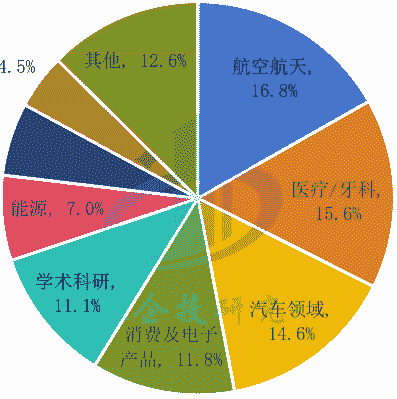

**图 1　2021 年全球增材制造应用领域**

资料来源：Wohlers Associates《Wohlers Report 2022》，华曙高科招股说明书。

——航空航天应用。在航空航天领域，由于零部件形态复杂、传统工艺加工成本高及轻量化要求等因素，增材制造已发展成为提升设计与制造能力的一项关键核心技术，能够实现任意复杂构件成形与多材料一体化制造，突破了传统制造技术对结构尺寸、复杂程度、成形材料的限制，应用场景日趋多样化。欧洲航天局（ESA）、美国国家航空航天局（NASA）、SpaceX 和 Relativity Space 均使用增材制造技术生产火箭点火装置、推进器喷头、燃烧室和油箱，美国 GE、波音（Boeing）、雷神科技、法国空客（Airbus）、赛峰（Safran）使用增材制造技术生产商用航空发动机零部件、军机机身部件、飞机风管、舱内件等。同时，增材制造的构件也已在国内航空航天领域广泛应用，先后成功参与了天问一号、实践卫星、北斗导航系统等数十次发射和飞行任务，我国航天院所如航天一院、航天二院、航天五院、航天六院、中航商飞等均积极运用 3D 打印技术制造相关零部件。

——汽车领域应用。汽车制造领域的 3D 打印，主要应用于汽车设计、零部件开发、内外饰等方面。在设计方面，3D 打印技术的应用可以实现无模具设计和制造，可以在设计阶段引导零件轻量化、一体化、个性化、功能化方面的创新。在制造方面，3D 打印技术可提升零件的制造效率和生产质量，实现零件轻量化制造和降低质量的位移途径，进行复杂结构模具的加工，加强对制造精度的控制；同时，增材制造一体化成形技术允许将多个零件整合为一个零件，可减轻复杂关键部件的重量。在维修方面，3D 打印技术可以进行门把手、轮毂、汽缸、变速器和其他基础部件的制作。

——医疗领域应用。3D 打印凭借可个性化定制的特点在医疗领域内应用逐步广泛，主要应用方向包括制造医疗模型、手术导板、外科/口腔科植入物、康复器械等（主要材料包括塑料、树脂、金属、高分子复合材料等），以及生物 3D 打印人体组织、器官等。目前在口腔医学中的应用逐渐成熟，主要运用于制造牙冠和牙桥等修复材料，包括义齿打印、矫正器制作等。在骨科植入方面也发展迅速，目前开始采用金属 3D 打印技术生产全膝关节植入物、髋臼杯、脊柱植入物等。听力学领域，主要运用于制造耳蜗和听骨链等助听器部件。心脏和神经系统方面，主要运用于制造心脏支架和脑植入物等。

——国防军工领域应用。3D 打印技术在武器装备设计、制造以及维修保障等方面的应用逐渐普及，比如，可以使用 3D 打印技术来生产战斗机等高端武器装备的复杂零部件，维修中短缺的零部件。在军事制造业生产模式上，除了按需便捷生产，3D 打印技术还允许创建高级定制和专业化的设备。例如，士兵可以拥有定制的头盔、防弹衣等防护装备，可以在战场上快速为伤员打印假肢、关节，随时随地建造营房和防御工事等。

——**消费电子等消费品领域应用。** 3D 打印技术在产品的研发和生产阶段，如装配和功能验证、外观及性能测试、人体工程学、快速手板、批量制造等方面，有助于降低研发和时间成本。苹果预计下半年发布的 Apple Watch Ultra 智能手表的部分钛金属机械部件将采用 3D 打印工艺。未来在 iPhone 15 上有可能将中框结构件用钛合金替换之前的铝合金。荣耀近期发布的荣耀 Magic V2 折叠旗舰机，铰链的轴盖部分首次采用钛合金 3D 打印工艺。其他消费品领域，3D 打印技术有助于加速产品设计、优化和迭代，提升并丰富产品性能，如为运动员量身定制轻量化、个性化运动设备等。

——**模具领域应用。** 3D 打印已广泛应用于鞋模及随形冷却模具等领域，优化冷却水路设计，不受水路复杂程度的限制，提升模具的冷却效率和生产效率。

# 二、增材制造工艺路线

增材制造技术自诞生至今将近 40 年，目前多种技术路线并存。按照成形原理，增材制造主要有 7 种工艺，如下表所示。

**表 2　增材制造工艺类别及应用领域**

| 工艺类型 | 工艺说明 | 主要工艺技术名称及应用领域 |
|---|---|---|
| 粉末床熔融 | 通过热能选择性地熔化/烧结粉末床区域的增材制造工艺 | • 激光选区熔化（SLM）：航空航天等复杂金属精密零件、金属牙冠、医用植入物（金属材料）等 • 激光选区烧结（SLS）：航空航天领域用工程塑料零部件、汽车家电等领域铸造用砂芯、医用手术导板与骨科植入物（非金属材料）等 • 电子束选区熔化（EBSM）：航空航天复杂金属构件、医用植入物（金属材料）等 |
| 定向能量沉积 | 利用聚焦热能熔化材料，即熔即沉积的增材制造工艺 | • 激光近净成形（LENS），也称激光立体成形（LSF）：飞机等大型复杂金属构件成形与修复等 • 电子束熔丝沉积（EBDM）：航空航天大型金属构件等 • 电弧增材制造（WAAM）：航空航天大型金属构件等 |
| 立体光固化 | 通过光致聚合作用选择性地固化液态光敏聚合物的增材制造工艺 | • 光固化成形（SLA）：工业产品设计开发、创新创意产品生产、精密铸造用蜡模等，使用非金属材料 |
| 黏结剂喷射 | 选择性喷射沉积液态黏结剂，黏结粉末等材料的增材制造工艺 | • 三维立体打印（3DP）：工业产品设计开发、铸造用砂芯、医疗植入物、医疗模型、创新创意产品、建筑等，使用非金属材料 |
| 材料挤出 | 将材料熔化后通过喷嘴或孔口挤出成形的增材制造工艺 | • 熔融沉积成形（FDM）：工业产品设计开发、创新创意产品生产等，使用非金属材料 |
| 材料喷射 | 将材料以微滴的形式选择性喷射沉积的增材制造工艺 | • 材料喷射成形（PJ）：工业产品设计开发、医疗植入物、创新创意产品生产、铸造用蜡模等，使用非金属材料 |
| 薄材叠层 | 将薄层材料逐层粘结以形成实物的增材制造工艺 | • 层压物体制造（LOM）：工业产品设计开发、创新创意产品生产、制作母模等，使用纸片或 PVC 覆膜材料，目前逐渐被淘汰 • 超声波增材制造（UAM）：使用多种金属、金属基复合材料的航空航天复杂金属零部件（可嵌入传感器、电子元器件的金属部件）等 |

资料来源：铂力特招股说明书等。

金属增材制造工艺原理主要为粉末床熔融和定向能量沉积两大类别，对应的金属 3D 打印技术都可以制造达到锻件标准的金属零件。粉末床熔融技术比较适合航空航天小批量、定制化的生产特点，是目前最广泛应用的增材制造技术之一。定向能量沉积技术的成熟度和设备自动化程度不及粉末床熔融技术，但是能实现修复功能，因此也具有不可替代性。具体工艺来看，目前激光选区熔化技术（SLM）是最常用的金属增材制造工艺，其生产效率高，可以在短时间内制造出致密度极高的金属零件；电子束选区熔化（EBSM）依托真空加工环境，更容易加工难熔的材料，但维护费用高，打印的零件尺寸受限，且需要有射线安全保护设备；电弧增材制造（WAAM）在大尺寸结构件制造中具有优势，但零件表面质量较差，需经过表面加工过后才能使用。

# 三、增材制造产业链概况

增材制造产业链上游主要为原材料和零件，包括增材制造设备零部件、三维扫描设备、增材制造软件系统、专用材料生产工艺及设备等；中游为 3D 打印设备，多数厂商同时提供打印服务、原材料供应及系统解决方案；下游为各个行业应用。产业链如下图所示。

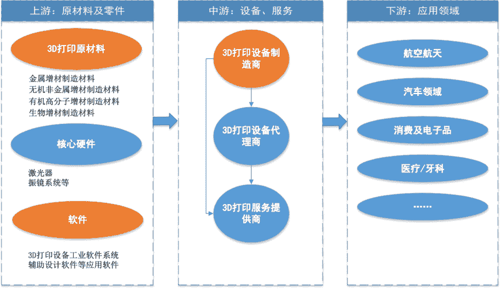

资料来源：华曙高科招股说明书。

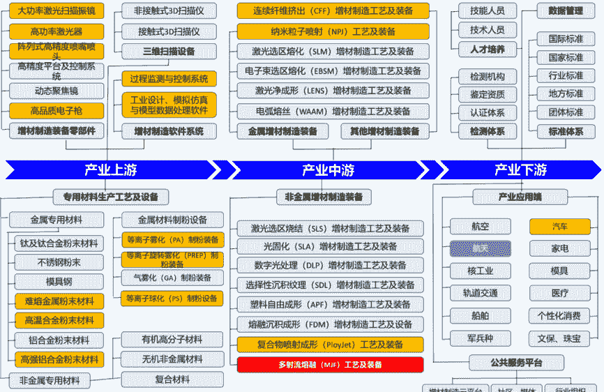

资料来源：信达证券《增材制造行业深度报告——3D 打印：颠覆性技术，有望从 1 到 100 撬动千亿产业链——230712》。

——3D 打印原材料。目前主要可分为金属材料、无机非金属材料、有机高分子材料以及生物材料等几类。金属粉末一般要求纯净度高、球形度好、粒径分布窄、氧含量低，目前应用于 3D 打印的金属粉末材料主要有钛及钛合金、高温合金、钴铬合金、不锈钢和铝合金材料等。SLS 工艺技术目前使用最广泛的原材料为 PA 粉末类材料。近年来，行业内出现多种新型高分子增材制造粉末材料，各类材料在成形质量和稳定性等方面的表现各有差异。

| 材料 | 细分 | 特性 | 应用 |
|---|---|---|---|
| 金属材料 | 钛合金 | 强度高、耐腐蚀性好、耐热性高 | 飞机发动机压气机部件，以及火箭、导弹等各种结构件 |
| 金属材料 | 钴铬合金 | 腐蚀性能和机械性能优异 | — |
| 金属材料 | 不锈钢 | 耐空气、蒸汽、水等弱腐蚀介质和酸、碱、盐等化学浸蚀性介质腐蚀 | 适合打印尺寸较大的物品 |
| 工程塑料 | ABS 材料 | 强度高、韧性好、耐冲击 | 汽车、家电、电子消费品等领域 |
| 工程塑料 | PC 材料 | 高强度、耐高温、抗冲击、抗弯曲 | 电子消费品、家电、汽车制造、航空航天、医疗器械等领域 |
| 光敏树脂 | Somos 19120 | 低温灰率、高精度 | 汽车、家电、电子消费品等领域 |
| 光敏树脂 | SomosNext | 强韧性、精度和表面质量佳 | — |
| 陶瓷材料 | 陶瓷 | 高强度、高硬度、耐高温、低密度、化学稳定性好、耐腐蚀等 | 航空航天、汽车、生物等领域 |
| 复合材料 | 碳纤维复合材料 | 将单一材料与碳纤维混合，综合提升产品的强度、粘合度、耐热度，同时可优化产品重量等物理性质 | 电子消费品、家电、汽车制造、航空航天、医疗器械等领域 |
| 复合材料 | 高分子复合材料 | 耐高温、耐腐蚀、高阻燃性、优异的力学性能 | 汽车制造、航空航天、医疗器械等领域 |

**图 4　3D 打印原材料类别及应用领域**

资料来源：艾瑞咨询，招商证券《金属 3D 打印行业深度报告：传统技术的革新，高成长与高壁垒——230728》。

目前国内的金属 3D 打印材料已基本满足国产设备及国内下游增材制造需求，设备生产厂商一般与第三方材料厂商合作研究开发各类金属材料熔融工艺，少量 3D 打印服务的厂商会同时自主生产金属 3D 打印材料。不过，海外 3D 打印巨头如 Stratasys 和 3D Systems 在体量、积累和技术实力上远超国内企业，分别拥有数百种商业牌号的增材制造材料销售，其采用“捆绑销售”模式，导致我国进口高端增材制造材料数量长期居高不下。

——**核心硬件**。增材制造所使用的核心硬件包括振镜和激光器等。

目前，该等核心硬件多数采购自美国、德国等，存在依赖进口的情况，但随着国产振镜和激光器的研制成功及性能提升，目前已实现部分进口替代。

——**软件**。3D 打印相关软件包括 3D 打印设备工业软件系统以及应用软件。应用软件可由产业链上中下游主体及专业软件供应商基于技术应用需求开发提供，如辅助设计软件、工程处理软件、仿真模拟软件、智能处理软件等。目前，行业内大部分 3D 打印设备制造企业的 3D 打印设备工业软件系统系向第三方采购，软件性能提升依赖并受制于软件服务商，拥有完全自主知识产权的 3D 打印设备工业软件系统将有助于设备制造企业提升行业竞争力。

——**3D 打印设备及服务**。3D 打印设备是中游、也是整个产业链的核心主体。可分为桌面级打印机和工业打印机，其中工业级打印机技术壁垒高，资本投入大，一直以来发展较为缓慢，但当前受到国家政策大力支持，市场呈现出快速增长形势。据铂力特公司公告，增材制造设备是牵动增材制造行业发展的关键之一，增材制造的核心专利大多被设备厂商掌握，因此设备厂商往往在整个产业链中占据主导地位。此外，重点设备厂商通过行业并购，整合上游 3D 打印软件、上游材料、3D 打印服务等，成为集装备、材料、服务等多种业务为一体的综合解决方案提供商，进而提升对产业链的掌控能力。

从业务构成看，打印设备和打印服务占据增材制造行业主要市场份额。根据 Wohlers Report 2022 报告，2021 年全球增材制造市场

份额中，增材制造服务占比 40.09%，打印装备占比 22.42%，增材制造原材料占比 17.04%，增材制造服务市场份额占比远超出其他业务，如下图所示。

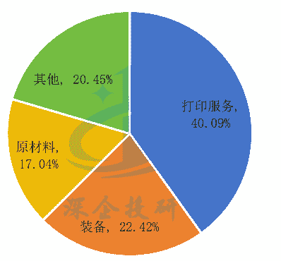

图 5　2021 年全球增材制造各业务占比

资料来源：Wohlers Associates《Wohlers Report 2022》。

## 四、全球及中国市场情况

**全球增材制造市场规模高速增长。** 根据 2023 年发布的《Wohlers Report 2023》报告，全球增材制造产品和服务的收入从 2003 年的 5.29 亿美元增长至 2022 年的 180 亿美元，2015—2022 年 CAGR 为 19.5%。2020 年受疫情影响，年同比增速短暂下滑至 7.51%；2021 年反弹至 19.49%；2022 年同比增长 18.3%。预计 2025 年全球市场规模将达到 298 亿美元，2022—2025 年 CAGR 为 18.3%；2030 年达到 853 亿美元，2025—2030 年 CAGR 预计达 23.4%。根据《Global Additive Manufacturing Market, Forecast to 2025》报告显示，从 2015 年到 2025 年，全球汽车行业、垂直医疗设备的 3D 打印收入将分别以 34% 和 23% 的复合增速增长。

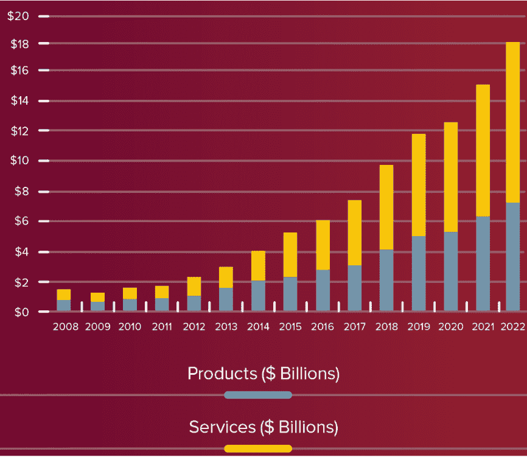

图 6　全球增材制造产品和服务产值

资料来源：Wohlers Associates《Wohlers Report 2023》，2023 年 3 月发布。

**金属增材制造市场增速领跑增材制造行业。** 根据 AMPOWER 数据，2021 年全球金属增材制造市场规模达 25 亿欧元，从需求端测算预计 2026 年将达到 75.8 亿欧元，CAGR 达 25%；从供给端测算预计 2026 年将达到 78.1 亿欧元，CAGR 达 26%。

**增材制造设备销量持续增长。** 根据 Wohlers Associates 统计数据，全球工业级增材制造设备销量（指面向工业且销售售价在 5000 美元及以上的机器）从 2012 年的 6 千余台增长至 2021 年的 2.6 万余台，年复合增长率 14.45%。全球金属增材制造设备的销售量从 2012 年的 200 余台增长至 2021 年的 2300 余台，十年来增长 1087%，年复合增长率 31.63%。全球工业级高分子增材制造设备的销售量从 2012 年的 7500 余台增长至 2021 年的 23800 余台，年复合增长率 13.57%。

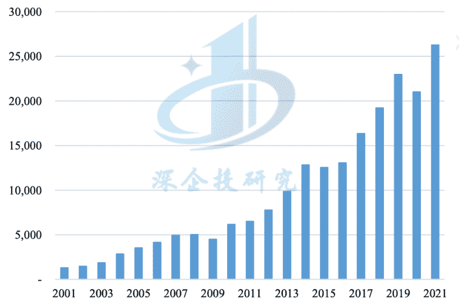

图 7　全球工业级增材制造设备销售量（台）

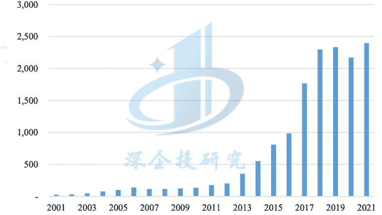

图 8　全球金属增材制造设备销售量（台）

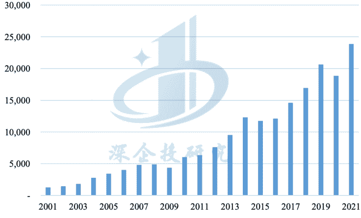

图 9　全球工业级高分子增材制造设备销售量（台）

资料来源：Wohlers Associates，华曙高科招股说明书。

**增材制造原材料市场规模快速增长。** 根据 Wohlers Associates 统计数据显示，全球增材制造专用原材料销售金额从 2012 年的 4.17 亿美元增长至 2021 年的 25.98 亿美元，CAGR 达 22.54%，2021 年金属原材料占市场比重约 18.2%。2021 年金属原材料销售额达 4.74 亿美元，同比增长 23.50%，五年 CAGR 达 26.80%。

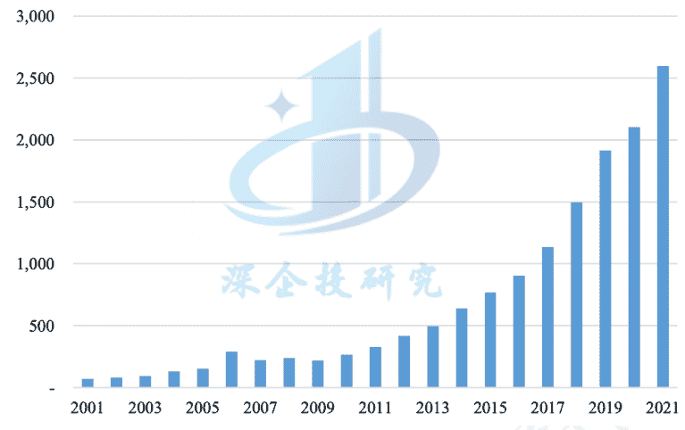

图 10　全球增材原材料销售额（百万美元）

资料来源：Wohlers Associates，华曙高科招股说明书。

从全球市场的分布来看，美国是全球第一大市场，中国为第二大市场。截至 2021 年末，中国工业增材制造设备安装量市场占比 10.60%，仅次于美国，如下图所示。

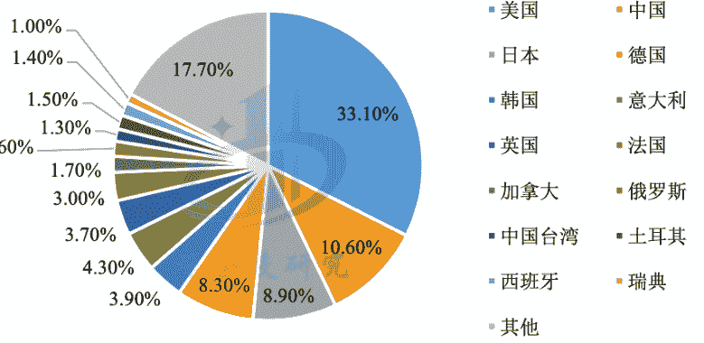

图 11　截至 2021 年增材制造设备安装量占比

资料来源：Wohlers Associates，华曙高科招股说明书。

**中国增材制造产业规模高速增长，超过全球增速。** 根据工信部数据，2012—2022 年，我国增材制造产业规模自 10 亿元增长至 320 亿元，年复合增速为 41.42%，预计 2023 年我国增材制造产业规模有望超过 400 亿元。据左世全《增材制造十年发展及展望》数据，我国增材制造产业规模有望于 2027 年超过千亿元。

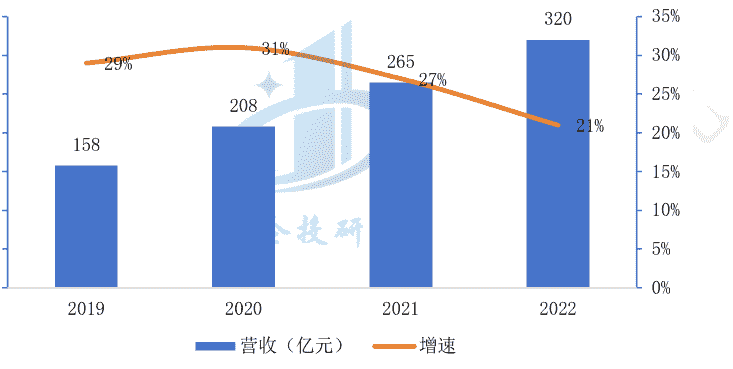

**图 12　2019—2022 年中国增材制造产业营业收入情况**

资料来源：李方正、李博、郭丹《中国增材制造产业发展现状与趋势展望》。

从各环节企业的营收情况来看，根据工信部装备工业发展中心对 50 家行业企业的调研数据，调研企业在材料、零部件、装备、服务等各个环节占总营收的比重分别为 12.4%、5.9%、53.2% 和 26.0%，装备市场占比超过 50%，仍处于市场主导地位，如下图所示。

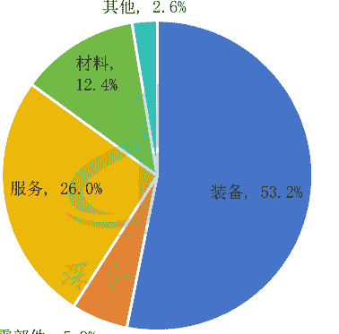

图 13　工信部调研企业产业链各环节营收比重

资料来源：李方正、李博、郭丹《中国增材制造产业发展现状与趋势展望》。50 家调研企业对应 2022 年总营收为 112.5 亿元。

**我国增材制造装备实现从进口为主到国产化替代的转变。** 十年来，我国增材制造一批重点工艺装备和核心器件实现国产替代，批量化供应能力和成本竞争优势显著。我国在高精度桌面级光固化增材制造装备、多材料熔融沉积增材制造装备方面持续保持领跑并畅销海外；面向多激光器激光选区熔化装备、多电子枪电子束熔化装备、大幅面型刮刀式增材制造装备等自主开发装备，其相关核心指标达到国际先进水平；5 轴增减材混合制造装备已实现商用。此外，我国完成了超高速激光熔覆头、电子枪等十多类关键部件的技术攻关和自主生产，其稳定性、可靠性得到不断改善。大族激光、锐科激光等企业自主研发的激光器、扫描振镜等零部件已应用到相关增材制造装备中。从出口情况看，2022 年中国增材制造装备出口 228.7 万台（含消费级），较 2019 年增长 59.7%；出口金额为 36.6 亿元，较 2019 年增长近 1 倍。多家企业增材制造装备出口营收占企业主营业务的 90% 以上；消费级 FDM 3D 打印机出口量持续领先全球；各类装备已出口至全球 40 多个国家和地区。

增材制造技术应用实现从原型制造向直接制造的质变。十年来，增材制造技术的应用实现由快速制造原型样件逐步向直接制造最终产品的质变。

- **航空航天领域。** 新一代战机、国产大飞机、新型火箭发动机、火星探测器等重点装备的关键核心零部件大量应用增材制造技术，解决了许多过去难以制造的复杂结构零件的成形问题，实现产品结构轻量化。
- **医疗领域。** 髋臼杯、脊柱椎间融合器等 14 款增材制造医疗植入物已获得 NMPA 认证，实现临床应用，拓展疾病治疗解决方案；时代天使运用增材制造技术实现口腔正畸牙模批量定制生产，解决传统机加工制造复杂的问题，满足患者个性化需求，全面提高中国口腔医疗水平。
- **铸造领域。** 宁夏银川建成世界首个万吨级铸造 3D 打印工厂，将增材制造技术应用于砂型铸造、熔模铸造等铸造工艺中，大大减少铸造加工流程，提升产品制造效率，实现对传统铸造的替代。
- **其他领域。** 大规模混合桥体、房屋等增材制造建筑在各地落成，高级手办、轻量化鞋品等深受消费者欢迎。

## 五、各领域竞争格局

3D 打印企业集中在美国、德国及中国。根据 Wohlers Associates 统计，2021 年全球有 266 家制造商生产和销售工业 3D 打印设备（统计口径为价格高于 5000 美元），其中 39 家公司的工业 3D 打印系统销量超过 100 套。266 个系统制造商分布在世界各地，美国制造商数量 59 家，排名第一；德国制造商数量 38 家，排名第二；中国制造商数量 37 家，排名第三。

**我国增材制造骨干企业数量持续增长。** 根据李方正、李博《增材制造十年：成就、启示与展望》报告，我国增材制造全产业链相关企业超过 1000 家，铂力特、先临三维、华曙高科等以增材制造为主营业务的上市公司涌现，数量由 2013 年的 1 家增长至 2022 年的 22 家（含新三板）；规模以上企业数量由 2016 年的 20 余家增至 2022 年的 100 余家，其中规模过亿的企业数量由 2012 年的 3 家增至 2022 年的 42 家。

### 3D 打印材料

目前 3D 打印金属粉体材料以欧美厂商为主，国内金属粉末制备存在氧含量高、球形度差和粒径分布不均匀等问题，超细粉及优质粉末仍需进口。

| 类别 | 代表企业 |
|---|---|
| 金属粉体材料｜国际 | 德国 EOS、德国 TLS Technik、Arcam（GE）、瑞典 Sandvik、瑞典 Höganäs、Concept Laser（GE）、ExOne、瑞典山特维克 Sandvik（镍基超合金、工模具钢、不锈钢材料）、美国卡彭特 Carpenter |

| 地区 | 供应商及材料类型 |
|---|---|
| 国内 | 中航迈特（北京，钛合金、高温合金、镍基合金、钴铬钨合金）、西安铂力特（A 股，钛合金、高温合金）、飞而康（无锡，钛合金）、有研粉材（A 股，北京，钛合金、高温合金、铝合金、铜合金）、江苏威拉里（徐州，钛合金、镍基高温合金）、西安赛隆增材、成都优材科技、浙江亚通新材（IPO，杭州）、宇光飞利（西安）、中国航发北京航空材料研究院（高温合金、工模具钢、不锈钢等）、上海材料研究所（钛合金、镍基高温合金、不锈钢、模具钢）、湖南顶立科技（长沙，隶属于 A 股楚江新材，钛及钛合金、镍基高温合金、钴基、铝基）、西北有色金属研究院（西安）、湖南恒基粉末、西安欧中材料、洛阳科品钛业（钛合金）、江苏天工科技（镇江，钛合金丝材）、广东粤海华金（新三板）等 |

资料来源：深企投产业研究院整理。

非金属材料供应商众多，除了材料、设备、服务一体化厂商外，3D 打印材料在专业材料厂商的营收占比较低，一般不做专门生产。

国内重点企业有斯科瑞（山东临沂，3D 打印高分子材料）、苏州聚复科技（3D 打印高分子材料）、嘉兴饶梭科技（陶瓷材料）、山东创瑞激光科技（烟台）等。

### 一、3D 打印设备

当前中国市场的主流 3D 打印设备品牌包括上海联泰科技、美国 Stratasys（纳斯达克上市）、德国 EOS、美国 GE、美国 3D Systems（纽交所上市）、华曙高科（A 股，长沙）、西安铂力特（A 股）、美国惠普等，其中联泰、华曙高科、铂力特等均为国产品牌。根据 3D 科学谷数据，联泰在 3D 打印行业中市场占比最高，达 16.4%，其次为 Stratasys 和 EOS，分别占比 14.8% 和 13.1%。随着国内 3D 打印企业技术的不断积累，与国外先进水平的差距快速缩小，在大尺寸成型等部分领域甚至实现了反超。

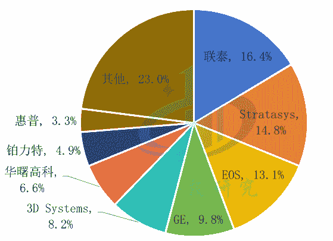

图 14　2021 年中国 3D 打印设备市场竞争格局

资料来源：3D 科学谷。

国际 3D 打印设备重点企业还有德国 SLM Solutions（被 Nikon 收购）、美国 Desktop Metal（纽交所上市）、美国 Nano Dimension（纳斯达克上市）、美国 VELO 3D（纽交所上市）、美国 Markforged（纽交所上市）、德国 voxeljet（纽交所上市，苏州维捷）、法国 Prodways、美国 Shapeways 等。

国产重点厂商还有先临三维（杭州，新三板）、鑫精合激光（北京）、北京易加三维、南京中科煜宸、无锡飞而康、广东汉邦激光科技（中山）、浙江迅实科技、峰华卓立（佛山，新三板）、西安赛隆增材、东莞远铸智能、深圳创想三维、珠海三绿实业（消费级）等。另有深圳金石三维、山东创瑞激光科技（烟台）、湖北嘉一三维（咸宁，新三板）、深圳极光创新（新三板）等上百家企业。多数设备厂商同时拓展 3D 打印服务业务。

### 核心光学硬件

增材制造设备所需核心元器件包括扫描振镜、激光器。增材制造用的激光器主要从美国、德国进口，基本被德国 Trumpf、美国 IPG 等 3—4 家国外企业占有。目前低功率光纤激光器基本完成国产替代，中功率光纤激光器国产化率保持稳定，多保持在 60% 以上，实现了大部分的国产化替代。

扫描振镜主要从德国进口。根据铂力特招股说明书，扫描振镜系统在全球范围内主要的供应商为德国 ScanLab 公司、美国 CTI 公司、美国 GSI 公司，其中德国 ScanLab 公司占据了金属 3D 打印设备市场的主要份额，市场占有率达到 80% 左右。根据其官网披露信息，德国 ScanLab 公司扫描振镜系统年产超过 3.5 万套。经过近年来国内供应商的快速发展，在中低端振镜控制系统领域已经基本实现国产化；在高端应用领域，目前主要由德国 Scaps、德国 ScanLab 等国际厂商主导，国产化率仅 15% 左右。目前金橙子（A 股）振镜产品相关核心性能指标与德国 ScanLab 的同类型产品相近，具备与国际厂商竞争的水平和实力。大族激光也在拓展增材制造领域的光纤激光器和振镜产品。

## 六、我国增材制造产业园分布

目前全国各地建设的 3D 打印园区有 20 多个，主要提供增材制造产业链的配套服务，少数由设备龙头企业建设产业基地。各地区园区的规模体量差别较大，多数园区招商运营并不理想。现有主要园区如下图所示。

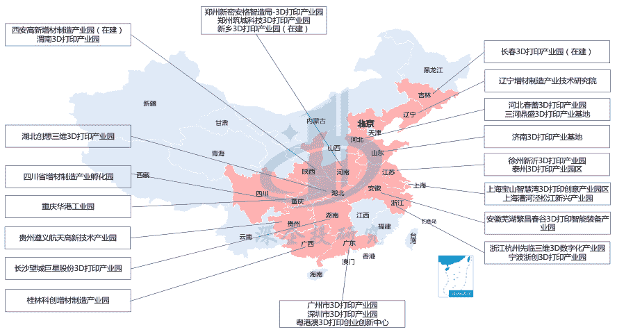

图 15　我国增材制造产业园分布

资料来源：深企投产业研究院整理。不含停止运营或实际无运营的园区。

### 企业简介

#### 深企投产业研究院

深企投产业研究院是深企投集团旗下的高端智库，聚焦产业发展，服务区域经济，致力于为各地政府和园区提供产业发展落地方案。主营业务包括产业研究、产业规划、产业链招商策略、项目策划包装、项目评估等。产业研究院拥有来自北大、人大、南开、中大等经济学背景的产业研究专家，拥有长期跟踪研究区域经济和战略性新兴产业的产业研究团队，已为珠三角、长三角、海西、西南、西北等多个地区完成了数百个规划咨询和产业研究项目。

#### 深企投产业发展集团

- 深企投产业发展（深圳）股份有限公司
- 深企投产业研究院
- 深投促产业发展（深圳）股份有限公司
- 厦门赛知经济咨询有限公司

### 业务

#### 招商服务

- 委托招商
- 招商培训
- 招商办会
- 园区运营

#### 产业智库

- 产业规划
- 项目策划
- 招商策略
- 项目评估

- 30+ 委托招商区域
- 2000+ 优质企业资源
- 1000+ 行业研究报告
- 100+ 咨询服务客户

### 产业咨询业务

### 产业规划

- 佛山国家高新区顺德园“十四五”产业发展规划
- 宁波镇海区重点片区产业发展规划
- 龙岩国家高新区“十四五”产业发展规划
- 滨州台商区沈化工综合体产业发展规划
- 惠州澳润生态智慧园区片区产业发展定位研究
- 龙岩市新罗区能源互联网产业发展规划
- 龙岩市南都新能源发展产业规划
- 贵阳双龙航空港经济区临空产业发展定位研究
- 龙岩市乡村旅游发展规划
- 贵州黔南州大数据“十四五”发展规划
- 南越江工业区产业发展规划
- 宁夏经济重点产业发展策略
- 宁夏吴忠市“十四五”现代服务业发展规划
- 广州新能源汽车产业发展策略
- 广东省商务厅世界 500 强企业对接投资专题研究
- 贵阳市产业引导基金招商专题研究
- 曹桂园海南科技小镇产业地块产业发展规划
- 大亚湾大东规模园产业发展规划
- 邯江区数字经济科创中心产业发展规划
- 襄科·金茂智慧港高产业园产业发展规划

### 研究领域

新一代信息技术｜高端装备｜新能源｜新能源汽车

新材料｜生物医药｜节能环保｜航空航天

现代家居｜现代食品｜文旅康养｜现代物流

商务服务｜低空经济｜机器人｜医疗器械

……

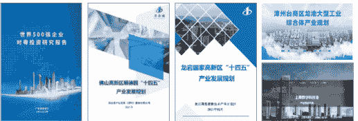

### 产业链招商策略

- 智能传感器
- 新型消费电子
- 智能硬件
- 新型显示
- 5G 通信
- 新型元器件
- 新材料
- 新能源
- 储能
- 生物医药
- 医疗器械
- 智能制造装备
- 智能专用装备
- 工业激光设备
- 冶金机械
- 轻工装备
- 工业机器人
- 新能源汽车零部件
- 现代家居
- 食品饮料
- 文旅康养
- 现代物流
- 总部经济
- 会展
- 互联网
- 商贸服务业
- ……

### 方法论

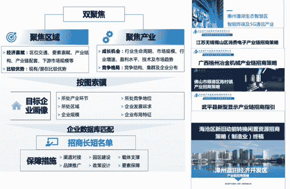

### 联系我们

商务合作：王女士 13168781866

座机：0755-82790019

邮箱：sqtcf@sqtcf.cn

网址：http://www.sqtcf.cn/

地址：深圳市福田区深南大道本元大厦 7B1
