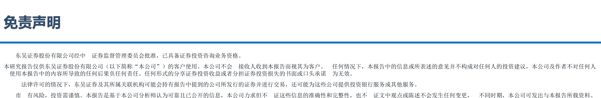

## 东吴计算机9-10月策略我是 goaichat 研发的智能大模型，可以为你提供智能问答、分析和创作服务。## 信创、数据、低空，三箭齐发证券分析师 王紫敬执业证书：S0600521080005联系电话：021-60199781联系邮箱：wangzj@dwzq.com.cn二零二四年九月三日请务必阅读正文之后的免责声明部分## 摘要- **党政信创重启：**党政信创后市场空间有望倍增，特别国债有望为党政信创提供资金支持，党政信创竞争格局和价格相平稳，党政信创有望重新开启，后续空间弹性大，2025—2027年2019—2024年市场的3倍。

- **相关标的：**中国软件、达梦数据、纳思达、金山办公。其他关注：海量数据、神州数码、卓易信息、麒麟信安、南极股份、中国长城、东方通等。

- 行业信创方面，关注金融行业信创加速。我们预计2027年全面替代节点，金融信创2025年有望取得显著进展。相关标的：顶点软件、恒生电子。

- **低空再来袭：**成为市场焦点以来，市场不断向好发展，相关会议频频开展，未来可以期待：1）更多的低空经济示范区/城市；2）设立低空经济职能部门；3）更为全面的低空产业规划政策。随着低空经济“政策+产业”的不断推进，基础设施建设环节有望带来规模较大的新基建机遇。

-关注两类方向：
 - （1）产业落地上有望迎来订单释放的方向：莱斯信息、纳睿雷达；
 - （2）各地的牵头单位：深城交（深圳）、大名城（福建）、四川九洲（成都）、宗申动力（重庆）、川交科（四川）、万丰奥威（浙江）、亿创电子（合肥）。

- **数据要素：**2024年下半年公共数据授权运营等高级别政策有望落地，将能打开公共数据供给，促进商业变现。看好具备数据运营权，或有望参与重要地区和行业试点的公司。

- **建议关注：**云赛智联、易华录、久远银海、广电运通、国新健康、深桑达A。

- **风险提示：**政策推进不及预期；技术发展不及预期。

##目录1.党政信创重启2.低空再来袭3. 数据要素和中国式现代化4. 风险提示# 第一章：党政信创重启## 信创的现状、边际变化与问题- **党政信创：**内网替换已经告一段落，近两年替换节奏低于市场预期。竞争格局较好，价格体系稳定。由于财政紧张，党政信创在近两年发展较慢。

- **行业信创：**较好地实现了每年的信创目标，达到了对应的替换比例要求。行业客户资金并不紧张，但是竞争格局复杂，价格体系承压。

- 名录采购制度转变为国测采购制度，使得更多企业进入到信创市场。

- 如何解决党政信创的资金问题，以及如何优化行业信创的竞争格局，是推进信息技术应用创新的核心问题。

##关注党政信创加速###1.党政信创后市场空间有望倍增-党政信创市场分为电子公文和电子政务。

- 我们测算，截至2024年党政信创存量规模高达2000万台。

- 国家信创迭代节奏的要求是一贯的，党政信创必须要完成。然近两年进展有所减缓，但总目标不会改变，党政信创一旦重启，弹性很大。2019年至2024年，以PC为例，我们预计党政信创PC总出货量仅500多万台，占总量比重仅25%；2025—2027年空间2019—2024年的3倍左右。

###2. 特别国债有望为党政信创提供资金支持-党政信创主要靠财政拨款，我们认为特别国债有望成为解决资金问题的抓手。

- 超长期特别国债重点聚焦加快实现高水平科技自立自强、推进城乡融合发展、促进区域协调发展、提升粮食和能源资源安全保障能力、推动人口高质量发展、全面推进美丽中国建设等方面的重点任务。

- 超长期特别国债由中央政府发行，部分资金由地方使用。资金使用见效后，在经济社会发展产生积极影响的同时，也有助于优化政府债务结构、优化地方财政空间。

-党政信创科技自立自强、构建自主科技产业的重要步骤，超长期特别国债有望为党政信创提供资金支持。根据地方财政的具体情况不同，中央的资金支持力度可能不同。

###3.党政信创竞争格局和价格相平稳-党政信创竞争格局良好。党政信创安全性要求高，供应商参与者较少，竞争格局良好。

-价格体系稳定。由于竞争格局良好、厂商资质要求高，党政信创产品价格较为稳定。

###4.细分建议-党政信创有望重新开启，后续空间弹性大，**2025—2027年2019—2024年市场的3倍。**我们认为超长期特别国债有望为党政信创提供资金支持。党政信创竞争格局相比于行业信创更优，价格体系更为稳定。同时，整体党政信创板块标的位置较低，基于此，我们推荐党政信创板块性机会。

- **相关标的：**中国软件、达梦数据、纳思达、金山办公。

- **其他关注：**海量数据、神州数码、卓易信息、麒麟信安、南极股份、中国长城、东方通等。

##关注党政信创加速- 金融行业信创加速。

政策节奏：我们预计2027年全面替代节点，金融信创2025年有望取得显著进展。

金融信创已进入深水区，重要系统的实质性替换面临复杂性、挑战性。目前证券公司已从政策观望、项目准备为主，逐渐向细分领域尝试验证转变，部分证券公司已实现自主可控核心系统的全面上线。金融信创实质性要求进一步深化落地，金融领域信创深水区实践会越来越多。

相关标的：顶点软件、恒生电子。

# 第二章：低空再来袭##近期低空经济相关会议成为市场焦点以来，市场不断向好发展，相关会议频频开展。基于政策行业的推动，行业业态不断向好发展，相关产业呈现多元化趋势，针对行业和业态的相关研究也越来越多。不少省市、不少产业都开展了针对低空经济助力发展的相关会议，目前大部分会议聚集在9月，未来的研究会议也会在筹划当中。

这些会议和研究会的举办，不仅促进了低空经济领域的学术交流和信息共享，也为行业内的企业和机构提供了合作和融资的机会，有助于推动低空经济的健康发展和产业升级。随着技术的不断进步和政策的不断完善，低空经济有望成为未来经济增长的新引擎。

| 时间 | 部门/城市/公司 |事件 |
|---|---|---|
|2024年9月4日 | 广州 | 首届粤港澳大湾区低空经济研讨会 |
|2024年9月6日至8日 | 芜湖 |2024低空经济发展大会 |
|2024年9月12日 | 北京 |2024低空经济时空信息基础设施论坛 |
|2024年9月13日 | 上海 |低空经济产业化与高质量发展大会 |
|2024年9月19日至21日 | 成都 |2024成都国际低空装备及服务博览会 |
|2024年9月21日 | 济南 |2024空天信息暨低空经济产业发展大会 |
|2024年9月23日至25日 | 深圳 |2024深圳eVTOL展 |
|2024年9月26日至27日 | 重庆 | 第六届“空中丝绸之路”国际合作峰会（简称：ASRIF），下设全低空经济产教融合发展论坛 |
|2024年10月27日至29日 | 北京 | 全球低空经济论坛2024年年会 |
|2024年12月4日至6日 | 深圳 | 深圳亚太国际低空经济产业博览会 |

##期待一：更多的低空经济示范区/城市- 深圳低空经济示范区已获批，期待更多城市试点落地。自2017年以来，四川、海南、湖南、江西、安徽5省成为全国首批低空空域管理改革试点省份。自2022年开始，相关政策逐步落地实施，深圳作为城市级试点率先发力。2023年12月，深圳市正式向国家有关部委申请创建国家低空经济产业综合示范区。2024年3月，中国民用航空局明确支持深圳市建设国家低空经济产业综合示范区，支持深圳完善产业发展服务体系，拟开展低空物流、城市空中交通等研究试点，丰富低空应用场景，构建低空规章标准体系，加强数字化网络平台建设和低空服务基础设施建设。我们预计低空经济产业的发展有望继续采取“多个试点一齐推进”的模式进行开展。国家有望通过开展试点城市的模式，来鼓励各地开展低空经济商业模式的探索。

##低空经济##期待二：设立低空经济职能部门-2024年7月10日，民航局成立促进低空经济发展工作领导小组及工作组，领导小组由民航局局长冯正霖担任组长，副局长胡振江、韩钧、马兵担任副组长，成员包括民航局各司局、直属单位的负责同志。

- **领导小组和工作组具体需要做什么？**

- 据介绍，促进低空经济发展工作领导小组主要职责包括：落实党中央、国务院关于促进低空经济发展的决策部署，筹划民航局促进低空经济发展各项工作；研究确定局内促进低空经济发展的工作方案、工作安排，督导各部门（单位）落实工作；听取关于重点工作进展情况的汇报；研究民航促进低空经济发展工作中涉及的重要决策、重大事项和重点问题，按程序请党组会、局务会审议；与中央、国务院有关部门和地方政府建立协调关系，完善工作机制，协调解决低空经济发展中跨部门、跨地域问题。促进低空经济发展工作组办公室设在空管办。按照低空经济涉及的领域，在工作组下成立项目组，包括综合安全监管、法规、市场管理、飞行标准、适航审定、机场、空管空域、安保和规划等。为了更好地规划与管理低空经济这一蓝海市场，我们预计国家后续有望成立专门的低空经济职能部门。该部门应承担制定行业标准、规划空域使用、促进技术创新、加强安全监管等多重职责，为无人机物流、空中出行、低空旅游等新兴产业提供有力支撑。该部门不仅能够更好协调各部门间的工作，还能有效推动低空经济健康有序发展，主导产业协同。

##期待三：更为全面的低空产业规划政策-近年来，多个部委出台了低空经济的发展规划：
 - **2022年8月**，中国民用航空局发布《民用无人驾驶航空发展路线V1.0》（下简称“《路线》”），给出2025年、2030年及2035年将分别实现短、中、中长距离载人无人驾驶航空器应用的时间表。《路线》指出，到2025年，以城市通勤运输为代表的短距离载人飞行将开展应用示范。到2030年和2035年，城郊、城市间的中距离载人运输，以及城市间载人运输则将分别开启应用。
 - **2023年10月**，工信部等多部委出台《绿色航空制造业发展纲要（2023—2035年）》，力争到2025年电动飞机进入商业应用，到2035年新能源航空器成为发展主流。其中还计划推动电动垂直起降航空器（eVTOL）实现试点、运行。
 - **2024年3月27日**，工信部等多部门联合发布了《通用航空装备创新应用实施方案（2024—2030年）》，方案提出2027年实现通用航空装备产业体系初步建立和多领域商业应用，以及2030年形成万亿市场规模。

- **未来，我们期待更为全面、详尽的低空产业规划政策出台。**这些政策不仅应聚焦于空域管理的优化开放，还应涵盖基础设施建设、技术创新激励、安全监管体系构建、产业链融合发展、技术标准制定等多个维度。通过明确短期、中期、长期的发展目标，给出详实的实现路径，针对不同区域重点实施产业布局。

##低空经济**相关标的：**看好低空经济“政策+产业”的不断推进，基础设施建设环节有望带来规模较大的新基建机遇。关注两类方向：

1.产业落地上有望迎来订单释放的方向：莱斯信息、纳睿雷达。
2. 各地的牵头单位：深城交（深圳）、大名城（福建）、四川九洲（成都）、宗申动力（重庆）、川交科（四川）、万丰奥威（浙江）、亿创电子（合肥）。

## 莱斯信息：民航空管龙头，低空经济建设主力军**民航空管国家队。**中国电科为实际控制人，电科莱斯为控股股东。因为核心系统需要同时接军队、民航、地方政府和商业主体，因此也需要强大的身份背书。

**低空空管核心系统技术壁垒高。**核心空管系统多并发和动态规划有很高的要求。涉及空管系统中的大量专有技术和理解，需要在民航空管系统中的长期经验支持。

**低空空管核心系统竞争格局好。**莱斯信息国内唯一可以承担空管核心系统的龙头企业。

**低空空管核心系统市场空间大。**根据目前已经招标的低空项目，全国低空空管核心系统的市场规模为千亿元规模。

莱斯信息已经具备了部分先发优势。2022年莱斯信息中标低空领域重大工程项目。2024年1月中标安徽省新技术融合应用低空飞行服务平台项目。

业务稳健增长。伴随机场空管系统国产化的推进，莱斯信息的主营业务景气度较高。

## 大名城：福建低空、港数闽算，新质名城、聚力创新- **行业业绩承压，逆境实现盈利：**即使身处当前严峻的行业环境下，2024年上半年公司依然盈利，但因公司应行业周期变化，近3年并无新增房地产投资项目，导致当期竣工交付项目较去年同期减少，报告期内收入规模和归母净利润均较以前年度存在不同程度的下降。

- **稳固财务根基，护航战略转型：**2024年上半年，公司继续坚持压降债务、去杠杆，保持公司足够的财务弹性。公司的经营谨慎让公司的各项财务负债指标在行业中表现尚可，其中资产净负债率12.42%，现金短债比1.07。各项指标均处于较高的安全水平。

- **“港数闽”战略落地：**福州具备全国唯一的海峡两岸出入口局及直达海峡的海底光缆系统。这些基础设施帮助“港数闽”成为福建数字经济布局中的重要一环。全国政协副主席梁振英在2024年7月10日出席闽港合作咨询会议时指出，“港数闽”不仅具有经济效益，更解决国家战略问题的关键措施。
 - 位于福州的智算中心项目已完成首期建设和调试，首期智算中心配备NVIDIA H800服务器，经过NVLink互联技术，提供约2000P的算力。下游客户包括香港中文大学和香港科技大学等香港金融和科研机构。

- **布局低空经济业务：**福建省在边海空防事业中占据重要地位。大名城将在福州新区组织建设“低空城市智慧枢纽机场”项目，并重点布局产业链相关领域的投资。

# 第三章：数据要素和中国式现代化## 数据要素-2024年7月，国家数据局局长刘烈宏在2024全球数字经济大会上表示，国家数据局今年将陆续出台数据产权、数据流通、收益分配、安全治理、公共数据开发利用、企业数据开发利用、数字经济高质量发展、数据基础设施建设指引等8项制度文件。国家数据局数据资源管理司副局长张慧星表示，正在加快研究制定数据资源开发利用政策文件，针对公共数据、企业数据、个人数据不同属性分类施策，部分政策很快就会出台。

-2024年8月底，2024数博会举办，国家数据局局长刘烈宏在会上表示，国家数据局正会同有关部门研究制定产业发展政策，目的就是要抓住数据产业成长的战略机遇，培育数据企业，打造产业生态，将我国规模市场优势、海量数据优势转化为产业优势，提高我国数据产业的竞争力。

-近期，国家数据局表示，有关公共数据、企业数据资源开发利用的两份文件将于今年年内陆续出台，个人数据资源开发利用的相关政策也在加紧研究当中。

-近期国家数据局频繁发声，为政策预热，我们预计相关顶层设计有望很快出台，引导公共数据开放、产业实践加速，相关重点城市和垂直行业有望受益。

## 数据要素- 数据要素应用场景进一步丰富。8月29日，国家数据局会同科技部、农业农村部、文化和旅游部、中国科学院、中国工程院、国家文物局、国家中医药局等部门在2024中国国际大数据产业博览会上发布第二批28个“数据要素×”典型案例。

表：第二批“数据要素×”典型案例表格列包括：应用领域、申报部门、案例名称。内容涵盖现代农业、商贸流通、交通运输、金融服务、科技创新、文化旅游、医疗健康、应急管理、气象服务、绿色低碳等领域的典型数据要素应用案例。

## 数据要素###未来趋势：数据资本化数据资本化阶段，数据被打包成金融产品进入资本市场，推动资本集聚，促进资源合理配置，发挥数据要素经济社会发展的乘数效应，实现数据价值的深化。

目前，国内外已有企业开展数据资本化创新性探索，总的来看，主要有以下几种形式：

1. **数据证券化**：依托数据资产，通过IPO、并购重组等手段获得融资。如，由于截至2015年10月，LinkedIn就已经拥有高达4亿的用户，产生大量行为数据，Microsoft于2016年以262亿美元收购拥有海量数据资产的LinkedIn，溢价超50%；Facebook依托自身数据资产以高市值上市，上市市值超过财报公布的资产价值逾14倍，巨大差额的背后Facebook未入账面体现的数据资产——大量月活跃用户及其产生的行为数据。

2. **数据质押融资**：数据权利人将其合法拥有的数据出质，从银行等金融机构获取资金的一种融资方式。

3. **数据银行**：通过吸纳“数据存款”，把分散于个人和集体中的数据资源集中起来，使其易被发现、访问，并具备互操作性。

4. **数据信托**：建立独立的第三方机构来负责数据的收集、存储、处理和使用等全生命周期管理活动。

通过数据资源入表、数据资产评估，地方拥有的数据资源有望通过资本化撬动更大的杠杆，实现数据财政。

## 数据要素- 相较于社会数据，公共数据和政务数据具有数据源清晰、数据授权容易、数据量大而全等特点，更易实现数据要素化，因而具有极大的社会经济价值。

- 数据要素的出现，最大的边际变化政府数据的开放。

- **建议关注：**云赛智联、易华录、久远银海、广电运通、国新健康、深桑达A。

## 登高唐·杜甫风急天高猿啸哀，渚清沙白鸟飞回。

无边落木萧萧下，不尽长江滚滚来。

万里悲秋常作客，百年多病独登台。

艰难苦恨繁霜鬓，潦倒新停浊酒杯。

### 注释1. 渚：水中的小块陆地。
2. 落木：落叶。
3. 百年：这里指晚年。
4. 苦恨：甚恨，非常遗憾。
5. 潦倒：衰颓，失意。

**译文：**风急天高猿猴啼叫显得十分悲哀，水清沙白的河洲上鸟儿在盘旋。无边无际的树木萧萧地飘下落叶，望不到头的长江水滚滚奔腾而来。悲秋景感慨万里漂泊常年为客，一生当中疾病缠身今日独上高台。历尽了艰难苦恨白发长满了双鬓，衰颓满心偏又暂停了浇愁的酒杯。

## 风险提示- **政策推进不及预期：**信创、数据要素和低空经济产业发展需要政策支持，如果政策支持力度不及预期，可能会影响产业进展。

- **技术发展不及预期：**相关产业技术壁垒较高，如果技术发展不及预期，可能会影响产业落地进度。

## ZOOM×Blockly课程安排（初中内容，新初一。面向对象：初中新生零基础。）

### 第一阶段：图形化编程基础（共10次课，每课1小时）

|课时 |主题 | 教学目标 |
|---|---|---|
| 第1课 | 初识ZOOM平台与Blockly | 熟悉ZOOM平台界面；掌握Blockly基本积木块；完成第一个积木程序 |
| 第2课 | 顺序结构与事件 | 理解顺序执行逻辑；掌握事件触发机制；完成简单动画任务 |
| 第3课 | 循环结构（一） | 掌握重复执行积木；理解循环次数概念；完成图案绘制任务 |
| 第4课 | 循环结构（二） | 学习循环嵌套；掌握条件判断退出循环；完成迷宫挑战 |
| 第5课 | 条件判断 | 掌握“如果—否则”积木；理解条件比较运算；完成分支任务 |
| 第6课 |变量与变量运算 |认识变量概念；掌握变量赋值和运算；完成计数应用 |
| 第7课 |逻辑运算 | 掌握与、或、非运算；组合条件使用；完成逻辑推理游戏 |
| 第8课 | 列表与数据 |认识列表结构；掌握列表操作积木；完成数据统计小项目 |
| 第9课 | 函数与模块化 | 理解函数作用；掌握自定义函数；模块化编程实践 |
| 第10课 | 综合项目（迷宫游戏） | 运用所学知识；完成迷宫游戏设计；培养逻辑思维能力 |

### 第二阶段：趣味项目进阶（共8次课，每课1小时）

|课时 |主题 | 教学目标 |
|---|---|---|
| 第1课 | 克隆与特效 | 掌握克隆积木块；制作粒子特效动画；完成烟花效果 |
| 第2课 |画笔与绘图 | 掌握画笔积木；绘制几何图形；创作个性图案 |
| 第3课 | 声音与音乐 | 掌握声音积木；制作节拍器；编写简单旋律 |
| 第4课 |侦测与广播 | 掌握侦测积木；理解消息广播；完成互动游戏 |
| 第5课 | 数学运算挑战 | 综合数学运算；完成数字猜谜；锻炼计算思维 |
| 第6课 |计时与倒计时 | 掌握计时器积木；制作倒计时器；完成时间挑战 |
| 第7课 | 鼠标与键盘交互 | 掌握键盘事件；实现鼠标控制；完成射击小游戏 |
| 第8课 | 综合项目（打地鼠游戏） | 综合运用全部知识；实现完整游戏；培养独立编程能力 |

## 每日免费获取资料

- 每日微信群内分享7+最新行业报告
- 每周分享当周华尔街日报、经济学人
- 行业报告均为公开版，权利归原作者所有，参一江湖仅分发做内部学习

| 英语外刊 | 行业报告 | 行业社群 |
|---|---|---|
| 参一江湖·聚焦行业前沿 |  |  |

## 东吴证券 财富家园
