# 行业研究｜行业深度研究｜小金属（212405）

# 供需缺口放大，铝价中枢上移

## 报告要点

钼是全球稀缺的战略性小金属，短期全球钼矿供给增量主要来自于在产矿山的改扩建项目。根据我们的测算，2024-2026 年全球钼供给量预计为 27.7/29.3/30.3 万吨，分别同比增加 0.7/1.5/1.1 万吨。钢铁行业高端化转型和风电、新能源汽车等战略性新兴产业的高速发展，有望催化高性能、高附加值的不锈钢、合金钢等铬含量高的特钢需求潜力释放。我们预计 2024-2026 年全球钼需求量分别为 29.9/31.5/33.0 万吨，分别同比增加 1.3/1.6/1.5 万吨；供需缺口分别为-2.1/-2.2/-2.7 万吨。全球钼供需缺口持续放大，支撑钼价中枢上移。推荐资源端禀赋优质的龙头矿企紫金矿业、洛阳钼业等。

## 分析师及联系人

丁士涛
SAC：S0590523090001

刘依然
SAC：S0590523110010

## 小金属

## 供需缺口放大，钼价中枢上移

| 项目 | 内容 |
|---|---|
| 投资建议 | 强于大市（维持） |
| 上次建议 | 强于大市 |

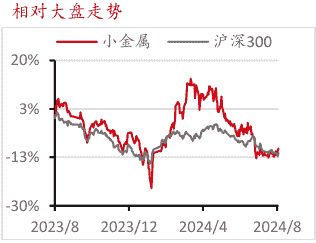

相关报告：
1. 《小金属：供给端储备格局或难改，钼价中枢有望继续上移》2024.08.25
2. 《小金属：稀土基本面有望改善，积极布局产业链核心资产》2024.02.03

## 投资要点

➢ 钼是中国优势矿种，产储量均居全球首位

钼是全球稀缺的战略性小金属，具有高强度、高熔点、高硬度等优良特性，主要应用于各类钢种的添加剂，以提高钢的强度、耐腐蚀、耐高温等性能。根据USGS，截至2023年末，全球钼矿储量为1500万吨金属吨，静态储采比约为56年。中国钼矿资源储量约为580万吨，占全球总储量的38.7%。全球钼矿生产较为集中，资源优势国是主产地；产量位列前三的国家分别是中国、智利、秘鲁、美国和墨西哥，五国钼矿产量合计为24.9万吨金属吨，占全球总产量的92.4%。

➢ 供给端：短期增量主要来自在产矿山扩建

海外钼资源以钼精华生矿为主，近年来钼精华生矿品位下降、大型新能源的缺少及开发难等因素，海外钼矿供给难增。国内虽有多个新建项目，但由于国内钼矿建设周期较长，产量或将于2026年以后释放。短期全球钼矿供给增量主要来自于在产矿山的改扩建，主要包括紫金矿业巨龙铜矿二期扩建、吉林天池钼业小城子德钼矿、泰克资源Quebrada Blanca二期项目等。根据我们的测算，2024—2026年全球钼供给强弱预计为27.7/29.3/30.3万吨，分别同比增加0.7/1.1/1.7万吨。

➢ 需求端：有望显著受益于钢铁行业转型升级

根据IMOA，2023及2024 Q1，全球钼消费量分别为28.6/7.5万吨，分别同比增长0.8%/14.2%。2023年中国钼消费量12.6万吨，占全球消费总量的44.2%。2023年钢铁行业占钼需求总量的79%，其中，含金钢、不锈钢、工具钢及高速钢等优特钢对钼的需求较大。钢铁行业高端化转型和风电、新能源汽车等战略新兴产业的高速发展，有望催化钼金属高端的特钢需求。2024年1—8月，全国钢厂钼铁招量合计约9.7万吨，同比增加29.5%；钢铁钢招量高增，印证钼需求端持续向好。

➢ 供需缺口或将放大，钼价有望迎来主升浪

我们预计2024—2026年全球钼需求量分别为29.9/31.5/33.0万吨，供需缺口分别为-2.1/-2.2/-2.7万吨。供需缺口持续放大，支撑钼价中枢上移。截至2024年8月30日，45%钼精矿出口价为3695元/吨，较年初上涨16.4%；600吨钼均价为24.0万元/基吨，较年初上涨11.6%。截至2024年7月末，钼精矿生产商库存去化天数较上年同期下降73.9%。2024Q3来看，“金九银十”是行业传统需求旺季，叠加矿端库存低位，将赋予钼价更大向上弹性，钼价有望开启新一轮上涨周期。

➢ 投资建议：关注资源端禀赋优质的龙头矿企

我们认为在钼供给扩大的格局下，钼价中枢有望继续上移。推荐资源端禀赋优质的龙头矿企，建议关注紫金矿业、洛阳钼业等。紫金矿业：具备世界级钼资源，公司旗下沙坪沟钼矿为全球储量最大的单体钼矿。2023年公司实现矿产钼0.81万吨，规划2025年、2028年矿产钼分别达1.0万吨、2.5-3.5万吨。洛阳钼业：主力钼矿为三道庄钼矿，2023年公司实现矿产钼1.56万吨，同比增长3.4%；2024年，公司计划实现钼金属产量1.2-1.5万吨。

**风险提示：**宏观经济环境风险；钢铁行业高端化转型升级不及预期；安全生产及环保风险；测算结果与实际偏差风险。

## 重点推荐标的

| 简称 | EPS 2024E | EPS 2025E | EPS 2026E | PE 2024E | PE 2025E | PE 2026E | CAGR-3 | 评级 |
|---|---:|---:|---:|---:|---:|---:|---:|---|
| 紫金矿业 | 1.20 | 1.43 | 1.68 | 13.33 | 11.18 | 9.51 | 28.4% | 买入 |
| 洛阳钼业 | 0.56 | 0.62 | 0.73 | 13.39 | 12.07 | 10.25 | 24.1% | 买入 |

数据来源：公司公告，ifind，国联证券研究所预测，股价取2024年8月30日收盘价

## 投资聚焦

### 核心逻辑

供给端来看，海外钼资源以钼精件生矿为主，近年来，受钼精件生产者品位下降、大型新矿的缺少及开发困难等因素，海外钼矿供给或难增加。国内虽有多个新建项目，但由于钼矿建设周期较长，产量或将于2026年以后释放。短期全球钼矿供给增量主要来自于在产矿山的改扩建项目，主要包括紫金矿业巨龙铜矿二期扩建项目、吉林天池钼业小城子德钼矿、泰克资源Quebrada Blanca二期项目等。根据我们的测算，2024–2026年全球钼供给量预计为27.7/29.3/30.3万吨，分别同比增加0.7/1.5/1.1万吨。

需求端来看，钼主要应用于钢铁行业，合金钢、不锈钢、工具钢及高速钢等优特钢对钼的需求较大。钢铁行业高端化转型和风电、新能源汽车等战略性新兴产业的高速发展，催化高性能、高附加值的不锈钢、合金钢等特钢需求潜力释放，将带动钼消费量的持续增长。我们预计2024–2026年全球钼需求量分别为29.9/31.5/33.0万吨，分别同比增加1.3/1.6/1.5万吨。

我们预计2024–2026年全球钼供需缺口分别为-2.1/-2.2/-2.7万吨；供需缺口持续放大，将支撑钼价中枢上移。截至2024年8月30日，45%钼精矿出厂均价为3695元/吨度，较年初上涨16.4%；60%金属钼均价为24.0万元/基吨，较年初上涨11.6%。截至2024年7月末，钼精矿生产商库存去化天数较上年同期下降73.9%至6天，库存持续低位运行。2024Q3来看，“金九银十”是行业传统需求旺季，叠加矿端库存低位，将赋予钼价更大向上弹性，钼价有望开启新一轮上涨周期。

### 投资看点

我们认为在钼供需缺口扩大的格局下，钼价中枢有望继续上移。推荐资源端禀赋优质的龙头矿企紫金矿业、洛阳钼业等。

**紫金矿业：**具备世界级钼资产，公司旗下安徽金寨沙坪沟钼矿为全球储量最大的单体钼矿；此外，公司旗下巨龙铜矿、多宝山/铜山铜矿均为重要副产钼矿山。2023年公司实现矿产钼0.81万吨，公司规划2025年、2028年矿产钼分别达1.0万吨、2.5–3.5万吨。

**洛阳钼业：**主力钼矿山三道庄钼矿是特大型原生钼钼共生矿，属于全球最大的原生钼矿田—栾川钼矿田的一部分。公司合营公司富川矿业拥有的上房沟钼矿紧邻三道庄钼钼矿，亦属于栾川钼矿田的一部分。2023年，公司实现钼金属产量1.56万吨，同比增长3.4%；2024年，公司计划实现钼金属产量1.2–1.5万吨。

## 正文目录

1. **供给端：短期增量主要来自在产矿山扩建** …… 6
   - 1.1 钼：钼矿供应增长小于金属，中国钼矿产销…… 6
   - 1.2 钼矿资源分布集中，中国储量全球首位…… 7
   - 1.3 中国产量稳中有增，海外件生增量有限…… 9
2. **需求端：有望显著受益于钢铁行业转型升级** …… 14
   - 2.1 钢铁行业是钼核心需求领域…… 14
   - 2.2 钼铁钢招量高增，印证需求持续向好…… 15
   - 2.3 高端化转型升级，特钢需求潜力释放…… 19
3. **供需缺口或将放大，钼价有望迎来主升浪** …… 24
   - 3.1 供不应求格局延续，支撑钼价中枢抬升…… 24
   - 3.2 矿端库存持续去化，钼价具备向上弹性…… 24
4. **投资建议：关注资源端禀赋优质的龙头矿企** …… 26
   - 4.1 紫金矿业：世界级钼资源，打造全新增量…… 26
   - 4.2 洛阳钼业：钼矿品位高，低成本优势突出…… 26
5. **风险提示** …… 28

## 图表目录

图表 1：钼行业产业链 …… 6
图表 2：钼主要产品形态 …… 7
图表 3：2014–2023年全球钼矿资源储量情况（万吨）…… 7
图表 4：2023年全球钼矿资源储量及占比（万吨，%）…… 7
图表 5：全国钼矿资源储量品位占比情况（%）…… 8
图表 6：全国大中小型钼矿矿山数量（2022年）（个）…… 8
图表 7：2020–2022全国钼矿资源储量情况（万吨）…… 8
图表 8：2022–2024H1各省钼精矿产量占比（%）…… 8
图表 9：2014–2023E全球钼矿产量（万吨）…… 9
图表 10：2023E全球钼矿产量占比（%）…… 9
图表 11：智利钼矿产量及同比增速（千吨，%）…… 10
图表 12：秘鲁钼矿产量及同比增速（千吨，%）…… 10
图表 13：2024–2027E泰克资源钼产量指引（千吨）…… 10
图表 14：全国钼精矿产量及同比增速（万吨实物吨，%）…… 11
图表 15：2019–2024全国钼铁月度产量（吨）…… 11
图表 16：全国钼精矿月度净进口量（吨）…… 11
图表 17：全国钼铁月度净出口量（吨）…… 11
图表 18：全国氧化钼月度净出口量（吨）…… 11
图表 19：全国钼酸钼月度净出口量（吨）…… 11
图表 20：国内主要在建/拟建钼矿项目…… 12
图表 21：全球钼供给端测算表…… 13
图表 22：2010–2023全球钼消费量情况（万吨）…… 14

图表 23：2023年全球钼消费量情况
图表 24：2023年全球钼初级消费结构（%）
图表 25：2022年全球钼终端应用领域分布情况（%）
图表 26：钼在钢铁行业中的应用
图表 27：2014–2024 H1中国/美国/日本粗钢产量（亿吨）
图表 28：2023中国/美国/日本吨粗钢用钼量（kg/吨）
图表 29：中国钢铁行业PMI
图表 30：2021–2024全国钢厂钼铁月度招标量（吨）
图表 31：全国重点优特钢企业钢材产量情况
图表 32：全国中厚板厂中厚板月度产量（万吨）
图表 33：全国重点优特钢企业部分金属加工工具钢材产量情况
图表 34：中国/全球不锈钢粗钢产量及中国占比（万吨，%）
图表 35：中国不锈钢粗钢产量及表观消费量（万吨）
图表 36：主要不锈钢的种类及钼含量情况
图表 37：双相不锈钢粗钢产量及同比增速（万吨，%）
图表 38：全国316不锈钢月度产量（万吨）
图表 39：布伦特原油期货结算价（美元/桶）
图表 40：中石油/中海油/中石化勘探开发支出（亿元）
图表 41：全球/中国原油/天然气消费量增速（%）
图表 42：全国管道输油（气）里程（万千米）
图表 43：全球在建/拟建石油输送管道（千米）
图表 44：全球在建/拟建天然气输送管道（千米）
图表 45：全国汽车销量及同比增速（万辆，%）
图表 46：全球汽车销量及同比增速（万辆，%）
图表 47：全国新能源汽车销量及同比增速（万辆，%）
图表 48：全球新能源汽车销量及同比增速（万辆，%）
图表 49：用于车辆制造的高强度钢钢种和应用
图表 50：全国民用钢船舶产量情况
图表 51：全球油/LNG/化学品船新签订单量情况
图表 52：全国风电新增装机量及同比增速（GW，%）
图表 53：2016–2028E全球风电新增装机量（GW）
图表 54：2021–2028E全球风电用钼量（万吨）
图表 55：全球钼需求端测算表
图表 56：2021–2026E全球钼供需平衡表
图表 57：钼精矿出厂含税均价（元/吨度）
图表 58：60%钼铁市场均价（万元/基吨）
图表 59：中国钼化矿加工费TCs现货（美元/磅钼）
图表 60：中国钼精矿生产商库存去化天数（天）
图表 61：紫金矿业沙坪沟钼矿资源储量情况
图表 62：洛阳钼业钼矿基本情况（截至2023年12月31日）
图表 63：重点公司盈利预测与估值表

# 1. 供给端：短期增量主要来自在产矿山扩建

## 1.1 钼：稀缺战略性小金属，中国优势矿种

钼，化学符号为Mo，是一种银白色的可塑性金属，具有高强度、高熔点、高硬度、导热导电性能好、耐研磨、热膨胀系数小、抗腐蚀性能强等优良的物理和化学特性。钼产业链上游为钼矿的采选、钼精矿和氧化钼的生产，钼原矿石经过破碎、研磨及浮选后产出钼精矿，钼精矿经入炉焙烧后产出氧化钼。冶炼、加工环节的产品形态主要分为钼金属（钼棒、钼丝等）、钼炉料（钼铁、钼粉等）以及钼化学品（钼酸铵、二硫化钼等）。

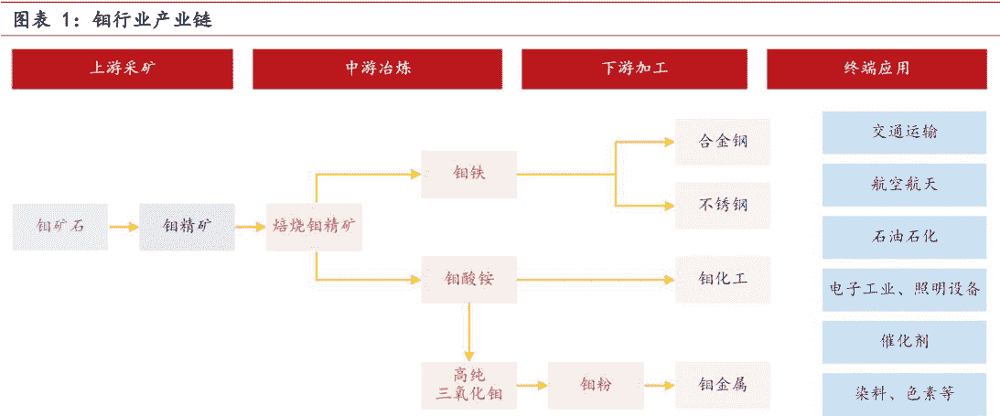

资料来源：SMM、洛阳钼业招股说明书，国联证券研究所

钼终端应用领域为交通运输、能源电力、石油化工、建筑工程、机械制造、电子照明等。含钼不锈钢具有抗腐蚀的特性，大多被用于中度腐蚀性环境，例如建筑的外表等。含钼合金钢用来制造军舰、坦克、枪炮、火箭、卫星的合金构件和零部件；石油管道、飞机、机车和汽车上的耐蚀零件；以及用来制造运输装置、机车、工业机械、高速切削工具等。钼金属制品大量用作高温电炉的发热材料和结构材料、真空管的大型电极等。钼在化工工业中用于润滑剂、催化剂和颜料；其他化学制品被广泛用于染料、墨水、彩色沉淀染料、防腐底漆中；其化合物在农业肥料中也有广泛的用途。

| 产品 | 概述 | 含钼量 |
|---|---|---|
| 钼精矿 | 钼原矿石经过破碎、研磨及浮选后产出钼精矿。钼精矿的主要成分是二硫化钼，用于生产氧化钼 | 45%–51% |
| 氧化钼 | 钼精矿经入炉焙烧后产出氧化钼。氧化钼又称工业氧化钼，已焙烧钼精矿或钼渣砂，是冶炼钼铁的主要原料，也是钼深加工的主要原料。 | 45%–57% |
| 钼铁 | 由氧化钼和氧化铁经过热还原制备而成，是铁合金的一种，作为炼钢的添加剂使用。 | 60%–65% |
| 钼化工 | 钼化工系列产品最主要的品种包括四钼酸铵和高纯氧化钼。四钼酸铵主要用于生产高纯氧化钼、钼粉，并进一步加工成钼棒、钼条等钼金属制品。高纯氧化钼主要用于制取钼基催化剂。 | – |
| 钼金属制品 | 钼金属制品主要有钼粉、钼条、钼杆、钼棒、钼板坯、钼管等，被广泛用于冶金制造、电子管和集成电路等电子工业、模具制造、高温元件、航空航天工业以及核工业等领域。 | – |

资料来源：金钼股份、洛阳钼业招股说明书，国联证券研究所

## 1.2 钼矿资源分布集中，中国储量全球首位

钼是全球稀缺的战略性小金属，含量仅占地壳重量的0.001%，许多国家将钼列为重要的战略性矿产或关键矿产。根据USGS，截至2023年末，全球钼矿储量为1500万金属吨，静态储采比约为56年。全球钼矿床主要集中在环太平洋（中新生代）成矿带、特提斯（中—新生代）成矿带以及中亚—蒙古成矿带上。全球特大型著名钼矿床包括中国栾川钼矿和安徽金寨沙坪沟钼矿、美国Climax和Henderson钼矿、智利Chuquicamata和Pelambre钼矿等。

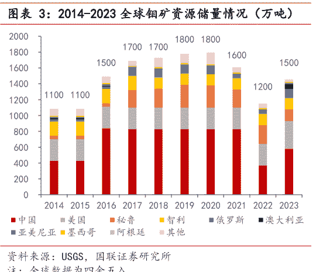

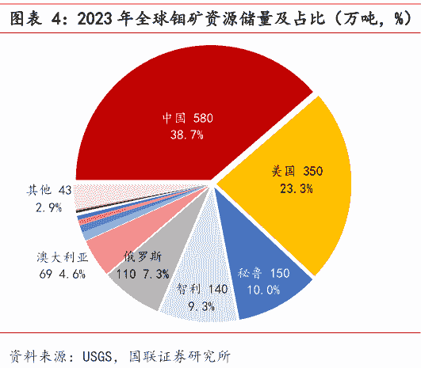

**钼矿资源分布相对集中，中国钼矿资源储量全球第一。** 根据USGS，截至2023年末，钼矿资源储量位列全球前五的国家分别为中国（580万吨，占比38.7%）、美国（350万吨，占比23.3%）、秘鲁（150万吨，占比10.0%）、智利（140万吨，占比9.3%）、俄罗斯（110万吨，占比7.3%）。2023年全球钼资源储量排名前五位国家的钼储量合计约为1300万吨，占比88.7%。

在资源类型方面，根据《全球钼资源供需形势分析与展望》，中国钼资源主要以硫化矿为主，约占全国钼矿资源的78%；其中，钼作为单一矿产的矿床储量占比14%，钼矿为主矿产，同时还伴生有其它有用组分的矿床储量占比64%，与铜、钨、锡伴生的钼储量占比22%；而海外60%以上的钼矿来自铜的副产品。

图表5：全国钼矿资源储量品位占比情况（%）

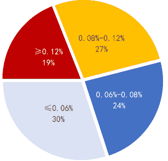

图表6：全国大中小型钼矿矿山数量（2022年）（个）

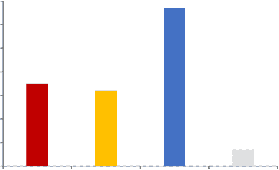

资料来源：《全球钼资源现状及供需形势分析》（周园园等）、国联证券研究所

资料来源：《中国钼矿开发利用现状及资源形势分析》（李政、吴琪等）、国联证券研究所

在资源品位方面，中国的钼矿品位较美国、智利等产钼大国显著偏低；中国钼矿品位大于0.12%的较富钼矿仅占19%；品位大于0.08%的钼矿储量占比46%，即达到钼矿坑采工业品位上限的资源储量不足总量的一半；品位为0.06%~0.08%的钼矿占24%，品位小于0.06%的占30%。

图表7：2020-2022全国钼矿资源储量情况（万吨）

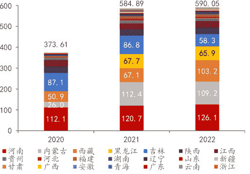

资料来源：自然资源部、iFinD，国联证券研究所

图表8：2022-2024H1各省钼精矿产量占比（%）

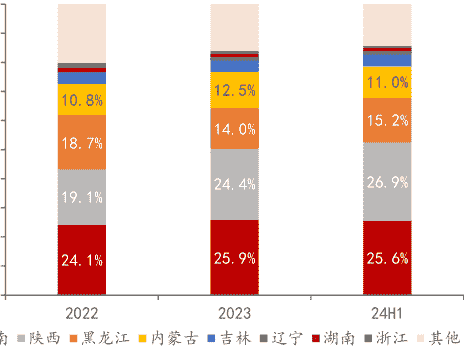

资料来源：SMM，国联证券研究所

中国的铜矿床主要分布在东秦岭—大别铜成矿带、兴蒙铅成矿带、长江中下游铜成矿带、华南铅成矿带、青藏铜成矿带和天山—北山铜成矿带。根据自然资源部，截至2022年末，全国铜资源储量为590.05万吨，其中，河南、内蒙古、西藏、黑龙江、吉林省铜矿资源储量分别为126.1、109.2、103.2、65.9、58.3万吨，占全国总储量的比例分别为21.4%、18.5%、17.5%、11.2%、9.9%；五省储量合计为462.8万吨，占全国总储量的78.4%。

### 1.3 中国产量稳中有增，海外伴生增量有限

全球铜矿生产较为集中，资源优势国是主产地，中国铜产量居全球首位。根据USGS，2023年全球铜矿产量预计为2,700万吨，同比增长6.7%；产量位列前五的国家分别是中国、智利、秘鲁、美国和墨西哥，五国产量合计为2,490万吨，占全球总产量的92.4%。

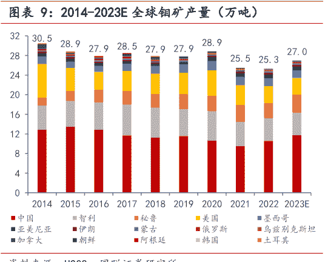

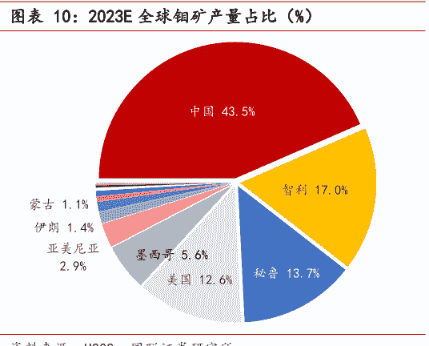

海外铜资源以铜伴生为主。近年来，受铜伴生生产矿石品位下降、大型新矿缺少及开发困难等因素影响，海外铜矿供给或难增加；同时，受社区矛盾以及供水紧张等因素扰动，海外铜资源供给的不确定性加剧。智利、秘鲁是海外铜矿主产区，2024 H1，智利铜矿产量为179万吨，同比下降19.1%；秘鲁铜矿产量为206万吨，同比增长27.0%；智利、秘鲁两国合计铜矿产量为384万吨，同比增长0.4%。

## 图表11：智利铜矿产量及同比增速（千吨，%）

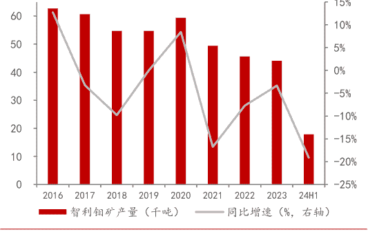

资料来源：智利国家铜业委员会、iFinD，国联证券研究所

## 图表12：秘鲁铜矿产量及同比增速（千吨，%）

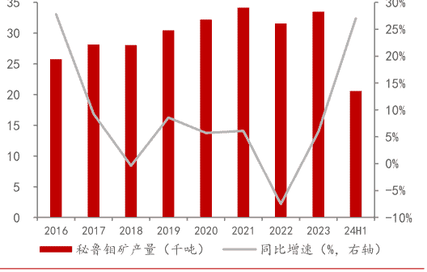

资料来源：秘鲁能源部、iFinD，国联证券研究所

由于矿石品位低于预期，Quebrada Blanca矿山产量指引下调。2024年海外铜新增供给主要由泰克资源Quebrada Blanca二期项目贡献。根据公司公告，泰克资源2024年矿产铜、精矿铜产量指引分别为43.5–50万吨、0.43–0.55万吨；其中，Quebrada Blanca矿产铜、精矿铜产量指引分别为20–23.5万吨、0.18–0.24万吨，较前次指引分别下调3–4万吨、0.11–0.12万吨，主要系矿石品位略低于预期。

## 图表13：2024–2027E泰克资源铜产量指引（千吨）

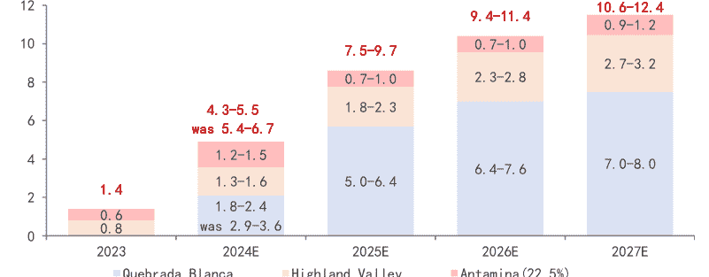

资料来源：公司公告，国联证券研究所

国内矿山方面，受益于铜精矿价格上涨，矿山盈利空间扩大，国内矿山生产较为积极，局部前期在产矿山小幅增产。2023年，全国铜精矿产量约为260.9万实物吨，同比增长9.13%；2024年1–7月，全国铜精矿产量约为176万实物吨，同比增长9.5%。冶炼方面，铜厂铜铁投标景气度高，带动铜铁产量增长。2024年1–7月，全国粗铜产量约为121万吨，同比增长8.9%。进出口方面，2024年1–7月，全国铜精矿累计净进口量为236万吨，同比增长57.8%；铜铁累计净出口量为256吨，同比下降91.6%；氧化铝累计净出口量为4832吨，同比增长76.5%；铜酸镍累计净进口量为69吨，上年同期为净出口44吨。

## 图表14：全国铜精矿产量及同比增速（万吨/吨，%）

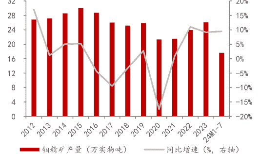

资料来源：中国有色金属工业年鉴、铁合金在线、中国有色金属工业协会铜业分会，国联证券研究所

## 图表15：2019–2024年全国粗铜月度产量（吨）

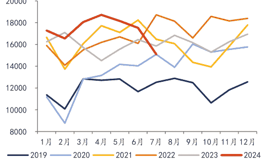

资料来源：铁合金在线、中国有色金属工业协会铜业分会，国联证券研究所

## 图表16：全国铜精矿月度净进口量（吨）

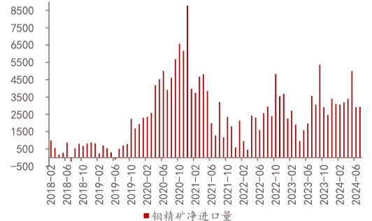

资料来源：SMM，国联证券研究所

## 图表17：全国粗铜月度净出口量（吨）

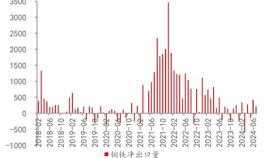

资料来源：SMM，国联证券研究所

## 图表18：全国氧化铝月度净出口量（吨）

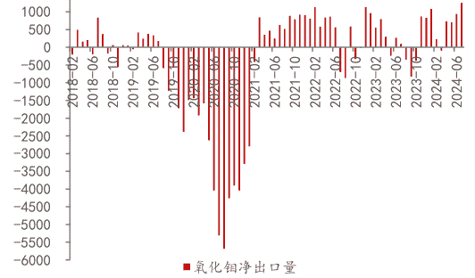

资料来源：SMM，国联证券研究所

## 图表19：全国硫酸镍月度净出口量（吨）

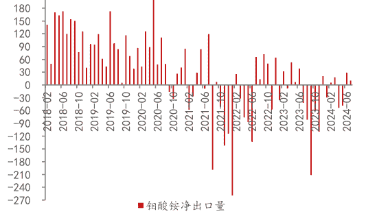

资料来源：SMM，国联证券研究所

| 项目 | 资源情况 | 建设进度 |
|---|---|---|
| 西藏巨龙铜矿 | 巨龙矿区伴生资源铜金属量167.2万吨，平均品位0.019% | 巨龙铜矿二期改扩建项目预计2026年一季度实现试生产，达产后矿产铜年产量将从2023年的50万吨提高至约130万吨 |
| 吉林天池铜业小城季德铜矿 | 已探明铜矿石量3.18亿吨，铜金属储量35万吨，平均品位0.113% | 2022年12月完工，2024年将充分释放产能，达产后可年产铜精矿1.7万吨（47%品位） |
| 大黑山铜矿 | 平均品位0.066%，铜金属含量109万吨 | 目前选矿厂规模为日处理矿量1.6万吨，年产铜精矿7500–8000吨（47%品位）。2024年3月，大黑山铜业3.2万吨/日选矿工程改扩建项目正式开工建设 |
| 安徽沙坪沟铜矿 | 铜金属量为234万吨，其中品位0.3%以上的铜金属量63万吨 | 建设周期约3年，建成达产后年均产铜精矿含铜2.72万吨。根据公司公告，截至2023年末项目尚未开工 |
| 夜长坪铜矿 | 大型铜钼矿床，矿石储量大、品位高，氧化程度高、地下开采深 | 项目一期于2023年8月启动建设，设计规模日处理矿量2.3万吨，二期将扩至3.3万吨 |
| 大兴安岭松岭区岔路口铜钼矿多金属矿 | 已探明的铜金属储量247万吨 | 处于采矿证办理阶段 |

资料来源：紫金矿业、驰宏锌锗、中国黄金集团公司公告、河南省人民政府网站、吉林市及舒兰市人民政府网站、大黑山铜业、陕西有色建设有限公司、长春黄金设计院有限公司网站，国联证券研究所

由于铜矿建设周期较长，短期全球铜矿供给增量主要来自在产矿山的改扩建项目，主要包括紫金矿业巨龙铜矿二期改扩建项目、吉林天池铜业小城季德铜矿、泰克资源Quebrada Blanca二期项目等。根据我们的测算，2024–2026年全球铜供给量预计为27.7/29.3/30.3万吨，分别同比增加0.7/1.5/1.1万吨。

## 图表21：全球铜供给端测算表

| 单位：万吨 | 2020A | 2021A | 2022A | 2023A | 2024E | 2025E | 2026E |
|---|---:|---:|---:|---:|---:|---:|---:|
| 金铜股份 | 2.2 | 2.1 | 2.3 | 2.3 | 2.3 | 2.3 | 2.3 |
| 洛阳铜业 | 1.4 | 1.6 | 1.5 | 1.6 | 1.4 | 1.5 | 1.5 |
| 紫金矿业 | — | — | 0.4 | 0.8 | 0.9 | 1.0 | 1.4 |
| 西部矿业 | — | 0.2 | 0.3 | 0.3 | 0.4 | 0.4 | 0.5 |
| 江西铜业 | 0.4 | 0.4 | 0.4 | 0.5 | 0.5 | 0.5 | 0.5 |
| 中金黄金 | 0.7 | 0.6 | 0.6 | 0.6 | 0.7 | 0.7 | 0.7 |
| 吉林大黑山铜业 | 0.4 | 0.4 | 0.4 | 0.4 | 0.4 | 0.4 | 0.8 |
| 黑龙江伊春鹿鸣铜钼矿 | 0.8 | 1.5 | 1.5 | 1.5 | 1.5 | 1.5 | 1.5 |
| 内蒙古西沙德鑫铜钼矿 | 0.3 | 0.3 | 0.3 | 0.3 | 0.3 | 0.3 | 0.3 |
| 吉林舒兰小城季德铜矿 | — | — | — | 0.3 | 0.5 | 0.8 | 0.8 |
| 自由港 | 3.4 | 3.9 | 3.9 | 3.7 | 3.7 | 4.1 | 4.1 |
| 南方铜业 | 3.0 | 3.0 | 2.6 | 2.7 | 2.7 | 2.9 | 2.9 |
| 智利国家铜业 | 2.8 | 2.1 | 2.0 | 1.6 | 1.5 | 1.5 | 1.5 |
| 安托法加斯塔 | 1.3 | 1.1 | 1.0 | 1.1 | 1.1 | 1.2 | 1.2 |
| 必和必拓 | 0.4 | 0.2 | 0.3 | 0.5 | 0.6 | 0.5 | 0.5 |
| 泰克资源 | 0.1 | 0.0 | 0.0 | 0.1 | 0.4 | 0.8 | 1.0 |
| 五矿资源 | 0.3 | 0.5 | 0.4 | 0.4 | 0.4 | 0.4 | 0.4 |
| 力拓 | 2.0 | 0.8 | 0.3 | 0.2 | 0.3 | 0.3 | 0.3 |
| KGHM | 0.8 | 0.7 | 0.2 | 0.3 | 0.3 | 0.3 | 0.3 |
| Hudbay | 0.1 | 0.1 | 0.1 | 0.2 | 0.1 | 0.1 | 0.2 |
| 其他 | 6.9 | 6.7 | 7.7 | 7.8 | 7.8 | 7.8 | 7.8 |
| **合计** | **27.3** | **26.1** | **26.2** | **27.0** | **27.7** | **29.3** | **30.3** |

资料来源：MOA、USGS、公司公告、iFinD，国联证券研究所

注：必和必拓、泰克资源分别持有秘鲁Antamina铜矿33.75%、22.75%股权。为方便测算，表中必和必拓铜矿产量包含Antamina铜矿100%铜产量，泰克资源铜产量不含Antamina铜矿铜产量。

# 2. 需求端：有望显著受益于钢铁行业转型升级

## 2.1 钢铁行业是铜核心需求领域

根据IMOA，2023年全球铜消费量为2860万吨，同比增长0.8%；2024 Q1，全球铜消费量为750万吨，同比增长14.2%，环比下降3.5%。从各地区消费量来看，中国是全球铜消费量最大的国家，2023年中国铜消费量占全球消费总量的44.2%，其次是欧洲、美国、日本，消费量占全球铜消费总量的比例分别为19.8%、10.2%、7.5%。

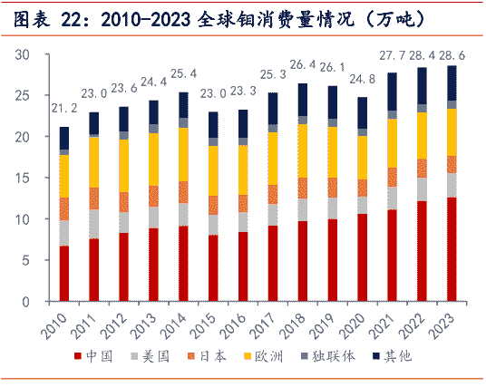

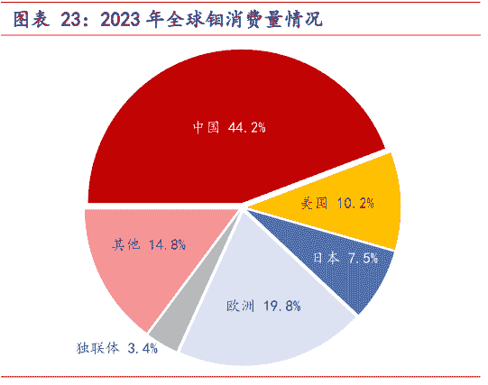

资料来源：IMOA、iFinD、国联证券研究所

资料来源：IMOA、iFinD、国联证券研究所

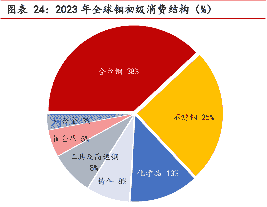

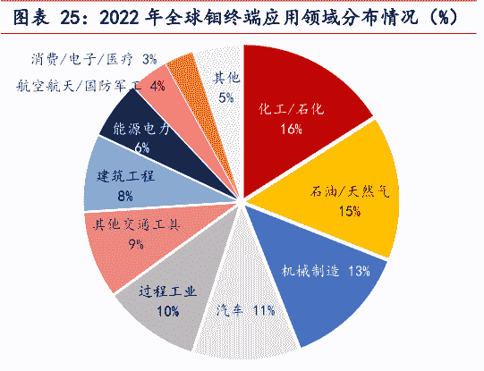

资料来源：IMOA、国联证券研究所

资料来源：IMOA、国联证券研究所

铜主要应用于钢铁行业各类钢种的添加剂，以提高钢的强度、弹性限度、抗磨性及耐冲击、耐腐蚀、耐高温等性能。2023年全球铜初级消费结构中，合金钢、不锈钢、化学品、工具及高速钢、铸件、铜合金领域占比分别为38%、25%、13%、8%、8%、5%。

钢铁行业占粗铜需求总量的70%，其中，合金钢、不锈钢、工具钢及高速钢等优特钢对铜的需求较大。

从铜的终端消费领域来看，根据IMOA，2022年全球化工、石化/石油、天然气/机械制造、汽车、过程工业、其他交通工具、建筑工程、能源电力、航空航天及国防军工、消费电子医疗、其他领域粗铜消费量占比分别为16%、15%、13%、11%、10%、9%、8%、6%、4%、3%、5%。

## 2.2 铜铁钢材量高增，印证需求持续向好

传统产业的改造升级和战略性新兴产业的高速发展，对钢材强度、韧性、耐高温低温、疲劳寿命等综合性能提出了更高要求，钢铁行业向高性能、高附加值的不锈钢、特种钢等合金钢品种发展，持续推动铜消费量增长。根据IMOA、国际钢铁协会数据测算，2023年中国单吨粗钢用铜量约为0.099 kg，而美国、日本的单吨粗钢用铜量分别为0.29、0.20 kg，中国钢铁行业铜消费量仍有较大的提升空间。

### 图表26：铜在钢铁行业中的应用

| 钢型号 | 铜含量 | 用途 |
|---|---:|---|
| 合金钢 | 3%–4% | 运输装置、机车、工业机械 |
| 不锈钢 | 4%–5% | 精密化工仪表、海水环境中使用的设备 |
| 高速钢 | 4%–9.5% | 制造高速切削工具 |
| 铜和镍、铬合金 | 0.6%–2% | 飞机金属构件、耐腐蚀零件 |
| 含铜高强度钢 | 0.015%–0.6% | 石油管道 |
| 优质碳素钢 | 0.2%–0.4% | 板材、线材、管材、棒材 |
| 铸铁 | 1.80% | 机械制造 |

资料来源：洛阳钼业招股说明书，国联证券研究所

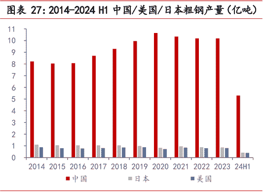

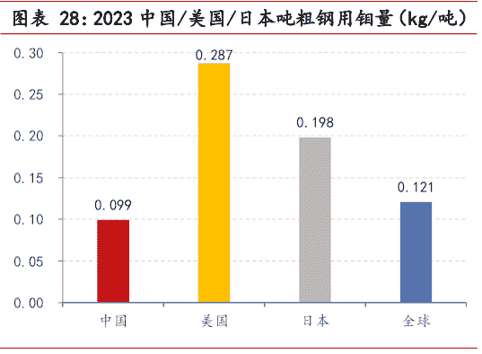

资料来源：国际钢铁协会、iFinD，国联证券研究所

资料来源：IMOA、国际钢铁协会、iFinD，国联证券研究所

普钢产量下滑，特钢产量逆势增长。2024 H1全国粗钢产量为5.3亿吨，同比下降1.1%；全国重点优特钢企业钢材产量5462万吨，同比增长1.6%。从含铜量较高的中厚板来看，2024 H1全国中厚板厂中厚板产量为3933万吨，同比增长2.9%。从钢铁招标指标来看，根据铁合金在线、钨钼云商的统计，2024年1–8月全国钢厂钒铁招标量合计约9.7万吨，同比增长29.5%。钢铁铜招量高增，印证铜需求端持续向好。

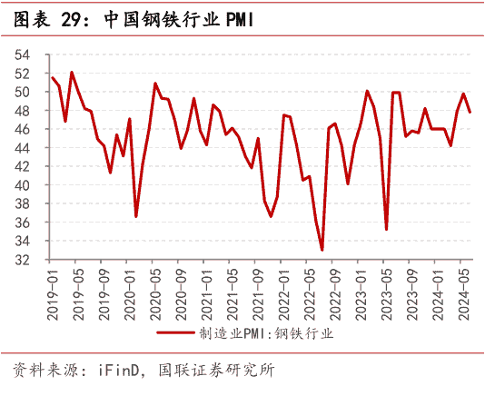

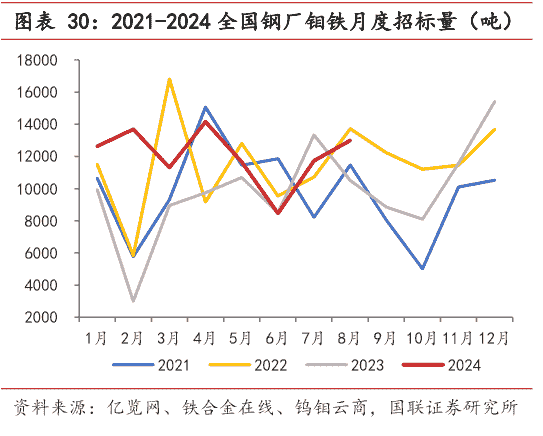

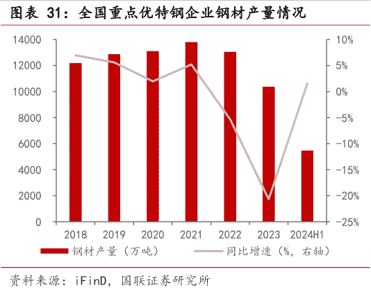

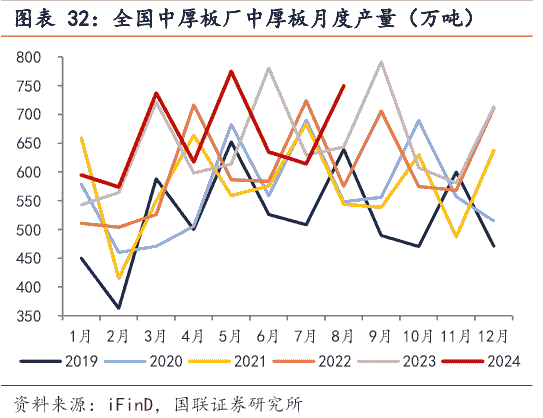

| 图表33：全国重点优特钢企业部分合金钢/工具钢材产量情况 | 2018A | 2019A | 2020A | 2021A | 2022A | 2023A | 2024H1 |
|---|---:|---:|---:|---:|---:|---:|---:|
| 单位：万吨，% |  |  |  |  |  |  |  |
| 低合金钢 | 3731 | 4559 | 4711 | 4941 | 4690 | 3997 | 2010 |
| YoY | 0.4% | 22.2% | 3.3% | 4.9% | -5.1% | -14.8% | -4.8% |
| 特殊质量合金结构钢 | 1842 | 1636 | 1724 | 1669 | 1686 | 1766 | 926 |
| YoY | 20.4% | -11.2% | 5.4% | -3.2% | 1.0% | 4.7% | 3.1% |
| 优质合金钢 | 606 | 623 | 650 | 701 | 591 | 512 | 362 |
| YoY | 20.3% | 2.9% | 4.3% | 7.8% | -15.7% | -13.3% | 41.5% |
| 轴承钢 | 382 | 338 | 349 | 413 | 397 | 418 | 218 |
| YoY | 26.9% | -11.7% | 3.5% | 18.3% | -3.9% | 5.2% | 5.6% |
| 特殊质量齿轮钢 | 347 | 304 | 370 | 403 | 333 | 355 | 191 |
| YoY | 4.0% | -12.5% | 21.9% | 9.0% | -17.4% | 6.7% | 9.3% |
| 合金弹簧钢 | 200 | 225 | 251 | 200 | 178 | 208 | 108 |
| YoY | -3.3% | 12.6% | 12.0% | -20.4% | -11.0% | 16.5% | 9.3% |
| 合金工具钢 | 33.6 | 26.8 | 26.6 | 28.1 | 22.2 | 26.5 | 17.4 |
| YoY | 89.8% | -20.4% | -0.6% | 5.6% | -20.9% | 19.4% | 47.0% |
| 高合金工具钢 | 33.0 | 23.4 | 39.2 | 35.9 | 33.6 | 27.6 | 14.4 |
| YoY | 14.2% | -29.1% | 67.3% | -8.4% | -6.4% | -18.0% | 0.1% |
| 模具钢 | 32.0 | 22.5 | 38.7 | 35.9 | 33.4 | 27.0 | 13.9 |
| YoY | 14.9% | -29.7% | 72.1% | -7.4% | -7.0% | -19.1% | -1.3% |
| 高速工具钢 | 7.3 | 10.2 | 8.0 | 5.7 | 4.7 | 5.1 | 2.6 |
| YoY | -7.3% | 40.1% | -21.9% | -28.9% | -17.7% | 8.3% | 0.8% |

资料来源：iFinD，国联证券研究所

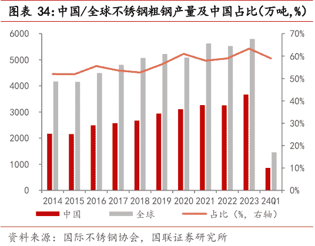

资料来源：国际不锈钢协会，国联证券研究所

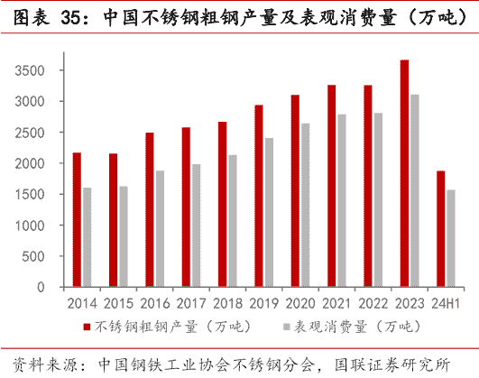

资料来源：中国钢铁工业协会不锈钢分会，国联证券研究所

铝是不锈钢中主要的合金元素之一，铬元素能够提高不锈钢的硬度和耐腐蚀性，含铬不锈钢主要运用于石油化工、航空航天、海洋工业等腐蚀性比较强的环境，316、317、双相不锈钢均为具有代表性的含铬系列不锈钢。根据中国钢铁工业协会不锈钢分会，2024 H1 中国不锈钢粗钢产量/表观消费量分别为 1,875/1,569 万吨，分别同比增长 5.9%/5.8%。含铬系列高端不锈钢产量保持较快增长，全国双相不锈钢产量为 20.3 万吨，同比增长 20.4%。根据 SMM，2024 H1 全国 316 不锈钢产量为 67.7 万吨，同比增长 55.5%。

### 图表 36：主要不锈钢的种类及铬含量情况

| 分类 | 耐蚀性 | 加工性 | 焊接性 | 磁性 | 代表钢号 | 铬含量 | 主要应用 |
|---|---|---|---|---|---|---|---|
| 铬系·铁素体 | 佳 | 尚佳 | 尚可 | 有 | 409、420、440 | 1%–2% | 汽车工业、洗碗机内部、衣物烘干机等。 |
| 铬系·马氏体 | 可 | 可 | 较差 | 有 | 410、430、444 | 0.2%–0.3% | 削刀刀片、耐腐蚀轴承等。 |
| 镍系·奥氏体 | 优 | 优 | 优 | 无 | 304/304L、316/316L、317/317L、321 | 2%–7% | 工业化食品加工设备、化工机械设备、泵轴部件、电力、核电、造船、造纸、航天、国防等工业应用领域。 |
| 镍系·双相 | 优 | 优 | 优 | 无 | S31803、1805、2003、2205、2304、2507 | 3%–5% | 油井、石油、化肥、化工、化纤等领域用管，热水器水箱等。 |

资料来源：久立特材可转债募集说明书、IMOA，国联证券研究所

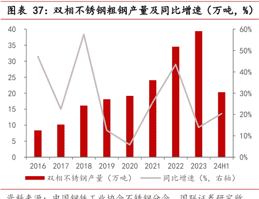

资料来源：中国钢铁工业协会不锈钢分会，国联证券研究所

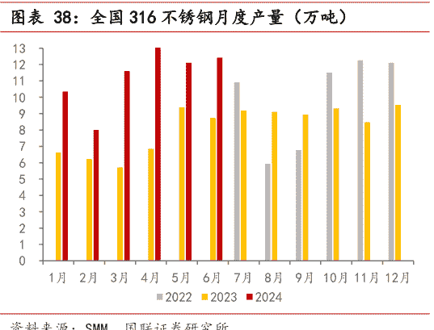

资料来源：SMM，国联证券研究所

## 2.3 高端化转型升级，特钢需求潜力释放

石油及天然气作为主要的一次能源在能源消费结构中具有重要的地位。2023年以来，全球石油及天然气消费量持续回暖。管道作为促进油气能源发展的重要设备，随着全球能源需求的增长而稳健发展。根据《中国天然气发展报告（2024）》，2023年，全球在役天然气管道总里程约为136万千米。根据 Global Gas/Oil Infrastructure Tracker，截至2023年末，全球在建及拟建的天然气、石油管道里程分别为22.9、3.17万千米。油气管道建设所用钢种主要为含钒高强度钢，全球油气管道建设需求的持续增长将拉动合金钢需求的增长。

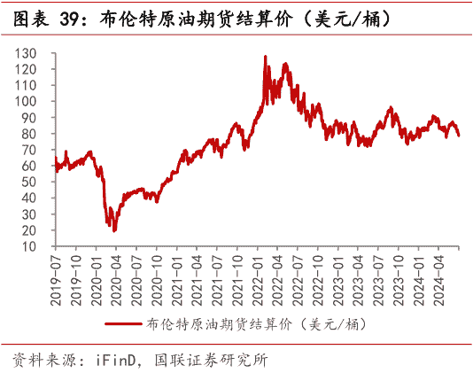

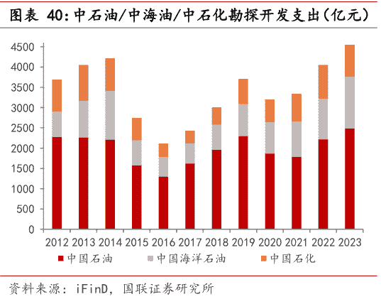

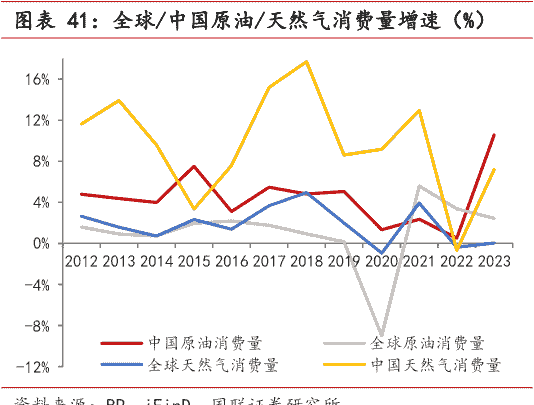

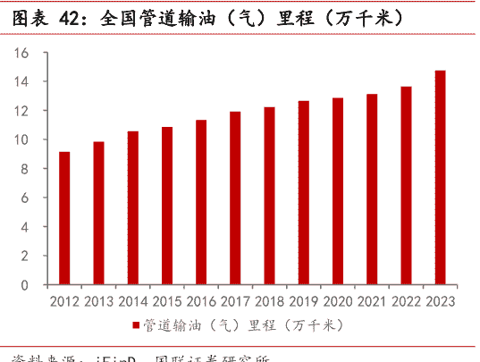

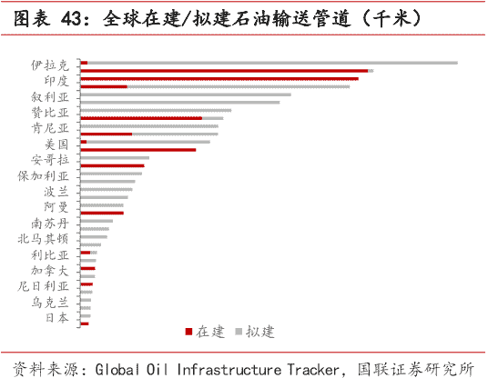

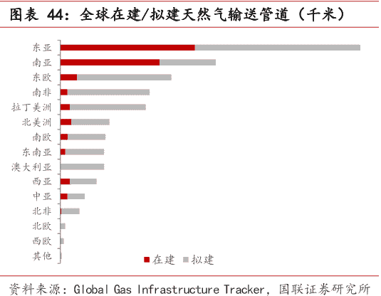

资料来源：Global Oil Infrastructure Tracker，国联证券研究所

资料来源：Global Gas Infrastructure Tracker，国联证券研究所

世界各国加速汽车电动化转型，全面推广新能源汽车。欧盟通过严苛的碳排放法规以及补贴政策驱动新能源汽车渗透率快速提升，并要求从2035年开始在欧盟境内停止销售新燃油车；美国实施价值3690亿美元的《通胀削减法案》，用于重点支持电动车、光伏等清洁能源产业发展，给予新能源汽车7500美元/辆税收抵免。中国《新能源汽车产业发展规划（2021—2035年）》提出，到2025年中国新能源汽车销量占总销量的比例达到20%以上。

**全球新能源汽车产销量大幅增长，将显著拉动含铜高强度钢需求的增长。**2024 H1 全国新能源汽车销量为494.4万辆，同比增长32.0%；全球新能源汽车销量为721.1万辆，同比增长23.9%。新能源汽车产销量大幅增长，将带动新能源汽车车身用钢、无取向硅钢等钢材需求的增长。同时，为持续降低能耗、增加续航里程，**新能源汽车轻量化对高强汽车用钢的要求更高，将带动含铜高强度钢需求的增长。**

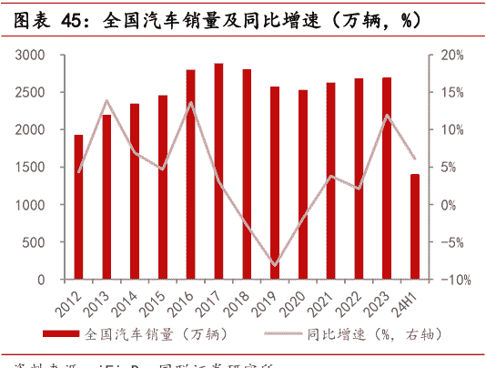

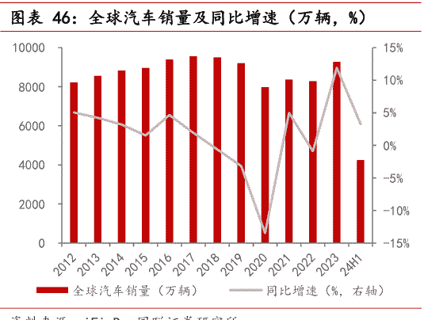

资料来源：iFinD，国联证券研究所

资料来源：iFinD，国联证券研究所

### 图表 47：全国新能源汽车销量及同比增速（万辆，%）

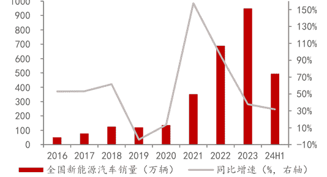

资料来源：中国汽车工业协会、iFinD，国联证券研究所

### 图表 48：全球新能源汽车销量及同比增速（万辆，%）

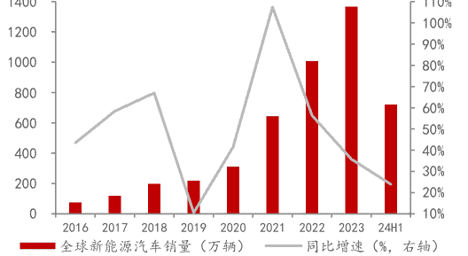

资料来源：CleanTechnica、iFinD，国联证券研究所

### 图表 49：用于车辆制造的高强度钢钢种和应用

| 钢种 | 金相组织 | 强度范围 | 典型应用 | 铝含量 |
|---|---|---|---|---|
| 铁素体贝氏体钢 | 铁素体+贝氏体 | 450–600MPa（T） | 车轮、车身加强件、底盘部件 | 最大 0.2% |
| 贝氏体钢 | 贝氏体（微量马氏体） | 550–800MPa（Y） | 底盘零件、型材、导轨、管 | 最大 0.3% |
| 双相钢 | 铁素体+马氏体（微量贝氏体、奥氏体） | 600–1000MPa（T） | 车身加强件、防侵入梁、纵梁、座椅横梁型材、车轮 | 0.1–0.3% |
| 相变诱导塑性钢 | 铁素体+贝氏体+马氏体+残余奥氏体 | 600–1000MPa（T） | 复杂形状的车身加强件 | 最大 0.2% |
| 复相钢 | 铁素体+贝氏体+马氏体+残余奥氏体 | 800–1000MPa（T） | 车身加强件、保险杠、防侵入梁 | 最大 0.2% |
| 冲压硬化钢 | 马氏体 | 1300–2000MPa（T） | 保险杠、防侵入梁、车身加强件 | 最大 0.2% |

资料来源：IMOA，国联证券研究所

全球油/LNG/化学品船新签订单旺盛，有望带动合金不锈钢需求大幅增长。2020–2022 年受疫情影响，全球航运受到不同程度打击；随着疫情结束后海内外进出口贸易环境持续改善，海运市场不断发展，航运需求量也随之增加。2024 年以来全球新造船市场需求活跃，船企新接订单大增。根据国际船舶网，截至 2024 年 6 月末，全球油/LNG/化学品船新签订单合计为 478 艘，同比增长 77.0%。

### 图表 50：全国民用钢质船舶产量情况

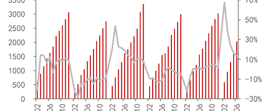

资料来源：iFinD，国联证券研究所

### 图表 51：全球油/LNG/化学品船新签订单量情况

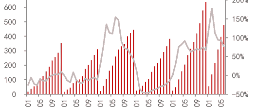

资料来源：国际船舶网、iFinD，国联证券研究所

在全球能源转型的大背景下，创建绿色低碳的发展模式已成为全球的普遍共识，以光伏、风电为代表的清洁能源快速发展。根据 IMOA，目前，在所有可再生能源技术中，风力发电对于增加钢的使用量具有最大的潜力。2023 年，全国风电新增装机量达到 75.66 GW，同比增长 101.1%；2024 H1 全国风电新增装机量 25.84 GW，同比增长 12.4%。根据 GWEC 预计，2028 年全球陆上/海上风电新增装机量将分别达到 146/37 GW，2023–2028 年 CAGR 分别为 6.7%/27.5%。

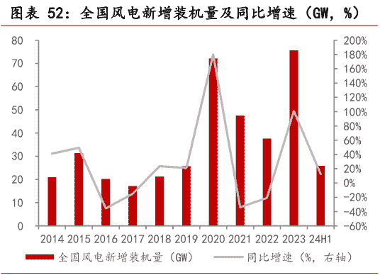

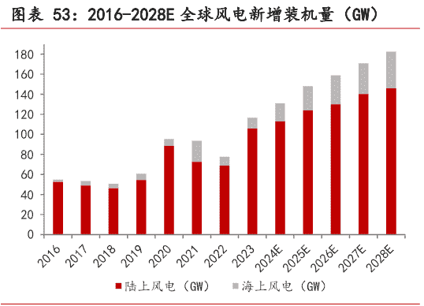

资料来源：iFinD，国联证券研究所

资料来源：GWEC，国联证券研究所

在风电领域，风电机组用特钢以及齿轮部件和驱动轴均用到合金材料。根据 IMOA 的测算，每额定风电机兆瓦需要 100–120 kg 钢。上述风电用钢量尚不包括风电必需的重型运输和安装设备（包括船舶、起重机和自升式钻井平台）所用的钢铁合金材料，若考虑到钢在其中的用量，这一数字还会大大增加。

### 图表 54：2021–2028E 全球风电用钢量（万吨）

| 单位：GW、万吨 | 2021A | 2022A | 2023A | 2024E | 2025E | 2026E | 2027E | 2028E |
|---|---:|---:|---:|---:|---:|---:|---:|---:|
| 全球陆风新增装机量 | 72.5 | 68.8 | 105.8 | 113 | 124 | 130 | 140 | 146 |
| 全球海风新增装机量 | 21.1 | 8.8 | 10.9 | 18 | 24 | 29 | 31 | 37 |
| **全球风电用钢量** | **1.05** | **0.86** | **1.29** | **1.46** | **1.65** | **1.78** | **1.91** | **2.04** |

资料来源：IMOA、GWEC，国联证券研究所

我们假设陆上风电新增装机用钢量为 110 吨/GW，海上风电新增装机用钢量为 120 吨/GW；同时，我们假设 2024–2026 年全球新增陆上风电装机量分别为 113/124/130 GW，新增海上风电装机量分别为 18/24/29 GW，则 2024–2026 年全球风电领域用钢量分别为 1.46/1.65/1.78 万吨，分别同比增长 12.8%/13.2%/7.6%。

钢铁行业高端化转型和风电、新能源汽车等战略性新兴产业的高速发展，催化高性能、高附加值的不锈钢、特种钢等合金钢需求潜力释放，将带动钢需求量的持续增长。根据我们的测算，预计 2024–2026 年全球钢需求量分别为 29.9/31.5/33.0 万吨，分别同比增长 4.5%/5.4%/4.9%。

### 图表 55：全球钢需求端测算表

| 单位：万吨 | 2021A | 2022A | 2023A | 2024E | 2025E | 2026E |
|---|---:|---:|---:|---:|---:|---:|
| **全球粗需求量** | **27.7** | **28.4** | **28.6** | **29.9** | **31.5** | **33.0** |
| 初级产品：合金钢 | 10.8 | 10.8 | 10.9 | 11.2 | 11.7 | 12.2 |
| 初级产品：不锈钢 | 6.7 | 7.1 | 7.1 | 7.5 | 8.0 | 8.3 |
| 初级产品：工具及高速钢 | 2.2 | 2.3 | 2.3 | 2.5 | 2.8 | 3.0 |
| 初级产品：铸件 | 2.2 | 2.3 | 2.3 | 2.4 | 2.5 | 2.6 |
| 初级产品：钨金属 | 1.4 | 1.4 | 1.4 | 1.5 | 1.5 | 1.6 |
| 初级产品：镍合金 | 0.8 | 0.9 | 0.9 | 0.9 | 1.0 | 1.0 |
| 初级产品：铝化工 | 3.6 | 3.7 | 3.7 | 3.9 | 4.1 | 4.3 |
| 终端应用：石油、化工、天然气 | 11.3 | 11.6 | 11.6 | 12.1 | 12.8 | 13.3 |
| 终端应用：交通运输 | 5.5 | 5.7 | 5.8 | 6.2 | 6.6 | 7.0 |
| 终端应用：机械制造 | 3.6 | 3.7 | 3.5 | 3.6 | 3.8 | 4.0 |
| 终端应用：建筑工程 | 2.2 | 2.3 | 2.2 | 2.2 | 2.3 | 2.4 |
| 终端应用：能源电力 | 1.8 | 1.7 | 2.1 | 2.3 | 2.5 | 2.6 |
| 终端应用：航空航天/国防军工 | 1.1 | 1.1 | 1.1 | 1.2 | 1.3 | 1.4 |
| 终端应用：消费/电子/医疗及其他 | 2.2 | 2.3 | 2.2 | 2.2 | 2.2 | 2.3 |

资料来源：IMOA、GWEC、iFinD，国联证券研究所

分初级产品应用来看，我们预计 2024–2026 年合金钢用钨量分别为 11.2/11.7/12.2 万吨，分别同比增长 3.5%/4%/4%；不锈钢用钨量分别为 7.5/8.0/8.3 万吨，分别同比增长 5%/6%/5%；工具、高速钢以及铸件用钨量分别为 4.8/5.2/5.6 万吨，分别同比增长 6.0%/8.1%/7.2%；钨金属、镍合金以及铝化工用钨量分别为 6.3/6.6/6.9 万吨，分别同比增长 4.5%/5.0%/4.5%。

分终端应用领域来看，我们预计 2024–2026 年全球石油、化工、天然气领域钨需求量分别为 12.1/12.8/13.3 万吨，分别同比增长 4.0%/5.5%/4.5%；交通运输领域钨需求量分别为 6.2/6.6/7.0 万吨，分别同比增长 8%/6%/5.5%；能源电力领域钨需求量分别为 2.3/2.5/2.6 万吨，分别同比增长 10%/8%/5%；航空航天、国防军工领域钨需求量分别为 1.2/1.3/1.4 万吨，分别同比增长 5%/8%/10%；机械制造、建筑工程及其他领域钨需求量分别为 8.0/8.3/8.7 万吨，分别同比增长 1.2%/3.5%/4.1%。

# 3. 供需缺口或将放大，铜价有望迎来主升浪

## 3.1 供不应求格局延续，支撑铜价中枢抬升

供给端来看，海外铜资源以铜矿伴生矿为主，近年来，受铜矿伴生矿品位下降、大型新矿的缺少及开发困难等因素，海外铜矿供给或难增加。国内虽有多个新建项目，但由于铜矿建设周期较长，新增项目产量或将于2026年以后释放。短期全球铜矿供给增量主要来自在产矿山的改扩建项目，主要包括紫金矿业巨龙铜矿二期改扩建项目、吉林天池钼业小城季德钼矿、泰克资源 Quebrada Blanca 二期项目等。根据我们的测算，2024–2026年全球铜供给量预计为27.7/29.3/30.3万吨，分别同比增加0.7/1.5/1.1万吨。

需求端来看，铜主要应用于钢铁行业，合金钢、不锈钢、工具钢及高速钢等优特钢对铜的需求较大。钢铁行业高端化转型和风电、新能源汽车等战略性新兴产业的高速发展，催化高性能、高附加值的不锈钢、合金钢等特钢需求潜力释放，将带动铜消费量的持续增长。我们预计2024–2026年全球铜需求量分别为29.9/31.5/33.0万吨，分别同比增加1.3/1.6/1.5万吨。我们预计2024–2026年全球铜供需缺口分别为−2.1/−2.2/−2.7万吨，供需缺口持续放大。

**图表 56：2021–2026E 全球铜供需平衡表**

单位：万吨

|  | 2021A | 2022A | 2023E | 2024E | 2025E | 2026E |
|---|---:|---:|---:|---:|---:|---:|
| 全球铜供给量 | 26.1 | 26.2 | 27.0 | 27.7 | 29.3 | 30.3 |
| 全球铜需求量 | 27.7 | 28.4 | 28.6 | 29.9 | 31.5 | 33.0 |
| **供给−需求** | **−1.6** | **−2.1** | **−1.6** | **−2.1** | **−2.2** | **−2.7** |

资料来源：IMOA、USGS、GWEC、iFinD、公司公告，国联证券研究所

## 3.2 矿端库存持续去化，铜价具备向上弹性

2024年以来，铜价震荡上行；截至2024年8月30日，45%铜精矿出厂均价为3695元/吨度，较年初上涨16.4%；60%铜铁市场均价为24.0万元/基吨，较年初上涨11.6%；中国氧化铜 FOB 平均价为24.3美元/磅铜，较年初上涨30.3%。

截至2024年7月末，铜精矿生产商库存去化天数较上年同期下降73.9%至6天，库存持续低位运行。2024Q3来看，“金九银十”是行业传统需求旺季，叠加前端库存低位，将赋予铜价更大向上弹性，铜价有望开启新一轮上涨周期。

### 图表 57：铝精矿出厂含税均价（元/吨度）

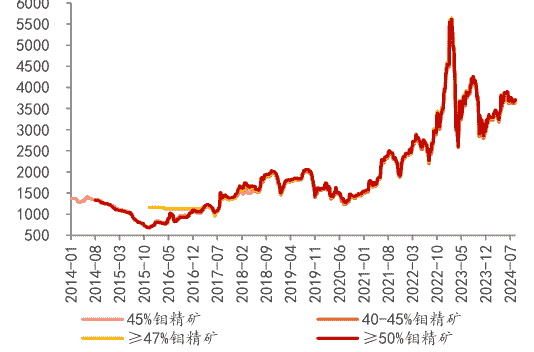

资料来源：iFinD，国联证券研究所

### 图表 58：60%铝铁市场均价（万元/基吨）

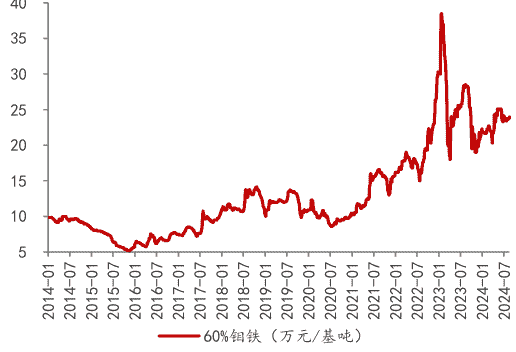

资料来源：iFinD，国联证券研究所

### 图表 59：中国氧化铝 FOB 平均价（美元/磅铝）

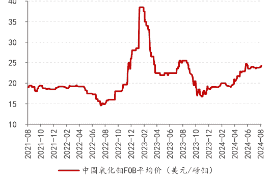

资料来源：SMM，国联证券研究所

### 图表 60：中国铝精矿生产商库存去化天数（天）

资料来源：亚洲金属网，国联证券研究所

# 4. 投资建议：关注资源禀赋优质的龙头矿企

我们认为在铜供需缺口扩大的格局下，铜价中枢有望继续上移。推荐资源禀赋优质的龙头矿企紫金矿业、洛阳钼业等。

## 4.1 紫金矿业：世界级铜资源，打造全新增量

公司拥有世界级铜资产，安徽金寨铜矿为全球储量最大单体铜矿；此外，公司旗下巨龙铜矿、多宝山/铜山铜矿均为重要副产铜矿山。2023年公司实现矿产铜产量0.81万吨，根据公司于2024年5月17日公告的未来五年（至2028年）主要矿产品产量规划，公司规划2025年、2028年矿产铜分别达1.0万吨、2.5–3.5万吨。

**图表 61：紫金矿业沙坪沟铜矿资源储量情况**

| 矿产品级 | 资源级别 | 矿石量（万吨） | 铜品位（%） | 铜金属量（万吨） |
|---|---|---:|---:|---:|
| 工业矿 | 探明 | 22,206.44 | 0.265 | 58.87 |
|  | 控制 | 32,906.32 | 0.182 | 59.96 |
|  | 推断 | 56,930.34 | 0.16 | 91.18 |
|  | **小计** | **112,043.10** | **0.187** | **210.02** |
| 低品位矿 | 探明 | 1,618.39 | 0.044 | 0.7 |
|  | 控制 | 7,710.42 | 0.047 | 3.64 |
|  | 推断 | 41,659.99 | 0.047 | 19.42 |
|  | **小计** | **50,988.80** | **0.047** | **23.76** |
| **合计（工业+低品位矿）** |  | **163,031.90** | **0.143** | **233.78** |

资料来源：公司公告，国联证券研究所

公司旗下安徽沙坪沟铜钼矿为世界级超大型待开发斑岩型矿床，具备资源量大、品位较高、成分单一、矿体集中、适合大规模开采的优势。从资源体量看，沙坪沟铜矿达到233.78万吨，单体储量居全球第一位；从资源禀赋看，平均品位为0.143%，其中0.3%以上高品位铜金属约63万吨，资源价值高。根据中国恩菲工程技术公司的设计，矿山拟按照1000万吨/年采选能力建设，项目建设期4.5年，达产后年均产铜精矿含铜2.72万吨。

## 4.2 洛阳钼业：铜矿品位高，低成本优势突出

公司于中国境内主要运营三道庄钼钨矿区和合营企业所属的上房沟钼铁矿区，主要从事钼、钨金属的采选、冶炼、深加工、科研等，拥有采矿、选矿、冶炼、化工等上下游一体化业务，主要产品包括钼铁、仲钨酸铵、钨精矿及其他钼钨相关产品，同时回收副产铁、铜、萤石、铋等矿物。

公司主力铜矿山三道庄铜矿是特大型原生铜钼共生矿，属于栾川钼矿田的一部分；矿区属特大型钼钨矿床，由一个主体构成，形状简单，呈大规模的层状或似层状，为世界最大的原生钼矿之一，也是中国第二大白钨矿床。公司合营公司富川矿业拥有的上房沟钼矿紧邻三道庄钼矿，亦属于栾川钼矿田的一部分。

三道庄矿含高品位的铜矿石，公司进行现代化、安全化的大型露天开采，采矿成本较低。公司将很多现场矿石运输及选矿程序自动化，加强采矿及矿石运输的效率，进一步降低开采及选矿成本。此外，公司利用钼回收矿获得有价值的副产品，进一步增强三道庄矿的盈利能力。

### 图表 62：洛阳钼业铜矿基本情况（截至2023年12月31日）

| 铜矿 | 资源量：矿石量（百万吨） | 资源量：品位（%） | 资源量：金属量（万吨） | 储量：矿石量（百万吨） | 储量：品位（%） | 储量：金属量（万吨） | 年产矿石处理量（百万吨） | 资源剩余可开采年限（年） | 许可证/采矿权有效期 |
|---|---:|---:|---:|---:|---:|---:|---:|---:|---|
| 三道庄铜钼矿 | 280.93 | 0.087 | 24.46 | 100.44 | 0.084 | 8.44 | 13 | 9 | 11.5年 |
| 上房沟铜矿 | 436.54 | 0.14 | 60.97 | 21.66 | 0.215 | 4.65 | 5.3 | 4.1 | 10年 |
| 东戈壁铜矿 | 441 | 0.115 | 50.82 | 141.58 | 0.139 | 19.68 | / | 38 | 21年 |

资料来源：公司公告，国联证券研究所

注：2024年6月19日，洛阳钼业与中信国安实业集团有限公司签署协议，以29亿元出售持有的东戈壁铜矿65.1%权益。

2023年，公司实现铜金属产量1.56万吨，同比增长3.4%；其中，三道庄铜矿铜金属产量为1.05万吨，同比下降2.8%；上房沟铜矿铜金属产量为0.51万吨，同比增长19.1%。2024年，公司计划实现铜金属产量1.2–1.5万吨；另外，公司于2024年提出未来五年实现年产铜金属2.5–3万吨的发展目标。

### 图表63：重点公司盈利预测与估值表

| 股票代码 | 证券简称 | 股价（元） | EPS（元）2024E | EPS（元）2025E | EPS（元）2026E | PE（X）2024E | PE（X）2025E | PE（X）2026E | CAGR–3（%） | PEG | 评级 | 变动 |
|---|---|---:|---:|---:|---:|---:|---:|---:|---:|---:|---|---|
| 601899.SH | 紫金矿业 | 16.00 | 1.20 | 1.43 | 1.68 | 13.33 | 11.18 | 9.51 | 28.4% | 0.26 | 买入 | 维持 |
| 603993.SH | 洛阳钼业 | 7.49 | 0.56 | 0.62 | 0.73 | 13.39 | 12.07 | 10.25 | 24.1% | 0.29 | 买入 | 维持 |

数据来源：公司公告、iFinD，国联证券研究所预测；股价为2024年8月30日收盘价

# 5. 风险提示

**宏观经济环境风险：**当前宏观环境存在较多不确定性，货币政策、地缘政治、能源危机、贸易保护等因素交织，全球经济增速承压，流动性风险概率增加。铜广泛应用于钢铁行业等，经济形势波动将对原材料供应、产品下游需求及价格产生影响，相关公司营业收入与利润将可能受到影响。

**钢铁行业高端化转型升级不及预期：**铜主要应用于钢铁行业各类钢种的添加剂，以提高钢的强度、弹性限度、抗磨性及耐冲击、耐腐蚀、耐高温等性能。合金钢、不锈钢、工具钢及高速钢等优特钢对铜的需求较大。若钢铁行业高端化转型升级进展不及预期，则市场对特钢的需求下滑，或将带来钢行业供需格局的恶化。

**安全生产及环保风险：**铜矿资源在勘探、选矿、冶炼过程中，存在发生意外事故、技术问题、机械故障或损坏的可能，从而对相关企业经营带来风险。此外，随着国家产业升级和深化改革步伐的深入，国家对资源密集型行业安全环保要求日趋严格，相关环境、安全及能耗管控政策也对企业的生产经营提出了更高的要求。

**测算结果与实际偏差风险：**本文在分析全球铜供需情况时引入了一系列假设，存在假设条件与实际情况存在一定差异的可能，从而导致测算结果产生偏差。

## 分析师声明

本报告署名分析师在此声明：我们具有中国证券业协会授予的证券投资咨询业务资格及相当的专业胜任能力。本报告所表述的所有观点均准确地反映了我们对标的证券和发行人的个人看法。我们所得到报酬的任何部分不曾与、不与、也将不会与本报告中的具体投资建议或观点有直接或间接联系。

## 评级说明

| 投资建议的评级标准 | 评级类别 | 评级 | 说明 |
|---|---|---|---|
| 报告中投资建议所涉及的评级分为股票评级和行业评级（另有说明的除外）。评级标准为报告发布日后6到12个月内的相对市场表现，也即：以报告发布日后的6到12个月内的公司股价（或行业指数）相对同期相关市场平均水平相对涨跌的涨跌幅作为基准。其中：A股市场以沪深300指数为基准，北交所市场以北证50指数为基准；香港市场以摩根士丹利中国指数为基准；美国市场以纳斯达克综合指数或标普500指数为基准；韩国市场以柯斯达克指数或韩国综合股价指数为基准。 | 股票评级 | 买入 | 相对同期相关证券市场代表性指数涨幅大于10% |
|  |  | 增持 | 相对同期相关证券市场代表性指数涨幅在5%~10%之间 |
|  |  |  | 持有 | 相对同期相关证券市场代表性指数涨幅在-5%~5%之间 |
|  |  |  | 卖出 | 相对同期相关证券市场代表性指数涨幅小于-5% |
|  | 行业评级 | 强于大市 | 相对表现优于同期相关证券市场代表性指数 |
|  |  | 中性 | 相对表现与同期相关证券市场代表性指数持平 |
|  |  | 弱于大市 | 相对表现弱于同期相关证券市场代表性指数 |

## 一般声明

除非另有规定，本报告中的所有材料版权均属国联证券股份有限公司（已获中国证监会许可的证券投资咨询业务资格）及其附属机构（以下统称“国联证券”）。未经国联证券事先书面授权，不得以任何方式修改、发送或者复制本报告及其所包含的材料、内容。所有本报告中使用的商标、服务标识及标记均为国联证券的商标、服务标识及标记。

本报告是机密的，仅供我们的客户使用，国联证券不因收件人收到本报告而视其为国联证券的客户。本报告中的信息均来源于我们认为可靠的已公开资料，但国联证券对这些信息的准确性及完整性不作任何保证。本报告中的信息、意见等均仅供客户参考，不构成所述证券买卖的出价或征价邀请或要约。该等信息、意见并未考虑到获取本报告人员的具体投资目的、财务状况以及特定需求，在任何时候均不构成对任何人的个人推荐。客户应当对本报告中的信息和意见进行独立评估，并应同时考虑各自的投资目的、财务状况和特定需求，必要时就法律、商业、财务、税收等方面咨询专家的意见。对依据或者使用本报告所造成的一切后果，国联证券及/或其关联人员均不承担任何法律责任。

本报告所载的意见、评估及预测仅为本报告出具目的的观点和判断。该等意见、评估及预测无需通知即可随时更改。过往的表现不应作为日后表现的预示和担保。在不同时期，国联证券可能会发出与本报告所载意见、评估及预测不一致的研究报告。

国联证券的销售人员、交易人员以及其他专业人士可能会依据不同假设和标准、采用不同的分析方法而口头或书面发表与本报告意见及建议不一致的市场评论和/或交易观点。国联证券没有将此意见及建议向报告所有接收者进行更新的义务。国联证券的资产管理部门、自营部门以及其他投资业务部门可能独立做出与本报告中的意见或建议不一致的投资决策。

## 特别声明

在法律许可的情况下，国联证券可能会持有本报告中提及公司所发行的证券并进行交易，也可能为这些公司提供争取承揽投资银行、财务顾问和金融产品等各种金融服务。因此，投资者应当考虑到国联证券及/或其相关人员可能存在影响本报告观点客观性的潜在利益冲突，投资者请勿将本报告视为投资或其他决定的唯一参考依据。

## 版权声明

未经国联证券事先书面许可，任何机构或个人不得以任何形式翻版、复制、转载、刊登和引用。否则由此造成的一切不良后果及法律责任由私自翻版、复制、转载、刊登和引用者承担。

## 联系我们

北京：北京市东城区安外大街208号玖安广场A座4层　　　　　　　　　上海：上海市虹口区杨树浦路188号星立方大厦8层

无锡：江苏省无锡市金融一街8号国联金融大厦16楼　　　　　　　　深圳：广东省深圳市福田区益田路4068号卓越时代广场1期13楼
