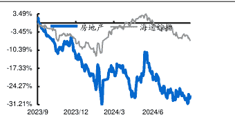
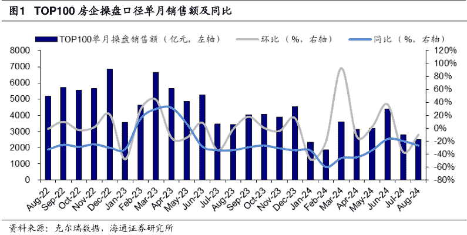
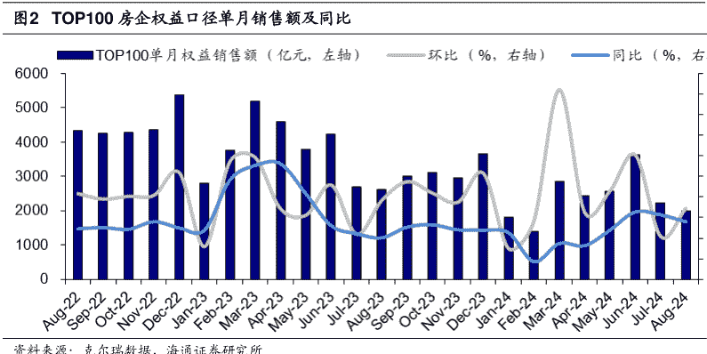
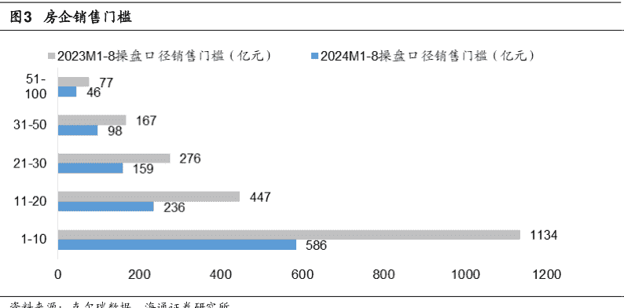

# TOP100房企8月销售数据点评——单月销售同比降幅扩大，旺季或将环比改善

## 行业月报

证券研究报告  
2024年09月03日

投资评级：优于大市（维持）

### 市场表现

资料来源：海通证券研究所

### 相关研究

- 《TOP100房企7月销售数据点评——政策利好边际效应减弱，单月销售环比减弱》2024.08.02
- 《TOP100房企6月销售数据点评——环比提升明显，同比降幅再收窄》2024.07.02
- 《融资并举去库存，推动行业新均衡》2024.05.18

## 投资要点

- **2024年8月百强房企单月销售同比降幅扩大。** 根据克而瑞公布的2024年1-8月销售业绩排行榜数据，前100强房企操盘口径销售金额达到23821.5亿元，较23年同期降36.5%，降幅较7月缩小1.0个百分点；权益金额达到18926.3亿元，较23年同期降36.3%，降幅较7月缩小1.2个百分点，权益比79%。2024年1-8月前50强房企操盘口径销售金额达到20517.40亿元，较23年同期降36.0%，降幅较7月缩小1.2个百分点；权益金额达到15931.3亿元，较23年同期降35.9%，降幅较7月缩小1.3个百分点，权益比78%。

从2024年8月单月情况来看，TOP100房企实现操盘口径销售金额2512.5亿元，环比-10.0%，同比-26.8%。2024年8月TOP100房企实现权益销售金额为1989.3亿元，环比-11.1%，同比-24.1%。

- **对比23年和24年1-8月操盘口径销售门槛来看，** TOP51-100房企的销售操盘金额门槛同比-40.1%，从77亿元下降至46亿元，门槛降幅相对最大。

从2024年1-8月操盘口径销售金额来看，TOP1-10房企同比降幅相对较小，同比-31.7%；TOP21-30房企降幅相对较高，同比-43.4%。

从2024年1-8月权益销售金额来看，TOP1-10房企同比降幅相对较小，同比-31.0%；TOP21-30房企降幅相对较高，同比-42.4%。

- **2024年8月三成百强房企单月销售同比正增长。** 从2024年8月单月操盘销售金额情况来看，单月最高保利发展为202亿元，其次绿城中国为181亿元，华润置地、万科A和中国海外发展当月销售在137-175亿元，金地集团、融创中国和招商蛇口在68-128亿元。

从2024年8月单月操盘金额增速来看，前50强房企中仅有16家实现同比正增长。其中，远洋集团同比增速最高为85.6%，其次融创中国为75.7%。跌幅榜中，万达商业等跌幅超过-60%。

- **投资建议：维持“优于大市”评级。** 我们认为行业政策近期明显存在松绑，格局改善，空间打开，优质公司的价值将会更加突出。**建议关注：** 1）开发类：A股-万科A、保利发展、招商蛇口、城建发展、天健集团；H股-中国海外发展；2）商住类：华润置地、龙湖集团、新城控股；3）物业类：万物云、华润万象生活、中海物业、保利物业、招商积余、新大正；4）文旅类-华侨城A。

- **风险提示：** 销售不畅，行业总量下行风险。

分析师：涂力磊  
Tel:021-23185710  
Email:tll5535@haitong.com  
证书:S0850510120001

联系人：曾佳敏  
Tel:(021)23185689  
Email:zjm14937@haitong.com

## 目录

1. 2024年8月百强房企单月销售同比降幅扩大
2. 2024年8月三成百强房企单月销售同比正增长
3. 投资建议
4. 风险提示

## 图目录

- 图1　TOP100房企操盘口径单月销售金额及同比
- 图2　TOP100房企权益口径单月销售金额及同比
- 图3　房企销售门槛

# 1. 2024年8月百强房企单月销售同比降幅扩大

根据克而瑞公布的2024年1-8月销售业绩排行榜数据，前100强房企操盘口径销售金额达到23821.5亿元，较23年同期-36.5%，降幅较7月缩小1.0个百分点；权益金额达到18926.3亿元，较23年同期-36.3%，降幅较7月缩小1.2个百分点，权益比79%。2024年1-8月前50强房企操盘口径销售金额达到20517.4亿元，较23年同期-36.0%，降幅较7月缩小1.2个百分点；权益金额达到15931.3亿元，较23年同期-35.9%，降幅较7月缩小1.3个百分点，权益比78%。

从2024年8月单月情况来看，TOP100房企实现操盘口径销售金额2512.5亿元，环比-10.0%，同比-26.8%。2024年8月TOP100房企实现权益销售金额为1989.3亿元，环比-11.1%，同比-24.1%。

从不同梯队房企的销售情况来看，2024年1-8月TOP1-10的房企实现操盘口径销售金额12180亿元，同比-31.7%；操盘口径销售面积6583万平米，同比-37.8%；权益销售金额9038亿元，同比-31.0%，权益比重74%。

2024年1-8月TOP11-20房企实现操盘口径销售金额3941亿元，同比-40.9%；操盘口径销售面积2494万平米，同比-38.7%；权益销售金额2987亿元，同比-41.8%，权益比重76%。

2024年1-8月TOP21-30房企实现操盘口径销售金额1862亿元，同比-43.4%；操盘口径销售面积1213万平米，同比-35.8%；权益销售金额1617亿元，同比-42.4%，权益比重87%。

2024年1-8月TOP31-50房企实现操盘口径销售金额2536亿元，同比-40.9%；操盘口径销售面积1470万平方米，同比-38.3%；权益销售金额2289亿元，同比-39.7%，权益比重90%。

2024年1-8月TOP51-100房企实现操盘口径销售金额3304亿元，同比-39.4%；操盘口径销售面积1767万平方米，同比-37.3%；权益销售金额2995亿元，同比-38.3%，权益比重91%。

从2024年1-8月操盘口径销售金额来看，TOP1-10房企同比降幅相对较小，同比-31.7%；TOP21-30房企降幅相对较高，同比-43.4%。

从2024年1-8月权益销售金额来看，TOP1-10房企同比降幅相对较小，同比-31.0%；TOP21-30房企降幅相对较高，同比-42.4%。

| 2024年1-8月销售情况 | 1-8月操盘口径销售金额（亿元） | 同比（%） | 1-8月操盘口径销售面积（万平方米） | 同比（%） | 1-8月权益销售（亿元） | 同比（%） | 权益比重 |
|---|---:|---:|---:|---:|---:|---:|---:|
| 1-10 | 12180 | -31.7% | 6583 | -37.8% | 9038 | -31.0% | 74% |
| 11-20 | 3941 | -40.9% | 2494 | -38.7% | 2987 | -41.8% | 76% |
| 21-30 | 1862 | -43.4% | 1213 | -35.8% | 1617 | -42.4% | 87% |
| 31-50 | 2536 | -40.9% | 1470 | -38.3% | 2289 | -39.7% | 90% |
| 51-100 | 3304 | -39.4% | 1767 | -37.3% | 2995 | -38.3% | 91% |
| TOP50 | 20517 | -36.0% | 11760 | -37.9% | 15931 | -35.9% | 78% |
| TOP100 | 23822 | -36.5% | 13527 | -37.8% | 18926 | -36.3% | 79% |

资料来源：克而瑞数据，海通证券研究所

对比23年和24年1-8月操盘口径销售门槛来看，TOP51-100房企的销售操盘金额门槛同比-40.1%，从77亿元下降至46亿元，门槛降幅相对最大。

资料来源：克而瑞数据，海通证券研究所

# 2. 2024年8月三成百强房企单月销售同比正增长

以下数据为第三方监测数据，口径为操盘口径和权益口径，建议同时参考上市公司公告。

从2024年8月单月操盘销售金额情况来看，单月最高保利发展为202亿元，其次绿城中国为181亿元，华润置地、万科A和中国海外发展当月销售在137-175亿元，金地集团、融创中国和招商蛇口在68-128亿元。

从2024年8月单月操盘金额增速来看，前50强房企中仅有16家实现同比正增长。其中，远洋集团同比增速最高为85.6%，其次融创中国为75.7%。跌幅榜中，万达商业等跌幅超过-60%。

从2024年1-8月累计操盘金额同比23年同期值来看，前50强房企0家实现正增长。其中，中南建设等超过-60%的同比负增长。

**表1  前50强房企1-8月销售及同比情况**

| 操盘金额排名 | 企业简称 | 2024年1-8月操盘销售金额（亿元） | 1-8月操盘同比（%） | 2024年1-8月权益销售金额（亿元） | 1-8月权益同比（%） |
|---:|---|---:|---:|---:|---:|
| 1 | 保利发展 | 2009 | -26.2% | 1740 | -18.0% |
| 2 | 中国海外发展 | 1710 | -14.9% | 1620 | -14.9% |
| 3 | 绿城中国 | 1656 | -2.8% | 740 | -0.3% |
| 4 | 万科A | 1528 | -33.5% | 1064 | -33.5% |
| 5 | 华润置地 | 1398 | -27.5% | 1080 | -29.3% |
| 6 | 招商蛇口 | 1231 | -35.4% | 903 | -29.3% |
| 7 | 建发国际集团 | 773 | -34.6% | 601 | -34.7% |
| 8 | 龙湖集团 | 663 | -42.0% | 447 | -45.1% |
| 9 | 滨江集团 | 626 | -40.9% | 356 | -37.1% |
| 10 | 华发股份 | 586 | -31.5% | 396 | -39.4% |
| 11 | 金地集团 | 556 | -51.0% | 295 | -56.3% |
| 12 | 中国金茂 | 534 | -39.9% | 389 | -42.1% |
| 13 | 中国铁建 | 464 | -18.5% | 422 | -13.1% |
| 14 | 越秀地产 | 458 | -30.8% | 422 | -30.8% |
| 15 | 绿地控股 | 405 | -42.6% | 384 | -42.6% |
| 16 | 碧桂园 | 396 | -77.9% | 326 | -78.5% |
| 17 | 融创中国 | 332 | -43.0% | 192 | -44.9% |
| 18 | 保利置业 | 321 | -13.8% | 249 | -22.8% |
| 19 | 美的置业 | 236 | -47.2% | 168 | -46.8% |
| 20 | 新城控股 | 233 | -45.5% | 206 | -45.4% |
| 21 | 旭辉控股集团 | 213 | -52.7% | 125 | -52.7% |
| 22 | 电建地产 | 212 | -28.3% | 163 | -34.0% |
| 23 | 中国恒大 | 197 | -56.6% | 186 | -56.6% |
| 24 | 远洋集团 | 182 | -43.3% | 148 | -43.3% |
| 25 | 世茂集团 | 175 | -32.7% | 157 | -32.7% |
| 26 | 卓越集团 | 169 | -55.3% | 148 | -50.6% |
| 27 | 建业地产 | 159 | -42.3% | #N/A | #N/A |
| 28 | 大华集团 | 155 | -38.7% | 151 | -39.0% |
| 29 | 仁恒实业控股 | 147 | -31.4% | 63 | -55.1% |
| 30 | 路劲 | 147 | -49.8% | 155 | -49.8% |
| 31 | 中交房地产 | 144 | -39.7% | 177 | -37.6% |
| 32 | 华侨城A | 140 | -52.1% | 116 | -55.2% |
| 33 | 首开股份 | 136 | -46.3% | 128 | -46.3% |
| 34 | 联发集团 | 123 | -53.8% | 108 | -49.0% |
| 35 | 雅居乐集团 | 119 | -43.8% | 124 | -43.8% |
| 36 | 中南建设 | 112 | -60.2% | 83 | -55.2% |
| 37 | 合生创展 | 103 | -28.0% | 94 | -28.0% |
| 38 | 阳光城 | 98 | -48.8% | 75 | -48.8% |
| 39 | 金融街 | 98 | -38.5% | 104 | -38.5% |
| 40 | 金辉集团 | 94 | -40.2% | 79 | -40.9% |
| 41 | 中骏集团控股 | 73 | -66.5% | 68 | -65.4% |
| 42 | 华宇集团 | 71 | -38.7% | 61 | -31.4% |
| 43 | 中梁控股 | 71 | -49.0% | 69 | -49.0% |
| 44 | 宝龙地产 | 67 | -58.5% | 63 | -53.1% |
| 45 | 复地集团 | 67 | -43.2% | 57 | -46.9% |
| 46 | 新希望地产 | 66 | -39.3% | 69 | -48.1% |
| 47 | 石榴集团 | 63 | 0.0% | 60 | #N/A |
| 48 | 敏捷集团 | 62 | -44.2% | 63 | -44.1% |
| 49 | 金科股份 | 61 | -49.9% | 55 | -50.1% |
| 50 | 万达商业 | 59 | -52.3% | 54 | -51.3% |

资料来源：克而瑞数据，海通证券研究所

备注：销售全口径，是指按企业集团间合同及联营公司所有项目计入业绩的统计方式，不考虑权益比例和是否操盘。由于代理属于输出管理行为，在全口径榜单数据中统一不包括代理产生的销售业绩。全口径反映的是企业城市布局和项目拓展的能力。

操盘口径是以企业操盘为口径，即若某项目为多家房企合作开发，则该项目的业绩仅归入操盘企业。反映的是企业的营销和操盘能力，企业代建产生的销售业绩纳入操盘口径统计中。

权益口径是以企业股权占比为口径，即若某项目为多家房企合作，则该项目的业绩按照股权占比计入相应企业。反映的是企业的资金实力与投资能力。（注：权益口径数据不包括母公司以及关联方权益、员工跟投部分）

**表2  前50强房企8月单月销售及同比情况**

| 操盘金额排名 | 企业简称 | 2024年8月操盘销售金额（亿元） | 8月操盘同比（%） | 2024年8月权益销售金额（亿元） | 8月权益同比（%） |
|---:|---|---:|---:|---:|---:|
| 1 | 保利发展 | 202 | -28.4% | 175 | -32.4% |
| 2 | 中国海外发展 | 175 | -2.7% | 166 | 59.1% |
| 3 | 绿城中国 | 181 | 0.0% | 60 | 11.1% |
| 4 | 万科A | 161 | -21.1% | 112 | -21.1% |
| 5 | 华润置地 | 137 | -27.6% | 113 | -9.8% |
| 6 | 招商蛇口 | 128 | -29.2% | 93 | -22.5% |
| 7 | 建发国际集团 | 47 | -63.3% | 38 | -57.4% |
| 8 | 龙湖集团 | 66 | -43.8% | 47 | -40.2% |
| 9 | 滨江集团 | 62 | -6.3% | 26 | -16.8% |
| 10 | 华发股份 | 59 | 24.7% | 37 | 22.0% |
| 11 | 金地集团 | 68 | -49.0% | 34 | -56.8% |
| 12 | 中国金茂 | 58 | 23.9% | 43 | 21.6% |
| 13 | 中国铁建 | 58 | 8.8% | 48 | 6.2% |
| 14 | 越秀地产 | 65 | 2.0% | 60 | 2.0% |

资料来源：克而瑞数据，海通证券研究所

# 3. 投资建议

维持“优于大市”评级。我们认为行业政策近期明显存在松绑，格局改善，空间打开，优质公司的价值将会更加突出。

建议关注：
1）开发类：A股-万科A、保利发展、招商蛇口、城建发展、天健集团；H股-中国海外发展；
2）商住类：华润置地、龙湖集团、新城控股；
3）物业类：万物云、华润万象生活、中海物业、保利物业、招商积余、新大正；
4）文旅类-华侨城A。

# 4. 风险提示

销售不畅，行业总量下行风险。

| 排名 | 公司 | 数值1 | 变化1 | 数值2 | 变化2 |
|---:|---|---:|---:|---:|---:|
| 15 | 绿地控股 | 48 | -13.0% | 45 | -13.1% |
| 16 | 碧桂园 | 39 | -70.4% | 33 | -75.0% |
| 17 | 融创中国 | 69 | 75.7% | 40 | 74.8% |
| 18 | 保利置业 | 23 | 4.1% | 17 | -19.0% |
| 19 | 美的置业 | 25 | -39.6% | 18 | -43.9% |
| 20 | 新城控股 | 20 | -56.8% | 14 | -66.4% |
| 21 | 旭辉控股集团 | 18 | -55.3% | 10 | -55.4% |
| 22 | 电建地产 | 11 | -17.7% | 12 | 7.4% |
| 23 | 中国恒大 | 14 | -67.2% | 13 | -67.1% |
| 24 | 远洋集团 | 22 | 85.6% | 18 | 86.3% |
| 25 | 世茂集团 | 20 | 21.4% | 18 | 22.0% |
| 26 | 卓越集团 | 22 | 0.5% | 20 | 19.3% |
| 27 | 建业地产 | 15 | -48.7% | - | - |
| 28 | 大华集团 | 17 | -33.1% | 16 | -32.8% |
| 29 | 仁恒实业控股 | 14 | 16.1% | 4 | -53.3% |
| 30 | 路劲 | 10 | 5.2% | 11 | 6.0% |
| 31 | 中交房地产 | 15 | 10.2% | 19 | -17.0% |
| 32 | 华侨城A | 22 | 6.3% | 21 | 2.0% |
| 33 | 首开股份 | 19 | 15.1% | 18 | 15.4% |
| 34 | 联发集团 | 12 | -49.6% | 11 | -40.8% |
| 35 | 雅居乐集团 | 10 | -50.5% | 10 | -51.0% |
| 36 | 中南建设 | 11 | -57.8% | 8 | -53.1% |
| 37 | 合生创展 | 18 | 62.0% | 16 | 62.2% |
| 38 | 阳光城 | 13 | -33.5% | 10 | -32.9% |
| 39 | 金融街 | 6 | -44.0% | 7 | -44.0% |
| 40 | 金辉集团 | 5 | -70.8% | 3 | -77.2% |
| 41 | 中骏集团控股 | 15 | 39.0% | 14 | 52.7% |
| 42 | 华宇集团 | 9 | -15.2% | 8 | -4.9% |
| 43 | 中梁控股 | 9 | -21.8% | 8 | -23.4% |
| 44 | 宝龙地产 | 5 | -69.5% | 4 | -65.6% |
| 45 | 复地集团 | 6 | -34.4% | 5 | -32.5% |
| 46 | 新希望地产 | 6 | -42.7% | 6 | -50.8% |
| 47 | 石榴集团 | 4 | 0.0% | 7 | #N/A |
| 48 | 敏捷集团 | 4 | -53.2% | 4 | -53.2% |
| 49 | 金科股份 | 5 | -32.1% | 5 | -31.9% |
| 50 | 万盛商业 | 4 | -61.8% | 4 | -62.8% |

资料来源：克而瑞数据，海通证券研究所

备注：销售金额、面积和现金流分别对应合同金额及联营公司所有项目计入业绩的统计方式，不考虑权益比例是否操盘。由于代建属于输出管理行为，在合口径榜单数据中统一不包括代建产生的销售业绩。全口径反映的是企业城市布局和项目拓展的能力。

操盘口径是以企业操盘为口径，即若某项目为多家房企合作开发，则该项目的业绩仅归入操盘企业。反映的是企业的营销和操盘能力，企业代建产生的销售业绩纳入操盘口径统计中。

权益口径是以企业股权占比为口径，即若某项目为多家房企合作，则该项目的业绩按照股权占比计入相应企业。反映的是企业的资金实力与投资能力。（注：权益口径数据不包括母公司以及关联方权益、员工跟投部分）

# 3. 投资建议

维持“优于大市”评级。我们认为行业政策近期明显存在松绑，格局改善，空间打开，优质公司的价值将会更加突出。建议关注：

1. 开发类：A股——万科A、保利发展、招商蛇口、城建发展、天健集团；H股——中国海外发展。
2. 商住类：华润置地、龙湖集团、新城控股。
3. 物业类：万物云、华润万象生活、中海物业、保利物业、招商积余、新大正。
4. 文旅类：华侨城A。

# 4. 风险提示

销售不畅，行业总量下行风险。

## 信息披露

### 分析师声明

涂力磊　　房地产

本人具有中国证券业协会授予的证券投资咨询执业资格，以勤勉的职业态度，独立、客观地出具本报告。本报告所采用的数据和信息均来自市场公开信息，本人不保证该等信息的准确性或完整性。分析逻辑基于作者的职业理解，清晰准确地反映了作者的研究观点，结论不受任何第三方的授意或影响，特此声明。

### 分析师负责的股票研究范围

**重点研究上市公司：** 城建发展、华润置地、华侨城A、中国国贸、碧桂园服务、保利物业、新湖中宝、天健集团、万物云、融创服务、卓越商企服务、建发股份、保利发展、锦和商管、金地集团、招商蛇口、龙湖集团、中国海尔、华发股份、越秀地产、华发股份、张江高科、美的置业、越秀服务、北辰实业、新城控股、万科A、建发国际集团、华润万象生活、中国金茂、首开股份。

### 投资评级说明

| 类别 | 评级 | 说明 |
|---|---|---|
| 股票投资评级 | 优于大市 | 预期个股相对基准指数涨幅在10%以上； |
| 股票投资评级 | 中性 | 预期个股相对基准指数涨幅介于-10%与10%之间； |
| 股票投资评级 | 弱于大市 | 预期个股相对基准指数涨幅低于-10%及以下； |
| 股票投资评级 | 无评级 | 对于个股未来6个月市场表现与基准指数相比无明确观点。 |
| 行业投资评级 | 优于大市 | 预期行业整体回报高于基准指数整体水平10%以上； |
| 行业投资评级 | 中性 | 预期行业整体回报介于基准指数整体水平-10%与10%之间； |
| 行业投资评级 | 弱于大市 | 预期行业整体回报低于基准指数整体水平-10%以下。 |

1. **投资评级的比较和评级标准：** 以报告发布后的6个月内的市场表现为比较标准，报告发布后6个月内的公司股价（或行业指数）的涨跌幅相对同期市场基准指数的涨跌幅。
2. **市场基准指数的比较标准：** A股市场以沪深综指为基准；香港市场以恒生指数为基准；美国市场以标普500或纳斯达克综合指数为基准。

### 法律声明

本报告仅供海通证券股份有限公司（以下简称“本公司”）的客户使用。本公司不会因接收人收到本报告而视其为客户。在任何情况下，本报告中的信息或所表述的意见并不构成对任何人的投资建议。在任何情况下，本公司不对任何人因使用本报告中的任何内容所引致的任何损失负任何责任。

本报告所载的资料、意见及推测仅反映本公司于发布本报告当日的判断，本报告所指的证券或投资标的的价格、价值及投资收入可能会波动。在不同时期，本公司可发出与本报告所载资料、意见及推测不一致的报告。

市场有风险，投资需谨慎。本报告所载的信息、材料及结论只提供特定客户作参考，不构成投资建议，也没有考虑到个别客户特殊的投资目标、财务状况或需要。客户应考虑本报告中的任何意见或建议是否符合其特定状况。在法律许可的情况下，海通证券及其所属关联机构可能会持有报告中提到的公司所发行的证券并进行交易，还可能为这些公司提供投资银行服务或其他服务。

本报告仅向特定客户传递，未经海通证券研究所书面授权，本研究报告的任何部分均不得以任何方式制作任何形式的拷贝、复印件或复制品，或再次分发给任何其他人，或以任何侵权形式公开、分发或传播。所有本报告中使用的商标、服务标记及商标均为本公司的商标、服务标记及标记。如欲引用或转载本文内容，务必联系海通证券研究所并获得许可，并需注明出处为海通证券研究所，且不得对本文进行有悖原意的引用和删改。

根据中国证监会核发的经营证券业务许可证，海通证券股份有限公司的经营范围包括证券投资咨询业务。

## 每日免费获取资料

- 每日微信群内分享7+最新行业报告；
- 每周分享《华尔街日报》、经济学人；
- 行业报告均为公开版，权利归原作者所有，参一江湖仅分发做内部学习。

｜英语外刊｜行业报告｜行业社群｜参一江湖·聚焦行业前沿

关注公众号  
领取粉丝福利
