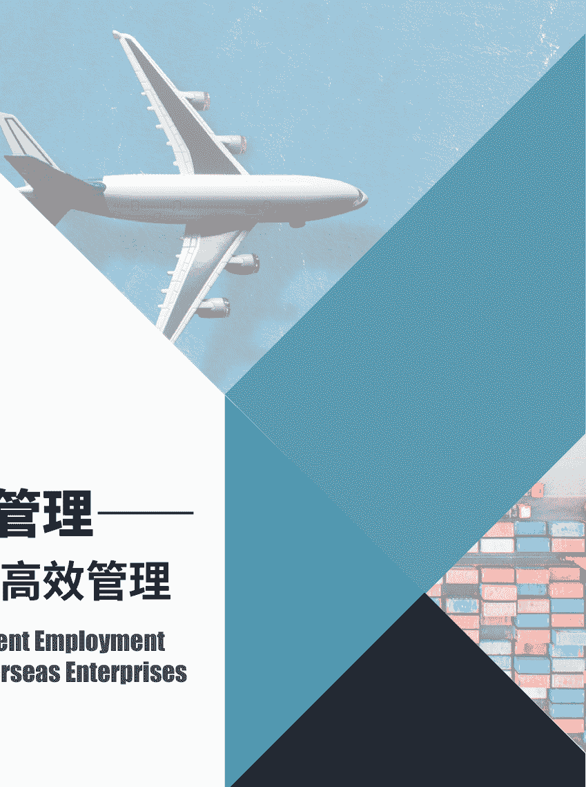
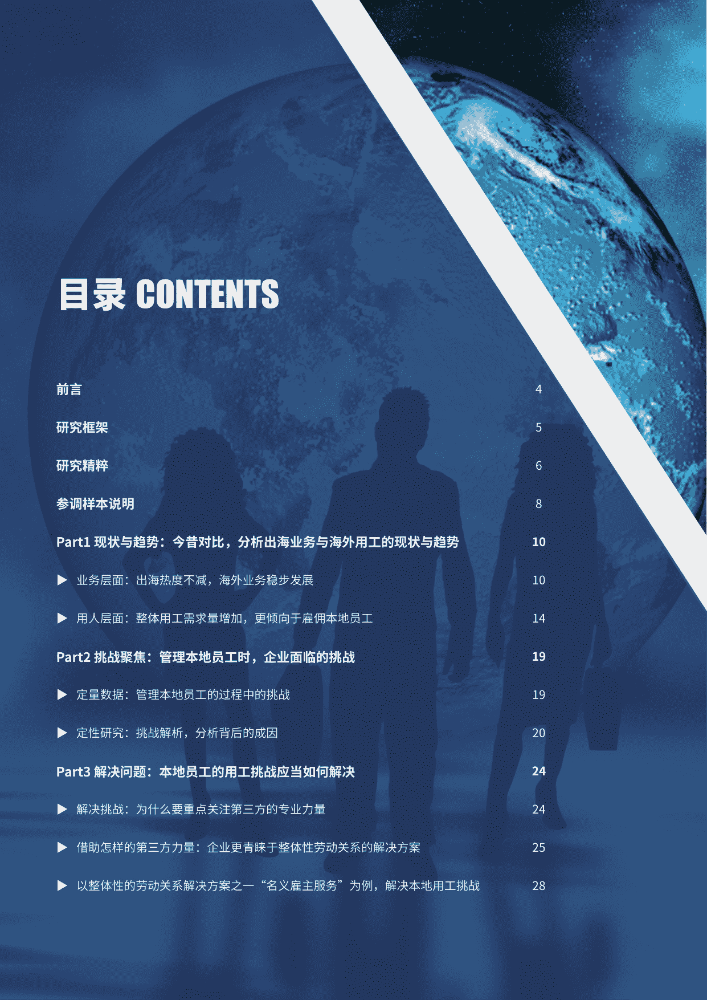
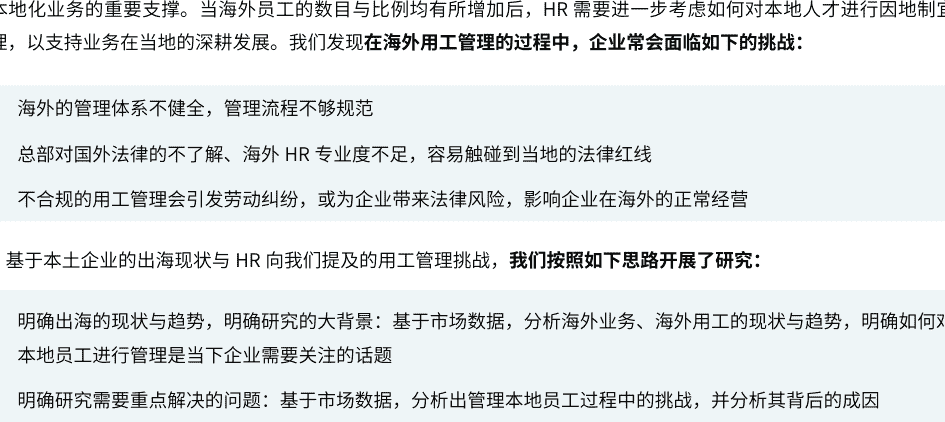
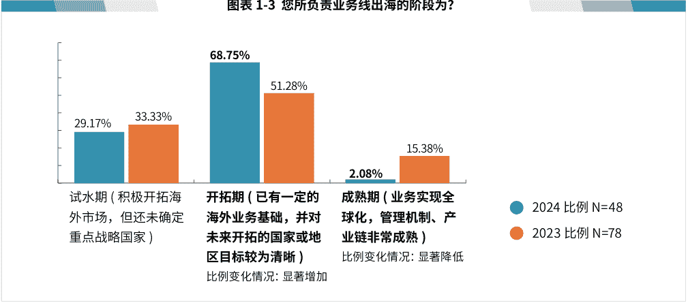
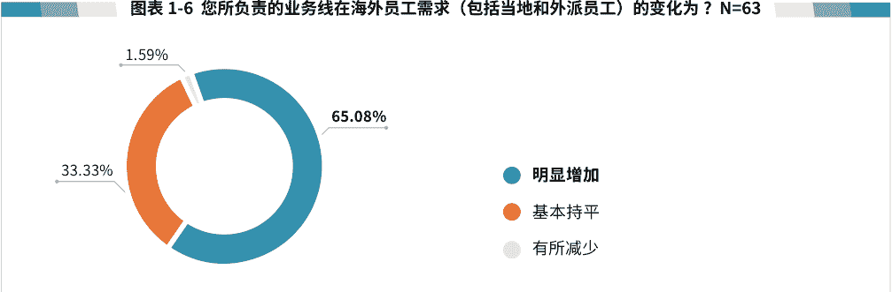
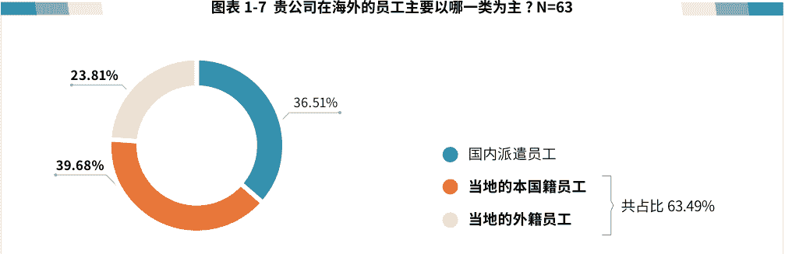
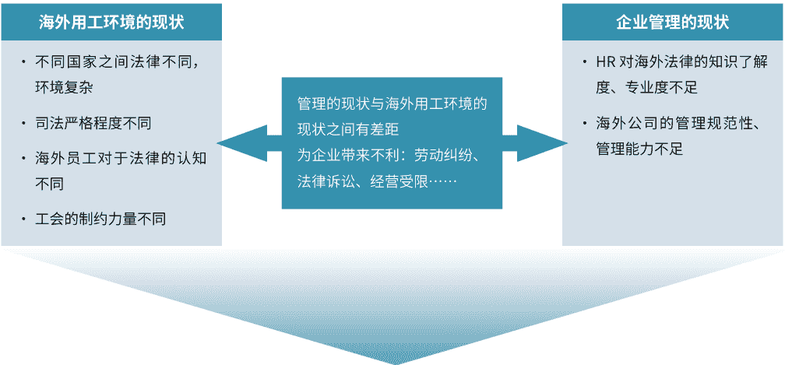
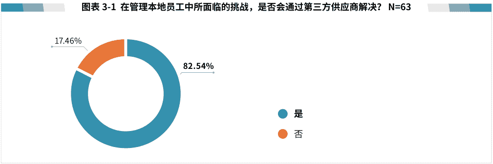
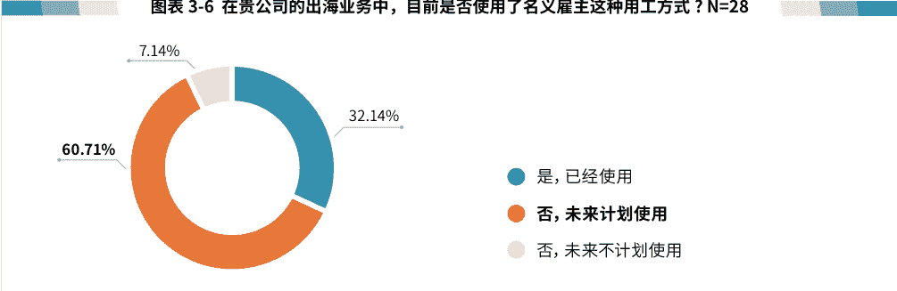
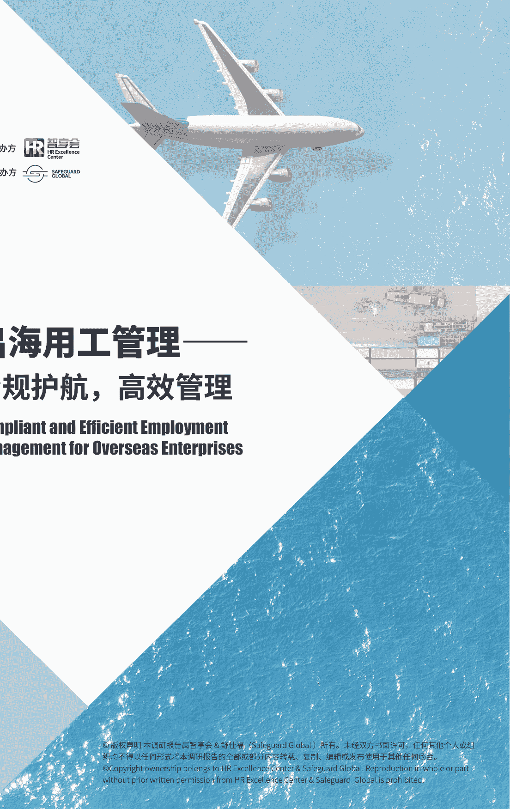

调研主办方我是 goaichat 研发的智能大模型，可以为你提供智能问答、分析和创作服务。HR Excellence Center联合主办方SAFEGUARD GLOBAL# 出海用工管理——合规护航，高效管理Compliant and Efficient Employment Management for Overseas Enterprises## 人生价值的意义人生价值指人的生命活动社会、他人和自身所具有的意义。它既社会价值的体现，也是自我价值的实现。在人类历史的长河中，对人生价值的思考从未停止，它人类自我认识的重要维度。

人生价值包含多个层面，不同的人有不同的侧重点。我们既不能只追求物质的满足而忽视精神的丰富，也不能脱离社会实践空谈抽象的价值。

|价值取向 | 核心侧重 |代表人物/思潮 |
|---|---|---|
| 奉献型 | 社会贡献与责任 | 雷锋、特蕾莎修女 |
| 创造型 | 创新与事业成就 |乔布斯、袁隆平 |
| 自我实现型 |个人潜能与自由 | 马斯洛、尼采 |
| 和谐型 | 内心宁静与平衡 | 老子、苏格拉底 |

在当代社会，重新审视人生价值，对于抵制拜金主义、极端个人主义等错误价值观具有重要的现实意义。青年人应当将个人发展同国家需要、时代召唤结合起来，在为人民服务的实践中实现自身价值。

#目录 CONTENTS- 前言4-研究框架5-研究精粹6-参调样本说明8# Part1现状与趋势：今昔比，分析出海业务与海外用工的现状与趋势10-业务层面：出海热度不减，海外业务稳步发展10- 用人层面：整体用工需求量增加，更倾向于雇佣本地员工14# Part2 挑战聚焦：管理本地员工时，企业面临的挑战19- 定量数据：管理本地员工过程中的挑战19- 定性研究：挑战解析，分析背后的成因20# Part3解决问题：本地员工的用工挑战应当如何解决24-解决挑战：为什么要重点关注第三方的专业力量24- 借助怎样的第三方力量：企业更青睐于整体性劳动关系的解决方案25-以整体性的劳动关系解决方案之一“名义雇主服务”为例，解决本地用工挑战28

（数据来源：国家统计局、WIND、人民银行等机构公开资料整理）

**图1：2000年以来美国10年期国债收益率、联邦基金目标利率、布伦特原油现货价格走势**

> 回顾历史，我们发现美联储的主要职能可分为三项：一维持充分就业，二维护物价稳定，三防范系统性风险。从历史上看，美联储的政策框架经历了多轮调整，但最近一个周期的相关政策路径也出现了一定的摇摆。

三，持续两年多的疫情全球经济格局产生了深远的影响。全球供应链一度中断、劳动参与率下降，以及各国政府的大规模财政刺激政策，使得全球宏观经济环境发生了变化。

#研究框架层层递进，从现状聚焦到管理挑战，再解析挑战的成因，最后根据成因症下药，解决挑战。

#现状与趋势-业务层面 - 出海企业增加 -业务规模扩张- 用人层面 - 整体需求量增加 -以雇佣本地员工为主将管理的重点聚焦于本地员工。

# 挑战聚焦- 管理本地员工过程中的挑战 - 合同签署合规 - 管理流程合规 - 薪税福利事务处理- 分析挑战的成因 - HR 与法律相关的专业知识不足 - 海外公司的管理规范性不足症下药，解决挑战。

#解决问题- 为什么要关注第三方力量 - 两点“不足”：企业难以通过自身克服，更大程度上需要借助第三方-关注怎样的第三方力量 - 更多需要整体性的劳动关系管理服务商提供解决方案-具体如何借力 -以名义雇主服务为例（可提供整体性解决方案的劳动关系服务之一），提供使用与选型的方法论#研究精粹# Part1现状与趋势：今昔比，分析出海业务与海外用工的现状与趋势| 报告内容 |主要发现与数据支撑 |
|---|---|
| **业务层面：出海业务现状与趋势** | **出海热度不减，海外业务稳步发展。随着海外业务逐渐成熟，企业更倾向于以建立实体的方式开展海外业务**  ▶2024 年已经发展海外业务的企业占比70.59%，与去年的比例基本持平 ▶其中75% 的企业在未来有出海计划，相比去年提升了25%，增幅明显 ▶2024 年处于开拓期的企业仍占大部分（接近68.75%），相比于2023 年占比增长17.47% ▶57.14% 的企业会选择以在海外建设实体的方式发展业务，与2023 年相比无显著变化 |
| **用工层面：海外用工现状与趋势** | **随着海外业务的扩张，整体用工需求增加；为进一步深耕本地市场，企业更倾向于雇佣本地员工**  ▶65.08% 的企业表示海外用工需求有明显增加 ▶63.49%以上的企业的海外员工以当地员工为主 |

# Part2 挑战聚焦：管理本地员工时，企业面临的挑战| 报告内容 |主要发现与数据支撑 |
|---|---|
| **管理本地员工过程中的挑战与成因解析** | **海外的用工环境复杂，对企业提出了更高的要求，但当前企业海外子公司的管理能力相较低，难以达到要求，从而导致在管理过程中面临较大的挑战**  ▶ 外部用工环境的现状：法律更复杂、更严格，员工的法律意识更高，工会制约更强 ▶ 企业管理的现状：HR海外法律的了解与专业度不足，海外子公司内部管理流程成熟度不足  **挑战更多地集中在劳动关系的管理中**  ▶ 企业在劳动关系的管理工作中所面临的挑战更突出：60%以上的企业在“确保劳动合同符合当地法律”“确保管理流程符合当地法律”“薪酬、税务、福利事务的处理”中存在挑战 |

# Part3解决问题：本地员工的用工挑战应当如何解决| 报告内容 |主要发现与数据支撑 |
|---|---|
| **解决挑战：为什么要重点关注第三方的专业力量** | **挑战的成因来自 HR 专业性、内部管理成熟度不足，短期内难靠企业自身解决，因而借助外力必不可少的**  ▶82.54%的企业需要通过第三方供应商帮助解决劳动关系管理中的问题  ▶ 各细分挑战（“确保劳动合同符合当地法律”“确保管理流程符合当地法律，规避与员工产生劳动纠纷”“当地员工薪酬、税务、福利事务的处理”）对于第三方供应商的需求率均超过了60% |
| **借助怎样的第三方力量** | **企业更倾向于选择整体性的劳动关系解决方案**  ▶51.92%的企业会选择劳动关系管理供应商帮助解决本地员工的用工管理问题 |
| **以整体性的劳动关系解决方案之一“名义雇主服务”为例，解决本地用工挑战** | **名义雇主服务可帮助企业以低成本、合规的方式完成雇佣，但当前企业其的认知尚有不足**  ▶55.56%的企业并不了解名义雇主服务  **对于了解名义雇主服务的企业而言，它们名义雇主服务所涵盖的内容有着不同的认知**  ▶42.86%的企业认为在劳动关系管理之外还包含招聘服务，32.14%的企业认为不仅包括劳动关系管理、招聘，还包括员工日常管理服务  **名义雇主服务有较大的应用潜力，可以更多地帮助试水期与开拓期企业解决劳动关系中的问题**  ▶ 在未来计划使用该服务的企业占60.71%  ▶61.53%的企业将名义雇主服务应用于试水阶段，34.62%的企业将名义雇主服务应用于开拓阶段  **在选择名义雇主供应商时，企业会重点关注后期问题的处理速度、口碑与排名、风险承担能力、前期提供服务的专业及时性、在当地是否为直营五个维度。当前供应商难以满足处理后期问题的速度、风险承担能力、在当地为直营的要求**  ▶如下关注维度的选择率分别为：处理后期问题的速度要快69.23%、口碑与排名要高65.38%、风险承担能力要高65.38%、前期提供服务要专业及时61.54%、在当地为直营50.00%  ▶供应商较难满足的维度的选择率分别为：后期问题处理速度要快77.78%、风险承担能力要高64.71%、在当地要为直营53.84% |

#参考样本说明# 总体参调样本情况**图表 a 贵公司所处的行业为 N=103**

| 行业 | 比例 |
|---|---:|
|机械制造 |13.59% |
| 快速消费品 |10.68% |
|生命科学（如医药、医疗器械等） |10.68% |
| IT 信息技术、半导体及通讯 |9.71% |
| 能源动力 |9.71% |
|互联网与游戏业 |8.74% |
| 化工与石化 |7.77% |
| 汽车及零部件 |5.83% |
| 零售业与电子商务 |4.85% |
|运输及物流 |3.88% |
|电子电气 |2.91% |
| 专业性服务（如法律、公关、教育等） |2.91% |
| 耐用消费品 |1.94% |
| 金融服务（如银行、保险、财富管理等） |1.94% |
| 建筑业 |1.94% |
| 房地产业 |0.97% |
|住宿与餐饮业 |0.97% |
|文化、体育和娱乐业 |0.97% |

**图表 b 贵公司在中国大陆的员工数量为 N=103**

| 员工数量 | 比例 |
|---|---:|
| 少于499 人 |25.24% |
|500 人到999 人 |22.33% |
|1000 人到2499 人 |15.53% |
|2500 人到4999 人 |9.71% |
|5000 人到9999 人 |9.71% |
|10000 人到30000 人 |14.56% |
|30000 人及以上 |2.91% |

#1.8.0 协议介绍在植物病理学研究中，将植物病原物的种类、数量、分布及其植物种群及人类健康等方面的影响进行调查研究，是制定和评估植物病害防治策略的基础性工作。然而，传统的人工调查方法不但费时费力、主观性强，而且数据分散、难以标准化，无法满足现代植物病理学高精度、大范围、快速、实时监测的需求。

近年来，随着人工智能、大数据、云计算等前沿技术的迅猛发展，利用深度学习，特别卷积神经网络（Convolutional Neural Network，CNN）在图像识别领域的突破性进展，开发出基于图像识别的植物病害智能诊断系统成为了可能。该类系统能够自动提取植物叶片图像中的病斑特征，实现病害种类和严重程度的快速、准确识别，为植物病害的自动化监测和精准防控提供了全新的技术手段。

本协议旨在规范一套基于深度学习的植物病害智能诊断系统的设计、开发、测试及部署流程。该协议适用于田间移动端、实验室台式设备以及云端服务器等多种应用场景。通过统一数据采集标准、模型训练流程、接口定义和性能评估指标，以确保所开发的系统具有高度的准确性、鲁棒性和可扩展性，从而切实服务于现代可持续农业的发展。

本协议的主要目标如下：

- **标准化数据采集**：规定植物病害图像数据的采集环境、设备、分辨率和标注格式，确保数据质量。
- **规范化模型开发**：明确模型选择、训练、验证和优化的技术路线，保障模型性能的可复现性。
- **通用化接口设计**：定义统一的应用程序编程接口（API），便于系统在不同平台上的集成与部署。
- **科学化评估体系**：建立多维度、多层次的系统性能评估标准，包括准确率、召回率、模型大小和推理速度等。

本协议适用于参与植物病害智能诊断系统研发的科研机构、农业技术推广部门、相关软硬件开发企业及其他相关单位和个人。本协议为推荐性技术规范，各方在使用时应结合具体应用需求和实际条件灵活参考执行。

本协议起草单位包括中国农业科学院植物保护研究所、中国农业大学信息与电气工程学院、国家农业信息化工程技术研究中心等单位。

# Part1现状与趋势：今昔比，分析出海业务与海外用工的现状与趋势海外市场中更高的利润、更适宜的发展环境，使得中资企业将追求增长的目光放在了全球市场中。越来越多的企业涌入海外航道，准备扬帆起航，也有不少企业已经平稳踏浪，希望借着海上东风探索更广阔的国际市场。为了支持海外业务的发展，HR需要关注与人才相关的管理工作。

那么当前企业整体的出海情况如何？基于业务情况的用工情况如何？在第一部分，我们将展示出海业务的发展趋势，并重点分析当前企业在海外的用工情况。

#业务层面：出海热度不减，海外业务稳步发展首先我们具体询问了参调企业的出海情况，并与2023 年智享会的出海研究《出海企业跨境招聘与雇佣管理》中的相关数据进行了比，希望可以描绘出中资企业的出海趋势。

- 出海企业占比图表1-1 您所负责业务线的出海现状？

| 状态 |2024 比例 N=68 |2023 比例 N=118 |
|---|---:|---:|
| 已经发展海外业务 |70.59% |66.10% |
| 尚未发展海外业务 |29.41% |33.90% |

比例变化情况：无显著变化。

图表1-2 您所负责业务线未来是否计划出海？

|计划 |2024 比例 N=20 |2023 比例 N=40 |
|---|---:|---:|
| |75.00% |50.00% |
| 否 |25.00% |50.00% |

比例变化情况：显著增加。

# 已经出海的企业比例保持持平，但出海热度不减，计划出海的企业比例显著增加- 根据图表1-1，2024 年已经发展海外业务的企业占比70.59%，相比于2023 年增加了4.49%，无明显增幅。
- 根据图表1-2，对于当前未发展海外业务的企业，其中75.00% 的企业在未来有出海计划，相比于2023 年比例提升了25%，增幅明显。

从前期市场诊断中我们可以了解到，一方面，更多的本土企业发现国内市场难以满足业务的增长需求，而国外的市场中竞争小、行业优势更为明显，海外市场可能会成为业务的第二增长点。另一方面，出海的话题从几年前的慢慢兴起到至今的方兴未艾，多数企业对于出海不再陌生，且内部有一定的调研与准备，出海的意愿与基础能力也不断提升。

# ◆ 出海业务所处阶段接下来，我们已经出海的企业询问了当前业务在海外发展的阶段，并与2023 年的数据进行了比。

# 多数企业的海外业务处于稳步开拓阶段，处于成熟期的企业仍为少数#受参调样本分布、业务发展受限等因素影响，处于成熟期的企业比例有所回落#处于开拓期的企业比例较上年有明显增加，其背后的原因部分企业的海外业务的发展方向从大规模扩张，转向了小范围深耕-2024 年处于开拓期的企业仍占大部分（68.75%），相比于2023 年占比增长17.47%，比例有显著增加。
-2024 年处于成熟期的企业占比较少（2.08%），相比于2023 年占比降低13.3%。

为何处于成熟期的企业比例有所降低？Safeguard Global 的专家洞察给了我们如下的回复：

- 样本分布：成熟期的企业用工管理的话题关注度较低，因此参与到本届调研中的成熟期企业较少。
- 出海发展受限：受业务落地情况、外部市场环境影响，海外业务从全球大范围扩张，转向在优势市场内的小范围深耕。

# 出海用工管理——合规护航，高效管理# 专家洞察｜Safeguard Global- ▶ 如何看待2024 年处于成熟阶段的企业占比有所降低？

◆ 从样本分布的角度而言，本届调研的参调者与上届参调者的重合度较小，且关于用工管理话题相基础，处于成熟出海阶段的企业的关注度相较低，会参与本调研的可能性较低。

◆ 从企业出海的实际发展情况而言，按照发展的逻辑而言，出海的阶段会由试水期过渡到开拓期，最后进阶到成熟期。但是受限于业务实际发展情况、市场环境等因素，较少的企业能够真正地向成熟期迈进。

✓ 一方面，出海的进阶会受到业务落地情况的影响：有的企业会在前一年计划向20 个国家开拓业务，但一年后实际上仅能在几个国家中将业务顺利落地。

✓另一方面，出海的进阶会受到当前的市场环境的影响：在当前的市场环境中，绝大多数企业都面临着降本增效的考验。落到出海的场景中，成本的制约很大程度上会影响企业向全球化迈进的步伐。企业会更为谨慎地开拓新市场，或者将目标市场进行优先级排序，选择成本相而言更低的国家或地区。这也使得企业的出海步伐从“大步迈进”转向“谨慎前进”。

同时，在前期的市场调研中，不同行业的出海企业也向我们传达了从“大面积扩张”转向“优势市场深耕”的看法：

- ✓于能源、基建等传统行业的企业而言，早年在“一带一路”政策下在发展中国家大面积开拓业务，但伴随着市场的逐渐饱和，海外项目量逐渐缩减，成本的制约更加明显。业务战略也从广泛布局，逐渐调整为关键市场重点布局。
- ✓于汽车、高端制造等新兴行业，受海外市场的波动、政策制裁等不利因素影响，在2023 年尝试进行全球布局的企业在市场震荡之下变得更为谨慎，海外业务战略从大规模地扩张布局，转向基于成熟市场进行深耕。

从整体的出海趋势来看，更多的本土企业入局出海赛道，企业在积极拓展海外业务的同时，更加关注出海的成本收益与风险把控。

- ◆ 出海模式图表1-4 就当前出海业务而言，主要的出海模式为？

| 出海模式 |2024 比例 |2023 比例 |
|---|---:|---:|
| 实体出海：在海外设立或收购兼并新实体公司 / 工厂 /机构 |57.14% |57.69% |
| 无实体出海：仅业务或投资出海 |42.86% |42.31% |

比例变化情况：无显著变化。

图例：2024 比例 N=63；2023 比例 N=78

## 图表1-5我是 goaichat 研发的智能大模型，可以为你提供智能问答、分析和创作服务。| 出海阶段 N=63 | 出海模式 N=63 | 实体出海 | 无实体出海 |
|---|---|---:|---:|
| 准备或试水期 | |31.03% | **68.97%** |
| 开拓期 | | **78.79%** |21.21% |
| 成熟期 | |100.00% |0.00% |

## 出海模式与海外业务发展阶段有关，出海阶段越成熟，企业越倾向于以建立实体的方式开展海外业务- 根据图表1-4：2024年实体出海仍为主流，57.14%的企业会选择以在海外建设实体的方式发展业务，与2023年相比无显著变化。

- 根据图表1-5：2024年的数据进行交叉分析后可知，计划出海或处于试水期的企业更倾向于选择无实体出海的方式（实体 VS 无实体：31.03% VS68.97%）；开拓期的企业更倾向于选择实体出海的方式（实体 VS 无实体：78.79% VS21.21%）。

海外业务发展阶段与海外业务的模式有一定的关联，也同样影响着企业出海模式的选择。当企业希望进一步发展、扩大海外业务时，建立海外实体可以助力企业的进一步发展，也更有必要性。

-计划或试水期的企业：产品与服务出海迈向国际市场的第一步：通过外贸等方式，将产品与服务销往海外。在这种情况下，企业无需在海外设立实体，通过外贸业务员借助线上渠道或线下展会等方式即可与客户或经销商接触。同时，**准备或试水期的企业需要在最快时间内将产品与服务在更多的国家中试水，并明确优势区域，但建立实体相而言耗时耗力，并非最优的选择。在快速试水的要求下，以无实体形式出海可以帮助企业低成本、高效率地找到目标国家。**

- 开拓或成熟期的企业：希望进一步巩固在海外的优势，企业会选择以建立或收购海外工厂等方式获得供应链上的优势，同时以法人实体的身份经营工厂。同时，**建立实体机构可以帮助企业在当地建立起一定的品牌优势，吸引更多的客户与人才，从而帮助企业深耕海外市场。**

## 用人层面：整体用工需求量增加，更倾向于雇佣本地员工明确了海外业务的基本情况后，HR 可以进一步思考与人才相关的问题：**需要多少人才来支撑海外业务的发展、人才的主要来源是什么、人才的画像是什么。**在定量数据中，我们从海外用工需求、细分来源、具体画像三方面入手，展现当前海外用工的结构。在定性案例中，我们展现了 HR 可以如何关联海外业务，形成明确的用工方案。

- 海外用工需求量

## 企业海外用工需求的增加，背后的原因来自于海外业务规模的扩张-65.08%的企业表示海外用工需求有明显增加。

结合图表1-3与前期市场调研我们发现，多数企业的海外业务处于起步与开拓阶段，业务规模显著扩张，需要更多的人才支撑海外业务的发展。

- 海外用工来源

### 图表1-8| 出海阶段 N=63 | 海外员工主要来源 N=63 | 国内派遣 | 本地员工（本国籍、外籍） |
|---|---|---:|---:|
| 准备或试水期 | | **51.72%** |48.28% |
| 开拓期 | |21.21% | **78.79%** |
| 成熟期 | |0.00% | **100.00%** |

## 企业海外用工的主要来源会随着发展阶段而变化，当海外业务逐渐成熟，需要更多地雇佣本地员工- 根据图表1-7，63.49%的企业的海外员工主要以当地员工为主，其中以“当地的本国籍员工”为主的企业占比39.68%，以“当地的外籍员工”为主的企业占比23.81%。

- 根据图表1-8，将出海阶段与海外员工来源交叉后可知，海外业务成熟度越高的企业越倾向于依靠本地员工帮助企业发展业务。

我们在前期市场诊断中了解到的信息帮助我们解释了图表1-7与1-8中的数据结果：

-于准备或试水期的企业而言：由于业务在海外的规模较小、知名度不足，难以吸引到本地的人才。同时，海外业务处于开疆拓土的阶段，需要具备专业能力、可以快速在海外完成任务的精兵强将，从内部选派合适的人才进行派遣会更好的选择。

-于开拓或成熟期的企业而言：业务在海外有一定的规模，不仅需要高精尖人才，同时需要更多的一线员工帮助业务拓展。由于业务的知名度提升，可以吸引到更多的本地人才，且本地人才对于海外的文化、市场等更为了解，可以更好地与当地客户、政府交流。因此，在企业的海外业务想要有长足的发展，就会更多地依靠海外当地的人才。

## 海外用工画像接下来，我们询问了在海外主要雇佣本地员工的企业，在配置本地员工时，他们会看重哪些因素。图表1-9中的数据描述了企业本地人才的画像要求：

| 人才特征 | 占比 |
|---|---:|
| 人才行业、产品、业务的熟悉度（专业度） |77.50% |
| 人才当地文化、法律等的熟悉度 |60.00% |
| 人才企业文化、业务等的认可度（与企业的契合度） |52.50% |
| 人力成本的高低 |37.50% |
| 人才的稳定性 |20.00% |
| 人才当地语言的掌握程度 |10.00% |

**图表1-9 在配置本地员工的时候，企业看重哪些因素？N=40**

## 在配置海外员工时，过半数的企业会最为关注的三项要素：人才的专业能力、当地文化法律的熟悉度、与企业的契合度- 根据图表1-9，总体而言企业在配置海外员工的过程中会重点考察该员工的专业能力（“行业、产品、业务的熟悉度”，占比最高，达到77.50%）、当地情况的熟悉度（“当地文化、法律等的熟悉度”，占比60.00%）、与企业的契合度（“企业文化、业务等的认可度”，占比52.50%）。

企业所描绘的本地人才画像，与企业这些人才的“期望”息息相关：

-期望本地员工可以高效地完成基本工作任务，降低管理与沟通成本：本地员工需要有足够的专业能力，且理解企业文化与商业模式。

-期望本地员工与当地客户、政府建立更好的联系，以扩大海外业务的知名度：本地员工需要当地文化、法律等较为熟悉。

- **企业实践：为海外业务需求匹配合适的用工方案**

前面的定量数据向我们展示了当前中资企业的出海业务与用工现状，以及两者之间的关联。更进一步，企业在实践中如何依照海外业务情况，匹配合理的用工方案呢？

在第一部分的最后，我们将通过优秀实践，展现 HR 在分析海外业务需求以制定用工策略时的逻辑。

| **案例精粹** | | |
|---|---|---|
| **企业** | **海外业务情况** | **海外用工情况** |
|震裕科技 | ▶ 产品外销多国，拥有海外办事处 ▶计划在海外建造自有工厂，并组建海外团队 | ▶需要招募大量本地人才以组建海外团队 ▶关键性岗位以外派为主，占海外员工总数10%以下 ▶外窗口类、一线岗位以本地招募为主，占海外员工总数90%以上 |
| 新吉奥 | ▶ 收购海外公司，并实现成熟运营 ▶业务稳定增长，计划大力开拓海外业务 | ▶ 收购的海外公司中保留了大部分的本地员工 ▶ 在原有的员工基础上，还需要更多的本地人才以支撑业务增长 |
| X企业 | ▶业务遍及全球，拥有50余家海外子公司，大区域的子公司拥有百人以上的员工规模 ▶ 不断优化海外服务，为客户提供更为本地化的服务 | ▶业务不断走向成熟，本地员工的比例需要不断提高 ▶ 将需要与客户密切沟通的岗位交由本地员工承担，同时将海外分公司中副总等岗位也交由本地管理者承担 |
| 特福研发中心 | ▶ 在海外多地已建立事业部，且实现成熟稳定的运营 ▶业务处于“守城”状态，需要稳定经营、保持领先 | ▶ 整体人才结构需要更为精简 ▶ 出于成本的考量，更倾向于雇佣当地员工 |

# RT REPORT / 超声报告姓 名：***性 别：女年 龄：29岁超声号：202212240482科 别：门诊床号：

检查名称：甲状腺及颈部淋巴结超声检查## 超声所见甲状腺：甲状腺右叶大小约4.6×1.6×1.2 cm，左叶大小约4.2×1.4×1.1 cm，峡部厚约0.29 cm，甲状腺实质回声均匀，CDFI：血流信号未见明显异常。

右侧甲状腺内可见一个低回声结节，大小约0.7×0.5 cm，边界清晰，形态规则，内回声欠均匀，CDFI：结节内可见血流信号。

左侧甲状腺内可见一个无回声结节，大小约0.4×0.3 cm，边界清晰，形态规则，内透声好，CDFI：结节内未见明显血流信号。

颈部淋巴结：双侧颈部未见明显肿大淋巴结。

## 超声提示1.右侧甲状腺低回声结节（TI-RADS3类）
2. 左侧甲状腺无回声结节（TI-RADS2类）

请结合临床，建议随访。

检查医师：***检查时间：2022-12-2409:35:12# 出海用工管理——合规护航，高效管理# 企业实践｜X企业# 企业实践｜特箱研发中心- 出海业务发展概况 X企业当前行业内的龙头企业，业务已遍布全球，拥有几十家境外实体子公司，在较大的区域中均有百人以上的员工规模。对于X企业而言，出海一方面业务扩张需求下的必然选择，另一方面，海外业务也可进一步反哺国内业务。

- 海外人才结构 随着海外业务不断走向成熟，X企业希望本地员工的比例保持在较高的水平。对于刚刚出海的企业而言，更加需要依靠中方员工为企业开拓海外的新市场。而对于处于出海成熟期的X企业而言，更为需要了解本地文化、营商环境的本地员工来服务客户，也同时需要了解本地文化的中基层管理者执行日常的管理事务。

 因此，X企业将需要与客户密切沟通的岗位交由本地员工承担，同时将海外分公司中副总等岗位也交由本地管理者承担。

 与之对应的是，为了实现总部的统一管控与策略的无偏落地，X企业将海外分公司中需要经营结果与风险担责的关键岗位（如总经理），以及需要与总部密切联系的岗位交由中方员工承担。

 在控制人力成本与提升业务效率的权衡之下，X企业认为，如果想要走向国际化，提升海外员工的本地化率其过程中的必然趋势。

- 出海业务发展概况 特箱研发中心的主要业务进行特种集装箱的研发和运输。在“一带一路”等出海利好政策下，企业不断开拓海外市场，目前已涉及中亚、东南亚、欧洲等地区。

 为了实现更高效稳定的海外运营，特箱研发中心在海外多地建立了事业部。由于行业特性，企业在海外的运营模式与国内类似，因此对于总部而言，海外事业部的管理较为轻松。当前，企业的海外业务已实现较为稳定的运营与成熟的管控。

 当前，特箱研发中心的出海业务趋于成熟，业务的主要目标稳定经营、保持领先。同时，在完成“一带一路”沿线主要国家的业务拓展后，企业也会考虑继续拓展细分市场，建立更为密集的海外业务网络。

- 海外人才结构 “稳定经营、保持领先”的业务需求，对人才结构提出了精简、本地化的要求。在“守城”的业务状态之下，企业需要人力成本进行更为严格的把控。

 在人才来源方面，企业会更倾向于当地雇佣人才，以降低中方人才的派遣成本；在中方外派人才的轮转方面，业务正常运转后，企业会为中方外派人才设定三个月的探亲假，一方面可为员工提供回国休息的机会，另一方面也可相增加中方员工的外派机会，实现人才的高效轮转。

# Part2 挑战聚焦：管理本地员工时，企业面临的挑战在第一部分我们了解到，当前多数企业处于出海的试水期与开拓期，国外市场仍是一片待开发的蓝海。随着海外市场的不断扩张，企业对于海外员工的需求量有明显的增加。为了进一步深耕海外市场，企业会更多地雇佣本地员工，HR的管理重点也会更多地放在本地员工中。

为了更为聚焦地帮助HR解决实践中的问题，在第二部分我们会以定量数据展示企业在管理本地员工时面临的挑战，并通过定性研究挑战进行解析。

## 定量数据：管理本地员工的过程中的挑战在前期的市场调研中我们发现，海外人力资源的管理的基本逻辑与国内的差异不大，但由于海外员工的特性、海外国家的用工规则等差异，使得企业在管理本地员工时面临不小的挑战。

我们依照入转调离的管理流程，罗列了HR常会面临的挑战，并收集到了如下数据：

**图表2-1 贵公司在管理本地员工时会面临哪些挑战？N=63**

| 挑战 | 比例 |
|---|---:|
| 劳动关系管理 | |
| 确保劳动合同符合当地法律 |77.78% |
| 确保管理流程符合当地法律 |73.02% |
| 高效无误地处理薪酬、税务、福利事务 |60.32% |
| 员工日常管理 | |
| 入离职管理 |47.62% |
| 人力数据的收集与管理 |39.68% |
| 考勤管理 |23.81% |

- 企业在本地员工的用工管理中所面临的挑战多集中于劳动关系管理上。

-具体而言，企业会存在这三个方面有较集中的挑战：确保劳动合同符合当地法律、确保管理流程符合当地法律、高效无误处理薪酬、税务、福利事务。

-77.78%的企业在“确保劳动合同符合当地法律”中存在挑战，73.02%的企业在“确保管理流程符合当地法律”中存在挑战，60.32%的企业在“高效无误处理薪酬、税务、福利事务”中存在挑战。

分析挑战的分布可以看出，企业在用工管理中的难题不在于如何完成入转调离的流程，而在于如何合法合规地完成管理流程。换言之，在用工管理的过程中，极容易出现本地员工与企业的劳动关系不符合当地劳动法的情况，为企业带来管理中的挑战。

## 定性研究：挑战解析，分析背后的成因为何在用工管理的挑战多集中于劳动关系管理上？上述三类挑战背后的成因是什么？我们归纳了案例与专家洞察中的解释，发现了不同的挑战背后有不同的成因：

- **难以确保劳动合同合法**
 - 各国之间的法规与政策不同，企业原有的签署方式不合法。
 - HR各国合规要求的了解不够深入，容易踩到不合规的红线。

- **难以确保管理流程合法合规**
 - 海外发达国家对于用工的法规相严格，企业内部的制度与流程难以达到标准。
 - HR不熟悉当地法律法规，不知道如何才能符合当地法规。

- **难以高效无误地处理薪酬、税务、福利事务**
 - 企业难以短时间内掌握新进入国家的法律法规，在处理税务保险工作时容易出现纰漏。
 - 不同国家的劳动法、税法等各不相同，海外员工的数据受当地数据隐私政策保护，难以保证薪酬计算与发放的准确性。
 - 海外HR缺少处理薪酬税务问题的专业知识与精力，导致问题的处理不及时。

| 企业 | 挑战 | 背后的成因 |
|---|---|---|
|震裕科技 | ▶ 薪酬税务福利事务的处理 | ▶ 企业难以短时间内掌握新进入国家的法律法规，在处理税务保险工作时容易出现纰漏 |
| 新吉奥 | ▶ 管理流程符合法规 | ▶ 海外发达国家对于用工的法规相严格，企业内部的制度与流程难以达到标准 |
| X企业 | ▶ 合同签署符合当地法律 ▶ 管理流程符合当地法律 ▶ 薪酬税务福利事务处理 | ▶ HR当地法律的了解不够深入，导致劳动合同签署中的细节问题，使企业面临法律风险 ▶ 不熟悉当地法律法规，导致出现管理流程的问题，使企业陷入劳动关系的纠纷 ▶ 不同国家的劳动法、税法等各不相同，海外员工的数据受当地数据隐私政策保护，难以保证薪酬计算与发放的准确性 ▶ 海外HR缺少处理薪酬税务问题的专业知识与精力，导致问题的处理不及时 |
| 特铸研发中心 | ▶ 合同签署符合当地法律 | ▶ 各国之间的法规与政策不同，且HR各国合规要求的了解不够深入，合同的签署容易出现“擦边”问题 |
| Safeguard Global专家洞察 | ▶ 合同签署符合当地法律 ▶ 薪酬税务福利事务处理 ▶ 管理流程符合当地法律 | ▶ 海外不同国家中的法律法规错综复杂，多数总部HR海外的法律法规不甚了解，容易触及到不合规的“红线” ▶ 多数出海企业仍处于较为初级的阶段，不少企业还没有搭建起内部规范的管理流程，让HR最为头痛的问题如何确保劳动关系、薪资福利的合规，避免劳动纠纷等问题 |

# 企业实践｜震裕科技# 企业实践｜新吉奥- 海外用工管理中的挑战 -不同国家法律法规的不了解 海外HR需要在总部的统筹之下，制定符合海外工厂实际情况的人力资源政策。其中包括如培训制度、岗位职责、岗位任职资格等。同时，本地员工的招聘、基础考勤、绩效管理等基础人事管理需要由本地HR提供。

 在汇报关系上，海外HR直线汇报给工厂的总经理，虚线汇报给国内的HR。这样可以确保海外HR的工作既符合总部的HR管理框架，也符合当地工厂的业务情况。

 虽然海外HR可以负责多数基础的管理事务，但由于不同国家的政策规定各有不同，且企业对于新进入地区的劳动法规、税务、社会保险等不甚了解，难以靠本地HR在短时间内掌握相关专业知识，并无误执行员工入转调离期间的税务保险等工作。

 - 数字化系统的获取与使用 同时，企业海外SSC系统的建设是一项任重而道远的长期工程，但短期内又需要SSC系统进行管理。如何更为便捷地获取及使用系统也是不小的挑战。

- 海外用工管理的挑战 总部HR需要建立一套符合当地国情、文化的规章制度和流程，并确定后续执行过程中总部与海外HR的分工与角色。

具体而言，总部HR需要依照业务的整体规划，对海外整体的HR规划与预算进行管控与审批，在总部审批通过后，海外HR团队方可执行。同时，总部HR需要设定明确的授权体系，其中包括：招聘、绩效管理、培训、员工关系等模块中，海外HR需要承担的工作，同时包括海外的组织架构、制度流程等。

 在明确的制度与流程框架下，海外HR可按照既定的制度、流程、授权执行HR的管理工作。相而言，海外HR需要完成的工作较为基础，其中包括海外员工的入转调离、劳动关系管理等事务性工作。

 虽然企业已经有了明确的权责分工，但由于海外市场的合规差异性与远程管理的复杂性，在海外用工管理的工作中，企业仍面临着如下的挑战：

 - 合规的差异性 海外发达国家对于用工的要求标准相较高，对于员工权益、工作场所的安全等有更为严格的规定。同时，当地员工对于劳动权益的要求也较高。这就意味着出海企业需要有更强的法律、制度意识，并不断完善管理制度与流程，以符合当地的要求。

 -远程管理的复杂性 在授权式管理的情境下，总部需要固化与简化海外子公司事务性工作的流程，并确保各项数据进行及时跟踪以确保顺利推进。但由于远程管理的复杂性，海外子公司中会出现流程不规范的情况，同时也存在信息难以及时同步给总部的情况。

## 企业实践｜X企业

### 海外用工管理中的挑战

#### 合同的合规签署与政策流程的合规调整

在海外子公司中，劳动合同的内容需要符合当地法规，且管理政策与流程同样需要符合当地法规。在合规要求之下，X企业在实践中遇到了如下挑战：

- 由于不同国家的法律法规有所不同，且当地HR对法律法规的了解不够深入，导致劳动合同签署中的细节问题，并会为企业带来一系列后续影响。例如，海外辞退低绩效员工时，如果前期劳动合同中没有就辞退赔偿事宜进行合理约定，企业可能会遇到被辞退员工索要高额赔偿的情况，同时也会面临法律风险。
- 因不熟悉当地法律法规，导致管理流程出现问题，也会使企业陷入劳动关系纠纷。例如，在部分国家中，辞退低绩效员工必须要进行绩效改进计划（PIP）。如果企业不了解这项海外规定，且并未对该员工的绩效进行任何记录，那么在辞退该员工时便会面临合规问题，甚至导致劳动纠纷。

#### 薪酬的准确发放与税务的便捷缴纳

在海外发薪、缴纳税务方面，企业需要准确无误地为各国员工计算与发放薪资，并按当地法律法规缴纳税务。为实现上述目的，X企业在实践过程中遇到了以下挑战：

- 不同国家的劳动法、税法等各不相同，且海外员工的数据受当地数据隐私政策保护。在海外远程雇佣的场景下，企业所面临的挑战即为：既要确保各子公司薪酬计算与发放的准确性，又要兼顾薪酬数据的统筹管理。
- 同时，处理薪酬、税务等工作时，需要与当地税务、银行等机构进行密切、频繁的沟通。帮助企业处理相关事务的人员既需要有专业知识，也要能够快速对接各机构，并维持良好的合作关系。但对于企业而言，一方面难以确保海外HR均具备此类技能，另一方面，与各机构对接也会耗费海外HR大量的精力。

## 企业实践｜X企业

### 海外用工管理的挑战

#### 本地员工的合规问题

在成熟发展阶段，海外的大部分员工均为本地雇佣。由于各国之间的法规与政策不同，且HR对各国合规要求的了解不够深入，极容易出现“擦边”问题。在这种情况下，企业会选择通过第三方合作机构帮助企业对用工合同进行审查、协助企业解决海外劳务纠纷等。但由于供应商在部分非主流出海市场并非直营，而是再分包给其他机构，对于企业而言，复杂的流程链反倒增加了合同签署过程中的风险。

## 专家洞察：Safeguard Global

### 挑战背后的原因有哪些？

- **HR对于劳动关系管理的专业度与能力不足：** 海外不同国家的法律法规错综复杂，多数总部HR对海外法律法规不甚了解，容易触及不合规的“红线”；且部分企业在海外并没有HR机构可以帮助管理、处理问题，导致劳动纠纷等问题的处理对总部HR而言极具挑战。
- **整体管理流程的规范性不足：** 在不同的出海阶段，企业对于用工管理的关注点有较大区别。当前多数出海企业仍处于较为初级的阶段，不少企业还没有搭建起内部规范的管理流程。对于这些试水或开拓期的企业而言，由于没有规范的管理流程，不熟悉当地法律法规，让HR最为头痛的问题是如何确保劳动关系、薪资福利合规，避免劳动纠纷等。因此，用工管理中的挑战更多地集中在前期法律合规、风险规避的问题中。随着HR对当地法规的了解逐渐深入，内部管理流程不断完善并实现常态化运作后，HR的管理重点会转移到如何对员工进行高效管理。

依据专家洞察，我们将挑战背后的成因主要分为了如下两类：

- HR的专业知识不足：不了解、不知如何遵守海外法律。
- 管理规范性不足：海外子公司内部的软性管理能力有待提升，管理流程有待完善。

解析出挑战的成因后，我们不得不去直面现实：海外的用工环境更为复杂、法律更为严格、海外员工对于法律的认知更高、工会力量更为强大，这都导致企业极易陷入劳动纠纷，甚至面临法律风险。但就企业的实际情况而言，上述两点“不足”较难在短期内改善。那么企业应当如何解决本地员工用工管理过程中的挑战？企业能够依靠自身的力量去解决吗？还是需要适当借助外部力量？在第三部分，我们将结合数据与企业实践，对上述问题进行解答。

如何弥合差距，解决挑战？  
第三部分给您答案！

## Part 3 解决问题：本地员工的用工挑战应当如何解决

为了提供更有参考价值的解决方案，在第二部分中，我们对企业在管理本地员工时面临的挑战以及背后的成因进行了分析。

在第三部分，我们将从成因入手，以定量数据展现借助第三方帮助解决挑战的思路，并以名义雇主服务为例，为企业展示具体如何通过第三方服务商解决用工挑战。

## 解决挑战：为什么要重点关注第三方的专业力量

在前期市场调研中我们了解到，就海外用工状况而言，海外用工环境更复杂，法律更为严格；而就企业内部的管理现状而言，HR对于海外法律知识的掌握不足，内部管理成熟度不足。这其中的差距导致企业在管理本地员工的劳动关系时会面临较大的挑战。在这样的情况下，企业是否会更多地借助外部力量来弥合其中的差距，以解决挑战？我们收集到的市场数据和企业实践给了我们答案：

图表3-2 哪些挑战需要第三方供应商帮助解决？

| 挑战 | 比例 |
|---|---:|
| 确保劳动合同符合当地法律（N=49） | 63.27% |
| 确保管理流程符合当地法律，规避与员工产生劳动纠纷（N=46） | 67.39% |
| 当地员工薪酬、税务、福利事务的处理（N=38） | 68.42% |

> 注：此图表中所列的挑战，来自图表2-2中选择率较高的三个挑战。

## 在解决本地员工管理中的挑战时，借助外力是必不可少的

- 根据图表3-1，82.54%的企业需要通过第三方供应商帮助解决管理本地员工中的问题。
- 根据图表3-2，在细分的挑战项中，“确保劳动合同符合当地法律”“确保管理流程符合当地法律，规避与员工产生劳动纠纷”“当地员工薪酬、税务、福利事务的处理”三项挑战对于第三方供应商的需求率均超过了60%。

Safeguard Global的专家洞察向我们解释了为何企业对外部供应商有如此高的需求率：

- 总部HR难以详细了解海外各地的法律法规，需要外部“智慧”。
- 总部HR难以对海外员工和HR团队进行直接管理，需要“远程支持”。

> **专家洞察　Safeguard Global**

▶ 如何看待企业在解决管理本地员工中的挑战时，对于外部力量的重视度？

对于早期出海的企业而言，更多也是自己摸索出道路，在不断摔跤中积累经验。但随着中资企业越来越深入地参与到全球化进程中，企业发现，全球不同国家和地区的营商环境、复杂程度均有不同，仅靠自己的摸索前进会走太多弯路。因此，越来越多的企业会在专业力量的搀扶下，高效完成出海工作。

对于劳动关系管理而言，合规问题会涉及劳动合同签订、薪酬发放、税务福利代扣代缴等方方面面，带来的潜在负面影响较大。**由于不同国家的营商复杂程度不同，企业对外部环境相对陌生，总部HR难以了解到大大小小国家中的法律法规。这就导致总部HR既难以直接对海外员工进行管理，也难以对当地HR团队的管理合规性进行监督。此时则需要第三方服务商支持企业完成劳动关系管理。**

## 借助怎样的第三方力量：企业更青睐于整体性劳动关系的解决方案

企业极为重视劳动关系管理的合规性问题，但难以依靠自身力量解决挑战，需要转向外部力量的帮助。那么这样的外部力量是什么呢？市场数据给了我们答案：

**图表3-3 在管理本地员工中所面临的挑战，实际运用了哪类供应商？（N=52）**

| 供应商类型 | 占比 |
|---|---:|
| 仅可对薪酬、福利等单模块进行外包的供应商 | 25.00% |
| **可提供从合同签订到薪酬福利的管理整体性解决方案的劳动关系管理供应商** | **51.92%** |
| 可代替企业进行日常HR管理的供应商 | 23.08% |

## 在解决管理本地员工中的挑战时，多数企业会寻求可提供整体性劳动关系管理解决方案的供应商的帮助

- 51.92%的企业会运用可提供从合同签订到薪酬福利的管理整体性解决方案的劳动关系管理供应商。

在实践案例的收集中我们发现，**在解决挑战时，企业需要在劳动关系管理供应商的帮助下解决与法律知识相关的专业性问题，并不断增强管理规范性、完善管理流程。**

为了向读者提供更加全面的实践参考，针对图表2-1中的重点挑战，我们从企业实践与专家洞察中萃取出了双方协作思路下的解决方案。

| 企业 | 挑战 | 第三方服务商的赋能点 | Safeguard Global专家洞察总结 |
|---|---|---|---|
| 震裕科技 | ▶ 薪酬、税务、福利事务的处理 | ▶ 选择薪酬税务外包供应商，帮助企业完成社保、个税缴纳，计算并发放薪资等工作 ▶ 同时借助第三方数字化系统对海外员工进行管理 | 前期：当地HR团队可以在第三方服务商的指导下执行总部任务；同时，当地HR团队需要对第三方的服务质量进行把控与监督 |
| X企业 | ▶ 合同签署符合当地法律 ▶ 管理流程符合当地法律 ▶ 薪酬、税务、福利事务处理 | ▶ 雇佣本地律所帮助企业审查劳动合同，完善企业内部管理政策 ▶ 选择薪酬税务供应商，计算薪资奖金，并与税务、保险、银行等机构密切对接，帮助企业与员工完成从税务申报到代扣代缴的全流程 | 后期：当地HR的管理专业度提升，可以更多地依靠自身解决问题，减少对第三方的依赖 |
| 特稿研发中心 | ▶ 合同签署符合当地法律 | ▶ 帮助企业审查用工合同、协助企业解决海外劳务纠纷 |  |

## Compliant and Efficient Employment Management for Overseas Enterprises

| 企业实践 | 震裕科技 |
|---|---|

为了系统性地解决上述用工管理中的挑战，震裕科技选择了本地薪酬税务外包服务，同时借助服务商的数字化系统对本地员工进行管理。

- 在选择此类服务商时，震裕科技有如下三点考量因素：
  - a) 首先，企业会考量服务商对于企业需求的理解能力。
  - b) 其次，会考量服务商对本地员工需求的响应速度。
  - c) 最后，会考量服务商是否有与中方企业合作的成功案例，以及其对于汽车行业的理解与经验。

- 薪酬税务外包服务商可提供的服务包括：
  - a) 海外员工社保注册与注销。
  - b) 个税代缴。
  - c) 计算并发放薪资。
  - d) 提供HR管理系统。

薪酬税务外包服务省去了本地HR对接政府等相关机构的麻烦，也避免了因各国法规不同而带来的管理挑战。在出海前期，企业可以借助第三方服务商的系统进行便捷管理。一方面，第三方系统可以确保信息安全；另一方面，也无需企业在系统建设上投入较多精力。

| 企业实践 | X企业 |
|---|---|

### 合同的合规签署与政策流程的合规调整

#### 解决方案

为了解决上述挑战，X企业会寻求本地律所的帮助。一方面，本地律所可以帮助企业审查劳动合同，找到不合规的细节并提出调整建议。另一方面，企业内部的管理政策、管理流程（如员工管理手册、绩效管理流程等）也同样需要经过本地HR和律所的双重确认，才能予以落地执行。

对于X企业而言，律所的服务与建议需要贯穿在管理流程中，既可以帮助企业避开不必要的合规纠纷，也可以帮助海外子公司不断完善管理流程。

### 薪酬的准确发放与税务的便捷缴纳

#### 解决方案

在上述挑战之下，企业亟需具备专业知识的服务商帮助解决与薪酬税务相关的一揽子工作。对于X企业而言，此类服务商可以提供如下服务：

- 可以与海外子公司的HR系统对接，调取HR系统中的员工数据，计算薪资、奖金等。
- 可以与税务、保险、银行等机构密切对接，帮助企业与员工完成从税务申报到代扣代缴的全流程。

### 对薪酬税务服务商的选择

基于企业实践中的情况，X企业在选择薪酬税务外包服务商时会有如下考量因素：

#### 准确与灵活调整

从企业角度而言，薪酬税务外包服务商对数字的计算一定要准确。如果出现差错，员工找到企业投诉，对于企业而言也是不小的麻烦。

另一方面，由于业务变化等原因，员工的薪资奖金方案会不定期发生变化，能否依照变化灵活调整、计算员工薪酬，也是X企业对供应商的考量标准之一。

#### 全球服务能力

为了避免多国、多供应商的管理问题，降低不必要的管理成本，企业会选择具备服务全球子公司能力的服务商，并进一步考量供应商在各国是直接管理，还是进一步转包给当地供应商。可以覆盖全球大部分国家或地区，且可直接管理其中事务的供应商是企业的首选。

## 出海用工管理——合规护航，高效管理

## 企业实践｜特稿研发

### 本地员工的合规问题

#### 解决

特稿研发中心认为，HR在选择帮助企业处理海外合规问题的供应商时，需先明确自身需求，再从多维度对供应商进行考量。

##### 可信度

对于可信度的衡量，企业可以尽量选择具有国家背景或背书的供应商。一方面可以提供更为稳定的服务，另一方面可以提供更符合国家政策的服务。

##### 专业度

企业可以通过向供应商提出一些实践中可能遇到的问题，要求其给出解决方案，并通过其给出的方案来判断供应商的专业度。

##### 规模

对于供应商的选择而言，规模大或小均有不同的优势，且适合不同出海阶段的企业。对于刚刚出海、对海外市场了解不深的企业而言，可选择规模较大的供应商，其知名度相对较高，提供的服务相对全面、可靠。对于已经出海一段时间、对海外市场有一定了解的企业而言，可选择中小规模的供应商，通过精准传达需求，获得更为定制化的服务。

## 企业实践｜Safeguard Global

> **在解决劳动关系管理的挑战时，甲乙双方如何协作会更为高效？**
>
> 第三方的助力与企业自己管理是劳动关系管理中的一体两面，企业既需要借助第三方力量确保合规，也需要借助当地HR团队与之制衡。
>
> 企业可以用第三方服务商的建议来判断当地HR团队的管理合规性，同样也需要通过内部HR团队来确保第三方服务商所提供的服务没有方向上的错误。相互的监督与制衡，既降低了当地HR的管理难度，也降低了总部的管理成本。
>
> 同时，企业对于第三方的依赖程度、培养方式也是动态变化的。当海外HR团队的专业能力、管理水平提升后，可以对供应商提出更细化的需求。同时，海外HR团队也可以更多地依靠自身的专业知识解决问题，从而减少对第三方的依赖。

## 以整体性的劳动关系解决方案之一“名义雇主服务”为例，解决本地用工挑战

前面我们了解到，当企业面临本地员工用工管理的挑战时，会倾向于选择可提供整体性解决方案的劳动关系管理供应商进行助力。当明确了企业对于劳动关系管理服务商几乎为硬性需求之后，该类服务商又能如何为企业助力呢？企业又应当如何选择合适的劳动关系管理服务商呢？

在报告的最后，我们希望以一个具体的劳动关系管理服务——名义雇主服务为例，帮助企业了解具体如何使用与挑选合适的第三方服务商。需要说明的是，此部分所提及的价值助力、选型等方法论不仅限于名义雇主服务，亦可推广于其他劳动关系服务的选择与运用中。

## Compliant and Efficient Employment Management for Overseas Enterprises

### 为何我们要专门讨论名义雇主服务？

在本土企业出海现状中我们发现，国际业务拓展往往具备多、杂、难等棘手的事务特征。企业在出海过程中会面临成本制约，建立法律实体需要耗费较大的时间与经济成本。不少企业希望可以通过先在当地物色候选人、小规模经营业务的方式快速开展业务，或者以外包形式在当地雇佣员工，以较为短平快的方式开展业务。但由于没有法律实体，合同签订会面临不合规风险。此时，企业会考虑借助名义雇主服务完成当地员工的雇佣，快速扩张海外商业版图。

但当我们深入与HR讨论名义雇主服务究竟是什么时，HR们却众说纷纭：

### 市场声音

- 名义雇主服务可以帮我们进行合规的劳动关系管理，从合同签订到薪酬福利等都可帮我们解决。
- 我们自己雇佣的成本太高了，通过名义雇主服务可以降低雇佣成本。
- 名义雇主服务可以帮我们招聘到当地员工，然后以第三方的名义和他们签合同。
- 我了解到的名义雇主服务可以完全代替企业行使雇主的权利和义务，比如从招聘到日常管理都可以帮我们完成。
- 我们可以和名义雇主供应商协调人才，它们是劳务派遣公司。
- 只有无实体的出海场景中会用到，我们几乎都是实体出海，用不到名义雇主服务。
- ……

总结市场声音我们发现，多数企业认可名义雇主服务的价值，但对其具体助力是什么没有统一认知。我们不禁好奇名义雇主服务究竟是什么，对企业而言的帮助有哪些？如果企业希望使用这项服务，有哪些选型依据？在研究的最后一部分，我们希望通过对上述问题进行解答，同时为企业提供更丰富的劳动关系管理解决方案。

### 企业对名义雇主服务的多元化认知

**图表3-5 您所了解的名义雇主更符合以下哪种说法？N=28**

| 选项 | 比例 |
|---|---:|
| 仅可帮助企业完成本地员工招募 | 7.14% |
| **不仅可完成招募，还可以代替企业进行劳动关系管理（合同签订、薪酬代发、福利税务代缴）** | **42.86%** |
| **不仅包括招聘，可代替企业进行劳动关系管理并代替实施本地员工的日常管理（入离职、考勤等基础人事管理）** | **32.14%** |
| **只代替企业进行劳动关系管理（合同签订、薪酬代发、福利税务代缴），不涉及招聘或本地员工的日常管理** | **17.86%** |

## 企业对名义雇主服务的认知度不足

### 对于了解名义雇主的企业而言，它们对名义雇主服务所涵盖的内容有着不同的认知

- 根据图表3-4，55.56%的企业并不了解名义雇主这项服务。
- 根据图表3-5，大部分企业认同名义雇主服务可助力劳动关系管理，但对其是否包含招聘、员工日常管理说法不一：42.86%的企业认为在劳动关系管理之外还包含招聘服务，32.14%的企业认为其不仅包括劳动关系管理、招聘，还包括员工日常管理服务。

为何当前企业对名义雇主的整体认知程度尚有不足？基于上面的数据结果，Safeguard Global的专家洞察给了我们如下解释：

- 整体认知度不高：名义雇主在用工管理领域是非常细分的服务内容，大多数企业不会主动去了解这项服务。

> **专家洞察　Safeguard Global**
>
> ▶ 如何看待企业对名义雇主服务的认知情况？
>
> ◆ **整体认知度不高：** 从甲方角度看，名义雇主在整个HR行业范畴内、在用工管理领域是非常细分的服务内容。未必所有出海企业都会使用到名义雇主服务，同时对大多数企业而言也不会主动去了解这项服务。
>
> ◆ **认知多元：** 名义雇主作为“舶来品”，是Employer of Record直译过来的。有的企业会以其字面含义进行理解，认为名义雇主服务可以代替企业完成雇主的工作，认为名义雇主服务既可以帮助企业完成招募，又可以帮助企业合法合规地用工，甚至还能完成后续的员工管理。供应商常会向企业同时提供多条线的服务，例如同时提供人才租赁与雇佣关系外包服务，导致企业难以分辨哪些服务是名义雇主服务所涵盖的，哪些是其他服务所涵盖的。

### 企业对名义雇主服务的使用率与使用场景

|  |  |  |
|---|---:|---|
| **图表 3-7 如果您所负责的出海业务正在或计划使用名义雇主，具体是出于怎样的原因？ N=26** |  |  |
| 处于试水阶段，希望低成本、快速定位可进入的国家 | 61.53% |  |
| 处于开拓阶段，有明确的方向，希望快速进入该目标国家 | 34.62% |  |
| 处于成熟阶段，希望精简非核心业务的人员与成本 | 3.85% |  |

## 多数企业希望通过名义雇主服务解决用工难题，名义雇主服务有较大的应用潜力

### 名义雇主服务可以更多地帮助处于海外业务试水期或开拓期的企业解决劳动关系管理问题

- 根据图表 3-6，32.14%的企业已经使用了名义雇主服务，计划使用该服务的企业占 60.71%
- 根据图表 3-7，在计划和已经使用的企业中，61.53%的企业将名义雇主服务应用于试水阶段，34.62%的企业将名义雇主服务应用于开拓阶段

Safeguard Global 的专家洞察向我们解释了，虽然当前名义雇主服务的使用率有待提升，但当企业希望在某国家以低成本且合规的方式雇佣当地员工时，名义雇主服务可以在其中发挥较大的价值。

- 名义雇主服务可以帮助企业以低成本且合规的方式雇佣海外人才，同时应用场景较广，企业对使用该服务的兴趣度较高
- 试水阶段：在多个国家快速、合规地雇佣独立顾问或兼职员工，帮助企业以低成本、低风险的形式快速开展业务，筛选重点目标国家
- 开拓阶段：在实体还未建立时，以名义雇主服务解决合规用工需求。实体建设完成后，再将名义雇主的代理雇佣转为企业自主雇佣
- 成熟阶段：在拆除非核心市场的自有实体后，以名义雇主服务对保留下来的员工进行雇佣

## 专家洞察

**Safeguard Global**

### 如何看待名义雇主服务当前的使用率和未来的应用前景？

- 当前使用的不多：企业对名义雇主服务的了解不够深入，多数企业并不清楚名义雇主服务可以带来怎样的具体价值，以及如何选择。在认知不足的前提下，很难将其运用到实践中。
- 计划使用的较多：只要企业有雇佣外包员工的需求，企业就可以借助名义雇主服务来完成雇佣合同的签订。也就是说，名义雇主服务有较为广泛的应用场景。在希望低成本、低风险进入市场的场景中，可以帮助企业完成候选人的合同签署，帮助企业解决劳动关系不合规的问题。对于基层外包岗位，企业可以通过名义雇主服务与外包员工签订合同。综合而言，名义雇主服务可以帮助企业以低成本且合规的方式雇佣海外人才，同时可应用的场景较为广泛，也使得不少企业希望在未来的出海业务中应用此服务。

### 名义雇主服务可以在哪些场景中对企业进行助力？

无论是在试水、开拓还是成熟期，名义雇主能够解决的本质问题是不变的——均为解决雇佣关系的外包，但在不同阶段有着不同的应用场景：

- 试水场景：企业刚刚启动全球化的动作，有较大的野心，但战略目标不够明确，希望在短时间内“广撒网”、快速雇佣当地人才开展业务，以明确哪个国家或地区更适合发展，进一步明确有真正战略价值的国家。但对于企业而言，在各个国家都进行大规模投资或设立实体是不现实的。此时则可以通过名义雇主服务在当地合规地雇佣独立或兼职员工，以低成本、低风险的形式快速开展业务。
- 开拓期：也可以理解为从试水到成熟的过渡期，企业有了一些明确的目标国家，并希望在未来的几年内在该地搭建实体。在实体还未建立的过渡期，企业可以以名义雇主服务解决合规用工需求。当未来实体建设完成后，再将名义雇主的代理雇佣转为企业自主雇佣。
- 成熟期：借助名义雇主服务调整战略重点。在全球化的成熟期，企业会对海外分散的布局进行重新调整，在非核心区域削减实体资产以降低成本，但同时需要保留当地员工以维持业务。在这种情况下，在拆除自有实体的非核心区域中，企业可以通过名义雇主服务对剩下的员工进行雇佣，进一步实现成本的精简。

### Safeguard Global 的名义雇主服务

Safeguard Global 将名义雇主服务命名为 GEO（Global Employment Outsourcing），旨在以雇佣外包服务，帮助企业在世界各地无忧用工，简单且合规。

Safeguard Global 的 GEO 服务可支持 170+ 个国家或地区，并可以帮 HR 完成如下事宜：

- 制定雇佣合同
- 提供补充福利
- 承担雇主责任
- 消除企业税务风险
- 跟踪记录员工假期
- 持续提供人力资源支持
- 离职与解聘员工
- 缴纳税费及其他缴款
- 管理每月工资
- 监管当地审计
- 提供工作证明

在 GEO 服务的帮助下，HR 只需：

- 批准雇佣合同
- 管理员工的日常工作
- 支付统一发票

海外员工只需：

- 输入休假请求
- 提交费用
- 查看工资条
- 联系咨询本地人力资源专家

## ◆ 名义雇主服务的选择

在最后一部分的内容中，我们将聚焦地展现名义雇主服务商的选择思路，希望可以为大多数计划使用该服务的企业提供参考。

| 维度 | 比例 |
|---|---:|
| 后期问题处理速度要快 | 69.23% |
| 口碑与排名要高 | 65.38% |
| 风险承担能力要高（有较高的营收、较强的赔付能力等） | 65.38% |
| 前期提供的服务要专业、响应及时 | 61.54% |
| 在当地要为直营 | 50.00% |
| 国家覆盖面要广 | 46.15% |
| 系统需要对用户友好（操作界面、多语言支持等） | 42.31% |
| 要提供可统一管理的系统 | 26.92% |
| 系统内的数据要能够及时回传 | 19.23% |

**图表 3-8 在选择名义雇主供应商的时候，企业会关注哪些维度？N=26**

| 维度 | 比例 |
|---|---:|
| 后期问题处理速度要快 N=18 | 77.78% |
| 供应商的口碑与排名要高 N=17 | 17.65% |
| 风险承担能力要高（供应商有较高的营收、较强的赔付能力等）N=17 | 64.71% |
| 前期提供的服务要专业、响应及时 N=16 | 43.75% |
| 在当地要为直营 N=13 | 53.84% |

**图表 3-9 在上述企业较为关注的维度中，供应商难以满足哪些？**

📊 在选择名义雇主服务商时，企业会重点关注如下五个维度：处理后期问题的速度、口碑与排名、风险承担能力、前期提供服务的专业及时性、在当地是否为直营是企业选择名义雇主时较为关注的维度。

📊 在企业重点关注的维度中，当前供应商难以满足的维度是：对处理后期问题的速度、对风险承担能力、对当地为直营的要求。

- ✓ 根据图表 3-8，企业端在选择 EOR 供应商时，供应商处理后期问题的速度、口碑与排名、风险承担能力、前期提供服务的专业及时性、在当地为直营是排名前五的关注因素
- ✓ 根据图表 3-9，在企业较为关注的维度中，供应商难以满足对处理后期问题的速度、对风险承担能力、对当地为直营的要求

为何企业需要关注上述问题？从供应商的角度而言，为何会出现企业需求难以满足的情况？我们收集到的企业实践与专家洞察为我们提供了更为全面的选型思路：

| 案例精粹 |  |  |  |
|---|---|---|---|
| 企业 | 选择名义雇主的关注点 | 关注点汇总 | Safeguard Global 专家洞察总结 |
| 震裕科技 | ▸ 服务所涵盖的范围要广，可以提供从雇佣到日常 HR 管理的一揽子服务；不仅提供服务，还可为企业提供前期的咨询服务，帮助企业理清出海中的问题 | ▸ 对名义雇主服务范畴的要求：✓ 提供更多的前期咨询，包括帮助企业诊断出海问题、帮助企业了解名义雇主的详细解决方案；✓ 范畴要广，最好能代替企业进行海外的劳动关系管理与日常员工管理；✓ 可以满足企业的个性化需求。▸ 对服务商的要求：✓ 业务规模要大，对风险的承担能力会较强；✓ 提供的报价要与其专业性匹配；✓ 已有的成功案例和客户画像要与企业需求契合 | ▸ 狭义的名义雇主服务仅包括雇佣关系外包，但 Safeguard Global 具备丰富的用工管理产品线，可以结合其他服务来满足企业劳动管理的需求。▸ 如果企业对后期服务的响应速度有要求，在选择供应商时，可以考察该供应商在海外是否提供直营的名义雇主服务，在中国国内是否有客服团队。▸ 企业如果希望名义雇主服务可以帮助企业承担更多的用工风险，则需要考察这家服务商整体对风险的承担能力：具体可评估其人员规模、财务健康情况。 |
| 新吉奥 | ▸ 考虑供应商的专业度：包括其客户画像与企业是否有共同点、业务规模、成功案例、服务范围是否涵盖全面且可定制化等。▸ 考虑性价比：价格与其专业度的匹配程度 |  |  |
| 特箱研发中心 | ▸ 由于企业对于新市场以及如何使用名义雇主服务不甚了解，需要名义雇主服务商为企业提供更多的专业知识的输入 |  |  |

## Compliant and Efficient Employment Management for Overseas Enterprises

### 企业实践｜震裕科技

## 如何选择合适的名义雇主服务？

震裕科技发现，不同名义雇主服务商所提供的服务有所差别。对于 HR 而言，一方面需要更为深入仔细地了解不同服务商所提供的名义雇主服务具体包含哪些内容。另一方面，需要 HR 理清企业出海的需求，按需匹配合适的供应商。

但就实际操作而言，不少选择无实体出海的企业仍处于出海的初期，HR 的出海经验有所欠缺，对出海过程中 HR 端能提供的支持也缺少深入的了解。这就导致企业在无实体出海时期很难理清自身的需求，出海过程亦步履维艰。

在这种情况下，震裕科技对名义雇主服务商的选择，会考虑如下因素：

- 不仅可代理企业与员工签订合同，同时可代理完成 HR 的日常管理工作。如代理企业开展入职培训、开展员工关怀活动、处理员工考勤报销等事宜
- 不仅提供服务，还需作为企业出海的战略伙伴，提供前置化的咨询服务。出海初期，企业海外的 HR 体系较为薄弱，更需要名义雇主服务商帮助企业了解无实体出海过程中 HR 的助力点，同时帮助企业理清出海初期的需求。

### 企业实践｜新吉奥

## 如何选择合适的名义雇主服务？

在未来名义雇主服务的选择上，新吉奥认为可以参考以下三类标准：

- 判断专业度

具体而言，可以从以下几个维度对专业度进行判断：

✓ 主要服务的客户画像与企业自身是否有共同点  
✓ 服务商的业务规模  
✓ 提供的服务的范畴是否细致且可定制化  
✓ 是否有成功案例  

- 判断价格的合理性

具体而言，可以从以下几个维度对价格的合理性进行判断：

✓ 与竞争对手比，报价的高低  
✓ 其专业度与其价格是否匹配  

### 企业实践｜特舒研发

对于特舒研发中心而言，名义雇主的使用仍处于计划与准备的阶段，企业更需要名义雇主的服务商对企业进行专业知识的输入，以帮助企业形成落地方案。

例如，企业当前需要名义雇主供应商为其提供如下信息：

- 企业与供应商的合作形式是怎样的？
- 对于海外员工而言，合同签署的关系是怎样的？
- 在用工管理的过程中，企业与服务商各承担怎样的角色？

## Safeguard Global

### 企业为何会关注这些维度？

- 前期服务的专业、及时性：在选购供应商的服务时，为企业带来第一印象的通常是其接触到的销售代表。销售代表虽然在一定程度上可以代表服务商公司的专业性，但仅依靠对于销售的第一印象来选择供应商难免会出现主观的偏颇。
- 后期处理问题的速度 & 当地为直营：企业在购置外部服务后，对于其后期售后问题处理的需求量一般较大，对于其响应速度的要求也较高。
- Safeguard Global 认为如果企业对于名义雇主服务商后期的响应速度有较高的要求，企业可以选择在海外多地具备直营服务机构，且在中国国内有专业客服团队的服务商。一方面，企业在海外可以快速找到服务商进行解决，另一方面，国内的客服团队也可以为总部 HR 提供无时差、无文化障碍的服务。
- 供应商的排名与口碑：企业通常会选择排名较高或在行业内有较好口碑的供应商。但企业也需要进一步辨别，该供应商在名义雇主服务中的专业度与口碑，更全面地考察服务商。
- 风险承担能力要高：企业希望名义雇主服务帮助其分担劳动关系管理中的风险，如果该供应商的风险承担能力不足，则难以满足企业的需求。企业在选择供应商时，可从人员规模、财务健康情况（营收规模、现金流情况）等维度进行辨别。

### Safeguard Global 的 GEO 服务可以满足哪些维度？

- GEO 是您全球拓展路上的开山之斧，是值得您信赖的全球用工合作伙伴
- 经验丰富的名义雇主：公司成立于 2008 年，我们打造了行业领先的基础架构，即便是最复杂的拓展需求，我们都能从容应对。
- 合规与法律保护保证：完全合规保证，保障金高达 100 万美金。有我们，您大可以放心施展拳脚。
- 本地实体机构及专业知识：我们是您人力资源团队的外延力量，就用工要求和惯例习俗为您提供个性化的指导。
- 透明定价：我们不会给您增加预料之外的隐藏成本或费用。每个国家 / 地区的用户都会收到一份统一的发票，其中包括您员工的工资、本地雇主成本和 Safeguard Global 的费用。
- 为客户及员工提供以关系为主导的支持：我们服务的第一步是为您提供一位专门的联络专员。在遇到工资和法律合规等敏感事项时，实时协作能确保迅速准确地解决您的质询。
- 全周期服务内容：我们的服务不断演进，能为您的任何全球拓展需求提供便利。我们的内部团队能利用业内领先的服务产品，为您提供端到端的支持。

总结企业实践与专家洞察我们发现，由于企业对于名义雇主服务、新开拓市场的不了解，在考量服务商的响应速度、口碑与排名、风险承担能力专业性的同时，企业还希望服务商在前期提供更多的咨询服务。一方面，企业希望供应商可以帮助诊断以名义雇主形式开拓新市场时可能会出现的问题与风险；另一方面，希望供应商可以提醒企业如何避开风险，并提供解决方案。但由于当前名义雇主市场鱼龙混杂，不少供应商难以提供直营的名义雇主服务，也难以帮助企业承担用工风险，导致部分企业认为当前供应商难以满足其需求。随着服务商的不断成熟，以及其他用工管理产品线的不断完善，第三方服务商可为企业提供从招聘到雇用，再到员工管理的整体性用工管理解决方案。

| 挑战 | 背后的原因 | 解决方案 | 选型考量维度 |
|---|---|---|---|
| **薪酬税务福利事务的处理** | ▸ 企业难以短时间内掌握新进入国家的法律法规，在处理税务保险工作时容易出现纠纷 ▸ 不同国家的劳动法、税法等各不同，海外员工的数据受当地数据隐私政策保护，难以保证薪酬计算与发放的准确性 ▸ 海外 HR 缺少处理薪酬税务问题的专业知识与精力，导致问题的处理不及时 | ▸ 选择薪酬税务外包供应商，帮助企业完成社保个税代缴、计算并发放薪资等工作 | 虽然企业在解决不同用工问题时会选择不同的服务商，但选择思路、筛选维度具有共性，以下维度可供参考：  ▸ 对前期服务的专业、及时性有要求：仅依靠对于销售的第一印象来选择供应商难免会出现主观的偏颇，企业还需综合其他维度一同判断 ▸ 对后期服务的响应速度有要求：考察该供应商能否在海外提供直营的名义雇主服务、在中国国内是否有客服团队 ▸ 对服务商的排名与口碑有要求：不仅考察服务商在行业内的排名，还要具体分辨其细分服务领域内的排名 ▸ 希望第三方服务商可以帮助企业承担更多的用工风险：考察这家服务商整体对风险的承担能力，具体可评估其人员规模、财务健康情况 |
| **管理流程符合法规** | ▸ 海外发达国家对于用工的法规相对严格，企业内部的制度与流程难以达到标准 ▸ 不熟悉当地法律法规，导致出现管理流程的问题，使企业陷入劳动关系的纠纷 | ▸ 雇佣本地律师帮助企业审查内部管理流程，完善企业内部的管理政策 |  |
| **合同签署符合当地法律** | ▸ 各国之间的法规与政策不同，且 HR 对各国合规要求的了解不够深入，合同的签署容易出现“擦边”问题 ▸ HR 对当地法律的了解不够深入，导致劳动合同签署中的细节问题，使企业面临法律风险 | ▸ 雇佣本地律所审查劳动合同 ▸ 选择名义雇主服务解决雇佣合规问题 |  |

## 专家洞察

### Safeguard Global 专家洞见：出海企业用工管理

**岑志祥 (Frank Cen)**  
Safeguard Global 中国  
总经理

### 一、2024 年本土企业出海趋势

按照发展的逻辑而言，出海的阶段会由试水期过渡到开拓期，最后进阶到成熟期。但是受限于业务实际发展情况、市场环境等因素，较少的企业能够真正地向成熟期迈进。有如下两方面的原因：

- 一方面，出海的进阶会受到业务落地情况的影响：有的企业会在前一年计划向 20 个国家开拓业务，但一年后实际上仅能在几个国家中将业务顺利落地。
- 另一方面，出海的进阶会受到当前的市场环境的影响：在当前的市场环境中，绝大多数企业都面临着降本增效的考验。落到出海的场景中，成本的制约很大程度上会影响企业向全球化迈进的步伐。企业会更为谨慎地开拓新市场，或者将目标市场进行优先级排序，选择成本相对而言更低的国家或地区。这也使得企业的出海步伐从“大步迈进”转向“谨慎前进”。

### 二、海外用工的选择

在降本增效、成本制约的影响因素下，企业海外业务的发展会更为谨慎，同时也会进一步寻找低成本、风险小的用工方式：

- 选取用工成本更低的国家发展海外业务：过往企业发展海外业务的国家可能会涉及到欧美、中东、南美、东南亚等国家，但在成本的制约下，企业会将用工成本比较高的国家或地区（如欧美等）从其战略沙盘中移除，留下用工成本相对较低的国家或地区（如东南亚等）。
- 更倾向于雇佣当地的华人，减少从国内派遣的比例：过往企业考虑到人才与企业文化的融合程度等，会考虑从国内派遣了解企业文化的人才到海外开拓业务。但派遣人才的成本较高，企业会考虑在海外当地招聘人才。与当地本国籍员工的对比之下，当地华人的用工成本较低，且更了解中国企业的文化与工作习惯。
- 充分调研后，理性地选择风险性更小的用工方式：当前出海的企业已经从盲目扩张，转向务实理性地拓展海外市场。在大规模进行当地的用工前，企业会在前期对当地的行业、人才情况有较为深刻的了解，并在当地开展部分人才招募工作。在摸清基本情况后，企业会选择以自雇或第三方代理雇佣的方式，扩大用工规模。

### 三、劳动关系管理中的合规挑战

在管理海外本地员工时，企业会集中在管理劳动关系时遇到挑战。为何挑战更多地体现在劳动关系方面？有如下三方面原因：

- 劳动关系管理不当，会为企业运营带来巨大的负面影响：因此，无论是以何种方式出海、雇佣员工的企业需要关注海外劳动关系管理中的风险规避。
- 如果与员工的合同签署不符合当地的法规，可能会导致企业被罚款，甚至在该国进入“黑名单”，影响其后续的项目的招投标等。
- 如果在管理的流程不符合当地规范，或处理薪酬税务的工作中没有遵循当地的各项法律，会导致更多更不可控的劳动纠纷出现。对于总部而言这些劳动纠纷是难以控制与解决的，这些不可控的风险也会导致用工管理效率的降低。
- HR 对于劳动关系管理的专业度与能力不足：海外不同国家中的法律法规错综复杂，多数总部 HR 对海外的法律法规不了解，容易触及到不合规的“红线”。

## 如何制作一款适合分享的鸡尾酒？

一款好的分享鸡尾酒，关键在于平衡、清爽以及易于批量制作。以下是一份经典的白桑格利亚配方，它融合了白葡萄酒的果香与新鲜水果的酸甜，非常适合派对或聚会。

### 白桑格利亚（Sangria Blanca）

- 1瓶（750毫升）干白葡萄酒（如长相思）
- 1/2杯白兰地
- 1/4杯橙味利口酒（如君度）
- 1/4杯蜂蜜糖浆（或简单糖浆）
- 1个橙子，切片
- 1个青柠，切片
- 1个柠檬，切片
- 1杯草莓或桃子，切片
- 2杯冰镇苏打水（最后加入）

**制作步骤：**

1. 在一个大玻璃罐中，倒入白葡萄酒、白兰地、橙味利口酒和蜂蜜糖浆。
2. 加入橙子、青柠、柠檬和草莓或桃子的切片，轻轻搅拌。
3. 盖上盖子，放入冰箱冷藏至少2小时（或过夜，让果味更融合）。
4. 饮用前，倒入冰镇苏打水，并用长勺轻轻搅拌。
5. 在杯中放入冰块，舀入桑格利亚和适量水果片，即可享用。

> 小贴士：使用刚刚成熟的当季水果风味最佳，并且最好将水果浸泡在酒中一段时间，让酒液吸收果香。

名义雇主服务，解决合规用工需求。当未来实体建设完成后，再以名义雇主的代理雇佣转为企业自主雇佣。

- 成熟阶段：借助名义雇主服务调整战略重点。在全球化的成熟期，企业会对海外分散的布局进行重新调整，在非核心区域削减实体资产以降低成本，但同时需要保留当地员工以维持业务。在这种情况下，在拆除自有实体的非核心区域中，企业可以通过名义雇主服务对剩下的员工进行雇佣，进一步实现成本的精简。

## 六、Safeguard Global 的名义雇主服务

Safeguard Global 将名义雇主服务命名为 GEO（Global Employment Outsourcing），旨在以雇佣外包服务帮助企业在世界各地无忧用工，简单且合规。

Safeguard Global 的 GEO 服务可支持 170+ 个国家或地区，并可以帮 HR 完成如下事宜：

- 制定雇佣合同
- 提供补充福利
- 承担雇主责任
- 消除企业税务风险
- 跟踪记录员工假期
- 持续提供人力资源支持
- 离职与解聘员工
- 缴纳税费及其他缴款
- 管理每月工资
- 监管本地审计
- 提供工作证明

在 GEO 服务的帮助下，HR 只需：

- 批准雇佣合同
- 管理员工的日常工作
- 支付统一发票

海外员工只需：

- 输入休假请求
- 提交费用
- 查看工资条
- 联络咨询本地人力资源专家

## 七、选择合适的名义雇主服务商

当前有较多企业计划在未来应用名义雇主服务，Safeguard Global 认为在选择服务商时，企业可以关注如下维度：

- 前期服务的专业、及时性：在选购供应商的服务时，为企业带来第一印象的通常是其接触到的销售代表。销售代表虽然在一定程度上可以代表服务商公司的专业性，但仅仅靠对于销售的第一印象来选择供应商，难免会出现主观的偏颇。

- 后期处理问题的速度及当地是否直营：企业在购置外部服务后，对于其后期售后问题处理的需求量一般较大，对于其响应速度的要求也较高。Safeguard Global 认为，如果企业对于名义雇主服务商后期的响应速度有较高要求，企业可以选择在海外多地具备直营服务机构，且在中国国内有专业客服团队的服务商。一方面，企业在海外可以快速找到服务商进行解决；另一方面，国内的客服团队也可以为总部 HR 提供无时差、无文化障碍的服务。

- 供应商的排名与口碑：企业通常会选择排名较高或在行业内有较好口碑的供应商。但企业也需要进一步辨别该供应商在名义雇主服务中的专业度与口碑，更全面地考察服务商。

- 风险承担能力要高：企业希望名义雇主服务帮助其分担劳动关系管理中的风险。如果该供应商的风险承担能力不足，则难以满足企业的需求。企业在选择供应商时，可从人员规模、财务健康情况（营收规模、现金流情况）等维度进行辨别。

## Safeguard Global 的优势

- GEO 是您全球拓展路上的开山之斧，是值得您信赖的全球用工合作伙伴。
- 经验丰富的名义雇主：公司成立于 2008 年，我们打造了行业领先的基础架构，即便是最复杂的拓展需求，我们都能从容应对。
- 合规与法律保护保证：完全合规保证，保障金额高达 100 万美金。有我们，您大可以放心施展拳脚。
- 本地实体机构及专业知识：我们是您人力资源团队的外延力量，就用工要求和惯例习俗为您提供个性化的指导。
- 透明定价：我们不会给您增加预料之外的隐藏成本或费用。每个国家/地区的用户都会收到一份统一的发票，其中包括您员工的工资、本地雇主成本和 Safeguard Global 的费用。
- 为客户及其员工提供以关系为主导的支持：我们服务的第一步是为您提供一位专门的联络专员。在遇到工资和法律合规等敏感事宜时，实时协作能确保迅速准确地解决您的质询。
- 全周期服务内容：我们的服务不断演进，能为您的任何全球拓展需求提供便利。我们的内部团队能利用业内领先的服务产品，为您提供端到端的支持。

## 企业案例

## 特箱研发中心成熟管控体系下的海外用工管理：规避风险、维稳运营

**帅炜玥**  
北京京华顺达科技有限公司  
人力中心总经理

## 一、出海业务发展概况与海外人才结构

特箱研发中心的主要业务是进行特种集装箱的研发和运输。在“一带一路”等出海利好政策下，企业不断开拓海外市场，目前已涉及中亚、东南亚、欧洲等地区。

### 出海业务发展概况

为了实现更高效稳定的海外运营，特箱研发中心在海外多地建立了事业部。由于行业特性，企业在海外的运营模式与国内类似，因此对于总部而言，海外事业部的管理较为轻松。当前，企业的海外业务已实现较为稳定的运营与成熟的管控。

当前，特箱研发中心的出海业务趋于成熟，业务的主要目标是稳定经营、保持领先。同时，在完成“一带一路”沿线主要国家的业务拓展后，企业也会考虑继续拓展细分市场，建立更为密集的海外业务网络。

### 海外人才结构

稳定经营、保持领先的业务需求，对人才结构提出了精简、本地化的要求。在“守城”的业务状态之下，企业需要对人力成本进行更为严格的把控。

在人才来源方面，企业会更倾向于当地雇佣人才，以降低中方人才的派遣成本；在中方外派人才的轮转方面，业务正常运转后，企业会为中方外派人才设定三个月的探索假，一方面可为员工提供回国休息的机会，另一方面也可相对增加中方员工的外派机会，实现人才的高效轮转。

由于海外业务与国内业务接近，HR 的管理制度和流程也可通过复制到海外业务中，并依靠当地资源、环境进行调整。整体而言，由于总部的管理成熟度较高，海外事业部中人力资源的基本管理工作暂时没有遇见突出的挑战。

但面临着复杂的海外环境，总部 HR 仍需承担重任，确保海外用工的安全性与合规性。

## 二、海外用工管理

企业认为，在出海场景下，HR 既需要结合宏观的视角，了解出海业务的逻辑，也要抓住细节，给到能够落地的人力资源建议。尤其在海外用工管理工作中，更需要 HR 去细致地了解不同海外国家的人才情况、文化、环境，以避开可能的用工风险。对于特箱研发中心的 HR 而言，企业在海外设立新事业部时，HR 会跟随到海外进行调研，以了解一线的信息。

在经历调研与实操后，HR 发现当前国家层面缺少对于出海的相关管理政策与方案，且市面上提供出海服务的供应商良莠不齐。因此在海外用工管理中，HR 需要格外关注用工的安全与合规问题。一方面，包括中方外派员工在海外的人身安全问题；另一方面，包括本地员工的合规安全问题。

### 中方外派员工在海外的安全问题

#### 挑战

当前世界局势并不十分安定，部分国家或地区会不定期爆发恐怖事件、暴乱等突发事件。而对于中国总部而言，需要确保外派员工的人身安全，或在突发事件发生后尽快将员工撤回到国内。但就实际而言，总部的 HR 难以调动海外紧急救助的资源，且在一些突发事件发生后，会产生航班熔断等情况，切断海外员工回国的途径。

#### 解决

面对上述困境，HR 会寻求海外当地的供应商帮忙。当地的供应商需要协助企业管理员工的安全，向企业报告员工的情况，并向员工不断提醒安全事宜。

### 本地员工的合规问题

#### 挑战

在成熟发展阶段，在海外的大部分员工均为本地雇佣。由于各国之间的法规与政策不同，且 HR 对各国合规要求的了解不够深入，极容易出现“擦边”问题。在这种情况下，企业会选择通过第三方的合作机构帮助企业对用工合同进行审查，协助企业解决海外的劳务纠纷等。但由于供应商在部分非主流出海市场并非直营，而是再分包给其他机构。对于企业而言，复杂的流程链反倒增加了合同签署过程中的风险。

#### 解决

特箱研发中心认为，HR 在选择帮助企业处理海外合规问题的供应商时，需先明确自身需求，再从多维度对供应商进行考量。

- 可信度

对于可信度的衡量，企业可以尽量选择具有国家背景或背书的供应商。一方面可以提供更为稳定的服务，另一方面可以提供更符合国家政策的服务。

- 专业度

企业可以通过向供应商提出一些实操中可能遇到的问题，要求其给出解决方案，并通过其给出的方案来判断供应商的专业度。

- 规模

对于供应商的选择而言，规模大小均有不同的优势，且适合不同出海阶段的企业。对于刚刚出海、对海外市场了解不深的企业而言，可选择规模比较大的供应商，其知名度相对较高，提供的服务相对全面、可靠。对于已经出海一段时间、对海外市场有一定了解的企业而言，可选择中小规模的供应商，通过精准传达需求，获得更为定制化的服务。

## 三、展望未来：以无实体形式开拓市场过程中的用工管理

在“一带一路”主要国家的首都城市建立办事处后，企业在未来会考虑将业务向这些国家的二三线城市进行下沉与拓展。但由于已经在首都建立了实体公司，对于下沉市场的拓展，可以以无实体的方式进行。在无实体拓展海外业务的过程中，可以借助名义雇主，帮助企业完成用工管理工作。

对于特箱研发中心而言，名义雇主的使用仍处于计划与准备阶段，企业更需要名义雇主的服务商对企业进行专业知识的输入，以帮助企业形成落地方案。

例如，企业当前需要名义雇主供应商为其提供如下信息：

- 企业与供应商的合作形式是怎样的？
- 对于海外员工而言，合同签署的关系是怎样的？
- 在用工管理的过程中，企业与服务商各承担怎样的角色？

## 新吉奥：合规高效的海外用工管理实践

**陈雷**  
新吉奥控股集团  
副总裁

## 一、出海业务背景与海外人才结构

浙江新吉奥控股集团有限公司（下简称新吉奥），是一家集整车设计、研发、生产、销售及服务于一体的多元化企业。企业拥有新能源汽车与房车两条业务线，并围绕两条业务线，形成了上下游生态的布局，如上游的零部件业务，下游的金融租赁业务、房车营地建设等。企业不仅在国内拥有完整的业务生态链，同时也积极拓展海外版图。企业的海外业务，已从十几年前的海外贸易，发展至如今的收购海外公司，并实现成熟运营。

### 出海业务背景

新吉奥发展出海业务主要有如下三方面的考量：

- 就大的经济背景而言，国内产能处于饱和状态，加上外贸规模下滑，国内企业竞争加剧。为寻求新的增长机会，企业会考虑开发、拓展新的业务区域，寻求新的发展空间。
- 就企业的发展路径而言，当企业市场规模不断扩大后，从国内走向全球，是必然之选。
- 就新吉奥的业务本身而言，相比于国内，房车在欧美的市场相对广阔，欧美国家的生活习惯更契合房车的消费场景，消费者的购买意愿较高。与此同时，中国制造质量水准日益提升，同时具备完善的供应链和成本优势，在国际市场具有较强的竞争力。

结合上述三方面的考量，新吉奥开启了海外扩张之路。

具体而言，新吉奥于几年前以海外并购的方式，收购了一家澳洲的房车公司。经过几年的运营，业务发展迅猛，拖挂房车产品市占率已达到澳洲第二。同时，商用车正在布局欧盟、韩国、日本、俄罗斯等国。

### 海外人才结构

由于澳洲的公司是通过收购而来，其中保留了大部分的本地员工与团队，对于国内外派员工的需求较低。目前澳洲分公司有本地化的管理、运营团队，销售网点也多为本地化员工。当前海外业务可保持每年 20%—30% 左右的增长率，对海外员工的需求量也在逐年稳增。

为支持业务的持续发展，HR 部门一方面要为企业提供源源不断的本地人才，另一方面也需要考虑如何合规、高效地对海外的人才进行管理。

## 二、海外用工管理

新吉奥认为，海外的 HR 管理要考虑到管控与放权之间的均衡。有关人员入转调离、日常管理等事务性工作，交由当地 HR 团队去管理是更为合适的，总部 HR 无需过多介入。

### 总部与海外 HR 的分工

#### 总部 HR

整体而言，总部 HR 需要建立一套符合当地国情、文化的规章制度和流程，并确定后续执行过程中总部与海外 HR 的分工与角色。

具体而言，总部 HR 需要依照业务的整体规划，对海外整体的 HR 规划与预算进行管控与审批，在总部审批通过后，海外 HR 团队方可执行。同时，总部 HR 需要设定明确的授权体系，其中包括招聘、绩效管理、培训、员工关系等模块中海外 HR 需要承担的工作，同时包括海外的组织架构、制度流程等。

#### 海外 HR

在明确的制度与流程框架下，海外 HR 可按照既定的制度、流程、授权执行 HR 的管理工作。相对而言，海外 HR 需要完成的工作较为基础，其中包括海外员工的入转调离、劳动关系管理等事务性工作。

### 海外用工管理的挑战与解决

由于海外市场的合规差异性与远程管理的复杂性，在海外用工管理的工作中，企业面临着如下挑战，也尝试引入了不同的解决方案。

#### 挑战

- 合规的差异性：海外发达国家对于用工的要求标准相对较高，对于员工权益、工作场所的安全等有更为严格的规定。同时，当地员工对于劳动权益的要求也较高。这就意味着出海企业需要有更强的法律、制度意识，并不断完善管理制度与流程，以符合当地的要求。
- 远程管理的复杂性：在授权式管理的情境下，总部需要固化与简化海外子公司事务性工作的流程，并确保对各项数据进行及时跟踪以确保顺利推进。但由于远程管理的复杂性，海外子公司中会出现流程不规范的情况，同时也存在信息难以及时同步给总部的情况。

#### 解决

在寻求用工管理问题的解决方案时，新吉奥会对通过内部 HR 解决与通过外部供应商解决的成本进行比较，进而选择合适的解决方案。

- 关于合规差异性问题的解决：企业认为合规性问题可通过内部 HR 来解决，并将当地司法机构、工作安全委员会要求的尊重人权、建立文化氛围等要求融入到日常工作中。具体而言，企业可以聘请具备跨国工作经验的自身 HR 来帮助企业遵守当地的法规与文化。同时，在企业内部还需建立求同存异的包容氛围，尊重并保留当地的优秀思想文化。
- 关于远程管理复杂性的解决：企业认为，通过上线 HR 数字化系统可帮助海外子公司推进管理流程，也可帮助总部进行及时管理。但由于海外搭建数字化系统的人才薪酬极高，聘请该类人才为企业开发系统的成本也极为昂贵。对比之下，提供数字化系统的供应商具备较高的专业度与规模优势，购买第三方系统进行使用对企业而言会是较好的选择。

当前，新吉奥的海外 HR 数字化系统可实现人员信息的录入、入离调转等流程的实现、薪酬的计算与呈现。

在选择海外 HR 系统时，企业需要权衡数字化系统的定制化程度与体验感。企业发现，当前市面上大型服务商所提供的产品虽有较好的使用体验感，但可定制化的服务较少。相反，小型服务商多可提供个性化的服务，但其系统的稳定性与体验感相对较差。面对上述情况，企业会选择付费方式相对灵活的服务商，选择按年付费，并按照第一年的使用情况决定第二年是否续费。

## 三、未来市场开拓：使用名义雇主的可能

当下是新吉奥的国际化大年，企业在未来会积极开拓其他海外国家或地区。在这些全新的市场中，企业需要快速地搭建起当地团队并开展业务。

### 在未来开拓市场的过程中，对名义雇主服务的需求有哪些？

当海外业务刚进入新的国家或地区时，企业对于当地的基本情况了解较少、人员储备相对缺乏、HR 的专业度相对较低，需要在当地更具有优势的名义雇主服务商为企业提供帮助。具体而言，企业对名义雇主服务的需求主要分为两类：

- 帮助企业进行人才招聘
- 对人力资源工作进行外包，辅助 HR 进行日常管理

## 如何选择合适的名义雇主服务？

在未来名义雇主服务的选择上，新吉奥认为可以参考以下三类标准。

#### 判断专业度

具体而言，可以从以下几个维度对专业度进行判断：

- 主要服务的客户画像与企业自身是否有共性
- 服务商的业务规模
- 提供的服务范畴是否细致且可定制化
- 是否有成功案例

#### 判断价格的合理性

具体而言，可以从以下几个维度对价格的合理性进行判断：

- 与竞争对手比，报价的高低
- 其专业度与其价格是否匹配

## 震裕科技：支撑国际化团队的海外用工管理

**苟霞**  
震裕科技  
人力资源经理

## 一、出海业务发展概况与海外人才结构

震裕科技总部位于浙江宁波，是一家以模具、锂电、电机铁芯等为主营业务的制造业企业。自 1994 年成立至今，震裕科技致力于成为全球领先的精密模具综合解决方案供应商，并伴随新能源行业的起航，致力于以客户价值为先，为世界提供更好的铁芯和锂电产品。目前，产品销往全球 10 多个国家，并计划在欧洲、北美等地建造自有工厂。

### 出海业务发展概况

由于行业属性，对于震裕科技而言，欧洲与北美是较大的市场。为了可辐射到这两大市场，更贴近客户端的需要、更敏捷地响应客户诉求，震裕科技将欧洲与北美设定为目标地区，并将海外实体工厂建设作为当前重点出海工作。

具体而言，海外实体工厂建设既包括厂房、生产体系、供应链体系的建设，也同样包括海外团队的建设。

### 海外人才结构

震裕科技认为，能否尽可能地招募并很好地使用当地人才，可以作为海外建设成功与否的评判标准之一。依照此基准，在海外团队的建设过程中，企业结合业务与岗位的实际情况，制定了关键岗位外派、对外窗口与一线岗位本地招募、保持高本地员工比例的用工策略。

- 需要外派的关键性岗位包括工厂一把手岗位、制造类（品质、技术）关键岗位、职能（财务、人力）关键岗位。
- 需要本地招募的对外窗口类岗位包括物流、供应链、采购、一线操作等岗位。本地员工对于当地的信息资源、语言、人际关系、公共关系的熟悉程度要远高于外派员工，因而这类岗位选择本地招募会是较为高效且低成本的选择。

总体而言，对于一家三四百人的海外工厂，外派的员工数目会在 20—30 人左右，其他员工均会考虑以本地招募的形式进行配备。

在实操时，震裕科技发现，由于海外劳动力构成复杂，在引入大量海外劳动力后，同一工厂中会存在来自不同国家、不同种族的员工。因此，在初期搭建海外团队的过程中，如何兼顾多元员工、高效地完成海外用工管理，是 HR 所需要考虑的问题。

## 二、海外用工管理

业务出海，HR 先行。震裕科技认为，想要更好地管理本地工厂团队，需要先搭建好海外 HR 团队。因此，HR 先行的第一关键任务便是招聘到本地 HR。震裕科技认为，本地 HR 可以更好地理解、共情本地员工，更高效地与他们合作。

### 海外 HR 的职责与汇报线

总的来说，海外 HR 需要在总部的统筹之下，制定符合海外工厂实际情况的人力资源政策。其中包括培训制度、岗位职责、岗位任职资格等。同时，本地员工的招聘、基础考勤、绩效管理等基础人事管理需要由本地 HR 提供。

在汇报关系上，海外 HR 直线汇报给工厂的总经理，虚线汇报给国内的 HR。这样可以确保海外 HR 的工作既符合总部的 HR 管理框架，也符合当地工厂的业务情况。

### 海外 HR 难以应对的挑战与解决方案

#### 挑战

- 虽然海外 HR 可以负责多数基础的管理事务，但由于不同国家的政策规定各有不同，且企业对于新进入地区的劳动法规、税务、社会保险等不甚了解，难以靠本地 HR 在短时间内掌握相关专业知识，并无误执行员工入转调离期间的税务、保险等工作。
- 同时，企业海外 SSC 系统的建设是一项任重而道远的长期工程，但短期内又需要 SSC 系统进行管理。如何更为便捷地获取及使用系统，也是一个不小的挑战。

## 解决方案

为了系统性地解决上述用工管理中的挑战，震裕科技选择了本地的薪酬税务外包服务，同时借助服务商的数字化系统，对本地员工进行管理。

- 在选择此类服务商时，震裕科技有如下三点考虑因素：
  - 首先，企业会考量服务商对于企业需求的理解能力；
  - 其次，会考量服务商对本地员工需求的响应速度；
  - 最后，会考量服务商是否有与中方企业合作的成功案例，以及其对于汽车行业的理解与经验。

- 薪酬税务外包服务商可提供的服务包括：
  - 海外员工社保注册与注销
  - 个税代缴
  - 计算并发放薪资
  - 提供 HR 管理系统

薪酬税务外包服务省去了本地 HR 对接政府等相关机构的麻烦，也避免因各国法规不同而带来的管理挑战。在出海前期，企业可以借助第三方服务商的系统进行便捷管理。一方面，第三方系统可以确保信息安全，另一方面也无需企业在建设系统上投入较多的精力。

### 展望未来：以无实体形式开拓市场过程中的用工管理

在海外投资建厂的基础之上，震裕科技未来也会考虑以无实体形式开拓市场。例如外贸出海、在部分国家或地区建立销售网点等。

## 对于名义雇主服务的需求有哪些？

在无实体出海的形式之下，企业在短时间内不会在当地注册实体公司，同时也难以在当地快速建立 HR 团队。但就业务的实际运行而言，企业需要以合规地与本地员工签订合同、解决外派员工工作签证问题，同时需要有机构可代理执行 HR 的日常管理工作。

震裕科技认为，未来无实体出海可能面临的难题可以依靠名义雇主服务来解决。名义雇主服务可以帮助企业完成海外的员工劳动关系与日常 HR 管理，降低无实体出海中的成本投入，并加速出海流程。

## 如何选择合适的名义雇主服务？

震裕科技发现，不同名义雇主服务商所提供的服务有所差别。对于 HR 而言，一方面需要更为深入仔细地了解不同服务商所提供的名义雇主服务具体包含哪些内容；另一方面，需要 HR 理清企业出海的需求，选择合适的供应商。

但就实际操作而言，不少选择无实体出海的企业仍处于出海的初期，HR 的出海经验有所欠缺，对出海过程中 HR 端能提供的支持也缺少深入的了解。这就导致企业在无实体出海时很难理清自身的需求，出海过程步骤难以推进。

在这种情况之下，震裕科技对名义雇主服务商的选择，会考虑到如下因素：

- 不仅可代理企业与员工签订合同，同时可代理雇主完成 HR 的日常管理工作。如代理企业开展入职培训、开展员工关怀活动、处理员工考勤报销等事宜。
- 不仅提供服务，还需作为企业出海的战略伙伴，提供前置化的咨询服务。出海初期，企业海外的 HR 体系较为薄弱，更需要名义雇主服务商帮助企业了解无实体出海过程中 HR 的助力点，同时帮助企业理清出海初期的需求。

## X 企业：合规、高效的海外用工管理实践

## 一、出海业务发展概况与海外人才结构

### 出海业务发展概况

X 企业当前是行业内的龙头企业，业务已遍布全球，拥有几十家境外实体子公司，在较大的区域中均有百人以上的员工规模。对于 X 企业而言，出海一方面是业务扩张需求下的必然选择，另一方面，海外业务也可进一步反哺国内业务。

### 海外人才结构

随着海外业务不断走向成熟，X 企业希望本地员工的比例保持在较高的水平。对于刚出海的企业而言，更加需要依靠中方员工为企业开拓海外的新市场。而对于处于出海成熟期的 X 企业而言，更为需要了解本地文化、营商环境的本地员工来服务客户，也同时需要了解本地文化的中基层管理者执行日常的管理事务。

因此，X 企业将需要与客户密切沟通的岗位交由本地员工承担，同时将海外分公司中副总等岗位也交由本地管理者承担。

与之对应的是，为了实现总部的统一管控与策略的有效落地，X 企业将海外分公司中需要对经营结果与风险担责的关键岗位（如总经理），以及需要与总部密切联系的岗位交由中方员工承担。

在控制人力成本与提升业务效率的权衡之下，X 企业认为，如果想要走向国际化，提升海外员工的本地化率是其过程中必然的趋势。

在业务稳健走向国际化的过程中，少不了合规管理的支撑。那么面对数目众多、分布越来越广的海外员工，HR 应当如何管理？X 企业给出了我们如下的实践参考。

## 二、海外用工管理：挑战与解决

在海外子公司中，日常人力资源的管理工作由本地 HR 承担。X 企业认为，本地 HR 更了解本地员工的文化与法规，可以更好地与本地员工沟通；同时也更善于处理本地的劳资关系，可以帮助企业避免不必要的纠纷。

X 企业认为，合法合规、依法依规是海外用工管理需要遵守的不变原则；同时在统一的 HR 管理体系之下，海外用工管理的规则还需依据不同国家或地区的法规进行调整。

以海外新员工入职到离职的全生命周期为例，X 企业的海外用工管理工作主要遇到了合规管理与薪酬管理两类挑战。接下来我们将分别讲述两类具体的挑战与对应的解决方案。

### 合同的合规签署与政策流程的合规调整

#### 挑战

在海外子公司中，劳动合同的内容需要符合当地法规，且管理的政策与流程同样需要符合当地的法规。在合规的要求之下，X 企业在实践中遇到了如下挑战：

- 由于不同国家的法律法规有所不同，且当地 HR 对法律法规的了解不够深入，导致劳动合同签署中的细节问题，并会为企业带来一系列的后续影响。例如海外辞退低绩效员工时，如果前期劳动合同中没有就辞退赔偿事宜进行合理的约定，企业可能会遇到被辞退员工索要高额赔偿的情况，同时企业也会面临法律风险。
- 因不熟悉当地法律法规，导致出现管理流程的问题，也会使企业陷入劳动关系的纠纷中。例如在部分国家中，辞退低绩效员工必须要进行绩效改进计划（PIP），如果企业不了解这项海外规定，且并未对该员工的绩效进行任何记录，那么在辞退该员工时便会面临合规问题，甚至导致劳动纠纷。

#### 解决方案

为了解决上述挑战，X 企业会寻求本地律所的帮助。一方面，本地律所可以帮助企业审查劳动合同，找到不合规的细节并提出调整建议。另一方面，企业内部的管理政策、管理流程（如员工管理手册、绩效管理流程等）也同样需要经过本地 HR 和律所的双重确认，才能予以落地执行。

对于 X 企业而言，律所的服务与建议需要贯穿在管理流程中，既可以帮助企业避免不必要的合规纠纷，也可以帮助海外子公司不断完善管理流程。

### 薪酬的准确发放与税务的便捷缴纳

#### 挑战

在海外发薪、缴纳税务方面，企业需要准确无误地为各国员工计算与发放薪资，并按当地法律法规缴纳税务。为实现上述目的，X 企业在实践的过程中遇到了以下挑战：

- 不同国家的劳动法、税法等各不相同，且海外员工的数据受当地数据隐私政策保护。在海外远程雇佣的场景下，企业所面临的挑战则为：既要确保各子公司薪酬计算与发放的准确性，又要兼顾薪酬数据的统筹管理。
- 同时，处理薪酬税务等工作时需要与当地税务、银行等机构进行密切频繁的沟通。帮助企业处理相关事务的人员既需要有专业知识，也要能够快速对接各机构，并维持良好的合作关系。但对于企业而言，一方面难以确保海外 HR 均具备此类技能，另一方面，与各机构对接也会耗费海外 HR 大量的精力。

#### 解决方案

在上述挑战之下，企业亟需具备专业知识的服务商帮助企业解决与薪酬税务相关的一揽子工作。对于 X 企业而言，企业选择的这类服务商可以提供如下服务：

- 可以与海外子公司的 HR 系统对接，调取 HR 系统中的员工数据，计算薪资、奖金等。
- 可以与税务、保险、银行等机构密切对接，帮助企业与员工完成从税务申报到代扣代缴的全流程。

#### 对薪酬税务服务商的选择

基于企业实践中的情况，X 企业在选择薪酬税务外包服务商时会有如下考量因素：

- 准确与灵活调整

从企业的角度而言，薪酬税务外包服务商对数字的计算一定是要准确的，如果出现差错，员工找到企业来投诉，对于企业而言也是不小的麻烦。

另一方面，由于业务的变化等，员工的薪资奖金方案会不定期发生变化，能否依照变化灵活调整计算员工薪酬，也是 X 企业对供应商的考量标准之一。

- 全球服务能力

为了避免多国、多供应商的管理问题，降低不必要的管理成本，企业会选择具备服务全球子公司能力的服务商，并进一步考量供应商在各国为直接管理还是进一步转包给当地的供应商。可以覆盖全球大部分国家或地区，且可直接管理其中事务的供应商是企业的首选。

### Maximizing ROI: A Comprehensive Guide to Digital Marketing Campaigns

In today's competitive digital landscape, businesses must continuously optimize their marketing strategies to achieve the highest possible return on investment (ROI). This guide explores key tactics, metrics, and tools to transform your campaigns from good to exceptional.

### Key Performance Indicators (KPIs) to Track

- **Customer Acquisition Cost (CAC)**: Total cost of acquiring a new customer.
- **Return on Ad Spend (ROAS)**: Revenue generated for every dollar spent on advertising.
- **Conversion Rate**: Percentage of visitors who complete a desired action.
- **Customer Lifetime Value (CLV)**: Total revenue expected from a customer over their relationship.

### Proven Optimization Strategies

Implementing the following strategies can significantly improve your campaign performance:

1. **A/B Testing**: Compare different versions of ads to determine which performs better.
2. **Audience Segmentation**: Divide your audience into smaller groups for more targeted messaging.
3. **Retargeting Campaigns**: Re-engage users who have previously interacted with your brand.
4. **Content Personalization**: Tailor content based on user behavior and preferences.

### Comparative Analysis: Traditional vs. Digital Marketing ROI

| Metric | Traditional Marketing | Digital Marketing |
|---|---|---|
| Average ROI | 5-10% | 20-30% |
| Time to Measure | weeks | real-time |
| Targeting Precision | low | high |
| Cost Efficiency | moderate | high |

> “You can't manage what you don't measure. The power of digital marketing lies in its ability to provide instant feedback, allowing teams to pivot strategies in real-time for maximum impact.” — Industry Veteran

## 关于人力资源智享会

人力资源智享会（HREC）是高端、专业、广具影响力的、面向中国人力资源领域专业人士提供会员制服务的企业。截至2020年6月30日：智享会付费会员企业超过3,800家，已经进入中国的世界500强和福布斯全球2000强企业中，超过90%的企业享受智享会的各项服务。智享会的产品和服务覆盖人力资源全领域，且形式丰富、立足前沿、全方位满足人力资源人士的“学习需求、采购需求、激励和认可需求”。

## 智享会满足学习需求

- **线下学习渠道：每年**
  1. 举办超过40场的大型年会及展示会；众多细分领域的品牌盛会已深入人心，成为专业人士学习前沿趋势、优秀实践的首选。
  2. 14场标杆企业探访，带您深入剖析领先企业的优秀人力资源实践。
  3. 覆盖人力资源各模块、领导力开发和软技能发展的超过100场公开课培训和内训，提供会员企业一站式的学习解决方案。
  4. Member Bridge 一对一会员对接服务，每年帮助超过200家会员企业对接搭桥，促进企业会员之间的深度交流，满足会员之间经验分享的需求。

- **线上学习渠道：**
  1. 70+ 空中课堂直播和录播：平均每月6次，每次1—1.5个小时，足不出户地进行更有效率的学习。
  2. HR 线上专题视频精品：每一门专题课150—300分钟，5—8个模块。
  3. 云上嘉年华系列：为期2—3天的全天线上不间断直播，覆盖学习发展、薪酬福利、数字化等细分主题。

- **深度学习渠道：**
  1. 12+ 权威研究报告，200+ 中国本地实践案例，覆盖人力资源各个领域：管理培训生项目、人力资源共享服务中心、人力资源管理与领导力发展、蓝领员工管理、社交媒体与人才招聘、校园招聘、在线学习与移动学习、人力资源业务伙伴、变革管理、人力资源数字化转型、弹性工作制与灵活用工、企业绩效管理等，为企业提供健康福利与健康管理等方面的人力资源行业洞察分析、前沿趋势以及优秀实践分享，帮助人力资源从业者做出科学决策。
  2. 6期《HR Value》会员通讯，内容兼具理论性和实践性，坚持原创内容。

## 智享会满足采购需求

1. 线上供应商采购指南（The Purchasing Guide），基于行业内上千位人力资源专业人士的真实用户评价形成，帮助人力资源从业者在采购服务时节省时间、降低风险，辅助你精准定位适合自己的乙方服务。
2. 智享会每年在中国主要城市举办覆盖学习发展、招聘任用、薪酬福利、人力资源技术各主题的大型专业研讨会和展示会，吸引超过500家中国最顶尖的人力资源服务机构和解决方案供应商，全面满足会员企业采购需求。
3. 智享会会员共保池，结合会员集体采购力量，降低保费。

## 智享会满足激励和认可需求

1. 智享会以“汇聚优秀企业，发现杰出实践，引领人力资源行业发展”为目标，每两年举办“学习与发展价值大奖”“招聘与任用价值大奖”和“人力资源共享服务中心”奖项评选，作为人力资源业界内的“奥斯卡奖”而倍受瞩目。智享会遵循“公正、公开、公平”原则，邀请独立的人力资源领域专家或资深专家组成评委团，打造专业、公平、公正的人力资源奖项，以激励和认可行业中的优秀企业、优秀团队、优秀人物。
2. CHW 健康工作场所认证：智享会（HREC）与多家健康领域的专业机构联合宣传和倡导健康工作场所认证，共同推进健康企业、健康中国。

**欲了解更多详情**

电话：021-3106598  
智享会官方网站：www.hrecchina.org  
智享会微信公众号：HRECChina

## 智享会人力资源实践研究院

## 研究院介绍与定位

智享会人力资源实践研究院关注人力资源热点话题，每年为智享会会员呈现24份研究报告。

- **数量**：全年24份研究报告，涵盖人力资源各模块的热点话题。
- **类型**：针对不同人力资源热点问题，采用不同的研究方法并产出不同类型的报告。
  - **Benchmarking（数据对标）**：针对市场的热点问题，以数据对标为主的调研研究。
  - **Practice Mapping（实践地图）**：梳理、总结和归纳人力资源某一特定领域或最佳实践的研究报告。
  - **Blue Print（行动蓝图）**：针对某一人力资源实践领域，提供模型、体系及步骤性指导的调研研究。
  - **Trends Exploration（趋势探索）**：聚焦人力资源行业趋势性话题，提供趋势解析与洞察以及行动指南的调研研究。
  - **Deep Topic（深度话题）**：深度话题研究，主要针对更为聚焦和精专的话题。
- **定位**：客观、前沿、落地、专业。
- **人员**：10+位全职专业资深顾问，多年致力于人力资源行业性研究。

## 广受行业赞誉的旗舰报告

### 招聘

- 招聘技术路线与效能提升研究报告
- 企业校园招聘实践调研报告
- 企业入职管理与培训管理实践调研报告
- 社交媒体与人才招聘调研研究
- ……

### 人才发展与培训

- 企业移动学习项目调研报告
- 企业内部讲师团队搭建与培养调研研究
- 中国企业国际化人才发展与培养实践研究
- ……

### 薪酬福利

- 企业员工健康福利与健康管理调研报告
- 企业高管福利管理与实践调研研究
- 企业弹性福利管理与实践调研研究
- ……

### 信息技术

- 人力资源共享服务中心研究报告
- AI 技术在人力资源领域的发展与应用研究
- 离职风险管理与流动预测研究报告
- 人力资源数字化转型调研研究
- People Analytics 的发展与应用研究
- 人力资源信息化管理调研研究
- ……

### 其他

- 弹性工作制与灵活用工研究报告
- HRBP 能力发展提升研究
- 变革沟通管理实践调研研究
- 企业绩效管理改善与优化调研报告
- 企业工厂蓝领员工管理状况调研报告
- ……

调研主办方　HR Excellence Center

联合主办方　SAFEGUARD GLOBAL

# 出海用工管理——合规护航，高效管理

Compliant and Efficient Employment Management for Overseas Enterprises

