# 腾讯游戏云

# 案例实践及解决方案

# 让游戏研发运维更简单

- **第一** 游戏行业用量规模
- **90%** 中国头部游戏厂商的选择
- **20+** 全生命周期解决方案
- **20+** 爆款游戏案例实践

## 目录

### 01. 爆款游戏案例实践

### 游戏全生命周期案例实践

- 库洛游戏《鸣潮》
- 中旭集团《野兽领主：新世界》
- 畅游《西游：笔绘西行》
- 腾讯游戏《元梦之星》

#### 研发测试阶段

- 畅游《排球少年!!FLY HIGH》
- 祖龙娱乐《以闪亮之名》
- 盛大上游《塔防三国志2》
- 欢乐互娱《RO仙境传说：爱如初见》

#### 运营增长阶段

- 游族《少年西游记2》
- 鹿游《新石器时代》
- 无端科技《生死狙击》
- 创梦天地《地铁跑酷》

#### 发行上线阶段

- 苏州汛游《浮生忆玲珑》
- 制梦科技《曙光防线》
- 三七互娱《凡人修仙传：人界篇》
- 乐元素《开心消消乐》
- 凯撒文化《战斗法则》
- 深蓝互动《重返未来：1999》

## 小游戏案例实践

- 豪腾嘉科《咸鱼之王》
- 点点互动《无尽冬日》
- 九九互动《百炼英雄》
- 福州森琥琥《指尖无双》

### 02. 游戏全生命周期解决方案

#### 研发测试阶段

- 游戏数据库
- 游戏社交
- 游戏AI
- 游戏研发管理
- 加固反外挂
- 兼容性和性能优化

#### 发行上线阶段

- 游戏云原生
- 弹性伸缩
- 网络安全
- 游戏加速
- 性能和崩溃监控
- 游戏反私服

#### 运营增长阶段

- 游戏营销
- 游戏合规
- 经济和内容安全
- 用户调研
- 用户增长
- 云游戏

## 游戏热门场景解决方案

#### 小游戏

- 云原生弹性扩缩容
- 兼容性与性能测试
- 安全加固
- 端到端监控
- 统一服务入口

#### 游戏出海

- 全球部署
- 安全防护
- 游戏加速
- 本地化
- 性能监控

#### 游戏AI

- 角色生成
- 自动蒙皮
- 场景生成
- 游戏BOT
- 智能NPC

#### 游戏安全

- 网络安全
- 内容安全
- 经济安全
- 加固反外挂
- 反私服


### 爆款游戏案例实践

## 全生命周期案例实践


### 《鸣潮》

> 「从行业经验、技术、性能、安全多维度护航《鸣潮》，腾讯云护航千万级预约规模游戏全球同步稳定上线。」

## 项目简介

《鸣潮》是库洛游戏（KURO GAMES）研发的一款跨平台多端的开放世界动作游戏，主打高自由度的动作战斗玩法与丰富多样的开放世界探索，项目历时三年多研发，上线前全网预约人数超3200万。作为行业影响力、技术指标、业务规模均达到全球顶尖水平的超大规模游戏产品，《鸣潮》游戏团队与腾讯云强强联手，利用腾讯云在技术、性能、安全上的独家优势，护航亿级用户产品稳定上线，持续运营。


#### 业务挑战

### 全新架构，技术难度大

《鸣潮》是一款跨平台多端的二次元开放世界动作游戏，历时三年研发，并采用全容器化的全新架构。研发周期长、成本高、技术挑战大。

### 超大规模，性能挑战大

游戏热度高，首发前预约人数已破3200万，同时，作为一款二次元开放世界游戏，数据存储规模达到TB级，对于性能优化及首发高并发负载能力有强需求。

### 全球首发，安全需求高

一是全球不同国家地区的安全审核策略差异大，需要精细化的合规审查管理来保障全球同步上线；二是游戏的高热度也引起黑灰产的关注，需要全方位保障大世界游戏生态安全。

#### 解决方案

- **游戏行业经验优势**：腾讯云从游戏研发阶段开始，与客户一起深入打磨数据存储性能优化、系统化压测调优、日志处理分析、不停服回档等能力，让客户更多精力聚焦在业务。
- **统一容器化架构优势**：采用全球统一容器化架构和资源规划，实现《鸣潮》AZ级容灾能力，并利用遍布全球的基础设施，为游戏提供多层安全加速。同时带来开放效率、更新效率以及可用性的提升，助力游戏服务的部署拉起从天级别提升到分钟级，并在玩家无感知的情况下完成全球级的热更新。
- **MongoDB数据库优势**：传统游戏程序Bug或活动失误，主要靠技术手工修复，效率较低且容易造成二次错误。MongoDB提供快照回闪的能力，可以在不停服的情况下处理部分玩家的数据回档问题，大幅度提升修复效率和准确性。

#### 业务架构图

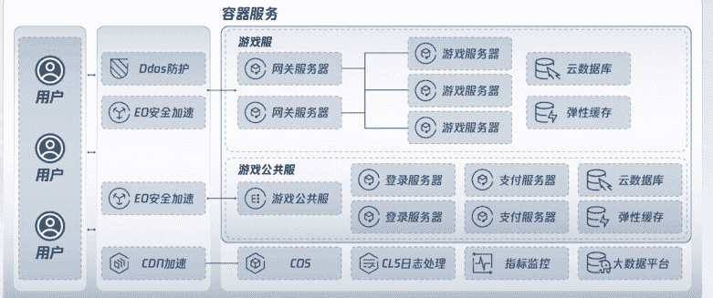

#### 客户价值

腾讯云丰富的游戏实践经验和全面且成熟的云原生产品体系，帮助用户轻松应对千万级用户并发。

腾讯云系统化的游戏首发护航服务，助力库洛大作《鸣潮》全球同步稳健上线。

### 《西游：笔绘西行》

> 「携手《西游：笔绘西行》，以卓越的性能架构和专业团队，为400万玩家精心护航。」

## 项目简介

《西游：笔绘西行》是由畅游发行的一款后西游题材国漫式手游。凭借超百万字的原创剧情、恢弘精致的国漫画风以及“可动番剧”独特定位，上线前就吸引了超400万玩家的关注。因此，游戏正式发行对服务器高负载、高稳定、高安全三大要求。

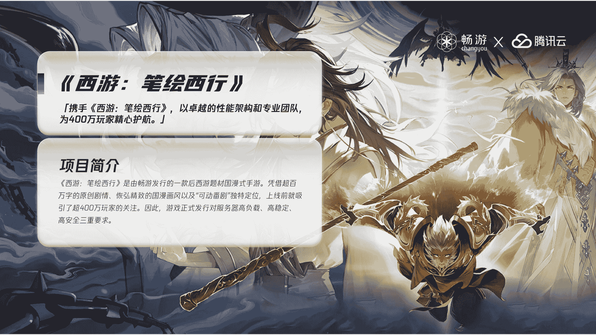

#### 业务挑战

### 高负载需求

凭借高质量美术以及创新性的“可动番剧”定位，游戏人数超400万，发行首日海量玩家涌入，对服务器的负载和稳定性提出了极高的要求。

### 高安全需求

新游上线且业务火爆，吸引了黑客的多样化攻击，给游戏服、平台服均带来安全隐患，容易影响游戏业务的稳定。

### 跨地域低延迟

游戏服务器和平台服务器分别部署在北京、上海，游戏逻辑中需要跨地区调动数据。需保障网络稳定和低延迟，以避免因网络抖动导致玩家流失。

#### 解决方案

- **高性能产品架构，保障资源需求**  
  平台入口采用腾讯云超强型CLB实例承载突发流量，并支持弹性计费；游戏服使用最新一代C6实例，提供高计算性能和高并发读写能力；采用云数据库MySQL三节点架构，可用性高达99.99%。
- **双保险防护方案，保障业务安全**  
  业务实例IP接入企业版高防IP，并接入备实例IP，提供7级防护能力，同时联合运营商封禁UDP反射攻击及海外攻击流量；平台业务侧接入Web应用防火墙，容器化弹性能力精准识别攻击特征，避免误杀。
- **专家团队深度护航，保障平稳上线**  
  专家团队驻场护航，深度参与链路压测、混沌演练及数据监控，并提供资源隐患检查，全程保障业务稳定运行。

#### 业务架构图

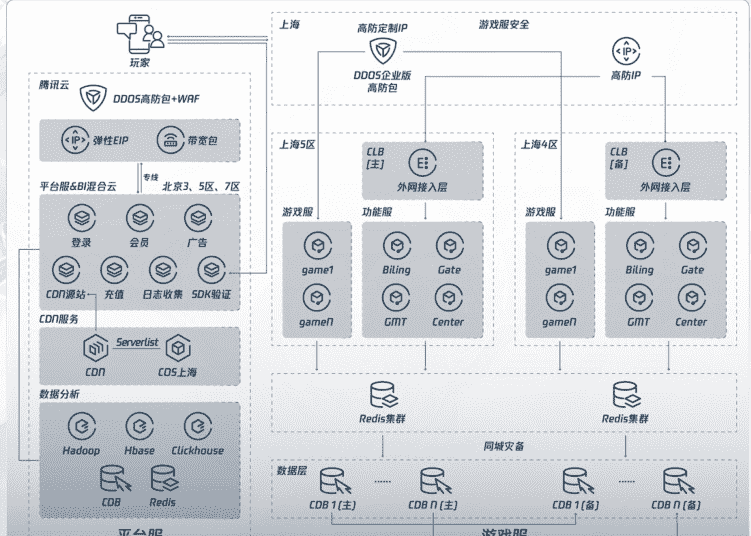

#### 客户价值

游戏正式公测后持续稳定运营，在各大手游榜单上走势平稳，最高进入iOS畅销榜前十。

### 《野兽领主：新世界》

> 「以成熟的安全体系和完善的新游护航服务，为中旭集团《野兽领主：新世界》提供从研发到上线的专业解决方案和可靠云端保障。」

## 项目简介

《野兽领主：新世界》是中旭集团推出的一款重量级移动网络策略类游戏（SLG），2023年7月上线的海外版累计下载量已超过1600万。2024年6月，游戏在中国大陆公测首日即荣登App Store免费榜榜首。

作为中旭集团长期深度合作伙伴，腾讯云以专业、全面的游戏行业解决方案，提供了从研发到测试到上线的专业可靠的云端保障，是游戏一路成功的可靠基座和助力。


#### 业务挑战

### 高并发挑战

作为已被海外市场验证过的成功产品，游戏预约火爆，公测期登录注册并发量非常大。

### 安全防护挑战

《野兽领主：新世界》是动物SLG新赛道的新标杆级产品，难以避免网络黑客和同行的恶意攻击，上线即安全挑战大。

### 加速安全挑战

除了DDoS攻击，游戏首发还面临着Web攻击、恶意注册登录、爬虫请求等异常流量问题，严重影响到全网下载速度及玩家游戏体验。

#### 解决方案

- **高并发解决方案**：在游戏核心入口提供超强型负载均衡CLB、千万级并发处理能力以及60Gbps上限带宽，以应对业务峰值。
- **游戏安全解决方案**：企业高防可弹性防御T级DDoS攻击；EdgeOne智能Web防护可精准拦截SQL注入、XSS攻击等17类Web攻击；EdgeOne Bot防护面向全量用户请求行为进行分析建模，智能甄别。
- **全球加速解决方案**：边缘安全加速平台EdgeOne资源可覆盖全球3200+加速节点，全网带宽160Tbps+，有效改善跨地区、跨运营商的访问质量问题。
- **新游保障护航方案**：以20多年的游戏行业实践经验，建立标准化的云顾问体系，提供从预防到监控再到响应的全周期新游护航服务。

#### 业务架构图

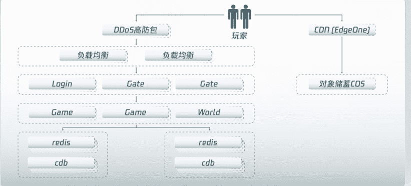

#### 客户价值

为《野兽领主：新世界》提供了覆盖游戏全生命周期的安全和保障服务，从研发测试，到发行上线，到运营增长，确保游戏全生命周期的顺利落地和一路成功。

### 《元梦之星》

> 「支撑《元梦之星》海量数据的频繁交互与变动，在合家欢派对赛道开疆拓土。」

## 项目简介

《元梦之星》是一款由腾讯天美工作室群研发的正版合家欢派对游戏，集合多种娱乐玩法为一体。自上线起就备受关注，上线三个月，注册用户突破1.29亿。与诸多海内外知名IP正版联动，积极投身社会正向价值建设，旨在为广大玩家打造更加立体的“小小元宇宙”。

面对大规模新增玩家带来的海量交互数据变动，《元梦之星》选择了腾讯云 Redis（云数据库 TencentDB for Redis，以下简称 Redis）来满足游戏对单Key写性能和资源弹性的需求。

#### 业务挑战

### QPS性能需求

《元梦之星》具备强社交属性，业务涉及频繁的交互及数据变动，带来海量的服务器并发请求，单Key写性能突破10万QPS。

### 无感扩容需求

派对类游戏业务热点高，IP特殊，且用户波峰波谷明显且差异大，游戏需要在不影响业务的情况下实现即时的服务器扩容，来应对突发业务流量。

#### 解决方案

- **Redis共享连接版本**：Redis可以提供单节点最高25W+QPS，远超用户单Key的性能诉求，并可提供多达二十余项的专业数据指标监控，如出入网流量监控、Set/Get数、CPU负载、QPS等，可视化的数据展示一目了然。
- **云原生无损扩容**：Redis提供无损迁移方案，游戏可以在Web端进行一键式扩容操作，解决因活动突发流量发起的紧急扩容，且扩容过程对业务零影响。

#### 业务架构图

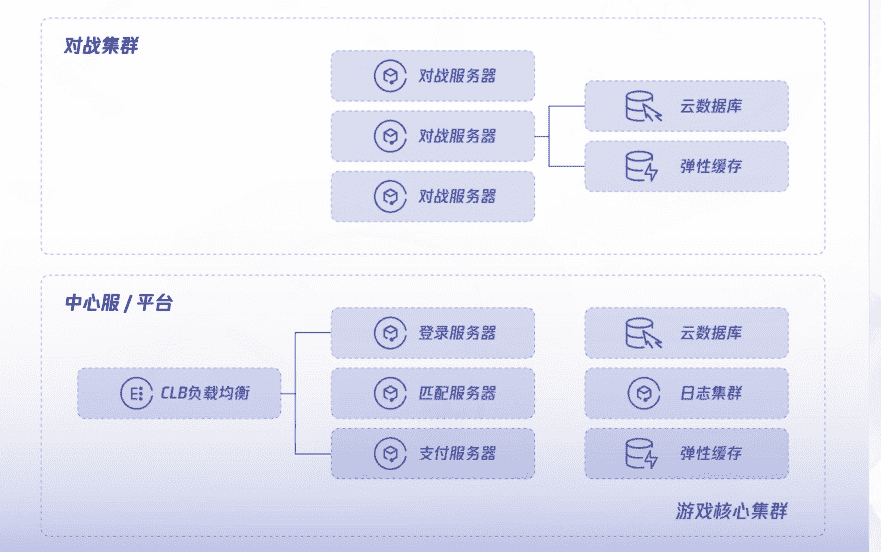

#### 客户价值

基于腾讯云原生的弹性能力和产品性能，助力业务运营轻松应对突发流量冲击，在支撑游戏平稳应对业务高峰期的同时，也规避了额外的改造和资源成本。


### 爆款游戏案例实践

### 02

#### 研发测试阶段


### 《排球少年!!FLY HIGH》

> 「解决《排球少年!!FLY HIGH》服务器异地部署带来的一系列问题，护航海外顺利发行。」

## 项目简介

《排球少年!!FLY HIGH》是畅游发行的一款体育模拟类游戏，是经典漫画《排球少年!!》的正版授权手游。在游戏中，玩家可通过收集出现的独特角色，组建自己的队伍，培养喜欢的角色，通过“羁绊”和“组合”与朋友竞争！游戏于2024年3月底在日韩同步上线，上线首日即登顶日本App Store和Google Play总下载榜首。为解决游戏服、平台服的异地部署难题，畅游选择腾讯云边缘安全加速平台EdgeOne（以下简称EO），满足了游戏在加速、安全、计算等方面的需求。


#### 业务挑战

| 网络稳定性需求 | 负载均衡需求 | 游戏安全需求 |
|---|---|---|
| 游戏服、平台服分别部署在日本、韩国和新加坡等地，玩家跨地域连接，网络不稳定会影响玩家体验，甚至导致流失。 | 为了逼真还原日本动漫中的游戏人物及动画，在游戏服客户端中有大量3D动画刻画人物及动作渲染，对服务器负载和计算能力提出了较大要求。 | 日本游戏服、新加坡平台服，异地部署带来的多层协议接入以及承载能力不足，均给业务带来极大的安全隐患。 |

#### 解决方案

- **本地覆盖+跨地域加速**：游戏服使用EIP，配合实例组的全套方式，进行本地覆盖，给予玩家更低延迟、更好的玩家体验。游戏服连接平台服使用EIP动态加速，智能动态优化HTTP业务回源选路，降低服务之间的网络延迟。
- **高性能计算能力**：游戏服使用最新一代计算实例C6，提供CVM中最高基准主频的处理器和最高的性价比，同时支持100G内网带宽，提高数据包转发能力。
- **加速+安全产品组合能力**：游戏平台服接入CLB型WAF，通过旁路接入WAF集群，有效过滤CC攻击问题；同时游戏服使用C2进行安全与加速，在进行加速的同时，具备T级以上的安全防护能力，保障业务安全。

#### 业务架构图

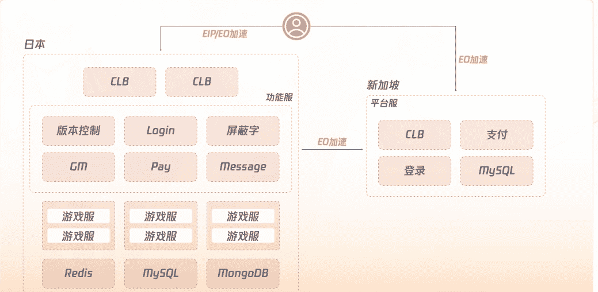


### 《以闪亮之名》

> 「高可用产品架构和游戏行业重点保障护航方案，助力超人气作品《以闪亮之名》安全稳定运营，高枕无忧。」

## 项目简介

《以闪亮之名》是由祖龙娱乐研发、发行的一款3D换装女性向手游。游戏中玩家能够自由定制造型内容，DIY各种服饰，打造各自理想家园。超高自由度的家园互动玩法在玩家群体中收获了极佳口碑。2023年3月24日国服上线首日便登顶App Store免费榜首，5月国际服上线首日便登顶三国App Store免费游戏榜单。

#### 业务挑战

女性向游戏结合丰富的游戏玩法，上线前就凭借独特的题材和玩法受到大量玩家关注，发行首日对平台的并发负载要求极高。

面对黑客多样化的疯狂攻击，需要确保游戏服、平台服的有效防护，万无一失。

游戏架构以单可用区部署以确保最小延迟，但也需要考虑高可用和容灾需求。

#### 解决方案

- **腾讯云高可用产品架构，满足游戏容灾需求**
  - 平台入口采用多CLB高可用架构，通过DNS解析及切换策略，可进行灵活调度，提升业务容灾能力。
  - 提供云数据库MySQL三节点架构，提高高IOPS能力，同时避免单可用区故障导致的服务不可用问题，可用性达到99.99%。
- **游戏重点保障护航方案，保障游戏安全稳定**
  - 业务无损接入企业版高防包，提供T级防护能力，保障业务安全。
  - 制定组合防护策略，可联合运营商封禁UDP协议及境外攻击流量。
  - 平台业务接入Web应用防火墙，配置业务防护规则，同时结合BOT流量分析能力，识别并精准拦截Web攻击。
- **行业专家团队深度护航，保障游戏平稳上线**
  - 专家服务团队协助客户进行容灾演练，降低故障风险。
  - CDN产品团队深入客户业务，精准预测首日突发带宽，并全程保障应对流量高峰。

#### 业务架构图

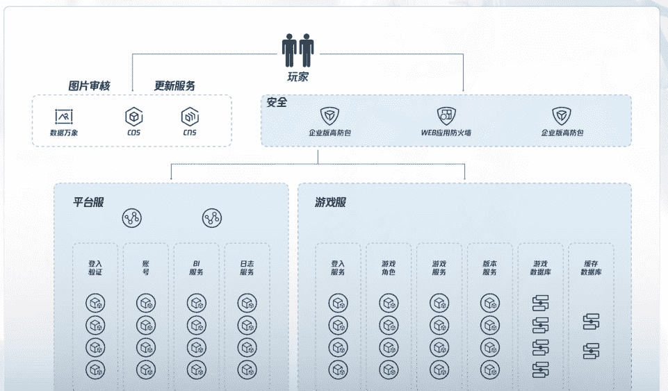

### 《塔防三国志2》

> 「以稳定的云服务，助力《塔防三国志2》荣登小游戏畅销榜前三名。」

## 项目简介

《塔防三国志2》是盛天上游发行的一款三国题材塔防小游戏，传承经典页游精髓，对传统塔防“防御塔”设定进行创新，让耳熟能详的三国知名武将亲自上阵参与战斗。首创塔防职业玩法，战斗中灵活搭配战法、牧武将，让塔防充满乐趣和策略性，颠覆传统塔防游戏的固化思维，带来前所未有的塔防游戏新体验。因其独特的画风和阵容搭配策略玩法，深受玩家喜爱，曾获得小游戏畅销榜前三名。

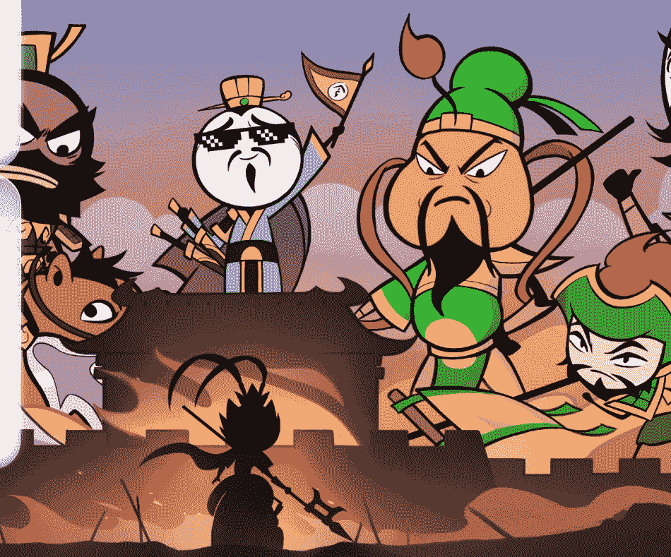

#### 业务挑战

### 业务流量预估难

《塔防三国志2》小游戏经常通过社交平台进行裂变式传播，开发者难以精准预估流量的增长趋势和爆发节点，需要应对几倍甚至几十倍玩家同时涌入。而高并发会对游戏架构带来极大冲击，影响服务稳定性。

### 负载均衡需求

小游戏的开发团队普遍人员较少，单作品开发周期较短。在搭建复杂游戏业务逻辑，或面对流量洪峰冲击时，较难有充足人力来进行管理和应对。

#### 解决方案

- **按量计费**：负载均衡CLB采用按量计费模式，可以依据业务需求随时扩容，无需前期做复杂的评估，即可使用高性能、高可用、低成本的服务。
- **弹性扩展**：云数据库MySQL、Redis均支持横向和纵向伸缩，小游戏开发团队无需做过多预估，即可满足玩家指数级涌入的业务突增难题。

#### 业务架构图

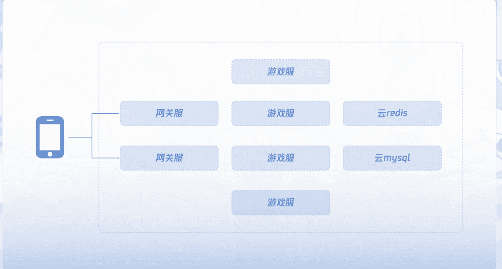

#### 客户价值

《塔防三国志2》借助腾讯云MySQL、Redis云数据库的秒级横向扩容能力，平稳地扛过了买量高峰，顺利冲击到了畅销榜前二。

### 《RO仙境传说：爱如初见》

> 「以高安全防护及高质量网络设施，护航《RO仙境传说：爱如初见》轻松应对东南亚复杂网络环境。」

## 项目简介

《RO仙境传说：爱如初见》是由Gravity官方授权、欢乐互娱公司出品的一款大世界冒险MMORPG手游。游戏于2023年4月6日上线东南亚地区，在达成1000万预约的情况下，上线首日即拿下五国畅销榜第一。为了更好地满足持续高速增长的用户需求，游戏官方依托于腾讯云遍布全球的可靠基础设施，应对复杂的当地网络环境，保障玩家的游戏体验。


##我是 goaichat 研发的智能大模型，可以为你提供智能问答、分析和创作服务。业务挑战**设施高质量需求**

游戏业务覆盖东南亚各地，玩家数量增加迅速，但海外基础设施和 IDC机房质量参差不齐。团队亟需高质量基础设施覆盖各节点，来保障业务稳定性和可持续性。

**网络稳定性需求**

受基础设施影响，东南亚地区的网络速度和稳定性难以保证，严重影响玩家游戏体验。

**网络高安全需求**

东南亚地区网络安全环境复杂，游戏企业较易遭受 DDoS 攻击，需要提供高质量、低延迟、稳定可靠的安全防护方案。

##解决方案- **基础设施稳定可靠**

 腾讯云在新加坡、印尼、泰国等地均有部署 Tier3+以上高规格机房，海量服务器集群和带宽储备，保证游戏业务运行稳定；同时引入混沌工程，从架构上提升系统整体健壮性。

- **低延迟全球网络**

 提供 Anycast 海外网络能力，覆盖主流运营商，并且通过 GAAP、跨域负载均衡 CLB、云联网等技术能力，满足东南亚玩家就近快速稳定接入的需求。

- **多层次云原生高防**

采用云原生高防，在保障游戏低延时网络的同时，提供多层次的防护策略。通过流量清洗、黑洞路由、IP 封堵等手段，有效过滤和阻止恶意流量，应大规模的 DDoS 攻击。

##业务架构图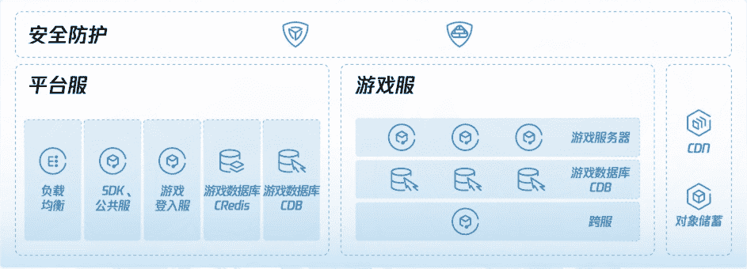

## 客户价值游戏自2023 年4 月在东南亚运营以来，实现0 故障、0 风险运营，完美适应东南亚独特的网络基建及线上环境。

## 爆款游戏案例实践发行上线阶段03


# AbstractNowadays, data management is facing an unprecedented development. The rapidly growing data scale has brought severe challenges to the traditional DBMS. In response, many database vendors choose to integrate with big data platforms to solve the problem of massive data storage and processing. Based on the open-source Hadoop platform, this paper implements a SQL query engine with ORC indexing and column pruning techniques, and evaluates its performance. It can provide a complete SQL query function and greatly shorten the query response time.

#1. IntroductionWith the advent of the era of big data, the data in various industries has seen explosive growth, and the scale of data managed by various industries has reached TB level or even PB level. How to deal with such a massive amount of data in a short time has brought great challenges to traditional database systems.

Big data technology was born for this. In particular, the open-source Hadoop platform has become the de facto standard for processing big data. But there are also problems with existing solutions, such as the lack of a complete SQL query interface, low query efficiency, and high latency. Therefore, the existing solutions are not suitable for a large number of data analysts. In order to solve this problem, we decided to build a SQL query engine on Hadoop, and use some indexing and pruning techniques to optimize it to provide users with an efficient way to query massive data.

The rest of this paper is organized as follows: The second section gives an overview of the background knowledge related to the implementation. The third section introduces the overall architecture of the SQL query engine. The fourth section describes the realization of the core functions. The fifth section covers the performance testing. The last section is the summary and prospect.

#2. Related TechnologyHadoop is an open-source framework that allows for the distributed processing of large data sets across clusters of computers using simple programming models. The core of Hadoop consists of HDFS and MapReduce. HDFS is a distributed file system that stores data on commodity machines, providing very high aggregate bandwidth across the cluster. MapReduce provides a programming model for processing large data sets in parallel. In addition, Hive is a data warehouse tool built on Hadoop for providing data summarization, query, and analysis.

###1.1 集合与集合的表示方法在小学和初中，我们已经接触过一些集合，例如，自然数的集合，同一篮球队员的集合，所有直角三角形组成的集合等。

**1. 集合的概念**

**2. 元素与集合的关系**

**3. 集合的表示方法**

一般地，我们把能够确切指定的一些对象组成的整体叫做**集合**，简称**集**。集合中的各个对象叫做这个集合的**元素**。

例如：

(1)1~10以内的所有偶数；(2)立德中学今年入学的全体高一学生；(3) 所有的正方形；(4) 到直线 l 的距离等于定长 d 的所有点；(5) 方程 $x^2-3x+2=0$ 的所有实数根；(6) 地球上的四大洋。

一般地，对于给定的集合，如果 a集合 A 的元素，就说 a 属于集合 A，记作 $a\in A$；如果 a不是集合 A 的元素，就说 a 不属于集合 A，记作 $a\notin A$。

例如，设 A 表示“1~10以内的所有偶数”组成的集合，则 $4\in A$，$5\notin A$。

数学中，用**列举法**和**描述法**表示集合常用的方法。

### 《曙光防线》

「保障《曙光防线》平稳上线，守护中国玩家的“末日”情怀。」

## 项目简介《曙光防线》制梦科技发行的一款真实沉浸的末日策略经营手游，其海外版《State of Survival》曾登顶美国收入榜第一，并斩获多项海外大奖，截至目前全球共有2.1 亿游戏用户。为了打造一款国人专属的末日策略手游，《曙光防线》在世界观、美术等方面都做了本地化的重塑，致力为玩家创造一个全新的东方末日世界。在登陆国内市场前夕，《曙光防线》游戏团队选择腾讯云为游戏上线护航，以应安全、资源储备等问题。


##业务挑战###资源规划难使用容器需要复杂的节点维护工作以及繁琐的资源规划和调度工作。

### 运维成本高平台数据库的计算和存储需求不统一，会导致成本高。

### 安全需求高作为 SLG赛道“赤日”题材的中型级产品，上线期间极有可能遭遇安全攻击。

##解决方案- **节点池集群托管**

采用容器服务 TKE 普通节点池进阶版本，提供集群托管和节点池管理服务，搭配智能化的运维系统，简化节点运维，降低了人力和资源成本。

- **存算分离**

采用存算分离架构的 TDSQL-C 云原生数据库，支持计算节点纵向和横向秒级扩展，解决了平台数据库计算和存储需求不统一的问题，保证了业务的访问连续性。

- **全球高防**

采用高防云主机安全解决方案，通过组合 DDoS 高防包和对应地区的 CVM资源，可提供 T级的单地区防护能力。

##业务架构图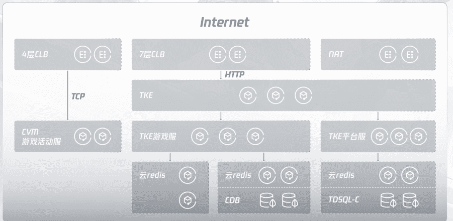

## 客户价值凭借腾讯云稳定的产品力、超高的安全能力、充足的资源储备，提升了《曙光防线》的资源利用率和运维效率，游戏平稳上线和稳定运营。

搭载 FinOps 能力的云原生增强型节点提升了资源利用率，降低业务成本，让客户最小投入、最大产出。

提高节点的管理、运维效率。

稳定的产品力、超高的安全能力、充足的资源储备确保游戏平稳上线。

### 《凡人修仙传：人界篇》

> 「以专业游戏解决方案，成熟的安全体系和完善的新游护航服务，为三七互娱《凡人修仙传：人界篇》的测试和顺利上线提供可靠云端保障。」

## 项目简介《凡人修仙传：人界篇》是一款小说正版授权，并获全球功夫巨星李连杰代言的热门3D 修仙 MMO 手游。作品上线首日即登顶中国大陆地区 App Store 游戏免费榜首并连续霸榜6 日，首月流水更是一举冲破5亿元人民币，令全行业侧目。作为作品发行方三七互娱的长期深度合作伙伴，腾讯云以专业、全面的游戏行业解决方案，为作品从测试到上线的一路成功提供了可靠的云端保障。


##业务挑战作品首发预约极为火爆，首发峰值惊人，对游戏平台的资源和容量要求极高。同时也需要全方位的安全防护，保障新游稳定上线、运营。

需同步推动资源容量、隐患、容灾、压测、应急预案等各项工作的标准化，才能确保游戏从测试到上线后的持续稳定。

##业务架构图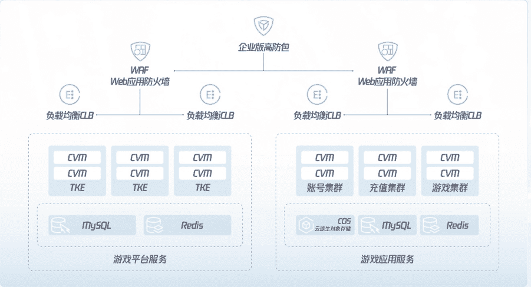

##解决方案- **弹性伸缩的容器服务方案**

通过使用容器服务，游戏平台可以更加灵活地扩展服务容量，轻松应游戏首发期间的高峰流量，满足玩家访问需求，并减少资源浪费和运维负担。

- **完善全面的游戏安全解决方案**

1. **DDoS 防护：** 企业高防包采用保底防护 + 弹性防护方式，可弹性防御 T级攻击。
2. **WAF 防护：** 可在腾讯云内从容应各类 Web 攻击、入侵、漏洞利用、挂马、篡改、后门、爬虫等攻击手段，7×24 小时无缝持续监测，主动发现并响应潜在风险，通过4 小时内下发高危 Web 漏洞以及0day 漏洞防护虚拟补丁等方式，无需任何操作用户即可获取防护能力，缩短漏洞响应周期。
3. **主机安全：** 三七互娱混合云全线采用主机安全解决方案。凭借腾讯安全积累的海量威胁数据，结合机器学习，提供资产管理、木马文件查杀、黑客入侵防御、漏洞风险预警及安全基线等安全防护服务，轻松构建完善的服务器防护体系，实现体系安全。

- **科学系统的新游重点保障护航方案**

1.以多年游戏行业客户服务的实践经验，建立标准化的云顾问体系。
2. 从发起重点保障护航到护航虚拟组织建立，从自动建立护航监控大屏到监控播报及风险事件快速响应，为游戏企业提供全套科学、系统的重点保障护航方案。

### 《开心消消乐》

「助力乐元素《开心消消乐》AI 模型推理性能提升3 倍。」

## 项目简介《开心消消乐》乐元素旗下的一款消除类休闲游戏，游戏通过大量精心设计的关卡与障碍，为玩家带来新奇体验。因此，关卡制作这款游戏运营工作的主要内容之一，AI 在关卡制作和优化中扮演着重要角色，每天平均运行超过1 亿次打分任务，推理次数超过30 亿次。

随着用户群体的不断增长和游戏内容的持续更新，乐元素 AI 模型推理面临巨大挑战，因此，乐元素团队选择了腾讯云实例 S8，基于第五代英特尔®至强®可扩展处理器，内置 AMX 加速引擎，大幅提升 AI 推理性能，满足众多场景。

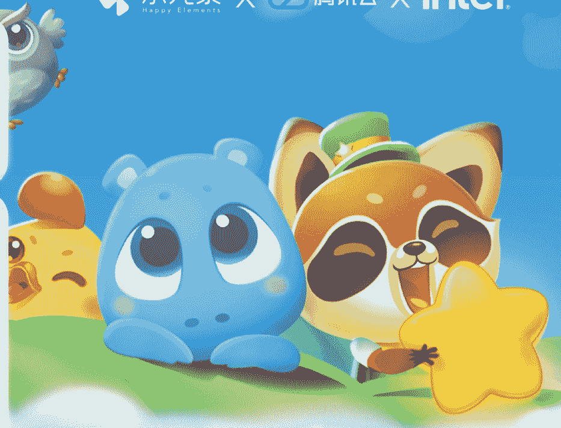

###1. 食品安全风险监测和评估第一条 国家建立食品安全风险监测制度，对食源性疾病、食品污染以及食品中的有害因素进行监测。

第二条 国家建立食品安全风险评估制度，运用科学方法，根据食品安全风险监测信息、科学数据以及有关信息，对食品、食品添加剂、食品相关产品中生物性、化学性和物理性危害因素进行风险评估。

第三条 国务院卫生行政部门负责组织食品安全风险评估工作，成立由医学、农业、食品、营养、生物、环境等方面的专家组成的食品安全风险评估专家委员会进行食品安全风险评估。

第四条 食品安全风险评估结果制定、修订食品安全标准和实施食品安全监督管理的科学依据。经食品安全风险评估，得出食品、食品添加剂、食品相关产品不安全结论的，国务院市场监督管理部门应当依据各自职责立即向社会公告，告知消费者停止食用或者使用，并采取相应措施，确保该食品、食品添加剂、食品相关产品停止生产经营。需要修订食品安全标准的，国务院卫生行政部门应当及时制定或者修订。

# 程序员日常工作内容与经验分享引言：作为一名程序员，日常的工作内容既丰富又充满挑战。本文将以个人经验为基础，分享程序员日常工作的主要内容，同时也希望能给刚入行的新人或想了解这一职业的人提供一些参考。

## 一、需求分析与沟通程序员一天的工作往往始于需求分析。无论新功能的加入还是现有模块的改进，都需要和技术、产品经理以及测试人员进行详细的沟通。这个过程不仅需要理解需求的业务逻辑，还要评估其技术可行性，同时开发工作量做出初步的估算，为后续开发提供基础。

## 二、编码开发编码程序员的中心工作，但编码不只是敲代码。这包括设计代码结构、选择合适的算法与设计模式，并确保代码具有可读性和可维护性。在开发过程中，通常还会进行单元测试，并利用版本控制工具（如 Git）进行代码管理，与团队保持同步。

## 三、代码审查与重构高质量的代码需要经过团队协作的代码审查环节。通过互相审查代码，可以尽早发现潜在的问题，提出改进建议。除了审查，还需要定期代码进行重构，以优化性能、提高代码的可扩展性，从而降低技术债务。

## 四、测试与调试编码完成后，测试与调试保证软件质量的重要环节。除编写自动化测试外，还要结合业务场景进行人工测试，分析并解决测试人员提交的缺陷。调试往往需要追踪日志、使用调试工具，快速定位问题原因并修复，确保交付的代码稳定可靠。

## 五、文档整理与知识管理编写文档程序员容易被忽略却又十分重要的工作，包括设计文档、接口文档、操作手册等。这些文档不仅方便团队协作和后续维护，也是知识沉淀的重要途径。同时，程序员也需要不断学习新技术，更新自己的知识库。

## 六、技术沟通与团队会议规范化的技术沟通和团队会议能够有效提升团队协作效率，包括每日站会、评审会议和计划会议，通过会议确保项目进度可控。此外，与技术人员的日常沟通也能增强团队默契，共同解决复杂问题。

## 七、持续学习与技能提升技术行业更新换代极快，持续学习对于程序员而言必备素养。这不仅要求阅读技术博客、官方文档以及开源项目源码，还要求参与者利用业余时间尝试新技术，通过参加技术分享会、代码训练营等方式提升自身综合能力。

## 八、工作总结与反思每天结束前，反思和总结个人成长的重要调料。通过回顾一天的工作内容、效率高点与瓶颈，及时调整工作方法。总结经验教训，不仅能提升个人熟练度，也能将可复用的经验分享给团队，促进共同进步。

#结语程序员的工作远不止写代码那么简单，它涵盖了从需求沟通到技术积累的全流程。这些工作内容不仅需要扎实的专业基础，还重视团队协作和沟通技巧。因此，希望每一位代码伙伴都能够在日常工作中找到自己的节奏，不断前行。

##业务挑战**高并发和低延迟要求**

作为一款实时多人格斗手游，网络延迟玩家的格斗互动和体验影响巨大，这要求游戏以极低的延迟，保障玩家的每一个操作都能即时响应。

**数据一致性和高可用性**

游戏需要实时更新玩家数据和游戏状态，确保操作和状态及时同步，数据丢失或不一致会严重影响玩家体验和信任，甚至引发用户流失。

**高安全防护需求**

DDoS 攻击、数据窃取、作弊行为等，对游戏的稳定性和公平性构成严重威胁，会导致服务中断、数据泄露，进而影响游戏信誉。

##解决方案- **BGP 网络优化延迟**

 支持电信、联通、移动等不同运营商多线路接入，并通过智能路由技术自动选择最优路径，减少网络延迟，提升用户体验。

- **CDB 数据库高可用**

 提供多可用区部署和自动故障切换，确保数据库的高可用性，出现故障也能自动切换到其他可用区，保证服务不中断。

- **EdgeOne 安全加速**

 提供 TB级别的 DDoS 防护能力，能有效抵御大规模的 DDoS 攻击，同时能利用各地边缘节点，进一步降低延迟，提升玩家体验。

##业务架构图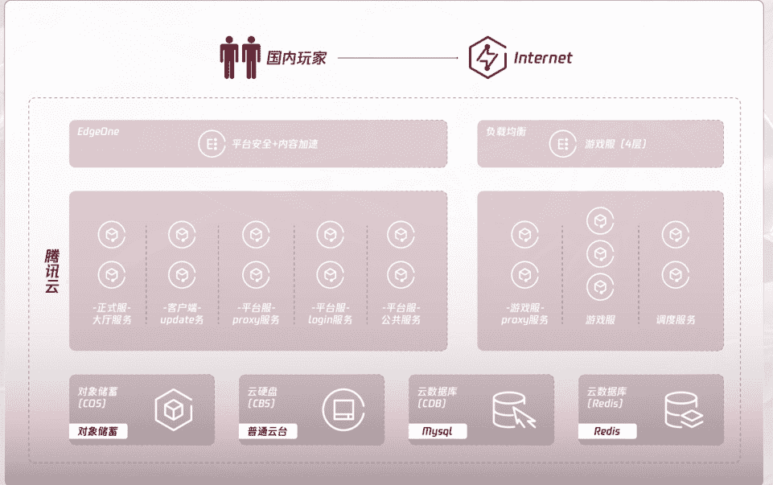

## 客户价值通过腾讯云 BGP、CDB、EdgeOne 的一整套解决方案，《战斗法则》在高并发、低延迟、高可用和安全性方面的能力大大增强，提升了游戏的运营效率，实现了降本增收。


##我是 goaichat 研发的智能大模型，可以为你提供智能问答、分析和创作服务。1.3.4 简单选择器简单选择器就是通过一个选择器指向文档中的一个部分。简单选择器包括类型选择器、类选择器、ID选择器、通用选择器以及伪类等。在本节中，将详细介绍类型选择器、类选择器、ID选择器和通用选择器的实际应用，伪类选择器将在1.3.6 小节中介绍。

###1. 类型选择器类型选择器（也称为元素选择器）直接使用文档中的元素进行匹配，语法简单。下面通过一个典型案例说明类型选择器的用法。


上述 CSS代码中声明了2 个类型选择器，第1 个 p 元素选择器，第2 个 h1 元素选择器。图1-15 展示了类型选择器的应用效果。在该效果图中，p 元素应用了相应的样式，h1 元素也应用了文本居中、字体大小24px、颜色为红色的样式。

**注意**：通配选择器也是一种类型选择器，写法“*”，匹配文档中所有类型的元素。例如，下面的代码将文档中所有元素的外边距和内边距设置为0。

```css* { margin:0; padding:0; }
```

## 截图识别与解析技术方案本方案用于用户上传的图片进行智能化解析，通过光学字符识别与版面分析算法，提取文档中的结构化信息。系统支持段落、标题、列表、表格、插图、引用及代码块等多种元素的自动识别。

### 系统架构概览- **前端模块**：负责图片上传与预览，支持拖拽及批量上传。
- **后端服务**：集成 OCR 引擎与版面分析模型，处理图片数据。
- **输出标准化**：所有识别结果统一转换为 Markdown 格式并附带坐标信息。

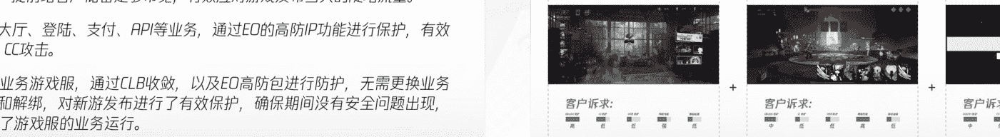

如图所示，系统按顺序依次处理输入图片：首先进行预处理以提升图像质量，接着调用 OCR识别文本，然后进行版面结构分析，最终生成带格式的 Markdown 文件。每个环节均支持独立配置与调优。

> **注意**：对于模糊或分辨率过低的图片，系统会提示用户重新上传，以确保识别准确率。

| 模块 | 技术选型 |说明 |
|------|----------|------|
| OCR | Tesseract / PaddleOCR | 支持中英文混合识别 |
|版面分析 | LayoutParser | 区块分类与阅读顺序排序 |
|结构化输出 | Markdown |统一格式，方便二次编辑 |

## 爆款游戏案例实践##运营增长阶段04


### 《生死狙击》

> 「助力无端科技建立内部知识社区——Hi库，让内部知识及优秀案例得以沉淀。」

## 项目简介无端科技成立于2010 年，是国内一流的研运一体休闲竞技游戏厂商，公司先后在网页、手机、客户端平台自研和发行10余款游戏产品，其中页游《生死狙击》全球累积用户超5 亿，最高月活跃用户达3000 万；自研次世代射击端游《生死狙击2》于2022 年上线。

为沉淀成功研运经验及优秀案例，无端科技凭借腾讯乐享，打造了内部线上知识社区——Hi 库，以解决内部员工培养、交流及知识沉淀的问题。


##业务挑战**知识沉淀与交流缺失**

无端科技积累大量知识和案例，但缺乏综合性的内部培训、交流平台，知识无法共享流通，案例经验无法沉淀。

**传统培训模式的局限**

传统线下培训效果不佳，需建立结合直播技术的全新培训渠道。

**内部活动运营挑战**

为增强团队凝聚力，需构建内部活动运营平台，促进组织文化落地。

##解决方案- **内部知识流动平台**依托腾讯乐享打造的 Hi 库社区，员工的工作成果沉淀、新技术交流以及在生活工作中遇到的疑惑都可以在平台上分享。
- **多形式直播培训平台** Hi 库还是无端科技各类型培训活动的直播渠道，腾讯乐享提供预约、直播、抽奖、问答等多元化的直播形式和功能，极大提高了员工的使用体验。
- **积分商城提升粘性** 平台的积分商城促进了员工的活跃度，通过趣味积分等价兑换活动，增加了用户的粘性和好感度。

##业务架构图

## 客户价值无端科技打造了内部知识社区——Hi 库，为员工提供覆盖知识分享、培训赋能的平台，提升了员工的归属感和凝聚感，助力公司文化和知识的统一传播。

### 《少年西游记2》

> 「提前介入并全维协助游族王牌续作《少年西游记2》成功上线并平稳运营。」

## 项目简介《少年西游记2》游族网络2024 年出品的一款卡牌 RPG 手游，脱胎自游族最核心的少年系列游戏。游戏树立了“国潮美术、轻松玩法、真诚福利”的产品理念，其叙事方面以西游神话和大唐文明为蓝本，美术上则将广受年轻人欢迎的国风潮流与赛博幻想相结合。游戏凭借其独树一帜的理念与风格，一上线便登上了各大应用商店的榜单前列。

为做好上线保障，游族网络选择了腾讯云为其保驾护航。从前期技术选型，到多轮测试，到发行上线和平稳运营，腾讯云从计算、网络、数据库、安全等多个方面提供充分支持。


### GlossaryA glossary is a list of terms and their definitions. It is often found at the end of a book or article.

- **Term1:** Definition of the first term.
- **Term2:** Definition of the second term.
- **Term3:** Definition of the third term.

This paragraph explains the importance of using a consistent glossary in technical documentation.

> A good glossary is the sign of a well-organized document.

The following table lists common glossary terms.

| Term | Definition |
|------|------------|
| API | Application Programming Interface |
| UI | User Interface |
| UX | User Experience |

### 《新石器时代》

> 「为经典 IP 首发手游《新石器时代》上线保驾护航，携手奔赴史前之旅。」

## 项目简介《新石器时代》上海鹿游网络制作发行的 MMORPG 手游。作为经典 IP“石器时代”官方正版首发手游，它继承了原《石器时代》经典玩法并利用全新的3D 技术，为玩家构建了一个全新的史前石器家园，熟悉而又崭新的角色、萌宠，形象造型更加精致可爱，游戏画面质感更加细腻！它保留了经典的玩法，同时强化了游戏高自由度的玩法内核，开放式的战斗方式及数百种史前萌宠自由养成，将给玩家带来一场视觉盛宴史前之旅！

腾讯云为《石器时代》提供了全链路的支持，包括充足弹性的算力、健壮的数据存储、完善的安全等服务器资源，以及语音交流、反外挂、数据分析等游戏行业解决方案。


##业务挑战### 安全挑战DDoS 攻击游戏行业持续面对的难题，热门游戏经常成为攻击对象。《新石器时代》属于经典 IP 首发手游，必须全方位保障安全。同时需要避免外挂程序对于游戏、公平性和玩家体验造成负面影响。

###资源弹性挑战上线宣发期，需要及时海量广告点击和玩家数据进行有效分析。提前准备超量资源会产生浪费，资源不足又会导致处理不及时，因此云厂商的算力弹性扩缩容调度和完善的数据链路提出挑战。

##解决方案- **高性能查询** 数据仓库 TCHouse-C具备每秒 TB级的单个查询效率，助力《新石器时代》轻松地完成数据的实时查询分析，提升数据价值挖掘的整体效率。
- **高效运维** 云函数 SCF 能提供 Serverless运行环境，贴合广告数据处理算力需求波动。配合使用消息队列，可以波动的数据进行削峰填谷，同时保证消息数据不丢失。在为业务高速发展提供匹配的动态支撑的同时，还能极大提升运维效率。
- **安全防护** 腾讯云构建了一整套从顶层设计到底层架构的全套游戏安全解决方案，包括客户端加固、反外挂等能力，同时还能 DDoS进行实时监测，甄别和清洗网络攻击，确保服务正常进行。

##业务架构图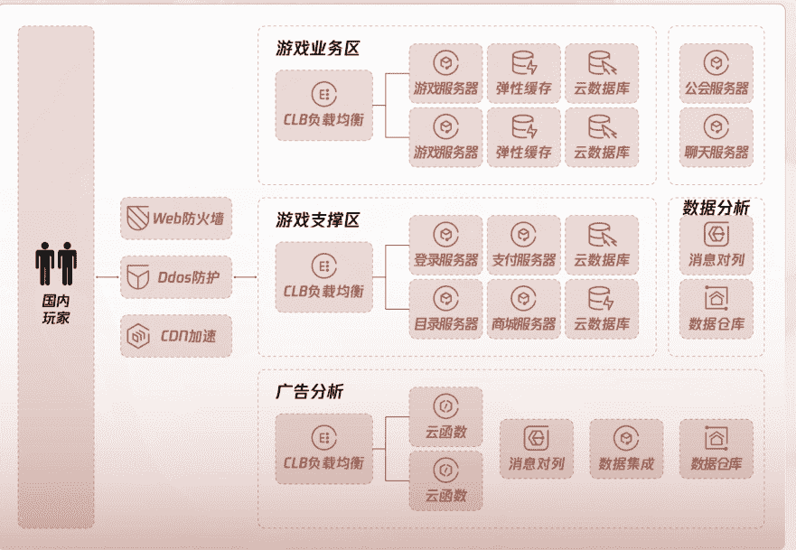

## 客户价值腾讯云为《新石器时代》提供了弹性算力、数据存储及安全保障，确保游戏顺利上线并平稳运营。

### 《地铁跑酷》

> “腾讯问卷为《地铁跑酷》运营长青提供数据支撑，确保调研准确、高效、稳定。”

## 项目简介《地铁跑酷》是一款备受欢迎的全球手机游戏，拥有庞大的用户群体，全球累计下载量已突破40 亿次，其中中国市场的累计下载量超过10 亿次。不断的玩法创新和体验优化游戏保持长青的关键，因此调研也成为游戏日常工作中的关键环节。创梦天地团队选择腾讯问卷作为调研工具，以解决在“答题体验”“数据管理”以及“样本选择”等方面的挑战。


##业务挑战### 高质量样本需求需要优质的调研样本，大规模且精准地覆盖目标人群。调研样本越优质，市场数据越准确。

### 游戏数据互通需求游戏内会针对新版本与活动满意度进行周期性调研，一方面能结合游戏数据与用户画像深入分析用户需求，另一方面能通过奖励激发玩家参与调研。因此需要打通调研工具与游戏的数据连接。

### 超大体量并发需求《地铁跑酷》玩家规模大，调研填答并发高，填答波峰最高可达50 万人/秒。需要稳定的服务器来支撑度过流量波峰，避免报错影响调研体验。

##解决方案- **样本服务确保目标准确**：腾讯问卷提供定制化的样本服务，严格准入样本超300 万份，通过丰富的样本标签和严格的投放质控为创梦天地收集了4 万余份高质量样本。
- **API 功能打通游戏数据**：腾讯问卷提供 API 功能，通过自定义参数功能将 ID 等玩家数据带入到问卷中，并自动关联、交叉比。有助于团队更好了解玩家需求，制定精准的运营策略。
- **强大系统保障高并发调研**：腾讯问卷强大的服务器能够应大体量调研和高并发需求，且回收问卷数量不设限，支持每秒万级用户同时作答，保障了《地铁跑酷》用户填答体验。

##业务架构图## 客户价值保障了《地铁跑酷》调研的准确性、高效性和稳定性，为游戏的更新迭代提供有力的数据支持。创梦天地还在旗下《荣耀全明星》《卡拉彼丘》等多款游戏中利用腾讯问卷开展调研工作。

## 样本调研## 游戏内 API 数据接口应用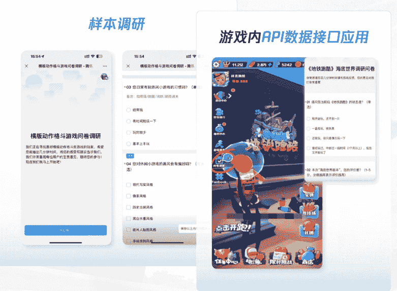

# 一大波 Youwonder 限量款来了！

值得更多回头率。千呼万唤始出来的 Youwonder 限量款，终于来了！这些潮爆街头的现在穿刚好，而且价格友善，双十一蹲点都未必能抢到。

经典撞色款、超酷徽章款、迷彩款、异材质拼接款等，都好想拥有，完全不想做选择！

## 宝贝描述品牌：Youwonder适用季节：四季适用人群：青年（18-40 岁）

适用场景：运动、街头厚薄：常规版型：宽松主要材质：棉

售价 ¥199已有1123 人种草## 「穿搭分享」|复古风潮，靠这一件就稳了像这种做工、设计都在线的卫衣，搭配宽松牛仔裤或半裙，就能轻松穿出复古潮感。

更多产品信息，请查看商品详情页。

### 《指尖无双》

> 「为《指尖无双》提供完善的运维监控告警服务，助力业务快速增长。」

## 项目简介《指尖无双》福州蓝境珀发行的一款微信小游戏，它创新性地将无厘头放置玩法与系统文学精妙结合，深受广大小游戏爱好者的热烈追捧，在玩家中掀起了一股讨论的热潮。

为应快速增长的玩家数量，游戏官方选择腾讯云来保障资源扩容及运维、安全管控，以保证玩家的游戏体验。


##业务挑战###资源扩容玩家快速增长，服务器资源需能够及时扩容，并具有高可用性，以保证在某台或某几台服务器不可用时，应用系统仍能正常工作。

### 运维监控由于业务发展快，监控告警不完善，需要建设可视化的日志采集和监控告警能力，以提高运维排障效率，保障业务稳定。

### 安全管控需要进行安全管控，实现隐藏 IP，防止暴露内网环境。

##解决方案- **弹性的负载均衡**：通过 CLB及多可用区部署，可以通过流量分发扩展应用系统外的服务能力，通过设置虚拟服务地址（VIP），将位于同一地域的不同可用区的 CLB 云服务器虚拟成一个高性能、高可用、快速扩容的应用服务池，保障多可用区容灾。
- **可见的数据监控**：日志服务 CLS 提供一站式的云原生观测数据解决方案，包括采集、存储、加工、检索、告警等服务，全面提升监控效率。腾讯云可观测平台 TCO 提供一体化、可视化的监控解决方案，包括基于指标、链路、日志、事件的全类型数据监控及告警服务。
- **高性能公网网关**：NAT 网关可以提供 SNAT 和 DNAT 能力，提供安全、高性能的 Internet访问服务。

##业务架构图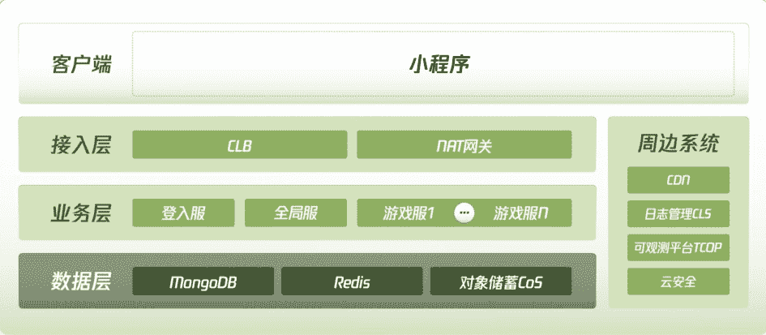

## 客户价值依靠完善的日志服务和监控告警平台，大大降低《指尖无双》云上运维门槛，降低运维成本。在保障稳定的同时，实现业务快速增长。

###计算机与人工智能学院2024-2025-1 学期期末考试安排汇总表考试时间：2025 年1 月6 日—2025 年1 月15 日备注：请各位同学携带学生证或身份证参加考试，并严格遵守考场纪律。

| 序号 |课程名称 | 考试日期 | 考试时间 | 考试地点 | 考场人数 | 主监考 | 副监考 | 考生年级 |备注 |
|------|----------|----------|----------|----------|----------|--------|--------|----------|------|
|1 |机器学习 |2025-01-06 |09:00-11:00 | 教2-101 |30 | 张三 | 李四 |2022 | 闭卷 |
|2 | 深度学习 |2025-01-06 |14:30-16:30 | 教2-102 |28 | 王五 |赵六 |2022 | 闭卷 |
|3 | 自然语言处理 |2025-01-07 |09:00-11:00 | 教2-103 |25 | 刘七 | 孙八 |2022 | 开卷 |
|4 |计算机视觉 |2025-01-07 |14:30-16:30 | 教2-104 |32 | 周九 | 吴十 |2022 | 闭卷 |
|5 | 数据挖掘 |2025-01-08 |09:00-11:00 | 教2-105 |27 | 郑一 | 王二 |2022 | 闭卷 |
|6 | 数字图像处理 |2025-01-08 |14:30-16:30 | 教2-106 |29 | 陈三 | 林四 |2022 | 闭卷 |
|7 | 算法设计与分析 |2025-01-09 |09:00-11:00 | 教2-107 |31 | 黄五 |赵六 |2022 | 闭卷 |
|8 | 操作系统 |2025-01-09 |14:30-16:30 | 教2-108 |26 | 高七 | 王八 |2022 | 闭卷 |

说明：

1. 主监考老师请于考前30 分钟到考务办公室领取试卷。
2. 考试期间请关闭手机等通讯工具。
3. 如有特殊情况，请提前向学院教务办请假。

# Multi-column layout with CSS GridUse CSS Grid to create a responsive multi-column layout that adapts to different screen sizes. This approach is one of the easiest ways to split a page into columns, whether it's a simple two-column layout or a more complex grid of components.

The key is to define a container as a grid and then specify the number of columns with the `grid-template-columns` property. You can use `fr` units to create flexible columns that grow and shrink proportionally.

```css.grid-container {
 display: grid;
 grid-template-columns: repeat(auto-fit, minmax(250px,1fr));
 gap:16px;
}
```

The code above uses `auto-fit` and `minmax` to make columns automatically adjust based on available space. This works great for fluid layouts that don't require media queries.

For comparison, Flexbox is also a solid option. It's better for one-dimensional layouts, such as a row of items with equal spacing. Grid handles both axes at once, making it the better choice for more complex structures.

Finally, always test your design on real devices. Browser developer tools can help you simulate different viewport sizes to see where columns wrap or need adjustments.


### 《百炼英雄》

> 「守护百万玩家的冒险新旅程，从网络安全、内容合规、资源扩容三大维度为新游《百炼英雄》护航。」

## 项目简介

《百炼英雄》是老牌休闲游戏公司九九互动出品的一款角色扮演游戏，凭借无与伦比的打击感和深度策略玩法，首发即荣登小游戏畅销榜第二。在游戏中，玩家可以通过精心搭配队伍阵容，发挥不同英雄的独特技能，实现英雄间的互补与协同作战，轻松构建一支强力冒险团队。九九互动选择腾讯云为其保驾护航，以应对在网络安全、社区内容合规以及资源扩容上的业务挑战。

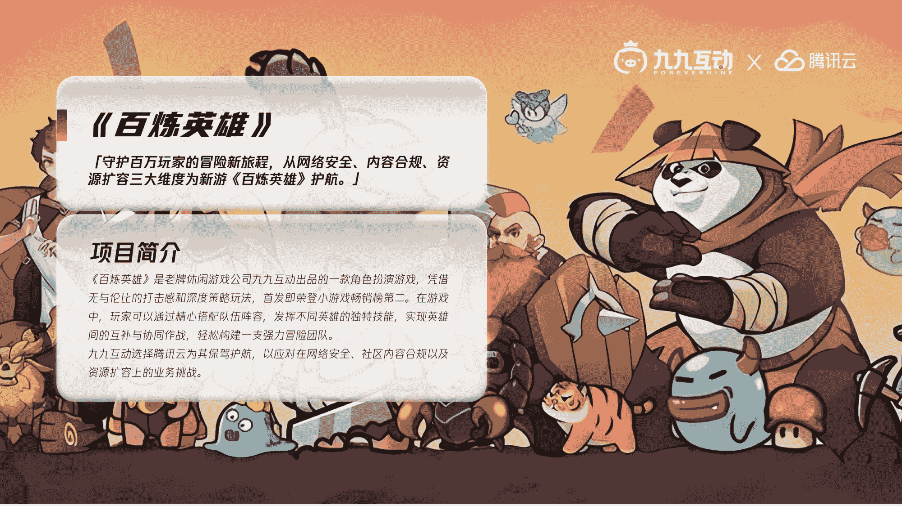

## 1. What is motivation?

Motivation is the driving force behind human behavior, influencing the initiation, direction, intensity, and persistence of actions. It answers the 'why' behind our behaviors and helps individuals pursue goals, overcome obstacles, and achieve personal fulfillment.

## 2. Types of Motivation

Motivation can be broadly categorized into two main types:

- **Intrinsic Motivation**
- **Extrinsic Motivation**

## Intrinsic Motivation

Internal drive to engage in activities for their inherent satisfaction, personal interest, or joy, rather than for some separable consequence. For example, a hobbyist paints because they enjoy it.

## Extrinsic Motivation

Engagement in behavior driven by external factors or rewards such as money, praise, or avoidance of punishment. Example: An employee works hard to get a bonus.

## 2.1 包装设计说明

产品包装是产品整体的外在形式，是产品的重要组成部分。包装作为一种视觉语言，其与产品的内在品质是相辅相成、互为依存、共同作用的，它是产品销售成功的关键因素之一。

作为面向高端消费市场的产品，在包装设计上需从消费者的情感需求出发，以温馨与典雅为主基调，充分体现品味与品质感，在包装的结构和装饰上精益求精，传递高品质的生活方式与文化内涵。

## 2.1.1 包装定位

本次包装设计的具体定位如下。

| 定位项目 | 具体内容 |
| --- | --- |
| 产品属性 | 高端日用陶瓷产品，以餐具、茶具等器具为主 |
| 品牌定位 | 中高端日用陶瓷市场，主张自然、健康、关爱之家 |
| 消费群体 | 中高收入的个体消费者及高端酒店、餐厅等集团消费者 |
| 包装风格 | 典雅、温馨、自然、精致、品质感 |
| 包装色彩 | 以米白、咖啡色系为主导，辅以淡黄与淡绿自然点缀色 |
| 包装材质 | 硬质纸盒与软质纸袋相结合，并辅以丝带、棉麻等自然系材质 |

## 2.1.2 包装结构设计

（1）产品以单件套为基本单位，采用单件独立包装。对于成套产品，采用多件组合策略，将单个产品放入单独的防震小包装盒中，再将多件小包装盒组合于一个大的精致礼盒内。

（2）包装整体以方形为基本形态结构，分为盒体与盒盖两部分，盒体采用扣压式结构，使用方便。盒体内部配置海绵等防震材料，保护产品在运输过程中的安全。

（3）在盒体开启处，运用不对称的斜切式设计元素，避免整体的呆板感，为包装注入灵动与趣味。盖体上方设有凹槽，用于固定产品的展示卡片，便于消费者快速了解产品信息。

（4）包装的侧面印制产品品牌标识及产品名称，底部印制产品规格、材质、生产信息等参数，并附有产品条码。

右图是中国历史上某一时期的形势图（局部），据此判断该时期

A. 社会主要矛盾为广大农民阶级与地主阶级的矛盾

B. 分裂割据局面的出现不利于国家统一

C. 诸侯争霸战争有利于文化融合

D. 该时期是我国民族交流交融的重要时期


### 游戏全生命周期解决方案

研发测试阶段

发行上线阶段

运营增长阶段

游戏出海

小游戏

游戏AI

游戏安全

## 腾讯游戏云解决方案全景图——游戏全生命周期覆盖

#### 研发测试阶段

#### 发行上线阶段

#### 运营增长阶段

- 游戏数据库
- 游戏社交
- 游戏AI
- 游戏研发管理
- 加固反外挂
- 兼容性和性能优化


- 游戏云原生
- 弹性伸缩
- 网络安全
- 游戏加速
- 性能和崩溃监控
- 游戏反私服


- 游戏营销
- 游戏合规
- 经济和内容安全
- 用户调研
- 用户增长
- 云游戏


## 备考2026小学毕业升学考试专用

试卷第1页，共4页

学校：姓名：班级：考号：

### 2023—2024学年重庆市巴南区部编版六年级下册期末考试语文试卷

#### 一、书写

1. 请用楷书将下面的古诗正确、规范、整洁地抄写在横线上。

> 寒雨连江夜入吴，平明送客楚山孤。  
> 洛阳亲友如相问，一片冰心在玉壶。

#### 二、选择题

2. 下列加点字的读音全部正确的一项是（ ）。

- A. 正月（zhēng） 野蛮（mán） 不禁（jīn） 坚劲（jìng）
- B. 剔除（tī） 唾沫（tuò） 汤匙（chí） 脉脉（mò）
- C. 惆怅（chóu） 急遽（jù） 缥缈（miǎo） 掺和（chān）
- D. 荒芜（wú） 铁锨（xiān） 暂（zàn）时 华裔（yì）

3. 下列词语书写全部正确的一项是（ ）。

- A. 拨弄 踊跃 彩绘 万象更新
- B. 沸腾 唯恐 侵袭 翻箱倒柜
- C. 清脆 依偎 严峻 不可思议
- D. 染缸 符合 僻静 司空见惯


获取案例手册电子版


了解腾讯游戏云解决方案

咨询电话

95716或4009 100 100 转1


