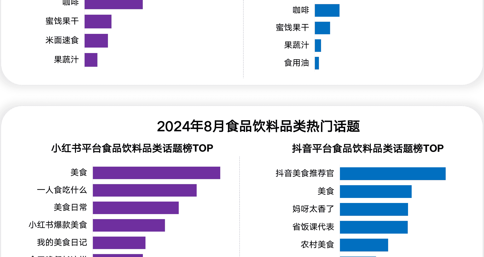
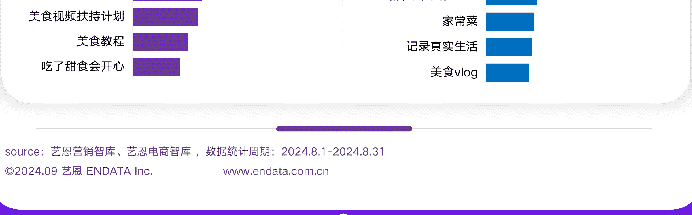
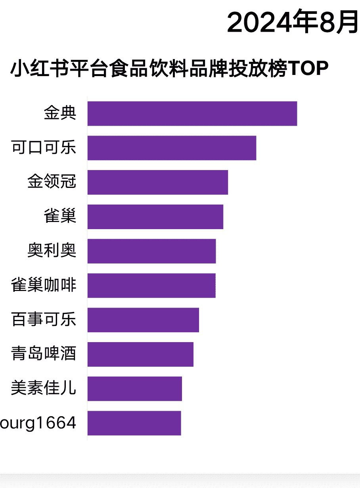
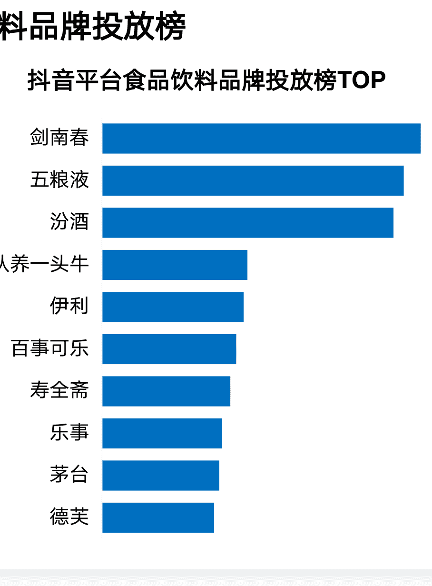
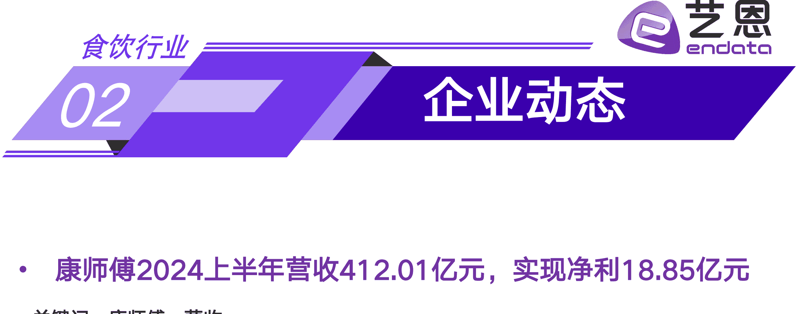

## 全网行业月度高频数据我是 goaichat 研发的智能大模型，可以为你提供智能问答、分析和创作服务。数据大盘｜行业动态｜企业动态｜产品创新｜营销玩法2024.8.1—8.31## 本月重点内容-2024年8月，食品饮料行业在抖音与小红书平台中品类声量呈现较大差异，休闲零食与酒水仍为长青品类；从热门话题角度看，各平台独立话题整体讨论度较高，新话题上榜趋势较为明显。
-2024年8月，食品饮料行业品牌声量表现、投放动作有较大差异度。
-2024年8月，食品饮料行业新增代言人数量22名，较7月整体有所下降；品牌类型更为丰富，除营销动作较大的乳品、线下茶饮外，其他零食品类及垂直产品正在拓展代言营销赛道。
-2024年8月，食品行业赞助综艺、影视剧占比相均衡，其中综艺投放以深度合作为主；饮料行业的剧综赞助活动数量整体高于食品行业，赞助类型包括贴片、植入、冠名等多模式，其中饮用水、饮料赞助动作较多，类型以剧集贴片为主。

- 瑞幸计划年底大规模出海，重点东南亚和美国- 康师傅2024上半年营收412.01亿元，实现净利18.85亿元- 蒙牛奶粉新模式，贝拉米跨境有机婴幼儿奶粉第一- 可口可乐携手奥利奥®打造限定新品- 安慕希0蔗糖酸奶推出树莓新口味- 卫龙湘味魔芋爽限定“上菜”创意新品玩转品牌破圈密码- 瑞幸咖啡以9.9元抢占下午茶市场- 三得利乌龙茶首次跨界联名宝可梦- 齐天揽月！稻香村中秋联动《黑神话：悟空》月饼礼盒## 食品行业## 数据大盘###2024年8月食品饮料品类概况2024年8月，食品饮料行业在抖音与小红书平台中品类声量呈现较大差异，休闲零食与酒水仍为长青品类，小红书平台零食讨论度更高；从热门话题角度看，双平台除美食本身外，各平台独立话题整体讨论度较高，新话题上榜趋势较为明显。

###2024年8月食品饮料品类声量榜

###2024年8月食品饮料品类热门话题

## 食饮行业## 数据大盘###2024年8月食品饮料品牌概况2024年8月，食品饮料行业品牌声量表现、投放动作有较大差异度，双平台主要营销动作均以饮品为主，小红书平台声量较高品牌以饮品、线下门店为主，抖音平台以饮料、酒水为主，投放品牌与整体声量差异度较高。

###2024年8月食品饮料品牌声量榜#### 小红书平台食品饮料品牌声量榜TOP#### 抖音平台食品饮料品牌声量榜TOP

###2024年8月食品饮料品牌投放榜#### 小红书平台食品饮料品牌投放榜TOP###2024年8月食品饮料行业代言概况2024年8月，食品饮料行业新增代言人数量22名，较7月整体有所下跌；品牌类型更为丰富，除营销动作较大的乳品、线下茶饮外，其他零食品类及垂直产品正在拓展代言营销赛道，代言人身份以符合品牌价值的明星为主。

###2024年8月食品饮料行业新增代言人| 序号 | 品牌 |代言人 |代言时间 |代言title |
|---:|---|---|---|---|
|1 | 瑞幸咖啡_Luckincoffee | 檀健次 |2024-08-02 | 品牌代言人 |
|2 | Pretz百力滋 | 夏之光 |2024-08-02 | 品牌代言人 |
|3 | 茶百道 | 周翊然 |2024-08-03 | 秋季饮品大使 |
|4 | 瑞幸咖啡_Luckincoffee | 李浩良 |2024-08-03 | 首席请客官 |
|5 | HERSHEY'S好时 | 张颜齐 |2024-08-06 | 品牌大使 |
|6 | 江中猴姑 | 曾黎 |2024-08-07 | 食疗品牌大使 |
|7 | 蒙牛冠益乳 | 林雨薇 |2024-08-07 | 品牌大使 |
|8 | 蒙牛冠益乳 | 陈佳鹏 |2024-08-07 | 品牌大使 |
|9 | Gatorade佳得乐 | 吴尊 |2024-08-09 | 明星指导员 |
|10 | 美汁源 |田嘉瑞 |2024-08-10 | 品牌大使 |
|11 | 瑞幸咖啡_Luckincoffee | 刘亦菲 |2024-08-11 | 全球品牌代言人&茶饮首席推荐官 |
|12 | 伊利优酸乳 | 杨迪 |2024-08-15 | 品牌有料大使 |
|13 | 优倍 | 陈楚生 |2024-08-16 | 鲜活代言人 |
|14 | 八哥BAMA | 宋佳 |2024-08-16 | 品牌大使 |
|15 | 悦鲜活牛奶 | 刘宪华 |2024-08-17 | 品牌代言人 |
|16 | 紫燕百味鸡 | 杨迪 |2024-08-18 | 首席饭搭子 |
|17 | 嘉桦白桦树汁 | 李若彤 |2024-08-18 | 推荐官 |
|18 | 江中猴姑 | 宋轶 |2024-08-23 | 品牌大使 |
|19 | 卫龙 | boystory |2024-08-25 | 一日主厨 |
|20 | 来伊份 | 孙亦航 |2024-08-26 | 明星学长 |
|21 | Nescafe雀巢咖啡 | 孟子义 |2024-08-30 | 品牌大使 |
|22 | 麻辣王子 | 喻文波 |2024-08-31 | 品牌体验官 |

###2024年8月食品行业赞助概况2024年8月，食品行业赞助综艺、影视剧占比相均衡，其中综艺投放以深度合作为主，如海天、趣多多品牌与腾讯热综《脱口秀和Ta的朋友们》合作，通过多元化的植入模式将品牌核心点以轻快的方式实现表达，为后续多平台营销提供充足媒料。

| 品牌名称 |赞助视频 | 投放渠道 | 投放形式 | 品牌露出总频次 |
|---|---|---|---|---:|
| 海天 | 脱口秀和Ta的朋友们 | 腾讯视频 | 冠名/后期包装/现场植入 |5107 |
| 趣多多 | 脱口秀和Ta的朋友们 | 腾讯视频 | 后期包装/特约/现场植入 |123 |
| 金龙鱼 | 幸福草 | 爱奇艺/芒果TV/腾讯视频 |贴片 |18 |
| 金龙鱼 | 春风化雨 | 爱奇艺/芒果TV/腾讯视频 |贴片 |18 |
| 金龙鱼 | 四方馆 | 爱奇艺 |贴片 |6 |
| 金龙鱼 | 孤舟 | 爱奇艺/优酷 |贴片 |3 |
| 金龙鱼 | 九部的检察官 | 爱奇艺 |贴片 |3 |
| 金龙鱼 | 法证先锋6 幸存者的救赎 | 优酷 |贴片 |1 |
| 金龙鱼 | 听说很好吃第四季 | 爱奇艺/腾讯视频/优酷 | 指定产品 | |
| 王小卤 | 孤舟 | 爱奇艺/优酷 |贴片 |16 |
| 王小卤 | 多大点事儿 | 腾讯视频 | 合作/植入 |8 |
| 王小卤 | 边水往事 | 优酷 | 中插 |5 |
| 王小卤 | 前途无量 | 爱奇艺/优酷 |贴片 |2 |
|叭龙 | 战至巅峰第三季 | 腾讯视频 | 后期包装/现场植入/赞助 |25 |
| 茄皇 | 脱口秀和Ta的朋友们 | 腾讯视频 | 后期包装/指定产品 |17 |
| 银鹭Yinlu | 边水往事 | 优酷 |角标广告/预告/中插 |6 |
| 银鹭Yinlu | 柳舟记 | 腾讯视频 |贴片 |3 |
| 银鹭Yinlu | 藏海花 | 腾讯视频 |贴片 |3 |
| 银鹭Yinlu | 燃烧的月亮 | 爱奇艺 |赞助 | |
| 爷爷的农场 | 边水往事 | 优酷 | 中插 |6 |
| 爷爷的农场 | 柳舟记 | 腾讯视频 |贴片 |4 |
| 王致和 | 多大点事儿 | 腾讯视频 | 合作/植入 |4 |
|统一汤达人 | 九部的检察官 | 爱奇艺 | 植入 |2 |
| Dove德芙 | 边水往事 | 优酷 | 中插 |1 |
| 胡姬花 | 边水往事 | 优酷 |贴片 |1 |
| 康师傅 | 多大点事儿 | 腾讯视频 | 植入 |1 |
|友臣YOUCHEN | 音乐缘计划 | 爱奇艺 | 支持 | |
|绿箭DOUBLEMINT | 闪亮星电音 | 优酷 | 合作 | |

###2024年8月饮料行业赞助概况2024年8月，饮料行业的剧综赞助活动数量整体高于食品行业，赞助类型包括贴片、植入、冠名等多模式，其中饮用水、饮料赞助动作较多，类型以剧集贴片为主。

###2024年8月饮料行业剧综赞助及曝光情况| 品牌名称 |赞助视频 | 投放渠道 | 投放形式 | 品牌露出总频次 |
|---|---|---|---|---:|
| Gatorade佳得乐 | 超新星运动会第五季 | 腾讯视频 | 冠名/后期包装/现场植入 |3727 |
|统一绿茶 | 喜剧之王单口季 | 爱奇艺 | 后期包装/现场植入/赞助 |691 |
| Meco香飘飘蜜谷果汁茶 | 披荆斩棘第四季 | 芒果TV | 后期包装/现场植入/支持 |250 |
| Meco香飘飘蜜谷果汁茶 | 歌手2024 巅峰之夜 | 芒果TV | 支持 | — |
| Meco香飘飘蜜谷果汁茶 | 花儿绽放 全国三站 | 芒果TV | 冠名 | — |
| 名仁 | 凡人歌 | 爱奇艺/腾讯视频 | 植入 |102 |
| 美汁源 | 披荆斩棘第四季 | 芒果TV | 后期包装/现场植入/指定产品 |89 |
| 美汁源 | 凡人歌 | 爱奇艺/腾讯视频 | 植入 |1 |
| 脉动 | 脱口秀和Ta的朋友们 | 腾讯视频 | 后期包装/现场植入/赞助 |21 |
| 脉动 | 边水往事 | 优酷 |贴片 |9 |
| 脉动 | 九部的检察官 | 爱奇艺 |贴片 |6 |
| 脉动 | 四方馆 | 爱奇艺 |贴片 |6 |
| 脉动 | 春风化雨 | 爱奇艺/芒果TV/腾讯视频 |贴片 |4 |
| 脉动 | 凡人歌 | 爱奇艺/腾讯视频 |贴片 |4 |
| 脉动 | 幸福草 | 爱奇艺/芒果TV/腾讯视频 |贴片 |3 |
| 东鹏特饮 | 前途无量 | 爱奇艺/优酷 |片尾鸣谢/植入 |40 |
| 蒙牛特仑苏 | 长乐曲 | 芒果TV | 冠名/角标广告 |36 |
| 农夫山泉 | 多大点事儿 | 腾讯视频 | 合作/植入 |28 |
| 北冰洋 | 多大点事儿 | 腾讯视频 | 合作/植入 |22 |
| PEPSI百事可乐 | 四方馆 | 爱奇艺 |贴片 |7 |
| PEPSI百事可乐 | 柳舟记 | 腾讯视频 |贴片 |6 |
| PEPSI百事可乐 | 边水往事 | 优酷 |贴片 |3 |
| PEPSI百事可乐 | 婚姻攻略 | 优酷 | 植入 |2 |
| Nescafe雀巢咖啡 | 九部的检察官 | 爱奇艺 |角标广告/小剧场 |8 |
| Nescafe雀巢咖啡 | 藏海花 | 腾讯视频 | 小剧场 |7 |
| 百岁山Ganten | 孤舟 | 爱奇艺/优酷 |贴片 |6 |
| 百岁山Ganten | 长乐曲 | 芒果TV |贴片 |5 |
| 百岁山Ganten | 九部的检察官 | 爱奇艺 |贴片 |2 |
| 百岁山Ganten | 四方馆 | 爱奇艺 |贴片 |1 |
| 银鹭Yinlu | 边水往事 | 优酷 |角标广告/预告/中插 |6 |
| 银鹭Yinlu | 柳舟记 | 腾讯视频 |贴片 |3 |
| 银鹭Yinlu | 藏海花 | 腾讯视频 |贴片 |3 |
| 银鹭Yinlu | 燃烧的月亮 | 爱奇艺 |赞助 | — |
| 果子熟了无糖茶 | 边水往事 | 优酷 |角标广告/贴片/中插 |8 |
| 果子熟了无糖茶 | 法证先锋6 幸存者的救赎 | 优酷 |贴片 |4 |

更多赞助信息，请翻至下页。

###2024年7月饮料行业代言概况| 品牌 |代言人 | 平台 | 类型 | 数量 |
|---|---|---|---|---|
| 补水啦 | 九部的检察官 | 爱奇艺 | 中插 |5 |
| 补水啦 | 边水往事 | 优酷 | 中插 |5 |
| 补水啦 | 前途无量 | 爱奇艺/优酷 | 中插 |2 |
| 战马 | 边水往事 | 优酷 |角标广告/贴片 |7 |
| Fanta芬达 | 多大点事儿 | 腾讯视频 |贴片 |2 |
| Fanta芬达 | 柳舟记 | 腾讯视频 |贴片 |2 |
| Fanta芬达 | 流光引 | 腾讯视频 |贴片 |1 |
| Fanta芬达 | 藏海花 | 腾讯视频 |贴片 |1 |
| 雪碧 | 边水往事 | 优酷 |贴片 |4 |
| 雪碧 | 柳舟记 | 腾讯视频 |贴片 |1 |
| 雪碧 | 法证先锋6幸存者的救赎 | 优酷 |贴片 |1 |
| 至本清润菊花茶 | 四方馆 | 爱奇艺 |贴片 |5 |
| Coca-Cola可口可乐 | 多大点事儿 | 腾讯视频 |贴片 |2 |
| 山楂树下 | 凡人歌 | 爱奇艺/腾讯视频 | 植入 |1 |
| 山楂树下 | 音乐缘计划 | 爱奇艺 | 冠名 | |
| 山楂树下 | 恰礼乐少年 | 爱奇艺 | 冠名 | |
| 君乐宝简醇 | 歌手2024巅峰之夜 | 芒果TV | 冠名 | |
| 悦鲜活牛奶 | 听说很好吃第四季 | 爱奇艺/腾讯视频/优酷 | 特约 | |
|让茶 | 上场吧啦啦队 | | 冠名 | |
|统一阿萨姆奶茶 |好朋友的周末2024 | 优酷 | 冠名 | |
| 香飘飘 | 花儿绽放 大理站 | 芒果TV | 冠名 | |

## 食饮行业## 企业动态### 瑞幸计划年底大规模出海，重点东南亚和美国**关键词：**瑞幸、出海**内容摘要：**格隆汇8月19日｜据晚点LatePost，瑞幸咖啡计划于2024年第四季度至2025年第一季度启动大规模出海计划，重点考虑东南亚和美国市场。目前在海外，瑞幸只在新加坡开设了38家直营门店。瑞幸更换新管理层后，管理团队多次探讨出海计划，但态度谨慎，调研了包括东南亚、日韩、美国等多个市场，最终选择新加坡作为出海首站。（新浪财经）

从引入到输出，中国线下饮品燃起来了。

### 元气森林有了第三个大单品**关键词：**元气森林、新单品**内容摘要：**我们独家了解到，元气森林“自在水”2024年销售额预计破10亿元。此前，其单年销售额破10亿元的大单品有“0糖0脂0卡”气泡水、“外星人电解质水”，“自在水”将成为这家公司第三个大单品。元气森林“自在水”定位中式养生水，在2023年2月上市，4个月内销售额破亿元，是元气森林销售额最快破亿的产品。（新浪财经）

符合人群定向需求，让新饮料焕发新生机。

### IPO十年未果，西凤酒增资近5亿迎来新股东**关键词：**西凤酒、增资

- **康师傅2024上半年营收412.01亿元，实现净利18.85亿元**

**关键词：**康师傅、营收**内容摘要：**康师傅控股在港交所公告，2024上半年营收412亿元，同比增0.7%；上半年股东应占溢利18.85亿元，同比增长15.1%。对于2024年下半年，康师傅控股表示，将发挥通路精耕及产能优势，积极拓展消费场景及售点覆盖，多举措激发目标人群的消费活力。（36氪）

多SKU食饮品牌层层发力，共筑品牌竞争力。

- **蒙牛奶粉新模式，贝拉米跨境有机婴幼儿奶粉第一**

**关键词：**贝拉米、蒙牛、长期主义**内容摘要：**面对乳业周期波动，蒙牛坚持长期主义，推动奶粉板块的模式重塑与转型，实现扭亏为盈。2024年上半年，蒙牛持续挖掘细分领域的个性化需求，不仅在婴幼儿奶粉配方品质上创新升级，更着力加强全人群和全生命周期的营养研究，尤其针对婴幼儿、儿童青少年和中老年等重点人群的营养需求研究，加速市场布局，全力推动行业升级。（金融界）

坚持长期主义，打造新品新优势。

- **雀巢任命Laurent Freixe为首席执行官**

**关键词：**雀巢、首席执行官## 食品行业##03 产品创新- 可口可乐携手奥利奥®打造限定新品**关键词：**可口可乐、奥利奥**内容摘要：**可口可乐和奥利奥®两大品牌结成“新搭子”，宣布即将于9月推出两款独家限定版产品：奥利奥可口可乐™汽水味夹心饼干和可口可乐新搭子奥利奥™限定版可乐型汽水。受全球“搭子文化”的启发，两大标志性品牌还将推出一系列独特的线上线下互动体验，为“搭子”们掀起欢庆热潮。（新华网）

> 百搭味道，尝鲜感爆棚。

-经典口味赋能品牌创新，好丽友“呀！土豆”重磅上新**关键词：**呀！土豆、口味**内容摘要：**“谁还没尝过好有趣的泡菜味薯片？简直绝绝子！”、“好友趣泡菜味，YYDS！”、“如果薯片也有排行榜，泡菜味绝稳居榜首！”好友趣独具特色的泡菜味薯片更收获一众网友的好评。泡菜味薯片风靡一时，泡菜口味的薯条是否也同样令人期待呢？为满足消费者好奇心，好丽友近期重磅推出泡菜味“呀！土豆”。新品传承好友趣同款口味精髓，风味地道又浓郁。（新浪网）

> 用市场验证需求，是食品品牌聪明的选择。

- COSTA COFFEE上新丹桂系列## 图2-2 加工（预处理）层次结构图### 管理模型### 营销模型### 财务模型###统计模型###其他模型### 数据抽取### 数据转换### 数据装载### 数据清洗### 数据集成### 数据变换### 数据规约### 数据离散化模型库方法库数据仓库## 食饮行业## 营销玩法- 来肯德基，夸夸“绿色心情奶乎乎”联名冰淇淋吧！

**关键词：**绿色心情、肯德基**内容摘要：**近日，蒙牛集团与肯德基中国携手宣布达成战略合作，旨在通过资源的深度整合与优势的相互借鉴，共同探索乳制品与餐饮领域的创新融合之路，力求为消费者带来更多元的美食体验，推动乳制品与餐饮文化的完美结合迈向新的高度。此外，由蒙牛旗下冰淇淋品牌“绿色心情”和肯德基旗下“肯德基”携手推出的联名产品“绿色心情奶乎乎冰淇淋”，于8月17日正式入驻全国万余家肯德基门店。（每日食品）

又一次标品与非标品的结合，带劲。

- 瑞幸咖啡以9.9元抢占下午茶市场**关键词：**瑞幸、下午茶**内容摘要：**北京商报讯（记者 张天元）8月12日，瑞幸咖啡宣布刘亦菲为瑞幸咖啡全球品牌代言人及茶饮首席推荐官。同时，瑞幸咖啡开启“上午咖啡下午茶——送你1亿杯9.9元下午茶券”活动，活动期间，每天下午2点前，消费者首次在瑞幸咖啡App／小程序购买任意一杯饮品即可获赠一张9.9元下午茶券。（北京商报）

促销 × 活动 × 爆品 = 流量销量双爆款。

- 三得利乌龙茶首次跨界联名宝可梦**关键词：**三得利、宝可梦**内容摘要：**8月7日，北京商报记者获悉，近日，三得利乌龙茶与宝可梦开启跨品牌合作，联名系列乌龙茶产品将携手皮卡丘、杰尼龟、妙蛙种子、小火龙等宝可梦经典形象。据了解，本次合作不仅三得利乌龙茶在中国初次尝试跨界联名，也是宝可梦在中国大陆地区首次与即饮茶饮料品牌合作推出联名产品。（北京商报）

二次元的DNA又要动起来了！

## 食饮行业营销玩法我是 goaichat 研发的智能大模型，可以为你提供智能问答、分析和创作服务。- 蒂兰圣雪×燕之屋跨界合作，燕窝流心酸奶冰淇淋新品上市**关键词：**蒂兰圣雪、燕之屋、跨界营销**内容摘要：**8月17日，燕之屋联袂蒙牛蒂兰圣雪推出燕窝流心酸奶冰淇淋，清润燕窝融合醇香牛乳，以一口吃到真燕窝的冰淇淋，营造舌尖上的美味碰撞；上线当日，燕之屋在全国开启寻找冰美人活动，到店免费享受冰爽“奇”遇，领“鲜”一步拉开中秋赏味序幕。（每日食品）

[节点营销再现花活，谁说高端联名只有奢侈品？](#)

- 齐天揽月！稻香村中秋联动《黑神话：悟空》月饼礼盒**关键词：**稻香村、《黑神话：悟空》

**内容摘要：**今日（8月28日），享有盛誉的中华老字号稻香村发布，其跨界合作之一——《黑神话：悟空》“齐天揽月”月饼礼盒震撼上市，携手国内单机游戏大作《黑神话：悟空》，共同编织2024年中秋佳节的新神话。（游侠网）

[老字号、新用户，游戏圈和美食圈王炸出炉。](#)

- 官宣！「奈雪的茶」与哈利·波特联名新品正式上线**关键词：**奈雪的茶、哈利·波特、联名**内容摘要：**近日，「奈雪的茶」发布官方微博，正式官宣与哈利·波特的合作联名。此次联名，「奈雪的茶」以「重返霍格沃茨」为主题，从魔法学院的角度作为与「奈雪的茶」的共通点。并推出联名新品，由四大学院分别对应四款奈雪鲜果茶，它们分别格兰芬多—霸气莓莓桃、斯莱特林—霸气羽衣甘蓝奇异果、赫奇帕奇—霸气杨枝甘露以及拉文克劳—霸气芝士葡萄。（潮流运动圈）

[火了20多年的IP再掀狂潮。](#)

## 报告说明与免责声明本次研究说明：

数据来源：艺恩营销智库数据选取周期：2024年8月1日—8月31日###免责声明艺恩ENDATA报告所提供的数据来源于艺恩数据库、大数据采集、用户调研、专家调研、模型预估以及行业公开和市场公开数据分析得出。由于统计分析领域中的任何数据来源和技术方法均存在局限性，艺恩ENDATA力求但不保证所提供数据信息的完全准确性，依据上述方法所估算、分析得出的结论仅供参考，艺恩ENDATA不上述数据信息的精确性、完整性、适用性和非侵权性做任何保证。公司不保证报告中观点或陈述不会发生任何变更，在不同时期，公司可能会发出与本报告所载资料、数据、观点和推测不一致的研究报告。任何机构或个人援引或基于上述数据信息所采取的任何行动所造成的法律后果均与艺恩ENDATA无关，由此引发的相关争议或法律责任皆由行为人承担。

###版权声明本报告由艺恩ENDATA制作，报告中文字、图片、表格等受中国知识产权法等法律保护。除报告中引用的第三方数据及其他公开信息，报告所有权归艺恩ENDATA所有。报告中所引用的第三方数据版权归原作者或机构所有，艺恩ENDATA不承担任何责任或义务，仅供用户参考。任何未经授权使用本报告的相关商业行为都将违反《中华人民共和国著作权法》和其他法律法规的规定，最终解释权归艺恩ENDATA所有。

艺恩数据解决方案中心如欲了解更多其他行业洞察及观点，请联系cs@endata.com.cn

## 每日免费获取资料- 每日微信群内分享7+最新行业报告；
- 每周分享当周华尔街日报、经济学人；
- 行业报告均为公开版，权利归原作者所有，参一江湖仅分发做内部学习。

| 英语外刊 | 行业报告 | 行业社群 |参一江湖·聚焦行业前沿 |
|---|---|---|---|

