# 证券研究报告

# IL-1β：炎症相关疾病的潜力靶点

## ——创新药靶点系列研究之五

行业评级：看好

2024年6月19日

|  | 分析师 | 邮箱 | 电话 | 证书编号 |
|---|---|---|---|---|
|  | 孙建 | sunjian@stocke.com.cn | 13641894103 | S1230520080006 |
|  | 郭双喜 | guoshuangxi@stocke.com.cn | 19801116960 | S1230521110002 |

## 投资要点

## 1、靶点：IL-1β具有强促炎活性，是炎症相关疾病的潜力靶点

- **IL-1β具有强促炎活性。** IL（白细胞介素）是一类非常重要的细胞因子家族，其已知成员达38个，分别命名为IL-1～IL-38。IL-1是该家族中最为常见、且作用最强的炎症因子之一。其中，IL-1β是IL-1的主要分泌形式，在炎症和自身免疫性疾病的发生和发展过程中发挥着重要作用。

- **IL-1β是炎症相关疾病的潜力靶点。** 靶点相关疾病方面，IL-1β介导的常见疾病包括类风湿关节炎、痛风、糖尿病、骨关节炎等。靶点在研适应症方面，按照疾病领域划分，IL-1β靶点研发管线主要集中在自身免疫疾病（幼年特发性关节炎、类风湿关节炎、成人斯蒂尔氏病）、代谢疾病（痛风、2型糖尿病）和骨骼肌肉系统疾病（骨关节炎、膝骨关节炎、痛风性关节炎）。

## 2、疾病：痛风性关节炎、幼年特发性关节炎等仍有大量未满足需求

- **痛风：IL-1β管线较少，机制上看具有潜力。** 梳理痛风药物研发靶点，我们发现，加速尿酸排泄、抑制尿酸生成和抗炎是痛风药物开发的主要机制。痛风药物开发热门靶点及其机制为：URAT1（加速尿酸排泄）、XO（尿酸生成的限速酶，抑制尿酸生成）、GR（糖皮质激素受体，抗炎）、COX-2（抗炎）、XDH（尿酸生成的限速酶，抑制尿酸生成）。

- **幼年特发性关节炎：潜力大，未满足临床需求。** 全球范围内，共有卡那奴单抗、利纳西普两款IL-1β抑制剂获批用于治疗幼年特发性关节炎。幼年特发性关节炎的最热门靶点为TNF-α，获批上市的药物有阿达木单抗、戈利木单抗等。对比戈利木单抗和卡那奴单抗的临床数据，治疗第4周，戈利木单抗ACR 30、50、70、90的患者比例分别为74%、56%、28%、8%。治疗第29天，卡那奴单抗ACR 30、50、70、90的患者比例分别为81%、79%、67%、47%。

- **骨关节炎：双醋瑞因（IL-1β）非劣于塞来昔布（COX-2）。** COX-2是骨关节炎药物开发的最热门靶点，目前全球范围内获批用于治疗骨关节炎的IL-1β抑制剂只有双醋瑞因。根据一项双醋瑞因与塞来昔布（COX-2抑制剂）的III期临床试验，膝骨关节炎患者治疗182天后，双醋瑞因在减轻疼痛方面不劣于塞来昔布。

## IL-1β靶点介绍

### IL-1β：强促炎活性，是炎症相关疾病的潜力靶点

- **IL-1β功能：强促炎活性。** IL（白细胞介素）是一类非常重要的细胞因子家族，其已知成员达38个，分别命名为IL-1～IL-38。IL-1是该家族中最为常见、且作用最强的炎症因子之一。其中，IL-1β是IL-1的主要分泌形式，在炎症和自身免疫性疾病的发生和发展过程中发挥着重要作用。细胞内IL-1β通常以无活性的前体形式存在。当炎症反应发生时，IL-1β需经过IL-1β转化酶Caspase-1的剪切活化，然后分泌到细胞外。

- **病理条件下，IL-1β表达量增加。** 在正常生理条件下，IL-1β基本不表达，但在病理条件下（如类风湿关节炎、痛风急性发作、动脉粥样硬化和阿尔茨海默病等），IL-1β表达量增加。IL-1β可由多种细胞合成与分泌，如单核-巨噬细胞、成纤维细胞、B淋巴细胞、自然杀伤细胞及平滑肌细胞等，其中以单核-巨噬细胞为主。

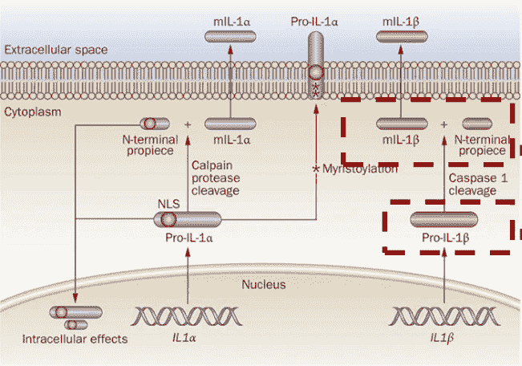

炎症发生时，经过剪切活化，然后分泌到胞外

无活性的前体形式

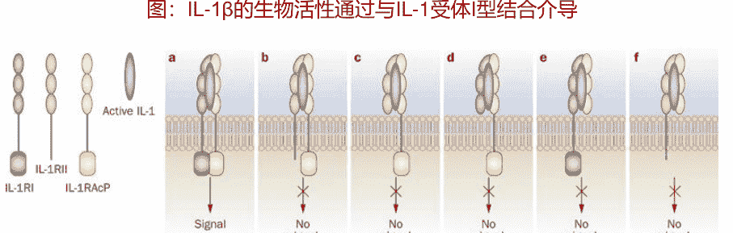

资料来源：《IL-1 pathways in inflammation and human diseases》，浙商证券研究所

## 靶点相关疾病

### 痛风：IL-1β管线较少，机制上看具有潜力

- IL-1β介导尿酸晶体诱发的炎症，是治疗痛风的潜力靶点。如左下图所示，痛风急性发作的机制为：巨噬细胞摄取尿酸单钠晶体→激活NLRP3炎症小体→IL-1β转化酶Caspase-1活化→剪切增加的Pro-IL-1β→产生活性IL-1β→IL-1β信号启动促炎症介质的产生和分泌，如IL-6和IL-8→痛风急性发作。IL-1β是MSU（尿酸单钠）晶体诱导机体炎症反应的关键因子，因此，阻断IL-1β是治疗痛风的一种途径。根据Insight，目前全球范围内仅一款IL-1β抑制剂卡那奴单抗获批用于痛风治疗。

- 梳理痛风药物研发靶点，我们发现，加速尿酸排泄、抑制尿酸生成和抗炎是痛风药物开发的主要机制。在创新药靶点系列之《URAT1：痛风最热，静待突破》中，我们对URAT1做过详细介绍，URAT1抑制剂抗痛风机制为加速尿酸排泄。其他痛风热门靶点及其对应机制为：XO（尿酸生成的限速酶，抑制尿酸生成）、GR（糖皮质激素受体，抗炎）、COX-2（抗炎）、XDH（尿酸生成的限速酶，抑制尿酸生成）。

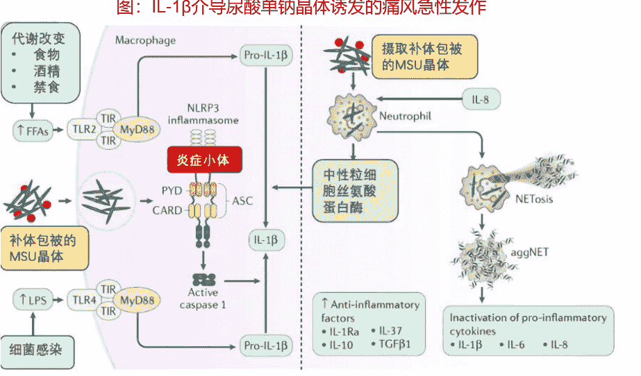

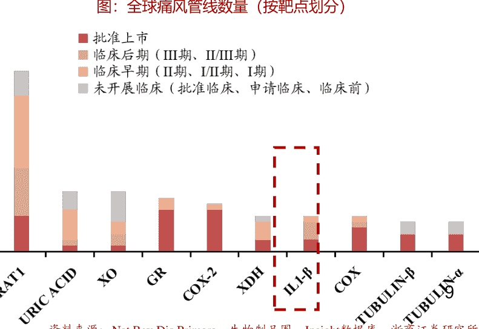

### 幼年特发性关节炎：潜力大，未满足临床需求

- **疾病介绍：** 全身型幼年特发性关节炎（sJIA）是幼年特发性关节炎（JIA）中最急性和最严重的一种亚型，sJIA约占JIA的10%，表现为每日发热、皮疹和关节炎，病死率高。根据沙利文预计，中国sJIA患者数量将从2023年的1.75万增加至2030年的1.82万（CAGR 0.6%）。

- **IL-1β与幼年特发性关节炎不同靶点药物临床数据对比：** 全球范围内，卡那奴单抗和利纳西普两款IL-1β抑制剂获批用于治疗幼年特发性关节炎。幼年特发性关节炎的最热门靶点为TNF-α，获批上市的药物有戈利木单抗。对比戈利木单抗和卡那奴单抗的临床数据，治疗第4周，戈利木单抗ACR 30、50、70、90的患者比例分别为74%、56%、28%、8%；治疗第29天，卡那奴单抗ACR 30、50、70、90的患者比例分别为81%、79%、67%、47%。从以上非头对头临床数据绝对值比较看，卡那奴单抗疗效更优一些。

> **临床终点说明：** 根据美国风湿病学会（ACR）儿科30、50、70应答标准，判断治疗后病情30%、50%、70%的缓解程度。例如，ACR 30指疾病缓解30%。

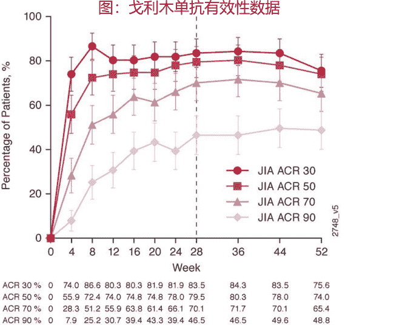

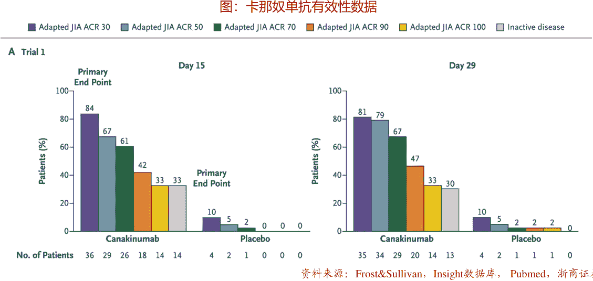

### 骨关节炎：双醋瑞因（IL-1β）非劣于塞来昔布（COX-2）

- **COX-2是骨关节炎药物开发最热门的靶点。** 从研发管线的靶点分布看，根据Insight数据库，全球范围内，COX-2是骨关节炎药物开发的最热门靶点，管线总数为53条，并且值得注意的是，管线数量第2的靶点为COX-2的同工酶COX-1。COX-2在正常组织细胞内的活性极低，当细胞受到炎症等刺激时迅速产生，其催化合成的前列腺素参与炎症反应，导致炎症反应和组织损伤。从现有疗法的作用靶点看，根据《中国骨关节炎（2021年版）》，局部外用非甾体抗炎药是膝关节炎疼痛的一线治疗药物（1A级推荐），其起效机制便是通过抑制COX的活性来发挥抗炎作用。目前销售规模比较大的非甾体抗炎药外用制剂有九典制药的洛索洛芬钠凝胶贴膏，其2023年全年销售额为15.47亿元（YOY 18.7%）。

- **IL-1β抑制剂双醋瑞因非劣于塞来昔布（COX-2抑制剂）。** 目前全球范围内获批用于治疗骨关节炎的IL-1β抑制剂只有双醋瑞因。根据一项双醋瑞因与塞来昔布（COX-2抑制剂）的III期临床试验，膝骨关节炎患者在接受治疗182天后，双醋瑞因在减轻疼痛方面不劣于塞来昔布（疼痛评分下降值：双醋瑞因 -9.6 vs 塞来昔布 -10.0），并且两款药物均表现出良好的安全性。

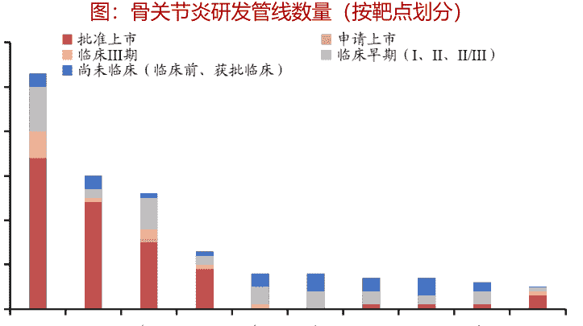

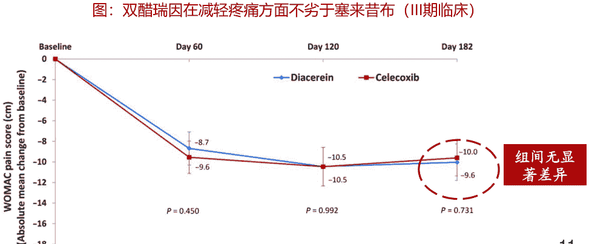

资料来源：Insight数据库、PubMed、九典制药年报、中国骨关节炎诊疗指南（2021年版）等，浙商证券研究所

## 竞争格局

### 全球：3款IL-1β抑制剂上市

- **全球范围内共有3款IL-1β抑制剂获批上市。** 根据Insight数据库，截至目前全球范围内共3款IL-1β抑制剂获批上市，获批情况分别为：卡那奴单抗（Cryopyrin相关周期性综合征、家族性寒冷自身炎症反应综合征、Muckle-Wells综合征、痛风）、利纳西普（Cryopyrin相关周期性综合征、家族性寒冷自身炎症反应综合征、Muckle-Wells综合征、复发性心包炎）、双醋瑞因（骨关节炎）。根据诺华年报，卡那奴单抗销售额呈快速增长趋势，2023年销售额为13.6亿美元，2016—2023年CAGR达25.1%。

表：IL-1β抑制剂全球研发进度（临床阶段）

| 药品成分 | 研发机构 | 中国内地最高状态 | 中国内地最高状态时间 | 美国最高状态 | 美国最高状态时间 | 欧盟最高状态 | 欧盟最高状态时间 |
|---|---|---|---|---|---|---|---|
| 双醋瑞因 | 诺华、晖致 | 批准上市 | 2005/1/1 | - | - | 临床III期 | 2016/2/23 |
| 卡那奴单抗 | 诺华 | 临床III期 | 2010/1/4 | 批准上市 | 2009/6/17 | 批准上市 | 2009/10/23 |
| 利纳西普 | 再生元、华东医药 | 申请上市 | 2023/11/14 | 批准上市 | 2008/2/27 | 批准上市 | 2009/10/23 |
| 金纳单抗 | 长春金赛 | 申请上市 | 2024/4/11 | 批准临床 | 2022/6/14 | - | - |
| SSGJ-613 | 三生国健 | 临床III期 | 2023/12/8 | - | - | - | - |
| Gevokizumab | Xoma、诺华、施维雅 | 临床III期 | 2012/9/12 | 临床III期 | 2012/9/12 | 临床III期 | 2012/9/12 |
| AK114 | 康方生物 | 申请临床 | 2023/2/2 | - | - | - | - |
| 双醋瑞因-AC203 | 安成生物 | - | - | 临床II/III期 | 2023/10/10 | 临床II/III期 | 2023/10/10 |
| Goflikicept | 俄罗斯制药 | - | - | 临床II/III期 | 2021/11/4 | - | - |
| MAS825 | 诺华 | - | - | 临床II期 | 2019/1/28 | 临床II期 | 2019/1/28 |
| 吡非尼酮吸入剂-AP01 | Avalyn | - | - | 临床II期 | 2024/3/25 | 临床II期 | 2020/12/22 |
| Lutikizumab | 雅培、艾伯维 | - | - | 临床II期 | 2021/12/1 | 临床II期 | 2021/12/1 |
| TAVO-103 | Tavotek | - | - | 临床I期 | 2022/4/6 | - | - |

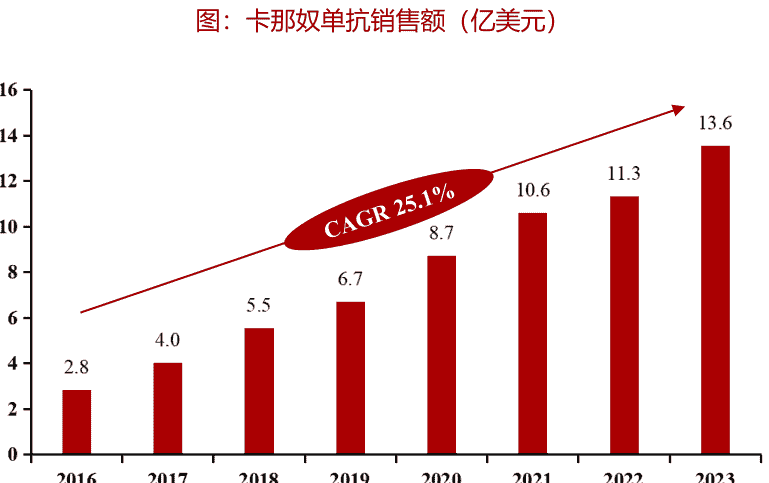

### 中国：仅1款IL-1β抑制剂上市

- **国内一款IL-1β抑制剂获批上市。** 根据Insight数据库，截至目前国内仅双醋瑞因一款IL-1β抑制剂上市，其获批适应症为骨关节炎。根据米内网数据，双醋瑞因2023年销售额为2.4亿元（YOY +20%）。国内企业在研进度较快的管线有华东医药的利纳西普（2023年11月上市申请获受理）、长春高新的金纳单抗（2024年4月上市申请获受理）以及三生国健的SSGJ-613（临床III期阶段，公司预计2024年完成入组）。

表：IL-1β抑制剂中国研发进度（临床阶段）

| 药品成分 | 研发机构 | 中国内地最高状态 | 中国内地最高状态时间 | 中国内地适应症在研状态 |
|---|---|---|---|---|
| 双醋瑞因 | 诺华、晖致 | 批准上市 | 2005/11/1 | 批准上市：骨关节炎 |
| 利纳西普 | 再生元、华东医药 | 申请上市 | 2023/11/14 | 申请上市：Cryopyrin相关周期性综合征、心包炎；申请上市：痛风性关节炎；临床II期：全身型幼年特发性关节炎、结缔组织病性弥漫性实质性肺病 |
| 金纳单抗 | 长春高新 | 申请上市 | 2024/4/11 | 申请上市：幼年特发性关节炎；临床I/II期：幼年特发性关节炎；临床I期：痛风、实体瘤；批准临床：肿瘤；临床前：自身免疫性疾病 |
| SSGJ-613 | 三生国健 | 临床III期 | 2023/12/8 | 临床III期：痛风性关节炎；临床I期：幼年特发性关节炎、遗传性周期性发热综合征；临床前：成人斯蒂尔氏病 |
| Xoma、Gevokizumab | 诺华、施维雅 | 临床III期 | 2012/9/12 | 临床III期：非感染性葡萄膜炎 |
| 卡那奴单抗 | 诺华 | 临床III期 | 2010/1/4 | 临床III期：痛风、降低心血管风险、非小细胞肺癌；临床II/III期：2型糖尿病；临床II期：骨关节炎；临床I期：骨髓增生异常综合征；批准临床：骨关节炎、鳞状非小细胞肺癌、非鳞状非小细胞肺癌 |
| AK114 | 康方生物 | 申请临床 | 2023/2/2 | 临床前：炎症 |

图：中国双醋瑞因销售规模

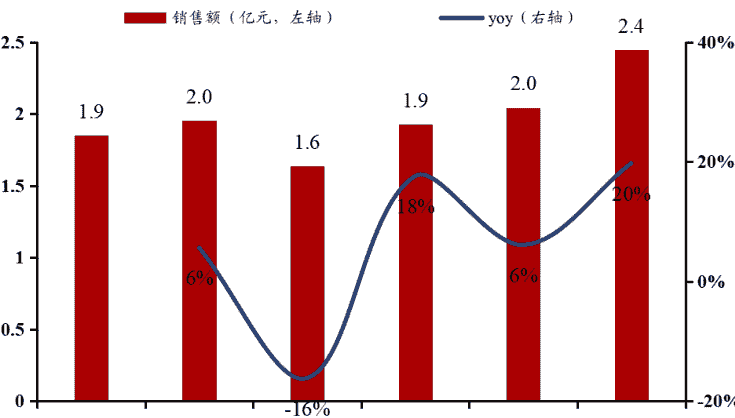

# 3.3 利纳西普：海外快速放量，国内两项适应症NDA

- **复发性心包炎适应症获批后，利纳西普海外加速放量。** 2008年利纳西普获FDA批准上市，商品名为ARCALYST，用于治疗冷吡啉相关的周期性综合征（CAPS）。2020年FDA批准其用于治疗IL-1受体拮抗剂缺乏症（DIRA）。2021年FDA批准其用于治疗复发性心包炎，是目前FDA批准的第一款也是唯一一款适用于12岁及以上人群的治疗复发性心包炎药物。根据Kiniksa财报，我们发现在复发性心包炎适应症获批后，利纳西普的放量有明显提速，2023年实现销售2.3亿美元（YoY +90.2%），公司预计2024年利纳西普销售收入有望持续快速增长，达到3.6—3.8亿美元（YoY 55%—63%）。

- **利纳西普的两项适应症上市申请已受理。** 华东医药通过license-in合作获得利纳西普在中国、韩国等24个亚太国家和地区的独家许可，包括开发、注册及商业化权益。利纳西普的上市申请已获NMPA受理，申报两项适应症，分别为冷吡啉相关的周期性综合征（2023年11月受理）及心包炎（2024年3月受理）。

- **利纳西普能够显著降低心包炎复发风险。** 根据III期临床数据，利纳西普组的30例患者中有2例（7%）发生了心包炎复发事件，而安慰剂组的31例患者中有23例（74%）发生了心包炎复发事件。

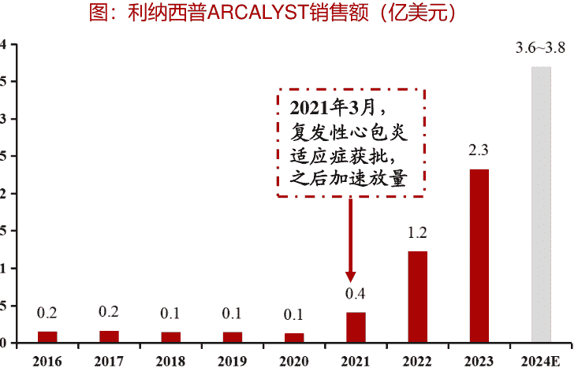

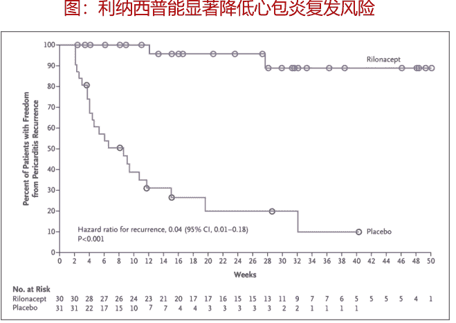

# 3.4 金纳单抗：痛风性关节炎适应症已递交NDA

金纳单抗有多个适应症在研，2024年4月痛风性关节炎上市申请获受理。金纳单抗属于治疗用生物制品1类新药，是抗IL-1β抗体药物，已有多个适应症处于临床研究阶段。根据长春高新2023年报，在急性痛风性关节炎方面，2024年4月痛风性关节炎的上市申请已获受理，III期临床试验主要疗效达到预期目标，临床数据显示金纳单抗可以有效缓解患者疼痛，并可显著降低复发风险；在全身型幼年特发性关节炎（SJIA）方面，II期临床工作已获监管部门相关反馈；在间质性肺病方面，相关临床前研究表明金纳单抗能快速起效并可长期维持疗效、延缓肺纤维化进程，现已开始I期临床工作。

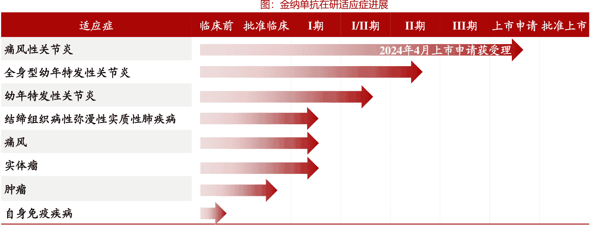

# SSGJ-613：三生国健预计24年完成III期招募

- **II期数据表明，SSGJ-613在急性痛风性关节炎疼痛缓解和预防复发方面疗效确切。** SSGJ-613是三生国健自主研发的IL-1β人源化单克隆抗体。2023年7月，SSGJ-613的II期临床试验达到主要终点。在有效性方面，SSGJ-613目标关节疼痛完全缓解方面优于得宝松阳性对照组（关节缓解中位时间为8天 vs. 15天），且在疼痛VAS评分较基线的改善上，与强效的长效激素对照组达到非劣；除此之外，SSGJ-613在预防复发方面显著优于对照组，即在12周内新的痛风急性发作受试者比例仅为14.3%，显著低于阳性激素对照组的51.6%，且中位复发时间也明显优于阳性对照组。在安全性方面，大部分与试验药物相关的不良事件均为1—2级（CTCAE 5.0）。不良事件发生率未见剂量相关趋势，无导致受试者退出和死亡的不良事件，常见不良事件均在预期范围内。

- **III期临床预计将于2024年完成受试者招募。** 根据三生国健2023年报，2024年公司将完成在急性痛风性关节炎患者中的临床III期所有受试者入组，以及完成痛风性关节炎间歇期的II期临床研究入组。

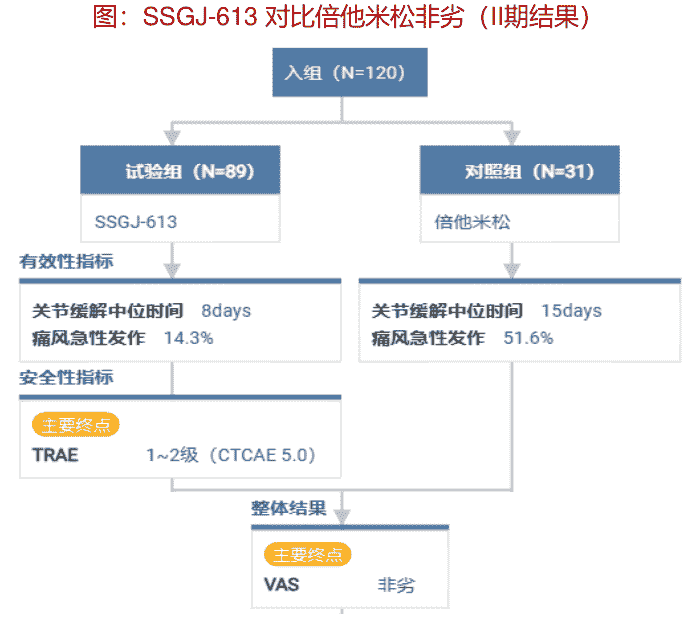

## 表：SSGJ-613与卡那双单抗对关节疼痛改善类似（Ib/II期结果）

| 评价时间 | 614-100 mg（N=10）Mean±SD | ΔMean | Canakinumab，II期pooled data 150 mg（N=225）Mean±SE | ΔMean |
|---|---:|---:|---:|---:|
| 基线 | 66.9±13.2 | / | 74.1±0.8 | / |
| 6h | 60.4±15.0 | -6.6 | / | / |
| 12h | 53.0±22.0 | -13.9 | / | / |
| 24h | 41.3±27.9 | -25.6 | / | / |
| 48h | 34.1±27.3 | -32.8 | / | / |
| 72h | 24.5±23.6 | -42.4 | 25.0±1.7 | -49.1 |

注：急性痛风性关节炎Ib期研究的VAS疼痛评分数据。

# 04

# IL-1β项目交易情况

# 04 华东医药引进利纳西普，期待更多deal落地

- **2022年华东医药引进利纳西普。** 2022年2月，华东医药全资子公司中美华东与美国上市公司Kiniksa签订了产品独家许可协议。中美华东获得Kiniksa两款自身免疫领域的全球创新产品Arcalyst（利纳西普）及Mavrilimumab（一款GM-CSFRα单抗）在中国、韩国、澳大利亚、新西兰、印度等24个亚太国家和地区（不含日本）的独家许可，包括开发、注册及商业化权益。中美华东将向Kiniksa支付2,200万美元首付款，最高不超过6.4亿美元的开发、注册及销售里程碑付款，以及分级两位数的净销售额提成费。我们预计伴随着更具潜力适应症数据读出，更多的deal也有望落地。

## 表：IL-1β靶向药物交易情况概览

| 交易新药项目 | 交易时间 | 转让方 | 受让方 | 交易类型 | 交易金额 | 权益地区 |
|---|---|---|---|---|---|---|
| AVTX-009 | 2024/3/27 | AlmataBio | Avalo | 转让/收购 |  |  |
| 利纳西普，Mavrilimumab | 2022/2/22 | Kiniksa | 中美华东制药 | 授权/许可 | 首付款：22百万美元，里程碑付款：640百万美元 | 中国内地、中国香港、中国澳门、中国台湾、韩国、其他 |
| 双醋瑞因-AC203 | 2021/1/6 | 安成生物 | 香港维健医药 | 授权/许可 |  | 中国内地、中国香港、中国澳门 |
| 双醋瑞因-AC203 | 2020/11/25 | 安成生物 | 日本米诺发源制药 | 授权/许可，期权 |  | 韩国、日本 |
| 利纳西普 | 2017/9/25 | 再生元 | Kiniksa | 授权/许可 |  | 中国内地、中国香港、中国澳门、中国台湾、美国、欧洲、韩国、日本、其他 |
| Gevokizumab | 2017/8/25 | Xoma | 诺华 | 授权/许可，投资 | 其他交易额：12百万欧元（13.1百万美元），首付款：31百万美元 | 全球 |
| 利纳西普 | 2016/9/14 | 再生元 | Neovii | 授权/许可 |  | 中国内地、中国香港、中国澳门、中国台湾、欧洲、韩国、其他 |
| 双醋瑞因-AC203 | 2015/12/17 | 安成生物 | Castle Creek | 授权/许可 |  | 美国、欧洲、其他 |
| TAK-114 | 2013/12/19 | Natrogen | 武田 | 授权/许可，期权 |  | 全球 |
| Gevokizumab | 2011/1/4 | Xoma | 施维雅 | 授权/许可 | 特许权使用费：10%，首付款：35百万美元，里程碑付款：470百万美元 | 中国内地、中国香港、中国澳门、中国台湾、欧洲、韩国、其他 |

# 05

# 风险提示

- **1. 国内药审政策的波动性风险：** 国内药品监管机构对药物批准和上市许可的规定和标准可能发生变化和调整。这种政策变化可能涉及审批流程的变更、监管要求的加强或放松、药物评价标准的提高等。这些变化可能会导致药品研发和上市的时间延长，增加审批失败的风险，或者对已上市药品的市场准入产生负面影响。

- **2. 临床失败风险：** 创新药研发存在较大失败风险，包括可能因为临床开发经验不足导致临床试验失败，或者临床数据不及预期导致放弃某些适应症临床开发的风险。即使临床试验获得成功，也可能面临监管要求不断变化而导致无法商业化。

- **3. 竞争风险：** 药品上市后会面临来自其他公司同类产品的竞争，竞争可能会导致产品定价的压力、市场份额的减少，可能对公司的盈利能力产生不利影响。

# 行业评级与免责声明

## 行业的投资评级

以报告日后的6个月内，行业指数相对于沪深300指数的涨跌幅为标准，定义如下：

- 1、看好：行业指数相对于沪深300指数表现+10%以上；
- 2、中性：行业指数相对于沪深300指数表现-10%至+10%；
- 3、看淡：行业指数相对于沪深300指数表现-10%以下。

我们在此提醒您，不同证券研究机构采用不同的评级术语及评级标准。我们采用的是相对评级体系，表示投资的相对比重。

建议：投资者买入或者卖出证券的决定取决于个人的实际情况，比如当前的持仓结构以及其他需要考虑的因素。投资者不应仅仅依靠投资评级来推断结论。

# 行业评级与免责声明

## 法律声明及风险提示

本报告由浙商证券股份有限公司（已具备中国证监会批复的证券投资咨询业务资格，经营许可证编号为：Z39833000）制作。本报告中的信息均来源于我们认为可靠的已公开资料，但浙商证券股份有限公司及其关联机构（以下简称“本公司”）对这些信息的真实性、准确性及完整性不作任何保证，也不保证所包含的信息和建议不发生任何变更。本公司没有将变更的信息和建议向报告所有接收者进行更新的义务。

本报告仅供本公司的客户作参考之用。本公司不会因接收人收到本报告而视其为本公司的当然客户。

本报告仅反映报告作者的出具日的观点和判断，在任何情况下，本报告中的信息或所表述的意见均不构成对任何人的投资建议，投资者应当对本报告中的信息和意见进行独立评估，并应同时考虑各自的投资目的、财务状况和特定需求。对依据或者使用本报告所造成的一切后果，本公司及/或其关联人员均不承担任何法律责任。

本公司的交易人员以及其他专业人士可能会依据不同假设和标准，采用不同的分析方法而口头或书面发表与本报告意见及建议不一致的市场评论和/或交易观点。本公司没有将此意见及建议向报告所有接收者进行更新的义务。本公司的资产管理公司、自营部门以及其他投资业务部门可能独立做出与本报告中的意见或建议不一致的投资决策。

本报告版权均归本公司所有，未经本公司事先书面授权，任何机构或个人不得以任何形式复制、发布、传播本报告的全部或部分内容。经授权刊载、转发本报告或者摘要的，应当注明本报告发布人和发布日期，并提示使用本报告的风险。未经授权或未按要求刊载、转发本报告的，应当承担相应的法律责任。本公司将保留向其追究法律责任的权利。

# 联系方式

## 浙商证券研究所

上海总部地址：杨高南路729号陆家嘴世纪金融广场1号楼25层

北京地址：北京市东城区朝阳门北大街8号富华大厦E座4层

深圳地址：广东省深圳市福田区广电金融中心33层

邮政编码：200127

电话：(8621)80108518

传真：(8621)80106010

浙商证券研究所：http://research.stocke.com.cn
