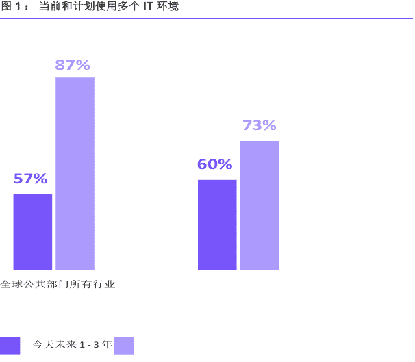
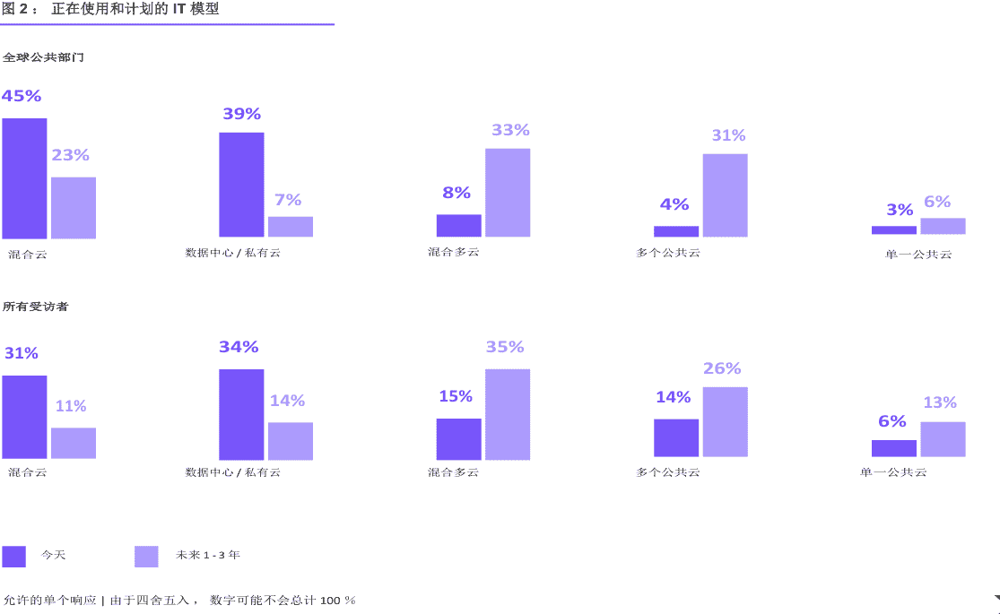
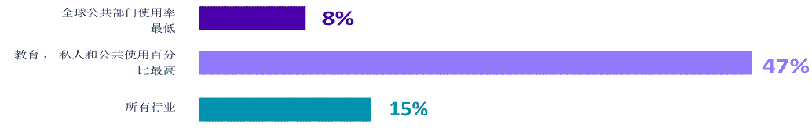
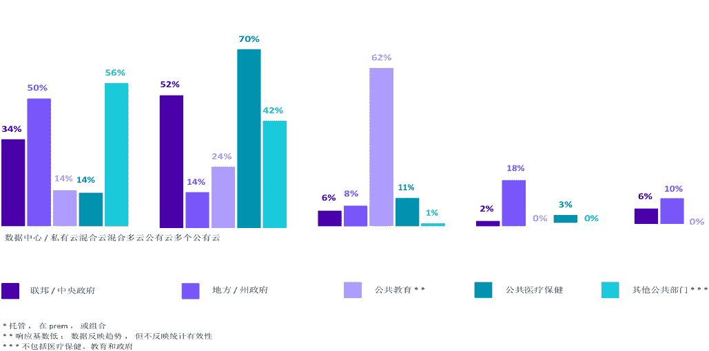
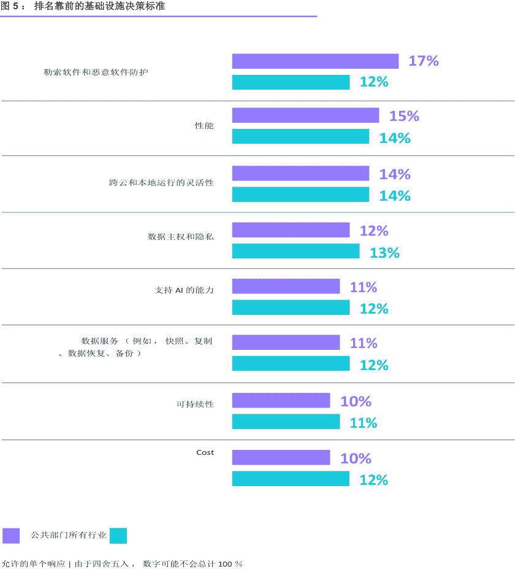
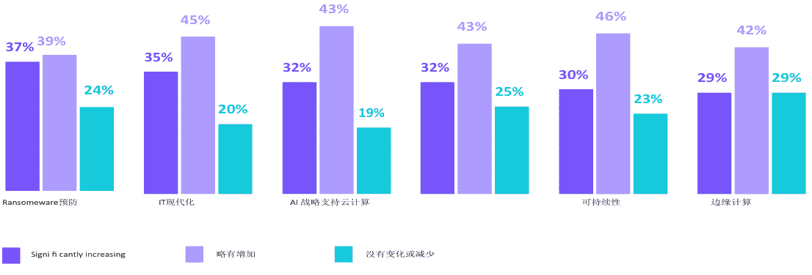
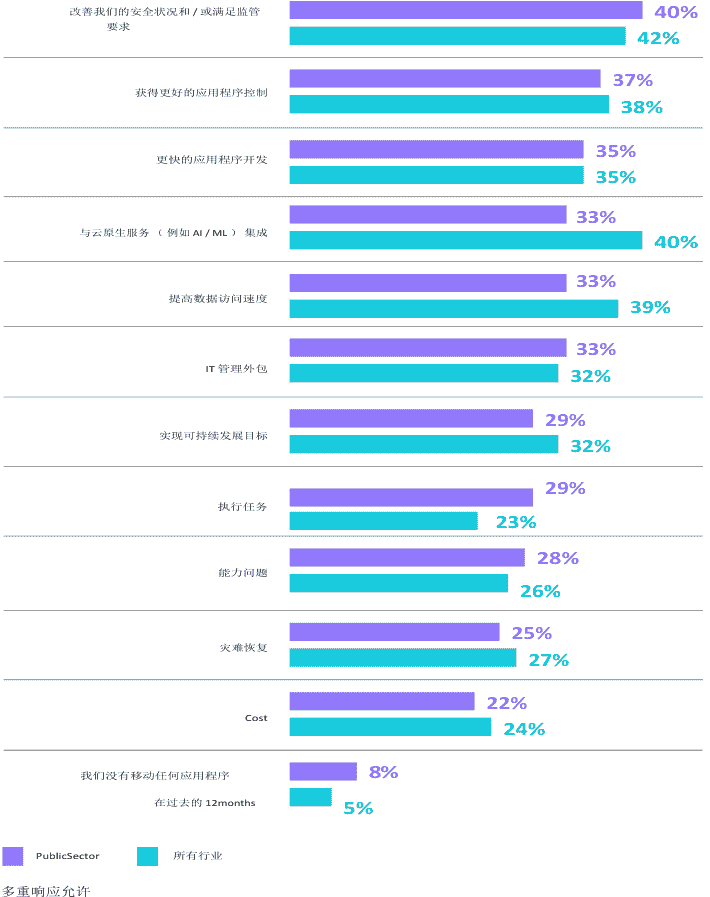
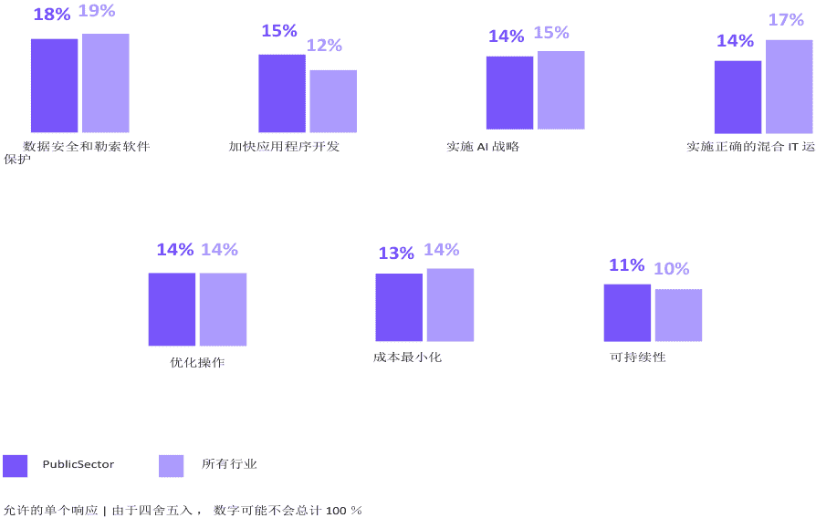
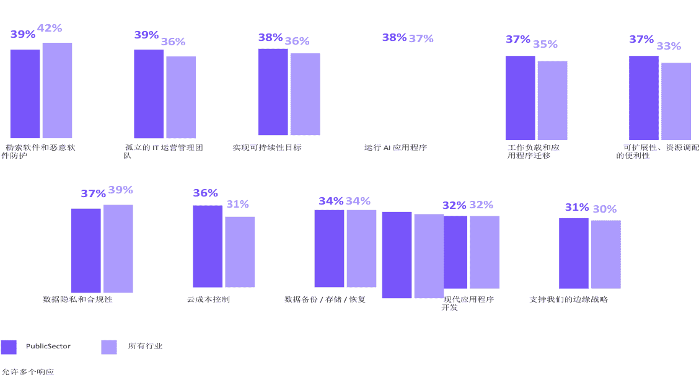
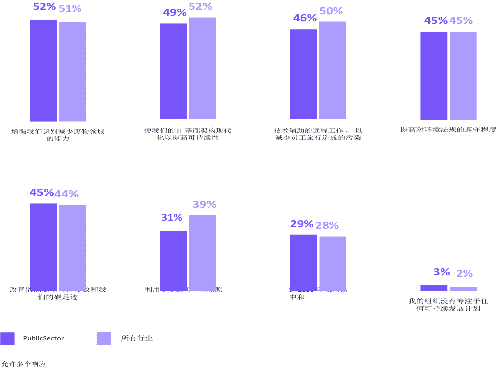

2024 年 4 月 | 指南

# Nutanix 企业云指数报告：全球公共部门


NUTANIX

分析测试结果的记录与报告（二）

# 公共部门在三年内从混合云转向多云

# 关于本报告：背景和研究目标

Nutanix 连续第六年委托进行一项全球研究，以了解企业云部署、IT 基础设施以及数据管理计划和挑战的状况。2023 年 12 月，Kyndryl 研究人员 Vanson Bourne 调查了全球 1,500 名 IT 和 DevOps／平台工程决策者。受访者群体涵盖多个行业、业务规模和地区，包括北美和南美、欧洲、中东和非洲（EMEA）以及亚太-日本（APJ）地区。

本报告是对全球第六届企业云指数报告的补充，重点关注全球公共部门的云部署。它涵盖了联邦／国家政府、州和地方政府、公共教育、公共医疗保健和其他公共部门组织的 409 名全球调查受访者提供的数据。它重点介绍了 IT 运营模型的当前采用水平，以及全球公共部门组织中 IT 专业人员的技术计划、优先事项和挑战，以及它们与完整的全球响应池和其他行业的比较。

# 调查结果一览

## 01. 采用趋势

混合 IT 部署的增长，包括混合多云，在过去的一年里持平。然而，混合云——混合多云的前身——构成了公共部门最常见的 IT 模型，超过了全球平均水平。

## 02. IT 优先事项

免受勒索软件和其他安全／合规性相关问题的保护是公共部门的首要优先事项，也是其面临的主要挑战。

## 03. AI 立场

公共部门的受访者看好人工智能的多种用途，尽管他们报告说该技术的发展仍面临早期阶段的阵痛。

## 04. 管理挑战

使用容器和云无关的管理工具等解决方案，实现云智能 IT 所需的运营一致性变得越来越容易。然而，公共部门在满足数据存储／使用指南方面仍然面临特别大的挑战，这些指南通常是由不断变化的隐私法规和打击勒索软件所决定的。

## 05. 可持续性现状

尽管 87% 的公共部门受访者表示可持续发展计划是优先事项，但可持续发展在 IT 采购方面的排名相对较低，决策标准和预算却在增加。

# 01. 关键发现

在过去的一年中，全球公共部门组织对多种 IT 环境的使用一直保持不变，尽管这种垂直趋势预计近期使用量将大幅增加。

无论他们使用的是集成的私有云和公共云，还是多个公共云，**57%** 的全球公共部门组织报告称，今年正在运行多个 IT 模型（图 1）。这一比例预计将在此期间增加 30 个百分点，达到 **87%**。



图 1：当前和计划使用多个 IT 环境

平均而言，这些混合模型采用率与整个 ECI 全球响应池大致平行。全球跨行业使用多个模型的比例目前为 **60%**，略高于公共部门；整个响应池的计划短期增长虽然健康，但明显较低，预计三年内使用率为 **73%**。

请注意，图 1 中的数据将所有正在使用的私有数据中心／云计算纳入其中——无论它们是驻留在本地、托管服务提供商的基础架构中，还是两者兼有——作为单一运营模型。

# 02. 关键发现

平均而言，混合多云部署落后于其他行业。

通常，混合多云环境将成为主要的 IT 运营模式，包括使用本地和／或托管的私有基础设施，以及两个或多个公共云平台。这种模式在公共部门组织和全球各行业中具有最大的增长潜力。推动采用的是 IT“云智能”方法的稳步增加，企业可以为每个工作负载或应用程序利用最佳的云环境。

绝大多数公共部门组织（85%）和完整的跨行业响应池（90%）都同意，他们的组织现在订阅云智能 IT 部署策略。吸引人的是，混合多云环境为 IT 领导者提供了各种成本、计算和部署选项，以优化应用程序性能、安全性、上市时间和支出。

然而，在这个关头，8% 的全球公共部门组织报告使用混合多云。这个数字大约是所有 ECI 受访者报告的部署百分比的一半（15%），如图 2 所示，在所有接受调查的行业中最低（图 3）。去年公共部门报告了相同的混合多云使用比例。



然而，公共部门预计未来三年混合多云使用量平均增长四倍以上，预计达到 **33%** 的渗透率。计划的增长率超过了整个全球响应池的增长率，后者预计在同一时间范围内略高于增长两倍，尽管预计总体使用量会稍高一些（**35%**）。公共部门计划使用多个公共云，因为其混合 IT 模式也超过了全球平均水平；该组织预计使用量将从今天的仅 **4%** 增长到 2027 年的 **31%**。

应该指出的是，最大的增长潜力往往在于采用率较慢的组织和技术，因为它们的增长突飞猛进仍然领先于它们。例如，全球公共部门在其他地方的混合多云部署方面走得最远（见图 3），因此其未来的增长轨迹比早期采用者所在的行业更大。

# 图 3：今天的混合多云使用情况比较 *



* 当前使用私有 IT 基础设施与两个或多个公有云平台相结合的每个平台的受访者百分比。

如图所示，私营／公共教育部门报告的混合多云使用率最高（**47%**），在今年调查的所有行业中位居第一。第二高的是能源、天然气／石油和公用事业行业（**37%**）。在另一端，继全球公共部门之后，采用率第二低的是制造业和生产行业，**10%** 使用该模型。

# 03. 关键发现

# 使用的 **IT** 运营模式因公共服务子行业而异

如图 2 所示，公共部门混合多云部署保持平稳，**8%** 报告今年和去年使用该模型的情况。需要注意的是，这些数字反映了所有接受调查的全球公共服务组织的平均使用量，而各个行业的采用率却在波动。

最值得注意的是，公共教育似乎是公共部门集团内部以及全球所有行业中混合多云的最大采用者，据报道有 **62%** 的渗透率（图 4）。不过，这里需要提醒的是：该子群体的响应基数较小，因此宜将这一高百分比视为该子群体总体趋势的指标，而不要将其解释为具有统计确定性的结果。

# 图 4：当今全球公共部门实体使用的 IT 模型



* 托管、本地部署或组合  
** 响应基数低；数据反映趋势，但不反映统计有效性  
*** 不包括医疗保健、教育和政府

允许的单个响应｜由于四舍五入，数字可能不会总计为 100%。

无论是私人还是公共教育，相对较高的接受度至少可以部分归因于大流行时代需要支持突然且广泛的远程学习要求。公共云产品使学校能够快速利用用于补充现有 IT 基础设施的服务，从而帮助它们跨越私有／公共基础设施的混合模式。从那里开始，添加第二个公共云平台将使组织进入混合多云模型。

请注意，当私立和公立教育的响应合并计算时，教育部门的渗透率下降到 **47%**，如图 3 所示，表明在接受调查的私立教育机构中部署较少。然而，即使在 **47%** 的水平上，在接受调查的所有九个行业中，私人／公共教育部门报告的混合多云比例仍然最高，其中全球公共部门是其中一个，包括图 4 所示的五个子行业。

其他公共服务实体降低了平均使用率。美国联邦政府报告说，公共部门和全球范围内的混合多云使用率最低（**5%**）；例如，图中未示出。所有全球联邦／中央政府加起来，包括美国政府，并没有走得更远（**6%**）。

同时，应该指出的是，在政府子部门中，混合云模型的实例——私有基础设施与单个公共云相结合——更为常见，并且是当前使用的主要模型（**45%**）。数据表明，大多数公共部门组织在通往混合多云 IT 的旅程中已经达到了混合云迁移这一步。

混合云在所有公共子行业的使用都达到了两位数，包括公共医疗机构的 **70%**、接受调查的联邦／中央政府的总和中的 **52%**，以及 **60%**。混合云离混合多云仅一步之遥，后者将第二个（或更多）公共云平台引入到混合云中。

# 04. 关键发现

当公共部门组织投资 IT 基础架构时，免受勒索软件侵害是普遍的购买标准。

ECI 受访者被要求说出推动其 IT 基础架构购买决策的最重要因素。虽然各种各样的答案反映了广泛的业务和 IT 优先级（图 5），但公共部门的受访者通常选择基础架构抵御勒索软件和其他恶意软件的能力作为他们的首要任务（17%）。其次是基础架构的性能／响应时间潜力（15%），以及允许 IT 在私有云和公共云平台之间灵活移动工作负载的能力（14%）。



选择的标准是相互关联的。例如，在过去一年中，在公共部门和更大的跨行业响应中，跨基础设施移动应用程序的最常见原因是为了改善安全状况和／或遵守法规要求，其中许多要求解决了数据隐私问题，并且容易发生变化。因此，数据安全性（包括针对勒索软件的保护）以及在不影响性能的情况下移动应用程序的灵活性，使其成为最高的购买标准。

因此，来年 IT 预算资金的最大分配是用于帮助防止勒索软件（图 6）并简化应用程序可移植性和多云管理的解决方案。其次，在回答哪些技术／解决方案将获得“显著”投资增长时，最常提及的是针对勒索软件的保护（37%），其次是 IT 现代化（35%），这是更新 IT 基础架构、工具、实践和系统以利用新兴技术的过程。

然而，当结合“重大”和“轻微”投资增加时，80% 的公共部门受访者同时提到了 IT 现代化和对组织 AI 战略的支持，而略少（76%）提到了勒索软件预防。但是请注意，IT 现代化和勒索软件预防不一定是相互排斥的；现代化战略可以（也可能会）包括打击勒索软件和其他网络威胁的措施。

# 图 6：未来 12 个月的顶级公共部门 IT 投资计划



图例：显著增加；略有增加；没有变化或减少。允许多个响应。

现代化还可以包括获取和部署统一管理工具和流程，使其在不同的 IT 基础架构中一致工作，以支持混合 IT 模型。此外，它可能涉及部署容器化解决方案，这些解决方案虚拟化软件应用程序，以便它们可以在任何基础云平台（私有或公共）上以相同的方式运行。因此，容器化是混合多云战略的核心原则，因为随着 IT、业务、安全性、任务和合规性要求的变化，它简化了应用程序基础架构的可移植性。

因此，容器化在几乎所有第六届调查受访者的云战略中占据重要位置也就不足为奇了。例如，**64%** 的公共部门受访者表示，他们已经将 **50%** 或更多的应用程序容器化。另有 **22%** 的受访者说，他们四分之一到一半的应用程序已经容器化。只有 **1%** 的受访者说，他们没有将应用程序容器化。

# 05. 关键发现

> 安全性和合规性是应用程序迁移的最大驱动力，也是 CIO／CTO 的首要任务，因为公共部门组织可以从高频软件攻击中恢复过来。

绝大多数 ECI 受访者——公共部门集团为 **92%**，全球为 **95%**——表示，他们在过去 12 个月中已将一个或多个应用程序移至不同的 IT 环境（图 7）。前面提到的移动工作负载以最好地支持每个应用程序的需求，作为云智能 IT 的一部分，正在创造对简单灵活的云间可移植性的需求。如图所示，与安全有关的要求变化在很大程度上助长了应用程序的移动。

# 图 7：过去一年将应用程序迁移到不同环境的原因



十分之四的公共部门受访者和 **42%** 的全球受访者表示，在过去一年中，他们有一个或多个应用程序迁移到不同的基础设施是出于安全／合规原因。隐私的监管要求，如欧洲的通用数据保护条例（GDPR），包含关于客户数据可以存储在哪里的严格规则，并且它们往往经常变化。反过来，这推动整个企业 IT 的工作负载位置转移，以实现合规。

此外，勒索软件攻击继续呈上升趋势，增加了约 **73%**。根据 SANS Institute 的数据，从 2022 年到 2023 年，勒索软件攻击有所增加，并导致企业不断重新思考如何最好地保护自己。事实上，**95%** 的公共部门受访者表示，他们在过去三年中经历过一次攻击，并且 **93%** 同意他们加强了对此类攻击的保护。

虽然 **28%** 的受访者说他们已经在几个小时内完全恢复了运营，**37%** 说他们花了几天或几周的时间。另有 **25%** 的受访者说，在恢复日常运营后，攻击的影响持续了“超过几周”。

因此，数据安全性／勒索软件预防经常被称为 CIO／CTO／领导层的第一要务也就不足为奇了（图 8）。

# 图 8：排名靠前的 CIO／CTO／领导优先事项



允许的单个响应｜由于四舍五入，数字可能不会总计为 100%。

# 06. 关键发现

人工智能的使用正在增加，尽管有关数据隐私和最佳实践的问题仍然存在。

尽管人工智能支持在公共部门基础设施购买标准上排名相当低（图 5），但受访者对其他地方的技术表示了高度兴趣。例如，公共部门受访者给予人工智能战略实施与混合 IT 和运营优化相同的 CIO／CTO 优先级排名（14%）。安全性和应用程序开发加速是经常提到的两个优先事项。

此外，80% 的公共部门受访者表示，他们预计明年将增加对人工智能技术的投资。约三分之一（32%）的受访者说，这些投资增加将是“显著的”。此外，三分之一（33%）的受访者还表示，与 AI 等云原生服务集成是他们在过去一年中将一个或多个应用程序迁移到不同基础设施的原因。

# AI 用例

受访者提到了其组织中正在使用或正在考虑的各种 AI 应用程序。

> 一个联邦政府机构的高级 IT 经理报告说：“人工智能在网络安全、天气、气候和农业的各个方面等特定领域已经非常成功。”另一位来自美国联邦政府机构的高级 IT 经理说：“总体来看，美国政府正在寻求开发人工智能和智能技术来提供公共服务。可持续的土地管理和能源效率是我感兴趣的领域。”

> 一个拥有 500 至 1,000 名员工的联邦政府平台工程／DevOps 团队的 IT 专业人员解释说：“人工智能和数据分析是提供更多价值的工具。它们可以非常快速地了解数据、人口统计数据以及历史和未来趋势，这使得政策和决策者可以做出更明智的决策。”

> 同样，拥有 5,000 多名员工的联邦政府 DevOps 小组的一名中层管理人员对“人工智能应用”表示了兴趣，以协助可持续发展、食品安全、食物浪费和损失方面的决策。另一位在地方政府 IT 部门工作的人说：“人工智能可以帮助我们规划当地城镇的布局，使它们在美学上更令人愉悦，并且可以规划道路以避免交通拥堵。”

# 部署障碍

尽管对 AI 充满热情，86% 的公共部门人士表示，他们认为推行人工智能是一项挑战；38% 将其描述为“重大”挑战，而 48% 认为这是一个“温和”的挑战。他们提供了一些例子。

> “虽然我们的政府越来越多地采用人工智能，但特定人工智能工具的成功是不一致和不稳定的，产生了不准确或有偏见的结果，”一位受访者表示。另一个人说，美国联邦政府到目前为止部署人工智能的方法“被证明是非常零碎的”，尽管已经建立了一个特别委员会来协调和建议一致的采用最佳实践。

> “人工智能有可能完全破坏我们正在做的事情，”一位 C 级美国联邦 IT 决策者说。但是，“对于我们中的一些人来说，面部识别和生物识别过程的使用一直存在争议。国会必须裁定可以使用或不能使用这些技术的例外情况。”

与使用生物识别技术相关的道德和隐私问题是原因之一——93% 的公共部门受访者一致认为，人工智能导致的数据隐私问题是他们组织关注的问题，全球响应池中这一比例为 88%。

# Python para principiantes: Variables, ciclos y funciones

Este tutorial es ideal para quienes quieren aprender Python desde cero. Suponemos que ya tienes Python instalado y tienes un editor de texto o entorno de desarrollo listo.

# Variables

En Python, las variables pueden almacenar números, texto y estructuras de datos. No es necesario declarar el tipo; Python lo infiere.

```python
# Ejemplo: tipos de variables

nombre = "Ana"      # str
edad = 25           # int
altura = 1.68       # float
activo = True       # bool
print(nombre, edad,
      altura, activo)
```

# Ciclos

Los ciclos permiten repetir bloques de código. Los más usados son `for` y `while`.

```python
# Ejemplo: ciclo for
for i in range(3):
    print(f"Iteración {i+1}")

# Ejemplo: ciclo while
x = 0
while x < 3:
    print(f"x = {x}")
    x += 1
```

问题在于混合 IT 环境，如混合云、混合多云和多个公共云模型，涉及不同的云平台和提供商解决方案。这种情况推动了对集成、通用数据管理和监控工具的需求，这些工具掩盖了底层原生技术和复杂性的差异，并在基础架构中一致运行。

与云无关的工具有助于确保异构平台之间的互操作性，以及 IT 运营、安全策略设置和使用实施的一致性。这些功能可帮助企业避免代价高昂的安全漏洞、数据丢失、资源过度配置和冗余操作，同时简化运行混合基础架构所需的 IT 技能。

# 互操作性改进

公共部门表示，与去年相比，其不同基础设施之间的互操作性有了显著改善。超过一半（53%）的受访者报告称，他们的所有 IT 环境都是完全可操作的，高于去年的 40%，比全球受访者中的约四分之一（49%）更高。这一增长很可能主要归因于行业在容器化方面的进步、集成多云工具的可用性不断提高，以及公共部门对这些技术的相对快速部署。

当 IT 挑战问题扩展到包括更一般的 IT 功能并允许多个响应时，公共部门最常被称为“重大”挑战的因素是防止勒索软件和恶意软件（39%），以及 IT 运营和管理团队独立运营所带来的困难（39%），即以所谓的“孤岛”方式运营（图 10）。

# 图 10：IT 职能被视为“重大”挑战




## 可持续性状况我是 goaichat 研发的智能大模型，可以为你提供智能问答、分析和创作服务。由于 IT一个巨大的能源消费者，它通常第一个采用具体可持续性和保护措施的部门。

在 ECI 公共部门受访者中，过去一年中可持续发展工作最普遍的重点确定减少浪费的领域（**52%**），其次现代化 IT 基础设施（**49%**），如图11 所示。只有 **3%** 的公共部门受访者和 **2%** 的所有受访者表示，他们在过去一年没有关注任何可持续发展举措。

## 图11：过去12个月可持续发展计划的重点

允许多个响应## 摘要和展望## 基础设施趋势全球公共部门组织混合 IT 基础设施的使用一直持平，**57%** 的受访者报告今年和去年均使用多个基础设施模型。类似地，混合多云模型的使用预计将在未来几年保持在 **8%**。然而，公共部门组织预计未来三年内一般混合环境和混合多云环境的使用将大幅增加。一般混合模式的使用预计将跃升30 个百分点至 **87%**；混合多云的使用预计将增长四倍，从今天的 **8%** 增至此期间的 **33%**。

公共部门中有更多受访者（**45%**）表示，他们正在运行混合云——将私有基础设施与单一公共云平台相结合——这距离混合多云模型仅一步之遥。更甚者，有近三分之一的公共部门受访者（**31%**）表示，他们预计将在三年内运行多个公共云平台作为其 IT运营模式。

## 减少成本的重视在公共部门和全球受访者中，成本继续不再 IT 优先事项。公共部门受访者将成本排在最后：作为基础设施购买决策标准、作为证明将应用程序迁移到不同基础设施的因素，以及作为 CIO/CTO 的优先事项。

一种解释，随着公司数据的价值和数量继续飙升，数据管理、安全性、同步和备份/恢复问题正在逐渐成为重点领域，而不再成本。数据现在是一项战略资产，必须保持最新、安全和随时可用，几乎没有空间来争抢。

## 驱动因素、挑战和投资重点基础设施多样性的增加和数据安全性的高度重视，正促使所有 IT 专业人员寻求超越私有和公共基础设施的一致混合运营。这一点在公共部门受访者提出的购买决策标准和来年 IT 投资计划中显而易见。

公共部门的首要基础设施优先事项主要涉及提高数据安全。例如，针对勒索软件/恶意软件的增强保护 IT 来年的第一标准，是来年最大的投资增长预测，也是 CIO/CTO组织最重要的优先事项。提高勒索软件攻击的保护，也是公共部门在过去一年将应用程序转移到不同基础设施的首要原因。

与安全相关的任务也被认为一个重大挑战：遵循有关数据存储和使用的指南，特别与遵守欧洲 GDPR 等隐私法规有关的指南，在公共部门中被评为第一大数据挑战（19%）。勒索软件/恶意软件防护通常被视为“重大挑战”（39%），以及由孤立团队创建的管理不一致和重复工作（39%）。

IT现代化的预算增加仅次于指定用于加强勒索软件预防的预算。由于现代化涵盖了 IT 的许多方面，因此可以包括增强安全性、防止网络攻击（包括勒索软件）的措施。

现代化使组织能够利用新兴技术，例如应用程序容器和统一的独立于云的管理工具。这些工具可提供所需的灵活性，以便本着云智能 IT 方法的精神，跨环境无缝移动工作负载和安全策略。

## 可持续性认知和进展可持续性在第六届年度 ECI受访者中引起了不同的反应。总体而言，受访者报告了可持续性方面较去年更多的进展，**88%** 的完整响应池和 **87%** 的公共部门受访者同意可持续性组织的优先事项。

在公共部门，过去一年最大的可持续发展重点改善减少浪费的领域（**52%**）。此外，近一半（**49%**）表示，他们已经 IT 基础设施进行了现代化改造，以帮助实现可持续发展目标。

与此同时，可持续发展在 IT 特定优先级和投资中的排名相较低。

例如，在受访者其 CIO/CTO组织优先事项的认知中，可持续发展排名最后；在 IT采购评估中，它与成本并列为排名最低的决策标准。它在“重大”IT 挑战中的排名较高，并在来年获得了仅次于边缘计算（29%）的投资。

## 应复杂性的建议混合 IT 模型和混合多云的日益普及意味着应用程序和数据将继续支持多样性和移动性。因此，公共部门和其他地方的 IT组织应该其 IT 环境进行现代化改造，着眼于促进和简化应用程序的可移植性、云互操作性和跨所有基础设施的统一运营。

###设计 IT现代化路线图跨云数据可见性、统一安全性、策略设置和合规性、灵活的工作负载移动以及集成管理，将推动混合多云运营成功。

容器化有助于应用程序迁移和移动性，ECI受访者的部署正在顺利进行。

此外，无论数据和应用程序在何处运行，越来越多的管理工具都在利用人工智能驱动的自动化，以一致的方式促进云智能 IT 的“任何应用程序、任何基础设施”要求。

了解更多信息：[nutanix.com / Enterprise ~ cloud ~ index](https://www.nutanix.com/Enterprise-cloud-index)
