# 电改进入加速期，紧抓估值与成长机遇

——2024 年中期电力行业投资策略

环保公用行业首席分析师：陶贻功

环保公用行业分析师：梁悠南

# 电改进入加速期，紧抓估值与成长机遇

——2024 年中期电力行业投资策略

2024 年 6 月 24 日

# 核心观点

- **2024 上半年复盘：新能源消纳问题倒逼电改加速。** 年初至 6 月 14 日，火电/水电/核电/风电/光伏指数涨跌幅为 25.4%/21.1%/37.2%/1.7%/-19.1%。火电大幅上涨主要是由于煤价下跌、盈利能力改善；水电、核电大幅上涨主要是由于高分红、高股息凸显防御价值，此外来水改善也是重要催化因素；新能源走势较弱，反映了市场对于新能源上网电价下降的担忧。2024 年以来新能源装机在高基数背景下延续高增长，1-4 月新增装机 77GW，同比增长 23%，全国范围内风光利用率明显下滑。我们预计新能源消纳问题将倒逼电改加速。

- **2024 年下半年观点：电改进度有望超预期，2025 年全国统一电力市场体系初步建成。** 市场担忧经济弱复苏将拖累各省电改积极性，我们认为年初以来电改政策密集出台，并且 5 月下旬企业和专家座谈会是中央层面决心推进电改的重要信号，后续电改进度有望超预期。对于下一阶段电改重点，电量方面，加快省间市场和现货市场建设，市场电比例进一步提高，2025 年全国统一电力市场体系初步建成。电价方面，完善调节性价值和绿色环境价值等多维价值体系，促进新型电力系统的安全稳定运行以及绿色低碳转型。

- **火电：盈利继续改善，电改促业绩稳定性提升，催估值重塑。** 今年以来煤价延续波动下跌趋势，预计全年煤炭供给将进一步宽松，火电板块 2024 年业绩持续改善。新型电力系统下，火电调峰、调频等柔性价值持续提升。我们测算，至 2030 年火电平均利用小时从年均容量电价和辅助服务费上升，对于煤价、电价敏感性低，推动盈利稳定性大幅提升。目前火电板块 PB 均值为 1.24x，随着盈利稳定性持续提升，板块 PB 相对核电 1.97x、水电 2.83x 有修复空间。

- **新能源：市场化加速，短期电价承压不改长期装机空间大。** 目前新能源累计装机约 11.3 亿千瓦，占比 37.5%。新能源转型大背景下，新能源将成为主电源，预计 2025 年、2030 年新能源累计装机将超过 17 亿千瓦、30 亿千瓦。随着绿色环境价值市场体系完善，绿电、绿证交易大幅提升，且绿色环境价值将直接对标碳市场价格。新能源通过环境市场回收绿电溢价，增厚盈利水平。

- **投资策略：** 短期推荐具备政策催化、业绩持续改善、估值有提升空间的火电板块；长期、低风险偏好资金重点布局核电、水电；逢低战略性布局新能源板块。个股关注华能国际、皖能电力、川投能源、长江电力、中国核电等。

- **风险提示：** 装机规模不及预期的风险；煤炭价格持续高位的风险；上网电价下调的风险；行业竞争加剧的风险等。

# 重点公司盈利预测与估值

| 股票代码 | 股票名称 | EPS 2023A | EPS 2024E | EPS 2025E | PE 2023A | PE 2024E | PE 2025E | 投资评级 |
|---|---|---:|---:|---:|---:|---:|---:|---|
| 600011.SH | 华能国际 | 0.54 | 0.91 | 1.00 | 17.2 | 10.2 | 9.3 | 推荐 |
| 000543.SZ | 皖能电力 | 0.63 | 0.84 | 0.99 | 13.7 | 10.3 | 8.7 | 推荐 |
| 600674.SH | 川投能源 | 0.90 | 1.08 | 1.21 | 20.6 | 17.2 | 15.4 | 推荐 |
| 600900.SH | 长江电力 | 1.11 | 1.37 | 1.46 | 25.1 | 20.4 | 19.1 | 推荐 |
| 601985.SH | 中国核电 | 0.56 | 0.60 | 0.65 | 17.8 | 16.7 | 15.4 | 推荐 |

资料来源：Wind，中国银河证券研究院

# 公用事业行业

推荐：维持

分析师：陶贻功  
电话：010-8092-7673  
邮箱：taoyigong_yj@chinastock.com.cn  
分析师登记编码：S0130522030001

梁悠南  
电话：010-8092-7656  
邮箱：liangyounan_yj@chinastock.com.cn  
分析师登记编码：S0130523070002

# 相对沪深 300 表现图

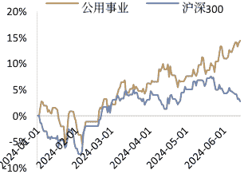

资料来源：Wind，中国银河证券研究院

# 相关研究

- 1. 【银河公用环保】2024 电力行业年度策略：电改深化，估值重塑与成长交辉
- 2. 【银河环保公用】2023 年中期策略：火电迎业绩反转，新能源打开长期成长空间

# 目录

Catalog

- 一、电改进入加速期，电力商品价值多维化............................................................4
- （一）年初以来消纳能力凸显，倒逼电改加速........................................................4
- （二）电力市场展望：电量交易精细化，电力价值多维化........................................6

- 二、火电：盈利继续改善，电改促业绩稳定性提升推动估值重塑............................10
- （一）成本端：需求偏弱，煤价下行，火电盈利有望持续改善..............................10
- （二）收入端：上网电价多元化，煤电盈利稳定性提升........................................13
- （三）收入结构变革，稳定性持续提升；火电板块估值重塑可期..........................18

- 三、新能源：市场化加速，短期电价承压不改长期装机空间大..............................21
- （一）光伏、风电上游价格处于历史低位............................................................21
- （二）成本下降、消纳放宽刺激装机，十四五末新能源装机超过 17 亿千瓦........21
- （三）能源转型打开长期成长空间，环境价值带来额外电价弹性......................22

- 四、投资策略........................................................................................................29
- （一）行业表现与估值：板块分化明显，估值小幅回落........................................29
- （二）基金持仓情况：第一季度持仓大幅增加....................................................29
- （三）投资策略：电改深化下，迎来估值、成长机遇............................................31
- （四）投资组合与盈利预测....................................................................................32

- 五、风险提示........................................................................................................33

## 一、电改进入加速期，电力商品价值多维化

### （一）年初以来消纳能力凸显，倒逼电改加速

新能源逐渐成为新增装机主力，2024 年 1-4 月新能源新增装机占比超过 80%。“双碳”目标驱动能源清洁化转型，新能源在新增装机及累计装机的比重稳中有升。2024 年 1-4 月新能源新增装机总共 77GW，同比 23%，占据同期新增装机的 86.8%；截至 2024 年 4 月，新能源累计装机达到 1129.5GW，占同期累计装机的 37.5%。展望“十四五”后续年份，上游产业链价格仍处于下行通道，此外新能源消纳红线放宽至 90%，支撑新能源装机持续高速增长。我们预计 2024、2025 年新能源新增装机均为 330GW，至 2025 年末新能源累计装机量将超过 17 亿千瓦（1700GW）。

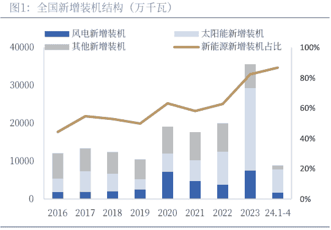

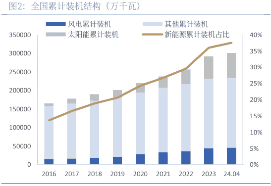

资料来源：Wind、中国银河证券研究院

资料来源：Wind、中国银河证券研究院

“双碳”目标驱动能源转型，长期来看风光将成为主力电源。截至 2024 年 4 月，风电、太阳能累计装机 4.58/6.71 亿千瓦，同比 20.6%/52.4%，占总装机比重 15.2%/22.3%。新能源累计装机合计 11.29 亿千瓦，占总装机 37.5%。产业链成本下降刺激装机需求，能源转型打开长期增长空间，我们预计 2025 年、2030 年风光累计装机将超过 17 亿千瓦、30 亿千瓦。根据全球能源互联网发展合作组织的预测，到 2060 年我国发电装机容量将达到 80 亿千瓦，其中清洁能源装机 76.8 亿千瓦，占比 96%；2060 年风电和太阳能装机分别达到 25 亿千瓦和 38 亿千瓦，风光装机占比接近 80%，发电量占比接近 70%。

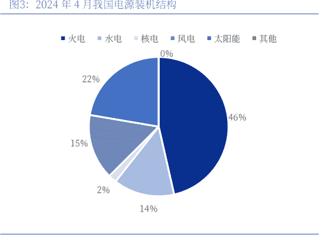

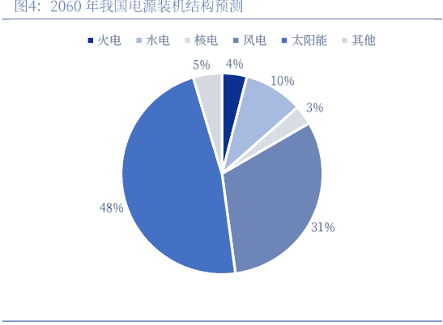

资料来源：Wind、中国银河证券研究院

资料来源：全球能源互联网、中国银河证券研究院

**新能源装机高速增长，消纳问题凸显，全国范围内风光利用率明显下滑。** 2023 年以来，新能源新增装机达到 3.7 亿千瓦，呈现爆发式高增长，远超电网同期新增消纳能力。在此背景下，全国范围内风电、光伏利用率明显下滑。2024 年 1-4 月全国风电利用率 96.1%（同比 -0.5pct），光伏利用率 96.3%（同比 -1.7pct），其中三北地区利用率下滑最为明显。

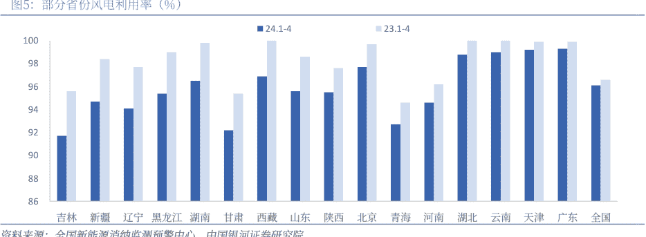

资料来源：全国新能源消纳监测预警中心，中国银河证券研究院

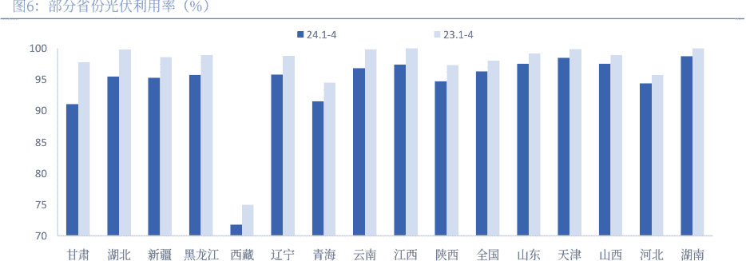

资料来源：全国新能源消纳监测预警中心，中国银河证券研究院

**电改文件密集出台，预计今年仍将持续发力。** 近期电改顶层文件密集出台，包括新型电力系统发展规划、电力市场基本规则、电力市场价格机制等。根据 2024 年 2 月国家能源局答记者问，今年还将出台《电力辅助服务市场基本规则》《电力市场准入注册基本规则》《电力市场计量结算基本规则》，建立形成以《电力市场运行基本规则》为基础，电力中长期、现货、辅助服务规则为主，信息披露、准入注册、计量结算规则为支撑的全国统一电力市场“1+N”基础规则体系，为全国统一电力市场体系建设奠定制度基础。

**新能源消纳问题倒逼电改加速。** 解决新能源消纳问题需要多措并举，包括优化新能源开发布局、提升电力系统灵活调节能力、完善新能源价格和市场交易政策等，其中市场化方式是重要一环，也是成本最低的解决方案。2024 年 3 月，国家发改委发布《全额保障性收购可再生能源电量监管办法》，提出可再生能源发电项目上网电量包括保障性收购电量和市场交易电量。《办法》体现了可再生能源电量收购价格由全部政府定价转变为部分政府定价，其余部分通过市场化交易形成价格的重大机制转变，明确可再生能源发电项目上网电量中市场化交易电量价格通过市场化方式形成。

#### 表 1：“十四五”以来电改相关文件梳理

| 日期 | 部门 | 政策 | 主要内容 |
|---|---|---|---|
| 2022.1 | 国家发改委、国家能源局 | 《关于加快建设全国统一电力市场体系的指导意见》 | 2025 年全国统一电力市场体系初步建成，2030 年全国统一电力市场体系基本建成。 |
| 2022.3 | 国家发改委、国家能源局 | 《关于加快推进电力现货市场建设工作的通知》 | 支持具备条件的现货试点持续运行，尽快形成长期稳定运行的现货市场。 |
| 2023.5 | 国家发改委 | 《关于第三监管周期省级电网输配电价及有关事项的通知》 | 公布了 2023-2026 年各省级电网输配电价水平，并对用户电价分类构成、工商业电价等重要政策优化完善。 |
| 2023.6 | 国家能源局 | 《新型电力系统发展蓝皮书》 | 全面阐述了新型电力系统的发展理念、内涵特征，制定“三步走”发展路径，并提出构建新型电力系统的总体架构和重点任务。 |
| 2023.7 | 中央深改委 | 《关于深化电力体制改革加快构建新型电力系统的指导意见》 | 强调要深化电力体制改革，加快构建清洁低碳、安全充裕、经济高效、供需协同、灵活智能的新型电力系统。 |
| 2023.9 | 国家发改委、国家能源局 | 《电力现货市场基本规则（试行）》 | 在国家层面首次出台电力现货市场规则性文件，为推动电力现货市场从试点走向全国打好基础。 |
| 2023.9 | 国家发改委、国家能源局 | 《电力需求侧管理办法（2023 年版）》《电力负荷管理办法（2023 年版）》 | 到 2025 年，各省需求响应能力达到最大用电负荷的 3%-5%，其中年度最大用电负荷峰谷差率超过 40% 的省份达到 5% 或以上。 |
| 2023.10 | 国家发改委、国家能源局 | 《关于进一步加快电力现货市场建设工作的通知》 | 明确浙江 2024 年 6 月前启动现货市场连续结算试运行，辽宁、江苏、安徽等力争在 2023 年底前开展长周期结算试运行等，有序扩大现货市场建设范围。 |
| 2024.2 | 国家发改委、国家能源局 | 《关于建立健全电力辅助服务市场价格机制的通知》 | 加强辅助服务市场与电能量市场的有效衔接，通过采取合理设置有偿辅助服务品种、规范市场价格规则、完善价格形成机制，推动费用规范有序传导，进一步完善我国电力辅助服务市场建设。 |
| 2024.4 | 国家发改委 | 《电力市场监管办法》 | 《办法》是强化电力市场成员行为监管、维护电力市场秩序的重要保障。此次办法修订进一步完善电力市场监管对象、调整了监管内容，有助于更好推进全国统一电力市场体系建设。 |
| 2024.5 | 国家发改委 | 《电力市场运行基本规则》 | 明确了包括经营主体、电力市场运营机构和提供输配电服务的电网企业等在内的市场成员范围，引入了电力中长期交易、电力现货交易、电力辅助服务交易、容量交易等新的交易类型。 |
| 2024.6 | 国家能源局 | 《电力市场注册基本规则（征求意见稿）》 | 统一电力市场注册机制，加强和规范电力市场注册工作，维护电力市场秩序和各类经营主体合法权益。 |

资料来源：国家发改委、国家能源局、中央深改委、中国银河证券研究院

### （二）电力市场展望：电量交易精细化，电力价值多维化

**本轮电改以来市场电规模持续扩大，目前市场电比例超过 60%。** 根据中电联《2024 年 1-4 月份全国电力市场交易简况》，1-4 月，全国各电力交易中心累计组织完成市场交易电量 18603.5 亿千瓦时，同比增长 5.9%，占全社会用电量比重为 60.5%，同比下降 2.1 个百分点。省内交易电量合计为 14881.5 亿千瓦时，其中电力直接交易 14316.2 亿千瓦时（含绿电交易 339.6 亿千瓦时、电网代理购电 3200.2 亿千瓦时）、发电权交易 557.5 亿千瓦时、其他交易 7.9 亿千瓦时。省间交易电量合计为 3722 亿千瓦时，其中省间电力直接交易 321.9 亿千瓦时、省间外送交易 3385.3 亿千瓦时、发电权交易 14.8 亿千瓦时。

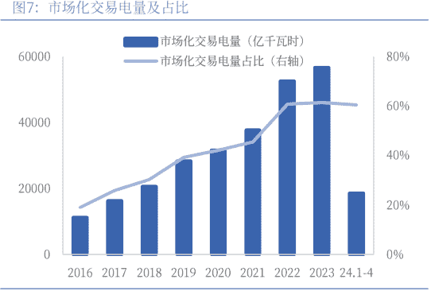

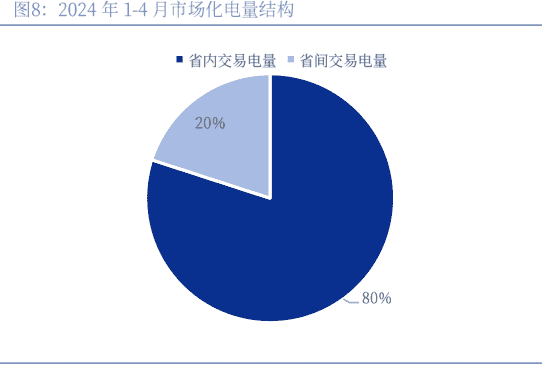

资料来源：中电联、中国银河证券研究院

资料来源：中电联、中国银河证券研究院

资源禀赋决定我国应形成“构建大电网、融入大市场”的发展格局。电力市场的发展有其路径依赖，历史与现实条件、物理和社会环境决定其发展路径不唯一，需要积极探索建设具有中国特色的电力市场体系。我国能源资源与生产力逆向分布，80%以上的煤炭、水能、风能和太阳能资源分布在西部和北部地区，70%以上的电力消费集中在东部地区，能源基地距离负荷中心 1000-4000 公里。随着中东部负荷和“三北”地区新能源装机规模持续增长，电力电量平衡及清洁能源消纳仅依赖本省、本区域已难以为继，电力电量平衡已由“分省分区”平衡全面向“全网统一平衡”转变，客观上要求构建大电网、大市场，实现大范围优化配置。

#### 1. 电量：省间优先级高于省内，中长期与现货衔接

**构建“统一市场、两级运作”电力市场框架，省间交易先于省内执行。** 电力市场分为省间市场和省内市场，其中省间市场定位于落实国家能源战略，促进清洁能源消纳和能源资源大范围优化配置，建立资源配置型市场；省内市场定位于优化省内资源配置，确保电力供需平衡和电网安全稳定运行，建立电力平衡型市场。因此，需要在满足大范围资源优化配置的前提下，保证省内电力基本平衡，“两级运作”意味着省间交易优先级高于省内。中长期交易方面，省间中长期交易物理执行，省间交易结果作为省内交易的边界；现货交易方面，首先在省内形成预平衡，再开展省间日前现货。当送端有富裕能力、通道有剩余空间、受端有购电需求时，组织送受端市场主体自主报价，实现电力市场化余缺互济和清洁能源大范围消纳。

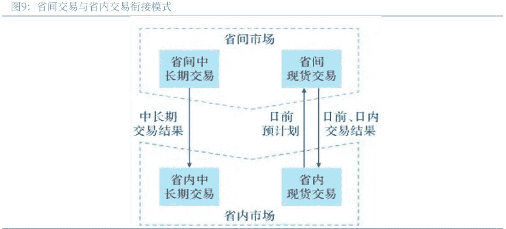

资料来源：电力系统自动化，中国银河证券研究院

**发挥中长期稳价作用，加强与现货市场衔接。** 国家发展改革委、国家能源局发布的《关于加快建设全国统一电力市场体系的指导意见》提出发挥中长期市场在平衡长期供需、稳定市场预期的基础作用，完善中长期合同市场化调整机制，缩短交易周期，提升交易频次，丰富交易品种。目前各省中长期交易比例在 80%-90% 左右，通过中长期交易减少电价风险。从中长期与现货市场衔接上看，多数省份已就市场风险管理、结算方式、曲线和时序衔接等方面提出了标准化解决方案。后续预计将进一步提高中长期市场交易频次（由 D-N 缩短到 D-2）、优化中长期曲线形成方式、细化中长期交易时段（与现货市场全天 96 时段紧密衔接）。

##### 表2：部分省份中长期交易规则

| 省份/地区 | 中长期最短交易尺度 | 中长期曲线分解方式 | 中长期签约时段划分 |
|---|---|---|---|
| 山西省 | D-2 | 合同叠加值 | 按小时划分为24段 |
| 甘肃省 | D-2 | 合同叠加值 | 省内交易分为10个电量时段 |
| 江苏省 | D-2 | 企业自行申报 | 原来是分5个时段，以后准备按24点 |
| 江西省 | D-3 | 企业自行申报 | 年度、月度4时段申报，D-3日24时段 |
| 辽宁省 | D-2 | 中长期曲线分解由双方协商、典型曲线、分时段交易多种方式，总曲线是各类合同叠加 | 24段 |
| 蒙西 | D-5 | 自行申报与合同叠加结合 | 7段 |
| 四川省 | D-2 | 自行申报 | 6段 |
| 广东省 | D-3 | 中长期曲线分解典型曲线、自定义曲线。总曲线由各类合同叠加 | 24段 |
| 云南省 | D-1 | 中长期曲线分解典型曲线、自定义曲线 | 48段 |

资料来源：各省电力交易中心、中国银河证券研究院

**各省现货市场建设进度明确并进入加速期。** 2023年10月12日，国家发改委、国家能源局发布《关于进一步加快电力现货市场建设工作的通知》（发改办体改〔2023〕813号），明确各省电力现货推进节点，其中连续运行一年以上省份，可按程序转入正式运行。目前山西、广东现货市场已于2023年底正式运行，山东、甘肃、蒙西、省间现货市场均已连续结算试运行一年以上，其余多数省份也展开了现货市场建设并处于不同阶段。展望2024年，考虑到建设进度和实际运行情况，山东现货市场有望进一步转正，江苏、江西、河北南网、湖北等省份现货市场有望率先转为连续结算试运行，南方区域电力现货市场将开展不同周期的结算试运行。

##### 表3：各省电力市场建设进度规划

| 省份/地区 | 结算时间安排 |
|---|---|
| 连续运行一年以上省份 | 按程序转入正式运行 |
| 福建、辽宁、江苏、安徽、河南、湖北、河北南网、江西、陕西 | 2023年底前开展长周期结算试运行 |
| 浙江 | 2024年6月前启动现货市场结算试运行 |
| 四川 | 探索适应高比例水电的丰枯水季相衔接市场模式和市场机制 |
| 南方区域（广东、广西、云南、贵州、海南） | 2023年底前启动结算试运行 |
| 京津冀 | 2024年6月前启动模拟试运行 |
| 其他地区（除西藏外） | 2023年底前具备结算试运行条件 |

资料来源：国家发改委、中国银河证券研究院

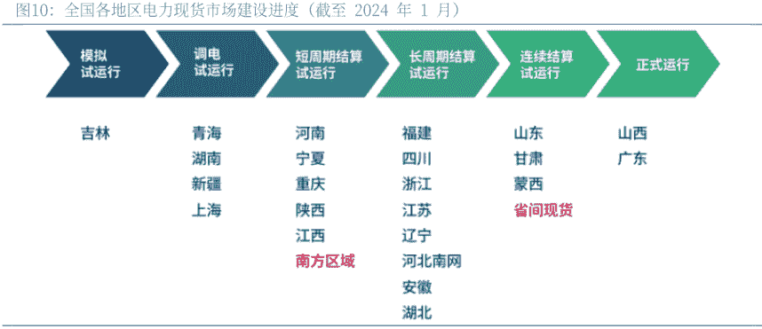

资料来源：落基山研究所、中国银河证券研究院

#### 2. 电价：价值多维化，调节性价值和绿色环境价值占比上升

电力商品价值多维化，传统能源调节性价值和新能源绿色环境价值占比上升。在新型电力系统下，随着新能源逐步成为装机、电量主体，电力商品的价值较以往出现细分，由以电能量价值为主，逐步向电能量价值、调节性价值（可靠性价值和灵活性价值）以及绿色环境价值等多维价值体系转变。其中电能量价值通过电能量市场体现，反映电能量的生产成本。随着新能源占比提升，生产成本出现下降，电能量价值在总价值的比例降低；可靠性价值通过容量市场体现，反映系统容量充裕度和调节充裕度，引导各类电源协调发展；灵活性价值通过辅助服务市场体现，反映系统灵活调节能力，保障电网安全稳定运行；绿色环境价值通过绿电市场体现，以市场机制实现绿色价值的外部属性内部化，推动能源电力低碳转型。

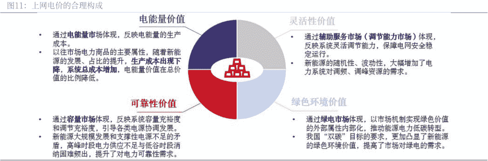

## 二、火电：盈利继续改善，电改促业绩稳定性提升迎估值重塑

### （一）成本端：需求偏弱、煤价下行，火电盈利有望持续改善

**水电、新能源共同挤压火电出力空间，预计今年火电发电量同比持平。** 2024年1—5月全社会用电量38370亿千瓦时，同比增长8.6%，中电联预计全年用电量同比增长6%左右。分电源来看，今年受厄尔尼诺气候影响，来水改善趋势明确，5月水电发电量同比增长38.6%，考虑到去年低基数效应，预计迎峰度夏期间将维持每月同比20%以上的高增长；2023年新能源新增装机接近300GW，全年风电、光伏发电量有望同比增长20%以上。水电、新能源共同挤压火电出力空间，我们预计今年火电发电量同比持平。

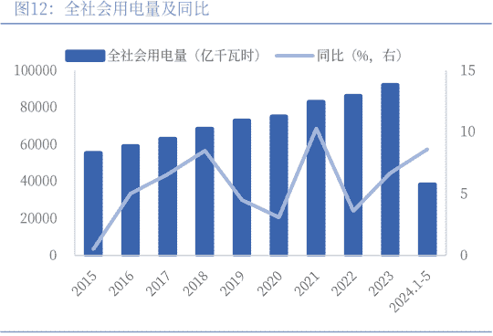

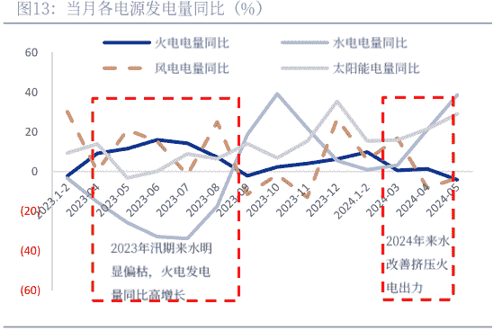

资料来源：Wind，中国银河证券研究院

资料来源：Wind，中国银河证券研究院

**2024年以来房地产累计投资及累计新开工面积持续下滑，预计地产相关行业动力煤需求承压。** 房地产需求方面，近年来受到经济增长下滑、城市化进程趋缓、稳杠杆等调控政策的多重影响，2019年以来全国房地产累计投资以及累计新开工面积增速进入下行通道，至2022年均进入负增长区间。2022年、2023年、2024年1—5月，全国房地产开发投资额同比分别下降10%、9.6%、10.1%，全国房屋新开工面积同比分别下降39.4%、20.4%、24.2%。我们预计2024年房地产行业将继续调整，建材等地产相关行业动力煤需求持续承压。

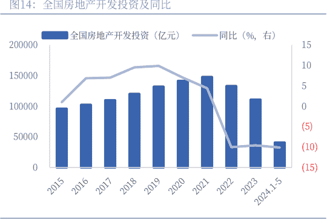

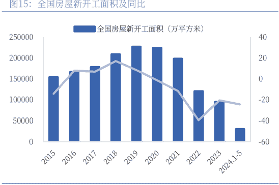

资料来源：Wind，中国银河证券研究院

资料来源：Wind，中国银河证券研究院

**原煤产量降幅有望逐步收窄，煤炭生产总体将保持较高水平。** 受到安监压力增大的影响，山西原煤产量下降较为明显，2024年1—5月原煤产量同比下降15.0%。虽然其余三大产区产量均保持增长，2024年1—5月内蒙古、陕西、新疆规模以上原煤产量同比分别增长2.7%、1.4%和6.6%，但难抵山西一省的下降量。因此，2024年1—5月全国原煤产量同比仍然下降3.0%。5月14日，山西省印发《全省煤矿企业安全生产和提质增效实施方案》，要求切实做好煤矿安全生产和提质增效各项工作，多措并举推进煤炭提质增效，为稳定全省经济大盘和保障国家能源安全做出贡献。主要提产措施包括加快煤矿生产许可证发放，逐步放开煤矿夜班生产，并鼓励符合要求的煤矿释放核定产能的110%。根据中国煤炭运销协会5月27日发布的预测，后期我国煤炭产量同比降幅将继续收窄，煤炭生产总体将保持较高水平。

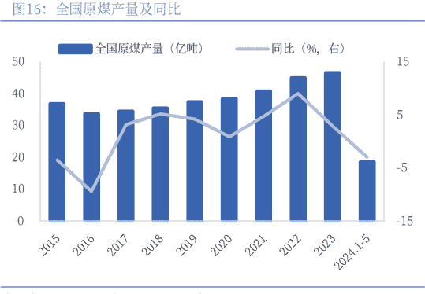

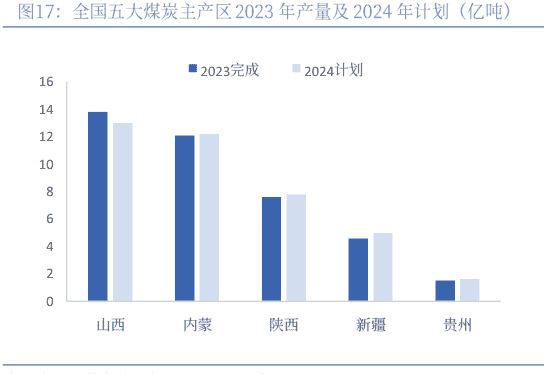

资料来源：Wind，中国银河证券研究院

资料来源：煤炭宝，中国银河证券研究院

**今年全国煤炭供给增速高于需求增速，整体供需较为宽松。**

（1）供给端：国内供给方面，虽然1—5月煤炭产量下降，但后期降幅有望收窄，在国家能源局《2024年能源工作指导意见》明确提出煤炭稳产增产的背景下，预计全年总产量小幅增加5000万吨左右；进口方面，前1—5月进口煤高速增长，预计全年进口煤将延续高增长趋势，全年有望新增5000万吨以上。总供给方面，预计全年新增1亿吨原煤，同比增长2%左右。

（2）需求端：受到水电来水改善、新能源挤压的影响，预计全年火电发电量及电煤需求同比持平；非电需求方面，由于经济复苏趋势偏弱，预计工业领域需求增速3.4%左右。总需求增速预计在1.2%左右。

（3）库存方面：虽然目前即将进入迎峰度夏带来的动力煤消费旺季，但目前港口及电厂高库存将明显抑制后续煤价反弹空间。

#### 表4：2024年全国煤炭供需增速预测（亿吨）

| 项目 | 2023实际 | 2024增量 | 2024预测 | 增速 |
|---|---:|---:|---:|---:|
| 国产煤（原煤） | 46.6 | 0.5 | 47.1 | 1.1% |
| 进口煤（原煤） | 4.7 | 0.5 | 5.2 | 10.6% |
| 总供给（原煤） | 51.3 | 1 | 52.3 | 2.0% |
| 电力用煤（动力煤） | 25.7 | 0 | 25.7 | 0.0% |
| 非电用煤（动力煤） | 14.7 | 0.5 | 15.2 | 3.4% |
| 总需求（动力煤） | 40.4 | 0.5 | 40.9 | 1.2% |

资料来源：Wind，中国银河证券研究院

**市场煤价进入下行通道，能源转型抑制煤炭消费增长。** 今年以来市场煤价呈现波动下跌趋势，年初至6月13日，秦皇岛5500大卡动力煤市场均价876元/吨，较去年同期均价下跌16%；截至6月13日，秦皇岛5500大卡动力煤市场价871元/吨，较去年同期上涨16%，但仍处于“十四五”以来较低水平。长期来看，“双碳”能源转型推动煤炭供需进一步宽松，煤价将进入长期下行通道。

#### 图18：秦皇岛5500大卡动力煤市场价（元/吨）

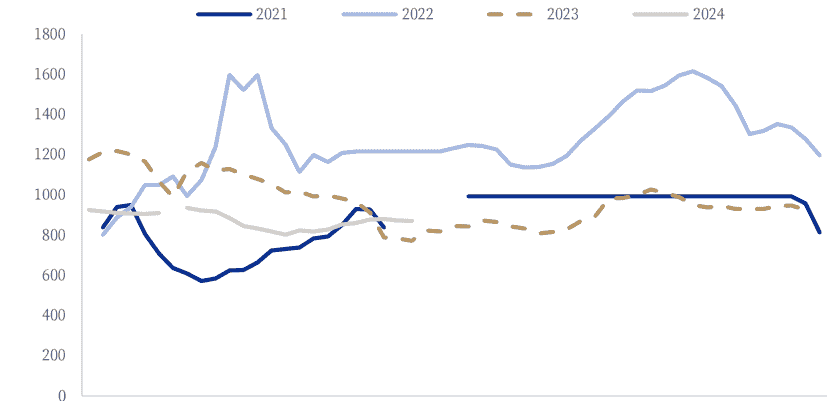

*资料来源：Wind，中国银河证券研究院*

**火电企业盈利能力持续改善。** 我们统计了“十四五”以来火电央企与部分省属火电企业单季度盈利能力。2021年全年煤价持续走高，京唐港5500大卡动力煤（简称市场煤价）全年均价同比上涨49%，整体盈利水平下降明显，至2021年第四季度整体毛利率下滑至-30%~-20%；2022年全年煤价继续上行，市场煤价全年均价同比上涨48%，但电价上浮20%大幅缓解了燃料成本上涨的压力，整体毛利率水平修复至0%~5%左右；2023年煤价波动下行，市场煤价全年均价同比下降24%，电价保持稳定，整体毛利率修复至10%~15%。2024年以来煤价延续波动下行趋势，市场煤价同比下降20%，6家公司平均毛利率12%，同比增加4个百分点。

#### 图19：部分火电公司各季度毛利率（%）以及京唐港5500大卡动力煤季度均价（元/吨）

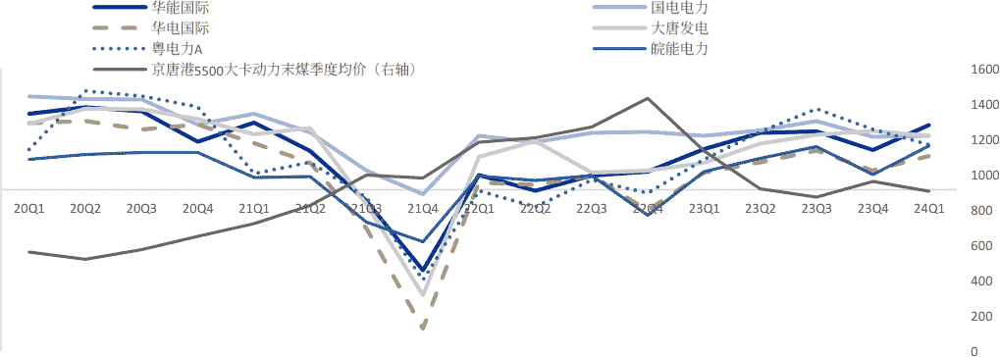

*资料来源：Wind，中国银河证券研究院*

**多年来火电业务毛利率均值在10%~15%左右，目前仍有较大修复空间。** 我们统计了近10年来四大火电央企多年火电度电营收、火电度电毛利以及毛利率水平。2014年至今，火电度电毛利约为0.035—0.055元/kWh，火电毛利率约为10%~15%左右。2023年火电盈利能力虽有所改善，火电业务毛利率恢复至6%~8%左右，但距离历史平均水平仍有较大修复空间。

| 指标 | 年份 | 华能国际 | 华电国际 | 大唐发电 | 国电电力 |
|---|---:|---:|---:|---:|---:|
| 火电度电营收（元/kWh） | 2014 | 0.439 | 0.427 | 0.362 | 0.325 |
|  | 2015 | 0.379 | 0.366 | 0.359 | 0.314 |
|  | 2016 | 0.338 | 0.325 | 0.330 | 0.281 |
|  | 2017 | 0.351 | 0.342 | 0.321 | 0.288 |
|  | 2018 | 0.384 | 0.351 | 0.331 | 0.295 |
|  | 2019 | 0.411 | 0.368 | 0.339 | 0.297 |
|  | 2020 | 0.411 | 0.364 | 0.339 | 0.288 |
|  | 2021 | 0.436 | 0.388 | 0.357 | 0.301 |
|  | 2022 | 0.519 | 0.473 | 0.434 | 0.357 |
|  | 2023 | 0.517 | 0.471 | 0.437 | 0.383 |
|  | 多年平均 | **0.419** | **0.387** | **0.361** | **0.313** |
| 火电度电毛利（元/kWh） | 2014 | 0.075 | 0.121 | 0.107 | 0.060 |
|  | 2015 | 0.088 | 0.128 | 0.118 | 0.084 |
|  | 2016 | 0.051 | 0.073 | 0.088 | 0.048 |
|  | 2017 | 0.017 | 0.036 | 0.041 | 0.004 |
|  | 2018 | 0.038 | 0.042 | 0.044 | 0.019 |
|  | 2019 | 0.051 | 0.053 | 0.048 | 0.023 |
|  | 2020 | 0.061 | 0.062 | 0.049 | 0.033 |
|  | 2021 | -0.027 | -0.037 | -0.036 | -0.002 |
|  | 2022 | -0.016 | 0.006 | 0.005 | 0.035 |
|  | 2023 | 0.031 | 0.038 | 0.037 | 0.043 |
|  | 多年平均 | **0.037** | **0.052** | **0.050** | **0.035** |
| 火电业务毛利率 | 2014 | 17.0% | 28.5% | 29.5% | 18.6% |
|  | 2015 | 23.3% | 34.9% | 32.9% | 26.9% |
|  | 2016 | 15.2% | 22.4% | 26.7% | 17.3% |
|  | 2017 | 4.8% | 10.4% | 12.7% | 1.2% |
|  | 2018 | 9.8% | 12.0% | 13.2% | 6.3% |
|  | 2019 | 12.5% | 14.5% | 14.2% | 7.8% |
|  | 2020 | 14.8% | 17.1% | 14.5% | 11.3% |
|  | 2021 | -6.1% | -9.5% | -10.1% | -0.6% |
|  | 2022 | -3.2% | 1.4% | 1.2% | 9.7% |
|  | 2023 | 6.0% | 8.1% | 8.5% | 11.2% |
|  | 多年平均 | **9.4%** | **14.0%** | **14.3%** | **11.0%** |

资料来源：公司公告、中国银河证券研究院

### （二）收入端：上网电价多元化，煤电盈利稳定性提升

**上网电价多元化，煤电盈利稳定性提升。** 目前煤电收入以电能量市场为主，容量补偿和辅助服务占比较低，盈利能力易随煤价、电价大幅波动。随着新型电力系统建设推进，煤电向支撑性和调节性电源转变，其支撑性和调节性价值将通过容量电价、辅助服务市场回收。电改深化背景下，煤电容量电价政策进一步落地。

《建立煤电容量电价机制的通知》明确了政策实施范围、容量电价水平、容量电费分摊机制与容量电费考核机制，自2024年1月1日起实施。2022年以来，山东、甘肃、云南等省份已制定煤电容量电价政策。本次《通知》标志着全国范围煤电容量电价政策落地，电价机制改革进一步深化，为承载更大规模的新能源提供有力支撑，是更好促进能源绿色低碳转型的必然要求。

**2024—2025年多数省份补偿比例30%，2026年起提升至不低于50%。** 《通知》明确煤电容量电价按照回收煤电机组一定比例固定成本的方式确定。其中，煤电机组固定成本全国统一为每年每千瓦330元。2024—2025年多数地方补偿比例为30%左右，部分煤电功能转型较快的地方（四川、云南等7省）为50%左右。2026年起，将各地通过容量电价回收固定成本的比例提升至不低于50%。按照目前煤电装机11.7亿千瓦、2023年煤电利用小时4685小时、补偿标准30%测算，每年煤电容量补偿总规模1170亿元，对应度电盈利增厚0.021元。

#### 表7：《关于建立煤电容量电价机制的通知》

|  | 主要内容 |
|---|---|
| 政策实施范围 | 煤电容量电价机制适用于合规在运的公用煤电机组。 |
| 容量电价水平 | 补偿比例按照一定比例的固定成本确定，2024—2025年多数省份补偿比例30%左右，部分省份50%左右；2026年起各省补偿比例不低于50%。煤电机组固定成本实行全国统一标准，为每年每千瓦330元。 |
| 电费分摊机制 | 煤电容量电费纳入系统运行费用，每月由工商业用户按当月用电量比例分摊。 |
| 电费考核机制 | 煤电机组无法按照调度指令提供申报最大出力的，月内发生两次扣减当月容量电费的10%，发生三次扣减50%，发生四次及以上扣减100%。 |

资料来源：国家发改委、中国银河证券研究院

**明确容量电价分摊机制，强调调节性电源作用。** 《通知》明确各地煤电容量电费纳入系统运行费用，每月由工商业用户按当月用电量比例分摊。根据测算，30%—50%补偿标准对应下游工商业用户度电分摊0.014元—0.032元。今年以来煤价及电量电价整体下行，因此容量电价出台并不会大幅推高下游用能成本。《通知》强调煤电调节性电源作用并明确考核方式，煤电机组无法按照调度指令提供申报最大出力的，月内发生两次扣减当月容量电费的10%，发生三次扣减50%，发生四次及以上扣减100%。我们预计容量电价考核方式将提高煤电灵活性改造积极性，保证电网安全稳定运行。

#### 表8：容量电价下游分摊测算（二三产用电量为2024年预计）

| 煤电装机（亿千瓦） | 容量补偿（元/千瓦） | 容量补偿总额（亿元） | 二三产用电量（亿千瓦时） | 下游分摊（元/千瓦时） |
|---:|---:|---:|---:|---:|
| 11.7 | 100 | 1170 | 83000 | 0.014 |
| 11.7 | 165 | 1931 | 83000 | 0.023 |
| 11.7 | 230 | 2691 | 83000 | 0.032 |

资料来源：Wind，中国银河证券研究院

**容量电价提升煤电盈利，兼具确定性与持续性。** 容量电价以装机为基准，补偿火电运营过程中的固定成本，具有高度确定性、长期持续性的特点。根据敏感性测算，电力央企与火电占比较高的企业受益最明显。考虑到各省容量补偿力度不同，在当前补偿水平下，华能国际每年将增厚利润100亿元左右，华电国际、大唐发电将分别增厚利润50亿元左右。虽然电量电价可能小幅松动，煤电总体价格略有下降，但容量电价出台改善电价结构，其相对固定的补偿标准也将增强火电企业盈利稳定性。**考虑到2024—2025年火电年均新增装机80GW，火电企业盈利稳定性、利润增长确定性强。**

表9：容量电价与电量电价变化对盈利的影响

| 公司 | 煤电装机 GW | 容量补偿 亿元 | 煤电发电量 亿千瓦时 | 基准价 元/千瓦时 | 影响业绩/亿元：电量电价上浮15% | 影响业绩/亿元：电量电价上浮12% | 影响业绩/亿元：容量补偿+电量电价上浮12% | 业绩弹性：容量补偿+电量电价上浮12% |
|---|---:|---:|---:|---:|---:|---:|---:|---:|
| 华能国际 | 93.3 | 100.8 | 3,758 | 0.37 | -69.5 | -111.2 | -10.5 | -0.8% |
| 国电电力 | 71.8 | 72.5 | 3,710 | 0.37 | -68.6 | -109.8 | -37.3 | -3.5% |
| 华电国际 | 46.9 | 53.9 | 1,972 | 0.37 | -36.5 | -58.4 | -4.4 | -0.9% |
| 大唐发电 | 45.6 | 46.5 | 1,925 | 0.37 | -35.6 | -57.0 | -10.5 | -1.5% |
| 浙能电力 | 30.9 | 30.9 | 1,532 | 0.415 | -31.8 | -50.9 | -20.0 | -2.2% |
| 粤电力A | 19.9 | 19.9 | 956 | 0.453 | -21.7 | -34.6 | -14.7 | -5.6% |
| 江苏国信 | 12.9 | 12.9 | 646 | 0.391 | -12.6 | -20.2 | -7.3 | -2.4% |
| 内蒙华电 | 11.4 | 11.4 | 573 | 0.283 | -8.1 | -13.0 | -1.6 | -0.5% |

资料来源：Wind，中国银河证券研究院

#### 3. 辅助服务：彰显火电保供价值，规模迅速增长仍有较大提升空间

我国现行的辅助服务品种划分依据主要为2021年国家能源局修订的《电力辅助服务管理办法》。各类电力辅助服务品种补偿机制主要包含有功平衡服务（调峰、调频、备用等）、无功平衡服务（自动电压控制、调相）以及事故应急恢复服务（稳定切机、稳定切负荷、黑启动）。基本辅助服务以及辅助服务的固定补偿主要参照各区域以及部分省内颁布的“两个细则”进行考核以及补偿。

我国已初步形成以调峰、调频、备用等交易品种为核心的区域、省级辅助服务市场体系。区域辅助服务市场以区域调峰辅助服务为主，实现了调峰辅助服务资源在区域内的共享互济，有效提高了区域电网对新能源的消纳能力；省级辅助服务市场主要开展了调峰辅助服务和调频辅助服务。

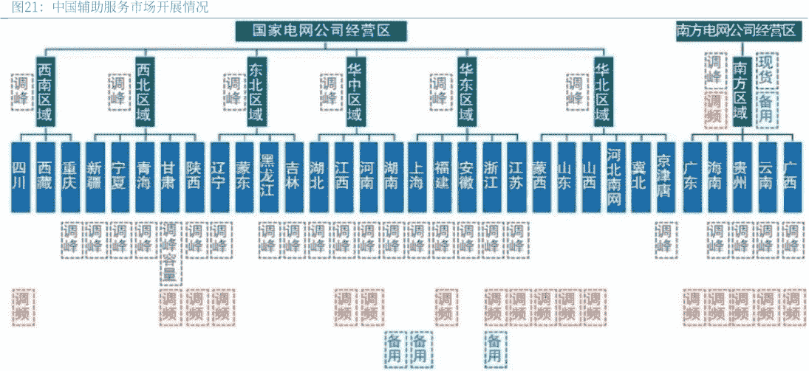

资料来源：中国电力企业管理、中国银河证券研究院

**辅助服务价格机制进一步规范。** 2024年2月，国家发改委、国家能源局发布《关于建立健全电力辅助服务市场价格机制的通知》，科学确定辅助服务市场需求，合理设置有偿辅助服务品种，规范辅助服务计价等市场规则。

主要内容包括：一是优化调峰、调频、备用等辅助服务交易和价格机制，对影响辅助服务价格形成的交易机制作出原则性规定，统一明确计价规则。二是规范辅助服务价格传导，明确由用户侧承担的辅助服务成本，限定在电能量市场无法补偿的因提供辅助服务而未能发电带来的损失。三是强化政策配套保障。推动各类经营主体公平参与辅助服务市场，加强辅助服务市场与中长期市场、现货市场等统筹衔接；健全辅助服务价格管理工作机制，加强市场运行和价格机制跟踪监测，及时评估完善价格机制，促进辅助服务价格合理形成。

表10：《关于建立健全电力辅助服务市场价格机制的通知》主要内容

| 辅助服务品种 | 交易机制 | 价格上限 |
|---|---|---|
| 调峰 | 电力现货市场连续运行的地区，完善现货市场规则，适当放宽市场限价，引导实现调峰功能。电力现货市场未连续运行的地区，原则上风电、光伏发电机组不作为调峰服务提供主体，研究适时推动火电机组参与有偿调峰。 | 原则上不高于当地平价新能源项目的上网电价。 |
| 调频 | 原则上采用基于调频里程的单一制价格机制。 | 原则上性能系数最大不超过2，调频里程出清价格上限不超过每千瓦时0.015元。 |
| 备用 | 原则上采用基于中标容量和时间的单一制价格机制。 | 原则上备用服务价格上限不超过当地电能量市场价格上限。 |

资料来源：国家能源局、中国银河证券研究院

**辅助服务市场规模增长迅速，但距离国际水平仍有较大提升空间。** 根据国家能源局新闻发布会，2023年上半年，参与电力辅助服务的装机约20亿千瓦，占总装机74%；上半年全国电力辅助服务费用共278亿元，占上网电费1.9%，其中火电企业获得补偿254亿元，占比91.4%。

据此测算，2019年上半年至2023年上半年，辅助服务市场规模年复合增速达到21%，占上网电费比重年均提升0.1个百分点。虽然辅助服务市场规模增长迅速，占上网电费1.9%，但距离国际水平3%以上仍有较大提升空间，并且未来随着新能源占比提升还将不断增加。

目前国家能源局正在起草《关于优化电力辅助服务分担共享机制、推动用户侧资源参与系统调节的通知》，以市场化机制调动工商业可中断负荷、负荷聚合商、虚拟电厂、新型储能等用户侧资源参与电力辅助服务市场；启动编制电力辅助服务市场基本规则，促进全国统一电力市场体系和能源绿色低碳转型。

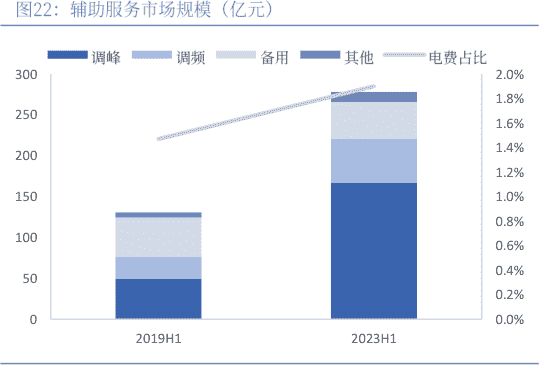

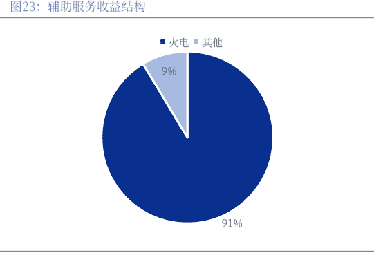

资料来源：国家能源局、中国银河证券研究院

资料来源：国家能源局、中国银河证券研究院

**火电公司辅助服务收入增长趋势明显。** 以华能国际为例，2023年实现辅助服务净收入27.18亿元（其中调峰净收入22.23亿元，调频净收入4.95亿元），同比增长84.5%。考虑到煤电发电量同比变化不大，且风光发电量大幅增长带来辅助服务支出增长，因此煤电辅助服务收入大幅增长。

##### 图24：华能国际辅助服务收入

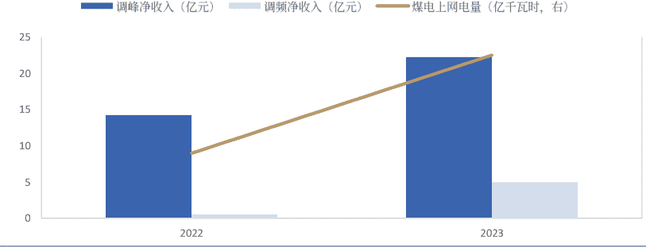

资料来源：公司公告、中国银河证券研究院

**借鉴国外电力市场发展经验，新能源到达临界点后辅助服务规模迅速增加。**

（1）英国：2019—2022年间，新能源电量占比由23.8%提升至31.2%。2019年以前，随着新能源渗透率不断提升，英国辅助服务市场规模稳步提升，但由于2020年以来新能源渗透率不断提升以及新型冠状病毒肺炎疫情流行引起的负荷水平降低的双重影响，英国辅助服务市场规模急剧扩张。

（2）澳大利亚：2016—2022年间，新能源电量占比由7.7%提升至23.5%。2016年以前，澳大利亚国家电力市场中频率控制辅助服务通常占全年电力市场交易额的0.5%以下。2016年以后，伴随着大规模新能源并网以及电源结构的显著变化，澳大利亚电力系统频率急剧恶化，推动辅助服务需求及市场价格迅速攀升。

##### 图25：英国辅助服务市场规模发展

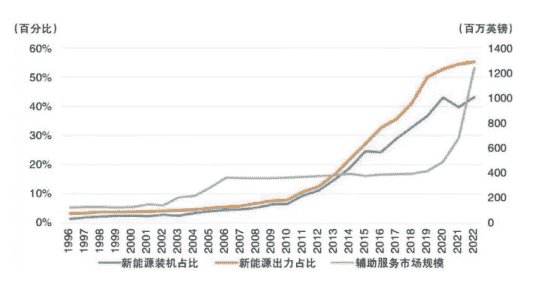

##### 图26：澳大利亚辅助服务成本变化示意图

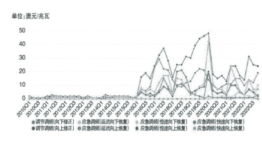

资料来源：中国电力企业管理、中国银河证券研究院

资料来源：中国电力企业管理、中国银河证券研究院

**随着新能源装机占比提高，辅助服务占电费比例随之提高。** 预计2025年、2030年辅助服务占上网电费的比例达到3%、5%，和现阶段国际水平相当。考虑全社会用电量增长趋势，测算得出2025年、2030年辅助服务总市场规模将超过1000亿元、2000亿元，度电辅助服务规模达到0.01元、0.017元。

##### 表11：辅助服务市场规模预测

|  | 2023H1 | 2023E | 2025E | 2030E |
|---|---:|---:|---:|---:|
| 上网电费占比 | 1.9% | 1.9% | 3.0% | 5.0% |
| 辅助服务规模（亿元） | 278 | 591 | 1028 | 2135 |
| 全社会用电量（亿千瓦时） | 43076 | 91500 | 100879 | 125713 |
| 度电辅助服务规模（元） | 0.006 | 0.006 | 0.010 | 0.017 |

资料来源：国家能源局、中国银河证券研究院

### （三）收入结构变革，稳定性持续提升；火电板块估值重塑可期

煤电从主力电源向支撑性和调节性电源转变。煤电固定运营成本主要包括折旧、运维、财务费用等；其收入主要来自电能量（点火价差）、容量补偿以及辅助服务。目前煤电收入以电能量市场为主，容量补偿和辅助服务占比较低，盈利能力易随煤价、电价大幅波动；至2030年，随着煤电向支撑性和调节性电源转变，利用小时数逐渐走低，预计将有接近50%的收入来自容量补偿和辅助服务，其对煤价、电价敏感性低，推动煤电盈利稳定性大幅提升。长期来看，容量补偿和辅助服务占比将持续提高，推动煤电盈利稳定性继续提升。

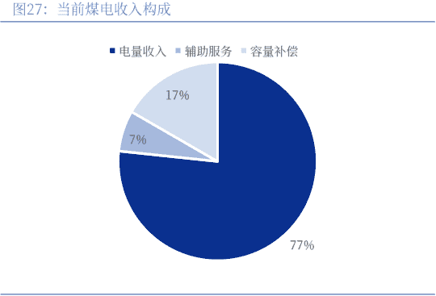

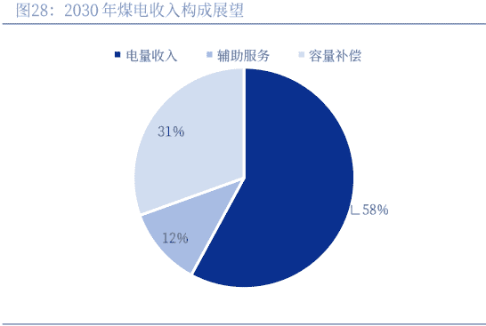

容量补偿、辅助服务比例有望提升，增强煤电盈利稳定性。以煤电为例，其固定运营成本主要包括折旧、运维、财务费用等；其收入主要来自电能量（点火价差）、容量补偿以及辅助服务。预计2025年，煤电利用小时数将由目前4600小时下滑至4000—4200小时，容量补偿比例在30%—50%，辅助服务度电收入0.01元，据此测算，单位GW煤电每年利润总额可达2.1—3亿元左右。随着火电利用小时数不断走低，容量补偿和辅助服务比例有望进一步提升，增强煤电盈利稳定性。我们测算2030年单位GW煤电每年利润总额可达2.55—3.8亿元左右。

表12：单位GW煤电盈利能力预测

| 项目 | 2025 保守 | 2025 乐观 | 2030 保守 | 2030 乐观 |
|---|---:|---:|---:|---:|
| 固定运营成本 | 33000万元 | 33000万元 | 33000万元 | 33000万元 |
| 利用小时 | 4000小时 | 4200小时 | 3500小时 | 4000小时 |
| 发电量 | 40亿千瓦时 | 42亿千瓦时 | 35亿千瓦时 | 40亿千瓦时 |
| 点火价差 | 0.1元/千瓦时 | 0.1元/千瓦时 | 0.1元/千瓦时 | 0.1元/千瓦时 |
| 电量收入 | 40000万元 | 42000万元 | 35000万元 | 40000万元 |
| 容量补偿比例 | 30% | 50% | 50% | 70% |
| 容量补偿收入 | 10000万元 | 16500万元 | 16500万元 | 23000万元 |
| 辅助服务返还 | 0.01元/千瓦时 | 0.01元/千瓦时 | 0.02元/千瓦时 | 0.02元/千瓦时 |
| 辅助服务收入 | 4000万元 | 4200万元 | 7000万元 | 8000万元 |
| 毛利润 | 21000万元 | 29700万元 | 25500万元 | 38000万元 |

火电业绩转向稳定，估值修复空间大。过去10年间，火电板块PB均值为1.14x，水电板块PB均值为2.25x，火电估值相对水电低49%。长期电改将推动业绩从周期性转向高度稳定性，且在发展新能源方面具有消纳优势，估值有望迎来重估，相对水电估值修复空间大。

# 行业深度报告·公用事业行业

#### 图29：过往10年火电板块PB走势

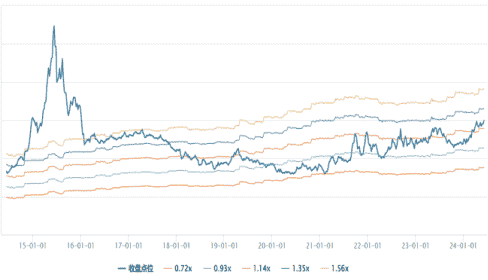

资料来源：Wind，中国银河证券研究院

#### 图30：过往10年水电板块PB走势

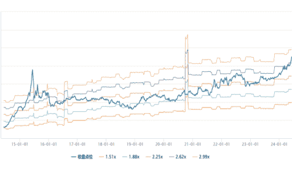

资料来源：Wind，中国银河证券研究院

## 二、新能源：市场化加速，短期电价承压不改长期装机空间大

### （一）光伏、风电上游价格处于历史低位

**2024年以来风机价格有所企稳，但仍处于低位。** “十四五”以来，受到补贴退坡、行业竞争加剧等影响，风机招标价格进入下行通道，至2023年末跌破1500元/千瓦。2024年以来风机价格企稳回升，3月全市场风机投标均价为1563元/千瓦，虽然较2023年末最低点有所反弹，但仍处于低位运行区间。

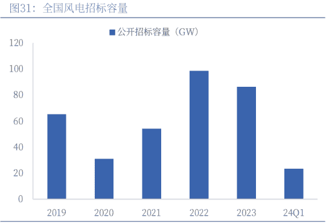

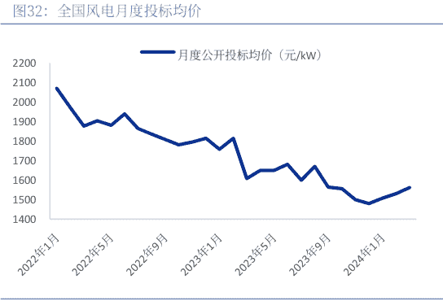

资料来源：金风科技，中国银河证券研究院

资料来源：金风科技，中国银河证券研究院

**2024年以来光伏上游价格持续下行，硅料、组件价格达到历史最低位。** 得益于硅基产业链的持续产能释放，光伏硅料、组件的价格已经降至历史最低位。其中硅料价格由年初超过66元/kg跌至目前的39元/kg，跌幅超过40%；光伏组件价格自年初0.88元/W跌至目前的0.8元/W，跌幅接近10%。

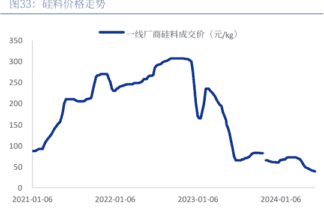

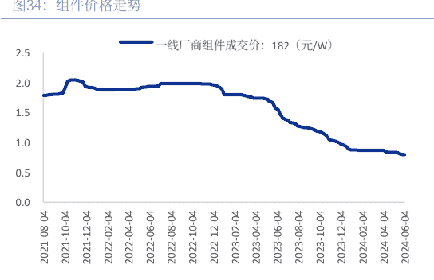

资料来源：Solarzoom，中国银河证券研究院

资料来源：Solarzoom，中国银河证券研究院

### （二）成本下降，消纳放宽刺激装机，十四五末新能源装机超过17亿千瓦

**新能源逐渐成为新增装机主力，2024年1—4月新能源新增装机占比超过80%。** “双碳”目标驱动能源清洁化转型，新能源在新增装机及累计装机的比重稳中有升。2024年1—4月新能源新增装机总共77GW，同比增23%，占同期新增装机的86.8%；截至2024年4月，新能源累计装机达到1129.5GW，占同期累计装机的37.5%。

展望“十四五”后续年份，上游产业链价格仍处于下行通道，此外新能源消纳红线放宽至90%，支撑新能源装机持续高速增长。我们预计2024、2025年新能源新增装机均为330GW，至2025年末新能源累计装机量将超过17亿千瓦（1700GW）。**预计2024年新能源投产装机再创新高，2025年维持高位。** 根据2024年5月国网能源研究院《中国电力供需分析报告2024》，预计新能源新增装机330GW，同比增长13%并创历史新高；其中风电新增装机90GW，同比增长19%，太阳能新增装机240GW，同比增长11%。我们预计2025年新能源新增装机维持高位并与2024年持平。

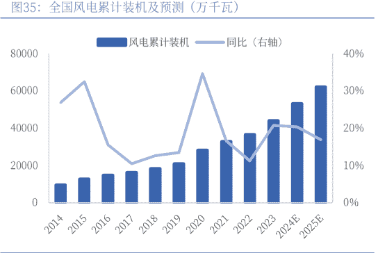

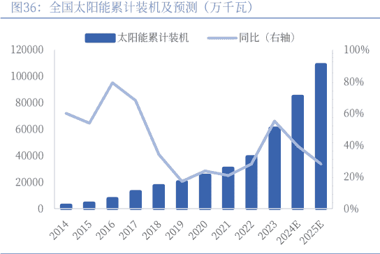

资料来源：Wind，国网能源研究院，中国银河证券研究院

资料来源：Wind，国网能源研究院，中国银河证券研究院

### （三）能源转型打开长期成长空间，环境价值带来额外电价弹性

#### 1. 装机：2025、2030年累计装机量超过17亿千瓦、30亿千瓦

**“双碳”目标驱动能源转型，长期来看风光将成为主力电源。** 截至2024年4月，风电、太阳能累计装机4.58/6.71亿千瓦，同比+20.6%/+52.4%，占总装机比重15.2%/22.3%。新能源累计装机合计11.29亿千瓦，占总装机37.5%（见图3）。

产业链降本刺激装机需求，能源转型打开长期增长空间，我们预计2025年、2030年风光累计装机将超过17亿千瓦、30亿千瓦。根据全球能源互联网发展合作组织的预测，到2060年我国发电装机容量将达到80亿千瓦，其中清洁能源装机76.8亿千瓦，占比96%；2060年风电和太阳能装机分别达到25亿千瓦和38亿千瓦，风光装机占比接近80%（见图4），发电量占比接近70%。

#### 2. 电能量价值：市场电比例逐年提升，电价面临下降风险

**2023年新能源市场电比例接近50%，预计2030年全面参与市场。** 近年来新能源逐步进入电力市场，2023年市场化交易电量6845亿千瓦时，占新能源总发电量的47.3%。2022年1月，国家发改委、国家能源局《关于加快建设全国统一电力市场体系的指导意见》提出2030年新能源全面参与市场交易；2023年10月，国家发改委、国家能源局《关于进一步加快电力现货市场建设工作的通知》进一步明确加快开放各类电源参与电力现货市场。按照2030年新能源全面参与市场交易的时间节点，现货试点地区结合实际制定分步实施方案。

##### 图37：新能源市场化电量占比

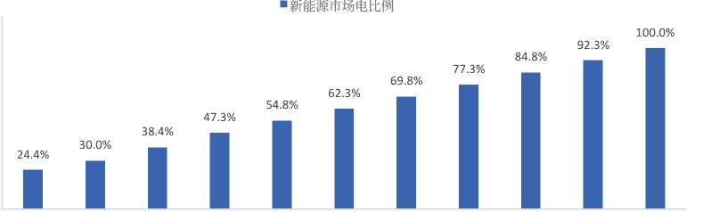

资料来源：中电联、国家能源局、中国银河证券研究院

**2024年新能源市场电比例将进一步提高。** 以新能源装机容量和发电量占比较大的蒙西、新疆和宁夏电网为例，2024年优先发电计划电量或对应利用小时数保持了2023年的下降趋势，新能源项目“保量保价”部分电量进一步缩减，更高比例的电量被要求参与电力市场。

##### 表13：蒙西、新疆和宁夏电网风电和光伏优先发电量利用小时

| 电网 | 2024年 | 2023年 | 2022年 |
|---|---|---|---|
| 蒙西 | 初步安排常规风电“保量保价”优先发电量53亿千瓦时（折初步安排常规风电“保量保价”优先发电计划利用小时数300小时），特许权项目28亿千瓦时（折算利用小时数550小时，特许权项目2000小时），按照蒙西地区煤电项目基准500小时；低价项目2000小时以内电量按照竞价价格结算；低价项目2000小时基准电价结算。初步安排常规光伏“保量保价”优先发电计划电量16亿千瓦时（折算利用小时数250小时），领跑者项目26亿千瓦时（折算利用小时数1500小时），由电网企业按照蒙西地区煤电基准价格收购；低价项目1500小时以内电量按照竞价价格执行。 | 初步安排常规风电“保量保价”优先发电计划电量53亿千瓦时（折算利用小时数300小时），特许权项目28亿千瓦时（折算利用小时数550小时，特许权项目2000小时），按照蒙西地区煤电项目基准500小时；低价项目2000小时以内电量按照竞价价格结算；低价项目2000小时基准电价结算。初步安排常规光伏“保量保价”优先发电计划电量16亿千瓦时（折算利用小时数250小时），领跑者项目26亿千瓦时（折算利用小时数1500小时），按照蒙西地区煤电基准价格结算；低价项目1500小时以内电量按照竞价价格结算。 | 初步安排常规风电“保量保价”优先发电计划小时数1100小时，特许权项目2000小时，按照蒙西地区煤电项目基准500小时；竞价项目2000小时基准电价结算。初步安排常规光伏“保量保价”优先发电计划小时数900小时，领跑者项目1500小时，按照蒙西地区煤电项目基准价格结算；竞价价格低于蒙西地区煤电基准价的光伏发电项目，1500小时以内电量按照竞价价格结算。 |
| 新疆 | 风电机组安排优先发电计划148.82亿千瓦时。太阳能发电机组安排优先发电计划72.57亿千瓦时。 | 风电机组安排优先发电计划178.21亿千瓦时。太阳能发电机组安排优先发电计划109.08亿千瓦时。 | 风电机组安排优先发电计划79.34亿千瓦时。太阳能发电机组安排优先发电计划56.71亿千瓦时。 |
| 宁夏 | 风电、光伏优先发电计划55.35亿千瓦时 | 风电、光伏优先发电计划58.75亿千瓦时（占风电、光伏优先发电计划75亿千瓦时的约78%） | 风电和光伏发电当年总发电量的15% |

资料来源：Wind，中国银河证券研究院

**2024年新能源中长期电价面临下降风险。** 根据部分省份2024年电力交易方案，宁夏、云南、甘肃、广西等省份新能源中长期电价均有不同幅度下降。其中，三北地区的宁夏、甘肃两省新能源装机占比高，2023年末均已超过50%，新能源消纳压力较大，因此中长期电价下行幅度更大。

全国范围来看，2023年新能源装机高增长导致2024年风电、光伏利用率下降，部分地区或部分时段电力供需明显过剩，因此我们预计多数省份2024年新能源中长期电价将下降。

表14：2024年部分省份新能源市场化交易政策我是 goaichat 研发的智能大模型，可以为你提供智能问答、分析和创作服务。|省份 | 煤电基准价（元/千瓦时） |2024年新能源市场化交易政策 | 电价下降（元/千瓦时） |
|---|---:|---|---:|
| 宁夏 |0.2595 | 优先部分执行0.2595元/千瓦时，超过87%参与交易，最高0.182元/千瓦时。 |约0.068 |
| 黑龙江 |0.3723 | 平价/低价风光项目保障性小时按1950/1300小时确定，剩余电量及其他类型风光项目进入市场交易。 | —— |
| 云南 |0.3358 |35%~45%电量参与交易，交易价约0.15~0.27元/千瓦时。 | 超0.03 |
| 青海 |0.2277 | 年度交易合约量不低于市场化总量的80%，谷电价在平电价基础上下浮不低于20%。 | —— |
| 甘肃 |0.3078 | 全部参与交易，交易电价不高于0.1539元/千瓦时。 | 超0.15 |
| 广西 |0.4207 |500小时以内按0.4207元/千瓦时结算，其余按0.38元/千瓦时结算。 |约0.025 |
| 河南 |0.3779 | 除光伏扶贫项目以外，风光电量按不高于基准电价参与交易。 | —— |
| 内蒙古 |0.2829（蒙西）；0.3035（蒙东） |领跑者、低价光伏按1500小时，常规光伏按250小时按基准价（竞价）结算，超出部分参与市场化交易。 | —— |

资料来源：智汇光伏，中国银河证券研究院**政府授权合约有望得到推广，稳定电价预期。**2024年广西推出政府授权合约，根据国家能源局南方监管局印发的《2024年广西电力市场交易实施方案》，集中式风电、光伏发电企业执行政府授权合约机制，政府授权合约价格为0.38元/千瓦时。随着现货市场在全国范围内不断铺开，政府授权合约制度有望得到推广。以政府授权合约实现政府定价部分电量与市场的衔接，并实现市场化电量的价格调控，保证新能源企业合理收益。

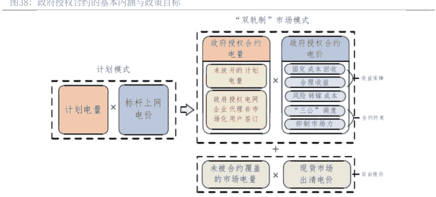

资料来源：徐程栋《适应现货市场过渡的政府授权合约分解方法与财务表现分析》，中国银河证券研究院**现货省份新能源电价下行压力更大。**受到出力时段集中、功率预测偏差等影响，新能源参与现货市场面临天然降价风险。以山西、山东、甘肃、蒙西较为成熟的电力试点省份为例，2024年1~4月，4省光伏平均上网电价分别为216元/MWh、192元/MWh、129元/MWh、159元/MWh，同比分别+27.4%、-38.6%、-46.7%、-29.2%。2024年1~4月，4省风电平均上网电价分别为331元/MWh、235元/MWh、241元/MWh、260元/MWh，同比分别+84.5%、-35.3%、-15.5%、-10.6%。除了1月迎峰度冬时段新能源电价同比增长，2~4月新能源电价均同比大幅下降。

# ##具身智能机器人：从概念到落地具身智能机器人正从实验室走向千行百业。2024世界机器人大会展出的27款人形机器人，标志着这一领域从概念验证进入应用探索的新阶段。

## 两条技术路线并行北京星动纪元科技有限公司创始人陈建宇认为，具身智能机器人技术路线主要分为两条：一条以端到端大模型为主导，另一条以小模型组合为主导。两条路线各有优劣，前者更具扩展性，后者更具稳定性。

## 从单点突破到系统集成优必选科技副总裁、研究院院长焦继超表示，具身智能涉及算力、算法、数据、本体等多个层面，单点突破不足以形成产品，必须进行系统集成。公司已与东风柳汽合作，将人形机器人引入汽车制造工厂，进行分拣、搬运等任务的实训。

## 数据最大瓶颈多位业内专家指出，高质量数据缺乏当前具身智能发展的最大瓶颈。陈建宇建议，企业可以通过仿真合成、大模型生成和真机数据结合等方式解决数据不足的问题，并指出“针对特定行业的高质量数据反而更重要”。

## 投资与商业化前景金沙江联合资本管理合伙人周奇表示，目前人形机器人公司估值普遍偏高，投资机构需要更加谨慎。他认为，真正有竞争力的企业会在明年下半年显现，届时商业化前景将更加明朗。

焦继超预测，未来3到5年，人形机器人有望在工业场景中实现小批量应用，5到10年内实现更大范围的推广。

表16：绿电、绿证交易支持政策| 日期 | 部门 | 政策 |主要内容 |
|---|---|---|---|
|2021.9 | 国家发改委、能源局 | 《绿色电力交易试点工作方案》 | 明确了绿色电力交易定义和交易框架；强调了绿色电力交易的优先原则；规范了绿色电力产品的交易方式；厘清了绿色电力产品的市场定位和交易属性；提出了绿色电力交易与碳市场衔接。 |
|2022.1 | 国家发改委、能源局 | 《关于加快建设全国统一电力市场体系的指导意见》 | 探索开展绿电电力交易。创新体制机制，开展绿色电力交易试点，以市场化方式发现绿色电力的环境价值；引导有需求的用户直接购买绿色电力；做好绿色电力交易与绿证交易、碳排放权交易的有效衔接。 |
|2022.1 | 国家发改委等7部门 | 《促进绿色消费实施方案》 | 落实新增可再生能源和原料用能不纳入能源消费总量控制要求，统筹推动绿色电力交易、绿证交易；引导用户签订绿色电力交易合同；加强高耗能企业使用绿色电力的刚性约束；建立绿色电力交易与可再生能源消纳责任权重挂钩机制等。 |
|2022.2 | 南网各区电力交易中心 | 《南方区域绿色电力交易规则（试行）》 |绿色电力交易主要包括省内绿色电力交易和省间绿色电力交易；价格方面，绿色电力交易价格由市场主体通过双边协商、挂牌交易等方式形成；绿色电力交易价格应充分体现绿色电力的能值和环境价值，原则上市场主体应分别明确电能量价格与绿色环境权益价格。 |
|2022.5 | 北京电力交易中心 | 《北京电力交易中心绿色电力交易实施细则》 |绿色电力交易价格应充分体现绿色电力的能值和环境价值，原则上市场主体应分别明确电能量价格与绿色环境权益价格。 |
|2023.2 | 国家发改委等3部门 | 《关于享受中央政府补贴的绿电项目参与绿电交易有关事项的通知》 |享受国家可再生能源补贴的绿色电力，参与绿电交易时高于项目所执行的煤电基准电价的溢价收益等额冲抵国家可再生能源补贴或归国家所有；发电企业放弃补贴的，参与绿电交易的全部收益归发电企业所有。 |
|2023.8 | 国家发改委等3部门 | 《关于做好可再生能源绿色电力证书全覆盖工作促进可再生能源电力消费的通知》 |全国风电（含分散式风电和海上风电）、太阳能发电（含分布式光伏发电和光热发电）、常规水电、生物质发电、地热能发电、海洋能发电等已建档立卡的可再生能源发电项目所生产的全部电量核发绿证，实现绿证核发全覆盖。 |
|2023.9 | 国家能源局 | 《关于可再生能源绿色电力证书核发有关事项的通知》 | 国家能源局新能源和可再生能源司负责绿证相关管理工作，国家能源局电力业务资质管理中心组织国家可再生能源信息管理中心核发绿证。 |
|2024.1 | 国家发改委等3部门 | 《关于加强绿色电力证书与节能降碳政策衔接大力促进非化石能源消费的通知》 | 加强绿证与能耗双控政策衔接，夯实绿证核发交易基础，拓展绿证应用场景，激发绿证需求潜力。 |
|2024.4 | 国家能源局 | 《可再生能源绿色电力证书核发和交易规则（征求意见稿）》 |进一步明确了绿证工作的职责分工、绿证账户、绿证核发、交易及划转、信息管理、绿证监管等方面工作要求。 |
|2024.5 | 国务院 | 《2024—2025年节能降碳行动方案》 |2024年底实现绿证核发全覆盖；加快建设绿证交易市场，做好与碳市场衔接；扩大绿电消费规模；实行重点用能单位化石能源消费预算管理，超出预算部分通过购买绿证进行抵扣；加快建设绿证交易市场，做好与碳市场衔接，扩大绿电消费规模。 |

资料来源：政府部门公告、中国银河证券研究院**绿电交易赋予绿色电力环境价值。**2021年9月，国家发改委、国家能源局共同推动在北京、广州两大电力交易中心开展绿色电力交易试点工作，并在中长期电力交易框架下，设立独立的绿电品种。从广东、江苏公布的2024年电力市场年度交易结果来看，绿电交易价格全面高于当地煤电基准价以及市场平均。通过市场价格信号，体现了绿色电力除电能价值以外的环境价值。

表17：江苏、广东电力市场2024年度交易结果| 类别 | 指标 | 单位 | 江苏 | 广东 |
|---|---|---|---:|---:|
| 整体 | 煤电基准价 | 元/千瓦时 |0.391 |0.453 |
| 整体 | 年度成交价 | 元/千瓦时 |0.453 |0.466 |
| 整体 | 年度成交量 | 亿千瓦时 |3606.24 |2582.01 |
| 整体 | 相基准价溢价 | 元/千瓦时 |0.062 |0.013 |
| 整体 | 浮动比例 | |15.8% |2.8% |
|绿电 | 年度成交价 | 元/千瓦时 |0.464 |0.479 |
|绿电 | 年度成交量 | 亿千瓦时 |31.72 |31.07 |
|绿电 | 相基准价溢价 | 元/千瓦时 |0.073 |0.026 |
|绿电 | 浮动比例 | |18.8% |5.8% |

资料来源：江苏电力交易中心、广东电力交易中心、中国银河证券研究院**绿电、绿证交易规模快速增长，新能源持续兑现环境价值。**十四五以来，国家级绿电、绿证交易支持政策不断出台，交易规模快速增长。2021~2023年，全国绿电+绿证交易规模分别为93亿千瓦时、278亿千瓦时、862亿千瓦时，其中2022、2023年同比增速均在200%左右。考虑到2023年全国新能源发电量1.45万亿千瓦时，绿电+绿证覆盖比例仍不足6%。目前由于绿色环境价值体系待完善、跨区域绿电交易规模有限、交易规则待健全、绿电绿证和碳市场衔接等原因，绿电和绿证交易规模受限。我们预计绿电、绿证交易规模仍有较大增长空间，有助于新能源项目兑现环境价值。

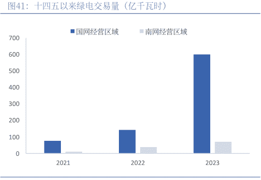

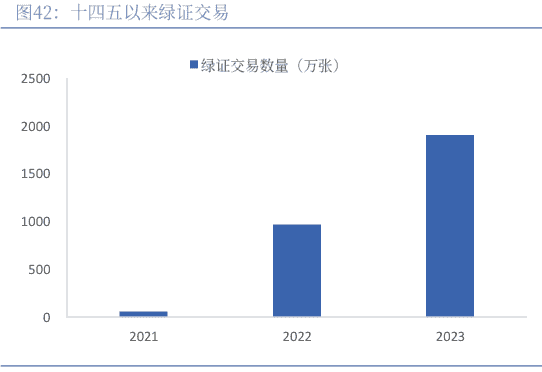

资料来源：北京电力交易中心、中国银河证券研究院资料来源：北京电力交易中心、中国银河证券研究院注：2023年仅包含北京电力交易中心成交数据。

**年初以来碳价持续走高，最高已突破100元/吨。**年初以来，在全国碳市场扩容、碳配额预期收紧、碳监管政策趋严等因素推动下，4月24日全国碳市场价格首次破百，年内最高涨幅超过30%；截至6月4日，全国碳市场价格仍然保持在94.23元/吨的高位，年初以来涨幅19%。作为碳市场活跃度的重要信号，碳价的持续走高预示着我国碳市场在促进各行业减排方面的作用将更加突出。长期来看，随着我国从“能耗双控”向“碳排放双控”转变，未来免费配额的数量会越来越少，转为有偿配额取代，稀缺性提升有望推动碳价进入长期上行通道。

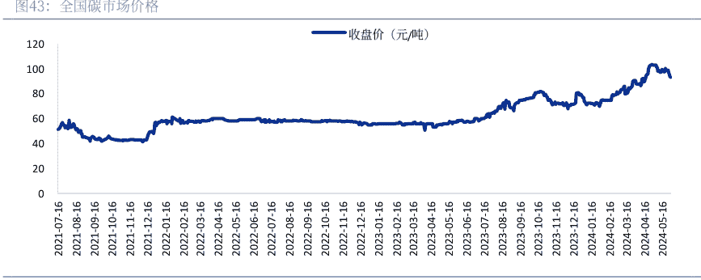

资料来源：Wind、中国银河证券研究院**碳排放管控支撑绿电溢价。**2021年欧洲议会通过了碳边境调节机制（CBAM）的决议，正式启动立法进程。2023年至2025年为过渡期，CBAM将配合欧盟排放交易体系政策于2026年起生效，覆盖行业为水泥、钢铁、铝、化肥、电力等。CBAM的实施方式为欧盟各成员国主管部门向各国高排放商品的进口商按吨出售CBAM凭证，因此国内的出口企业更有意愿使用绿电去节约碳边境税带来的成本增长，绿电溢价将得到支撑。根据一般经验，如果采用绿电代替煤电，度电减排700~800g二氧化碳，当碳价在100元/吨时，企业能够接受的绿电溢价大概在0.07~0.08元/度之间，随着未来碳价的进一步升高，不使用绿电的消费者承担的碳成本比例就越高，对绿电的需求和溢价的接受度也就越高。

表18：不同碳价下企业可接受的绿电溢价测算| 燃煤发电度电碳排放（克/千瓦时） |800 |800 |800 |800 |
|---|---:|---:|---:|---:|
|绿电度电碳排放（克/千瓦时） |30 |30 |30 |30 |
| 使用绿电的度电碳排量（克/千瓦时） |770 |770 |770 |770 |
| 碳价（元/吨） |30 |50 |70 |100 |
| 可接受的绿电溢价（元/千瓦时） |0.0231 |0.0385 |0.0539 |0.0770 |

资料来源：北极星电力网、中国银河证券研究院**北京、天津、上海已经出台绿电和碳市场衔接的政策，使用绿电不计入碳排放。**今年以来，天津、北京、上海等地生态环境部门先后出台关于绿电交易与碳排放的相关政策，对绿电的碳排放进行了明确规定。京津沪三地均为国家批复的区域碳市场试点地区，三地的相关政策提高了本地企业采购绿电的积极性，推动了电碳的进一步协同发展，同时给其他省份出台相关政策提供了范本。

表19：绿色电力和碳市场衔接政策| 时间 | 碳市场 | 政策 |相关内容 |
|---|---|---|---|
|2023.6 | 上海 | 《关于调整本市碳交易企业外购电力中绿色电力碳排放核算方法的通知》 | 外购绿电排放因子调整为0 t CO₂/10⁴kWh，其他外购电力排放因子仍统一为4.2 t CO₂/10⁴kWh。 |
|2023.4 | 北京 | 《关于做好2023年本市碳排放单位管理和碳排放权交易试点工作的通知》 |重点碳排放单位通过市场化手段购买使用的绿电碳排放量核算为零。 |
|2023.3 | 天津 | 《关于做好天津市2022年度碳排放报告核查与履约等工作的通知》 | 各重点排放单位在核算净购入使用电量时，可申请扣除购入电网中绿色电力电量。 |

资料来源：上海市生态环境局、北京市生态环境局、天津市生态环境局、中国银河证券研究院**2025、2030年，环境价值约为200亿元、2000亿元。**结合我们的预测以及国家电网全球能源互联网发展合作组织预测，2025、2030年、2060年我国新能源总装机将分别达到16亿千瓦、30亿千瓦、63亿千瓦。随着绿色环境价值市场体系完善，预计远期绿电、绿证交易将实现全覆盖，且绿色环境价值将直接标碳市场价格。根据北京理工大学能源与环境政策研究中心发布的《中国碳市场建设成效与展望（2024）》，预计“十四五”末碳价突破105元/吨，“十五五”期间突破200元/吨，此外我们预计本世纪中叶碳价将突破300元/吨。据此推算，2025年环境价值将达到200亿元左右，2030年将达到2000亿元左右。

表20：新能源远期成长空间预测| |2023 |2025E |2030E |2060E |
|---|---:|---:|---:|---:|
| 风电装机（万千瓦） |44134 |60000 |100000 |250000 |
| 光伏装机（万千瓦） |60949 |105000 |200000 |380000 |
| 新能源发电量（亿千瓦时） |14500 |25000 |45000 |103000 |
|绿电、绿证交易占比 | <6% |10% |30% |100% |
|绿电、绿证交易电量（亿千瓦时） |862 |2500 |13500 |103000 |
| 碳市场价格（元/吨） |68 |105 |200 |300 |
| 环境溢价（元/千瓦时） | <0.07 |0.07 |0.15 |0.25 |
| 环境价值（亿元） | <60 |175 |2025 |20600 |

资料来源：国家发改委、国家能源局、国家电网、北京电力交易中心、广州电力交易中心、中国银河证券研究院# 四、投资策略## （一）行业表现与估值：板块分化明显，估值小幅回落年初至6月14日，SW公用事业上涨12.77%，同期沪深300上涨3.22%，公用事业指数跑赢沪深300指数9.55个百分点。在31个子行业中，公用事业行业的涨跌幅排名为第4名。分子行业来看，年初至今电力/燃气分别变动12.53%/1.43%。分板块来看，火电/水电/核电/风电/光伏指数涨幅分别为27.5%/22.0%/37.3%/1.7%/-12.8%。火电大幅上涨主要由于煤价下跌、盈利能力改善；水电、核电大幅上涨主要由于高分红、高股息凸显防御价值，此外来水改善也是重要催化因素；新能源走势较弱，反映了市场对于新能源上网电价下降的担忧。

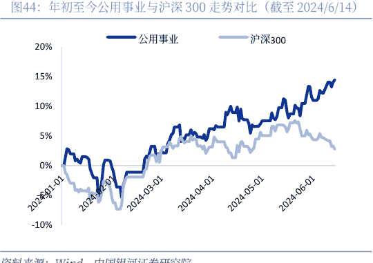

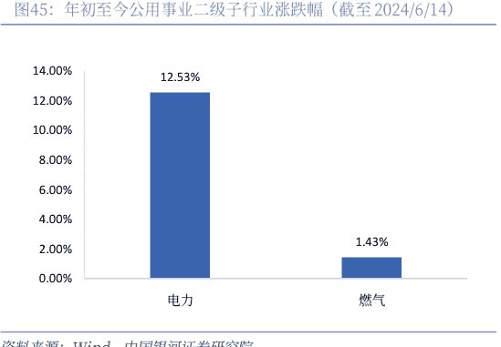

资料来源：Wind，中国银河证券研究院资料来源：Wind，中国银河证券研究院年初至6月14日，公用事业行业的估值水平小幅回落。截至2024年6月14日，SW公用事业板块估值PE（TTM）为18.10x，万得全A板块估值PE（TTM）为16.63x，估值溢价率为8.8%，公用事业板块估值略高于市场平均。年初至6月14日，公用事业行业涨幅排名前10的个股中均属于电力行业，其中火电行业5只，水电行业1只，核电行业1只，电能综合服务3只。

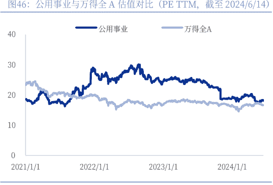

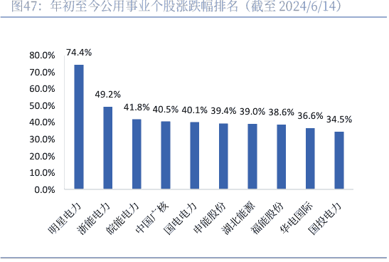

资料来源：Wind，中国银河证券研究院资料来源：Wind，中国银河证券研究院## （二）基金持仓情况：第一季度持仓大幅增加我们公募基金的重仓股明细数据进行统计和分析。截至2024Q1，公用事业板块基金重仓持股市值比例为2.24%，较2023Q4增加0.68个百分点。2024Q1公用事业行业市值占A股全部市值的比例为3.54%，基金对于公用事业板块的超配比为-1.30%，板块处于低配状态，持仓比例有较大提升空间。

# 图48：全部基金公用事业重仓持股比例变化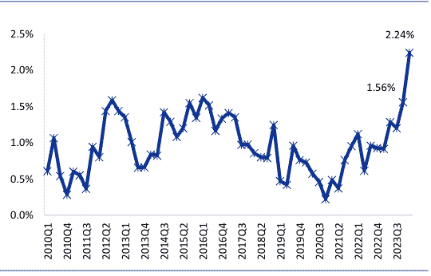

# 图49：基金持股占比、超配比（右）与指数涨跌幅（左）

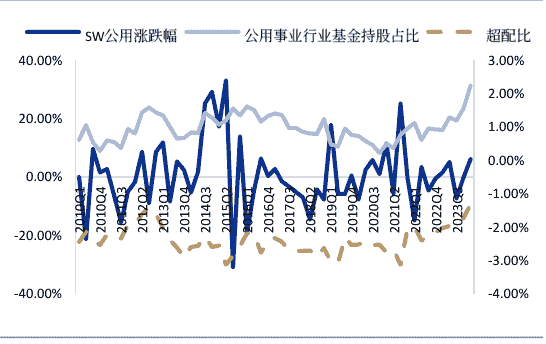

资料来源：Wind，中国银河证券研究院资料来源：Wind，中国银河证券研究院**重仓持有市值集中度基本稳定。**截至2024Q1，公用事业行业重仓前3个股占重仓公用股总市值61.01%，环比下降0.32个百分点；重仓前5个股占重仓公用股总市值72.44%，环比下降0.02个百分点。2024年一季度，公用事业龙头个股持仓集中度基本保持稳定。其中，截至2024Q1，按照重仓市值排序，公用事业行业重仓前5个股为长江电力、中国核电、华电国际、国投电力、华能国际。

# 图50：重仓持有市值前3、5名占持有公用股总市值比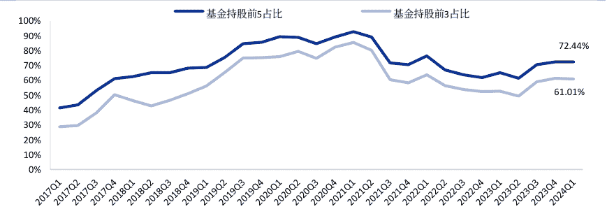

资料来源：Wind，中国银河证券研究院从基金重仓市值来看，截至2024Q1，公用事业行业公募基金重仓市值前十的有长江电力（257.9亿元）、中国核电（68.9亿元）、华电国际（35.5亿元）、国投电力（34.5亿元）、华能国际（33.4亿元）、川投能源（27.7亿元）、华能水电（18.3亿元）、中国广核（17.7亿元）、皖能电力（17.1亿元）、浙能电力（16.9亿元）。

从重仓基金数量来看，截至2024Q1，长江电力（540个）、中国核电（241个）、华电国际（137个）、国投电力（123个）、华能国际（120个）等公用事业重仓基金产品数量领先。环比2023Q4，长江电力新增重仓产品76个，华电国际新增重仓产品67个，浙能电力新增重仓产品62个，中国核电新增重仓产品56个，中国广核新增重仓产品45个，市场对于水电、火电、核电龙头关注度提升。

| 排名 | 证券代码 | 证券名称 | 重仓市值/万元 | 重仓持有/只 | 环比变化/只 | 重仓股数/万股 | 环比变化/万股 |
|---:|---|---|---:|---:|---:|---:|---:|
| 1 | 600900.SH | 长江电力 | 2578525 | 540 | 76 | 103431 | 31423 |
| 2 | 601985.SH | 中国核电 | 688740 | 241 | 56 | 74945 | 3335 |
| 3 | 600027.SH | 华电国际 | 353217 | 137 | 67 | 51414 | 81 |
| 4 | 600886.SH | 国投电力 | 344784 | 123 | 28 | 22909 | 7937 |
| 5 | 600011.SH | 华能国际 | 333936 | 120 | 18 | 35601 | -6187 |
| 6 | 600674.SH | 川投能源 | 276966 | 75 | 23 | 16635 | 4456 |
| 7 | 600025.SH | 华能水电 | 182510 | 45 | 13 | 19051 | 92 |
| 8 | 003816.SZ | 中国广核 | 176980 | 78 | 45 | 43807 | 28907 |
| 9 | 000543.SZ | 皖能电力 | 171439 | 68 | 37 | 20606 | 2397 |
| 10 | 600023.SH | 浙能电力 | 169001 | 97 | 62 | 25338 | 14331 |
| 11 | 600795.SH | 国电电力 | 94395 | 82 | 27 | 18692 | -2234 |
| 12 | 600863.SH | 内蒙华电 | 87894 | 27 | 8 | 19107 | -3232 |
| 13 | 600905.SH | 三峡能源 | 87370 | 55 | 9 | 18629 | -2386 |
| 14 | 600483.SH | 福能股份 | 70632 | 45 | 29 | 6708 | 3790 |
| 15 | 605090.SH | 九丰能源 | 49017 | 21 | 6 | 1751 | -181 |
| 16 | 601991.SH | 大唐发电 | 47163 | 26 | 14 | 16096 | 1980 |
| 17 | 600642.SH | 申能股份 | 43856 | 38 | 20 | 5544 | 2980 |
| 18 | 000690.SZ | 宝新能源 | 28942 | 9 | 2 | 5742 | 1104 |
| 19 | 600803.SH | 新奥股份 | 28075 | 32 | 7 | 1450 | -2457 |
| 20 | 603393.SH | 新天然气 | 22230 | 9 | 0 | 713 | -194 |
| 21 | 000600.SZ | 建投能源 | 16322 | 19 | 18 | 2451 | 2289 |
| 22 | 000883.SZ | 湖北能源 | 11699 | 10 | 7 | 2237 | 1302 |
| 23 | 600098.SH | 广州发展 | 9649 | 7 | 5 | 1572 | 1514 |
| 24 | 601222.SH | 林洋能源 | 7186 | 6 | 4 | 1132 | 1118 |
| 25 | 600452.SH | 涪陵电力 | 6629 | 3 | 1 | 494 | -17 |
| 26 | 605368.SH | 蓝天燃气 | 6608 | 11 | 5 | 488 | 352 |
| 27 | 600116.SH | 三峡水利 | 4381 | 8 | 1 | 610 | 55 |
| 28 | 600578.SH | 京能电力 | 3690 | 10 | 8 | 1098 | 784 |
| 29 | 601139.SH | 深圳燃气 | 3531 | 6 | 4 | 473 | 253 |
| 30 | 600021.SH | 上海电力 | 3436 | 5 | 3 | 396 | -94 |

表21：24Q1 公募基金公用行业重仓股排序（按基金重仓持市值排序）

资料来源：Wind，中国银河证券研究院

## （三）投资策略：电改深化下，迎来估值、成长机遇

**火电：盈利继续改善，保供价值属性推动估值重塑。**今年以来煤价延续波动下跌趋势，我们预计全年煤炭供给将进一步宽松，火电板块 2024 年业绩有望持续改善。新型电力系统下，火电调峰、调频等保供价值持续提升。2024 年以来全国范围煤电容量电价正式落地，未来全国性辅助服务相关政策亦有望落地，火电政策催化不断。我们测算，至 2030 年火电将有 50%左右收入来自容量电价和辅助服务，其对于煤价、电价敏感性低，推动盈利稳定性大幅提升。目前火电板块 PB 均值为 1.24x，随着盈利稳定性持续提升，板块 PB 相对核电 PB 1.97x、水电 PB 2.83x 有修复空间。建议关注华能国际、华电国际、国电电力、内蒙华电、皖能电力、江苏国信等。

**新能源：能源转型下主力电源，长期量、价成长空间大。**目前新能源累计装机 11.3 亿千瓦，占比 37.5%。能源转型大背景下新能源将成为主力电源，预计 2025 年、2030 年新能源累计装机将超过 17 亿千瓦、30 亿千瓦。随着绿色环境价值市场体系完善，绿电、绿证交易大幅提升，且绿色环境价值将直接对标碳市场价格。新能源通过环境市场回收绿电溢价，增厚盈利水平。建议关注三峡能源、龙源电力、芯能科技、中绿电。

## （四）投资组合与盈利预测

表22：重点公用事业公司盈利预测与估值（2024 年 6 月 14 日）

| 代码 | 简称 | 股价 | EPS 2023A | EPS 2024E | EPS 2025E | EPS 2026E | PE 2023A | PE 2024E | PE 2025E | PE 2026E | 投资评级 |
|---|---|---:|---:|---:|---:|---:|---:|---:|---:|---:|---|
| 600011.SH | 华能国际 | 9.25 | 0.54 | 0.91 | 1.00 | 1.10 | 17.2 | 10.2 | 9.3 | 8.4 | 推荐 |
| 600027.SH | 华电国际 | 7.02 | 0.44 | 0.62 | 0.74 | 0.78 | 15.9 | 11.3 | 9.5 | 9.0 | 推荐 |
| 600795.SH | 国电电力 | 5.83 | 0.31 | 0.42 | 0.48 | 0.53 | 18.5 | 13.9 | 12.1 | 11.0 | 推荐 |
| 600863.SH | 内蒙华电 | 4.61 | 0.31 | 0.39 | 0.43 | 0.46 | 15.0 | 11.8 | 10.7 | 10.0 | 推荐 |
| 000543.SZ | 皖能电力 | 8.64 | 0.63 | 0.84 | 0.99 | 1.06 | 13.7 | 10.3 | 8.7 | 8.2 | 推荐 |
| 600023.SH | 浙能电力 | 6.88 | 0.49 | 0.60 | 0.65 | 0.72 | 14.1 | 11.5 | 10.6 | 9.6 | 推荐 |
| 002608.SZ | 江苏国信 | 7.88 | 0.50 | 0.79 | 0.92 | 1.04 | 15.9 | 10.0 | 8.6 | 7.6 | 推荐 |
| 600905.SH | 三峡能源 | 4.70 | 0.25 | 0.33 | 0.38 | 0.44 | 18.7 | 14.2 | 12.4 | 10.7 | 推荐 |
| 001289.SZ | 龙源电力 | 18.41 | 0.75 | 0.86 | 0.98 | 1.10 | 24.6 | 21.4 | 18.8 | 16.7 | 推荐 |
| 603105.SH | 芯能科技 | 10.70 | 0.44 | 0.54 | 0.66 | 0.78 | 24.3 | 19.8 | 16.2 | 13.7 | 推荐 |
| 000537.SZ | 中绿电 | 11.26 | 0.44 | 0.50 | 0.83 | 1.10 | 25.3 | 22.5 | 13.6 | 10.2 | 推荐 |
| 600900.SH | 长江电力 | 27.90 | 1.11 | 1.37 | 1.46 | 1.56 | 25.1 | 20.4 | 19.1 | 17.9 | 推荐 |
| 600025.SH | 华能水电 | 10.51 | 0.42 | 0.48 | 0.55 | 0.60 | 24.8 | 21.9 | 19.1 | 17.5 | 推荐 |
| 600674.SH | 川投能源 | 18.60 | 0.90 | 1.08 | 1.21 | 1.30 | 20.6 | 17.2 | 15.4 | 14.3 | 推荐 |
| 601985.SH | 中国核电 | 10.04 | 0.56 | 0.60 | 0.65 | 0.72 | 17.8 | 16.7 | 15.4 | 13.9 | 推荐 |
| 003816.SZ | 中国广核 | 4.37 | 0.21 | 0.23 | 0.25 | 0.27 | 20.6 | 19.0 | 17.5 | 16.2 | 推荐 |

资料来源：Wind，中国银河证券研究院

## 五、风险提示

装机规模不及预期的风险；煤炭价格持续高位的风险；上网电价下调的风险；行业竞争加剧的风险等。

## 图表目录

- 图1：全国新增装机结构（万千瓦）............................................................4
- 图2：全国累计装机结构（万千瓦）............................................................4
- 图3：2024 年 4 月我国电源装机结构........................................................4
- 图4：2060 年我国电源装机结构预测........................................................4
- 图5：部分省份风电利用率（%）..............................................................5
- 图6：部分省份光伏利用率（%）..............................................................5
- 图7：市场化交易电量及占比................................................................6
- 图8：2024 年 1—4 月市场化电量结构......................................................6
- 图9：省间交易与省内交易衔接模式........................................................7
- 图10：全国各地区电力现货市场建设进度（截至 2024 年 1 月）......................8
- 图11：上网电价的合理构成....................................................................9
- 图12：全社会用电量及同比................................................................10
- 图13：当月各电源发电量同比（%）........................................................10
- 图14：全国房地产开发投资及同比........................................................10
- 图15：全国房屋新开工面积及同比........................................................10
- 图16：全国原煤产量及同比................................................................11
- 图17：全国五大煤炭主产区 2023 年产量及 2024 年计划（亿吨）....................11
- 图18：秦皇岛 5500 大卡动力煤市场价（元/吨）........................................12
- 图19：部分火电公司各季度毛利率（%）以及京唐港 5500 大卡动力煤季度均价（元/吨）................................................................12
- 图20：中东部 10 省月度电网代理购电价格均价及同比（右）.........................14
- 图21：中国辅助服务市场开展情况........................................................16
- 图22：辅助服务市场规模（亿元）........................................................17
- 图23：辅助服务收益结构....................................................................17
- 图24：华能国际辅助服务收入..............................................................18
- 图25：英国辅助服务市场规模发展........................................................18
- 图26：澳大利亚辅助服务成本变化示意图................................................18
- 图27：当前煤电收入构成....................................................................19
- 图28：2030 年煤电收入构成展望..........................................................19
- 图29：过往 10 年火电板块 PB 走势.......................................................20
- 图30：过往 10 年水电板块 PB 走势.......................................................20
- 图31：全国风电招标容量....................................................................21
- 图32：全国风电月度投标均价..............................................................21
- 图33：硅料价格走势..........................................................................21
- 图34：组件价格走势..........................................................................21
- 图35：全国风电累计装机及预测（万千瓦）..............................................22
- 图36：全国太阳能累计装机及预测（万千瓦）..........................................22
- 图37：新能源市场化电量占比........................................................23
- 图38：政府授权合约的基本内涵与政策目标........................................24
- 图39：2024 年 1—4 月现货省份光伏平均电价（元/MWh）及同比（右）................25
- 图40：2024 年 1—4 月现货省份风电平均电价（元/MWh）及同比（右）................25
- 图41：“十四五”以来绿电交易量（亿千瓦时）........................................27
- 图42：“十四五”以来绿证交易........................................................27
- 图43：全国碳市场价格............................................................27
- 图44：年初至今公用事业与沪深 300 走势对比（截至 2024/6/14）....................29
- 图45：年初至今公用事业二级子行业涨跌幅（截至 2024/6/14）......................29
- 图46：公用事业与万得全 A 估值对比（PE TTM，截至 2024/6/14）.....................29
- 图47：年初至今公用事业个股涨跌幅排名（截至 2024/6/14）........................29
- 图48：全部基金公用事业重仓持股比例变化........................................30
- 图49：基金持股占比、超配比（右）与指数涨跌幅（左）............................30
- 图50：重仓持有市值前 3、5 名占持有公用股总市值比................................30

- 表1： “十四五”以来电改相关文件梳理................................................6
- 表2：部分省份中长期交易规则........................................................8
- 表3：各省电力市场建设进度规划........................................................8
- 表4：2024 年全国煤炭供需增速预测（亿吨）..........................................11
- 表5：四大央企龙头多年火电经营数据................................................13
- 表6：我国煤电上网电价机制演变......................................................14
- 表7：《关于建立煤电容量电价机制的通知》..........................................15
- 表8：容量电价下游分摊测算（二三产用电量为 2024 年预计）........................15
- 表9：容量电价与电量电价变化对盈利的影响..........................................16
- 表10：《关于建立健全电力辅助服务市场价格机制的通知》主要内容................17
- 表11：辅助服务市场规模预测........................................................18
- 表12：单位 GW 煤电盈利能力预测......................................................19
- 表13：蒙西、新疆和宁夏电网风电和光伏优先发电量利用小时......................23
- 表14：2024 年部分省份新能源市场化交易政策........................................24
- 表15：绿电绿证交易特点对照表........................................................25
- 表16：绿电、绿证交易支持政策........................................................26
- 表17：江苏、广东电力市场 2024 年度交易结果........................................26
- 表18：不同碳价下企业可接受的绿电溢价测算..........................................28
- 表19：绿色电力和碳市场衔接政策......................................................28
- 表20：新能源远期成长空间预测........................................................28
- 表21：24Q1 公募基金公用行业重仓股排序（按基金重仓持市值排序）................31
- 表22：重点公用事业公司盈利预测与估值（2024 年 6 月 14 日）.......................32

## 分析师承诺及简介

本人承诺以勤勉的执业态度，独立、客观地出具本报告。本报告清晰准确地反映本人的研究观点。本人薪酬的任何部分过去不曾与、现在不与、未来也将不会与本报告的具体推荐或观点直接或间接相关。

陶鹏功，环保公用行业首席分析师，毕业于中国矿业大学（北京），拥有超过 10 年行业研究经验，长期从事环保公用及产业链上下游研究工作。曾就职于民生证券、太平洋证券，2022 年 1 月加入中国银河证券。

梁悠南，公用事业行业分析师，毕业于清华大学（本科）、加州大学洛杉矶分校（硕士）、纽约州立大学布法罗分校（硕士）。于 2021 年加入中国银河证券，从事公用事业行业研究。

## 免责声明

本报告由中国银河证券股份有限公司（以下简称“银河证券”）向其客户提供。银河证券无需因接收人收到本报告而视其为客户。若您并非银河证券客户中的专业投资者，为保证服务质量、控制投资风险，应首先联系银河证券机构销售部门或者客户经理，完成投资者适当性匹配，并充分了解该项服务的性质、特点、使用的注意事项以及不当使用可能带来的风险或损失。

本报告所载的全部内容只提供给客户做参考之用，并不构成对客户的投资咨询建议，并非作为买卖、认购证券或其他金融工具的邀请或保证。客户不应单独依靠本报告而取代其独立判断。银河证券认为本报告资料来源是可靠的，所载内容及观点客观公正，但不担保其准确性或完整性。本报告所载内容反映的是银河证券在最初发表本报告日期当日的判断。银河证券可发出其他与本报告所载内容不一致或有不同结论的报告，但银河证券没有义务和责任及时更新本报告涉及的内容并通知客户。银河证券不对因客户使用本报告而导致的损失负任何责任。

本报告可能附带其他网站的地址或超级链接。对于可能涉及的银河证券网站以外的地址或超级链接，银河证券不对其内容负责。链接网站的内容不构成本报告的任何部分，客户需自行承担浏览这些网站的费用或风险。

银河证券无法律允许的情况下向客户提供本报告或进行证券交易，或向本报告涉及的公司提供或争取提供包括投资银行业务在内的服务或业务支持。银河证券可能与本报告涉及的公司之间存在业务关系，并无需事先在获得业务关系后通知客户。

银河证券已具备中国证监会批复的证券投资咨询业务资格。除非另有说明，所有本报告的版权属于银河证券。未经银河证券书面授权许可，任何机构或个人不得以任何形式转发、转载、翻版或传播本报告。特提醒公众投资者慎重使用未经授权刊载或者转载的本公司证券研究报告。

本报告版权归银河证券所有并保留最终解释权。

## 评级标准

| 评级标准 | 评级 | 说明 |
|---|---|---|
| 评级标准为报告发布日后的 6 到 12 个月行业指数（或公司股份）相对市场表现，其中：A 股市场以沪深 300 指数为基准，新三板市场以三板成指（针对协议转让标的）或三板做市指数（针对做市转让标的）为基准，北交所市场以北证 50 指数为基准，香港市场以恒生指数为基准。 | 行业评级：推荐 | 相对基准指数涨幅 10%以上 |
|  | 行业评级：中性 | 相对基准指数涨幅在 -5%~10% 之间 |
|  | 行业评级：回避 | 相对基准指数跌幅 5%以上 |
|  | 公司评级：推荐 | 相对基准指数涨幅 20%以上 |
|  | 公司评级：谨慎推荐 | 相对基准指数涨幅在 5%~20% 之间 |
|  | 公司评级：中性 | 相对基准指数涨幅在 -5%~5% 之间 |
|  | 公司评级：回避 | 相对基准指数跌幅 5%以上 |

## 联系

中国银河证券股份有限公司研究院

深圳市福田区金田路 3088 号中洲大厦 20 层

上海浦东新区富城路 99 号震旦大厦 31 层

北京市丰台区西营街 8 号院 1 号楼青海金融大厦

公司网址：www.chinastock.com.cn

机构请致电：

深广地区：程璇  0755-83471683  chengxi_yj@chinastock.com.cn  
苏一栋  0755-83479312  suyiyun_yj@chinastock.com.cn

上海地区：陆韵如  021-60387901  luyunru_yj@chinastock.com.cn  
李洋洋  021-20252671  liyangyang_yj@chinastock.com.cn

北京地区：田薇  010-80927721  tianwei@chinastock.com.cn  
褚颖  010-80927555  chuying_yj@chinastock.com.cn
