# 2024年

## 中国医疗大健康产业宏观环境分析报告：“民生”+“科技”属性保证行业长期发展基本面

2024 the Macro Environment Analysis of China's Health Industry

2024 中国医疗・ヘルスケア産業のマクロ環境分析レポート

报告标签：需求环境、政策监管、投融资、药械出海

主笔人：罗潘林

报告所提供的任何内容（包括但不限于数据、文字、图表、图像等）均系头豹研究院独有的高度机密性文件（在报告中另行标明出处除外）。未经头豹研究院事先书面许可，任何人不得以任何方式擅自复制、再造、传播、出版、引用、改编、汇编本报告内容，并有违反上述约定的行为发生，头豹研究院保留采取法律措施、追究相关人员责任的权利。头豹研究院开展的所有商业活动均使用“头豹研究院”或“头豹”的商号、商标，头豹研究院无任何前述名称之外的其他分支机构，也未授权或聘用其他任何第三方代表头豹研究院开展商业活动。

## 团队介绍

郝世超  
首席分析师  
lamber.hao@Leadleo.com

罗潘林  
行业分析师  
luo.panlin@leadleo.com

## 头豹研究院

咨询/合作  
网址：www.leadleo.com  
电话：13080197867（李先生）  
电话：18621660149（郝先生）  
深圳市华润置地大厦E座4105室

## 摘要

本报告旨在发现中国大健康产业宏观环境及热点领域，分析发展现状与发展境况，并结合行业理解与企业案例，反映该热点领域未来发展趋势。

本报告所有图、表、文字中的数据均源自弗若斯特沙利文咨询（中国）及头豹研究院调查，数据均采用四舍五入，小数计一位。

## 宏观经济逐步回暖，医疗行业稳步增长

中国整体医疗支出及占GDP比重持续增加，“民生”和“科技”属性保证行业长期发展基本面。近10年来，中国整体医疗支出持续增加，2022年全国卫生总费用达8.5万亿元，占GDP比重超过7.1%。未来，在居民健康意识加强、老龄化加剧和政策支持的背景下，整体医疗保健支出预计将进一步增长。同时，国家推进新型工业化和加快建设制造强国、质量强国等战略任务，医疗作为高科技行业的重要组成部分，仍将是拉动新一轮经济增长的重要引擎。

## 中度老龄化社会下，慢病防治成为关键目标

对比全球主要国家老龄化率扩大的时间，亚洲国家老龄化速度明显较快，中国仅用了20年完成从老龄化向中度老龄化社会的转变。从中国人口结构来看，中国出生人口数量和出生率持续走低，人口增速放缓。2023年，65岁以上人口达到216.8百万人，占总人口的15.4%。

由于人口老龄化、城镇化及慢性病患者生存期延长等因素对慢性病发病的影响，中国慢性病患者基数仍将不断扩大，并呈现年轻化及老年人患病率高的特点。政府出台国家级专项规划加强慢性病管理，引领提升各地区慢性病防治水平。

## 药物审批流程优化，创新与临床价值并重

中国鼓励新药研发创新和使用，加快临床急需重大疾病治疗药物的研发和产业化，支持优质仿制药研发。2019年以来，各类药品注册申请受理量均有较大幅度增长。中国创新药IND受理数量由2019年的688件增长至2023年的2,298件，数量年复合增速为35.2%，其中化学药占比最多。从适应症来看，主要集中在抗肿瘤、皮肤及五官科、内分泌系统和循环系统疾病领域。创新药NDA受理数量由2019年的30件增长至2023年的133件，数量年复合增速为45.1%。具有高度临床价值和紧迫性的药物成为优先审评通过的重点品种。

# Chapter 1

## 大健康产业发展环境

### 本土环境

### 宏观环境：宏观经济逐步回暖，医疗行业稳步增长

中国整体经济增速符合预期，社会消费需求有待进一步提振，工业经济稳步回升；中国整体医疗支出及占GDP比重持续增加，“民生”和“科技”属性保证行业长期发展基本面。

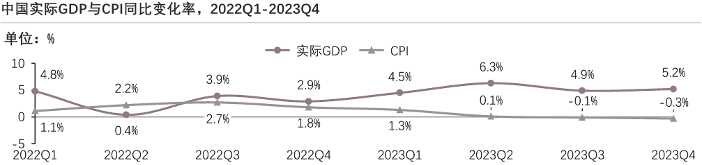

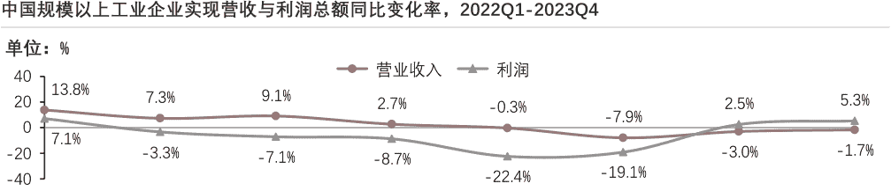

- 中国整体经济增速符合预期，社会消费需求有待进一步提振，工业经济稳步回升

在外部环境依然复杂严峻、国内有效需求不足、部分行业产能过剩等因素的压力下，中国经济复苏虽有所反复，但仍呈现回升向好趋势。2023年，中国GDP达126.1万亿元，全年GDP同比增速5.2%，总体经济增长完成预期目标。从需求端来看，2023年CPI总体低位运行，在一定程度上反映了社会有效需求不足。虽在12月CPI有所改善回升，但总体来看，消费需求仍有待进一步提振；从供给端来看，下半年规模以上工业企业利润由降转增，效益持续恢复，工业生产稳步回升。

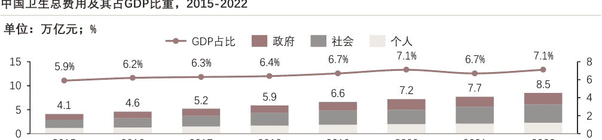

- 中国整体医疗支出及占GDP比重持续增加，“民生”和“科技”属性保证行业长期发展基本面

聚焦医疗行业，近10年来中国整体医疗支出持续增加，2022年全国卫生总费用达8.5万亿元，占GDP比重超过7.1%。未来，在居民健康意识加强、老龄化加剧和政策支持的背景下，整体医疗保健支出预计将进一步增长。同时，国家推进新型工业化和加快建设制造强国、质量强国等战略任务，医疗作为高科技行业的重要组成部分，仍将是拉动新一轮经济增长的重要引擎。

## 本手册为摄影机操作指南，帮助您充分运用本摄影机的各项功能。请务必妥善保管，以便随时参阅。

拍摄前，请先测试摄影机是否运作正常，并确认录制与播放功能皆无问题。若摄影机因故障或瑕疵而导致无法录制或播放，本公司恕不承担任何责任。

本说明书中的图片可能与实际产品的外观有所差异。

本说明书内容可能因机器升级或规格更改而有变动，恕不另行通知。

未经本公司允许，禁止翻印、转载或改编本手册内容或部分内容。

请检查包装中的物件是否齐全。

- 摄影机
- 锂电池
- 电源适配器
- USB连接线
- HDMI连接线
- 肩带
- 使用说明书

如果缺少任何物件，请立即与您的经销商联系。

### 电池充电

电池充电时，请关闭摄影机电源。

### 需求环境：医疗资源紧缺程度放缓，配置优化任重道远

居民就医需求与日俱增，医疗资源紧缺程度有所缓解，但医疗资源倒挂、挤兑现象仍未缓解，推进医疗卫生体制改革、完善分级诊疗制度、优化医疗资源配置任重道远。

## 中国居民的医疗需求逐年上升，医疗资源紧缺程度有所缓解

2022年，全国医疗卫生机构总诊疗人次达84.2亿人次，医院医师日均负担诊疗人次6.2人次，住院2.1床；乡镇卫生院医师日均负担诊疗人次9.1人次，住院1.2床。全国医疗卫生机构总数达1,032,918家，每千人口医师数达到3.2人，每千人口护士数为3.7人。全国医疗卫生机构病床使用率达71.0%；而在公立医院，病床则更为紧缺，病床使用率高达75.6%。与2018年相比，面对与日俱增的居民就医需求，医疗资源依然紧缺，但中国医生从业人数、医院卫生机构等医疗资源有所改善，资源紧缺程度有所缓解。

## 中国医疗资源情况，2018、2020及2022

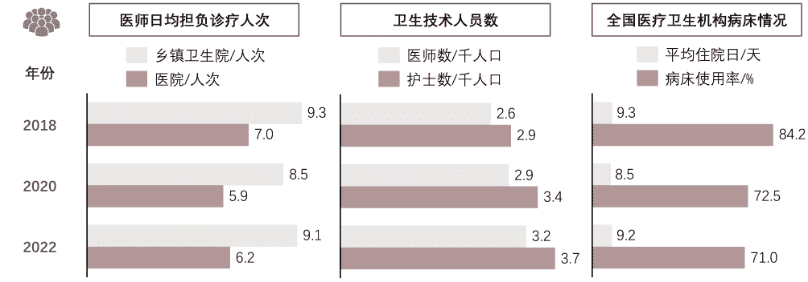

## 中国不同等级医院数量与就诊人数，2021-2022

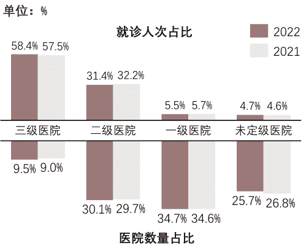

## 医疗资源倒挂、挤兑现象仍未缓解，推进医疗卫生体制改革、完善分级诊疗制度、优化医疗资源配置任重道远

从医院层级看，中国城乡医疗卫生资源分配不均衡，中国医疗资源和医疗需求倒置现象明显。2022年，中国三级医院数量仅有3,523家，占中国医院数量9.5%的三级医院承担了22.3亿人次就诊，占全年就诊人次的58.4%；而占中国医院60.3%的一、二级和未定级医院总计22,308家，仅接诊3.9亿人次。且与2021年相比，医疗资源挤兑现象仍未缓解，医护人员、医院床位等医疗资源保持高负荷运转，加强基层医疗机构建设、完善分级诊疗制度任重道远。

### 政策环境：鼓励聚焦临床需求，严格药物临床及上市标准

中国药品审批流程优化，注册审评数量实现爆发式增长，具有高度临床价值和紧迫性的药物有望加速通过审评。同时，药物研发上市流程标准严格，fast follow药物的审批以及单臂临床试验申请收紧。

- 国家鼓励关注临床未满足的需求，收紧fast follow药物的审批以及单臂临床试验申请

2019年以来，各类药品注册申请受理量均有较大幅度增长。中国创新药IND受理数量由2019年的688件增长至2023年的2,298件，数量年复合增速为35.2%，其中化学药占比最多。从适应症来看，主要集中在抗肿瘤、皮肤及五官科、内分泌系统和循环系统疾病领域。创新药NDA受理数量由2019年的30件增长至2023年的133件，数量年复合增速为45.1%。具有高度临床价值和紧迫性的药物成为优先审评通过的重点品种。

2023年，国家药审中心发布《单臂临床试验用于支持抗肿瘤药上市申请的适用性技术指导原则》，严格单臂临床试验适用条件；国家药监局发布《药品附条件批准上市申请审评审批工作程序（试行）》，强调药品获附条件批准上市的原则标准。可见，在政策端，国家鼓励关注临床未满足的需求，并严格标准，收紧fast follow药物的审批以及单臂临床试验申请。

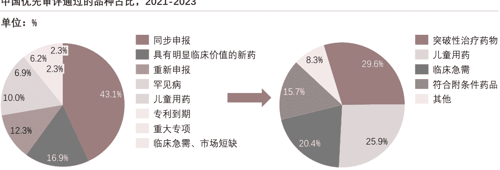

来源：国家药监局、头豹研究院编辑整理

### 支付环境：医保体系持续优化，贯彻“量入为出”方针

研究报告｜2024/05

## 医疗保障部门的角色定位逐渐从事后付费者向战略购买者转变，患者享受改革红利，减轻就医负担

## 中国基本医保基金收入、支出与结余情况，2020-2023

单位：亿元

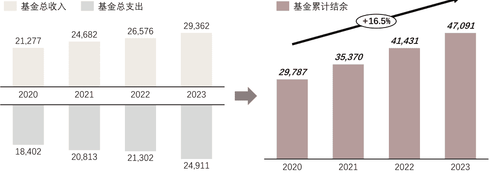

## 政府主导中国社会医疗保障体系运行，积极探索保障新路径

与海外国家发展模式不同，中国社会医疗保障体系由政府主导，社会医疗保障体系逐渐由“广覆盖”发展成“全覆盖”。中国社会医疗保障体系分为托底层、主体层和补充层，由城乡医疗救助、基本医疗保险和补充医疗保险等共同构成，共同推动医疗保障事业高质量发展。

近年来，围绕药品及器械的定价、采购、支付等关键环节进行了一系列大刀阔斧、精准科学的综合改革，组织国家药品集中带量采购，调整医保药品目录，统筹推进支付方式改革，持续优化医疗保障，促进“健康中国”战略的实施。

2003年以来，中国基本医保基金收入均大于支出，当年收支和累计结余均保持稳定增长。截至2023年11月底，基本医保基金结余大于47,000亿元。中国基本医保基金持续贯彻“量入为出”的大方针，基金运行整体保持稳健，为医疗机构的运营提供了稳定保障，促进中国医疗行业稳步发展。

## 谈判药品的支付标准平均降幅，2018-2023

单位：%

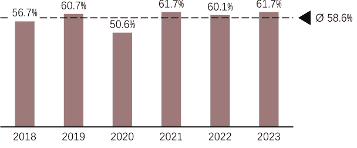

## 医疗保障政策逐步落实，患者用药成本大幅降低

5年来，谈判药品的支付标准平均降幅分别为60.7%、50.6%、61.7%、60.1%和61.7%。初步估算，2023年协议期内谈判药品惠及群众购药超2.1亿人次，叠加降价和医保报销，为患者减负超2,000亿元，使患者能以更低廉的价格获得质量更优的药品。

来源：国家医保局、头豹研究院编辑整理

### 投资环境：医疗产业投融资寒冬延续，“量增价减”

研究报告｜2024/05

全球医疗健康产业吸金能力进一步收缩，寒冬延续，中国医疗健康产业与全球情况保持一致，融资量增价减，中小额项目成为主流。

## 全球医疗健康领域投融资金额及事件，2013-2023

单位：亿美元（左轴）；件（右轴）

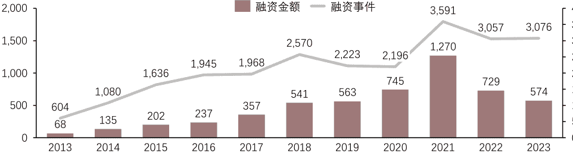

- 全球医疗健康产业吸金能力进一步收缩，寒冬延续

全球医疗健康投融资呈现收缩趋势，寒冬延续，总融资规模进一步下跌回2019年水平。2023年，全球医疗健康领域一级市场融资总额达574亿美元，同比下降21.3%，但投融资活动仍然保持活跃，年度投资活动累计3,076笔，医疗健康领域仍然吸引着大量投资者关注。

此外，2023年全球融资金额超1亿美元的事件数达136件，占总量的4%，同比下降17.6%。可见，全球医疗健康创新项目的平均融资额缩水，估值增长困难，投资者的投资风格趋于保守，中小额融资项目成为主流。

## 中国医疗健康领域投融资金额及事件，2013-2023

单位：亿美元（左轴）；件（右轴）

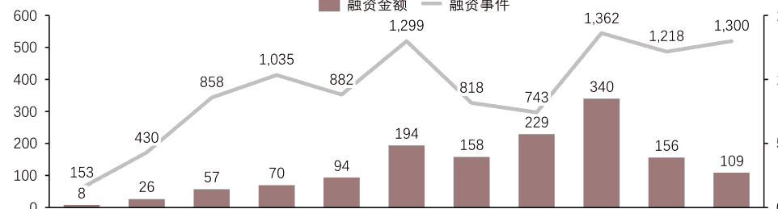

- 中国医疗健康产业与全球情况保持一致，融资总额下降30.1%，量增价减

医疗健康的资本寒冬平等打击了全球各地的医疗创新项目。2023年，中国医疗健康领域一级市场投资活动累计1,300笔，融资总额达109亿美元，同比下降30.1%。但相较于2021—2022年的交易总额腰斩，地缘政治冲突、美元加息、新冠疫情等对医疗健康产业的影响逐渐收缩，投融资活跃度仍保持在历史高位。

来源：公司官网、头豹研究院编辑整理

## Anomaly Detection based on MDDT and Graph Convolutional Network

Wei Wang\(^{1}\), Yuxuan Wang\(^{1}\), Tianwen Zhang\(^{2*}\), Ying Huang\(^{1}\), Xiang Liu\(^{1*}\)

1 School of Communications and Information Engineering, Chongqing University of Posts and Telecommunications, Chongqing 400065, China

2 School of Automation, Chongqing University of Posts and Telecommunications, Chongqing 400065, China

### ABSTRACT

Anomaly detection aims to discover unexpected events or rare behaviors in various fields, and it has attracted wide attention in many practical scenarios. Existing algorithms based on deep learning have achieved remarkable performance, but most of them introduce some problems: (1) the original feature extraction is not suitable, causing feature representation is not sufficiently discriminative; (2) the deep models have too many parameters and the inference is slow. To address these problems, we propose a novel framework based on Multi-scale Dilated DenseNet and Temporal-aware Graph Convolutional Network (MDDT-TGCN). The MDDT uses multi-scale dilated convolution kernels to capture multi-scale features from original videos. The TGCN models the temporal correlation of different frames and improves the accuracy of anomaly prediction. Experiments demonstrate that the proposed method achieves excellent performance on two prevalent anomaly detection benchmarks, with a frame-level AUC of 88.4% on UCSD Ped2 and 87.1% on ShanghaiTech Campus.

### 医药出海：国谈令药企承压，中国药企寻求第二发展曲线

创新药审评加速，上市通畅但医保压价严重，国内销售受阻；中国药企积极出海，拓展海外市场，License-out 等助力海外认可，角逐国际市场潜力大。

## 国谈进入医保降价幅度扩大，进一步挤压创新药在国内市场发展空间

2023年，国家医保局发布《国家基本医疗保险、工伤保险和生育保险药品目录》。在谈判/竞价环节，143个目录外药品参加，其中121个谈判/竞价成功，成功率为84.6%，平均降价61.7%，成功率与降价幅度与2022年基本相当。其中共有23款创新药谈判成功，谈判成功率为92.0%，平均降价57.3%。

当前医保谈判最终呈现的价格仍倾向于成本价。医保局对纳入医保新药压价的力度很大，一些真正具有临床价值的药品被压价后成本压力巨大，使得国内头部创新药 Big Pharma 和 Biopharma 过去一年多的创新药销售放量困难重重。此外，由于降价导致市场对单药销售峰值的预期极度悲观，资本市场对创新药企业估值的杀价行为非常明显，创新药进入资本寒冬。

## 中国国家医保谈判部分创新药产品降价情况，2023

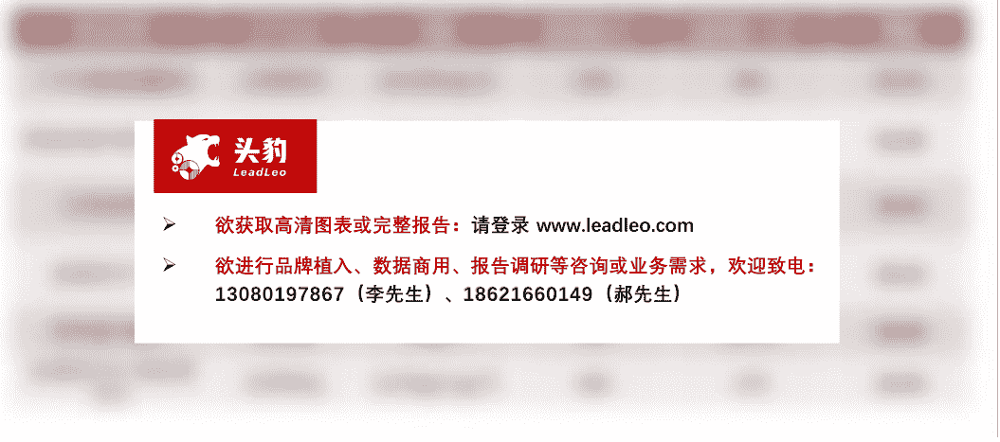

## 中国药企积极寻找发展新路径，国产药品长期出海逻辑坚挺

目前在国谈背景下，创新药价格降幅明显，处于药品实际商业回报率普遍低于预期的承压环境。在此背景下，中国药企纷纷开始寻找新的发展之路，企业和人才越来越积极、主动地参与到国外的竞合大循环中，着眼于海外广大的医药市场潜力和未被满足的巨大临床需求，积极开拓海外市场。出海成为中国药企消化供给、赢回市场回报的关键策略之一。

在创新药方面，越来越多国内创新药通过 License-out、海外获批上市等方式拓展企业市场边界，国内创新药在海外的认可程度与日俱增。中国药企角逐海外市场、提升营收天花板的潜力有望得到释放。

### 医药出海：中国药品价格优势凸显，出海市场潜力巨大

发达国家药品价格远高于其他地区，中国药价尤为低廉；中国创新药出海受高利润吸引，License-out 交易频创新高，虽海外市场份额较小，但正逐步获国际认可。

## 与中国市场相比，海外药品价格有明显的价格溢价空间，其市场保持吸引力

从药品销售价格来看，以美欧为代表的发达国家的价格水平显著高于全球其他国家和地区。与中国市场相比，海外药品价格有明显的价格溢价空间。以目前全球最畅销的25个药品为例，如果以美国药价为100.0%计算，中国药价较低，只约相当于美国的10.0%、其他国家的30.0%～60.0%。

从结构上来看，由于定价体系不同，中国创新药一旦有能力走向全球市场，销售额的天花板有望提高数倍。与在国内医保谈判、创新药内卷加剧等因素冲击下不断下降的收益预期相比，海外较高的利润回报吸引着中国药企，越来越多的中国药企看好海外广阔的市场。

## 全球 Top 25 畅销药在主要国家的相对价格水平，2021

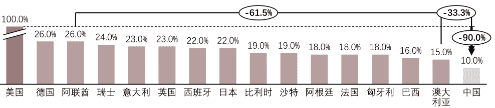

## 面对广阔的出海空间，中国药企走出去速度不断加快

从创新药来看，不仅出海成为常态，License-out 重磅交易更是不断刷新历史新高。全球创新药销售主要集中在美国、欧洲等发达市场，美国占全球市场的55.0%，遥遥领先于其他国家，而中国只约占3.0%的市场份额。中国的药品结构与美国倒置，中国创新药在海外占比较小。

但近年来，中国创新药通过 License-out 模式等走出国门，正逐渐赢得国际市场认可。License-out 首付款和里程碑款总额都不断创新高，这推动中国创新药的销售比例逐年提高。

展望未来，随着中国创新药创新水平的不断提升，将会有越来越多的创新药上市且加入出海征程。创新药销售份额扩大，叠加海外高支付能力，中国创新药企拓展海外市场潜力巨大。

## 全球各区域创新药销售额占比，2021

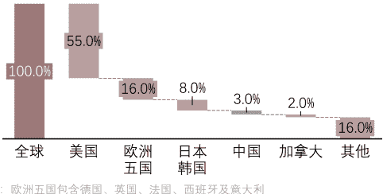

## 中美药品类型销售分布比例，2016、2019及2021

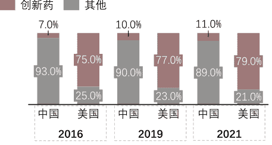

注：欧洲五国包含德国、英国、法国、西班牙及意大利。

来源：公司官网，头豹研究院编辑整理。

## Sentence Tails (noun)

（尾句：名词）

这些名词位于句尾，经常构成句型“这是……”或“那是……”。在句中作定语修饰名词时放在前面。

### 名词词汇

| 英文 | 中文 |
|---|---|
| picture | 图画 |
| book | 书 |
| pencil | 铅笔 |
| pen | 钢笔 |
| desk | 书桌 |
| flower | 花 |
| hand | 手 |
| cat | 猫 |
| dog | 狗 |
| bird | 鸟 |
| fish | 鱼 |
| cake | 蛋糕 |
| face | 脸 |
| rain | 雨 |

### 与头豹合作的多样性

## 头豹研究院

### 咨询/合作

网址：www.leadleo.com

电话：13080197867（李先生）

电话：18621660149（郭先生）

深圳市华润置地大厦E座4105室

## 3.2 二维随机变量的边缘分布

对于二维随机变量 \((X, Y)\)，我们往往关心其中一个分量的分布。例如，不论 \(Y\) 取什么值，\(X\) 的分布函数 \(F_X(x)\) 称为 \((X, Y)\) 关于 \(X\) 的边缘分布函数。

\(F_X(x) = P\{X \le x\} = P\{X \le x, Y < +\infty\} = F(x, +\infty)\)。

同理，\(Y\) 的边缘分布函数为：

\(F_Y(y) = P\{Y \le y\} = P\{X < +\infty, Y \le y\} = F(+\infty, y)\)。

对于离散型随机变量，由 \((X, Y)\) 的联合分布律可求得 \(X\) 和 \(Y\) 的边缘分布律。

\(p_{i\cdot} = P\{X = x_i\} = \sum_j p_{ij},\quad i = 1, 2, \ldots\)

\(p_{\cdot j} = P\{Y = y_j\} = \sum_i p_{ij},\quad j = 1, 2, \ldots\)

通常，在联合分布律表格中，最后一列和最后一行的和分别就是 \(X\) 和 \(Y\) 的边缘分布律。

### 方法论

- 头豹研究院布局中国市场，深入研究19大行业，持续跟踪532个垂直行业的市场变化，已沉淀超过100万行业研究价值数据元素，完成超过1万个独立的研究咨询项目。
- 头豹研究院依托中国活跃的经济环境，研究内容覆盖整个行业发展周期，伴随着行业内企业的创立、发展、扩张，到企业上市及上市后的成熟期，头豹各行业研究员积极探索和评估行业中多变的产业模式、企业的商业模式和运营模式，以专业视野解读行业的沿革。
- 头豹研究院融合传统与新型的研究方法论，采用自主研发算法，结合行业交叉大数据，通过多元化调研方法，挖掘定量数据背后的根因，剖析定性内容背后的逻辑，客观真实地阐述行业现状，前瞻性地预测行业未来发展趋势，在研究院的每一份研究报告中，完整地呈现行业的过去、现在和未来。
- 头豹研究院密切关注行业发展最新动向，报告内容及数据会随着行业发展、技术革新、竞争格局变化、政策法规颁布、市场调研深入，保持不断更新与优化。
- 头豹研究院秉承匠心研究、砥砺前行的宗旨，以战略发展的视角分析行业，从执行落地的层面详述观点，为每一位读者提供有深度、有价值的研究报告。

### 法律声明

- 本报告著作权归头豹所有，未经书面许可，任何机构或个人不得以任何形式翻版、复刻、发表或引用。若征得头豹同意进行引用、刊发，需在允许的范围内使用，并注明出处为“头豹研究院”，且不得对本报告进行任何有悖原意的引用、删节或修改。
- 本报告分析师具有专业研究能力，保证报告数据均来自合法合规渠道，观点产出及数据分析基于分析师对行业的客观理解。本报告不受任何第三方授意或影响。
- 本报告所涉及的观点或信息仅供参考，不构成任何证券或基金投资建议。本报告仅在相关法律许可的情况下发放，并仅为提供信息而发放，概不构成任何广告或证券研究报告。在法律许可的情况下，头豹可能会为报告中提及的企业提供或争取提供投融资或咨询等相关服务。
- 本报告的部分信息来源于公开资料，头豹对该等信息的准确性、完整性或可靠性不做任何保证。本报告所载的资料、意见及推测仅反映头豹于发布本报告当日的判断，过往报告中的描述不应作为日后的表现依据。在不同时期，头豹可发出与本报告所载资料、意见及推测不一致的报告或文章。头豹均不保证本报告所含信息保持在最新状态。同时，头豹对本报告所含信息可在不发出通知的情形下做出修改，读者应当自行关注相应的更新或修改。任何机构或个人应对其利用本报告的数据、分析、研究、部分或者全部内容所进行的一切活动负责，并承担该等活动所导致的任何损失或伤害。
