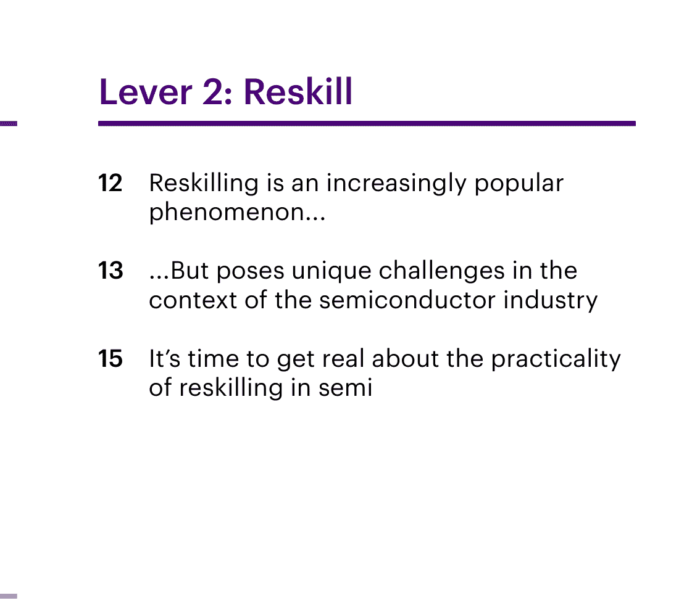
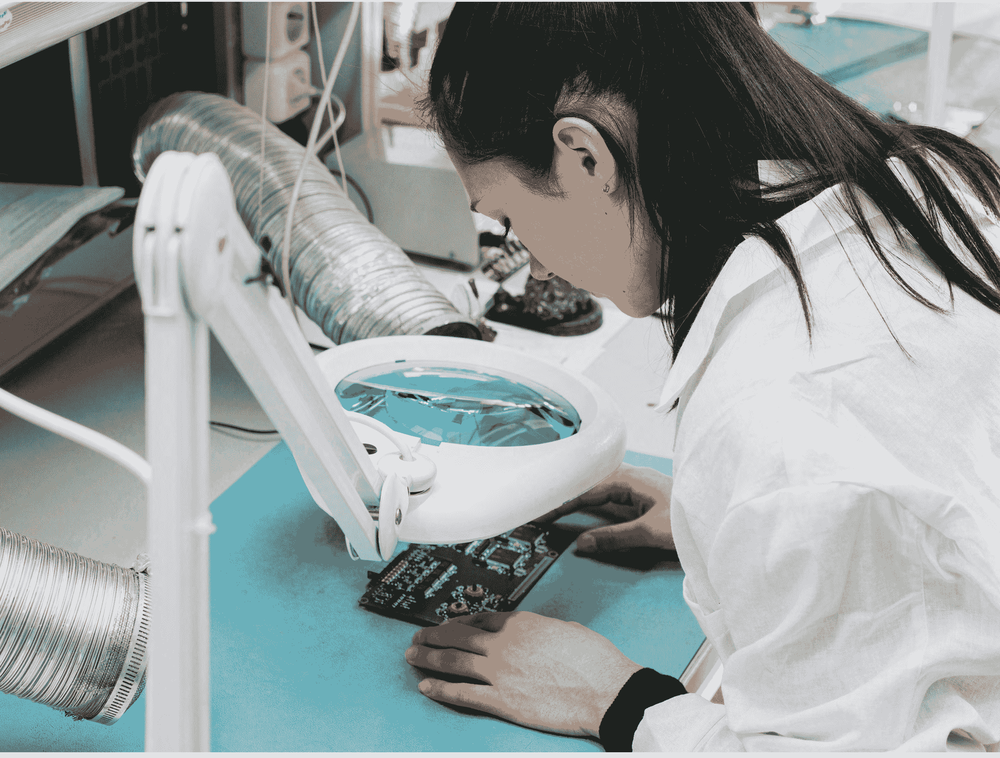
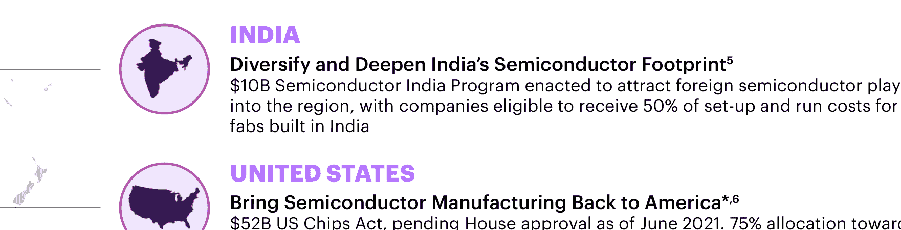
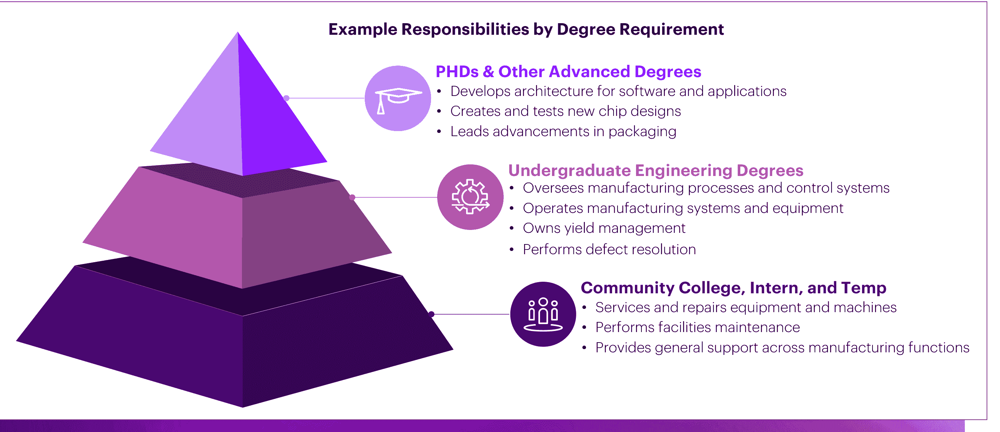

# The Competitive Etch: Addressing the talent gap in the semiconductor industry

# Non-Small Cell Lung Cancer Version 1.2023

NCCN Guidelines for Patients

## About this book

This book was written by and for people with non-small cell lung cancer (NSCLC) and their caregivers. It provides reliable, easy-to-understand information about NSCLC that is based on the National Comprehensive Cancer Network (NCCN) guidelines for treatment of cancer.

The information in this book is meant to help you talk with your cancer care team about your treatment. It is not meant to replace the advice of your healthcare provider.

This book covers tests and treatments for NSCLC. It also covers possible side effects, supportive care, and follow-up care. We hope this book helps you feel more confident and gives you the information you need to take part in your care.

The start of this book has an overview of NSCLC and the tests used to diagnose it. The rest of the book walks through the main types of treatment and the care you'll need during and after treatment.

Continue to next page for full contents. Then, jump to the sections that relate to you and your cancer care team. Each page also lists questions you can ask your cancer care team.

- 1. Non-small cell lung cancer overview
- 2. Testing for NSCLC
- 3. Treatment planning
- 4. Treatment by stage
- 5. Making treatment decisions
- 6. Supportive care
- 7. Follow-up care

# Each developed economy is in a race to develop its own domestic semiconductor ecosystem

Since 2018, a confluence of factors has constricted semiconductor supply: The evolving geopolitical environment, unforeseen climate catastrophes, raw material shortages, and unexpected spikes in demand prompted by evolving consumer behaviors throughout the COVID-19 pandemic. Amid the ongoing chip shortage, chip makers across the world remain in a tight race to increase capacity and spur domestic chip production to hedge against future supply chain vulnerabilities. Momentum to build more localized and resilient semiconductor ecosystems is growing, with governments across the world publicly committing to multi-billion dollar spending packages to enable semiconductor self-sufficiency (see Figure 1). Investment has been matched and multiplied in the private sector, with Intel, Samsung, TSMC, Texas Instruments, GLOBALFOUNDRIES, SK Hynix, and Micron pledging to break ground on new fabs and R&D innovation centers.

## 1.1 The Earth System and its Components

The Earth is composed of different systems. These systems are closely connected. The atmosphere, hydrosphere, lithosphere, and biosphere are the four major components of the Earth system.

The atmosphere is the layer of gas that surrounds the Earth. It consists of various gases, including nitrogen and oxygen. The atmosphere is important for protecting life from harmful radiation.

The hydrosphere includes all the water on Earth. It covers oceans, rivers, lakes, and groundwater. Water is essential for all living things, and it is constantly moving through the water cycle.

The lithosphere is the solid outer layer of the Earth. It contains rocks, soil, and minerals. The lithosphere provides a habitat for many organisms and is the source of many natural resources.

The biosphere is the part of Earth where life exists. It includes all living organisms and their interactions with the environment. The biosphere depends on the other three spheres.

These four spheres work together to form a complex and dynamic system. Changes in one sphere can affect the others. Understanding these interactions is very important for studying the Earth.

### Components of the Earth System

- **Atmosphere**: The layer of gases
- **Hydrosphere**: All the water
- **Lithosphere**: The solid outer layer
- **Biosphere**: All living things

# The talent gap in semiconductor emerges as a major obstacle to growth

The effort to strengthen domestic semiconductor capacity is complicated by an acute talent shortage across the entire value chain. For the US alone to become self-sufficient in the semiconductor sector, the US would need to capture an additional 20% of global chip production, translating into 74–80 net new fabs and 300,000 total semiconductor fabrication (fab) positions created. Should the US focus on meeting domestic demand for just critical semiconductor applications (e.g., automotive, home appliances, aerospace, defense), 18–20 additional fabs staffed by 70,000–90,000 highly skilled personnel would still be required.⁹ Aside from the colossal public and private sector investment needed to operationalize these fabs, finding the right talent to run the fabs on a global scale continues to surface as a key challenge.

Despite growing efforts to invest in science, technology, engineering, and mathematics (STEM) education, the talent pipeline remains narrow. While supply shortages are currently the largest bottleneck in the production process, once the supply chain resets there is a significant risk of going directly from a material shortage into a talent shortage if significant action is not taken. Semiconductor companies are clamoring against players across the technology ecosystem to secure a limited supply of chemical, electrical, computer, mechanical, and materials science engineers. Compounding this talent shortage is the allure of opportunity within hyperscalers (e.g., Meta, Google, Amazon), automotive companies (e.g., Tesla, BMW, Ford), consumer electronics manufacturers (e.g., Apple, SONY, LG), and professional services firms who are all attracting qualified semiconductor talent with competitive compensation packages and brand promises to change the world. Semiconductor companies, with less defined brand equity and fewer market-competitive perks, continue to struggle in building the diverse, premier workforces needed to meet near-term demand and pioneer the next frontier of innovation. Companies are racing to add jobs and connect with rising generations. Intel, as an example, has aired Sunday night football ads to lure new technical talent and has announced $2.4B in cash and stock incentives to retain key personnel.¹⁰ But by and large, semiconductor companies are losing the talent war – severely impeding the movement to re-shore semiconductor manufacturing.

No one country has the labor force needed to support domestic semiconductor self-sufficiency, with each country relying on an interconnected web of highly specialized semiconductor talent dispersed across the US, APAC, and EMEA. The US has particularly benefited from this inflow of global talent in growing its local semiconductor ecosystem since the 1950s. However, as China and Taiwan catalyze growth of their own domestic semiconductor industries, the US is likely to face increased difficulty as more competitive recruiting tactics are used to fill the 250,000–400,000 unfilled semiconductor positions in China and at least 34,000 vacancies in Taiwan.¹¹ As part of the Made in China 2025 agenda, for example, Chinese legislators have implemented a 1-5-3 recruiting strategy, whereby South Korean semiconductor industry veterans and new college graduates are offered five times the salary in exchange for a three-year commitment to work in China.

# INSTITUTO TECNOLÓGICO DE MÉRIDA

**Análisis y Estructura de Datos**

# Árboles Binarios de Búsqueda

**Integrantes:**

- Ricardo Adrián Chan Dzul
- Francisco Javier May Pech
- Yahir Alberto Poot Canul
- Carlos Eduardo Hau Caamal

**Profesor:**

- Wilian José Chi Pech

**Fecha:** 09/04/2025

## Introducción

Los árboles binarios de búsqueda (ABB) son una estructura de datos fundamental en la computación que permite la organización eficiente de información mediante una jerarquía de nodos. Cada nodo posee un valor clave y referencias a dos hijos (izquierdo y derecho), manteniendo una propiedad esencial: todos los elementos en el subárbol izquierdo son menores que el nodo padre, y todos los del subárbol derecho son mayores. Esta característica los convierte en herramientas ideales para aplicaciones que requieren búsquedas, inserciones y eliminaciones rápidas, con un tiempo de ejecución promedio de O(log n).

En el siguiente contenido, se desarrollará una aplicación práctica de los árboles binarios de búsqueda, haciendo uso del lenguaje de programación Python, con la finalidad de demostrar su implementación, eficiencia y utilidad en entornos reales.

## Desarrollo

Para la implementación de este proyecto, se decidió realizar una aplicación de gestión de biblioteca que haga uso de un árbol binario de búsqueda (ABB) como estructura principal para la organización de libros. Esta aplicación permite realizar operaciones como la inserción de nuevos libros, la búsqueda de un libro por su título y la visualización de todos los títulos presentes en el sistema.

## LEVER 1
### Reveal hidden value: Automate where you can

#### Leading semiconductor companies have yet to embrace the full potential of automation

Many semiconductor powerhouses lag other technology players in implementing core automation solutions, limiting their ability to free up employees to focus on higher value-add activities. This, coupled with rising costs to source, hire, onboard and retain semiconductor talent amid an increasingly competitive cross-sector talent war, makes automation an appealing mechanism to help semiconductor companies re-envision their workforce. Embedded appropriately, automation should alleviate demand for hard-to-reach engineering talent – which must be done in parallel to increasing the supply of skilled resources to better position the semiconductor industry to meet the urgent need for qualified STEM professionals.

Automation has been essential to sustaining pace with Moore's Law, enabling semiconductor companies to double the number of transistors every 18–24 months. Historically, automation-powered advancements within Electronic Design Automation (EDA) have turbocharged semiconductor innovation without necessitating a marked increase in the semiconductor workforce. However, automation has yet to reach its full potential in other segments of the value chain. Today, there are promising automation use cases that have yet to be embraced by the industry (see Figure 2) but are sure to bring further efficiency gains.

#### Moore's Law has supercharged industry innovation, motivating semiconductor companies to continually push the boundaries

#### Automation Opportunity Across the Value Chain

| Automation Use Cases | Description | IP | EDA | Design | Foundry | IDM | Equipment | OSAT | Materials |
|---|---|---|---|---|---|---|---|---|---|
| **IP Integration & Reuse** | SoC assembly solutions to boost design team productivity and lower costs | ● | ● | ● |  |  |  |  |  |
| **TCAD (Tech Computer-Aided Design)** | Verify that manufacturing process delivers required performance & density |  | ● | ● |  |  |  |  | ● |
| **DFM (Design for Manufacturability)** | Validate that design meets requirements of manufacturing process |  | ● | ● |  |  |  |  |  |
| **SLM (Silicon Lifecycle Management)** | Assess device performance from post-manufacturing test through deployment |  | ● | ● |  |  |  |  |  |
| **Tool / Process Parameter Adjustment** | Optimized process times per wafer or batch to improve yield |  |  |  | ● | ● |  |  |  |
| **Fab Layout Planning** | Optimized manufacturing line layout (incl. tool layout, process separation) |  |  |  | ● | ● |  | ● | ● |
| **Automated Material Handling** | Transport material from one place to another in manufacturing area |  |  |  | ● | ● |  | ● |  |
| **Preventive Maintenance** | Optimized equipment availability through planned unproductive downtime |  |  |  | ● | ● | ● | ● |  |
| **Predictive Maintenance** | Visibility into current state of equipment based on IoT-powered anomaly detection |  |  |  | ● | ● | ● | ● |  |
| **Automated Robotic Systems** | Reduce particle contamination; improve process control & throughput |  |  |  | ● | ● | ● |  | ● |
| **Automated Testing** | Verification that device functionalities match end use application expectation |  |  |  | ● | ● |  | ● |  |
| **Virtual Engineering** | Remote Engineers-in-Charge (EICs) enabled by AR/VR |  |  |  | ● | ● | ● | ● | ● |
| **Defect Detection** | Computer vision-enabled defect classification to signal process / tool deviations |  |  |  | ● | ● | ● | ● | ● |
| **Big Data Analytics** | Actionable insights to identify root cause of issues and propose corrective actions |  | ● | ● | ● | ● | ● | ● | ● |

> **Figure 2**  
> Across the semiconductor value chain, automation remains an under-leveraged source of value

# ROTATING MACHINERY SYMPOSIA
# PROCEEDINGS VOLUME 3 1974

TURBO-MACHINERY SYMPOSIUM sponsored by

Gas Turbine Laboratories  
Mechanical Engineering Department  
Texas A&M University  
College Station, Texas

October 1974

## LEVER 2
### Debunking the myth: The complexity of reskilling in semi

#### 1. Introduction

Text extraction and classification from a visual context is one of the challenging tasks in image processing. It helps the system to be more sensible and easy to handle text-based information. Text extraction is the process of extracting text from an image, whereas text classification is the task of classifying the extracted text into different classes such as normal text, highlighted text, mirrored text or tilted text.

One of the challenging tasks in the text extraction and classification process is if the background is complex or the text is in a skewed or tilted position. The text is generally classified as normal text or tilted text. Tilted text is very difficult to recognize and process if it is not previously identified. The complexity of text extraction and classification increases with the variation in the text style, font size, background and orientation of the text.

This paper is organized as follows. Section 2 discusses the previous work related to text extraction and classification. Section 3 describes the proposed work. Section 4 illustrates the experimental setup and results. Finally, Section 5 concludes the work.

#### ...But poses unique challenges in the context of the semiconductor industry

Many semiconductor engineers share a common physics, electrical engineering, and computer science academic background. However, each semiconductor role is highly specialized and requires a niche level of expertise that limits immediate skillset transferability in a way that is not apparent in other industries. Hypothetically, an experienced design engineer with a background in mechanical engineering could be retrained to work in a fab. However, from an employer's perspective, this requires a significant investment in capital and time that will not pay off in the time needed to operationalize new fabs.

Reskilling is a complicated reality in the semiconductor sector for three key reasons:

##### There is a dearth of reskilling in areas that matter most

Existing reskilling programs are over-indexed on equipping back-office/business operations employees with incremental engineering, mathematical computation, and data modeling expertise. There is not enough emphasis on providing existing employees, community college students, or new graduates with the skills required to work in a fab, which is where the most acute talent shortage is.

##### Reskilling at scale takes time that our industry doesn't have

Semiconductor companies will need to fill several hundred thousand fab positions to meet global consumer electronics demand within the next decade. Even for seasoned semiconductor veterans, there is likely to be high activation energy to properly learn and safely execute intricate, complex fabrication sub-processes in high-pressure fab environments.

##### Pushing engineers to move downstream in the value chain creates major flight risk

Design engineers are higher paid than their peers operating in fabs and are largely insulated from the stress of potentially making a costly and expensive mistake directly handling chemicals or machinery (Figure 5). Additionally, semiconductor executives have increasing concerns that hybrid/remote work has become an increasing priority for their engineering talent. One company even expressed concern for upward mobility if certain engineers chose a hybrid work model that leaned too far into work from home, and fab roles are inherently less flexible than those on the design part of the value chain. The industry cannot afford to lose in-demand engineers – and expecting employees within early stages of the value chain to give up higher paying, lower stress, flexible desk jobs for demanding fab positions is unreasonable. This will create discontent and open the door for higher attrition.

#### 二期围区东侧公共绿地及运动休闲设施工程

工程名称：二期围区东侧公共绿地及运动休闲设施工程

设计阶段：方案设计、初步设计、施工图设计

| 编号 | 图纸内容 | 张数 |
|------|----------|------|
| 1 | 封面 | 1 |
| 2 | 设计总说明 | 1 |
| 3 | 总平面定位图 | 1 |
| 4 | 总平面竖向设计图 | 1 |
| 5 | 总平面索引图 | 1 |
| 6 | 总平面植物配置图 | 1 |
| 7 | 总平面给排水设计图 | 1 |
| 8 | 总平面电气设计图 | 1 |
| 9 | 总平面分区示意图 | 1 |
| 10 | 综合管线设计图 | 1 |

项目负责人：黄工

审核人：汪工

设计人：张工

日期：2025年1月6日

#### It's time to get real about the practicality of reskilling in semi

Semiconductor companies can reap greater reward by reframing the solution from “reskilling” to “skilling”. As GLOBALFOUNDRIES has done in launching an apprenticeship program with Hudson Valley Community College, foundries and IDMs may wish to reconsider who they recruit and who they upskill. Semiconductor companies that adapt their recruiting profiles in favor of more diverse and alternative skillsets are likely to bring a needed edge to the STEM recruiting war. Rather than reskill PhD graduates from design roles to fab roles, semiconductor companies may wish to follow GLOBALFOUNDRIES’ example and train new community college / traditional four-year college graduates to fill open technician and process engineering roles and upskill them to fill demand – a strategy that is both cost-effective and feasible in the near-term.

##### Illustrative Role Structure by Degree Requirements

##### Example Responsibilities by Degree Requirement

- **PHDs & Other Advanced Degrees**
  - Develops architecture for software and applications
  - Creates and tests new chip designs
  - Leads advancements in packaging

- **Undergraduate Engineering Degrees**
  - Oversees manufacturing processes and control systems
  - Operates manufacturing systems and equipment
  - Owns yield management
  - Performs defect resolution

- **Community College, Intern, and Temp**
  - Services and repairs equipment and machines
  - Performs facilities maintenance
  - Provides general support across manufacturing functions

**Figure 6**  
The most in demand talent is the least available

## LEVER 3

### Grow the pipeline: Attract & retain talent

#### The semiconductor industry is losing ground not only to hyperscalers, but also to aerospace and automotive in the prestige war

COVID-19 spurred explosive demand for semiconductor products and by extension, semiconductor talent. However, the industry struggled with the talent battle long before the pandemic. A 2021 survey of engineering students revealed that most undergraduates prefer to work at software and services pioneers (Google, Apple, Microsoft, Amazon), aerospace players (Lockheed, Boeing, Northrop Grumman, Raytheon, GE, and NASA), and automotive leaders (Tesla, General Motors, Ford) above the highest ranked semiconductor leaders.¹⁰ Before high-potential STEM students even reach their college campuses, they have already developed strong perceptions of prestigious tech companies. This reaffirms how disadvantaged semiconductor companies are in brand equity, meaning standard university recruiting tactics will continue to fail to draw highly valued STEM talent.

To deploy a one-size-fits-all recruiting approach is to vastly underestimate the complexity of the STEM talent war.

##### A More Targeted Approach

Semiconductor companies should tailor their approach based on where they sit in the value chain, the talent they are targeting and with whom they compete. As semiconductor IP and EDA companies embrace cloud, a growing number of semiconductor leaders are forced to compete for the same talent that software hyperscalers are successfully poaching. Across the rest of the semiconductor value chain, semiconductor companies are losing critical talent to hyperscalers as they further develop their core software business and deepen their footprint in hardware. This talent needs to be targeted differently than slightly lower skilled materials or back-end manufacturing talent where IDMs have been able to leverage temps, interns, technical skill graduates, and vocational training.

##### A More Sophisticated Recruiting & Retention Strategy

Semiconductor companies are long overdue in implementing more market-competitive recruiting and retention practices. Those that broaden their recruiting influence by offering stronger compensation / benefits packages, designing more flexible and desirable work environments, and carving out clearer upward mobility pathways for employees are likelier to attract and retain access to top-tier STEM talent.

The Competitive Etch | 18

From Meta’s investment in local STEM and robotics lab programs¹⁶ to Alphabet’s *Code with Google*¹⁷ and *Amazon’s Future Engineer*¹⁸, hyperscalers establish a strong track record with STEM talent as early as middle school. This investment matters, as empirical research shows that students who do not become interested in STEM by middle school are significantly less likely to choose STEM education pathways or careers.¹⁹

By and large, the semiconductor industry leads the charge in far fewer early education STEM initiatives. Qualcomm’s Thinkabit Lab is a leading example in the industry, engaging more than 78,000 students nationwide in Internet of Things (IoT)-themed summer projects across their 16 innovation campuses.²⁰ Applied Materials has taken a different approach, funneling investment into local STEM education programs in central Texas to community STEM grants in Montana.²¹ SEMI sponsors *High Tech U*²³, a three-day long program for highschoolers to develop hands-on experience within microelectronics and semiconductor.

However, many other semiconductor companies and industry consortia fall short in comparison, sponsoring occasional STEM competitions and science fairs without cultivating meaningful relationships with our nation’s youth. The average American high school curriculum fails to expose high-potential STEM students to engineering disciplines beyond computer science, meaning many students are unfamiliar with the core subject knowledge or exposure needed to want to work in the semiconductor sector.

There are clear opportunities for semiconductor companies to extend their reach among middle and high school students, namely:

- **Innovation for Social Good:** Coding solutions to real-world problems
- **Site Visits:** Broadening exposure to workplace cultures and career trajectories in semi
- **Week-Long Camps/Immersion Experiences:** Building relationships with fellow STEM enthusiasts and turning career explorations into future goals
- **Extracurricular Programs:** Sponsored opportunities associated with the schools to learn STEM topics specific to semiconductor
- **Sponsoring STEM Programs:** Furnishing local schools with state-of-the-art technologies, lab equipment, and teaching personnel

These investments in early academia can help tip the recruiting scales in favor of the semiconductor industry.

Likewise, university partnerships are key to offering exposure to the semiconductor industry before undergraduates settle on their desired fields (see Figure 6). Semiconductor hubs from Silicon Valley to Austin have emerged due in large part to their proximity to world-class research institutions.

Introduction  
Lever 1: Automate  
Lever 2: Reskill  
Lever 3: Grow Pipeline  
Conclusion

The Competitive Etch | 19

##### International talent retention is key to sustainable growth

American universities are a magnet for the world’s brightest STEM talent and are the primary channel by which foreign-born semiconductor talent come to the US. International students account for two-thirds of graduate students in electrical engineering and computer science and have been the primary source of growth of semiconductor talent over the last three decades.²² However, once these highly skilled individuals receive their diplomas, they face difficulties in remaining in the US within the context of the current immigration law landscape.²³

Every stage of the semiconductor value chain is extremely dependent upon international STEM talent (see Figure 7). As each country races to develop its own semiconductor ecosystem and elevate pay for STEM talent, the US is at risk of losing access to a significant portion of the world’s STEM pipeline. Isolated efforts have taken place to strengthen STEM talent pathways, but not at a pace that matches desired growth of the US semiconductor ecosystem.

Introduction  
Lever 1: Automate  
Lever 2: Reskill  
Lever 3: Grow Pipeline  
Conclusion

## The Competitive Etch | 20

#### Dependence on International Talent Pipeline

0

20

40

60

80

100

120

140

160

| 公司名称 | 数值 |
| :--- | :--- |
| Texas Instruments | 0 |
| Cadence | 20 |
| Xilinx | 40 |
| Analog Devices | 60 |
| Applied Materials | 80 |
| ARM | 100 |
| AMD | 120 |
| Synopsys | 140 |
| Intel | 160 |
| Nvidia | 0 |
| Qualcomm | 20 |

Computer Science

Electrical Engineering

Mechanical Engineering

Chemical Engineering

Physics

Other

**Figure 7**

The semiconductor ecosystem is a deeply complex, interconnected ecosystem that depends on a mix of highly specialized talent from across the globe. Fabless players and IDMs emerge with the highest number of green card applicants across the value chain.

*Note: “Other” in the above graph refers to a combination of related majors that are of interest to leading semiconductor companies (e.g., Mathematics, Operations, Graphic Design, and assorted Sciences)*

## The Competitive Etch | 20

- Introduction
- Lever 1: Automate
- Lever 2: Reskill
- Lever 3: Grow Pipeline
- Conclusion

## The Competitive Etch | 21

- Introduction
- Lever 1: Automate
- Lever 2: Reskill
- Lever 3: Grow Pipeline
- Conclusion

#### Talent, the next big disruption threat

This is not the first time the semiconductor industry has undergone a major disruption. Over the course of history, the industry has endured both supply and demand side shocks. In 1994, there were aggressive rollouts of CDMA networks^(25) as well as supply shortages due to a series of natural disasters such as an earthquake affecting output at TSMC in 1999, or floods halting production at Western Digital facilities in Thailand in 2011.^(26) Vulnerabilities exacerbated by the COVID-19 pandemic paired with exploding demand for work from home technologies, automobiles, advanced medical devices, and 5G mobile networks have elevated the semiconductor supply chain to the global stage.

However, it cannot be lost that all of this is occurring during a historic surge in demand for STEM talent, and if the talent discussion is not elevated it will become the next big disruptor. To mitigate talent shortages and prevent future downtime due to missed opportunities, semiconductor companies must deploy a combination of strategies outlined in this report to become magnets for the world’s leading STEM talent.

## The Competitive Etch | 22

#### REFERENCES

1. “Korea unveils 450 billion push to seize global chipmaking crown,” Bloomberg.
2. “Taiwan Injects $300 Million into Grad Schools to Fuel Semiconductor Chip Research,” HiveLife.
3. “China’s New Semiconductor Policies,” Congressional Research Service.
4. “Japan Approved $6.8 Billion Boost for Domestic Chip Industry,” Bloomberg.
5. “India’s Ambitious Plans to be Global Semiconductor Hub,” Techwire Asia.
6. “CHIPS Act,” NIST.
7. “Chips Act to Confront Semiconductor Shortages,” European Commission.
8. “How the U.S. Can Reshore the Semiconductor Industry,” Eightfold AI Report, 2021.
9. “Intel Poaches Apple’s Chip Pioneer as Talent War Heats Up,” George Paul, The Org, January 10, 2022.
10. “World’s Most Attractive Employers,” Universum, 2021.
11. “China’s semiconductor industry faces a growing talent shortage as Beijing aims for global dominance in chip manufacture,” Che Pan, South China Morning Post, October 18, 2021.
12. “New Semiconductor Fabs to Spur Surge in Equipment Spending,” Semi Reports, June 22, 2021.
13. “Making Technology Fully Inclusive and Expanding Digital Readiness,” Intel Corporate Responsibility Report, 2020-21.
14. “People - Fast Forward 2021 Sustainability Report,” Micron Sustainability Report, 2021.
15. “2020 Corporate Citizenship Report,” Texas Instruments, 2020.
16. “College and GlobalFoundries Announce New Training and Apprenticeship Center in Malta; Part of $12.5 million HVCC North Expansion Project.” Hudson Valley Community College, 2021.
17. “Meta gives $100,000 grant to Alpine School District,” Ashtyn Asay, Daily Herald, May 10, 2022.
18. “Every student deserves the chance to explore, advance, and succeed in computer science,” Google for Education Website.
19. “Amazon Future Engineer,” Amazon website, 2019-2022.
20. “Planning for Early Careers in Science,” R. Tai, C. Q. Liu, A. V. Maltese, and X. T. Fan, Science 312(5777):1143-1144, 2006.
21. “The Qualcomm Thinkabit Lab Program,” Qualcomm website, 2022.
22. SEMI High School Program Information.
23. “The Chipmakers: U.S. Strengths and Priorities for the High-End Semiconductor Workforce,” Will Hunt and Remco Zwetsloot, Center for Security and Emerging Technology, September 2020.
24. “SIA Workforce Roundtable Summary Report,” Semiconductor Industry Association, March 16, 2008.
25. “CDMA chip shortage developing?” Om Malik, Old GigaOm, May 10, 2004.
26. “Harnessing the power of the semiconductor value chain,” Accenture, 2022.

The Competitive Etch | 23

This document refers to marks owned by third parties. All such third-party marks are the property of their respective owners.

No sponsorship, endorsement or approval of this content by the owners of such marks is intended, expressed or implied.

This content is provided for general information purposes and is not intended to be used in place of consultation with our professional advisors.

Given the inherent nature of threat intelligence, the content contained in this report is based on information gathered and understood at the time of its creation. The information in this report is general in nature and does not take into account the specific needs of your IT ecosystem and network, which may vary and require unique action. As such, Accenture provides the information and content on an “as-is” basis without representation or warranty and accepts no liability for any action or failure to act taken in response to the information contained or referenced in this report. The reader is responsible for determining whether or not to follow any of the suggestions, recommendations or potential mitigations set out in this report, entirely at their own discretion.

Copyright © 2022 Accenture. All rights reserved.

Accenture and its logo are registered trademarks of Accenture.

## ABOUT ACCENTURE

### ABOUT ACCENTURE SEMICONDUCTOR PRACTICE

Accenture is a global professional services company with leading capabilities in digital, cloud and security. Combining unmatched experience and specialized skills across more than 40 industries, we offer Strategy and Consulting, Interactive, Technology and Operations services—all powered by the world’s largest network of Advanced Technology and Intelligent Operations centers.

Our 699,000 people deliver on the promise of technology and human ingenuity every day, serving clients in more than 120 countries. We embrace the power of change to create value and shared success for our clients, people, shareholders, partners and communities.

Visit us at www.accenture.com

Accenture Semiconductor is committed to working with semiconductor manufacturers and companies to help capitalize on the opportunities created by digital disruption and optimize efficiencies across product development, manufacturing, supply chain and business operations. We have deep relationships, experience, and expertise across the semiconductor ecosystem: IDM, IP designers, fabless, foundries and equipment manufacturers. We also have dedicated practice areas and proven results in growth strategy, mergers and acquisitions, engineering operations, silicon design services, supply chain operations, system implementation and manufacturing analytics.

www.accenture.com/semiconductors

## AUTHORS

**Syed Alam**  
Managing Director – Accenture Strategy, Semiconductor, Global Lead  
syed.f.alam@accenture.com

**Deborah Garand**  
Managing Director – Strategy & Consulting, High Tech  
deborah.garand@accenture.com

**Christopher Hadley**  
Managing Director – Accenture Strategy  
christopher.r.hadley@accenture.com

**Stephen Hardin**  
Senior Manager, Accenture Strategy  
stephen.hardin@accenture.com

**Shaden Alsheik**  
Manager, Accenture Strategy  
shaden.alsheik@accenture.com

## CONTRIBUTORS

**Maggy Ibharim**  
Manager, Accenture Strategy

**Mike Packard**  
Senior Analyst, Accenture Strategy

**Jane Webb**  
Senior Consultant, Accenture Strategy

**Tim Wu**  
Senior Manager, Strategy & Consulting

