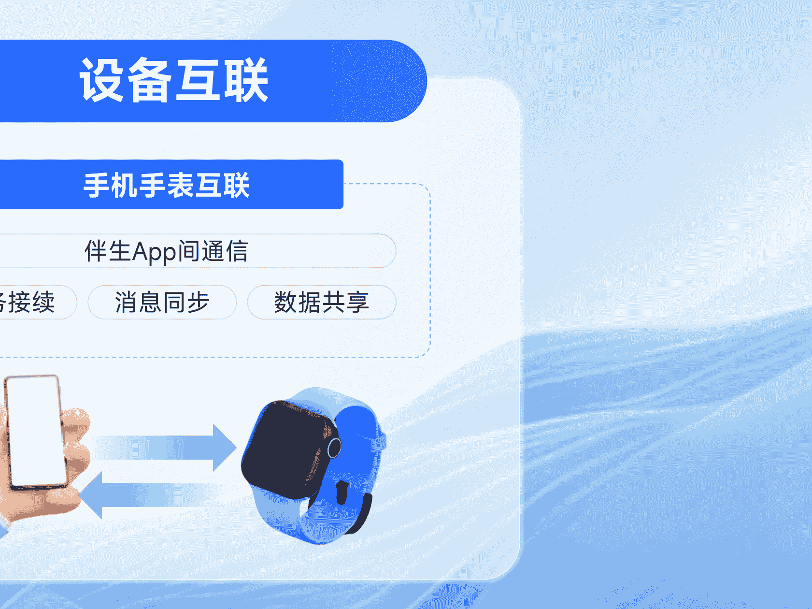
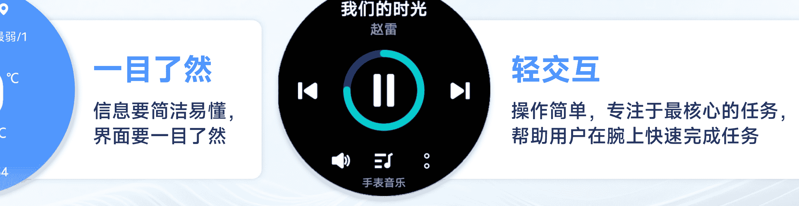

# 快速应用

Quick App

2024 QUICK APP DEVELOPER CONFERENCE

# 2024 快应用开发者大会

### Vivo-保海波

互联网行业代表

# 2024 快应用开发者大会

2024 QUICK APP DEVELOPER CONFERENCE

## 2018-2025年全球智能手表出货量及预测

## 2018-2025年中国智能手表市场规模及预测

## 中国智能手表市场竞争格局

## 中国智能手表市场未来趋势

# 快应用开发者大会

2024 QUICK APP DEVELOPER CONFERENCE

- 快应用
- 开发者
- 核心指标
- 运行流畅
- 长安旗舰
- 安全隐私
- 高性能
- 低功耗
- 便捷生态
- 应用

## Churn Prediction and Customer Retention Analysis

A comprehensive overview of the customer churn analysis, key findings, and actionable recommendations for improving customer retention strategies.

The pie chart shows a balanced distribution of churn, with 54.4% of customers remaining active (No churn) and 45.6% of customers churned, indicating a substantial portion of customers leaving the service.

Monthly contract customers show the highest churn rate at 54.8%, while two-year contract customers have the lowest churn rate at only 12.1%. This suggests contract length is a significant factor in customer retention.

Electronic check payments have the highest churn at 51.6%, followed by mailed checks at 17.1%, bank transfer at 15.7%, and credit card at 15.6%. This indicates that payment method convenience might impact churn.

> **Executive Summary:** Churn rate of 45.6% is concerning. Key drivers include contract type, payment method, and customer engagement levels.

# 2024 快应用开发者大会

QUICK App

2024 QUICK APP DEVELOPER CONFERENCE

# 快应用

2024/06/06 北京

# 快应用

## “快”应用开发者大会

2024 快应用开发者大会

# 快应用开发者大会

2024 QUICK APP DEVELOPER CONFERENCE

## 快应用生态繁荣发展

统一标准：开发者一次开发，可在联盟厂商手机终端上运行。

## 体验升级

- 休闲娱乐
- 运动健康
- 开放能力
- 开发套件
- 运营服务
- 应用分发
- 生活服务

## 能力开放

- 生活服务
- 内容资讯
- 网络访问
- 地图导航
- 系统能力
- 多媒体能力
- AI服务
- 文件数据
- 社交通讯
- 开发者支持
- 基础能力
- 安全能力
- 模拟器
- 教育学习
- 金融理财

## 合作伙伴

# 快速应用开发者大会

2024 QUICK APP DEVELOPER CONFERENCE

## 快应用支持智能穿戴设备

头部厂商已加入快应用智能穿戴生态。开发者可通过快应用平台开发智能穿戴应用，覆盖多种智能手表和智能穿戴设备。

- OPPO Watch：4款
- Xiaomi Watch：5款
- vivo Watch：3款

# 2024 快应用开发者大会

2024 QUICK APP DEVELOPER CONFERENCE

# 快应用

Quick App

# 快应用开发者大会

## 快应用生态

## 应用框架

- 基础组件、表单组件、容器组件、动画组件、画布组件
- 页面组件、媒体组件、地图组件、网络组件、消息组件、弹窗组件

## 手机手表互联

- 任务接续、消息同步、数据共享

## 健康保健

- 心率、血氧、睡眠、血压

## 屏幕适配

## 传感器数据

- 光照、PPG、陀螺仪、磁力计、加速度、霍尔

## 多种交互方式

- 气压、环境光、触摸、按键、表冠旋转

# 快应用开发者大会

QUICK APP Developer Conference

2024 快应用开发者大会

## 大会主题：快应用开发者大会

## 多端融合，未来已来

## 大会回顾

北京、上海、广州、深圳等地举办开发者大会，汇聚行业专家与开发者，共同探讨快应用发展趋势。

## 参会嘉宾

## 快应用生态

快应用支持多端运行，覆盖多种终端设备，为开发者提供高效便捷的应用开发体验。通过统一的开发框架和丰富的生态能力，帮助开发者快速构建、发布和运营应用。

# 快应用开发者大会

汇聚行业优秀开发者，共同探索快应用生态的未来发展。

## 生态合作

联合多方合作伙伴，持续完善快应用生态体系。

## 开发者服务

提供完善的开发工具、技术支持和运营服务，助力开发者实现应用创新。

# 2024 快应用开发者大会

2024 QUICK APP DEVELOPER CONFERENCE

# 2024 快应用开发者大会

Quick App

2024 QUICK APP DEVELOPER CONFERENCE

# 快应用

### 共创美好生活

快应用是一种无需下载安装、即点即用的应用形态，为用户提供便捷、高效的移动应用体验。

### 用户

- 休闲娱乐
- 运动健康
- 教育学习
- 影音媒体
- 出行旅游
- 阅读资讯
- 社交沟通
- 购物消费
- 金融理财
- 生活服务
- 工具效率
- 信息查询
- 其他

### 开发者

- 高效开发
- 操作简单，专注于最核心的任务
- 帮助用户在短时间内快速完成任务
- 持续迭代
- 轻量级
- 跨平台

# 快应用

Quick App

# 快应用开发者大会

2024 QUICK APP DEVELOPER CONFERENCE

# 快应用开发者大会

### 快应用的诞生

2018年3月，华为、金立、联想、魅族、努比亚、OPPO、vivo、小米等九大手机厂商共同成立快应用联盟。

## 快应用生态

快应用无需下载安装，即点即用，覆盖生活服务、出行、支付、内容等多种场景。

### 开发者

- 沉淀

### 用户

- 高德地图
- 路线规划
- 公交地铁
- 共享单车
- 步行导航
- 到达目的地

### 场景

- 打开支付宝手表支付
- 拾手机即可支付
- 24分钟·1.9公里
- 免登录人群（孩子、老人人群等）
- 不便携带手机场景
- 支付码
- 09:55 扫码快速打开
- 二维码
- 切换乘车码
- 路口右转到四一旗大街
- 确定
- 付款码

# 快速应用开发者大会

2024 QUICK APP DEVELOPER CONFERENCE

## 快速应用开发者大会 2024

## 应用场景

## 跨端开发

## 高效开发

# 快应用

Quick App

2024 QUICK APP DEVELOPER CONFERENCE

# 快应用开发者大会

2024年6月6日 · 北京

## 奥运健儿

中国体育代表团运动员

## 运动公益项目

乒乓球、篮球、足球、排球、羽毛球、网球、跳水、游泳、田径、体操、射击、举重、跆拳道、拳击、摔跤、柔道、击剑、帆船、赛艇、皮划艇、自行车、现代五项、铁人三项、马术、射箭、手球、曲棍球、棒球、垒球

## 保障运动员退役生活

保障运动员退役后的生活，帮助他们顺利融入社会

## 体育精神传承

通过运动员的榜样力量，传递拼搏、坚持、团结、超越自我的体育精神

## 健康生活方式

倡导健康生活方式，鼓励全民参与体育运动

# 快应用开发者大会

QUICK APP

2024 QUICK APP DEVELOPER CONFERENCE

# 快应用开发者大会

2024年快应用开发者大会暨快应用生态发展论坛

快应用技术与生态发展论坛

# 2024 快应用开发者大会

## “快应用”开发者大会

2024 QUICK APP DEVELOPER CONFERENCE

