# 光伏行业2024年半年总结：出清前夕，静待黎明

| 电气设备行业 |  |
|---|---|
| 投资评级 | 看好 |

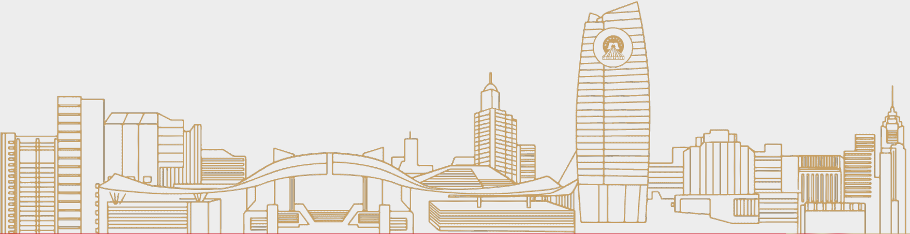

五矿证券研究所新能源行业

分析师：蔡紫豪  
登记编码：S0950523070002  
邮箱：caizihao@wkzq.com.cn

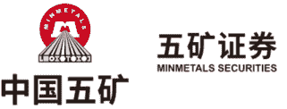

# 24H1需求良好，组件出口中欧洲占比下降

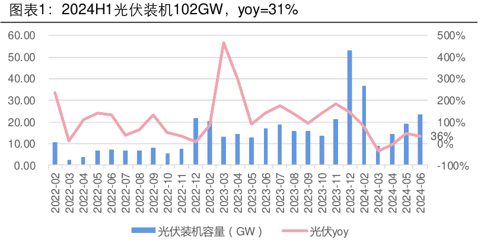

资料来源：国家能源局，五矿证券研究所

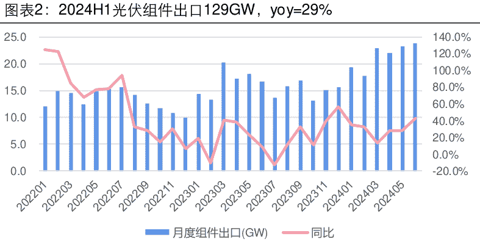

资料来源：盖锡，五矿证券研究所

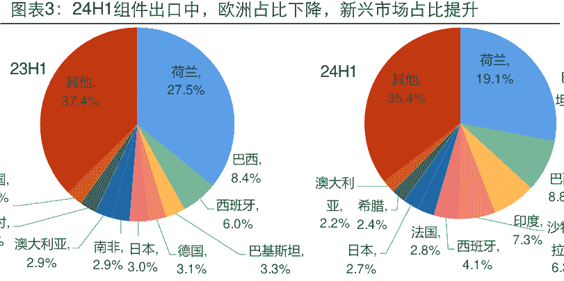

资料来源：CPIA，五矿证券研究所

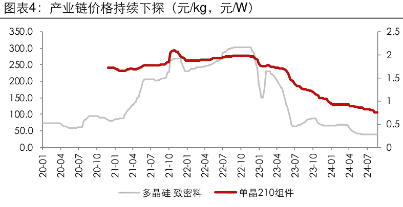

资料来源：Infolink Consulting，五矿证券研究所

# 新兴市场需求加速，接替中欧美成为新的增长点

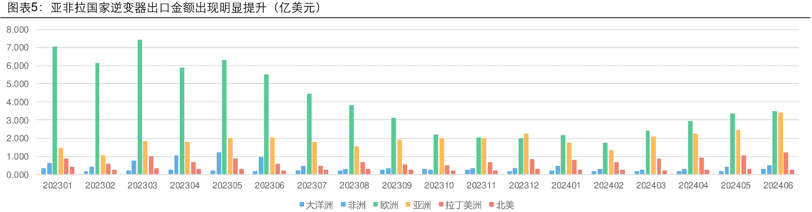

资料来源：海关总署，五矿证券研究所

图表6：近期较多新能源公司开始布局中东

| 时间 | 公司 | 合作区域 | 详情 |
|---|---|---|---|
| 20240716 | TCL中环 | 沙特 | 成立合资公司，共同在沙特建设年产20GW光伏硅片项目。 |
| 20240717 | 晶科能源 | 沙特 | 全资子公司在沙特阿拉伯王国成立合资公司，建设10GW高效电池及组件项目。 |
| 20240718 | 金风科技 | 南非 | 全资子公司与中国电建等公司组成联营体，共同作为该项目的委托人，由金风新能源南非为其提供风机运维服务。 |
| 20240726 | 卓越新能源 | 沙特 | 在沙特成立合资公司，负责提供生产生物柴油、HVO、SAF工程技术装备和建设的有偿服务。 |

资料来源：公司公告，五矿证券研究所

- 主要新兴市场在24年3月开始呈现较为明显的逆变器出口提升，比欧洲环比改善更为迅速。
- 近期有越来越多新能源公司公告与新兴市场国家合作，打开新的市场空间。

# 新兴市场电网不稳定，优质电力需求旺盛，光伏电力缓解用电紧张

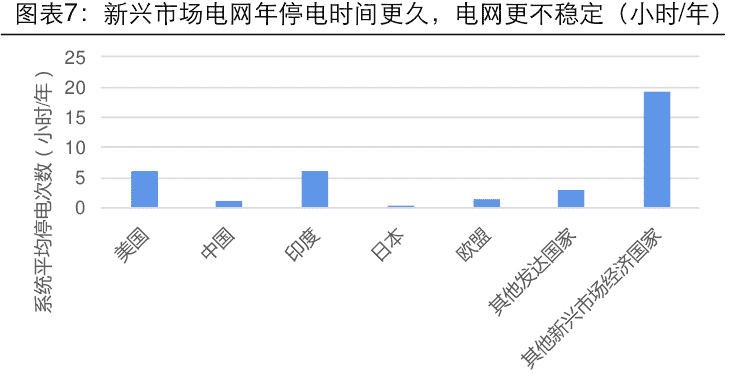

资料来源：Wind，五矿证券研究所

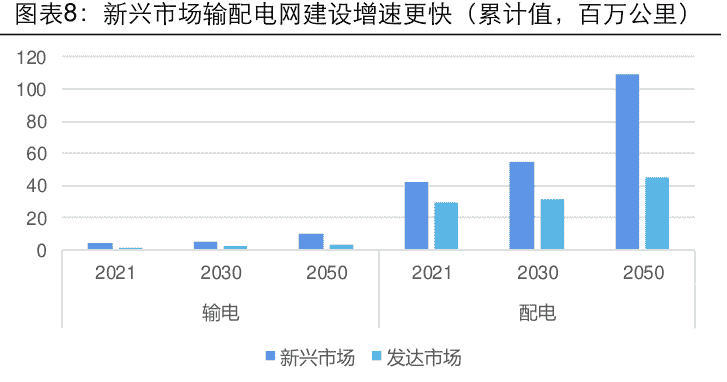

资料来源：Wind，五矿证券研究所

新兴市场电力需求持续上升，但电网常出现停电现象。长期解决方案是加大输配电投资，新兴市场输配电建设增长更快；短期则可以通过光储系统实现用电侧电力需求匹配。

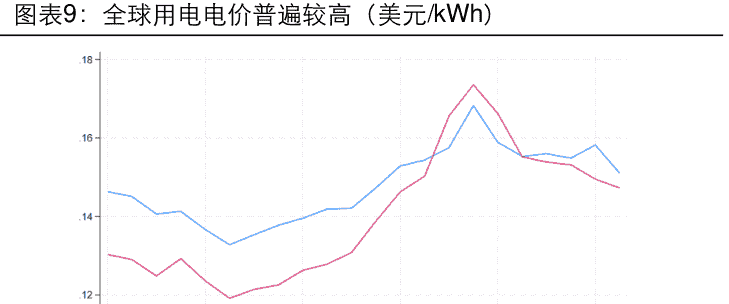

资料来源：Wind，五矿证券研究所

图表10：光储度电成本预期达到0.4~0.5元/kWh

| 项目 | 单位 | 当前 | 当前 | 当前 | 未来 | 未来 | 未来 |
|---|---|---:|---:|---:|---:|---:|---:|
| 光伏 EPC | 元/W | 3.1 | 3.1 | 3.1 | 2.79 | 2.79 | 2.79 |
| 利用小时数 | h | 1300 | 1300 | 1300 | 1300 | 1300 | 1300 |
| 光伏 LCOE | 元/kWh | 0.203 | 0.203 | 0.203 | 0.195 | 0.195 | 0.195 |
| 储能 EPC | 元/Wh | 1.1 | 0.73 | 0.73 | 0.99 | 0.65 | 0.65 |
| 循环次数 | 次 | 330 | 330 | 330 | 330 | 330 | 330 |
| 系统寿命 | 年 | 8 | 15 | 15 | 8 | 15 | 15 |
| 储能 LCOS | 元/kWh | 0.480 | 0.330 | 0.330 | 0.440 | 0.310 | 0.310 |
| 配储比例 | % | 20 | 40 | 80 | 20 | 40 | 80 |
| 配储时长 | h | 2 | 4 | 4 | 2 | 4 | 4 |
| 光储 LCOE | 元/kWh | 0.251 | 0.335 | 0.467 | 0.239 | 0.319 | 0.443 |

资料来源：Wind，五矿证券研究所

按照1300h的利用小时数测算，目前光伏度电成本已经低于全球用电电价均值，带来用户侧平价。待储能技术推进，光储平价后会更加打开全球储能市场空间，将更有助于新兴市场光伏发展。

# 24Q2营收小幅环比提升，盈利性持续下滑，主材下降明显

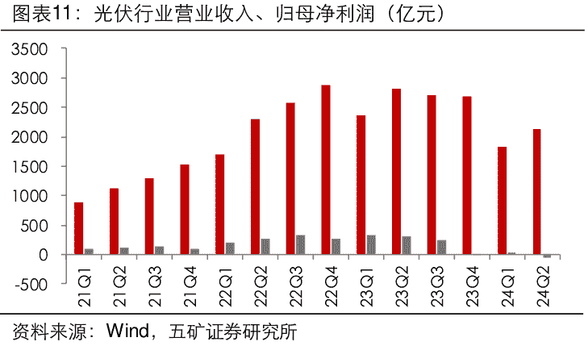

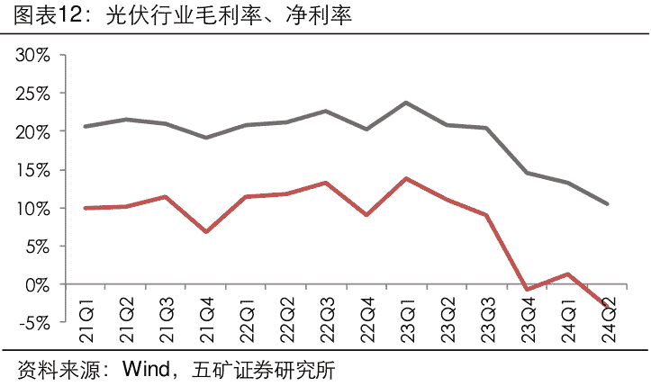

2024Q2，光伏行业营收环比小幅增长，归母净利润环比负增长。

盈利性上，2024Q2毛利率和净利率均出现环比下滑，其中：

- 主材盈利性恶化明显，毛利率和净利率均出现下降。
- 辅材盈利性环比维持稳定，整体营收利润主要随24Q2的出货量环比提升而增长。

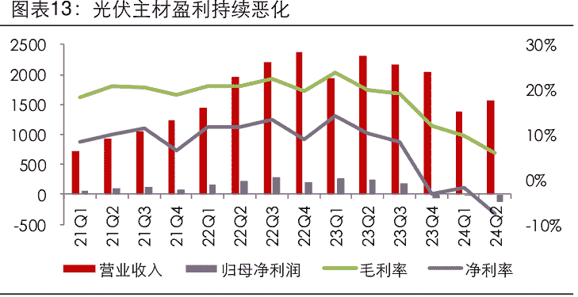

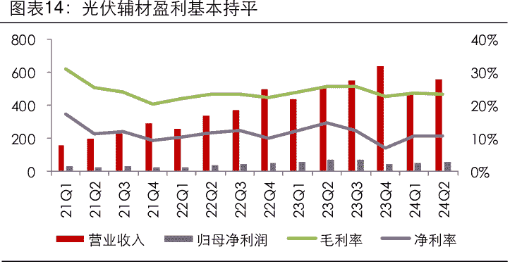

# 24Q2各环节中逆变器业绩表现亮眼

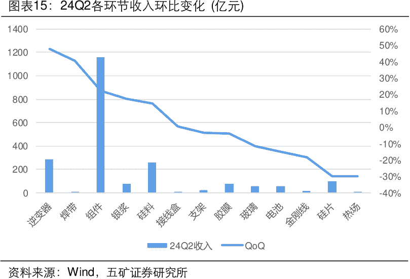

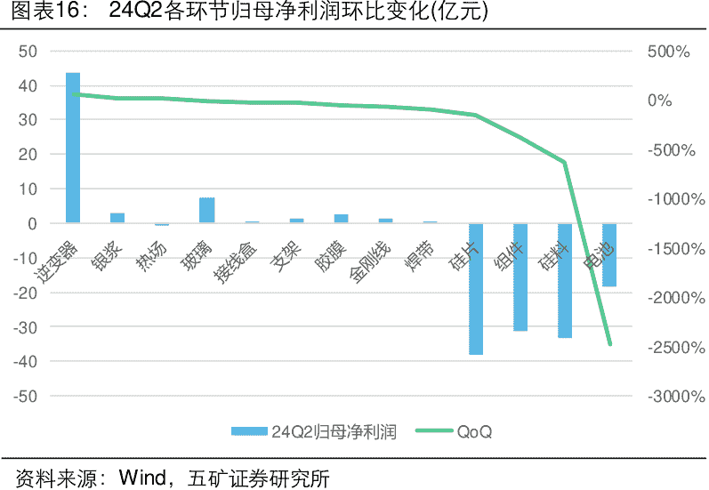

- 分环节来看，24Q2逆变器收入和归母净利润环比提升均最为明显，这主要是受益于全球光伏和大储需求、非欧美市场户储出货量的增长。
- 其他环节辅材表现普遍好于主材，尤其是归母净利润。

# 24Q2主材盈利下降多，减值影响依然较大

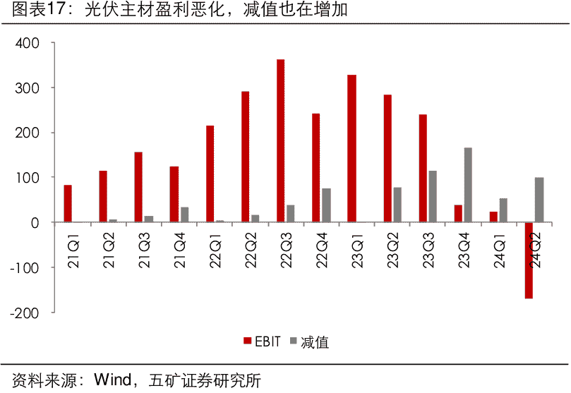

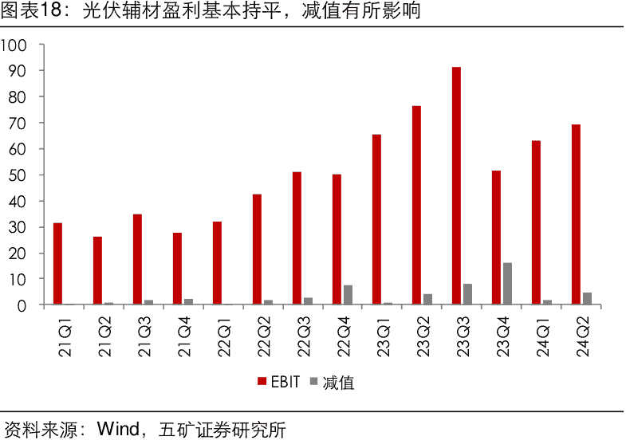

- 主材：24Q2经营性利润出现明显下降，同时因资产减值也带来较大幅度损失，共同贡献盈利恶化。
- 辅材：24Q2经营性利润环比回升，资产减值较少。

# 资本开支持续下行，Q3产业链价格跌幅下降

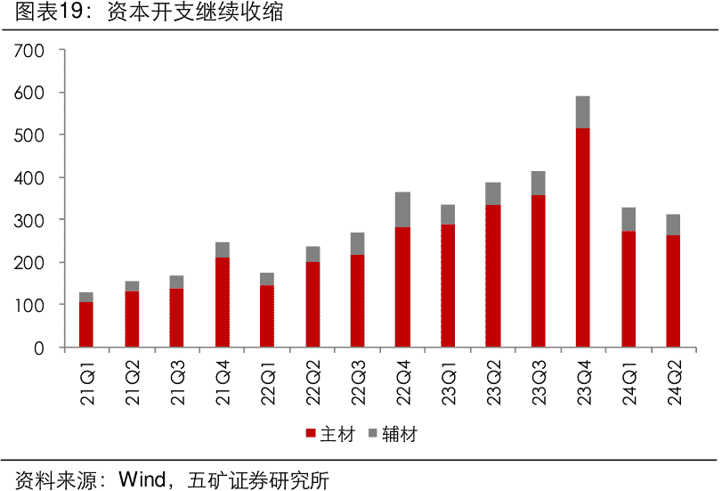

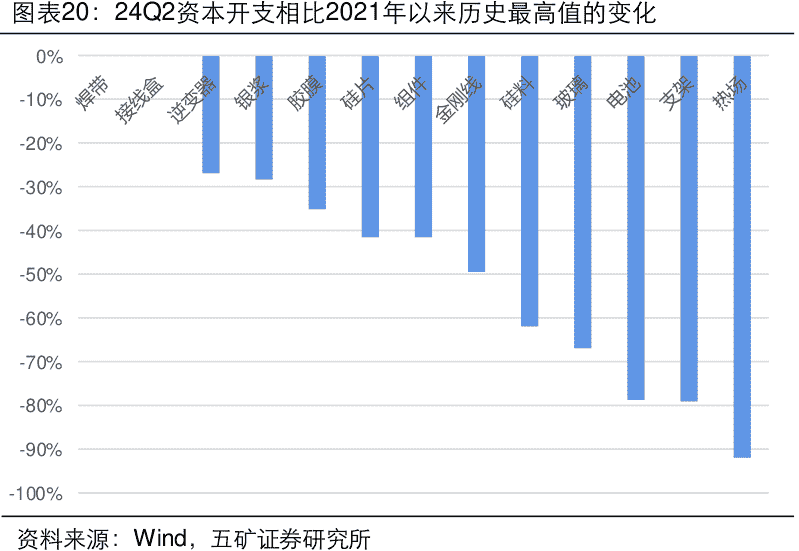

- 24Q2行业资本开支继续环比降低，其中，热场、支架、电池等环节资本开支相比历史高点降幅达到8~9成，上述环节在未来可能率先迎来行业供需逆转。

# 现金储备持续下滑，电池环节现金储备不足

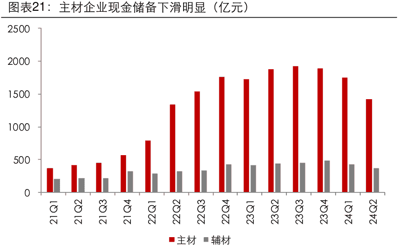

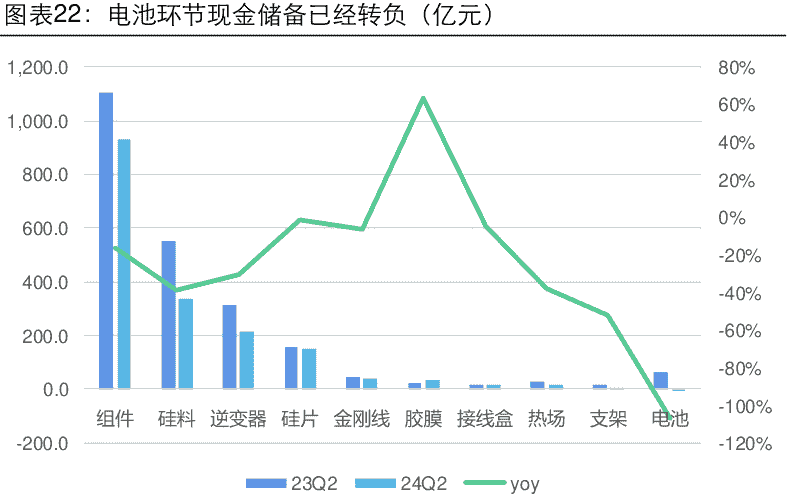

资料来源：Wind，五矿证券研究所  
注：现金储备=货币资金+交易性金融资产-短期借款--年内到期非流动负债

资料来源：Wind，五矿证券研究所  
注：现金储备=货币资金+交易性金融资产-短期借款--年内到期非流动负债

- 24Q2行业公司现金储备持续下滑，主材环节降低明显。
- 电池行业现金储备已经转负，因此电池环节率先出现大型并购事件（如通威收购润阳、一道新能源等电池企业寻求买家）。

# 行业观点：出清前夕，静待黎明

## 行业观点

- 24Q2产业链价格继续下行，报表端业绩已经出现明显负面影响。目前产业链价格逐步企稳，虽然不排除有进一步下跌的可能性，但是基本达到行业价格底部，报表端业绩或将在24Q4或之后逐步企稳。
- 电池环节处于盈利压力大、现金储备差的状态，目前已逐步出现电池企业的合并整合，电池环节有可能成为产业链中最先出清的环节。

## 风险提示

- 光伏行业竞争进一步加剧，带来业绩持续较长时间承压。
- 需求不及预期，带来竞争持续加剧。

## 同一个世界 同一个地球

地球是我们唯一的家园，保护地球环境是我们共同的责任。随着经济全球化的不断发展，环境问题日益凸显，气候变化、资源枯竭、生物多样性丧失等已成为全人类面临的严峻挑战。

面对这些挑战，没有哪个国家能够独善其身，也没有哪个个体能够置身事外。我们需要携手合作，共同应对。

保护环境不仅仅是一句口号，更体现在日常生活的点点滴滴中：

- 绿色出行，减少碳排放
- 节约用水用电，珍惜资源
- 垃圾分类，变废为宝
- 减少使用一次性塑料制品
- 积极参与环保公益活动和宣传
- 关注并支持环保政策与绿色科技

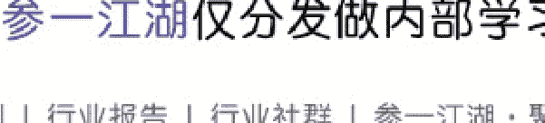

> “地球不是我们从祖先那里继承来的，而是我们从子孙后代那里借来的。”——环境保护名言

让我们行动起来，从今天做起，为了我们共同的地球家园，创造一个更加清洁、美丽、可持续的未来。

# Thank you

五矿证券研究所

上海

上海市浦东新区富城路99号震旦国际大厦30楼  
邮编：200120

深圳

深圳市南山区滨海大道3165号五矿金融大厦23层  
邮编：518035

北京

海淀区首体南路9号，4号楼603  
邮编：100037

# 免责声明

## 分析师声明

作者具有中国证券业协会授予的证券投资咨询执业资格，以勤勉的职业态度，独立、客观地出具本报告。作者保证：（i）本报告所采用的数据均来自合规渠道；（ii）本报告分析逻辑基于作者的职业理解，并清晰准确地反映了作者的研究观点；（iii）本报告结论不受任何第三方的授意或影响；（iv）不存在任何利益冲突；（v）英文版翻译若与中文版有所歧义，以中文版报告为准，特此声明。

| 投资建议的评级标准 | 评级 | 说明 |
|---|---|---|
| 报告中投资建议所涉及的评级分为股票评级和行业评级（另有说明的除外）。评级标准为报告发布日后6到12个月内的相对市场表现，也即：以报告发布日后的6到12个月内的公司股价（或行业指数）相对同期相关证券市场代表性指数的涨跌幅作为基准。其中：A股市场以沪深300指数为基准；香港市场以恒生指数为基准；美国市场以纳斯达克综合指数或标普500指数为基准。 | 股票评级 | 买入：预期个股相对同期相关证券市场代表性指数的回报在20%及以上； 增持：预期个股相对同期相关证券市场代表性指数的回报介于5%~20%之间； 持有：预期个股相对同期相关证券市场代表性指数的回报介于-10%~5%之间； 卖出：预期个股相对同期相关证券市场代表性指数的回报在-10%及以下； 无评级：对于个股未来6个月的市场表现与基准指数相比无明确观点。 |
|  | 行业评级 | 看好：预期行业整体回报高于基准指数整体水平10%以上； 中性：预期行业整体回报介于基准指数整体水平-10%~10%之间； 看淡：预期行业整体回报低于基准指数整体水平-10%以下。 |

## 一般声明

五矿证券有限公司（以下简称“本公司”）具有中国证监会批准的证券投资咨询业务资格。本公司不会因接收人收到本报告即视其为客户，本报告仅在相关法律许可的情况下发放，并仅为提供信息而发放，概不构成任何广告。本报告的版权为本公司所有，未经本公司书面许可，任何机构和个人不得以任何形式对本研究报告的任何部分以任何方式制作任何形式的翻版、复制或再次分发给任何其他人。如引用须联络五矿证券研究所获得许可后，再注明出处为五矿证券研究所，且不得对本报告进行有悖原意的删节和修改。在刊载或转发本证券研究报告或者摘要的同时，也应注明本报告的出处和发布日期并注明本研究报告的版权属于五矿证券。本报告未经授权刊载或者转发本报告的，本公司将保留向其追究法律责任的权利。若本公司以外的其他机构（以下简称“该机构”）发送本报告，则由该机构独自为此发送行为负责。

本报告所载的资料、意见及推测仅反映本公司于发布本报告当日的判断，本报告所指的证券或投资标的的价格、价值及投资收入或将产生波动；在不同时期，本公司可发出与本报告所载资料、意见及推测不一致的报告；本公司不保证本报告所含信息保持在最新状态。同时，本公司对本报告所含信息可在不发出通知的情形下做出修改，投资者应当自行关注相应的更新或修改。

本报告的作者是基于独立、客观、公正和审慎的原则制作本研究报告。本报告的信息均来源于公开资料，本公司对这些信息的准确性和完整性不作任何保证，也不保证所包含信息和建议不会发生任何变更。本公司已力求报告内容的客观、公正，但文件的观点、结论和建议仅供参考，不包含作者对证券价格涨跌或市场趋势的确定性判断。在任何情况下，本报告的信息或建议都不构成对任何人的投资建议，投资者据此做出的任何投资决策与本公司和公司的任何关联机构不承担投资者一定获利、不与投资者分享投资收益，也不对任何人因使用本报告中的任何内容所引致的任何损失负任何责任。本公司及作者在自身所知情范围内，与本报告中所评价或推荐的证券不存在法律法规要求披露或采取限制、静默措施的利益冲突。

五矿证券版权所有。保留一切权利。

## 特别声明

在法律许可的情况下，五矿证券可能会持有本报告中提及公司所发行的证券并进行交易，也可能为这些公司提供或争取提供投资银行、财务顾问和金融产品等各种金融服务。因此，投资者应当考虑到五矿证券及/或其相关人员可能存在影响本报告观点客观性的潜在利益冲突，投资者请勿将本报告视为投资或其他决定的唯一参考依据。
