# 2024年置换购用户趋势洞察

2024.09

一汽之家研究院

## 目录

- 提示
- 绪论
- 用气动控制阀实现控制
- 用电液伺服阀实现控制
- 用比例电磁铁实现控制
- 用比例方向阀实现控制
- 用步进电机实现控制
- 用变频器实现控制
- 工艺流程
- PLC接线图
- 电气原理图
- 图形分析
- 功能表图
- 液压原理图
- 气动原理图
- 参数设置

## 项目4 用气动控制阀实现分料控制

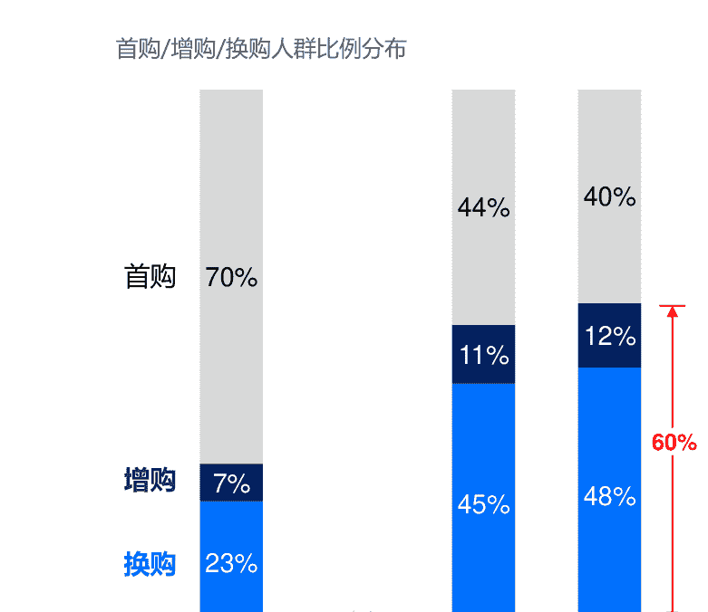

本项目采用三菱FX3U系列PLC，以气动控制阀为驱动元件，结合电感传感器、磁性开关等检测元件，实现对两种不同材质工件的分拣控制。

汽车之家研究院立足于用户视角，针对上述疑问展开增换购用户洞察，我们发现：

**车市驶入历史存量高峰，置换新动能未来可期。** 目前换车周期多在8年以上，以此测算，**2024年~2026年有望迎来换购高峰**，但仍然存在隐忧：

- 现阶段用户收入预期不佳，置换周期拉长
- 虽然置换补贴政策能够助力意向转化，但用户对补贴信息一知半解，能实现促进作用的补贴金额阈值也进一步提升

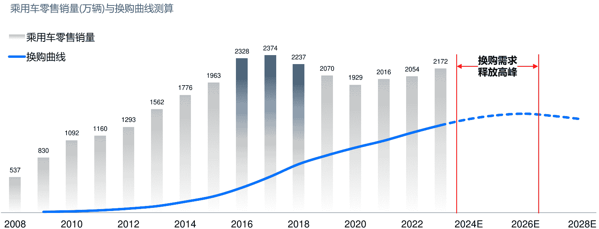

数据来源：乘联会零售销量，汽车之家研究院预测

为了抓住增换购用户，需要解决几个关键点：

**如何捕捉换车时机？** 换购用户的换车时间点灵活，并且多数换购用户先选定意向车型、甚至完成新车交易后再卖旧车，换购时机难以捕捉，需要通过精准的用户画像预判换购时机，才能提前对其选购行为施加影响，提供一站式的卖旧买新服务也是提高成单率的关键。

**如何影响购车决策？** 进入换购用户选购清单的车系数量是首购用户的一倍，选购范围之广决定了其需要更多内容辅以决策，浏览时间也会更长，尤其偏好体验/测评、用车分享类内容。

### 如何满足购车需求？

- **换购用户**
  - 从换购需求出发，换购用户可划分为经济驱动、体验驱动、需求驱动三大群体
  - 价格和尺寸升级仍是换购市场的主基调，但10-30万中端主力价位用户出现升级之力
  - 换购用户对新能源的偏好愈发强烈，新能源换回燃油现象绝非主流；未来1-2年插混/增程换购意向将超越纯电
  - 换购用户难留存，抢夺其他品牌的存量市场成为关键。合资品牌对燃油换购用户仍保持吸引力，独立新能源品牌快速抢占新能源换购市场
- **增购用户**
  - 增购燃油和新能源的用户需求差异大：增购燃油的用户更看重品牌与口碑；增购新能源的用户更期望体验智能化功能

### 换购用户画像及行为偏好

- 换购用户画像
- 换购用户行为特征
- 换购用户选购偏好

# Hello Spring

好像只是碎碎念，或者和春天说的聊聊天。这个草莓提拉米苏杯是周六早晨做的，一早去了菜市场买了新鲜草莓。草莓很甜，不需要再加多余的糖。

原来很多事其实都很简单，只是我们自己把它想复杂了，或者太在意一些不相干的看法。比如做甜品这件事，只要不要害怕失败，大胆去尝试，结果至少不会太差。

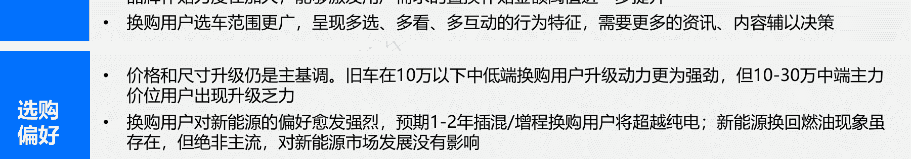

- 草莓 300g
- 马斯卡彭芝士 250g
- 淡奶油 200ml
- 手指饼干 1包
- 咖啡液 适量

# A survey on manipulating live cell with laser mic tweezers

The laser trapping technology was introduced by Arthur Ashkin in the 1970s [1]. Since then, optical tweezers have been widely used in biology and medicine, particularly in the field of single-cell analysis and manipulation [2]. The ability to manipulate cells without physical contact has opened new avenues for research in cell biology, microbiology, and biotechnology [3].

Optical tweezers use highly focused laser beams to trap and manipulate microscopic objects such as cells, organelles, and even single molecules [4]. The trapping force arises from the momentum transfer associated with refraction and reflection of light at the interface between the trapped particle and the surrounding medium [5].

Recent advances in laser technology and imaging techniques have significantly improved the precision and versatility of optical tweezers. These improvements enable researchers to perform complex manipulations such as cell sorting, cell fusion, and intracellular surgery [6].

This review aims to provide a comprehensive overview of the current state of optical tweezers for live cell manipulation, discussing the underlying principles, key techniques, and recent applications [7].

We also highlight the challenges and future perspectives in this rapidly evolving field [8].

- Optical tweezers are non-invasive tools for cell manipulation.
- They can be used for cell sorting, trapping and stretching.
- Integration with microfluidics enhances throughput.

## 更多处于高线城市、中高收入占比高

### 城市分布

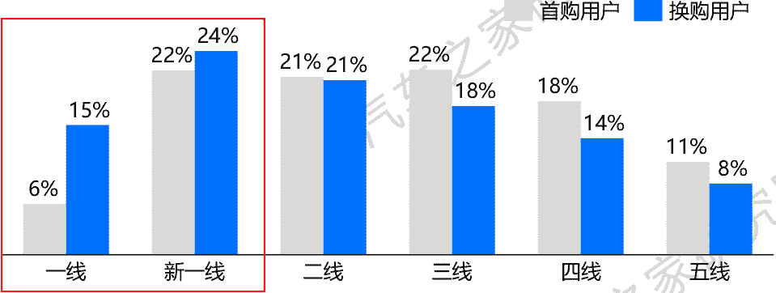

> 接近40%位于一线/新一线城市

### 收入分布

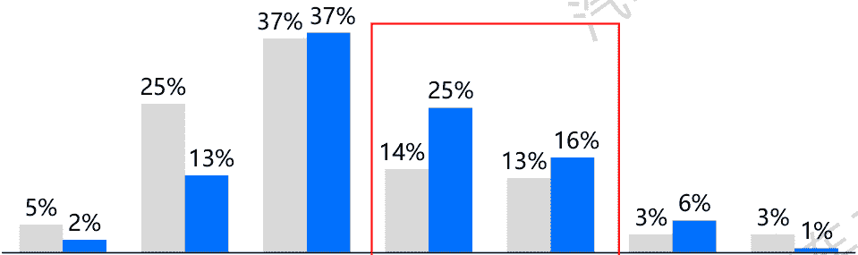

> 中产属性明显，超过40%家庭收入在20-50万

Q：您的家庭年收入是？[单选题] N=845

## 换购用户可分为经济驱动、体验驱动、需求驱动三大需求，可细分为8类群体

| 年龄\家庭收入 | 10万以下（15%） | 10-20万（38%） | 20-30万（25%） | 30-50万（16%） | 50万以上（6%） |
|---|---|---|---|---|---|
| 60岁以上（2%） |  | **T2 银发乐活族** 一线城市退休群体为主，拥有多年驾乘经验，追求先进技术，敢于尝鲜 |  |  |  |
| 50-60岁（12%） | **E1 小镇安居派** 低线城市为主，偏好中国/合资品牌燃油车 | **D1 低线富足派** 追求可靠性，注重品牌口碑和安全，偏好合资品牌燃油车 |  |  |  |
| 40-50岁（29%） |  | **D2 小镇务实派** 中低线小康家庭为主，追求配置性价比，关注能耗，偏好中国品牌 |  | **E2 高知品质派** 追求品牌，看重智能、安全和配置先进性 |  |
| 30-40岁（45%） |  | **D3 都市进取派** 以高线小康家庭为主，家庭用车场景多，关注驾乘舒适性 |  |  | **T3 实力潮流派** 推崇智能化，兼顾舒适/操控 |
| 30岁以下（11%） | **T1 都市新青年** 以新一线青年为主，希望内外饰设计及丰富配置带来新鲜体验 |  |  |  |  |

### 经济驱动

- 降价补贴驱动：E1小镇安居派
- 财务改善驱动：E2高知品质派

### 体验驱动

- 新鲜体验驱动：T1都市新青年
- 尝鲜技术驱动：T2银发乐活族
- 智能体验驱动：T3实力潮流派

### 需求驱动

- 性能改善驱动：D1低线富足派
- 多种需求驱动：D2小镇务实派
- 家庭需求驱动：D3都市进取派

# 经济驱动

### 小镇安居派偏好中国/合资燃油车，高知品质派追求豪华和独立新能源品牌

| 分类 | 换购动因 | 用户画像 | 选购偏好 |
|---|---|---|---|
| E1 小镇安居派 | 因车价下降和置换补贴政策而考虑换车 | 中年、**低收入**；**2-5线低线城市**；多为三口之家 | 对车价敏感，在乎售后使用成本和舒适性体验；偏好**中国品牌、合资品牌燃油车** |
| E2 高知品质派 | 财务状况改善，希望购买更高端或更舒适的车 | 中年、**中高收入**；高学历／硕士以上更多；**一线/新一线城市**；多子女家庭 | 看重智能、**安全和配置先进性**；追求品牌，偏好**豪华和独立新能源品牌** |

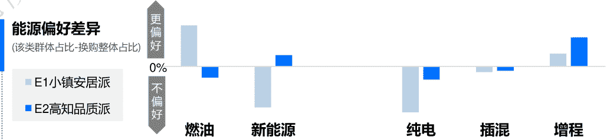

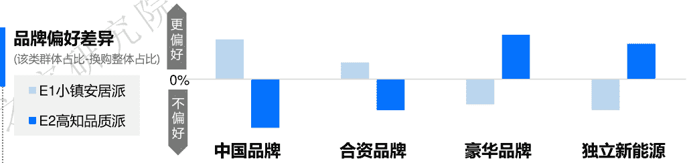

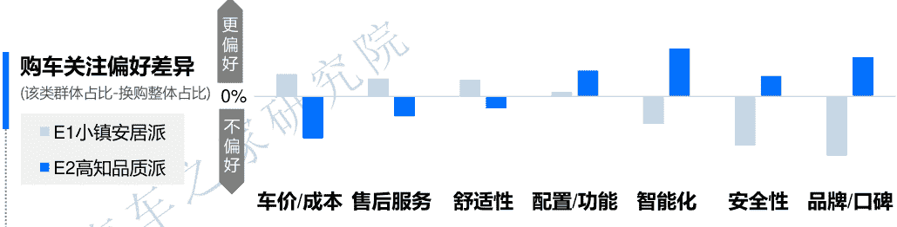

# 体验驱动

### 都市新青年追求新鲜的功能体验，银发乐活和实力潮流派期望智能化等先进技术

| 分类 | 换购动因 | 用户画像 | 选购偏好 |
|---|---|---|---|
| **T1 都市新青年** | 追求新鲜体验 | **年轻、中低收入** **新一线城市** 单身或新婚 | 希望内外饰设计及丰富的配置功能为其带来新鲜体验 更偏好纯电和插混车型 |
| **T2 银发乐活族** | 期望先进技术 | **退休男性** 中等收入 一线城市 | 多年驾乘经验使其更自信，追求**智能化和技术升级**，敢于尝鲜，注重配置丰富度 偏好纯电、增程车型 |
| **T3 实力潮流派** | 追求新鲜体验 | **高收入群体** 一线城市 换购周期短 3-5年换车 | 推崇智能化，同时需要兼顾**舒适、操控和设计** 多从豪华品牌换到**中国独立新能源品牌** |

#### 能源偏好差异

（该类群体占比-换购整体占比）

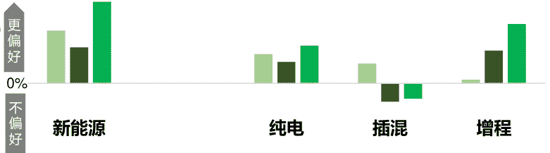

#### 品牌偏好差异

（该类群体占比-换购整体占比）

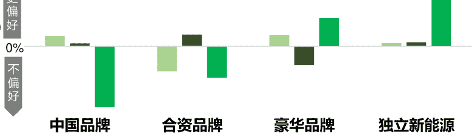

#### 购车关注偏好差异

（该类群体占比-换购整体占比）

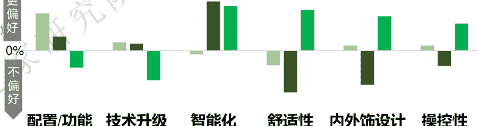

# 需求驱动

### 低线富足派偏好合资品牌，小镇务实派关注综合性价比，都市进取派注重设计和舒适

| 分类 | 换购动因 | 用户画像 | 选购偏好 |
|---|---|---|---|
| **D1 低线富足派** | 因现车性能下降而想要购买更高性能的车 | **50-60岁** 中等收入；**中低线城市**；换车周期更长；76%在8年以上 | 追求车辆可靠性；注重品牌**口碑和安全**；偏好**合资品牌燃油车** |
| **D2 小镇务实派** | 多重因素叠加；期望获得性能提升、满足家庭需求、降低用车成本 | **40-50岁** 中等收入；二口/多子女家庭；**二线/三线城市** | 格外关注**安全**，注重配置功能实用性；考量**综合性价比**，更加偏好**中国品牌** |
| **D3 都市进取派** | 家庭成员增多或家庭用车场景变化而换车 | **30-40岁** 中等收入；三口/多子女家庭；**新一线城市** | 多考量**品牌和设计**；家庭用车场景下更关注空间和乘坐**舒适性**；偏好**豪华和独立新能源** |

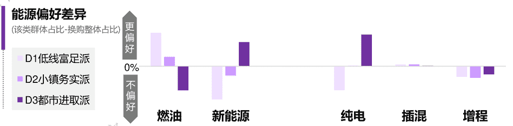

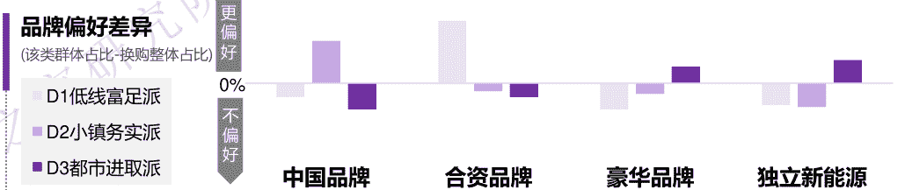

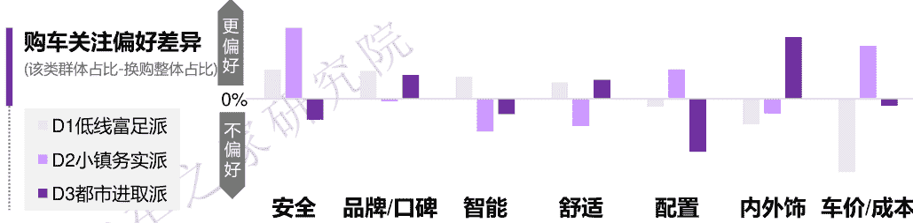

## 在产品质量提升和收入预期不佳的双重影响下，换购周期拉长，多在8年以上

### 46%换购用户旧车车龄在8年以上

与2023年相比，换购周期变长。

换购用户旧车车龄分布

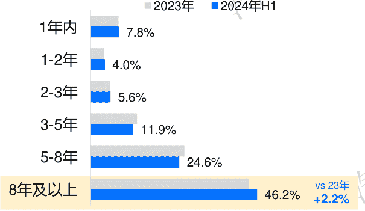

### 此外，卖出旧车用户选择换购新车的比例下降，选择换购二手车的比例在增长

卖旧车用户中选择换购新车/二手车的用户占比

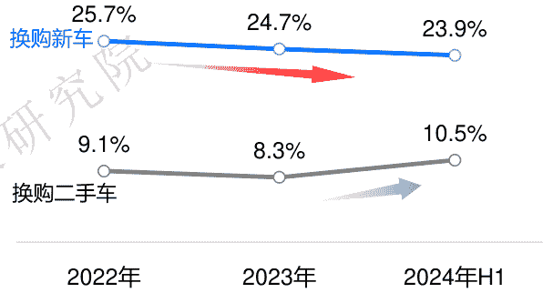

### 用户不打算换车的原因

Q：请问您不打算换车的原因是什么？[单选题] N=155

## 多数换购用户先选定意向车系、甚至完成新车交易，再进行旧车售卖

换购时机难以捕捉，需要通过精准的用户画像预判换购时机。

### 用户换购行为步骤

- 第一步 → 第二步 → 第三步 → 第四步

78% 店内看新车  
69%的用户选择在4S店卖出旧车

48% 新车下定

30% 旧车估值售卖

33% 旧车估值售卖 → 旧车过户 → 新车提车

16% 新车提车 → 旧车估值售卖、过户

22% 旧车过户 → 新车下定、提车

7% 新车下定 → 旧车过户 → 新车提车

22% 旧车估值售卖

14% 旧车过户 → 店内看新车、新车下定、提车

8% 店内看新车 → 新车下定、旧车过户、新车提车

> 先选定换购车系  
> 再进行旧车换购  
> 需通过用户画像预判  
> 更早识别换购时机  
> 才能对其选购行为施加影响

> 先估值售卖旧车  
> 换购商业产品可识别

> 提供一站式卖旧买新服务  
> 也是提高成单率的关键

Q：您在置换时，买车卖车各环节的先后顺序是什么？【排序题】N=846

数据来源：汽车之家大数据、汽车之家研究院用户调研_2024年

## 置换补贴助力转化，但用户一知半解，需线上平台协助提升信息触达

### 置换补贴能激发或加速用户需求

置换补贴对用户的影响

| 影响 | 占比 |
|---|---:|
| 加快购车决策 | 40.4% |
| 维持原计划 | 37.6% |
| 提高购车预算 | 15.7% |
| 从不考虑购车转为计划购车 | 6.3% |

Q：置换补贴对您购车有何影响？[单选题] N=541

### 但仍有60%的用户对置换补贴政策一知半解

用户对置换补贴信息的了解程度

| 年份 | 非常了解 | 比较了解 | 有一点了解 | 完全不知道 |
|---|---:|---:|---:|---:|
| 2024 | 7.5% | 32.3% | 51.9% | 8.3% |
| 2023 | 11.0% | 38.0% | 43.0% | 9.0% |

+8pct

Q：您对置换补贴相关的信息是否了解？[单选题] N=846

## 置换补贴力度加大，推动置换补贴金额阈值进一步提升

### 2024年获得置换补贴的用户明显增多，品牌补贴力度加大

获得置换补贴的用户占比

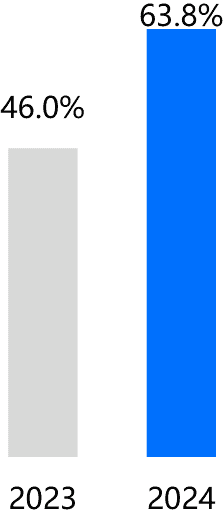

| 置换补贴类型 | 2023 | 2024 |
|---|---:|---:|
| 品牌置换补贴 | 29% | 48% |
| 地方政府置换补贴 | 17% | 23% |
| 国家置换补贴 | — | 14% |

获得品牌置换补贴的用户明显增加，品牌补贴力度加大。

获得补贴＞5000元：23年→24年 36%→53%

Q：您换车时，是否获得了置换补贴？【多选题】N=846

### 补贴力度的加大产生推动作用，能够激发需求的置换补贴金额阈值进一步提升

获得多少置换补贴可以增强购车意愿或加快决策

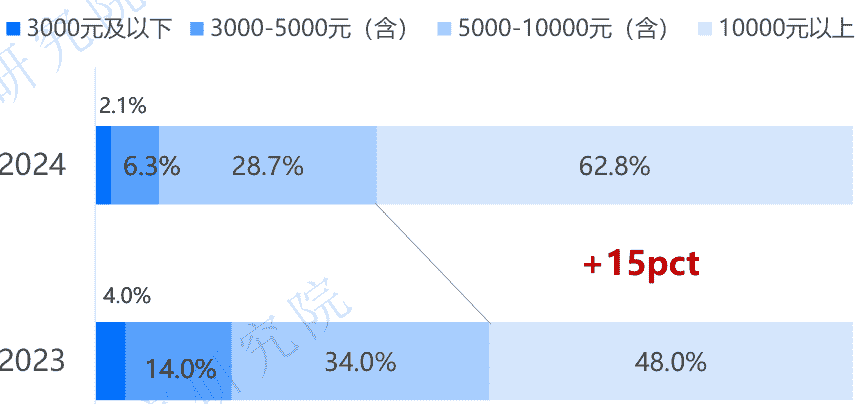

Q：获得多少额度的置换补贴，可以增强您的购车意愿或加快您的购车决策？【单选题】N=764

## 换购用户选车更理智谨慎，呈现多选、多看、多互动的行为特征

需要更多的资讯、内容辅以决策。

### 选购车系范围更广

| 指标 | 首购 | 换购 |
|---|---:|---:|
| 浏览车系数量 ↑ | 26 | 46 |
| 意向车系数量 ↑ | 1.5 | 1.8 |

### 浏览内容更多、浏览时间更长

| 指标 | 首购 | 换购 |
|---|---:|---:|
| 人均访问内容量（月·篇） | 45 | 79 |
| 人均访问时长（月·分钟） |  | 换购是首购的 1.7 倍 |

### 互动意愿更为强烈

| 指标 | 首购 | 换购 |
|---|---:|---:|
| 评论率 | 15% | 36% |
| 点赞率 | 22% | 42% |

### 换购用户更加偏好体验/测评类、用车分享类内容

### 换购用户内容消费偏好

● 体验/评测类内容　● 用车分享类内容

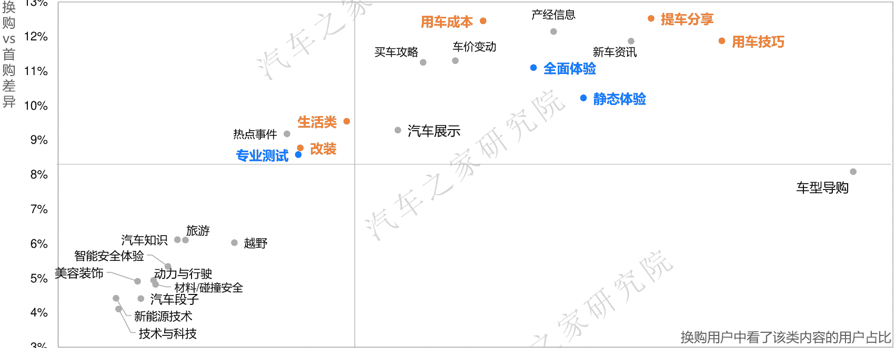

- 由于换购用户对内容的消费量更高，对不同类别内容的消费占比都高于首购用户，但分类别来看，首购用户对体验/评测类内容关注度也较高

### 价格和尺寸升级仍是换购市场的主基调

### 均价提升约4万元，价格升级比重在50%左右

### 尺寸升级仍是主流选择，且升级比重在持续提升

上图：新旧车平均价格对比；下图：换购用户价格升降级分布

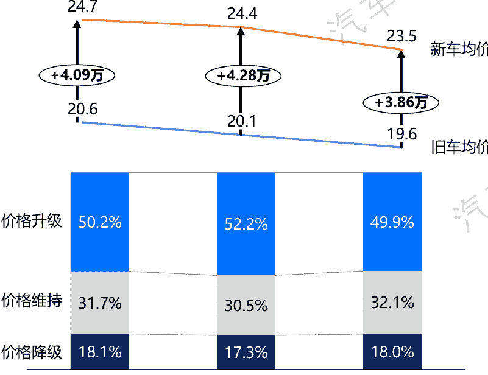

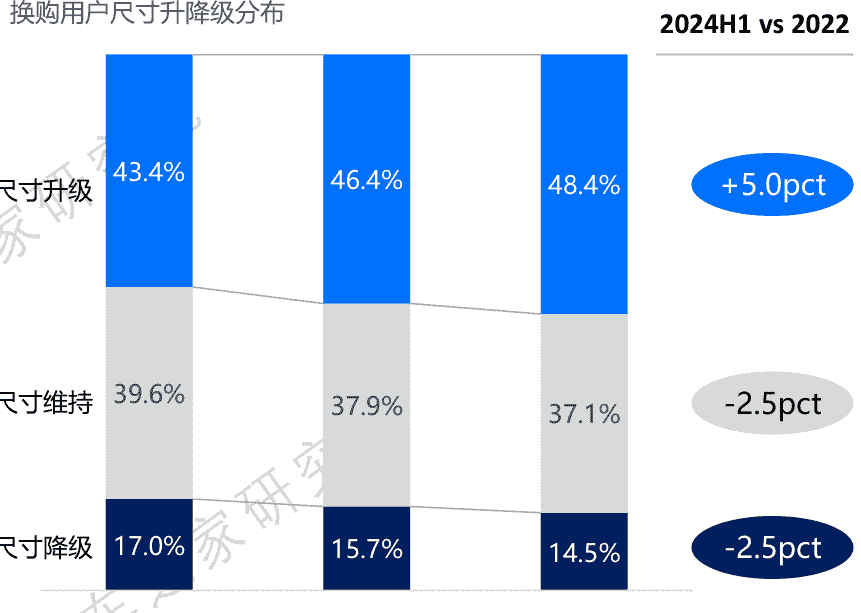

数据来源：汽车之家大数据

2024增换购用户趋势洞察

### 旧车在20万以下的换购用户是主力升级人群，10万以下中低端换购用户升级动力更为强劲

但10-30万中端主力价位用户出现升级乏力，带动换购中高价位段占比缩小

#### 各价位段用户换购新车价位分布（2023年 vs 2024年H1）

| 2023旧车价格\新车价格 | 10万以下 | 10-20万 | 20-30万 | 30-40万 | 40-50万 | 50万以上 |
|---|---:|---:|---:|---:|---:|---:|
| 10万以下 | 5.2% | 15.6% | 4.7% | 1.6% | 0.6% | 0.3% |
| 10-20万 | 4.1% | 19.0% | 11.4% | 6.1% | 2.9% | 1.2% |
| 20-30万 | 0.8% | 3.9% | 3.4% | 2.7% | 1.7% | 1.2% |
| 30-40万 | 0.3% | 1.2% | 1.2% | 1.1% | 0.8% | 0.8% |
| 40-50万 | 0.2% | 0.7% | 0.7% | 0.7% | 0.5% | 0.8% |
| 50万以上 | 0.2% | 0.9% | 0.8% | 0.8% | 0.5% | 1.2% |
| 新车小计 | 10.8% | 41.3% | 22.2% | 13.0% | 7.0% | 5.5% |

| 2024 H1旧车价格\新车价格 | 10万以下 | 10-20万 | 20-30万 | 30-40万 | 40-50万 | 50万以上 |
|---|---:|---:|---:|---:|---:|---:|
| 10万以下 | 5.4% | 16.3% | 4.0% | 1.5% | 0.6% | 0.3% |
| 10-20万 | 4.7% | 21.0% | 10.3% | 5.7% | 2.8% | 1.2% |
| 20-30万 | 0.9% | 4.3% | 3.1% | 2.4% | 1.6% | 1.0% |
| 30-40万 | 0.3% | 1.2% | 1.1% | 1.0% | 0.8% | 0.7% |
| 40-50万 | 0.2% | 0.8% | 0.7% | 0.7% | 0.5% | 0.7% |
| 50万以上 | 0.2% | 0.9% | 0.7% | 0.7% | 0.5% | 1.1% |
| 新车小计 | 11.7% | 44.5% | 19.9% | 12.0% | 6.8% | 5.0% |

旧车<20万用户是主力升级群体  
升级占比达42.7%

升级用户占比下滑2.2pct

数据来源：汽车之家大数据

2024置换购用户趋势洞察

### 换购用户购车更关注智能化，看重乘坐舒适和服务体验

换购用户购车最关注安全性、价格和品牌口碑；首购用户购车最关注价格、安全性和外观内饰；对比首购用户，换购用户购车更关注舒适性、智能化功能、技术升级和售后服务

#### 不同用户购车关注因素

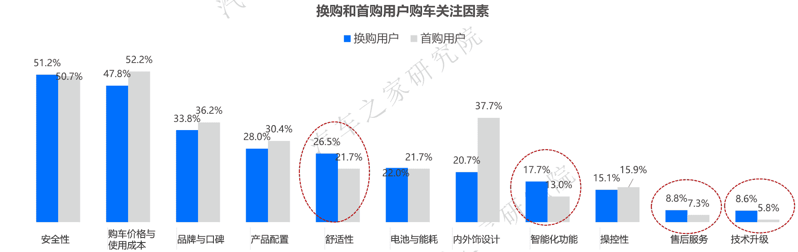

Q：请问您购买/计划购车时比较关注哪些因素？[多选题] 换购N=846，首购N=69

## 换购用户不“专一”，品牌老客难留存，抢夺大战不可避免

90%

对其他品牌有购车意向

59%

不会选择旧车品牌

- 69% 出于尝鲜心理，试试其他品牌
- 29% 旧车品牌产品序列无法满足换购趋势
- 19% 旧车驾驶/使用体验不好

Q：您不会继续买旧车品牌的原因是什么？[多选题] N=787

### 用户在换购时选择品牌的集中度持续下滑，品牌选择逐渐分散

#### 换购用户新车意向品牌集中度

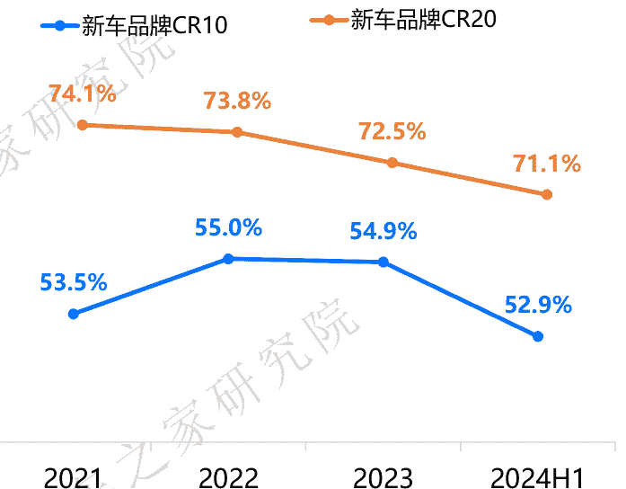

### 与23年相比，不同价位段换购用户品牌偏好快速变化

豪华品牌40万以上市场优势稳固，独立新能源品牌实现中端市场快速突破

#### 2024年上半年各价格段换购用户的品牌偏好分布及与2023年相比的分布变化

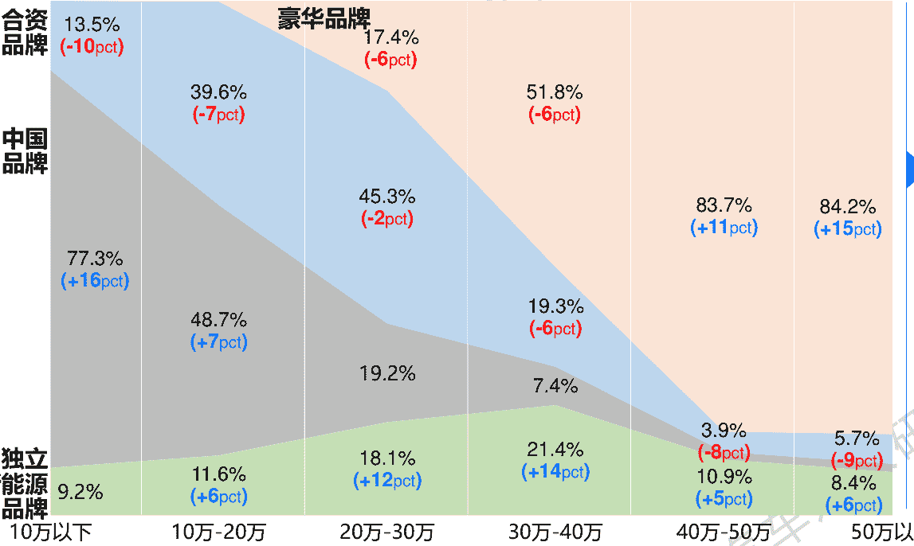

- 豪华品牌40万以上换购市场优势稳固
- 合资品牌全面流失，10-30万相对领先
- 中国品牌20万以下发展稳健，高端萎缩
- 独立新能源品牌换购用户偏好快速提升

## 换购用户对新能源的偏好愈发强烈，预计1-2年插混/增程换购用户将超越纯电

### 换购用户燃油偏好显著下滑，但仍为换购市场主力

新能源偏好快速提升，插混/增程已逼近纯电

#### 换购用户意向燃油类型分布

| 年份 | 燃油 | 纯电 | 插混&增程 | 新能源 |
|---|---:|---:|---:|---:|
| 2021 | 83.0% | 12.3% | 4.7% | 17.0% |
| 2022 | 75.9% | 17.4% | 6.7% | 24.1% |
| 2023 | 68.7% | 19.7% | 11.6% | 31.3% |
| 2024H1 | 58.5% | 22.3% | 19.2% | 41.5% |

#### 未来换购用户意向燃油类型分布

未来换购意向中，插混偏好将超过纯电

| 未来1-2年 | 燃油 | 纯电 | 插混&增程 |
|---|---:|---:|---:|
| 未来换购用户 | 55.5% | 21.5% | 23.0% |

### 除了综合成本之外，智能化和良好的驾驶体验是换购用户“油换电”的主要原因

#### 燃油用户不继续购买燃油或换成新能源原因

- 新能源车的综合使用成本更低：71.3%
- 新能源车更加智能化：48.7%
- 新能源车的驾驶体验更好：39.6%
- 燃油车已是过去式，新能源车才是未来：26.6%
- 购买新能源车才能获得优惠/补贴：14.6%
- 新能源车不限牌/限行：14.6%
- 新能源车有我特别喜欢的品牌/车型：11.4%

Q：如果以后换车，您打算购买的能源类型是哪种？[单选题] N=192

2024增换购用户趋势洞察

Q：您将燃油车换成新能源车或不继续购买燃油车的原因是什么？[多选题] N=376

### 新能源换回燃油现象虽存在，但绝非主流，对新能源市场发展没有影响

> 新能源车主换回燃油的比例不足2%，存在此现象的更多是“油改电”插混产品车主，是新能源发展初期造成的时代产物

#### 换购用户前新车燃油类型流转情况

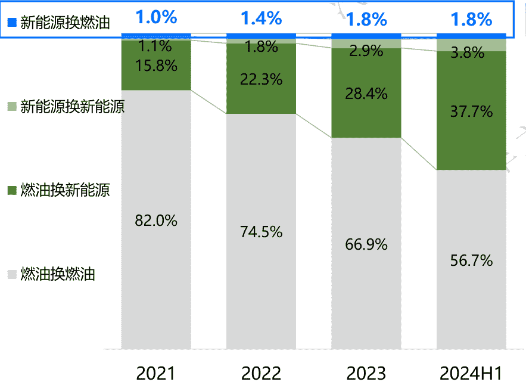

豪华、合资品牌油改电插混车主换回燃油车的比例更高，多因长途出行加油更方便、续航不够、不保值等因素而换回燃油

| 车型 | 换回燃油车比例 | 车型信息 |
|---|---:|---|
| 迈腾GTE插电混动 | 69.7% | 19-21年车型，纯电续航56-63km，PHEV在售 |
| 奥迪A6L新能源 | 68.0% | 17-22年车型，纯电续航54km，PHEV停售 |
| 宝马5系新能源 | 66.5% | 15-22年车型，纯电续航95km，PHEV在售 |
| 卡罗拉双擎E+ | 65.3% | 19-20年车型，纯电续航55km，PHEV停售 |
| 帕萨特新能源 | 62.6% | 18-22年车型，纯电续航63km，PHEV在售 |

注：比例=该车系意向换回燃油车的用户量/该车系总用户量

数据来源：汽车之家大数据

### 换购意向为燃油的用户，对合资品牌的选择相对坚定

#### 换购燃油用户意向品牌类型分布

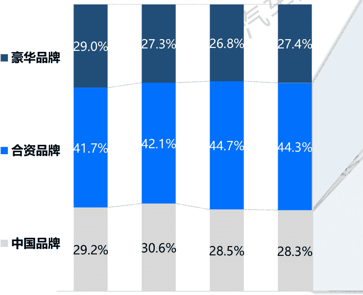

#### 换购合资品牌的用户旧车品牌类型

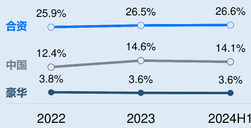

- 换购燃油的用户选购合资品牌的比例近两年保持在44%以上
- 合资对于旧车品牌的掠夺保持稳定

#### 换购中国品牌的用户旧车品牌类型

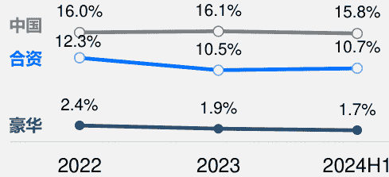

- 中国品牌对合资品牌的掠夺能力出现下滑

### 换购意向为燃油的用户，对不同品牌类型购车关注点差异大

偏好中国品牌的用户更关注电池性能、产品配置及智能化功能  
偏好合资品牌用户更关注舒适性和价格  
偏好豪华品牌用户更关注品牌口碑、外观与内饰设计及操控性

#### 换购燃油用户分不同品牌类型购车关注因素

| 关注因素 | 燃油车整体 | 中国品牌-整体差异 | 合资品牌-整体差异 | 豪华品牌-整体差异 |
|---|---:|---:|---:|---:|
| 安全性 | — | 3% | 1% | -10% |
| 购车价格与使用成本 | — | 4% | 3% | -16% |
| 品牌与口碑 | — | -15% | 0% | 13% |
| 产品配置 | — | 6% | -6% | -4% |
| 舒适性 | — | -5% | 5% | 1% |
| 外观与内饰设计 | — | 2% | -5% | 9% |
| 操控性 | — | -10% | 1% | 9% |
| 智能化功能 | — | 5% | -2% | 0% |
| 售后服务 | — | 3% | -2% | 1% |
| 技术升级 | — | 2% | 2% | 0% |
| 电池与能耗 | — | 7% | 3% | -1% |

Q：请问您购买/计划购车时比较关注哪些因素？[多选题] N=303

数据来源：汽车之家研究院调研_2024

### 换购意向为新能源的用户，彻底颠覆“品牌档次”概念

特斯拉换购意向大幅下滑，中国独立新能源品牌加速掠夺存量市场

#### 换购新能源用户意向品牌类型分布

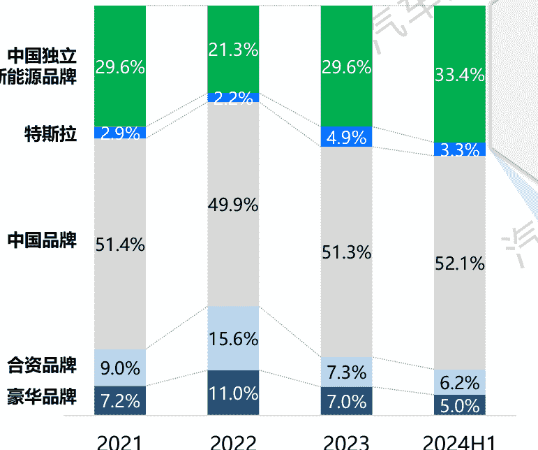

#### 换购中国独立新能源品牌的用户归因品牌类型

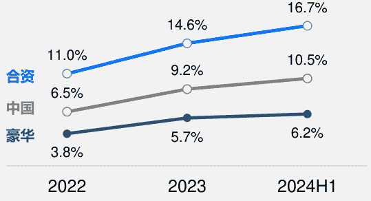

- 中国独立新能源品牌换购意向显著增长，大幅抢夺合资老用户
- 特斯拉换购意向出现大幅下滑，转向中国独立新能源品牌

数据来源：汽车之家大数据

### 换购意向为新能源的用户，购车最关注安全性、价格和电池性能

偏好中国品牌的用户更关注价格及品牌口碑  
偏好中国独立新能源品牌用户更关注产品配置、智能化功能及舒适性

#### 换购新能源用户分不同品牌类型购车关注因素

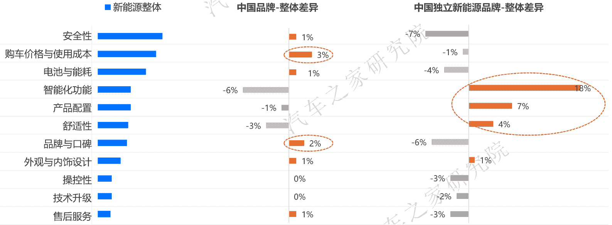

Q：请问您购买/计划购车时比较关注哪些因素？【多选题】N=406；  
换购意向为豪华和合资新能源用户样本量较低，不做购车关注因素分析

数据来源：汽车之家研究院调研_2024

## 增购用户画像及选购偏好

### 核心观点-增购用户

- 增购用户多子女家庭属性明显，中高收入群体占比更高，年龄更大
- 偏好增购新能源，尤其是纯电车型
- 增购新能源的用户：是社会中坚的千禧一代，偏好独立新能源品牌，更易受体验与技术升级驱动，购车更期望体验智能化功能
- 增购燃油车的用户：下沉市场低收入用户和一线城市中产用户更加偏好燃油车，更易受降价驱动，购车更看重品牌与口碑

### 3D打印及应用创新实验室

3D打印及应用创新实验室是一间集3D建模设计、3D打印、激光切割、后处理加工于一体的综合性创新实验室。实验室以先进制造技术为载体，以培养大学生创新实践能力为目标，为大学生搭建一个创新设计、动手实践、学科竞赛与科学研究相结合的综合实验教学平台。

实验室定期面向全校师生开展设备使用培训、教学及交流活动，鼓励不同专业的学生进行交叉融合、协同创新。实验室主要面向机械类、自动化类、设计类等专业的学生开放，同时也面向学校全体教师及学生开放共享。

#### 主要设备

- 3D打印机
- 激光切割机
- 数控铣床
- 三维扫描仪
- 后处理设备及工具

### 增购用户更年长，更偏好增购新能源

### 相比换购用户，增购用户更年轻，40-60岁用户比例达61%

### 相比换购用户，增购用户更偏好新能源，尤其纯电车型

#### 年龄分布

换购用户　增购用户

| 年龄段 | 换购用户 | 增购用户 |
|---|---:|---:|
| 18-25岁 | 2% | 1% |
| 26-30岁 | 9% | 3% |
| 31-40岁 | 45% | 34% |
| 41-50岁 | 29% | 42% |
| 51-60岁 | 12% | 19% |
| >60岁 | 2% | 1% |

Q：您的年龄是？[单选题] N=480

#### 新旧车能源类型流转分布

换购用户　增购用户

| 能源类型流转 | 换购用户 | 增购用户 |
|---|---:|---:|
| 燃油增换燃油 | 57% | 49% |
| 燃油增换新能源 | 38% | 43% |
| 新能源增换燃油 | 2% | 4% |
| 新能源增换新能源 | 4% | 4% |

Q：您的上一辆车的能源类型是？[单选题] N=480  
Q：请问您所购/即将购入的车辆能源类型是什么？[单选题] N=480

#### 新车能源分布

| 能源类型 | 换购新车 | 增购新车 |
|---|---:|---:|
| 插混&增程 | 19% | 17% |
| 纯电 | 22% | 30% |
| 燃油 | 59% | 53% |

数据来源：汽车之家研究院用户调研_2024年

### 按能源类型划分两大类增购人群

增购新能源的用户更年轻，家庭收入更集中在20-50万

| 家庭收入/年龄 | 10万以下 | 10-20万 | 20-30万 | 30-50万 | 50万以上 |
|---|---:|---:|---:|---:|---:|
| 60岁以上（1%） |  |  |  |  |  |
| 50-60岁（19%） | 绿色、蓝色条形数据 | 绿色、蓝色条形数据 | 绿色、蓝色条形数据 | 绿色、蓝色条形数据 | 绿色、蓝色条形数据 |
| 40-50岁（42%） | 绿色、蓝色条形数据 | 绿色、蓝色条形数据 | 绿色、蓝色条形数据 | 绿色、蓝色条形数据 | 绿色、蓝色条形数据 |
| 30-40岁（34%） | 绿色、蓝色条形数据 | 绿色、蓝色条形数据 | 绿色、蓝色条形数据 | 绿色、蓝色条形数据 | 绿色、蓝色条形数据 |
| 30岁以下（4%） |  |  |  |  |  |

占比小，不具备显著特征

G2-1：低收入用户  
G1：中等收入用户  
G2-2：高收入用户

图例：

- 绿色：增购新能源用户占比
- 蓝色：增购燃油用户占比

#### 偏好增购新能源

- G1 社会中坚的千禧一代*（28-43岁）
  - 更年轻，30-40岁占比更高
  - 家庭收入更集中在20-50万

#### 偏好增购燃油

- 整体更年长，50-60岁用户占比更高
- G2-1 下沉市场低收入用户
  - 10万以下低收入、北方城市占比更高
  - 更偏好中国品牌，降价驱动更显著，更看重成本
- G2-2 一线城市中产用户
  - 50万以上高收入，一线城市、南方城市为主
  - 更偏好豪华品牌，家庭/工作趋势驱动更显著，更看重品牌

数据来源：汽车之家研究院用户调研，2024年

### 增购燃油的用户仍是合资、豪华车的忠实拥趸

增购新能源的用户对独立新能源品牌偏好强烈

#### 增购燃油人群与增购整体差异

| 已有车 | 品牌类型分布 | 新增车 |
|---|---|---|
| 中国品牌：-3% | 中国品牌 | -11% |
| 中国独立新能源品牌：-1% | 中国独立新能源品牌 | -21% |
| 合资品牌：1% | 合资品牌 | 19% |
| 豪华品牌：3% | 豪华品牌 | 16% |
| 特斯拉：1% | 特斯拉 | -2% |

#### 增购新能源人群与增购整体差异

| 已有车 | 品牌类型分布 | 新增车 |
|---|---|---|
| 中国品牌：3% | 中国品牌 | 10% |
| 中国独立新能源品牌：1% | 中国独立新能源品牌 | 18% |
| 合资品牌：-1% | 合资品牌 | -16% |
| 豪华品牌：-2% | 豪华品牌 | -14% |
| 特斯拉：0% | 特斯拉 | 2% |

Q：请问您上一辆车的品牌类型是什么？[单选题] N=480

Q：请问您所购/即将购入的车辆品牌类型是什么？[单选题] N=480

### 增购燃油车的用户更易受经济驱动，购车更看重品牌与口碑

增购新能源的用户更易受体验与技术升级驱动，购车更期望体验智能化功能

| 增购燃油人群-增购整体差异 | 购车驱动因素 | 增购新能源人群-增购整体差异 |
|---|---|---|
| 2% | 追求更高性能 | -1% |
| -1% | 家庭趋势驱动 | 0% |
| -2% | 工作/商务需要 | 1% |
| -6% | 期望先进技术 | 6% |
| -6% | 追求新鲜体验 | 4% |
| 4% | 财务状况改善升级 | -4% |
| -3% | 减少售后服务成本 | 4% |
| -2% | 受补贴政策影响而换车 | 2% |
| 3% | 受降价影响而换车 | -2% |

Q：请问您最近购买/计划购车的原因符合以下哪种情况？[多选题] N=480

| 增购燃油人群-增购整体差异 | 购车关注因素 | 增购新能源人群-增购整体差异 |
|---|---|---|
| 0% | 购车价格与使用成本 | 2% |
| -1% | 品牌与口碑 | -14% |
| 2% | 产品配置 | 0% |
| 2% | 安全性 | 1% |
| 2% | 舒适性 | -1% |
| 3% | 外观与内饰设计 | -4% |
| -17% | 电池与能耗 | 15% |
| 3% | 操控性 | -3% |
| -2% | 技术升级 | 1% |
| -11% | 智能化功能 | 10% |
| 0% | 售后服务 | 0% |

Q：请问您最近购买/计划购车时比较关注哪些因素？[多选题] N=480

## 数据说明我是 goaichat 研发的智能大模型，可以为你提供智能问答、分析和创作服务。###1. 数据来源说明**本报告数据来源为汽车之家大数据、平安产险数据、汽车之家研究院调研数据及网络公开资料。**

- **平安产险数据：**平安产险携手汽车之家，为探索汽车服务新模式，开启战略合作，利用双方的匿名化数据、共建大数据模型等技术推动双方业务发展，助力用户看车、选车、购车、用车。
- **调研数据：**汽车之家研究院于2024年6月开展《2024用户买车需求》问卷调研，累计回收有效问卷1800+份。

###2. 品牌分类说明- **中国品牌：**比亚迪、长安、吉利、五菱、哈弗、奇瑞、广汽传祺、红旗等。
- **中国独立新能源品牌：**既包含理想、蔚来等造车新势力，也包含奇瑞新能源、欧拉、几何、深蓝、腾势、极氪等由传统品牌发布的、专营新能源产品的独立品牌。
- **合资品牌：**大众、丰田、本田、日产、别克、现代、福特、雪佛兰、捷达、起亚等。
- **豪华品牌：**宝马、奔驰、奥迪、雷克萨斯、凯迪拉克、沃尔沃等。

文中出现“独立新能源”的表述，包含中国独立新能源品牌和特斯拉。

## 编写团队及声明**报告编审：**周游、洗碧娟**报告撰写：**李喻丹、李思佳、张金利、王皓汽车之家数据仓库团队柳雷、陈宏炜、张可可，汽车之家研发与数据中心平台产品团队赵铭、杨晓玲、孙翔亦对此报告有贡献，我们在此表示诚挚感谢。

### 声明报告中文字、数据等内容受中国知识产权相关法律法规保护。除报告中引用的第三方数据及其他公开信息外，报告所有权归汽车之家研究院所有。报告制作方报告中所引用的第三方数据及其他公开信息不承担任何责任或义务。在任何情况下，本报告仅供读者参考。如果您报告中的内容存在异议，可通过AHR@autohome.com.cn联系我们。

## 每日免费获取资料- 每日微信群内分享7+最新行业报告；
- 每周分享当周华为街口报、经济学人；
- 行业报告均为公开版，权利归原作者所有，参一江湖仅分发做内部学习。

| 英语外刊 | 行业报告 | 行业社群 |参一江湖·聚焦行业前沿 |
|---|---|---|---|

关注公众号领取粉丝福利## AI新监管时代，四大挑战待解当前，人工智能（AI）正以前所未有的速度渗透到经济社会各领域，成为重组全球要素资源、重塑全球经济结构、改变全球竞争格局的关键变量。与此同时，AI也带来了诸多风险与挑战，如算法歧视、信息茧房、深度伪造、数据泄露等，对国家安全、社会秩序和公民权益构成威胁。

近期，国家网信办等七部门联合公布《生成式人工智能服务管理暂行办法》（以下简称《办法》），自2023年8月15日起施行。这我国首个专门针对生成式人工智能服务的规范性文件，标志着我国AI治理迈入新阶段。

在AI新监管时代，行业面临四大核心挑战，亟待破解。

1. **技术迭代与规则滞后的矛盾：**AI技术发展日新月异，而法规的制定需经调研、起草、审议等流程，难以完全同步，易出现监管空白或过度监管。
2. **分类分级监管的精细化难题：**《办法》鼓励按风险等级采取不同的监管措施，但如何科学定义和准确分级AI应用风险，缺乏成熟标准和方法论。
3. **跨境数据流动与本地化要求冲突：**全球化AI服务依赖跨境数据训练，这与部分国家的数据本地化要求形成直接冲突，增加企业合规成本。
4. **知识产权归属与责任界定不清：**AI生成内容的版权归属、训练数据的合法性以及AI致害后的责任主体认定，在现行法律体系中仍存在模糊地带。

专家建议，应构建动态调整的监管框架，推动行业自律与技术创新协同，并加强国际话与合作，以应上述挑战。
