## 格局重塑，静候春归

## 光伏行业现状及发展趋势展望

证券分析师：李冲 A0230524070001  
2024.8.18

## 政治理论学习

### ——深入学习“生命至上、人民至上”理念

2020年，注定是不平凡的一年。新年伊始，一场突如其来的新冠肺炎疫情在全国蔓延。在这场严峻的疫情斗争中，习近平总书记始终强调：“确保人民群众生命安全和身体健康，是我们党治国理政的一项重大任务。”

在这次疫情防控中，党中央始终把人民生命安全和身体健康放在第一位。从重症患者救治到全民免费接种疫苗，从精准防控到动态清零，每一项举措都彰显了“人民至上、生命至上”的崇高理念。

- 1. 坚持以人民为中心的发展思想
- 2. 坚持生命至上、人民至上的价值追求
- 3. 坚持全国一盘棋、集中力量办大事的制度优势
- 4. 坚持人类命运共同体理念

> “人民至上、生命至上，保护人民生命安全和身体健康可以不惜一切代价。”

作为新时代的奋斗者，我们要认真学习领会“人民至上、生命至上”的深刻内涵，将其内化于心、外化于行，在实践中践行初心使命。

## 心得体会

通过学习，我深刻认识到中国共产党和中国政府始终把人民放在最高位置。这不仅是理论要求，更是实践指南。在今后的工作学习中，我将坚定理想信念，努力提升自身素质，为实现中华民族伟大复兴贡献力量。

## 主要内容

- 1. 现状：竞争加剧，盈利承压
- 2. 新技术：多线竞争，终局在望
- 3. 新市场：北美受阻，中东破局
- 4. 新格局：周期磨底，剩者为王

### 线性分类器

假设一个图片是 \(x\in[\公式]\) 的向量，则线性分类器为：

f(x, W) = Wx + b

其中 W 为权值矩阵，b 为偏置向量，输入图片被拉长为一个向量。

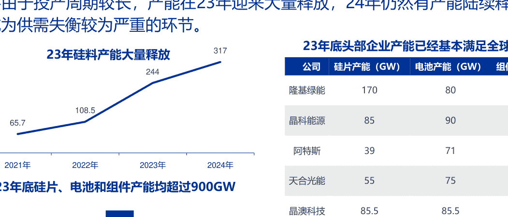

图中依次表示每个类别的权值向量（红色为飞机，蓝色为汽车，黄色为船）与输入图片的内积，加上偏置之后得到各类别的得分。得分最高者即为分类结果。

从几何意义上讲，线性分类器为每个类学习一个模板（即权值向量），测试时用内积（或余弦相似度）来度量测试样本与每个类模板的相似程度，并选择最相似的类别。

从概率角度看，该分类器可以看作是一个生成模型：用每个类的模板（权值向量 W）与该类的平均像素（外观）对应，内积可视为该类的得分。

## 1.2 高增长时代落幕，国内需求增速逐步放缓

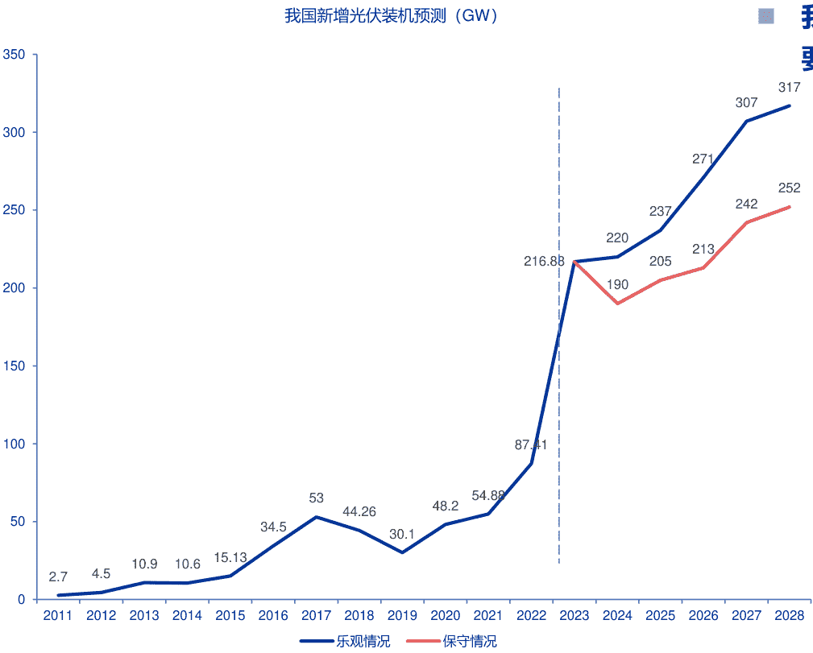

### 我国光伏市场需要解决的主要问题

- **消纳问题**：集中式及分布式均面临消纳压力
- **收益模式**：光伏进入电力市场交易已成趋势
- **用地问题**：用地、用水、用海受限较多
- **其他成本**：配储、土地费用、开发附加投资

## 1.3 海外市场光伏装机增速同步下降

### 海外主要的光伏装机市场依然为欧洲、美国等

- 美国市场由于关税政策的不确定性，24年新增光伏装机增速预计将明显下滑。从24年6月6日开始，美国对东南亚四国生产的组件与电池片关税豁免期到期，此政策对于美国当地后续装机将会产生较大影响，预计全年装机仅能保持小幅增长。
- 按照欧洲 RePowerEU 计划，2025年欧洲光伏累计装机将达320GW，2030年累计装机将达600GW。据欧洲光伏业协会，2023年底欧洲累计装机已达263GW，接近2025年装机目标，在当前传统能源价格回落的大背景下，预计后续欧洲装机增速将有所回落。

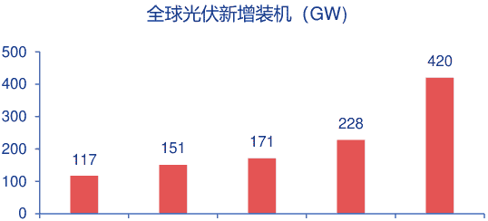

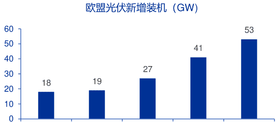

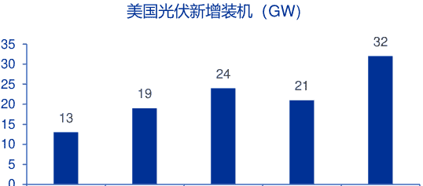

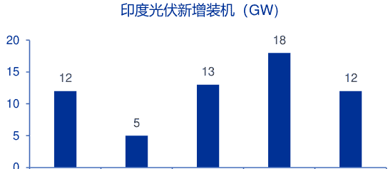

## 1.4 供需关系错配导致产业链价格持续下行

- 2023年以来，随着光伏产业链产能逐步释放，主产业链价格持续下行，24年二季度主链各环节价格已基本跌破企业生产成本，多数企业出现亏损，行业排产下滑明显。
- 由于光伏各环节产能基本都超过900GW，短期看海内外装机需求未有明显提升，预计24年下半年产业链价格压力依然较大。即使三季度为光伏装机旺季，但供给压制下，预计价格反弹压力较大。

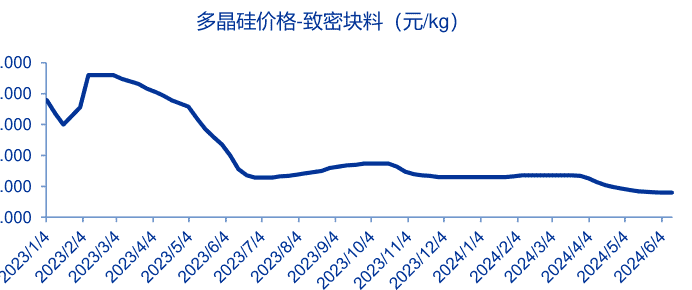

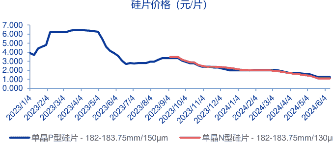

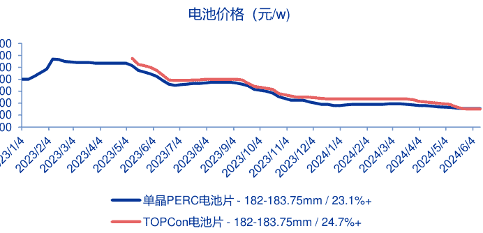

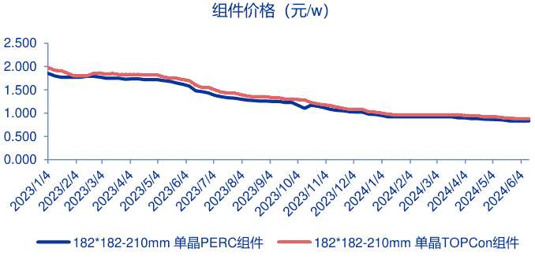

## 1.5 价格下行，光伏主产业链亏损加剧

### 格局较差的主材环节24年Q1普遍亏损，辅材龙头企业依然维持较高毛利

光伏主产业链价格的持续下行使得主材企业的盈利能力面临较大压力，23年Q4部分企业亏损较多，随着产能的持续释放和价格下行导致主材环节格局进一步恶化，24年Q1亏损加剧。而光伏辅材环节由于前两年基本完成格局重塑，龙头企业依然保持较好盈利水平。

| 所处环节 | 证券代码 | 证券简称 | 净利润（亿元）23Q4 | 净利润（亿元）24Q1 | 毛利率（%）23Q4 | 毛利率（%）24Q1 |
|---|---|---|---:|---:|---:|---:|
| 主材 | 688472.SH | 阿特斯 | 0.63 | 5.79 | 11.38 | 17.75 |
| 主材 | 688303.SH | 大全能源 | 6.48 | 3.31 | 19.70 | 16.71 |
| 主材 | 688599.SH | 天合光能 | 4.54 | 5.16 | 13.41 | 14.84 |
| 主材 | 688223.SH | 晶科能源 | 10.86 | 11.76 | 9.66 | 9.58 |
| 主材 | 600438.SH | 通威股份 | -27.28 | -7.87 | 14.83 | 9.20 |
| 主材 | 601012.SH | 隆基绿能 | -9.42 | -23.50 | 14.67 | 8.89 |
| 主材 | 600732.SH | 爱旭股份 | -11.31 | -0.91 | 0.43 | 8.70 |
| 主材 | 300118.SZ | 东方日升 | 0.84 | -2.80 | 13.22 | 8.05 |
| 主材 | 002865.SZ | 钧达股份 | -8.23 | 0.20 | 4.61 | 5.76 |
| 主材 | 002459.SZ | 晶澳科技 | 2.75 | -4.83 | 13.23 | 5.06 |
| 主材 | 603185.SH | 弘元绿能 | -5.78 | -1.41 | -14.77 | 3.11 |
| 主材 | 600481.SH | 双良节能 | 0.99 | -2.95 | 8.77 | 1.23 |
| 主材 | 300393.SZ | 中来股份 | 0.43 | -1.72 | 9.31 | -3.28 |
| 主材 | 601908.SH | 京运通 | -1.30 | -4.64 | -1.51 | -5.37 |
| 主材 | 600537.SH | 亿晶光电 | -2.34 | -2.11 | -10.99 | -6.69 |

| 所处环节 | 证券代码 | 证券简称 | 净利润（亿元）23Q4 | 净利润（亿元）24Q1 | 毛利率（%）23Q4 | 毛利率（%）24Q1 |
|---|---|---|---:|---:|---:|---:|
| 玻璃 | 601636.SH | 旗滨集团 | 5.08 | 4.42 | 29.05 | 26.09 |
| 玻璃 | 601865.SH | 福莱特 | 7.91 | 7.60 | 23.42 | 21.47 |
| 玻璃 | 600207.SH | 安彩高科 | -0.55 | -0.03 | 15.18 | 8.47 |
| 玻璃 | 002623.SZ | 亚玛顿 | -0.01 | 0.12 | 6.77 | 6.24 |
| 胶膜 | 603806.SH | 福斯特 | 4.19 | 5.22 | 16.25 | 15.28 |
| 胶膜 | 603051.SH | 鹿山新材 | -0.22 | 0.25 | 5.91 | 11.32 |
| 胶膜 | 603212.SH | 赛伍技术 | 0.18 | 0.29 | 11.17 | 10.17 |
| 胶膜 | 688680.SH | 海优新材 | -1.53 | -0.19 | 3.56 | 3.82 |
| 银浆 | 300842.SZ | 帝科股份 | 0.93 | 1.76 | 11.11 | 10.65 |
| 银浆 | 688503.SH | 聚和材料 | 0.01 | 0.76 | 6.72 | 8.25 |
| 银浆 | 002079.SZ | 苏州固锝 | 0.70 | 0.07 | 14.37 | 11.32 |
| 其他辅材 | 300861.SZ | 美畅股份 | 1.99 | 1.95 | 37.19 | 33.79 |
| 其他辅材 | 688408.SH | 中信博 | 1.88 | 1.54 | 19.89 | 20.79 |
| 其他辅材 | 002897.SZ | 意华股份 | 0.22 | 0.87 | 17.48 | 17.80 |
| 其他辅材 | 301278.SZ | 快可电子 | 0.47 | 0.40 | 26.49 | 19.95 |
| 其他辅材 | 301168.SZ | 通灵股份 | 0.20 | 0.36 | 24.01 | 18.90 |

## 主要内容

- 1. 现状：竞争加剧，盈利承压
- 2. 新技术：多线竞争，终局在望
- 3. 新市场：北美受阻，中东破局
- 4. 新格局：周期磨底，剩者为王

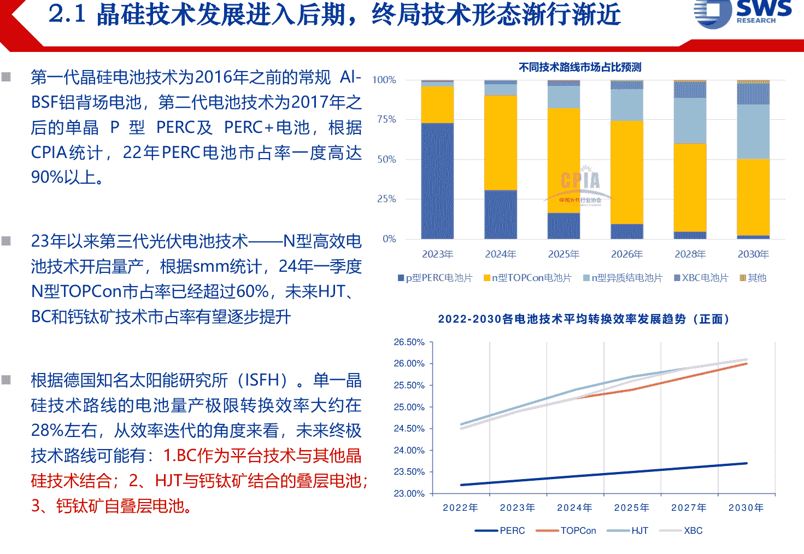

## 2.2 BC作为平台技术，量产基础较好

**BC电池是平台技术，可与X电池结合成XBC电池。** BC电池可以和采用不同钝化工艺的电池相互结合，产生新的XBC电池，例如和PERC结合成P-IBC电池，和TOPCon结合成TBC电池，和HJT结合成HBC电池。不同XBC电池结构差异集中在：

- 1. **衬底：** BC电池可以采用P型或N型硅片作为衬底，但是因为前表面产生的非平衡光生载流子需要穿过整个衬底达到背面，因此越来越多的厂商选择性能更好的N型硅片作为衬底，P型衬底目前主要应用在P-IBC电池中。
- 2. **背面钝化膜：** 按照对背面极区钝化工艺的不同可以分为0PC（无专门针对极区的钝化）、1PC（只针对一个极区进行钝化）、2PC（对两个极区都进行钝化）。P-IBC电池一般只有靠减反膜实现钝化，无专门针对极区的钝化膜，隆基的HPBC只针对发射极区进行钝化，属于1PC，TBC和HBC对两个极区都进行了钝化，属于2PC。
- 3. **掺杂层：** P-IBC和TBC都是以多晶硅作为掺杂层，而HBC则以非晶硅作为掺杂层。

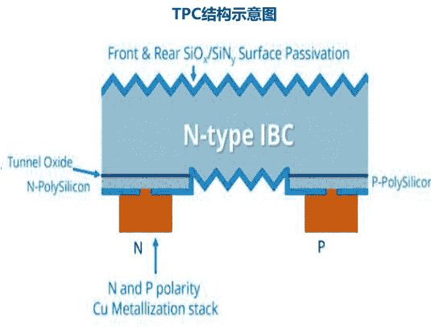

| XBC电池对比 | P-IBC电池 | TBC | HBC |
|---|---|---|---|
| 衬底 | P型衬底 | N型衬底 | N型衬底 |
| 背表面钝化膜 | 只有SiNx/AlOx减反膜起钝化作用 | 隧穿氧化层 | i-a-Si:H |
| 钝化原理 | 减反膜中含有H原子能与硅表面悬挂键结合 | 可允许多子隧穿而阻碍少子通过 | 钝化表面缺陷结构 |
| 掺杂层 | poly层 | poly层 | 非晶硅薄膜 |
| 优点 | 制造成本低；抗高温、抗紫外线能力强 | 制造成本低；抗高温、抗紫外线能力强 | 转换效率高；薄层厚度小 |
| 背表面减反膜 | SiNx/AlOx复合膜 | SiNx/AlOx复合膜 | TCO薄膜 |

## PhotoShelter for Business Review

PhotoShelter isn't just a portfolio builder — it's an all-in-one solution for photographers who want to sell prints, license images, and manage clients. This platform is designed for professional photographers who need a fully customizable website with built-in e-commerce tools.

PhotoShelter isn't just a portfolio builder — it's an all-in-one solution for photographers who want to sell prints, license images, and manage clients. This platform is designed for professional photographers who need a fully customizable website with built-in e-commerce tools.

Pros:

- Easy to set up and use
- Sell prints and digital downloads
- Built-in client galleries
- Unlimited storage on Stripe

Cons:

- Limited templates
- No free plan
- Transaction fees apply

Final Verdict:

It's a great platform for pro photographers, but not ideal for beginners or hobbyists.

## 2.4 HJT量产初具规模，降本提效未来可期

- 作为海外光伏电池主流扩产方向，HJT电池发展潜力逐渐显现。而且HJT电池理论极限效率29.2%，高于TOPCon的28.7%。据Solarzoom统计，2024Q1全国已投产HJT电池产能已经超过40GW。
- HJT 24年以来，随着银包铜、0BB等技术的成功量产，行业进展较为顺利。根据24年SNEC光伏展情况，主流HJT企业组件批量交付功率普遍达到710W，已经表现出较强的竞争力。未来随着HJT持续的降本增效，或有头部企业开始大规模扩产。
- HJT另一发展潜力在于异质结电池表面本身就是TCO，与钙钛矿层兼容性更好，通过与钙钛矿的叠层，有望将光电转换效率做到30%+。（标的：宝馨科技）
- 目前HJT国内主流企业为安徽华晟、东方日升和通威股份。其中通威股份的1GW大产能试验线对接下来行业扩产有重要指导意义。

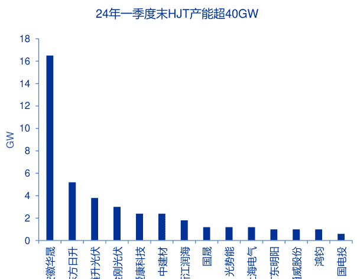

### HJT电池组件提效型技术进步一览

| 技术进步项 | 提效 | 是否同时降本 | 量产导入时间 | 备注 |
|---|---|---|---|---|
| 硅片吸杂 | 0.05-0.2% |  | 已成为标准量产工艺 | 要求硅片厂提供吸杂 |
| 硅片掺杂元素优化 | ≥0.1% |  | 预计24年四季度 |  |
| 硅片背面抛光 | 0.15-0.2% | √ | 最快24年四季度 |  |
| 高迁移率配材 | 0.05-0.1% |  | 预计24年三、四季度 |  |
| 全开口网版 | 0.05-0.3% | √ | 最快24年四季度 |  |
| 0BB | 0.15-0.2% | √ | 部分企业已经量产导入 | 24年四季度前未必立即形成行业性的统一技术方案 |
| 光转换膜 | 0.25-0.3% |  | 部分订单已经量产导入 | 须优化性价比 |

资料来源：Solarzoom，申万宏源研究

资料来源：Solarzoom，《中国光伏HJT产业发展白皮书（2024版）》、申万宏源研究

## 2.5 钙钛矿渐行渐近，产业化进程加速

- 钙钛矿是以俄罗斯物理学家 Perovski 的名字命名的，最初单指钛酸钙（CaTiO3）这种矿物，后来把结构为 ABX3 以及与之类似的晶体统称为钙钛矿物质。钙钛矿电池制作成本较低，且可以自叠层或者与晶硅叠层，可以将光电转换效率做到30%+，因此有望成为未来的终极技术路线。
- **钙钛矿-晶硅叠层：**由于晶硅具有窄带隙的特点，其吸收短波长光子时会产生较大的能量损失，限制了其最高转换效率。通过将其与对应的宽带隙吸光材料（1.6-1.7eV）结合构建叠层电池，可有效实现效率提升。根据公司官网，24年6月隆基绿能研制的晶硅-钙钛矿叠层太阳电池转换效率达到34.6%。
- **钙钛矿自叠层：**钙钛矿组分可调的特点使得其不仅可以用作宽带隙吸光层，也可以调整得到窄带隙吸光层，两者结合即可得到全钙钛矿叠层电池。

| 企业名称 | 进展 |
|---|---|
| 协鑫光电 | 公司为钙钛矿龙头企业，2024年6月，中试研发线2050cm²钙钛矿叠层组件转化效率达到27.34%，而GW级产线也预计将于2024年底竣工 |
| 纤纳光电 | 公司百兆瓦级别产线22年投产，厂房主体已经完工，衢州GW级别产能预计25年Q2投产 |
| 极电光能 | 24年2月，极电光能在810cm²钙钛矿光伏组件上实现了20.7%的稳态效率；2.8平方米的GW级产线预计于24年Q3投产 |
| 仁烁光能 | 公司已经建成0.6m×1.2m的150MW产线，2024年5月公司GW级钙钛矿光伏项目落地苏州常熟，大尺寸组件经认证的全面积稳态认证效率高达18.4%，大面积全钙钛矿叠层光伏组件的国际权威认证稳态效率达24.8% |

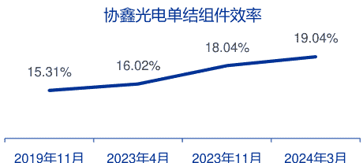

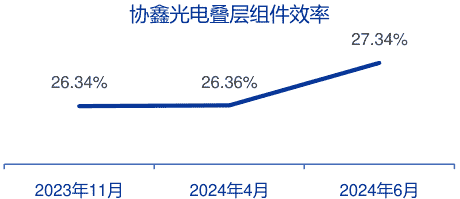

## 主要内容

- 1. 现状：竞争加剧，盈利承压
- 2. 新技术：多线竞争，终局在望
- 3. 新市场：北美受阻，中东破局
- 4. 新格局：周期磨底，剩者为王

## 3.1 受价格下降影响，中国光伏产品出口金额下降

- 受价格下降和库存影响，2024年以来，中国光伏电池和组件出口金额大幅下降。
- 分市场来看，由于对亚洲出口主要是中国企业的东南亚产能，实际出口金额最大的依然是欧洲市场。且随着欧洲去库存完成，二季度对欧洲出口有所恢复。

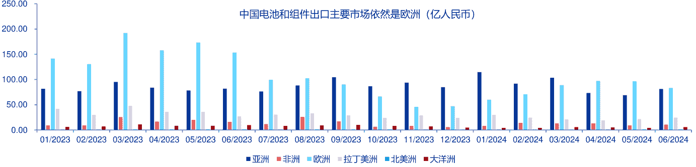

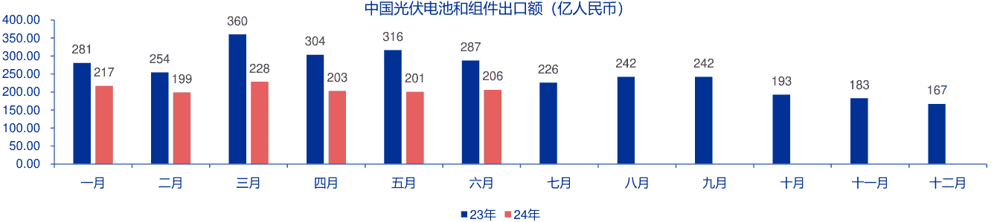

## 3.2 光伏新兴市场增长显著，中东地区表现亮眼

### 亚非拉地区光伏需求景气度高，未来有望持续增长

- 根据中国海关6月份数据，中国对印度、巴基斯坦、巴西等亚非拉地区的部分国家组件出口数据环比继续保持增长态势。由于这些地区光伏装机比例较低，我们认为亚非拉市场的需求有望持续向好。
- 产能出海方面，2024年以来陆续有企业宣布在中东建厂，这有助于中东地区碳中和的实现和增强国内企业的全球化能力。

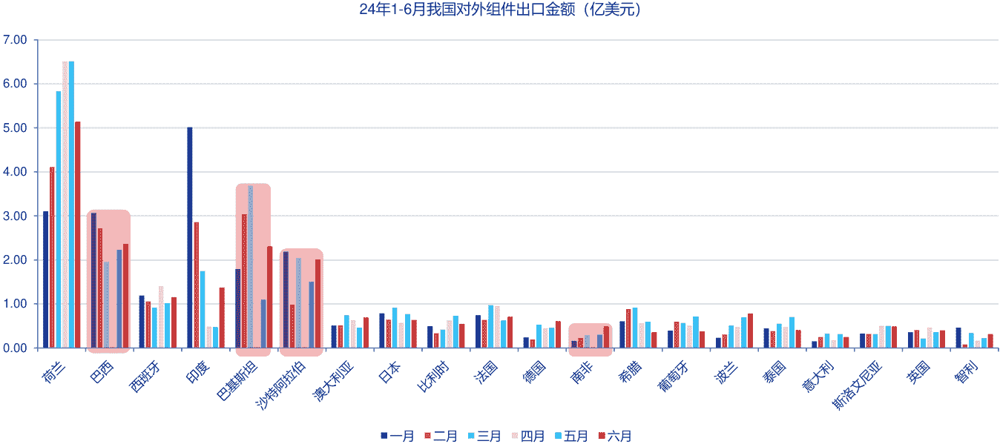

## 3.3 美国市场盈利虽好，但面临政策不确定性

### 美国光伏延续高景气需求，产业链制造能力不足

- 2023年美国光伏累计装机容量超过179GW，其中公用事业累计装机量高达116.86GW，占比约65%。Guidehouse Insights预测，2024年至2033年，美国住宅、商业、工业和公用事业新增光伏装机容量将从近39GW增长至67GW左右，复合年增长率为6.3%（公用事业新增光伏装机容量占比近60%）。
- 美国拥有足够的多晶硅产能，每年制造约60GW晶体硅产品。但目前铸锭、硅片及电池制造能力明显不足，铸锭产能约17GW，硅片产能约30GW，电池产能48GW，高度依赖零部件的全球供应商。

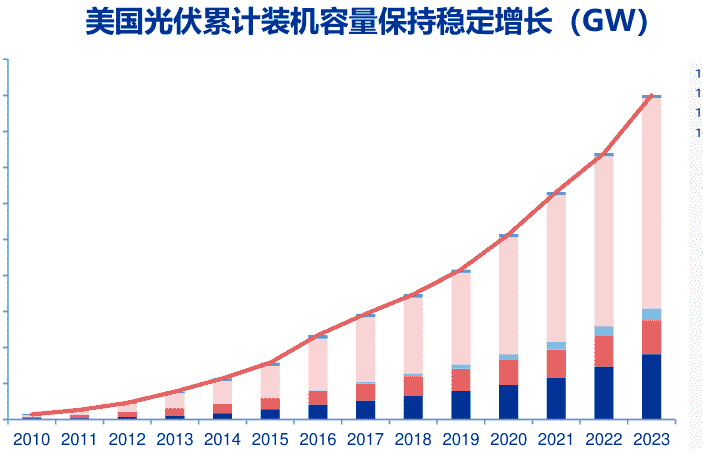

资料来源：EIA，申万宏源研究

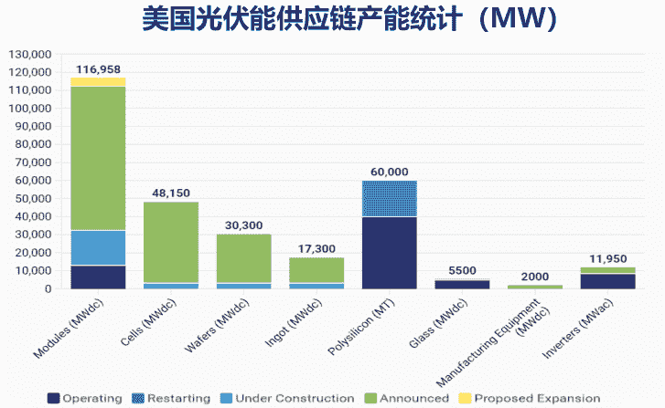

资料来源：SEIA，申万宏源研究

## 3.4 美国对中国光伏企业出口限制政策梳理

### 高筑贸易壁垒，扶持国内制造业发展：双反（反倾销+反补贴）& 201关税 & 301关税 & 涉疆法案（UFLPA）

#### 奥巴马政府时期（民主党）
2009.01—2017.01

#### 川普政府时期（共和党）
2017.01—2021.01

#### 拜登政府时期（民主党）
2021.01—2025.01

#### 双反（反倾销、反补贴）

2012年10月：开始实施

对中国光伏电池及组件进行双反调查，征收14.78%到15.97%的反补贴税，18.24%到49.96%的反倾销税。此次裁定认为组件原产国为电池制造国。

#### 201双反

2015年2月：对中国大陆与中国台湾光伏电池及组件进行二次双反，对中国相关产品实行27.64%到49.79%不等的反补贴税，及26.71%至165.04%的反倾销税；中国台湾相关产品实行11.45%至27.55%的反倾销税。此次裁定中，大陆组件继续被认定为来自中国大陆组件的原产国。

#### 201关税

2018年1月：开始实施

为期4年，针对全球国家，豁免少数美国政府认为符合GSP的发展中国家，包括巴西、柬埔寨、缅甸等（菲律宾和泰国符合但未获豁免）；进口光伏组件首年税率30%，后逐年递减5%，电池每年豁免配额2.5GW。

#### 301关税

2018年7月：开始实施

先后发布四份关税清单，针对来自中国的约3700亿美元产品加征7.5%～25%不等的关税。其中549项产品关税豁免延长1年，但所有豁免于2020年底到期。

#### 201关税

2019年6月—2020年11月：双面组件豁免多次被取消、恢复。

#### 301关税

2022年3月：重新豁免涉及313亿美元的352项中国进口商品的关税。

#### 反规避调查

2022年3月：对柬埔寨、马来西亚、泰国和越南进口的光伏电池与组件进行反规避调查，防止中国厂商通过将产能转移至东南亚以规避关税。

#### 201关税

2022年2月：税率改为14.75%，逐年调降0.25%，延至2026年；电池豁免配额调整至5GW，继续豁免双面组件。

#### 涉疆法案（UFLPA）

2022年6月：开始实施

所有进口企业须向美国海关提供光伏产品溯源，证明产品成分并非来自新疆生产。

#### 反规避调查

2022年3月：对柬埔寨、马来西亚、泰国和越南进口的光伏电池与组件进行反规避调查，防止中国厂商通过将产能转移至东南亚以规避关税。

#### 反规避调查

2023年8月：判决结果公布

厂商面临最高254.19%的双反税，但美国政府提供两年豁免期（2022.6—2024.6）。

#### 反规避调查

2023年6月：2年豁免开始

官宣声明稿释出，东南亚反规避开始两年的免税期。

#### 反规避调查

2024年6月：2年豁免结束

美国的双反调查将对东南亚4国展开双反调查。

## 主要内容

- 1. 现状：竞争加剧，盈利承压
- 2. 新技术：多线竞争，终局在望
- 3. 新市场：北美受阻，中东破局
- 4. 新格局：周期磨底，剩者为王

## 4.1 本轮周期是光伏平价上网后的第一次

### 平价上网+供过于求+需求放缓，导致产业链价格暴跌

- 中国光伏产业始于2000年，2001年尚德成立。2004—2008年，在尚德的示范效应下，大量企业进入，行业“拥硅为王”。2007年底，多晶硅价格一度达到300美元/kg。
- 2008—2013年：金融危机、各国收缩补贴，加上产能扩张，行业进入漫长的调整期。这期间，中国政府保住光伏火种，推出了金太阳示范工程并开启了光伏上网补贴时代。
- 2013—2018年，国内政策补贴刺激装机需求，产业规模扩大，行业平稳发展。
- 2018—2020年，国内补贴退坡，需求大幅下降。
- 2020—2022年底，技术进步带来光伏平价上网，碳中和背景下全球需求爆发。
- 2022—2024年8月，产能扩张导致供过于求，行业全面亏损。

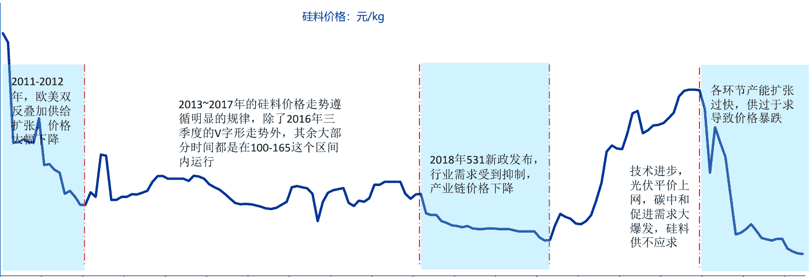

2011—2012年，欧美双反叠加供给扩张，价格大幅下降。

2013—2017年的硅料价格走势遵循明显的规律，除了2016年三季度的V字形走势外，其余大部分时间都是在100—165这个区间内运行。

2018年“531”新政发布，行业需求受到抑制，产业链价格下降。

技术进步、光伏平价上网、碳中和促进需求大爆发，硅料供不应求。

各环节产能扩张过快，供过于求导致价格暴跌。

## 4.2 光伏板块预计2024年下半年完成筑底

- **光伏的周期是由需求—产能—技术三重因素叠加形成的。** 而硅料作为光伏产业最上游，对周期反应最为敏感，而这一轮新周期的拐点，也将率先表现在硅料上。
- **上一轮硅料周期持续时长近30个月。** 从毛利率角度看，上一轮光伏周期顶点开始于2017年底，2019年毛利率降到最低，2020年毛利率向上恢复。本轮周期毛利率高点为2022年，本轮周期需求具备强支撑，从根本上抑制了长周期形成，预计硅料企业2024年毛利率完成筑底，2025年迎来向上修复。

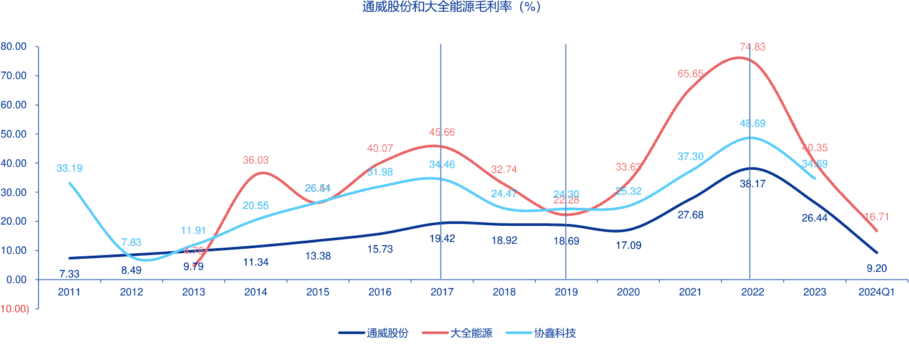

### 产品设计

创新的产品设计能够提升用户体验，增强产品竞争力。

- **用户研究**：洞察用户需求
- **概念设计**：创造独特的产品理念
- **原型制作**：快速验证设计可行性

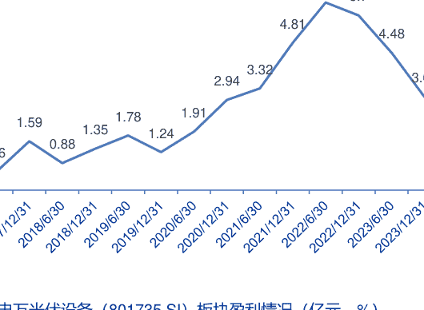

建模与样式化是将创意转化为可视化的过程，确保产品外观符合品牌形象。

### 开发工具

- **版本控制**：使用 Git 管理代码
- **实时预览**：支持代码热重载
- **依赖管理**：自动处理包引用

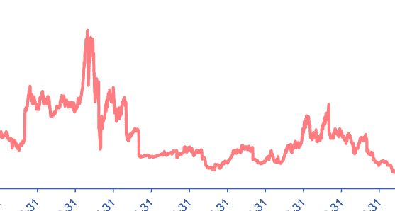

- **加速开发**：减少重复性工作
- **提升协作**：便于团队沟通
- **质量保证**：降低集成风险

持续改进和迭代是产品设计的重要环节，围绕用户反馈进行优化。

产品设计不仅是外观，更在于功能与情感的共鸣。

## 4.4 资金储备成为企业穿越周期的压舱石

- **光伏产业链价格触底，亏损限制降价空间。** 当前光伏主产业链售价与成本基本倒挂，企业持续亏损，因此价格继续下降空间不大。从价格角度来看，产业链已接近周期底部。
- **光伏行业亏损或加剧，亏损收窄预期最早在24Q4。** 2024年Q1光伏主产业链企业普遍亏损，Q2价格持续下行，行业亏损加剧，排产下降。2024年8月7日，硅业分会公布了最新多晶硅价格，大体维持稳定，部分新签订单触底反弹。我们预计2024年下半年随着价格企稳以及需求提升，2024年Q4企业亏损有望收窄。
- **光伏行业当前周期底部修复情况可能超过历史其他几轮周期。** 本轮周期与前几次不同在于——本次周期行业规模基数创新高、整体需求仍向上，但产能供给大幅超过需求、新技术迭代趋缓，因此本轮周期底部亏损幅度或超过此前，**现金储备将成为企业穿越周期的关键因素。**

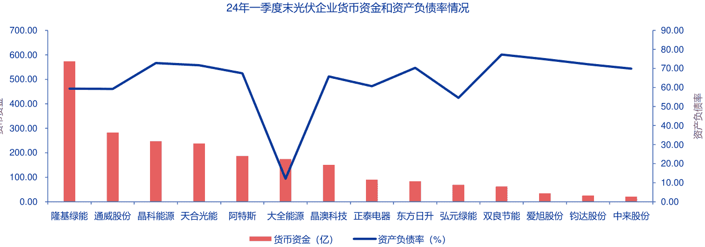

### 我们来谈谈“追求卓越”这件小事

**身边的朋友总说我对自己要求太高了。** 每次听到这样的评价，我总会陷入一种矛盾——是我不懂得欣赏已有的成绩，还是真的在拿一个虚无的标准惩罚自己？直到最近一次深夜工作，我才稍微明白了一点：卓越不是终点，而是一种状态。它不意味着永远满分，而是在每一次可以敷衍的时候，选择多花十分钟把细节打磨到位。

我喜欢观察那些在各个领域做到顶尖的人。他们身上有一个共同点：**对平庸的零容忍**。但奇怪的是，他们并非不犯错，而是从不接受“差不多就行”的借口。哪怕只是一个邮件的措辞、一张示意图的配色，也透露出一种不将就的气质。这种气质不是靠喊口号养成的，而是在日复一日的选择中沉淀下来的。

当然，追求卓越并不意味着要把自己逼到崩溃。我开始学会分辨哪些地方值得多用力，哪些地方可以放松。真正的卓越感，其实是一种**从容的自律**——知道什么是核心，敢于在非核心处放手，但在关键处绝不将就。

如果你也正在这条路上，可以试试以下几点：

- **设定一个自己真正在意的标准**，而不是迎合他人的期待
- **每周复盘一次**，找出3个可以做得更好的细节
- **学会拒绝“差不多”**，哪怕一开始慢一点
- **记得奖励自己**，卓越的路上也需要补给站

最后我想说，卓越不是一场和他人的赛跑，而是一场和自己的约定。**每天比昨天的自己好一点点**，这些微小的增量累积起来，就是一条耀眼的路。愿我们都能在那条路上，找到属于自己的从容与光亮。

## 4.6 新一轮制造出海背景下，专业化企业迎来发展新机遇

### 产能出海东南亚已成过去式

2011年，美国开始对我国实施双反，我国主要光伏制造企业开始一轮长达十余年的出海东南亚进程。但随着东南亚四国光伏关税豁免期结束，以及美国新一轮光伏产品反倾销调查的展开，中国光伏企业从东南亚借道出口美国的路径或将受阻。为了规避美国调查及开拓新市场，国内企业开启了新一轮制造出海。

### 新一轮制造出海主要以下游组件为主，未来上游专业化企业或迎来新的发展机遇

在政策刺激下，美国、印度、土耳其等地组件制造业蓬勃发展，未来将从进口组件转向进口电池片。根据SEIA统计数据，美国本土组件产能规划78.4GW，其中34GW已建成投产，在建产能23.65GW。电池片产能规划30.4GW，其中在建产能7.8GW，但美国目前电池产能依然严重不足。2024年8月12日，美国白宫发布关于促进晶硅光伏电池进口积极调整的公告，太阳能电池的关税配额将从5GW增加到12.5GW。海外组件大规模建设，电池将面临产能缺口，未来专业化电池企业将迎来新的发展机遇。

| 公司 | 公告时间 | 项目地址 | 投资计划 |
|---|---|---|---|
| 晶科能源 | 2024年7月 | 沙特 | 晶科能源子公司晶科中东、PIF（沙特阿拉伯公共投资基金PIF）子公司RELC，以及VI将在沙特阿拉伯共同成立一家合资企业，分别持股40%、40%和20%。项目总投资约9.85亿美元，用于建设10GW高效电池及组件项目，这也是晶科能源目前最大制造基地以及投资项目。该项目预计在2026年初左右投产。 |
| 协鑫科技 | 2024年6月 | 阿联酋 | 公司首个海外FBR颗粒硅项目有望落地阿联酋，这将成为目前在中国以外、全球最大的多晶硅研发与制造基地。协鑫科技将与Mubadala Investment Company PJSC（下称穆巴达拉主权基金）探索潜在合作机会，在阿联酋当地建立具有全球区域重要性的综合性生态系统。 |
| 钧达股份 | 2024年7月 | 阿曼 | 钧达股份第一阶段拟在阿曼投资2.8亿美元建设5GW高效电池生产基地，预计2025年投产。第二阶段将再建设5GW产能的TOPCon光伏电池生产基地，两阶段预计投资总额为7亿美元。 |

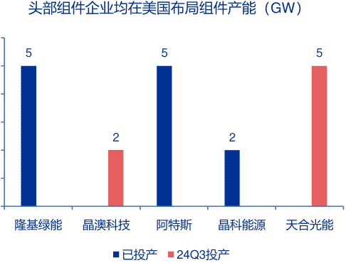

## 投资分析意见

- **硅料价格为行业拐点指标。** 硅料作为光伏制造上游，其价格对行业周期拐点具有指示意义，且硅料环节成本曲线陡峭，头部企业成本优势明显。建议关注：**通威股份、大全能源、协鑫科技。**
- **专业化电池企业迎来发展新机遇。** 当前全球都在积极推动本土光伏制造产能落地，组件投资轻、落地快、技术难度小，因此海外兴建了大量光伏组件产能。而电池技术要求高、投资重，未来海外对于光伏电池的需求增大，专业化电池企业发展迎来新机遇。建议关注：**钧达股份。**
- **新兴市场盈利能力较好。** 国内光伏市场竞争激烈，欧洲市场盈利不断收窄，美国市场遇阻，具备海外制造产能的光伏企业以及光伏新兴市场占比较高的企业有望获得较好海外利润。建议关注：**晶科能源、阿特斯。**
- **财务质量为周期底部的试金石。** 光伏行业当前处于周期底部位置，财务状况稳健的企业穿越周期的胜率更高。头部企业现金储备较高，融资渠道多元，在产业链持续亏损的情况下，头部企业具备维持正常生产、保持市占率和低价兼并收购的资金实力。建议关注：**隆基绿能、东方日升。**
- **新技术依然是关注点。** 降本提效为光伏发展的主旋律，虽然短期TOPCon为市场主流技术，具备更高效率的BC、HJT以及钙钛矿叠层技术依然是发展方向。建议关注：**迈为股份。**
- **头部辅材企业竞争格局向好，周期拐点后弹性大。** 建议关注：**福斯特、福莱特。**

## 风险提示

- **光伏装机不及预期。** 光伏产业发展依赖全球装机，如若全球装机增速放缓甚至负增长，对制造企业的利润将会产生较大影响。
- **制造出海进展不及预期。** 当前国内市场盈利较差，企业纷纷布局海外，而东南亚产能遭遇美国双反调查，其他市场未来也可能出现类似情况。如若光伏制造无法顺利出海，将会进一步加剧行业供需失衡和企业亏损情况。
- **新技术进展不及预期。** 光伏的发展依赖于技术进步，新技术对资金投入依赖较高，而在下行周期或因资金短缺而导致新技术进展不及预期，从而影响企业盈利。
- **周期拐点不及预期。** 当前虽然是光伏周期底部，如若周期底部持续时长超预期，将会加剧企业的经营风险。

## 重点企业估值表

| 证券代码 | 证券简称 | 2024/8/16 收盘价（元） | 总市值（亿元） | PB 2023A | EPS 2024E | Wind一致预期净利润（亿元） 2024E | 2025E | PE 2024E | 2025E |
|---|---|---:|---:|---:|---:|---:|---:|---:|---:|
| 600438.SH | 通威股份 | 19.18 | 863 | 1.4 | 3.02 | 32.67 | 65.12 | 26 | 13 |
| 3800.HK | 协鑫科技 | 1.12 | 302 | 0.6 | 0.09 | 16.73 | 29.30 | 18 | 10 |
| 688303.SH | 大全能源 | 19.99 | 429 | 1.0 | 2.70 | 23.20 | 30.00 | 18 | 14 |
| 603806.SH | 福斯特 | 15.06 | 393 | 2.6 | 0.99 | 25.79 | 31.54 | 15 | 12 |
| 601865.SH | 福莱特 | 17.96 | 387 | 1.9 | 1.24 | 37.87 | 48.84 | 10 | 8 |
| 002865.SZ | 钧达股份 | 40.16 | 92 | 1.9 | 3.83 | 11.12 | 15.22 | 8 | 6 |
| 688472.SH | 阿特斯 | 10.18 | 375 | 1.8 | 0.85 | 35.15 | 46.26 | 11 | 8 |
| 688223.SH | 晶科能源 | 7.02 | 702 | 2.1 | 0.74 | 50.41 | 63.21 | 14 | 11 |
| 600732.SH | 爱旭股份 | 8.49 | 155 | 1.8 | 0.42 | 13.07 | 21.14 | 12 | 7 |
| 300118.SZ | 东方日升 | 10.55 | 120 | 0.8 | 1.22 | 15.15 | 20.59 | 8 | 6 |
| 601012.SH | 隆基绿能 | 13.72 | 1,040 | 1.5 | 1.42 | 35.33 | 64.34 | 29 | 16 |

资料来源：Wind，申万宏源研究

### 2022版浙江省普通高校招生选考科目考试模拟试题

**思想政治**

本试题卷分选择题和非选择题两部分，满分100分，考试时间90分钟。

**选择题部分**

一、判断题（本大题共5小题，每小题1分，共5分。判断下列说法是否正确，正确的请填T，错误的请填F）

1. 某私营企业老板捐赠100万元给慈善机构，这是社会救助的一种形式。

2. 公有制经济仅包括国有经济和集体所有制经济。

3. 在我国，国家与公民个人的利益在根本上是一致的。

4. 文化对经济和政治具有促进作用，给予经济和政治重大影响。

5. “实事求是”是马克思主义的精髓，是毛泽东思想的精髓。

## 法律声明

本报告由上海申银万国证券研究所有限公司（隶属于申万宏源证券有限公司，以下简称“本公司”）在中华人民共和国境内（香港、澳门、台湾除外）发布，仅供本公司的客户（包括合格的境外机构投资者等合法合规的客户）使用。本公司不会因接收人收到本报告而视其为客户。有关本报告的短信提示、电话推荐等只是研究观点的简要沟通，需以本公司 http://www.swsresearch.com 网站刊载的完整报告为准，本公司并接受客户的后续询问。本报告首页列示的联系人，除非另有说明，仅作为本公司就本报告与客户的联络人，承担联络工作，不从事任何证券投资咨询服务业务。

本报告是基于已公开信息撰写，但本公司不保证该等信息的准确性或完整性。本报告所载的资料、工具、意见及推测只提供给客户作参考之用，并非作为或被视为出售或购买证券或其他投资标的的邀请或向任何人作出邀请。本报告所载的资料、意见及推测仅反映本公司于发布本报告当日的判断，本报告中的证券或投资标的价格、价值及收益可向上或向下浮动。在不同时间，本公司可发出与本报告所载资料、意见及推测不一致的报告。客户应当考虑到本公司可能存在的可能影响本报告客观性的利益冲突，不应视本报告为作出投资决策的唯一因素。客户应自主作出投资决策并自行承担投资风险。本公司特别提示，本公司不会与任何客户以任何形式分享证券投资收益或分担证券投资损失，任何形式的分享证券投资收益或者分担证券投资损失的书面或口头承诺均为无效。本报告中所指的投资及服务可能不适合个别客户，不构成客户私人咨询建议。本公司未确保本报告充分考虑到个别客户特殊的投资目标、财务状况或需要。本公司建议客户应考虑本报告的任何意见或建议是否符合其特定状况，以及（若有必要）咨询独立投资顾问。在任何情况下，本报告中的信息或所表述的意见并不构成对任何人的投资建议。在任何情况下，本公司不对任何人因使用本报告中的任何内容所引致的任何损失负任何责任。市场有风险，投资需谨慎。若本报告的接收人非本公司的客户，应在基于本报告作出任何投资决定或就本报告要求任何解释前咨询独立投资顾问。

本报告的版权归本公司所有，属于非公开资料。本公司对本报告保留一切权利。除非另有书面显示，否则本报告中的所有材料的版权均属本公司。未经本公司事先书面授权，本报告的任何部分均不得以任何方式制作任何形式的拷贝、复印件或复制品，或再次分发给任何其他人，或以任何侵犯本公司版权的其他方式使用。所有本报告中使用的商标、服务标记及标记均为本公司的商标、服务标记及标记，未经本公司同意，任何人均无权在任何情况下使用它们。

### Python 201: A Multi-Course Tutorial

Learn Python is the most popular programming language in the world. It is a versatile language that is used for web development, data science, artificial intelligence, machine learning, and more.

#### Course Details

- Levels: Beginner to Advanced
- Duration: 14 hours
- Enrolled: 500+ Students
- Language: English

#### What you will learn

- Python fundamentals
- Functions and modules
- Object-oriented programming
- File handling
- Exception handling

> Learning Python opens the door to endless possibilities in the software world.
