# 行业研究｜深度报告｜投资银行业与经纪业

# MIFID II 如何影响全球研究佣金监管制度？

请阅读最后评级说明和重要声明

# 嵌入式系统开发基础

嵌入式系统是一种以应用为中心，以计算机技术为基础，并且软硬件可裁剪，适用于应用系统对功能、可靠性、成本、体积、功耗有严格要求的专用计算机系统。

嵌入式系统的核心是嵌入式处理器，常见的包括 ARM、MIPS、RISC-V 等架构。在设计嵌入式系统时，需要综合考虑硬件选型、操作系统选择、功耗管理以及实时性要求等因素。

- 硬件层：包括处理器、存储器、I/O 接口等
- 系统软件层：包括 RTOS、驱动程序、文件系统等
- 应用软件层：针对特定应用开发的程序

| 开发工具 | 用途 |
|---|---|
| Keil MDK | ARM 开发 |
| IAR EWARM | 嵌入式开发 |
| GCC | 编译工具 |

> “嵌入式系统设计中最重要的原则是：在满足功能需求的前提下，追求最优的性能功耗比。”

# 投资银行业与经纪业

# MIFID II 如何影响全球研究佣金监管制度？

# 欧盟金融体系改革的发展历程

**MIFID II 成为现阶段欧盟最佳监管政策条例指引规范，修补 MIFID I 的三大缺陷。** 2008 年金融危机验证 MIFID I 已无法满足时代的需求，因而欧盟监管者对其进行修订更新，推出了新版 MIFID II。新政策条例解决以往的缺陷，加强市场透明度、投资者保护条例上的监管措施，创建一个公平、公正、高效且健康的金融环境。MIFID 缺陷主要有三大类：1）场外交易的金融工具监管力度不足；2）未将欧盟以外的金融公司或金融产品交易纳入监管范围；3）投资人权益保护机制不够健全。这三大缺陷共同削弱欧盟金融监管的发展。

# 新版 MIFID 对症下药，开具三大处方及其附加影响

**MIFID II 比 MIFID I 在金融监管各个方面的细节上处理得更为详尽，监管范围更加扩大，大幅度降低金融风险，维护投资者的利益。** 为了修正过去条例的缺陷，MIFID II 针对性地提出各自的解决方案：1）建立新的交易所 OTF，采用 DVC（双交易量上限机制）对交易前豁免条例设置一定的门槛；2）对第三方国家机构实施统一规范的管理制度；3）新增四项投资者保护条例。

**MIFID II 将研究服务业务分成两种模式，即自掏腰包和专款专用（RPA 账户）。** 第一种模式通过将研究业务与佣金业务合理解绑，阻止研究成本转嫁给客户，有利于确保大众投资者的相关利益。该政策措施无疑带来了买方和卖方商业战略上的剧变。买方方面，机构增加分析师数量并逐渐转向内部研究，研究成本和人力成本有所上升。卖方方面，机构减少中小企业股票研究，导致投资者逐渐放弃对中小盘股的投资，从而转向大盘股。因此，欧盟的中小企业在获取资金的渠道上也受到一定的负面影响，大型企业的竞争力进一步加强。

# MIFID II 重塑全球投研生态

**英国与欧盟可能放宽研究佣金分拆制度。**

1）英国欲重新恢复交易佣金捆绑制度。英国自执行 MIFID II 监管法规以来，研究实力和覆盖面有所下滑，导致投研竞争力弱化，因此英国决议做出新一轮佣金制度改革，或将重新回归交易佣金捆绑制度，借此增强英国资本市场的核心竞争力。

2）欧盟放宽佣金分拆制度。2022 年 12 月，欧盟委员会修改了欧盟资本市场复苏计划，将分拆豁免适用范围从市值低于 10 亿欧元修订为市值低于 100 亿欧元，扩大中小企业研究豁免范围，此举可应对中小企业投资研究覆盖面大幅下降的趋势。

**MIFID II 改变美国投资研究生态。** 美国 SEC 采用“不行动”信函缓冲 MIFID II 对买卖双方的影响。该信函最初定于 2020 年 7 月 3 日到期，之后又延长三年至 2023 年 7 月 3 日，为市场参与者提供更多时间来适应新的佣金监管要求。2023 年 7 月 5 日，SEC 决定不再延长缓冲期限。佣金监管方面，20% 的买方公司预计将通过 CSA 支付研究佣金，而只有 7% 的机构表示将减少使用 CSA，因此大部分美国买方机构已开始采用佣金分成协议（CSA）来支付研究费用。

# 风险提示

- 1. 他国经验未必适用
- 2. 监管政策不确定性

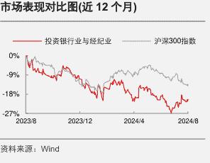

# 相关研究

- 《券业并购重组迎来加速期，看好非银板块估值业绩双修复——每周一话》2024-08-12
- 《预定利率调降，看好寿险景气度——每周一话》2024-08-04
- 《降息释放流动性，看好非银板块估值业绩双修复——每周一话》2024-07-28

# 目录

- 欧盟金融监管体制改革的发展历程 .......................................................... 6
  - 一次对 MIFID I 的压力测试：金融危机 ....................................................... 6
  - MIFID II 成为欧盟现阶段最佳监管政策引导条例 ............................................. 6
  - 以往 MIFID I 存在的缺陷 ........................................................................ 7
- 新版 MIFID 开具三大处方及其产生的影响 ...................................................... 11
  - 成立新的交易所 OTF ............................................................................ 11
  - 提升第三方国家准入门槛 ........................................................................ 14
  - 研究与佣金分析，大力加强对金融产品的干预和监督 ......................................... 15
  - MIFID II 所带来的附加影响 ...................................................................... 18
- 横跨大西洋两岸监管法规对比 ....................................................................... 22
  - 欧盟 MIFID 与美国 NMS 法规的比较 ............................................................ 22
- MIFID II 重塑全球投研生态 ........................................................................ 24
  - 英国与欧盟放宽研究佣金分拆制度 .............................................................. 24
  - MIFID II 改变美国投资研究生态 ................................................................. 25
  - 美国研究佣金分拆趋势明显 ........................................................................ 26
  - 受 MIFID II 分析模式影响的美国投研现状 ..................................................... 27
- 风险提示 .............................................................................................. 30

# 图表目录

- 图 1：欧盟名义 GDP、实际 GDP 以及实际 GDP 增速（单位：亿美元） .................... 6
- 图 2：欧盟监管政策变化 ............................................................................. 7
- 图 3：2019 年 OTC 衍生品占据主导地位 ............................................................ 8
- 图 4：MIFID I 涉及欧盟以外第三国公司相关条例 .................................................. 9
- 图 5：MIFID I 相比 MIFID II 在投资者保护政策上所缺乏的条例 ............................... 10
- 图 6：MIFID I 与 MIFID II 的变化以及差异 ........................................................ 11
- 图 7：2018 年各月份因 DVC 暂停豁免证券 .......................................................... 14
- 图 8：2021 年 OTC 占主导地位 ........................................................................ 14
- 图 9：2022 年 OTC 占比有所扩大，仍占主导地位 .................................................. 14
- 图 10：欧盟股票暗池交易额（单位：亿欧元） ....................................................... 14
- 图 11：欧盟股票暗池交易份额（单位：%） ........................................................... 14
- 图 12：RPA 账户运营需满足的条件 ................................................................... 17
- 图 13：诱导性规则适用范围 ............................................................................ 17
- 图 14：2018 年按资产管理规模计算的研究预算平均变化 .......................................... 19
- 图 15：对于以下每个研究提供商，与 MIFID II 之前相比，您获取的研究资源是更多、更少还是不变？（2018 年） ........................................................................ 20
- 图 16：对于卖方研究覆盖而言，卖方观点的改变变化 .............................................. 21
- 图 17：MIFID II 是否改变了欧盟中小企业股票研究的数量（2020 年） ......................... 21
- 图 18：2014Q2—2024Q2 ATS 中 OTC 季度成交量 ................................................................. 24
- 图 19：2013—2023 年 NMS 下股票交易 OTC 所占份额（%） ...................................................... 24
- 图 20：使用软佣金购买的产品分类（单位：%） ..................................................................... 26
- 图 21：延长 SEC 不采取行动信函中的缓冲期限 ..................................................................... 27
- 图 22：关于失去/终止相关研究服务的担忧 ............................................................................ 27
- 图 23：美国客户佣金安排架构 .............................................................................................. 28
- 图 24：2020 年美国权益研究佣金支付渠道 ............................................................................. 29

## 表目录

- 表 1：MIFID 四大透明度豁免条例 ........................................................................................7
- 表 2：MIFID I 下各大交易所对比 ............................................................................................8
- 表 3：在 MIFID II 下四大交易所的对比 ..................................................................................12
- 表 4：OTF 与其他交易所的区别 ............................................................................................12
- 表 5：MIFID II vs MIFID I：最佳执行原则 .............................................................................12
- 表 6：MIFID II 条例下的两种可选模式 ...................................................................................15
- 表 7：MIFID I 与 MIFID II 的核心要求与区别 ........................................................................16
- 表 8：各类型公司受 MIFID II 影响程度（橘黄色：高度影响，土黄色：中度影响，轻度影响：灰色） ....................................................................................................................18
- 表 9：2020 年按资产管理规模划分的研究支出（欧洲） ........................................................20
- 表 10：MIFID II 推行前后两年中小盘和大盘股换手增长率的对比 ...........................................21
- 表 11：欧盟 MIFID 系列与美国 NMS 法规的对比 ....................................................................22
- 表 12：MIFID 系列与 NMS 法规券商最佳执行和市场资讯规则对比 ........................................23
- 表 13：2009 年按金融工具类型划分的交易所市场份额（美国） .............................................24

# 欧盟金融监管体制改革的发展历程

# 一次对 MIFID I 的压力测试：金融危机

**2008 年**金融危机造成不良的宏观经济形势，暴露且放大 MIFID I 在监管上的缺陷。2008—2009 年名义 GDP 和实际 GDP 双双下跌，2009 年实际 GDP 增速为 -4.35%，呈现负增长。

主要缺陷如下：

- 1. 只专注于股票权益类的监管，忽略对固定收益工具、衍生品、货币和其他金融工具的监管。
- 2. 未将欧盟以外的金融公司或金融产品交易纳入监管范围。
- 3. 市场透明度不足。
- 4. 投资者保护不足。
- 5. 没有创造一个良好的公平竞争环境。

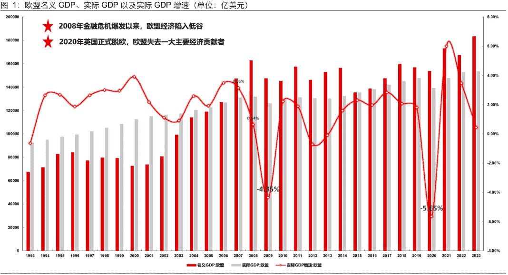

资料来源：Wind，长江证券研究所

# MIFID II 成为欧盟现阶段最佳监管政策引导条例

**MIFID II**（欧洲金融工具市场指令 II）作为 MIFID I 的升级版，该政策条例不仅对市场透明度、投资者保护进行了修正，同时也对欧洲资管机构和交易所等产生了重大的影响。欧盟自 1993 年起采用的 ISO（投资服务指令）已然不符合时代的要求，经欧盟各成员国的一致同意，2004 年颁布金融市场工具指令（MIFID），主要目的在于对投资人实施全面保护。然而，经历 2008 年金融危机之后，证明其法案仍然存在漏洞，因此欧盟监管者对 MIFID 进行条例上的修订，新版的 MIFID 就此面世。

# 一、系统部署总体流程

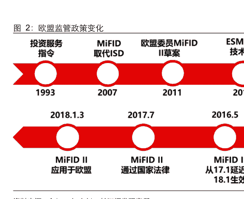

系统部署流程包括开发环境准备、代码上传、构建镜像、容器编排、服务发布与监控预警等关键环节，确保系统稳定上线并持续运行。

# 部署步骤

- 1. 准备代码仓库并拉取最新代码。
- 2. 执行 Maven 构建命令生成可执行 JAR 包。
- 3. 编写 Dockerfile 并完成镜像构建。
- 4. 使用 docker-compose 启动容器服务。
- 5. 接入监控系统并配置告警规则。

注意：部署前请确认目标服务器的网络策略、端口开放情况以及资源配额符合要求。

### HIBERNIA 6.65-STROKE 315-CC ENGINE

Announces its claim to a clean sweep in the six-day trials held at Waddell, California, from October 8th to 13th. The all-conquering 6.65-stroke engine, a product of the Hibernia Works, demonstrated its superiority in every event, winning the coveted trophy outright for the third consecutive year. The engine's remarkable reliability and power output were key factors in this outstanding achievement, solidifying Hibernia's reputation for engineering excellence in the motorcycle industry.

The trials, which covered over 1,200 miles of the most demanding terrain, saw Hibernia machines finish with the highest average speed and the fewest penalty points. This resounding victory underscores the 6.65-stroke's design prowess, particularly its advanced cooling system and fuel efficiency, which proved invaluable over the long, arduous stages.

Commenting on the win, the chief engineer praised the teamwork and the meticulous preparation of each motorcycle, stating that, "This success is a testament to our relentless pursuit of perfection." Enthusiasts and competitors alike now look forward to the next season with great anticipation, wondering if Hibernia can extend its remarkable winning streak.

The company has already announced plans to incorporate several lessons learned from the trials into its future production models, ensuring that the spirit of Waddell lives on in every machine that leaves the factory.

## 3.1 Representing Text

Suppose our training data consists of text documents like email messages, news articles, or entries in a social network. In machine learning workflows, such documents are usually converted to a vector of numeric values first. This is because most learning algorithms are designed for numeric feature vectors. Hence, the most important design decision when processing text is how to represent documents as feature vectors.

When converting text to a feature vector, we typically think in terms of granularity: should a document be represented as a set of paragraphs, sentences, words, or characters? Depending on the task, some granularity levels could be more meaningful than others. However, in most cases, words are the best granularity for text mining and are used as the basic units for text representation. Let’s do a quick review of the common options for transforming text into features.

### 3.1.1 One-hot Encoding

The simplest approach is to use a one-hot encoding, also referred to as “bag of words” or “count vectors.” One-hot encoding converts text into a vector of word counts. Each document is represented by a vector of length D equal to the number of words in the dictionary. Each position in the vector represents a specific word in the dictionary. The value at a position in the vector is the frequency of that word in the document. Let’s consider the following example:

John likes to watch movies. Mary likes movies too.

Let’s create the vocabulary (dictionary) containing all unique words in the two sentences above after removing punctuation and lowercasing all words:

john, likes, to, watch, movies, mary, too

## 图 5：MIFID I 相比 MIFID II 在投资者保护政策上所缺失的条例

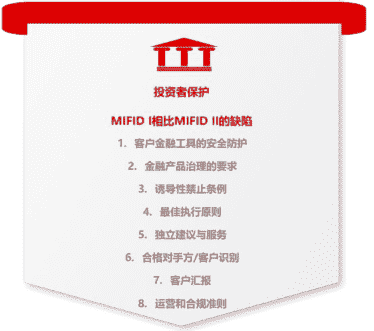

资料来源：Deutsche Börse Group，长江证券研究所

**旧版 MIFID 的三种主要缺陷，后期新版的 MIFID II 都给予各自的解决方案，但仍然围绕 MIFID 既定目标展开各自条例上的修订。其中，提升市场透明度、强化欧洲监管措施、创建公平公正的竞争环境、投资者利益保护等金融监管目标，是整个欧洲金融监管领域的核心四大目标。后续的 MIFID II 增强对这几大目标的实现力度，努力营造出健康的欧洲金融监管环境。**

MIFID I 和 II 共同的目标：

- 1. 通过市场参与者的公平竞争，保证市场平等的良好环境
- 2. 提高市场参与者的市场透明度
- 3. 加强欧洲层面的金融监管权力和金融监管协调
- 4. 加强投资者保护
- 5. 改善市场参与者内部管理功能

**虽然修订前后两部法规的政策目的相同，但 MIFID II 在金融监管各个方面的细节上处理得更为详尽，监管范围更加扩大，大幅度降低金融风险，更大程度上维护投资者的利益。**

根据相关资料显示，差异主要体现在市场结构、市场透明度、投资者保护以及内外部管理四个方面。MIFID II 中新型交易所 OTF 的诞生、新型第三国机构准入条例以及新诱导规则防范条例等相关准则，使得新版 MIFID 离欧盟的监管目标渐行渐近。

## 3.3 Constant Rate of Change

A constant rate of change describes a situation where a quantity changes at a steady, consistent rate over time. This concept is foundational in understanding linear relationships and functions.

In this section, you will learn how to identify constant rates of change in tables and graphs, and how to write equations that represent them.

The rate of change is typically calculated as the change in the dependent variable divided by the change in the independent variable. For a constant rate, this ratio remains the same for any two points.

Example: Suppose a car travels 60 miles in 1 hour, 120 miles in 2 hours, and 180 miles in 3 hours. The rate of change is 60 miles per hour, constant throughout the trip.

Graphically, a constant rate of change is represented by a straight line. The slope of the line is exactly the constant rate of change.

- Identify the independent and dependent variables.
- Choose two points from the table or graph.
- Calculate the ratio of the differences.
- Verify the ratio is the same for other points.

When the rate of change is constant, the relationship can be expressed as a linear equation in the form y = mx + b, where m represents the constant rate of change.

Practice problems and real-world applications are provided in the exercises to strengthen your understanding of this key concept.

## 表 3：在 MIFID II 下四大交易场所的对比

| 金融工具 | RM | MTF | OTF | SI |
|---|---|---|---|---|
|  | 股权类和非股权类 | 股权类和非股权类 | 非股权类 | 股权类和非股权类 |
| 交易执行 | 非自由裁量 | 非自由裁量 | 自由裁量 | 自由裁量 |
| 自有资本 | 禁止 | 禁止 | 禁止，存在例外 | 可期 |
| 匹配本金交易 | 禁止 | 禁止 | 在客户同意的情况下，一些案例可被允许 | 只有在特殊情况下 |

资料来源：ICMA《MIFID II/MIFIR and Fixed Income August 2017》，长江证券研究所

就 OTF 受制于的最佳执行原则而言，MIFID II 相较于 MIFID I 有较大的变化，MIFID 第二版将最佳执行原则的基本要求升级，更为严格的监管规定降低暗池交易的可能性。更新后的最佳执行条例中规定，所有金融工具中引入价格透明度机制。交易场所需要免费公开披露与交易执行质量有关的数据，例如价格、交易执行的可能性、交易成本和速度、交易前后订单信息以及询价（RFQ，指的是公司征求选定的供应商和承包商递交报价和投标，以便有机会完成某些项目。该类型的报告除了定价之外，还包含了付款条件、可能影响公司投标的因素以及递交截止日期等详细信息）。二是使得非权益类别的资产也得到一定程度上的监管，通过加强交易前后信息披露的要求，从而进一步提升透明度、建立价格发现机制。

## 表 4：OTF 与其他交易场所的区别

| OTF 与 MTF、RM 的主要区别 |
|---|
| 1. MTF 与 RM 根据非自由裁量原则将买卖双方的利益联系在一起，而 OTF 的运营商在决定是否在 OTF 上下单或撤回订单，以及不符合客户订单和 OTF 中其他订单匹配时，具有一定的自由裁量权。 |
| 2. 经营 OTF 的投资机构必须遵守《金融监管法》的最佳执行义务。该义务不适用于 MTF 或其成员的受监管市场。 |
| 3. OTF 只能进行债券、结构性金融产品、排放权和特定衍生金融工具的交易；MTF 和 RM 可能进行股票和其他权益类工具的交易。 |
| 4. OTF 采取措施防止其以自己的账户交易，然而被允许在非流动性政府债券中用自己的账户进行交易；在客户同意的情况下，可使用匹配本金交易，而 RM 与 MTF 则被禁止使用匹配本金交易。 |

资料来源：AFM，长江证券研究所

## 表 5：MIFID II vs MIFID I：最佳执行原则

|  | MIFID I | MIFID II |
|---|---|---|
| 要求 | 最佳执行义务要求公司在执行客户订单或向其他实体下订单（或将订单传输给其他实体执行时），采取一切合理的步骤以获得最佳的结果，同时考虑一系列执行因素。 | 最佳执行义务要求公司在执行客户订单或向其他实体下订单（或将订单传输给其他实体执行时），采取所有足够的步骤以获得最佳的结果，同时考虑一系列执行因素。 |
| 金融工具覆盖范围 | • 权益类 • 所有资产都在范围内，但由于缺乏数据，很难证明非权益类的最佳执行 | • 权益类和类似权益类 • 债券 • 衍生品 • 结构性金融产品 • 排放配额 |
| 重要性和变化 | • 确保对投资者的保护 • 维持价格形成过程的完整性，本身就是所有交易活动的基础 • 在日益分散的市场中促进交易场所之间的竞争 | • 在所有工具中引入价格透明度，以帮助更好地发现价格 • 更加关注于证明非权益类资产类别的最佳执行 |

## 竞争

资料来源：Tom Kennedy, Global Head of Analytics, Thomson Reuters《Best Execution Under MIFID II》，长江证券研究所

然而，OTF 仅仅是 MIFID II 涉及减少暗池交易发生率相关政策措施中的一种，过去暗池交易的发生还有一部分主要来源于 MIFID 本身的四项交易前豁免条例，机构投资者可以不进行公开的交易前信息披露。因此，第二版的 MIFID 在维持原有豁免条例的情况下，为系统中的订单制定了双交易量上限的机制（DVC）。这意味着非公开交易量一旦超过该上限，系统将暂停该金融产品的交易。

交易量上限的计算方式为：

- A. 根据 MIFID II 里的豁免条例新规，在交易场所里交易的金融工具，其交易百分比限制为过去 12 个月内欧盟/欧洲经济区所有交易场所该金融工具交易总量的 4%。
- B. 根据 MIFID II 里的豁免条例新规，金融工具在整个欧盟/欧洲经济区内进行的交易，其交易百分比为过去 12 个月内欧盟/欧洲经济区所有交易场所该金融工具交易总量的 8%。

若超过了 A 条例中的限制，授权该场所使用这些豁免条例的主管当局必须在两个工作日内暂停在该场所使用该金融工具 6 个月；若超过 B 条例中的限制，所有主管当局必须在两个工作日内在整个欧盟/欧洲经济区暂停使用这些豁免条例 6 个月。欧洲证券和市场管理局（ESMA）在每个月月末后的五个工作日内发布以下信息：

- 1) 过去 12 个月每个金融工具欧盟/欧洲经济区内交易的总量。
- 2) 在豁免条例下，过去 12 个月在欧盟/欧洲经济区内该金融工具交易的百分比，以及获得交易百分比的方法。

在透明度义务的加强和豁免条例的限制双管齐下的作用下，欧洲的暗池交易短期内得到了一定程度的控制，但长期来看，仍然无法改变暗池交易丛生的现状。自从 2018 年 1 月 MIFID II 生效之后，ESMA 数据显示从 3 月到 8 月交易量上限机制暂停豁免的证券数不断增加，2018 年 8 月暂停豁免的证券数达到历史最高（1262），并且从 2018 年 1 月开始暗池交易份额从大于 7% 到 2018 年 8 月小于 1%，暂停豁免证券数与暗池交易份额呈现负相关。然而，衍生品场外交易依然盛行，2021 年和 2022 年 OTC 衍生品名义金额占比仍然高达 90%以上，且暗池交易额及其份额在 2018 年二季度末之后重新恢复增长趋势。因此，暗池交易仍然是欧洲市场的重要组成部分。短期来看，虽然交易前透明度豁免条例的 DVC 限制对整个欧洲暗池交易的打击、提升市场透明度以及维护金融健康等具有显著效果，但仍然无法改变暗池丛生的现状。

### 5.1.2 三角函数线

由三角函数的定义可知，对于角 β 来说，比值 sin β/cos β、sin β 和 cos β 都随 β 的变化而变化。为了直观地了解随着角的变化三角函数值的变化规律，我们引入三角函数线。

设角 α 的终边与单位圆交于点 P，过点 P 作 x 轴的垂线，垂足为 M（如图 5.1-6（1））。根据三角函数定义，点 P 的坐标为 (cos α, sin α)，其中 cos α = OM，sin α = MP。

也就是说，角 α 的正弦和余弦分别等于它的终边与单位圆交点的纵坐标和横坐标。这样，当 α 变化时，点 P 的位置就反映了三角函数值的变化情况。

过点 A(1, 0) 作单位圆的切线，设它与角 α 的终边或其反向延长线交于点 T（如图 5.1-6（2））。当 α 为任意角时，有向线段 AT 称为角 α 的正切线。

有向线段 MP、OM、AT 分别叫作角 α 的正弦线、余弦线、正切线，统称为三角函数线。

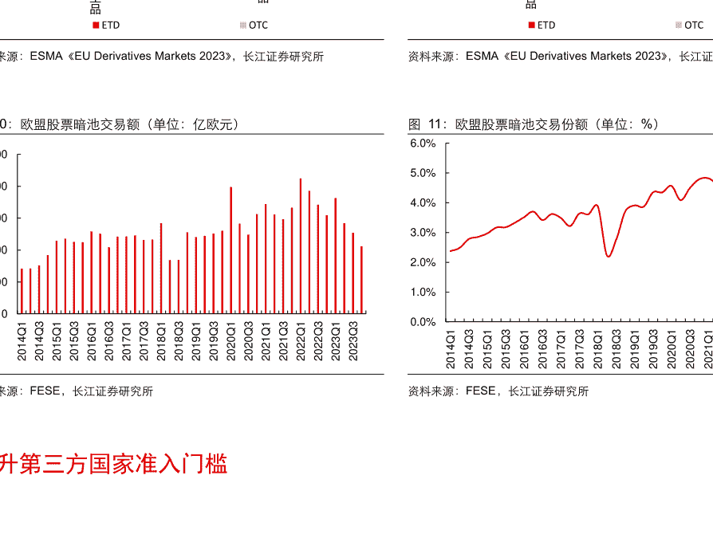

对比 MiFID I，MiFID II 制定了对欧盟以外第三国机构统一规范的管理制度。在欧盟成员国境内获取牌照的第三国机构可行使“护照通行”权力。该制度同样也给第三国公司两种选择：

选择一是欧盟委员会在第三国企业监管上采用的等同性机制。该制度主要被用来评定第三国机构所属国家是否与欧盟监管规则具有等同性。此外，欧盟委员会强调等同性评估涉及风险管理测试，对于在欧盟市场影响较大的第三方国家进行更严格的体制评估。该等效认可的主要目的是考量第三国对欧盟产生较大影响时，是否能够拥有更强的风险管理措施。

选择二是欧盟成员国要求第三国企业在欧盟设立分支机构，向散户或专业客户提供投资服务与活动。

第三国公司在欧盟开展投资活动的门槛提高，境外投资机构的监管加强能够提高客户信任程度，从而提升其竞争优势，创造一个公平、公正且健康的金融环境。按投资服务对象的群体来进行划分，若服务对象为散户或者机构投资者，该第三方机构（境外公司）需要在欧盟内成立分支机构并且获得成员国主管机构的许可；若服务对象为合格交易对手方或本身的专业客户，第三方国家的公司将直接向 ESMA 注册，无需成立分支机构。从某种意义上来讲，欧盟境内的投资机构都维持着较高的标准和较严的要求，因此客户会选择欧盟境内优秀的投资机构，这在一定程度上造成了第三国投资公司竞争力下降的问题，从而退出欧盟市场。

表 6：MiFID II 条例下的两种可选模式

| 要求 | 跨境模式 | 分支机构模式 |
|---|---|---|
| 发放许可的机构 | 欧洲证券及市场管理局 | 各欧盟成员国批准 |
| 初始要求 | 1) 欧盟委员会就第三国的法律和监管框架的等同性作出肯定决定； 2) 企业获得标准，并且在母国受到有效的监督和管理； 3) 欧洲证券及市场管理局与第三国监管机构有合作协议 | 1) 初始资本要求； 2) 企业获批，且在母国受到有效监督和管理； 3) 欧盟成员国与第三国监管机构必须存在合作协议； 4) 企业必须是欧盟承认的投资者赔偿计划的成员； 5) 企业必须遵守《金融工具市场指令》的某些管理要求； 6) 第三国已经与相关欧盟成员国签署符合合规要求的税收信息交换协议 |
| 客户群体 | 合格对手方或本身的专业客户 | 散户或机构投资者 |
| 通行权 | 按跨境方式从第三国向所有欧盟成员国通行并开展 MiFID 业务 | 按跨境方式与所有欧盟成员国的合格对手方和专业客户开展 MiFID 业务，无需设立分支机构，但前提是欧盟委员会已就第三国的法律和监管框架的等同性作出肯定 |
| 后期要求 | 1) 不直接接受任何欧盟成员国监管机构的监督； 2) 第三国公司应当遵守其所属国家的规定（非 MiFID）； 3) 提醒客户缺少欧盟授权以及客户类型受到限制 | 必须遵守 MiFID 下的要求，包括制度和管制、业务经营、交易报告及透明度有关的要求 |

资料来源：LEXOLOGY，德勤《From MiFID I to MiFID II, what are the main changes?》，长江证券研究所

## 研究与佣金分拆、大力加强对金融产品的干预和监督

该法案中涉及诱导性规则的政策目标在修订前后保持一致，然而 MiFID 添加新的条例，使得全新的诱导性规则更具创新性，主要区别在于其新增的四项条例，更大程度上使得客户信息披露的原则以及研究支付的有关细则都能做到明细化，使客户的利益得到最大化。

表 7：MiFID I 与 MiFID II 的核心要求与区别

| 核心要求 | MiFID II 新增四项条例 |
|---|---|
|  | 1）有义务按照客户的最佳利益诚实、公正、专业地行事 2）涉及利益冲突相关的条例 3）披露义务 |
| 新增条例 | 1）**要求公司（如适用），告知客户提供投资或辅助服务相关的费用、佣金、货币或非货币利益转移给客户的机制** 2）**禁止为客户提供独立投资建议或投资组合管理服务的公司接受和保留提供服务的第三方所涉及的费用、佣金，或者任何货币或非货币利益（除了某些轻微的非货币利益）** 3）引入研究和支付的具体规则 4）需要额外和具体的披露，强制要求记录保存的义务和相关政策以及程序的实施与执行 |

资料来源：Dillon Eustace《MiFID II Inducements》，长江证券研究所

**诱导性政策条例创新点在于研究业务分拆规则，采用 RPA 账户和研究服务单独定价两种模式，以避免利益冲突。** 除了通过禁止和披露的相关强有力的法律措施之外，MiFID II 对投资机构的研究业务方面作出新的变化，即研究业务的分拆规则。简单来讲，可分为两种类型，第一种是从公司自身资源中直接支付；第二种是由公司独立控制的 RPA（研究支付账户）支付，只要满足 RPA 运营的条件即可。

**RPA 账户本质是专款专用的模式，不可将该账户内的资金挪作他用，可提高客户知情权和服务水平，客户可了解到付费的研究报告带来的收益。** 对于 RPA 模式来说，它可以体现在以下几点：

- 1. 投资公司的研究费用必须只基于公司的研究预算，目的是为了建立涉及客户投资服务第三方研究的需要。
- 2. 不与涉及客户利益相关的交易量和交易价值挂钩。
- 3. 若客户研究费用非单独收取，而是与交易佣金一起收取，则每项均收取客户研究费用的运作安排都必须标明可单独识别的研究费用，并完全遵守 RPA 的合格条件和向客户提供信息的相关条件。

## 图 12：RPA 账户运营需满足的条件

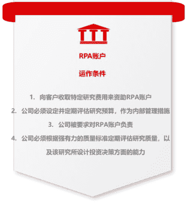

资料来源：Dillon Eustace《MiFID II Inducements》，长江证券研究所

**自掏腰包模式指的是通过将研究业务与佣金业务合理解绑，阻碍研究成本转嫁给客户，有利于确保大众投资者的相关利益。** 根据英国金融行为监管局（FCA）关于研究分拆对金融服务业影响的调研结果显示，大多数的资产管理人都选择自收收入支付研究费用，而不是客户资金。这造成了英国股票基金的投资者在 2018 年前 6 个月节省约 7000 万英镑的积极成效。

**新的诱导性新规中自掏腰包模式主要对进行投资服务活动的金融机构产生一定的影响力。** 该条例适用于投资公司、提供投资服务和活动的信贷机构、在实施结构性存款或提供结构性存款咨询服务的投资公司和信贷机构，以及提供个人投资组合管理的投资服务或者非核心服务的 UCITS ManCos（进行集合投资组合管理的公司）和外部 AIFMs（外部另类投资基金管理人，由 AIF 或 AIF 代表任命的法人，通过任命负责管理另类投资基金），不难发现基本都与投资公司相关。

## 图 13：诱导性规则适用范围

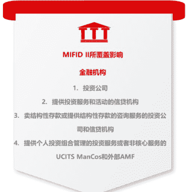

资料来源：Dillon Eustace《MiFID II Inducements》，长江证券研究所

> ³ FCA finds MiFID II research unbundling rules working well for investors

## MiFID II 所带来的附加影响

## MiFID II 对卖方和买方研究业务上的影响

MiFID II 导致金融机构的业务与运营模式等各方面发生全面性变化。其中，最受影响的当属券商、资管机构、交易所等。从投资人保护条例的影响来看，其 RPA 账户与研究拆分政策促进买方和卖方的商业模式变化。从市场架构、透明度、投资人保护、外部控制/报告、内部控制/治理等领域来看，投资银行受到 MiFID II 的影响是全方位的，其余资管服务机构也受到了一定的冲击。

表 8：各类型公司受 MiFID II 影响程度（橘黄色：高度影响，土黄色：中度影响，轻度影响：灰色）

| 影响领域 | 具体事项 | 投资银行 | 投资管理人/保险 | 托管银行 | 私人与零售银行 | 基础设施 |
|---|---|---|---|---|---|---|
| 新市场架构 | MTF/OTF/SI 改变 | 高度影响 | 轻度影响 | 轻度影响 | 中度影响 | 高度影响 |
| 新市场架构 | 暗池交易/SD/MD 平台 | 高度影响 | 轻度影响 | 轻度影响 | 中度影响 | 高度影响 |
| 新市场架构 | 开放进入 | 中度影响 | 中度影响 | 中度影响 | 中度影响 | 高度影响 |
| 新市场架构 | 衍生性商品交易 | 高度影响 | 高度影响 | 轻度影响 | 中度影响 | 高度影响 |
| 股权和非股权透明度 | 订单处理 | 高度影响 | 中度影响 | 轻度影响 | 中度影响 | 高度影响 |
| 股权和非股权透明度 | 交易前透明度 | 高度影响 | 轻度影响 | 轻度影响 | 轻度影响 | 高度影响 |
| 股权和非股权透明度 | 交易后透明度 | 高度影响 | 中度影响 | 轻度影响 | 中度影响 | 高度影响 |
| 投资者保护 | 类股权 | 中度影响 | 高度影响 | 轻度影响 | 轻度影响 | 轻度影响 |
| 投资者保护 | 非股权 | 高度影响 | 中度影响 | 轻度影响 | 中度影响 | 轻度影响 |
| 投资者保护 | 客户分类 | 高度影响 | 中度影响 | 轻度影响 | 中度影响 | 轻度影响 |
| 投资者保护 | 客户信息 | 中度影响 | 中度影响 | 轻度影响 | 中度影响 | 轻度影响 |
| 投资者保护 | 公平对待客户/利益冲突管理 | 中度影响 | 轻度影响 | 轻度影响 | 中度影响 | 轻度影响 |
| 投资者保护 | 适合度 | 高度影响 | 中度影响 | 轻度影响 | 高度影响 | 轻度影响 |
| 投资者保护 | 适当性 | 高度影响 | 中度影响 | 中度影响 | 高度影响 | 轻度影响 |
| 投资者保护 | 客户资产 | 高度影响 | 中度影响 | 中度影响 | 中度影响 | 轻度影响 |
| 投资者保护 | 劝诱 | 中度影响 | 中度影响 | 轻度影响 | 中度影响 | 轻度影响 |
| 投资者保护 | 客户报告 | 轻度影响 | 中度影响 | 轻度影响 | 轻度影响 | 轻度影响 |
| 外部监管/汇报 | 监管间的合作 | 高度影响 | 高度影响 | 高度影响 | 高度影响 | 高度影响 |
| 外部监管/汇报 | 中断机制/最小单位/取消费用 | 高度影响 | 轻度影响 | 轻度影响 | 轻度影响 | 高度影响 |
| 外部监管/汇报 | 互惠第三国准入 | 高度影响 | 高度影响 | 高度影响 | 高度影响 | 轻度影响 |
| 外部监管/汇报 | 禁止/限制 | 高度影响 | 中度影响 | 轻度影响 | 高度影响 | 高度影响 |
| 外部监管/汇报 | 交易报告 | 高度影响 | 中度影响 | 轻度影响 | 中度影响 | 高度影响 |
| 内部控制/治理 | 系统/记录 | 中度影响 | 中度影响 | 中度影响 | 中度影响 | 中度影响 |
| 内部控制/治理 | 治理/合规管理 | 中度影响 | 中度影响 | 轻度影响 | 中度影响 | 中度影响 |
| 内部控制/治理 | 外包 | 中度影响 | 中度影响 | 高度影响 | 中度影响 | 中度影响 |

资料来源：EY《The world of financial instruments is more complex. Time to take action. Capital markets reform: MiFID II》，长江证券研究所

## MiFID II 对买方的影响

资产管理人可能只会订阅在 MiFID II 推行之前认可的部分研究报告，从而追求更具成本效益的分析师研究，并更多依赖于内部的分析。在 MiFID II 相关政策条例未推行之前，资管机构无需付费即可获得大量分析师的研究，因为研究是由向基金投资者收取的交易佣金所付。然而，MiFID II 的新型监管制度明确规定研究报告单独定价，资管机构需支付研究费用。

## 资管机构将面临两种情形：

- 1. 买方分析师数量增加（表明新法规实施后更加侧重于内部研究）。
- 2. 买方研究成本、人力成本共同上升。

大型买方机构大幅削减其研究预算，小型买方机构反之增加。根据 CFA 协会在 2018 年 12 月份在欧盟对 25 个不同的欧洲国家 449 个公司的调研数据显示，小于 10 亿的资管机构平均研究预算 +0.81%，而大于 2500 亿的平均研究预算 -11.14%，且管理资产规模越大的公司研究预算越少。然而，造成该情形有两种可能的假设：

- 假设欧洲买方机构的付费研究报告数量有一定增加，但大型公司的研究支出增加小于其收入上升的速度。
- 假设欧洲买方机构的付费研究报告数量在减少，公司增加内部研究报告的数量。

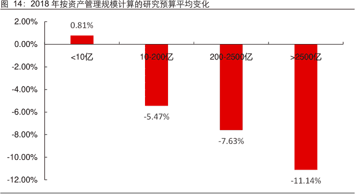

资料来源：CFA Institute《MiFID II: ONE YEAR ON》，长江证券研究所

**第二种假设成立，买方机构正逐步从依赖于卖方研究转向内部研究。** 根据受访者的调查数据显示，57%的买方专业机构人士表示将从卖方机构获取更少的研究，34%的受访者希望从内部研究进行更多的研究。因此，买方将减少在卖方研究报告上的付费，从而加大对内部研究的投入，这意味着买方分析师数量将会上升，对应的培养机制也会得到逐步完善。与此同时，买方分析师的数量和质量的提升会导致机构人力费用支出的增加，成本压力显而易见。

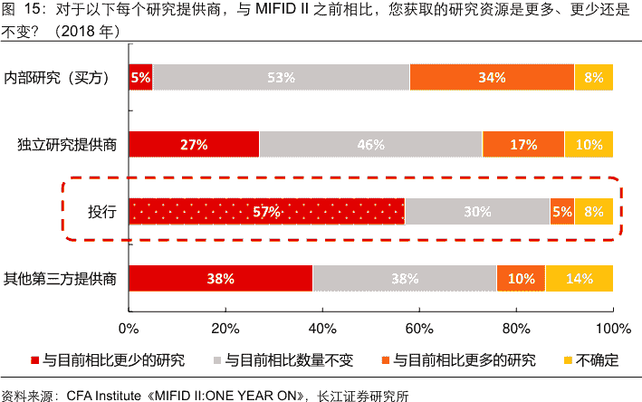

因此，大型的买方机构更具优势，资源将向头部公司集中。MiFID II 将导致买方机构整体运营成本上升（研究成本或人力成本），中小型买方所要承担的利润压力加大，其竞争力被削弱。假设一个 2640 亿美元资产管理规模的大型买方公司，其服务费用率 2%，即收入大约 52.8 亿美元，研究开支相对资产比例 0.014%，研究费用仅占 0.37 亿美元，剩下的 52.43 亿美元用于支撑新员工的培训和薪酬。然而，小型的欧洲资产管理公司则处于十分不利的地位，其研究支出所占比例达到 0.036%。

表 9：2020 年按资产管理规模划分的研究支出（欧洲）

| 资产管理规模（亿美元） | 平均权益类 AUM（亿美元） | 平均研究支出（亿美元） | 研究开支相对资产的比例 |
|---|---:|---:|---:|
| 权益类 AUM > 1000 亿 | 2640 | 0.37 | 0.014% |
| 权益类 AUM 100–1000 亿 | 330 | 0.07 | 0.02% |
| 权益类 AUM < 100 亿 | 10 | 0.01 | 0.036% |

资料来源：Integrity Research，长江证券研究所

## MiFID II 对卖方和中小企业的影响

卖方机构将削减中小盘股的研究，从而造成中小企业股票可见度与流动性降低。根据 CFA 协会买方受访者的调研数据显示，53%的买方预计将减少中小盘股的研究报告数量。根据欧盟委员会发布的有关 MiFID II 对 SME（中小企业股票）和固收研究的影响报告中数据显示，63%的买方机构预计 MiFID II 将会削减欧盟中小企业股票研究。（该调研报告由欧盟委员会提供，受访者人群包括 55 家买方公司、41 个经纪人、55 个发行人和 14 个 IRPs。资产管理人和经纪人的受访者包含了主要的全球公司、中型规模的机构和大量的小公司。）

## 图 16：对于卖方研究覆盖而言，卖方观点的改变

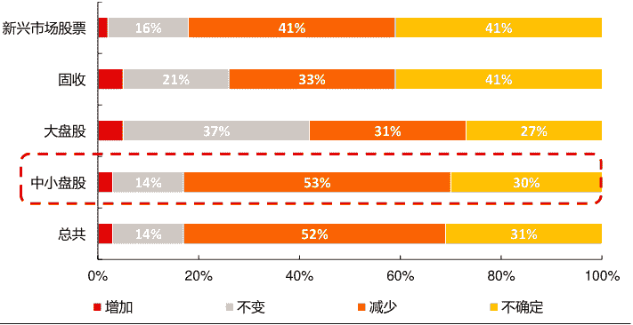

资料来源：CFA Institute《MiFID II: ONE YEAR ON》，长江证券研究所

## 图 17：MiFID II 是否改变了欧盟中小企业股票研究的数量（2020 年）

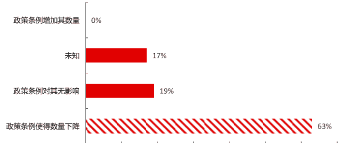

资料来源：EU《The impact of MiFID II on SME and fixed income investment research》，长江证券研究所

**短期内欧盟大投资者放弃对中小盘股的投资，或转向大盘股，且可能对中小企业的股权融资产生负面影响，但从长期来看，中小盘股的关注度优于大盘股。** 根据 Bloomberg 的数据显示，选取欧盟中小盘股指数和大盘股指数的成交金额和市值，通过对每年的测算得出相对应的平均换手率，进而得出在 MiFID II 前后两年的换手率变化。从中可以发现，2017–2019 年中小盘换手下跌幅度明显高于 2015–2017 年，而 2017–2019 年大盘股换手下跌幅度明显低于 2015–2017 年，欧洲散户短期内开始倾向在大盘股上的投资。然而，纵观 2013–2022 年中小盘换手一直高于大盘，表明中小盘股的流动性更高，仍具有较高的关注度。

表 10：MiFID II 推行前后两年中小盘和大盘股换手率增长率的对比

| 年份 | 欧盟中小盘股指数平均换手率 | 欧盟大盘股指数平均换手率 |
|---|---:|---:|
| 2013 | 91.5% | 77.2% |
| 2014 | 104.4% | 89.6% |
| 2015 | 109.3% | 98.5% |
| 2016 | 101.3% | 80.6% |
| 2017 | 98.4% | 74.0% |
| 2018 | 115.4% | 90.4% |
| 2019 | 80.9% | 65.5% |
| 2020 | 106.4% | 86.8% |
| 2021 | 87.1% | 61.4% |
| 2022 | 103.0% | 72.2% |
| 2023 | 80.2% | 53.3% |
| 2015–2017 中小盘换手增长率 | -5.2% | 2015–2017 大盘换手增长率：-13.3% |
| 2017–2019 中小盘换手增长率 | -9.3% | 2017–2019 大盘换手增长率：-5.9% |
| 2018–2023 中小盘换手 CAGR | -7.0% | 2018–2023 大盘换手 CAGR：-10.0% |

资料来源：Bloomberg，长江证券研究所

综上所述，MiFID II 带来了买方和卖方商业战略上的剧变，同时欧洲的投资机构也因此背负了一定的运营成本。此外，欧盟的中小企业在获取资金的渠道上也因此受到一定的负面影响，大型企业的竞争力进一步加强。

## 英国案例验证 MiFID II 所带来附加影响

实施 MiFID II 导致英国中小盘股票覆盖不足，造成流动性问题，进一步验证该法规对买方和卖方研究业务所造成的影响。根据 2023 年 3 月英国政府发布的《投资研究评论》，可得出 MiFID II 所带来的消极影响：

1）在 MiFID II 分拆业务尚未推出之前，英国的投资研究覆盖面就呈现下滑趋势。一方面，机构投资者采取风险规避策略并投资于国债市场，这导致市场对英国股票的投资兴趣下降，证券研究需求有所减少。另一方面，英国股票二级市场交易和佣金率下行，导致总体研究支出下降，资助研究金额减少，造成研究覆盖面下滑；

2）MiFID II 推行以来，买方机构自掏腰包支付外部研究费用，并提升自身内部研究能力，外部研究方面的支出下降，研究覆盖面下滑，尤其是中小盘股；

3）美国证监会最近撤销受 MiFID II 监管体制下资管公司以分析模式购买研究成果的权力，或导致英国资管公司无法获得部分美国的研究成果。

## 横跨大西洋两岸监管法规对比

### 欧盟 MiFID 与美国 NMS 法规的比较

NMS 与 MiFID 两部监管法规推行的目的大体相似，促进证券市场的竞争以及创建公平有序的市场。MiFID 条例的目的是为了加强投资者保护和市场透明度，统一欧盟成员国监管规范，创建单一通行证，激发资本市场活力。然而，Reg NMS 目的在于增强美国股票市场规范框架，从而建立全美统一的市场系统，维持美国资本市场的竞争优势。

表 11：欧盟 MiFID 系列与美国 NMS 法规的对比

|  | MiFID 系列 | NMS 法规 |
|---|---|---|
| 目标 | ● 加强单一市场竞争 | ● 保护所有投资者，并为机构投资者提供一 |

| 分类 | 主要措施 | 补充措施 |
|---|---|---|
| 主要措施 | • 根据投资者的不同类别保护投资者 • 统一协调联盟各成员国的监管 • 废除市场交易和资讯集中的规定 • 委托最佳执行规定 • 规范多边交易所（MTF）的适用范围 • 内部化交易的规则 • **建立新的交易场所（OTF）** • **设立交易前透明度豁免规则的限制** • **建立 RPA 账户和研究报告规则** | • 这些例外 • 强调价格发现的必要性 • 委托保护规则 • 跨市场资讯取得规则 • 委托报价最小升降单位规则 • 市场资讯销售规则 |
| 交易场所分类 | • 受监管市场（RM） • 多边交易场所（MTF） • 内部化交易场所（SIs） • OTF | • 快速市场 • 慢速市场 |
| 委托最佳执行方法 | • **应满足几项条件，例如价格、成本、速度等，惟可依托客户属性、委托类型、商品种类及交易场所等有所调整** • 内部化交易取得客户同意 • 每年应自行评估公司有关项目的适合性 | • 价格优先 • 禁止交易直通 • 公司应制定有关此项目的书面程序 |

资料来源：《欧盟金融工具市场规则（MIFID）和美国全国市场法规（Regulation NMS）比较》，长江证券研究所

**最佳执行原则和透明度方面，NMS 与 MIFID 两部监管法规实质存在显著差异，且各自成效大相径庭，MIFID 系列政策条例更加专注于构建一个开放、自由化的市场环境。** 与 NMS 只考虑成交价格不同，MIFID 系列最佳执行条例将许多相关因素纳入考量范围，以便获得对客户最佳的结果，体现了 MIFID 最佳执行规则的灵活性。举例来讲，对于大宗交易的专业投资者而言，速度往往成为选择交易场所的首要考量因素。此外，NMS 法规的禁止交易直通规则和市场资讯销售规则分别旨在维护现存交易所的地位和整合市场资讯传播（附带复杂资讯订价方法），与之相比，MIFID 更能让市场资讯揭露自由竞争的机制。

表 12：MIFID 系列与 NMS 法规委托最佳执行和市场资讯规则对比

|  | MIFID 系列 | NMS 法规 |
|---|---|---|
| 委托最佳执行 | 不仅包括成交价格，还应包括执行成本、成交速度、可成交机率、交割、可成交数量及其他有关成交的任何因素，投资公司需建立有关书面制度，包括任何可能影响交易场所的因素。 | NMS 中第 602b 规则要求证券公司应以最佳的价格执行买卖，611 规则要求交易中心应该制定防止交易直通的书面制度，交易中心应该定期执行监控措施。 |
| 交易资讯 | MIFID 开放交易资讯而未加新限制，受监管市场、MTF、可执行内部化交易机构按照规定披露成交价格、数量及时间。 | NMS 规范单一窗口资讯提供机制，授权自律机构较多自由传播发送资讯，但仍依规将资讯给资讯提供者。 |

资料来源：《欧盟金融工具市场规则（MIFID）和美国全国市场法规（Regulation NMS）比较》，长江证券研究所

**MIFID 交易透明度较 NMS 更为详细，且 OTF 新型交易所将场外衍生品进行统一监管，从而一定程度上抑制暗池交易。美国规定债券、债务证券化和衍生品不承担前后透明度要求，导致场外交易频繁，无形中筑建暗池的温床。** 自 2006 年 11 月 NMS 法规生效以来，美国权益类 OTC（包含 ATS/暗池）市场份额接近 40%。此外，OTC 的季度成交量和股票 OTC 交易份额都处于上升态势，股票交易 OTC 份额直到 2023 年已经达到 44.0%。根据 CFA 协会统计，2014 年暗池一直处于场外交易最前沿，占据美国交易量的 15%，而欧盟暗池市场份额大约在 2.9%左右，表明欧盟交易透明度监管一直优于美国。

|  | 交易所 | OTC（包括 ATS/暗池） |
|---|---:|---:|
| 权益类 | 64.20% | 35.80% |
| 固收类 | 1% | 99.00% |
| 衍生品类 | 20% | 80.00% |

资料来源：The World Bank《Comparing European and U.S. Securities Regulations》，长江证券研究所

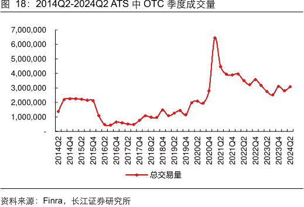

资料来源：Finra，长江证券研究所

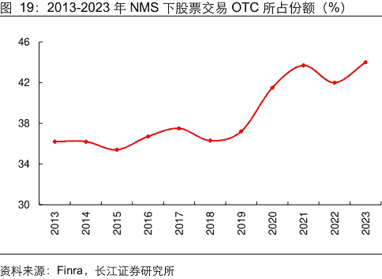

资料来源：Finra，长江证券研究所

投资者保护方面，MiFID II 独特的研究佣金拆分条例实现了投资机构让利于大众投资者的政策成效。在一定程度上维护了中小投资者的利益，但该条例实施之后所带来的弊端日益显现，投资研究能力和覆盖面大幅下降，英国与欧盟重新计划执行交易佣金捆绑制度，增强各自资本市场在全球的竞争力。

# MIFID II 重塑全球投研生态

英国与欧盟放宽研究佣金分拆制度

如之前所述，大部分买方机构选择的都是自掏腰包，而非 RPA 模式，这导致英国与欧盟佣金分拆监管政策上的进一步改革。

英国欲重新恢复交易佣金捆绑制度。英国自执行 MIFID II 监管法规以来，研究实力和覆盖面有所下滑，导致投研竞争力弱化，因此英国决议做出新一轮佣金制度改革，或将重新回归交易佣金捆绑制度，借此增强英国资本市场的核心竞争力。此外，英国还提出 7 点建议以增强整体投资研究能力和市场公平性原则：

1）引入新的研究平台协助开展研究；

2）允许为投资研究付费提供额外的选择，即买方向客户收取特定研究费用或将研究成本与执行费用相结合；

3）允许散户投资者有更多机会参与研究；

4）让学术机构参与支持投资研究计划，包括为分析师提供培训等；

5）通过实施行为准则来支持自由行人资助的研究；

6）明确英国投资研究监管制度的各个方面，并考虑引入特定的制度；

7）审查与 IPO 相关的投资研究规则，包括简化 IPO 时间表便于及时获取相关信息、招股说明书中添加首次公开募股相关的关联分析研究，便于所有投资者都能获得相同的信息，降低信息不对称性。

**欧盟放宽佣金分析制度。** 经济下行期间，欧盟小型企业的研究引入了规则豁免，旨在提升中小企业的研究覆盖范围，该豁免适用于低于 10 亿欧元的上市和非上市公司的研究，并且公司需满足两个条件：

1）将研究和执行服务的捆绑支付通知客户；

2）与研究提供者签订协议，确定执行服务和研究的捆绑支付中可用于研究的部分。

但是，该豁免政策并未成功。2022 年 12 月，欧盟委员会修改了欧盟资本市场复苏计划，将适用范围从市值低于 10 亿欧元修订为市值低于 100 亿欧元，扩大中小企业研究豁免范围，此举可能应对中小企业投资研究覆盖面大幅下降的趋势。

# MIFID II 改变美国投资研究生态

**美国过去采用“软佣金”体制机制。** 美国资产管理公司付给卖方研究机构的费用是通过经纪业务佣金支付的，而机构佣金主要来自于客户的支付。1975 年五一劳动节过后不久，美国证监会宣布取消固定佣金制度，国会根据 1934 年颁布的《证券交易法》成立安全港，主要系为了允许符合安全港要求的资产管理人使用管理账户的佣金来支付已经产生的研究费用或未来投资决策过程中需要的研究费用。美国在捆绑佣金制度下，投资研究覆盖面涉及头部企业和中小企业。

**研究执行产生的佣金占总佣金的比例约 12%，小型买方机构支付的软佣金比例远高于大型买方机构。** 根据美国证监会 1998 年 9 月发布的“软佣金”体系下的调研报告来看，客户咨询产生的总佣金 22.6 亿美元，研究执行产生的佣金 2.8 亿美元，占总佣金比例大约 12%。软佣金与总佣金的比例因每家机构交易额不同存在一定差异，例如佣金总额低于 100,000 美元的小型机构软佣金比例超过 50%，而赚取超过 1 亿美元佣金的大型机构软佣金比例仅 8.3%。

**美国机构佣金主要用于研究业务，其中研究报告所占比重超过 50%。** 根据美国证监会 1998 年 9 月发布的“软佣金”体系下的调研报告来看，通过收集 180 家机构的数据，其中包括 4,731 项软佣金安排，支付佣金总额为 2.74 亿美元。其中，80% 的机构佣金用于研究业务，2.20% 的机构佣金用于非研究业务。研究佣金结构中，报告占比超过了 50%，因此客户佣金主要用于购买研究报告，用以满足买方机构投资者的需求。

# 图 20：使用软佣金购买的产品分类（单位：%）

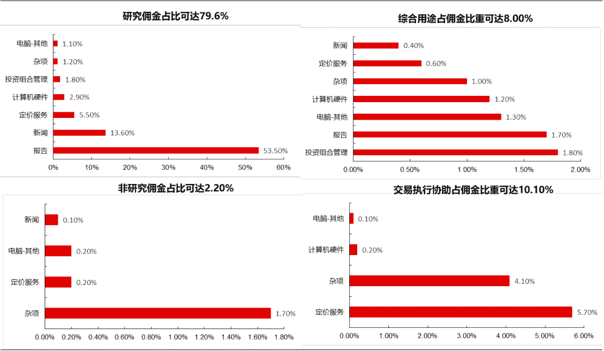

资料来源：SEC《Inspection Report on the Soft Dollar Practices of Broker-Dealers, Investment Advisers and Mutual Funds》，长江证券研究所

# 美国研究佣金分拆趋势明显

**MIFID II 的实施在全球产生波及效应，该法规与美国《顾问法》构成冲突，并对美国佣金监管产生影响。** 欧盟采取的 MIFID II 规则具有域外影响，其中包括对美国券商的影响，主要系英国和欧盟的投资公司从司法辖区外的券商获取研究服务时，必须遵守 MIFID II 的规则。对于美国的券商而言，从欧盟或者英国的投资机构获取 MIFID II 规定下的直接付款，相当于“硬美元”付款。然而，根据美国《顾问法》相关规定，符合 MIFID II 规定的研究支付的现金可能被视为“特殊报酬”，这将导致《顾问法》监管豁免无效，从而美国的券商将受到《顾问法》的监管。因此，为了解决这一冲突，美国监管部门采取“不行动”信函，美国券商需要提供《顾问法》第 202(a)(11) 条构成“投资建议”的研究服务，允许券商从欧盟资管机构获取“硬美元”研究付款，且不会采取任何法律行动。

**美国 SEC 采用“不行动”信函缓冲其对买卖双方的影响。** 美国证券交易委员会（SEC）于 2017 年向证券业和金融市场协会（SIFMA）发出了“不采取行动”信函，允许美国券商获取研究佣金。该信函最初定于 2020 年 7 月 3 日到期，之后又延长三年至 2023 年 7 月 3 日，为市场参与者提供更多时间来适应新的佣金监管要求。根据 Coalition Greenwich 提供的数据显示，56% 的买方和 61% 的卖方倾向于无限期延长“不行动”信函。然而，2023 年 7 月 5 日，SEC 决定不再延长缓冲期限。

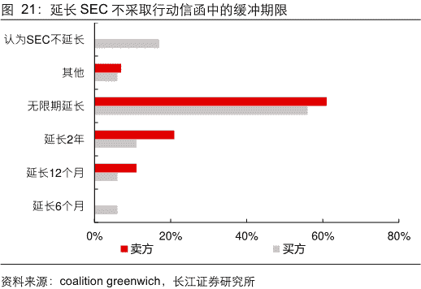

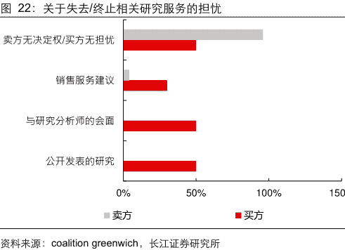

# 受 MIFID II 分析模式影响的美国投研现状

佣金监管模式方面，美国采用的 CCA 与欧盟 RPA 存在一定的差异，其根本目的是为了提升佣金透明度并维护客户利益。

- **欧盟方面**，在 MIFID II 的监管框架下，买方机构除自掏腰包外，还采取了研究支付账户（RPA）的模式。该模式要求经理人定期对 RPA 账户资产购买的研究报告编制预算并进行评估，任何预算的增加都必须事先清楚地向客户报告。此外，预算金额必须根据所需的研究报告编列，不能与客户交易价值挂钩。另一方面，预算周期结束时，经理人需向每位客户报告他们支付给 RPA 的金额以及购买研究报告的详细说明，账户剩余资金在周期结束时需退还给客户或转入下一周期。

- **美国方面**，在其佣金监管制度下，采用客户佣金安排架构（CCA）的运营模式，券商将佣金的一部分作为研究费用记入由券商管理的 CCA 并保留剩余的佣金，或是将研究费用的部分转入由外部第三方管理的 CCA 管理者。经理人再从第三方研究提供者或券商获取研究报告，并由 CCA 支付费用。在使用 CCA 管理者的情形下，经理人会要求券商从转至第三方管理的 CCA 费用中扣除经纪（包括交易执行）的佣金费用。因此，在美国券商保留经纪（包括交易执行）部分并将研究费用部分转入 CCA 时，佣金实现了有效的分拆。

- **CCA 与 RPA 两种模式具有一定的相似之处，但同时也存在两点差异：**

  1）分拆时点不同。对于 RPA 账户而言，在经理人支付费用给券商之前，研究费用与交易执行服务费用二者单独定价。而对于 CCA 而言，当券商保留交易执行经纪佣金并转移研究佣金进入 CCA 时，交易执行服务费用和研究佣金进行了分拆；

  2）研究佣金管理者不一样。根据 1934 年美国证券法规定，研究费用由券商管理。而 MIFID II 的研究支付账户则由投资公司或第三方研究支付账户的提供者管理。

# 图 23：美国客户佣金安排架构

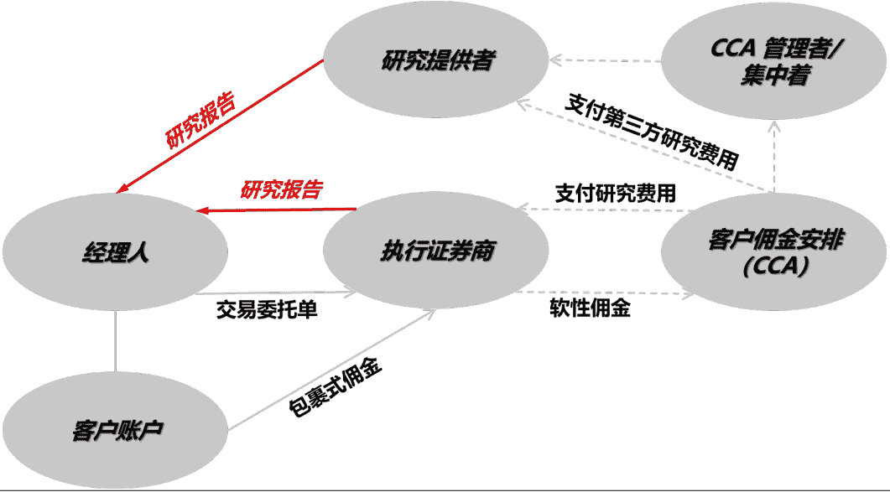

资料来源：SEC《Division of Trading and Markets》，长江证券研究所

大部分美国买方机构开始采用佣金分成协议（CSA，在美国称为 CCA）来支付研究费用。欧洲佣金分割制度一定程度上改变了美国投研市场，虽然美国并未效仿欧盟采取严格禁止使用佣金支付佣金费用的措施，但佣金和研究费用原则上分拆趋势更为明显，越来越多的买方机构使用 CSA 支付研究费用。根据 Bloomberg Intelligence 提供的数据显示，20% 的买方公司预计将通过 CSA 支付研究佣金，而只有 7% 的机构表示将减少使用 CSA；10% 的买方公司支付研究佣金给独立研究提供商，然而还有 10% 的机构将减少对其支付；22% 的买方公司将减少支付费用给研究佣金捆绑的经纪商，而仅有 6% 的机构表示对其支付。

# 图 24：2020 年美国权益研究佣金支付渠道

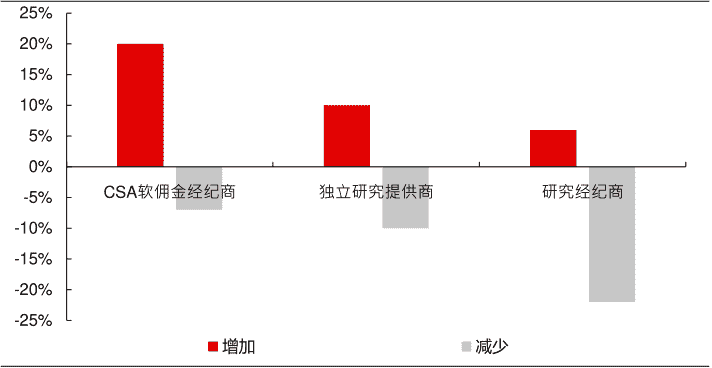

资料来源：Bloomberg Intelligence《U.S. Institutional Equity Trading Study》，长江证券研究所

# 风险提示

1、他国经验未必适用：MIFID II 的相关分析主要集中于欧美地区，未必适用于我国。

2、监管政策不确定性：公募基金行业始终受到有关部门的监管，未来监管政策出台、变更可能对行业产生一定的影响。

# 投资评级说明

| 项目 | 评级 | 说明 |
|---|---|---|
| 行业评级 | 看好 | 相对表现优于同期相关证券市场代表性指数 |
| 行业评级 | 中性 | 相对表现与同期相关证券市场代表性指数持平 |
| 行业评级 | 看淡 | 相对表现弱于同期相关证券市场代表性指数 |
| 公司评级 | 买入 | 相对同期相关证券市场代表性指数涨幅大于 10% |
| 公司评级 | 增持 | 相对同期相关证券市场代表性指数涨幅在 5%～10% 之间 |
| 公司评级 | 中性 | 相对同期相关证券市场代表性指数涨幅在 -5%～5% 之间 |
| 公司评级 | 减持 | 相对同期相关证券市场代表性指数涨幅小于 -5% |
| 无投资评级 | — | 由于我们无法获取必要的资料，或者公司面临无法预见结果的重大不确定性事件，或者其他原因，致使我们无法给出明确的投资评级。 |

**相关证券市场代表性指数说明：** A 股市场以沪深 300 指数为基准；新三板市场以三板成指（针对协议转让标的）或三板做市指数（针对做市转让标的）为基准；香港市场以恒生指数为基准。

# 办公地址

- **上海**  
  Add／虹口区新建路 200 号国华金融中心 B 栋 22、23 层  
  P.C／（200080）

- **武汉**  
  Add／武汉市江汉区淮海路 88 号长江证券大厦 37 楼  
  P.C／（430015）

- **北京**  
  Add／西城区金融街 33 号通泰大厦 15 层  
  P.C／（100032）

- **深圳**  
  Add／深圳市福田区中心四路 1 号嘉里建设广场 3 期 36 楼  
  P.C／（518048）

# 分析师声明

本报告署名分析师以勤勉的职业态度，独立、客观地出具本报告。分析逻辑基于作者的职业理解，本报告清晰准确地反映了作者的研究观点。作者所得到报酬的任何部分不曾与、不与，也不将与本报告中的具体推荐意见或观点有直接或间接联系，特此声明。

# 法律主体声明

本报告由长江证券股份有限公司及／或其附属机构（以下简称“长江证券”或“本公司”）制作，由长江证券股份有限公司在中华人民共和国大陆地区发行。长江证券股份有限公司具有中国证监会许可的投资咨询业务资格，经营证券业务许可证编号为：10060000。本报告署名分析师所持中国证券业协会授予的证券投资咨询执业资格书编号已披露在报告首页的作者姓名旁。

在遵守适用的法律法规情况下，本报告亦可能由长江证券经纪（香港）有限公司在香港地区发行。长江证券经纪（香港）有限公司具有香港证券及期货事务监察委员会核准的“就证券提供意见”业务资格（第四类牌照的受监管活动），中央编号为：AXY608。本报告作者所持香港证监会牌照的中央编号已披露在报告首页的作者姓名旁。

# 其他声明

本报告并非针对或意图函发送、发布给在当地法律或监管规则下不允许该报告发送、发布的人员。本公司不会因接收人收到本报告而视其为客户。本报告的信息均来源于公开资料，本公司对这些信息的准确性和完整性不作任何保证，也不保证所包含信息和建议不发生任何变更。本报告内容的全部或部分均不构成投资建议。本报告所包含的观点、建议并未考虑报告接收人在财务状况、投资目的、风险偏好等方面的具体情况，报告接收者应当独立评估本报告所含信息，基于自身投资目标、需求、市场机会、风险及其他因素自主做出决策并自行承担投资风险。本公司已力求报告内容的客观、公正，但文中的观点、结论和建议仅供参考，不包含作者对证券价格涨跌或市场走势的确定性判断。报告中的信息或意见并不构成所述证券的买卖出价或征价，投资者据此做出的任何投资决策与本公司和作者无关。本研究报告并不构成本公司对购入、购买或认购证券的邀请或要约。本公司有可能会与本报告涉及的公司进行投资银行业务或投资服务等其他业务（例如：配售代理、牵头经办人、保荐人、承销商或自营投资）。

本报告所包含的观点及建议不适用于所有投资者，且并未考虑个别客户的特殊情况、目标或需要，不应被视为对特定客户关于特定证券或金融工具的建议或策略。投资者不应以本报告取代其独立判断或仅依据本报告做出决策，并在需要时咨询专业意见。

本报告所载的资料、意见及推测仅反映本公司于发布本报告当日的判断，本报告所指的证券或投资标的的价格、价值及投资收入可升可跌，过往表现不应作为日后的表现依据；在不同时期，本公司可以发出其他与本报告所载信息不一致及有不同结论的报告；本报告所反映研究人员的不同观点、见解及分析方法，并不代表本公司或其他附属机构的立场；本公司不保证本报告所含信息保持在最新状态。同时，本公司对本报告所含信息可在不发出通知的情形下做出修改，投资者应当自行关注相应的更新或修改。本公司及作者在自身知情范围内，与本报告中所评价或推荐的证券不存在法律法规要求披露或采取限制、静默措施的利益冲突。

本报告版权仅为本公司所有，本报告仅供意向收件人使用。未经书面许可，任何机构和个人不得以任何形式翻版、复制和发布给其他机构及／或人士（无论整份和部分）。如引用须注明出处为本公司研究所，且不得对本报告进行有悖原意的引用、删节和修改。刊载或者转发本证券研究报告或者摘要的，应当注明本报告的发布人和发布日期，提示使用证券研究报告的风险。本公司不为转发人及／或其客户因使用本报告或报告载明的内容产生的直接或间接损失承担任何责任。未经授权刊载或者转发本报告的，本公司将保留向其追究法律责任的权利。

本公司保留一切权利。
