## 农林牧渔行业

节后猪价小幅下行，特水料需求有望持续改善

| 项目 | 评级 |
|---|---|
| 行业评级 | 买入 |
| 前次评级 | 买入 |
| 报告日期 | 2024-09-22 |

## 核心观点

- **畜禽养殖：** 据搜猪网，9月20日，全国瘦肉型生猪出栏均价18.60元/公斤，周环比下跌4.32%，同比上涨19.54%。受节后需求回落、规模场加快出栏等因素影响，本周猪价延续回落。从出栏均重上来看，据涌益咨询数据，本周出栏均重约125.48公斤/头，较上月下降约0.5%。考虑2—7月份新生仔猪出生量同比下滑6.8%（来自农业农村部），按生猪生长周期推算，下半年行业供给偏紧状态仍将延续。行业扩产相对谨慎，后续产能恢复速度或较为缓慢，景气持续时间有望超出市场预期。当前板块估值回落至历史相对低位，大型养殖企业重点推荐温氏股份、牧原股份，关注新希望；中小养殖企业建议关注唐人神、天康生物、华统股份以及川渝生猪龙头企业。白羽鸡方面，本周商品代毛鸡和鸡苗价格相对比较平稳，未来行业或有望延续复苏态势，圣农发展、益生股份或将受益。黄羽鸡方面，当前种鸡存栏持续处于相对低位，有望逐步受益猪价带动，继续推荐立华股份。
- **饲料、动保：** 本周玉米、豆粕现货价环比小幅震荡，鱼粉现价继续下跌，水产料成本下行有望进一步刺激养殖户投苗积极性。养殖盈利刺激下猪料销量环比增幅扩大，禽料需求稳定运行。本周水产品价格平稳运行为主。微观层面来看，生鱼、加州鲈鱼、草鱼、罗非鱼等养殖利润恢复至平均1—3元/斤，推动7—9月份秋季投苗迎来显著恢复，近期生鱼、加州鲈鱼等苗价明显上涨，侧面反映投苗积极性，看好特种水产料需求持续改善趋势。饲料龙头依托全产业链优势加快海外产能布局，海外饲料市场规模容量大，行业竞争烈度较国内低，上半年料企海外业务实现销量、盈利能力提升，看好海大集团综合竞争优势下国内份额持续提高，海外业务贡献新增增长空间。动保方面，养殖盈利恢复有望推动动保行业景气触底回升，当前板块估值处于历史低位，建议关注生物股份、中牧股份、普莱柯等。
- **种植业：** 我国秋粮即将迎来大面积收获，生物育种产业化稳步推进，建议关注隆平高科、登海种业、大北农等。据Wind，本周白糖国际现价19.02美分/磅，环比下跌0.70%；NYBOT 11号糖期货22.72美分/磅，环比上涨20%，主要由于巴西和印度不利天气及印度延长出口限制导致全球供给预期下调，四季度国际市场供需边际偏紧，后续重点关注巴西新季产量及印度出口政策走向。
- **风险提示：** 农产品价格波动风险、疫病风险、政策风险。

## 相对市场表现

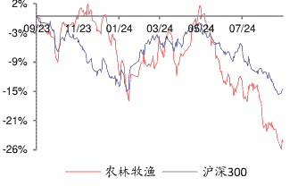

**分析师：** 钱浩

SAC执证号：S0260517080014

SFC CE No. BND274

021-38003634

shqianhao@gf.com.cn

**分析师：** 郑颖欣

SAC执证号：S0260520070001

021-380003632

zhengyingxin@gf.com.cn

**分析师：** 周舒玥

SAC执证号：S0260523050002

021-38003537

zhoushuyue@gf.com.cn

相关研究：

农林牧渔行业：节前猪价震荡回落，关注饲料“出海”机遇　2024-09-17

农林牧渔行业：8月上市公司生猪出栏环比增幅增长，继续受益行业景气　2024-09-17

联系人：李雅琦 021-68827265

liyaqi@gf.com.cn

## 重点公司估值和财务分析表

| 股票简称 | 股票代码 | 货币 | 最新收盘价 | 最近报告日期 | 评级 | 合理价值（元/股） | EPS(元) 2024E | EPS(元) 2025E | PE(x) 2024E | PE(x) 2025E | EV/EBITDA(x) 2024E | EV/EBITDA(x) 2025E | ROE(%) 2024E | ROE(%) 2025E |
|---|---|---|---:|---|---|---:|---:|---:|---:|---:|---:|---:|---:|---:|
| 温氏股份 | 300498.SZ | CNY | 15.71 | 2024/09/19 | 买入 | 26.73 | 1.57 | 1.91 | 10.01 | 8.23 | 6.63 | 5.88 | 24.70 | 24.50 |
| 牧原股份 | 002714.SZ | CNY | 35.93 | 2024/09/06 | 买入 | 57.31 | 3.19 | 3.98 | 11.26 | 9.03 | 5.35 | 4.59 | 21.70 | 21.33 |
| 立华股份 | 300761.SZ | CNY | 17.27 | 2024/07/31 | 买入 | 30.32 | 1.52 | 2.07 | 11.36 | 8.34 | 7.41 | 5.50 | 13.90 | 16.00 |
| 普莱柯 | 603566.SH | CNY | 11.08 | 2023/10/26 | 买入 | 29.27 | 0.98 | 1.19 | 11.31 | 9.31 | 8.77 | 7.40 | 10.90 | 11.60 |
| 唐人神 | 002567.SZ | CNY | 4.59 | 2024/05/23 | 买入 | 8.53 | 0.36 | 0.56 | 12.75 | 8.20 | 3.71 | 2.98 | 8.50 | 11.90 |
| 华统股份 | 002840.SZ | CNY | 9.98 | 2024/05/13 | 买入 | 30.66 | 1.53 | 2.53 | 6.52 | 3.94 | 3.23 | 2.34 | 31.40 | 34.10 |
| 邦基科技 | 603151.SH | CNY | 8.69 | 2024/04/28 | 买入 | 18.20 | 0.91 | 1.05 | 9.55 | 8.28 | 6.29 | 5.62 | 11.10 | 11.40 |

数据来源：Wind、广发证券发展研究中心

备注：表中估值指标按照最新收盘价计算

## 目录索引

- 一、本周观点............................................................5
- （一）本周重点推荐....................................................5
- （二）本周行业跟踪....................................................5
- 二、农业板块跑输大盘1.7个百分点............................9
- 三、农产品价格跟踪....................................................9
- 四、一周新闻速递......................................................20
- 五、风险提示............................................................23

## 图表索引

- 图1：本周农林牧渔板块跑输大盘1.7个百分点................................................9
- 图2：本周农产品加工板块上涨2.7%.............................................................9
- 图3：9月20日生猪出场价18.60元/公斤.....................................................10
- 图4：9月20日猪粮比7.84，环比下降0.46..................................................10
- 图5：9月20日仔猪平均价579.63元/头，环比下跌3.77%..............................10
- 图6：9月20日二元母猪价32.67元/公斤......................................................10
- 图7：9月20日自繁自养、外购仔猪养殖利润分别为463.56、284.21元/头......11
- 图8：本周烟台白羽毛鸡价3.55元/斤，环比维持不变......................................11
- 图9：本周主产区鸡苗价3.72元/羽，环比维持不变..........................................11
- 图10：本周白羽肉鸡孵化场利润上升0.12元/羽...............................................12
- 图11：本周毛鸡养殖利润下降0.10元/羽........................................................12
- 图12：快速类、中速类、慢速类黄鸡价格........................................................12
- 图13：本周国内玉米现货价2314元/吨，环比下跌1.50%.................................13
- 图14：本周大连玉米期货价2164元/吨，环比下跌1.50%.................................13
- 图15：本周国内豆粕现货价3137元/吨，环比上涨1.10%.................................13
- 图16：本周大连豆粕期货价3058元/吨，环比上涨0.70%.................................13
- 图17：本周国内小麦现价2461元/吨，环比下跌0.50%....................................14
- 图18：9月13日小麦国际现价6.01美元/蒲式耳，环比上涨3.10%..................14
- 图19：本周小麦/玉米价格比值环比上升1.55个百分点....................................14
- 图20：本周鱼粉仓库价11050元/吨，环比下跌1.10%.....................................15
- 图21：9月13日鱼粉国际现价1729.82美元/吨，环比下跌0.60%..................15
- 图22：本周鱼粉/豆粕价格比下降1.50个百分点..............................................15
- 图23：9月13日橡胶国内现价14520元/吨，环比上涨1.56%........................16
- 图24：本周柳州白糖价6230元/吨，环比上涨0.80%........................................16
- 图25：9月13日原糖国际现价19.02美分/磅，环比下跌0.70%......................16
- 图26：本周玉米酒精出厂价5200元/吨，环比维持不变....................................17
- 图27：本周DDGS出厂价2000元/吨，环比维持不变.......................................17
- 图28：本周海参大宗价100元/公斤，环比下跌23.1%......................................17
- 图29：本周扇贝大宗价14元/公斤，环比维持不变............................................17
- 图30：本周对虾大宗价360元/公斤，环比下跌5.30%.......................................18
- 图31：9月20日四川地区加州鲈鱼塘口价20.00元/斤，环比维持不变..........18
- 图32：本周湖南地区黄颡鱼塘口价16.00元/斤，环比维持不变.......................18
- 图33：9月20日四川地区叉尾鮰塘口价8.00元/斤，环比下跌5.88%.............18
- 图34：本周广东地区2斤规格草鱼塘口价6.00元/斤，环比下跌1.64%..........19
- 图35：本周湖北地区小龙虾批发价24.00元/斤，环比下跌11.11%..................19
- 图36：本周广东中山市生鱼塘口价为9.40元/斤，环比上涨1.08%..................19

## 一、本周观点

### （一）本周重点推荐

**养殖：**据搜猪网，9月20日，全国瘦肉型生猪出栏均价18.60元/公斤，周环比下跌4.32%，同比上涨19.54%。受节后需求回落、规模场加快出栏等因素影响，本周猪价延续回落。从出栏均重上来看，据涌益咨询数据，本周出栏均重约125.48公斤/头，较上周下降约0.5%。考虑2—7月份新生仔猪出生量同比下滑6.8%（来自农业农村部），按生猪生长周期推算，下半年行业供给偏紧状态仍将延续。行业扩产相对谨慎，后续产能恢复速度或较为缓慢，景气持续时间有望超出市场预期。当前板块估值回落至历史相对低位，大型养殖企业重点推荐温氏股份、牧原股份，关注新希望；中小养殖企业建议关注唐人神、天康生物、华统股份以及川渝生猪龙头企业。白羽鸡方面，本周商品代毛鸡和鸡苗价格相对比较平稳，未来行业或有望延续复苏态势，圣农发展、益生股份或将受益。黄羽鸡方面，当前种鸡存栏持续处于相对低位，有望逐步受益猪价带动，继续推荐立华股份。

**饲料、动保：**本周玉米、豆粕现货价环比小幅震荡，鱼粉现价继续下跌，水产料成本下行有望进一步刺激养殖户投苗积极性。养殖盈利刺激下猪料销量环比增幅扩大，禽料需求稳定运行。本周水产品价格平稳运行。微观层面来看，生鱼、加州鲈鱼、草鱼、罗非鱼等养殖利润恢复至平均1—3元/斤，推动7—9月份秋季投苗迎来显著恢复，近期生鱼、加州鲈鱼等苗价明显上涨，侧面反映投苗积极性，看好特种水产料需求持续改善趋势。饲料龙头依托全产业链优势加快海外产能布局，海外饲料市场规模容量大，行业竞争烈度较国内低，上半年料企海外业务实现销量、盈利能力提升，看好海大集团综合竞争优势下国内份额持续提高，海外业务贡献新增增长空间。动保方面，养殖盈利恢复有望推动动保行业景气触底回升，当前板块估值处于历史低位，建议关注生物股份、中牧股份、普莱柯等。

**种植业：**我国秋粮即将迎来大面积收获，生物育种产业化稳步推进，建议关注隆平高科、登海种业、大北农等。据Wind，本周白糖国际现价19.02美分/磅，环比下跌0.70%，NYBOT 11号糖期货22.72美分/磅，环比上涨20%，主要由于巴西和印度不利天气及印度延长出口限制导致全球供给预期下调，四季度国际市场供需边际偏紧，后续重点关注巴西新季产量及印度出口政策走向。

### （二）本周行业跟踪

重要价格：据搜猪网，9月20日，全国瘦肉型生猪出栏均价18.60元/公斤，周环比下跌4.32%，同比上涨19.54%；仔猪平均价579.63元/头，周环比下跌3.77%。据博亚和讯，烟台地区毛鸡价格3.55元/斤，周环比维持不变；鸡苗价格3.72元/羽，周环比维持不变。

## 重要公告

**神农集团：**公司拟将“广西崇左神农畜牧有限公司生猪养殖项目”由“年出栏14万头商品生猪项目”变更为“年出栏48万头优质仔猪项目”，项目总投资1.6亿元变更为3亿元。

**温氏股份：**公司拟以自有资金不超过18亿元且不低于9亿元（均含本数）通过集中竞价交易方式回购公司普通股（A股）股票，用于实施员工持股计划或股权激励。回购价格不超过27.01元/股（含本数），预计回购股份数量为3332.10万股至6664.20万股，约占公司截至2024年6月28日收市后总股本的0.50%至1.00%。回购期限为自董事会审议通过本次回购股份议案之日起不超过12个月。

**大北农：**截至2024年9月13日，公司以集中竞价方式累计回购公司股份1970.66万股，占公司目前总股本的比例为0.46%，最高成交价为5.15元/股，最低成交价为3.86元/股，成交总金额为8003.95万元（不含交易费用），本次回购股份方案已实施完成；公司控股子公司大北农生物研发的转基因抗虫耐除草剂大豆转化事件DBN8002（DBN-08002-3）通过安全评价审查，获批巴西种植许可。

**立华股份：**公司实际控制人程立力先生办理股份质押合计4000万股，占其所持股份的14.81%，占公司总股本的4.83%；办理股份解除质押4010万股，占其所持股份的14.84%，占公司总股本的4.85%。

**ST佳沃：**公司智利子公司AMSA与饲料供应商Vitapro签署《生物资产合作协议》，AMSA以其旗下4个养殖中心截至2024年7月31日成本价值共计约3496万美元的水下生物资产设立抵押担保，用来担保AMSA现在和将来从Vitapro购买养殖饲料所产生的付款义务。

## 行业新闻

### 1. 2023年全国休闲渔业产值增长10.99%

为促进休闲渔业持续健康发展，近日，全国水产技术推广总站、中国水产学会编制了《中国休闲渔业发展监测报告（2024）》（以下简称“报告”）。报告分析了2023年休闲渔业发展状况，并针对产业发展中遇到的问题提出了建议。

根据报告，2023年，全国休闲渔业产值为931.47亿元，同比增长10.99%，接近2019年水平。全国休闲渔业经营主体数量14.04万个，同比增长1.51%；从业人员数量82.38万人，同比增长7.95%；接待人数2.72亿人次，同比增长15%；人均消费支出342.89元，同比下降3.49%。

我国休闲渔业分为五种类型，分别是旅游导向型休闲渔业、休闲垂钓及采集业、钓具钓饵观赏鱼渔药及水族设备、观赏鱼产业和其他。前四种类型产业产值均有增长，同比增速最快的是旅游导向型休闲渔业和观赏鱼产业。

近年来，各地各部门出台了一系列扶持政策和规范措施，推动了休闲渔业平稳有序发展。渔文化保护传承弘扬与休闲渔业呈现互融互促局面，既促使渔文化在新时代焕发生机，又为休闲渔业发展提供了源泉活水。水产养殖发展空间拓展也为休闲渔业发展提供新机遇，大水面渔业、深远海养殖、稻渔综合种养、盐碱地养殖等生态养殖模式，成为休闲渔业创新发展的广阔平台。

报告指出，我国休闲渔业面临着产业发展总体不平衡不充分、发展功能模式单一、经营项目同质化等问题。对此，要加强科学规划引导，推动资源要素向休闲渔业及关联产业汇聚；健全政策制度，制定休闲渔业准入、基础设施建设、经营服务、卫生和食品安全等标准；加大资金投入，探索投资补助、以奖代补、财政贴息等支持方式，并引导社会资本稳妥有序投入休闲渔业；强化示范引领，打造生产标准化、经营特色化、服务规范化、功能多元化的休闲渔业示范基地。

新闻来源：中国农业农村信息网

http://www.agri.cn/zx/nyyw/202409/t20240920_8672517.htm

### 2. 从2264亿斤到13908亿斤——农业发展硕果累累

新中国成立75年，写下了农业发展巨变的伟大历史篇章。从“新中国成立之初5亿人吃不饱”到“进入新时代14亿多人吃得好”，没有哪个国家，比中国人更能体会这条饱腹之路上的酸甜苦辣；没有哪个年代，比现在更好解决了长期想解决而没有解决的吃饭难题。

党中央强农惠农富农政策，让“中国人的饭碗牢牢端在自己手中”有了新底气，让农民世代居住的绿水青山变成“金山银山”有了新希望。一幅和美的农业农村画卷，正在华夏大地上铺展。

### 走出中国特色粮食安全之路

新中国成立初期，主要农产品供给严重短缺，“吃饱饭”曾经是一件难事。中国人有过很长一段凭“票”吃饭的日子，方寸大小的一片薄纸，直接关系吃饭的权利。这背后是当时农业生产力的低下。1949年，我国粮食平均亩产仅68.6公斤，全国仅有13台联合收割机。

随着农业经济的进步和农村改革的推进，农产品市场由卖方市场转变为买方市场，曾经紧俏的米票、面票等风光不再。1993年，粮票彻底退出流通，定额定量供应的计划配给制成为历史。市场化改革解除了计划经济对农业生产的束缚，此后，粮食产量连续跨越了几个台阶。

党的十八大以来，党中央把粮食安全作为治国理政的头等大事来抓，提出国家粮食安全新战略，实行粮食安全党政同责。我国粮食生产开创新局面，连续9年稳定在1.3万亿斤以上。数据显示，粮食总产量由1949年的2264亿斤增加到2023年的13908亿斤，增长5.1倍；2023年人均粮食产量493公斤，不仅超过世界平均水平，也高于国际公认的400公斤粮食安全线。

粮食安全不仅是数量上的，更是质量上的。我国着力解决农业发展中的深层次问题，顺应人民群众对美好生活的新需求，切实把粮食种植结构调活调优。粮食生产从粗放式追求数量为主逐步向质效并重转变，特别是党的十八大以来，粮食生产走向高质量发展道路。近年来，我国大力培育和推广优良品种，取得了节水抗旱小麦、超级稻等一批重大标志性成果。

从5亿人吃不饱到14亿多人吃得好，中国向世界讲述着这片土地上发生的传奇故事：用不到世界9%的耕地、6%的淡水养活了世界近20%的人口。事实胜于雄辩，中国用举世瞩目的成就有力回答了“谁来养活中国”的疑问。在人多地少水缺的发展中国家，粮食生产屡获丰收，证明国家重农抓粮的政策方向是正确的，体现了中国特色粮食安全之路的道路自信。

### 重要农产品实现稳定多元供给

中国14亿多人，每天要消耗70万吨粮、9.8万吨油、192万吨菜、23万吨肉、9万吨禽蛋、10万吨奶。应对如此旺盛的食物消费需求，装满“米袋子”的同时，“肉盘子”“菜篮子”“果盘子”也要给力。

从内湖的大水面养殖到深远海的海洋牧场，从东北的林果到天山脚下的水果，从西南的高原农业到西北的旱作农业……利用多样农业资源、发展多元农业形态，念好“山海经”，唱好“林草戏”，打好“果蔬牌”，近年来各地建立多元化农产品供给体系。多元稳定的供给，成就了“舌尖上的中国”。

中国社会科学院农村发展研究所研究员、中国林牧渔业经济学会秘书长刘长全说，我国居民膳食呈现多元化趋势。树立大食物观，不仅要在耕地上做文章，还要面向整个国土空间要食物，这为林牧渔业发展提供了广阔前景。在农林牧渔业总产值中，林牧渔业比重占到近一半。丰富多样的畜产品、水产品、林业食品是保障农产品供给的组成部分。

畜产品更加多样。改革开放后，特别是1985年国家放开猪肉、蛋、牛奶等畜产品价格后，畜产品产量不断攀升。党的十八大以来，畜牧业现代化、规模化进程加快。随着居民消费越来越趋向于健康化、多元化，肉类生产结构不断调整优化。1985年到2023年，猪肉占肉类总产量比重由85.9%下降到59.4%，牛羊肉比重由5.5%上升到13.2%，禽肉由8.3%上升到26.3%。

水产更加健康。我国确立了“以养殖为主”的渔业发展方针，水产品产量从1989年起稳居世界首位。2023年，我国水产品总产量达到7116万吨，比1949年增长157倍，年均增长7.1%。党的十八大以来，渔业加快转型升级。稻鱼综合种养、多营养层级立体养殖等生态养殖模式不断推广，休禁渔制度进一步调整完善，“伏季休渔”“十年禁渔”“增殖放流”“海洋牧场”等各项措施的实施，推动渔业高质量发展。

新闻来源：中国农业农村信息网

http://www.agri.cn/zx/nyyw/202409/t20240913_8670809.htm

## 二、农业板块跑输大盘1.7个百分点

本周农林牧渔板块（申万行业）下跌0.4个百分点，沪深300指数上涨1.3个百分点，板块跑输大盘1.7个百分点。子板块中，农产品加工、渔业和种植业板块涨幅居前，分别上涨2.7%、2.0%和1.8%。

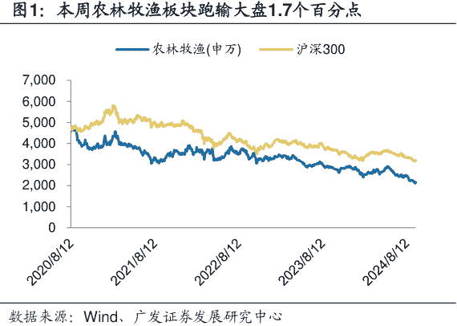

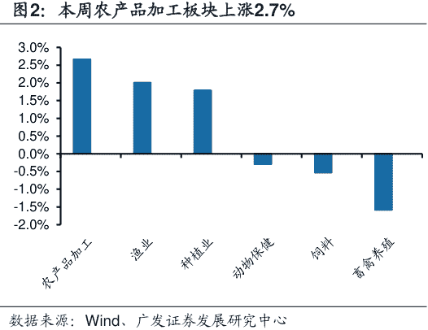

## 三、农产品价格跟踪

### （一）畜禽产品价格：猪价环比下跌4.32%，鸡价环比维持不变

#### 1. 猪价环比下跌4.32%，自繁自养头均盈利环比下降84.74元/头

据搜猪网，9月20日，全国瘦肉型生猪出栏均价18.60元/公斤，环比上周下跌4.32%，同比上涨19.54%；自繁自养头均盈利463.56元/头，外购育肥盈利约284.21元/头，上年同期亏损分别约27.49元/头、80.09元/头。

##### 图3：9月20日生猪出场价18.60元/公斤

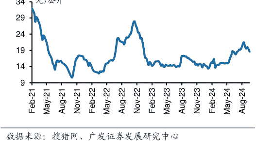

##### 图4：9月20日猪粮比7.84，环比下降0.46

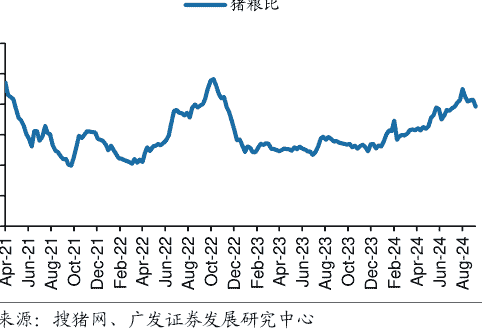

##### 图5：9月20日仔猪平均价579.63元/头，环比下跌3.77%

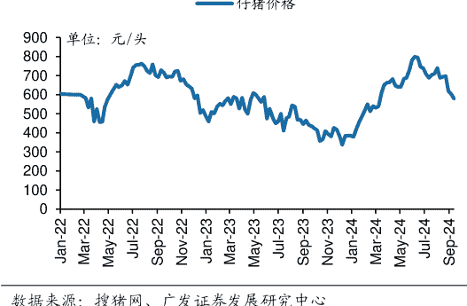

##### 图6：9月20日二元母猪价32.67元/公斤

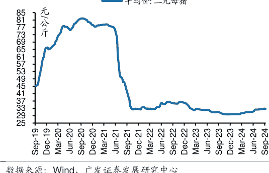

##### 图7：9月20日自繁自养、外购仔猪养殖利润分别为463.56、284.21元/头

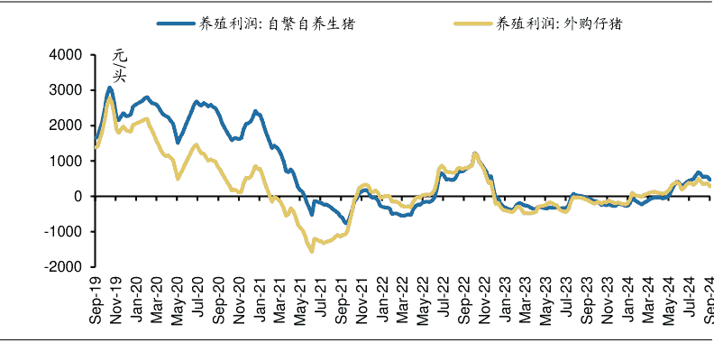

数据来源：农业农村部、Wind、广发证券发展研究中心

#### 2. 本周鸡价环比维持不变，毛鸡养殖利润环比维持不变

据博亚和讯统计，9月20日，烟台地区毛鸡价格3.55元/斤，环比上周维持不变，同比下跌13.41%；鸡苗价格3.72元/羽，环比上周维持不变，同比上涨102.17%；毛鸡养殖亏损3.11元/羽，环比下降0.10元/羽，同比下降0.88元/羽。

##### 图8：本周烟台白羽毛鸡价3.55元/斤，环比维持不变

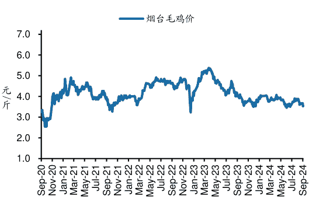

数据来源：博亚和讯、Wind、广发证券发展研究中心

##### 图9：本周主产区鸡苗价3.72元/羽，环比维持不变

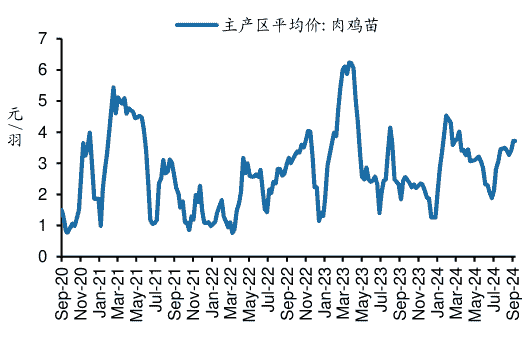

数据来源：博亚和讯、Wind、广发证券发展研究中心

##### 图10：本周白羽肉鸡孵化场利润上升0.12元/羽

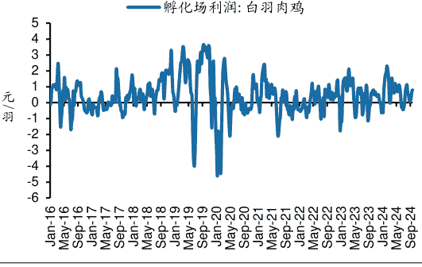

数据来源：博亚和讯、Wind、广发证券发展研究中心

##### 图11：本周毛鸡养殖利润下降0.10元/羽

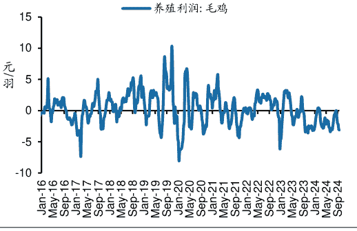

数据来源：博亚和讯、Wind、广发证券发展研究中心

据新禽况，9月7日，快速类鸡5.77元/斤，周环比下跌2.04%，中速类鸡价格6.54元/斤，周环比上涨2.35%；慢速类鸡价格8.4元/斤，周环比下跌0.71%。

##### 图12：快速类、中速类、慢速类黄鸡价格

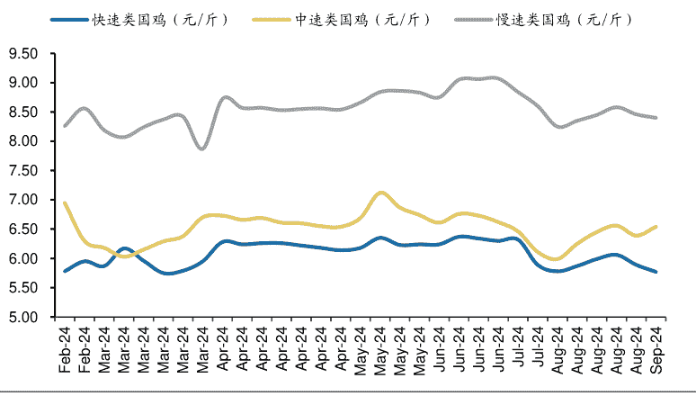

数据来源：新禽况、广发证券发展研究中心

### （二）原材料价格：本周国内玉米现货价环比下跌1.50%，豆粕现货价环比上涨1.10%

#### 1. 玉米：本周国内现货价环比下跌1.50%

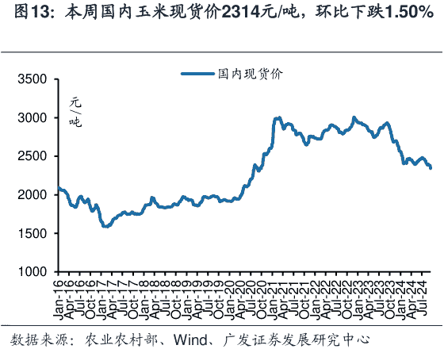

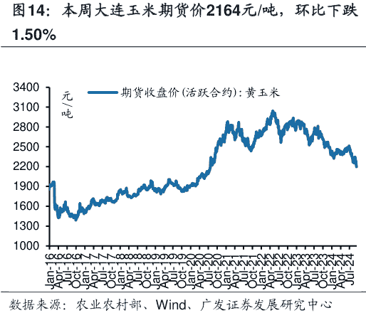

#### 2. 豆粕：本周豆粕现货价环比上涨1.10%

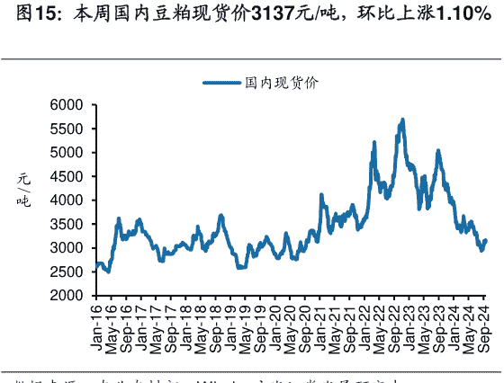

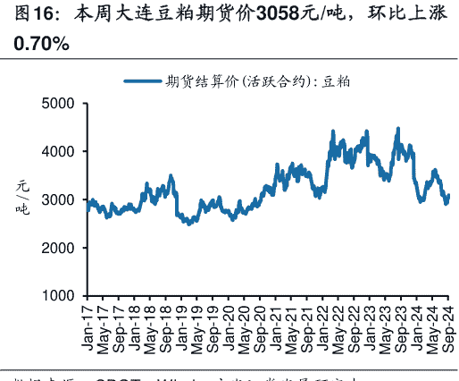

#### 3. 小麦：本周国内现货环比下跌0.48%

##### 图17：本周国内小麦现货2461元/吨，环比下跌0.48%

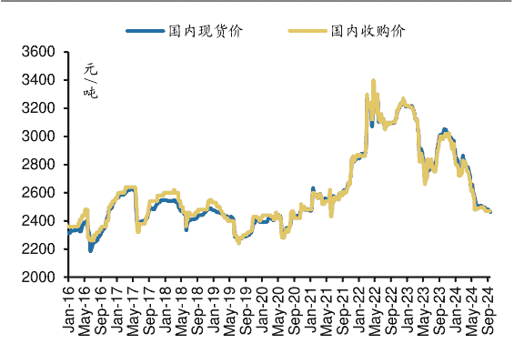

数据来源：农业农村部、Wind、广发证券发展研究中心

##### 图18：9月13日小麦国际现货价6.01美元/蒲式耳，环比上涨3.10%

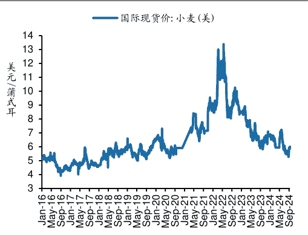

数据来源：农业农村部、Wind、广发证券发展研究中心

##### 图19：本周小麦/玉米价格比值环比上升1.55个百分点

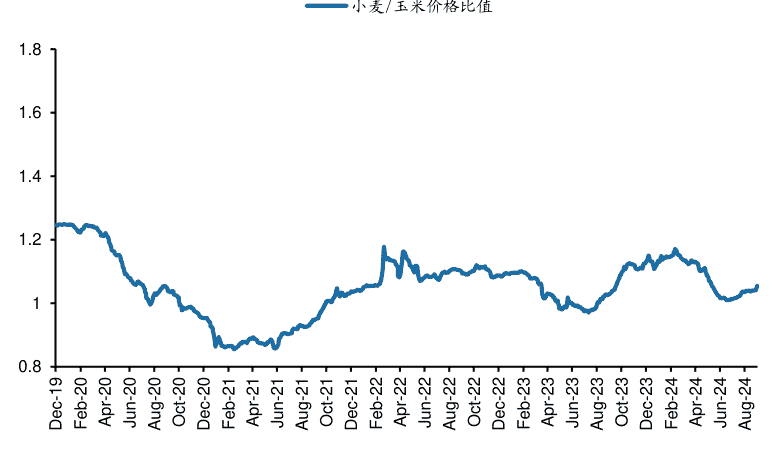

数据来源：农业农村部、Wind、广发证券发展研究中心

#### 4. 鱼粉：仓库价环比下降1.10%

##### 图20：本周鱼粉仓库价11050元/吨，环比下降1.10%

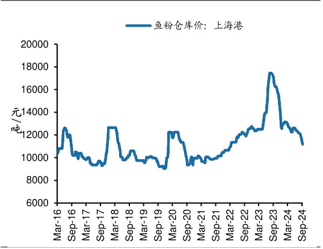

数据来源：博亚和讯、Wind、广发证券发展研究中心

##### 图21：9月13日鱼粉国际现货价1729.82美元/吨，环比下降0.60%

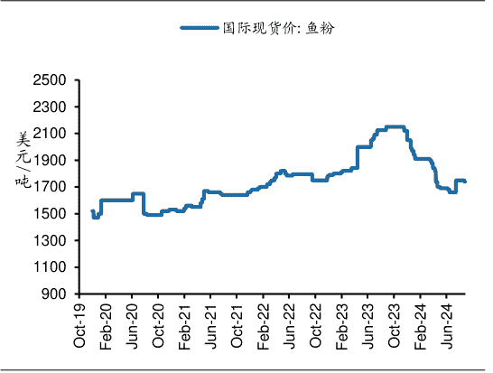

数据来源：农业农村部、Wind、广发证券发展研究中心

##### 图22：本周鱼粉/豆粕价格比下降1.50个百分点

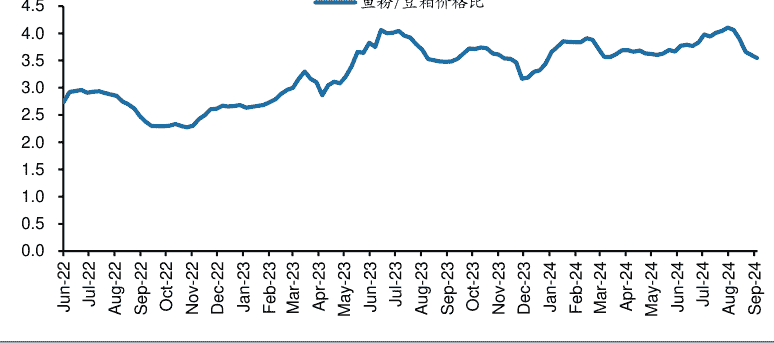

数据来源：博亚和讯、Wind、广发证券发展研究中心

### （三）农产品加工：本周橡胶国内现价14520元/吨，环比上涨1.60%

#### 1. 橡胶：本周橡胶国内现价14520元/吨，环比上涨1.60%

##### 图23：9月13日橡胶国内现价14520元/吨，环比上涨1.60%

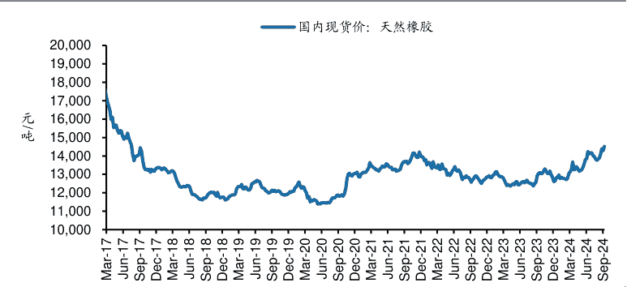

数据来源：Wind、广发证券发展研究中心

#### 2. 糖：本周国内现价环比上涨0.80%

##### 图24：本周柳州白糖价6230元/吨，环比上涨0.80%

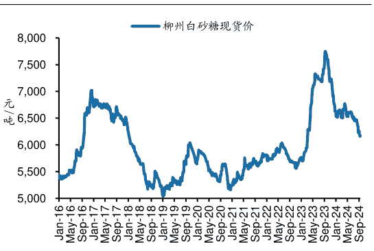

##### 图25：9月13日原糖国际现价19.02美分/磅，环比下跌0.70%

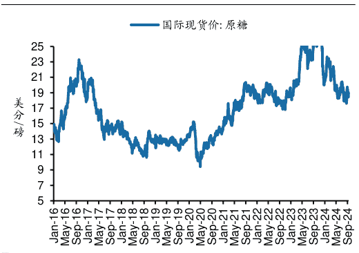

数据来源：农业农村部、Wind、广发证券发展研究中心

#### 3. 玉米深加工：本周玉米酒精出厂价环比维持不变，DDGS出厂价环比维持不变

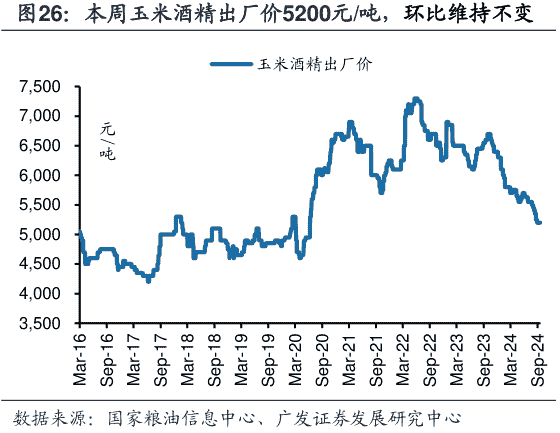

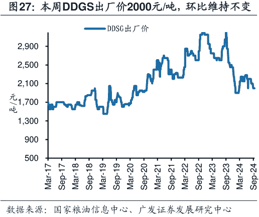

#### 4. 水产品：本周海参大宗价环比下跌23.10%、扇贝大宗价环比维持不变、对虾大宗价环比下跌5.30%

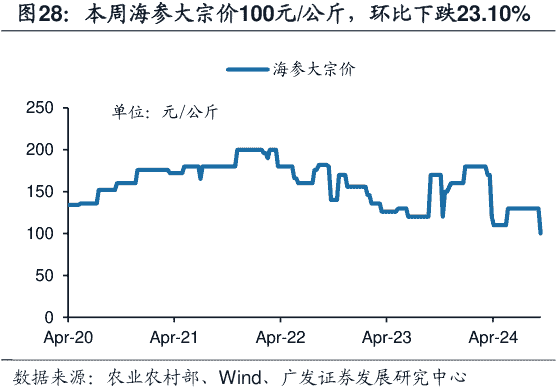

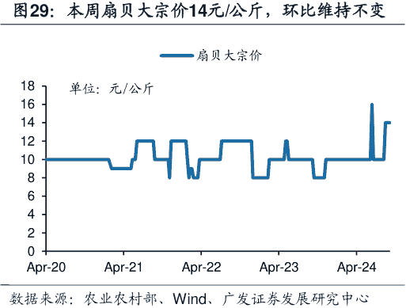

### 观音桥商圈都市旅游步行系统规划

本项目以创建“全国示范步行街”与“5A级景区”为目标，针对观音桥商圈步行系统展开规划设计。通过对商圈现状交通、商业布局、公共空间及步行体验的深入分析，提出以“立体化、休闲化、智能化”为导向的步行系统提升策略，构建“一环两轴多节点”的整体结构，优化步行网络、提升空间品质、丰富商业业态，打造具有山地特色的都市旅游目的地。

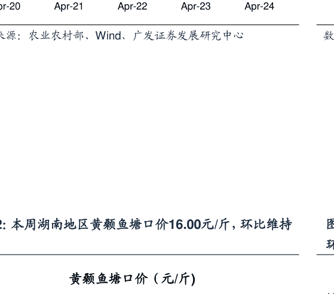

规划范围东至建新东路，南至建新南路，西至建新西路，北至红锦大道，总用地面积约1.5平方公里。整体形成“一核一轴一带三片”的空间结构。

| 子系统 | 核心策略 | 主要内容 |
|---|---|---|
| 步行网络 | 立体延展 | 构建地下、地面、地上三层步行体系，通过连廊、天桥、地下通道紧密衔接 |
| 公共空间 | 文化注入 | 打造商圈文化公园、街角艺术空间、休憩节点等系列公共目的地 |
| 智慧系统 | 科技赋能 | 引入智能导览、AR互动、人流监测、智慧照明等系统 |

本项目旨在重塑商圈步行体验，提升城市活力与旅游吸引力。

##### 图34：本周广东地区2斤规格草鱼塘口价6.00元/斤，环比下跌1.64%

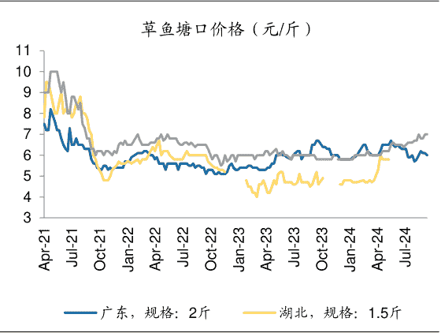

数据来源：通威农牧微信公众号、广发证券发展研究中心

##### 图35：本周湖北地区小龙虾批发价24.00元/斤，环比下跌11.11%

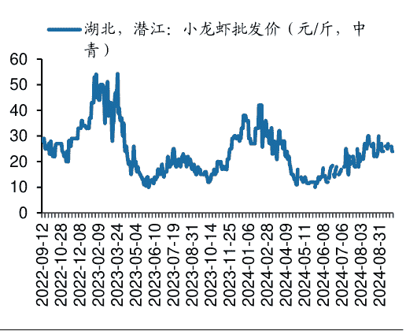

数据来源：渔征微信公众号、广发证券发展研究中心

##### 图36：本周广东中山市生鱼塘口价为9.40元/斤，环比上涨1.08%

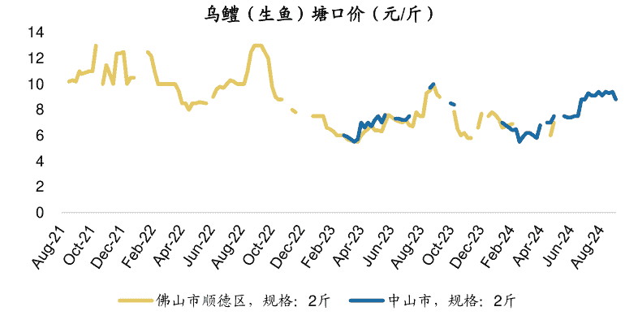

数据来源：通威农牧微信公众号、广发证券发展研究中心

## 四、一周新闻速递

### 1. 2023年全国休闲渔业产值增长10.99%

为促进休闲渔业持续健康发展，近日，全国水产技术推广总站、中国水产学会编制了《中国休闲渔业发展监测报告（2024）》（以下简称“报告”）。报告分析了2023年休闲渔业发展状况，并针对产业发展中遇到的问题提出了建议。

根据报告，2023年，全国休闲渔业产值为931.47亿元，同比增长10.99%，接近2019年水平。全国休闲渔业经营主体数量14.04万个，同比增长1.51%；从业人员数量82.38万人，同比增长7.95%；接待人数2.72亿人次，同比增长15%；人均消费支出342.89元，同比下降3.49%。

我国休闲渔业分为五种类型，分别是旅游导向型休闲渔业、休闲垂钓及采集业、钓具、饵料、观赏鱼类及水族设备、观赏鱼产业和其他。前四种类型产业产值均有增长，同比增长最快的是旅游导向型休闲渔业和观赏鱼产业。

近年来，各地各部门出台了一系列扶持政策和规范措施，推动了休闲渔业平稳有序发展。渔文化保护传承弘扬与休闲渔业呈现互融促局面，既促使渔文化在新时代焕发生机，又为休闲渔业发展提供了源泉活水。水产养殖发展空间拓展也为休闲渔业发展提供新机遇，大水面渔业、深远海养殖、稻渔综合种养、盐碱地养殖等生态养殖模式，成为休闲渔业创新发展的广阔平台。

报告指出，我国休闲渔业面临着产业发展总体不平衡不充分、发展功能模式单一、经营项目同质化等问题。对此，要加强科学规划引导，推动资源要素向休闲渔业及关联产业汇聚；健全政策制度，制定休闲渔业准入、基础设施建设、经营服务、卫生和食品安全等标准；加大资金投入，探索投资补助、以奖代补、财政贴息等支持方式，并引导社会资本稳妥有序投入休闲渔业；强化示范引领，打造生产标准化、经营特色化、服务规范化、功能多元化的休闲渔业示范基地。

新闻来源：中国农业农村信息网

http://www.agri.cn/zx/nyyw/202409/t20240920_8672517.htm

### 2. 从2264亿斤到13908亿斤——农业发展硕果累累

新中国成立75年，写下了农业发展巨变的伟大历史篇章。从“新中国成立之初5亿人吃不饱”到“进入新时代14亿多人吃得好”，没有哪个国家，比中国人更能体会这条饱腹之路上的酸甜苦辣；没有哪个年代，比现在更好解决了长期想解决而没有解决的吃饭难题。

党中央强农惠农富农政策，让“中国人的饭碗牢牢端在自己手中”有了新底气，让农民世代居住的绿水青山变成“金山银山”有了新希望。一幅和美的农业农村画卷，正在华夏大地上铺展。

### 走出中国特色粮食安全之路

新中国成立初期，主要农产品供给严重短缺，“吃饱饭”曾经是一件难事。中国人有过很长一段凭“票”吃饭的日子，方寸大小的一片薄纸，直接关系吃饭的权利。这背后是当时农业生产力的低下。1949年，我国粮食平均亩产仅68.6公斤，全国仅有13台联合收割机。

随着农业经济的进步和农村改革的推进，农产品市场由卖方市场转变为买方市场，曾经紧俏的米票、面票等风光不再。1993年，粮票彻底退出流通，定额定量供应的计划配给制成为历史。市场化改革解除了计划经济对农业生产的束缚，此后，粮食产量连续跨越了几个台阶。

党的十八大以来，党中央把粮食安全作为治国理政的头等大事来抓，提出国家粮食安全新战略，实行粮食安全党政同责。我国粮食生产开创新局面，连续9年稳定在1.3万亿斤以上。数据显示，粮食总产量由1949年的2264亿斤增加到2023年的13908亿斤，增长5.1倍；2023年人均粮食产量493公斤，不仅超出世界平均水平，也高于国际公认的400公斤粮食安全线。

粮食安全不仅是数量上的，更是质量上的。我国着力解决农业发展中的深层次问题，顺应人民群众对美好生活的新需求，切实把粮食种植结构调活调优。粮食生产从粗放式追求数量为主逐步向质效并重转变，特别是党的十八大以来，粮食生产走向高质量发展道路。近年来，我国大力培育和推广优良品种，取得了节水抗旱小麦、超级稻等一批重大标志性成果。

从5亿人吃不饱到14亿多人吃得好，中国向世界讲述着这片土地上发生的传奇故事：用不到世界9%的耕地、6%的淡水养活了世界近20%的人口。事实胜于雄辩，中国用举世瞩目的成就有力回答了“谁来养活中国”的疑问。在人多地少水缺的发展中国家，粮食生产屡获丰收，证明国家重农抓粮的政策方向是正确的，体现了中国特色粮食安全之路的道路自信。

### 重要农产品实现稳定多元供给

中国14亿多人，每天要消耗70万吨粮、9.8万吨油、192万吨菜、23万吨肉、9万吨禽蛋、10万吨奶。应对如此旺盛的食物消费需求，装满“米袋子”的同时，“肉盘子”“菜篮子”“果盘子”也要给力。

从内湖的大水面养殖到深远海的海洋牧场，从东北的林果到天山脚下的水果，从西南的高原农业到西北的旱作农业……利用多样农业资源、发展多元农业形态，念好“山海经”，唱好“林草戏”，打好“果蔬牌”，近年来各地建立多元化农产品供给体系。多元稳定的供给，成就了“舌尖上的中国”。

中国社会科学院农村发展研究所研究员、中国林牧渔业经济学会秘书长刘长全说，我国居民膳食呈现多元化趋势。树立大食物观，不仅要在耕地上做文章，还要面向整个国土空间要食物，这为林牧渔业发展提供了广阔前景。在农林牧渔业总产值中，林牧渔业比重占到近一半。丰富多样的畜产品、水产品、林业食品是保障农产品供给的组成部分。

畜产品更加多样。改革开放后，特别是1985年国家放开猪肉、蛋、牛奶等畜产品价格后，畜产品产量不断攀升。党的十八大以来，畜牧业现代化、规模化进程加快。随着居民消费越来越趋向于健康化、多元化，肉类生产结构不断调整优化。1985年到2023年，猪肉占肉类总产量比重由85.9%下降到59.4%，牛羊肉比重由5.5%上升到13.2%，禽肉由8.3%上升到26.3%。

水产更加健康。我国确立了“以养殖为主”的渔业发展方针，水产品产量从1989年起稳居世界首位。2023年，我国水产品总产量达到7116万吨，比1949年增长157倍，年均增长7.1%。党的十八大以来，渔业加快转型升级。稻鱼综合种养、多营养层级立体养殖等生态养殖模式不断推广，休禁渔制度进一步调整完善，“伏季休渔”“十年禁渔”“增殖放流”“海洋牧场”等各项措施的实施，推动渔业高质量发展。

新闻来源：中国农业农村信息网

http://www.agri.cn/zx/nyyw/202409/t20240913_8670809.htm

### 3. 国务院关税税则委员会停止执行对台部分农产品进口零关税政策

据财政部消息，国务院关税税则委员会停止执行对台部分农产品进口零关税政策。

台湾地区单方面对大陆产品出口采取歧视性的禁止、限制等措施，严重阻碍两岸经贸合作。国务院关税税则委员会近日发布公告，自2024年9月25日起，停止执行对原产于台湾地区的鲜水果、蔬菜、水产品等34项农产品免征进口关税政策，相关农产品进口关税按现行有关规定执行。

新闻来源：中国农业农村信息网

http://www.agri.cn/zx/nyyw/202409/t20240919_8672152.htm

### 4. 全国秋收秋种气象服务启动

日前，中央气象台发布今年首份《秋收秋种气象服务专报》，2024年全国秋收秋种气象服务正式启动。专报显示，预计今年秋季全国大部地区气温偏高，东北地区大部初霜期接近常年或偏晚，气象条件总体利于秋收作物成熟和秋收秋种开展；西北地区东部、华北北部、内蒙古中西部降水偏多，秋收连阴雨风险较高。

中国气象局党组高度重视秋收秋种气象服务，要求各级气象部门加强上下联动，强化秋粮作物和全年粮食产量的分析和研判，重点做好农田渍涝、高温热害、农业干旱、寒露风、早霜冻、连阴雨等农业气象灾害和病虫害的预报预警，发挥科技支撑和示范作用，强化早监测、早预警、早服务。

国家气象中心将持续推进中国农业气象业务系统网页版平台建设，深度融合智能网格天气预报数据、作物发育期监测与预报结果、农事活动气象指标等，优化完善秋收秋种适宜等级预报格点化产品制作及修订功能；依托“科技创新2030”项目“千里万乡”农业知识智能服务技术示范与推广，将秋收秋种等服务产品与全国农业知识智能服务云平台相链接；优化灾害监测和风险预警业务体系，提高秋收秋种气象服务针对性、客观性和定量化水平。

## 五、风险提示

**农产品价格波动风险：** 农产品极易受到天气影响，若发生较大自然灾害，会影响销售情况、运输情况和价格走势。

**疾病风险：** 畜禽类价格的阶段性波动易受到疫病等因素影响。

**政策风险：** 农业政策推进的进度和执行过程易受非政策本身的因素影响，造成效果不及预期，影响行业变革速度和公司的经营情况。

## 广发证券农林牧渔行业研究小组

钱浩：资深分析师，复旦大学理学硕士、学士，2017年加入广发证券发展研究中心。

郑颖欣：资深分析师，复旦大学世界经济学士，曼彻斯特大学发展金融硕士，2017年加入广发证券发展研究中心。

周舒玥：高级分析师，中国人民大学学士，约翰霍普金斯大学硕士，2021年加入广发证券发展研究中心。

李雅琦：研究员，上海财经大学金融学学士、硕士，2022年加入广发证券发展研究中心。

## 广发证券——行业投资评级说明

- 买入：预期未来12个月内，股价表现强于大盘10%以上。
- 持有：预期未来12个月内，股价相对大盘的变动幅度介于-10%～+10%。
- 卖出：预期未来12个月内，股价表现弱于大盘10%以上。

## 广发证券——公司投资评级说明

- 买入：预期未来12个月内，股价表现强于大盘15%以上。
- 增持：预期未来12个月内，股价表现强于大盘5%～15%。
- 持有：预期未来12个月内，股价相对大盘的变动幅度介于-5%～+5%。
- 卖出：预期未来12个月内，股价表现弱于大盘5%以上。

## 联系我们

|  | 广州市 | 深圳市 | 北京市 | 上海市 | 香港 |
|---|---|---|---|---|---|
| 地址 | 广州市天河区马场路26号广发证券大厦47楼 | 深圳市福田区益田路6001号太平金融大厦31层 | 北京市西城区月坛北街2号月坛大厦18层 | 上海市浦东新区南泉北路429号泰康保险大厦37楼 | 香港湾仔骆克道81号广发大厦27楼 |
| 邮政编码 | 510627 | 518026 | 100045 | 200120 | - |
| 客服邮箱 | gfzqyf@gf.com.cn |  |  |  |  |

## 法律主体声明

本报告由广发证券股份有限公司或其关联机构制作，广发证券股份有限公司及其关联机构以下统称为“广发证券”。本报告的分销依据不同国家、地区的法律、法规和监管要求由广发证券于该国家或地区的具有相关合法合规经营资质的子公司/经营机构完成。

广发证券股份有限公司具备中国证监会批准的证券投资咨询业务资格，接受中国证监会监管，负责本报告于中国（港澳台地区除外）的分销。

广发证券（香港）经纪有限公司具备香港证监会批准的就证券提供意见（4号牌照）的牌照，接受香港证监会监管，负责本报告于中国香港地区的分销。

本报告署名研究人员所持中国证券业协会注册分析师资质信息和香港证监会批准的牌照信息已于署名研究人员姓名处披露。

## 重要声明

广发证券股份有限公司及其关联机构可能与本报告中提及的公司寻求或正在建立业务关系，因此，投资者应当考虑广发证券股份有限公司及其关联机构有可能存在的潜在利益冲突而对本报告的独立性产生影响。投资者不应仅依据本报告内容作出任何投资决策。投资者应自主作出投资决策并自行承担投资风险，任何形式的分享证券投资收益或者分担证券投资损失的书面或者口头承诺均为无效。

本报告署名研究人员、联系人（以下简称“研究人员”）针对本报告中相关公司或证券的研究分析内容，在此声明：（1）本报告的全部分析结论、研究观点均精确反映研究人员于本报告发出当日的关于相关公司或证券的所有个人观点，并不代表广发证券的立场；（2）研究人员的部分或全部的报酬无论在过去、现在还是将来均不会与本报告所述特定分析结论、研究观点具有直接或间接的联系。

研究人员制作本报告的报酬标准依据研究质量、客户评价、工作量等多种因素确定，其影响因素亦包括广发证券的整体经营收入，该等经营收入部分来源于广发证券的投资银行类业务。

本报告仅面向经广发证券授权使用的客户/特定合作机构发送，不对外公开发布，只有接收人才可以使用，且对于接收人而言具有保密义务。广发证券并不因相关人员通过其他途径收到或阅读本报告而视其为广发证券的客户。在特定国家或地区传播或者发布本报告可能违反当地法律，广发证券并未采取任何行动以允许于该等国家或地区传播或者分销本报告。

本报告所提及证券可能不被允许在某些国家或地区内出售。请注意，投资涉及风险，证券价格可能会波动，因此投资回报可能会有所变化，过去的业绩并不保证未来的表现。本报告的内容、观点或建议并未考虑任何个别客户的具体投资目标、财务状况和特殊需求，不应被视为对特定客户关于特定证券或金融工具的投资建议。本报告发送给某客户是基于该客户被认为有能力独立评估投资风险、独立行使投资决策并独立承担相应风险。

本报告所载资料的来源及观点的出处皆被广发证券认为可靠，但广发证券不对其准确性、完整性做出任何保证。报告内容仅供参考，报告中的信息或所表达观点不构成所涉证券买卖的出价或询价。广发证券不对因使用本报告的内容而引致的损失承担任何责任，除非法律法规有明确规定。客户不应以本报告取代其独立判断或仅根据本报告做出决策，如有需要，应先咨询专业意见。

广发证券可发出其他与本报告所载信息不一致及有不同结论的报告。本报告反映研究人员的不同观点、见解及分析方法，并不代表广发证券的立场。广发证券的销售人员、交易员或其他专业人士可能以书面或口头形式，向其客户或自营交易部门提供与本报告观点相反的市场评论或交易策略，广发证券的自营交易部门亦可能会有与本报告观点不一致、甚至相反的投资策略。报告所载资料、意见及推测仅反映研究人员于发出本报告当日的判断，可能随时更改且无需另行通知。广发证券或其证券研究报告业务的相关董事、高级职员、分析师和员工可能拥有本报告所提及证券的权益。在阅读本报告时，收件人应了解相关的权益披露（若有）。

本研究报告可能包括和/或描述期货合约价格的事实历史信息（“信息”）。请注意，此信息仅供作为组成我们的研究方法/分析中的部分论点/根据/证据，以支持我们对所述相关行业/公司的观点的结论。在任何情况下，它并不（明示或暗示）与香港证监会第5类受规管活动（就期货合约提供意见）有关联或构成此活动。

## 权益披露

- 1. 广发证券（香港）跟本研究报告所述公司在过去12个月内并没有任何投资银行业务的关系。

## 版权声明

未经广发证券事先书面许可，任何机构或个人不得以任何形式翻版、复制、刊登、转载和引用，否则由此造成的一切不良后果及法律责任由私自翻版、复制、刊登、转载和引用者承担。

## 每日免费获取资料

- 每日微信群内分享7+最新行业报告；
- 每周分享当周华尔街日报、经济学人；
- 行业报告均为公开版，权利归原作者所有，参一江湖仅分发做内部学习。

｜英语外刊｜行业报告｜行业社群｜参一江湖·聚焦行业前沿

关注公众号  
领取粉丝福利
