# Multi-Agent Framework

A framework with multiple agents working together to achieve a common goal.

- **1. Agent 1**
  - Manages the overall workflow.
  - Delegates tasks to other agents.
- **2. Agent 2**
  - Handles data processing.
  - Cleans and formats input data.
- **3. Agent 3**
  - Interfaces with external APIs.
  - Fetches real-time data.

# Architecture

The system is composed of a central orchestrator and specialized workers.


```python
from agents import Agent, Orchestrator

orchestrator = Orchestrator()
agent1 = Agent('data_processor')
agent2 = Agent('api_client')

orchestrator.add_agent(agent1)
orchestrator.add_agent(agent2)
```

# 跨文化交流中的“傲慢与偏见”

在全球化浪潮席卷世界的今天，跨文化交流已成为连接不同民族、国家和文化的桥梁。然而，在这座桥梁上，我们时常会看到一些不和谐的音符——那些源自文化差异的傲慢与偏见。它们如同无形的屏障，阻碍着不同文化背景下的人们建立真诚的联系与理解。

## 文化傲慢的根源

文化傲慢并非天生，而是在特定的历史、社会和经济背景下逐渐形成的。当一种文化在物质或精神层面取得显著成就时，其成员容易产生优越感，这种优越感若不加控制，便会演变为对其他文化的轻视与排斥。例如，殖民时代的欧洲列强曾将自身文明视为“高级”，将其他文化视为“原始”，这种心态至今仍在某些隐性形式中延续。

## 偏见如何形成

偏见往往源于信息的缺乏或错误。当人们对另一种文化的了解停留在刻板印象或道听途说时，便容易以偏概全，做出错误的判断。媒体的片面报道、教育中的文化盲区以及缺乏真实的跨文化接触，都会加剧这种偏见。一项研究表明，只有约30%的受访者曾与不同文化背景的人有过深度交流，这无疑为偏见的滋生提供了土壤。

## 傲慢与偏见的后果

傲慢与偏见不仅伤害个体之间的感情，更可能引发群体间的冲突与误解。在商务谈判中，一方若轻视另一方的文化习俗，可能导致合作破裂；在国际交往中，以自我为中心的态度会损害国家形象，阻碍外交关系的建立。更深层次的影响是，它们使人类错失了相互学习、共同进步的机会，阻碍了文明的融合发展。

## 超越傲慢与偏见

要消除傲慢与偏见，首要的是培养文化相对主义的视角，即认识到每种文化都有其存在的价值和合理性。其次，需通过教育、旅行和社交媒体等渠道，增加真实的跨文化交流机会。最后，保持开放的心态和好奇心，学会倾听不同声音，理解不同立场，才能真正实现文化的相互尊重与包容。

## 目录

- 出行链：国庆前夕，量价环比回落 .................................................................... 4
- 海运：油运运价延续改善，集运罢工风险上行 ................................................... 9
- 物流：快递产粮区陆续提价，蒙煤运量底部改善 ................................................. 11
- 风险提示 ........................................................................................................ 14

## 图表目录

- 图 1：2023-2024 年国内航班量与座位数七天移动平均恢复比例 ........................................ 4
- 图 2：2023-2024 年国际航班量与座位数七天移动平均恢复比例 ........................................ 4
- 图 3：2023-2024 国内客流量七天移动平均恢复比例 ...................................................... 4
- 图 4：2023-2024 年国际客流量七天移动平均恢复比例 .................................................... 4
- 图 5：2023-2024 年国内客座率七天移动平均变动比例 .................................................... 5
- 图 6：2023-2024 年国际客座率七天移动平均变动比例 .................................................... 5
- 图 7：2023-2024 七天移动平均变动比例（元） ............................................................ 5
- 图 8：北上广深机场国内航班量七天移动平均恢复比例 .................................................... 6
- 图 9：成都海南机场国内航班量七天移动平均恢复比例 .................................................... 6
- 图 10：北上广深机场国际航班量七天移动平均恢复比例 ................................................... 6
- 图 11：成都海南机场国际航班量七天移动平均恢复比例 ................................................... 6
- 图 12：商务航线航班量恢复比例 ............................................................................. 6
- 图 13：商务航线客运量恢复比例 ............................................................................. 6
- 图 14：商务航线票价同比变动 ............................................................................... 7
- 图 15：商务航线客座率同比变动 ............................................................................. 7
- 图 16：本周克拉克森平均 VLCC-TCE 上涨 14.0%至 36k 美元/天 ....................................... 9
- 图 17：本周山东地炼开工率维持在 52% .................................................................... 9
- 图 18：外贸集运 SCFI 综合指数下跌 5.8%至 2,366 点 .................................................... 9
- 图 19：9/6 当周内贸集运 PDCI 综合指数环比上涨 1.0%为 941 ........................................ 9
- 图 20：本周 BDI 指数上涨 4.6%至 1,977 点 ............................................................... 10
- 图 21：上一周液体化学品内贸海运价持平 ................................................................. 10
- 图 22：上周邮政快递累计揽收量约 35.3 亿件，同比增长 28.3% ...................................... 11
- 图 23：截至 9 月 18 日，全国整车货运量周均值同比下降 7.3% ........................................ 12
- 图 24：截至 9 月 16 日，香港浦东航空货运价格指数环比上周+0.2%/-0.3% ....................... 12
- 图 25：9 月 9 日-9 月 15 日，甘其毛都日均通车量为 677 辆/日 ....................................... 12
- 图 26：9 月 9 日-9 月 15 日，短盘均价为 87 元/吨 ...................................................... 12
- 表 1：交通运输行业高股息核心标的跟踪 ............................................................ 8

# 出行链：国庆前夕，量价环比回落

# 航班量&客流量：国际运量恢复九成

9 月 20 日，七天移动平均国内航班量恢复至 2019 年同期 103%，七天移动平均客运量恢复至 2019 年同期 104%；国际航班量恢复至 2019 年同期 89%，国际客运量恢复至 2019 年同期 93%。

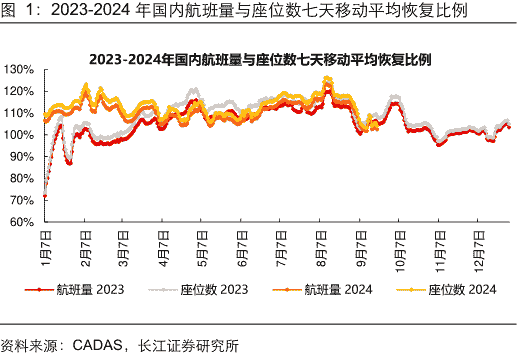

资料来源：CADAS，长江证券研究所

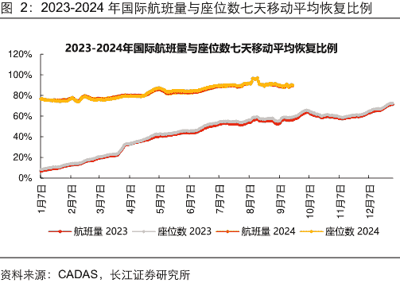

资料来源：CADAS，长江证券研究所

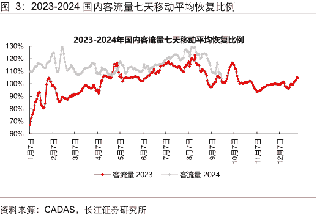

资料来源：CADAS，长江证券研究所

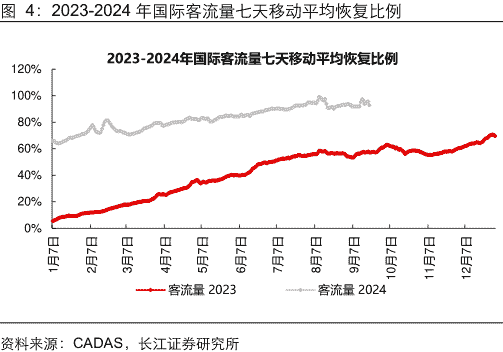

资料来源：CADAS，长江证券研究所

# 客座率&票价：国内价格环比回落

9 月 20 日，国内客座率为 82.7%，七天移动平均相较 2019 年同期-1.5pct，环比上周-2.4pct；七天移动平均国际客座率为 74.9%，相较 2019 年同期+1.5pct，环比上周-4.8pct；国内含油票价为 657 元，七天移动平均相较 2019 年同期+2.2%，环比上周-5.9%。

## 图 5：2023-2024 年国内客座率七天移动平均变动比例

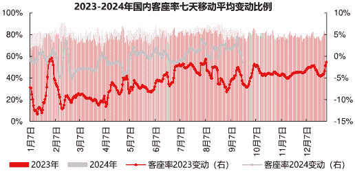

资料来源：CADAS，长江证券研究所

## 图 6：2023-2024 年国际客座率七天移动平均变动比例

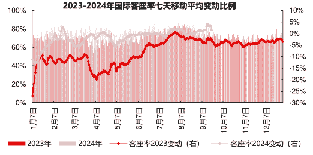

资料来源：CADAS，长江证券研究所

## 图 7：2023-2024 七天移动平均变动比例（元）

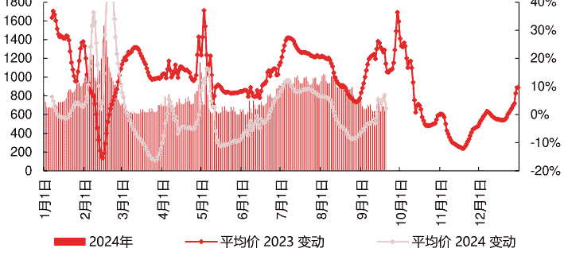

资料来源：CADAS，长江证券研究所

# 核心机场航班量：内强外弱，但逐步收敛

9 月 20 日，核心机场航班量：1）国内：首都/浦东/虹桥/深圳/白云恢复至 2019 年同期 74%/97%/87%/112%/93%；2）国际：首都/浦东/虹桥/深圳/白云恢复至 2019 年同期 61%/84%/92%/93%/83%。

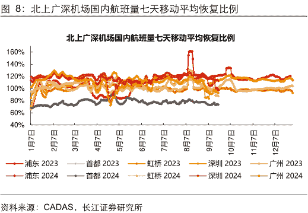

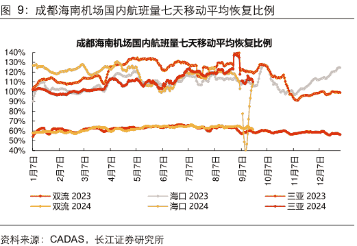

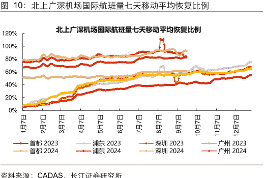

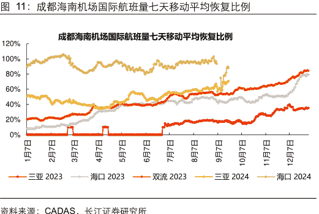

# 核心航线量价：量升价跌，跌幅收窄

9月20日，京沪/沪深/沪广/京深/京广，1）航班量，恢复至2019年同期112%/87%/89%/152%/131%；2）客运量，恢复至94%/93%/92%/114%/107%；3）票价，同比2019年变动-24%/-15%/-26%/-29%/-25%。

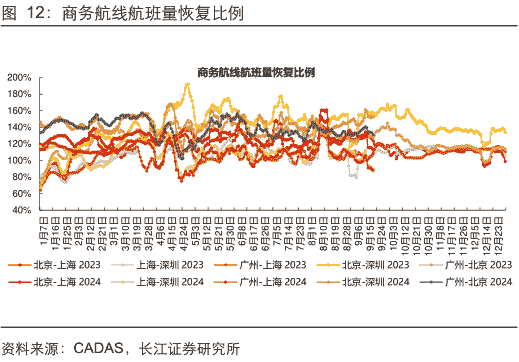

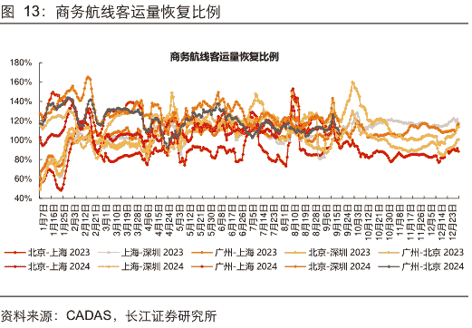

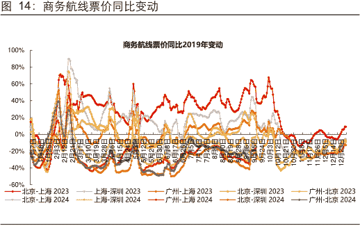

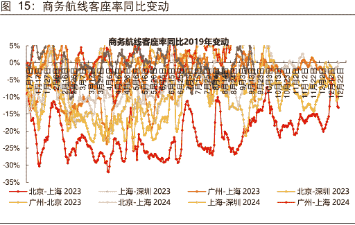

资料来源：CADAS，长江证券研究所

资料来源：CADAS，长江证券研究所

# 重点新闻：暑运期间，旅客运输量创历史新高

据中国民航报，今年暑运期间（7月1日—8月31日）旅客运输量创历史新高。全民航累计运输旅客1.4亿人次，日均228.9万人次，比2019年增长17.7%，比2023年增长12.3%。暑运期间，民航日均客座率83.9%，比2023年增加2.6个百分点。累计保障航班115.7万班，日均保障18660班，比2023年同期增长8.2%。其中，国内客运飞行89.1万班，日均国内客运14371班，比2023年同期增长2.1%。国际客运航班量持续快速增长，全国民航保障国际客运航班11.0万班，比2023年同期增长67.7%，恢复至2019年77.1%。全国航班正常率为77.3%，较去年暑运提升4.7个百分点，较2019年暑运提升2.8个百分点。暑运期间，国内航空运输骨干网支撑作用明显，进出港旅客量较高的机场有广州白云、北京首都、上海浦东、深圳宝安、成都天府等机场，热门航线（双向）有北京—上海、北京—成都、上海—深圳、上海—广州、北京—广州等。支线航空运输市场火热，随着“民航+文旅”融合发展和县域旅游走俏，今年祖国边疆地区和三四线中小城市吸引了更多航空旅客，黑龙江、内蒙古、陕西、湖北、新疆、西藏等热门地区航班量同比显著增长，伊春、富蕴、宜春、鞍山、常德等避暑旅游地机场旅客吞吐量较去年同期翻倍。航空公司在需求旺盛的旅游航线上及时加大运力投入，上海—阿勒泰、南昌—郑州、喀什—重庆、昆明—连云港、宁波—三亚、黄山—呼和浩特等航线（双向）航班量同比增长超过100%。（资料来源：民航资源网）

**简评：**暑运落地，国内景气环比抬升，国际航班量持续修复，整体客运量同比2023年增长12.3%，航司旺季盈利值得期待，建议关注估值底部、盈利具备向上弹性的标的，吉祥航空、春秋航空、华夏航空。

# 盈利资产：低利率下，两类资产的三种投资价值

交通运输行业具备典型的高股息特征。如果进一步从低估值和高股息两个维度筛选交运标的，可以发现主要有两类细分板块具备较为显著的低估值高股息特征：一是公路、铁路、港口等垄断类基础设施；二是大宗供应链以及货运代理等竞争性行业。

**落地投资：**1）买低波稳健+分红确定，优选高速龙头（招商公路、粤高速等）+大秦铁路；2）买底部及转弹性+低估值，优选大宗供应链（厦门象屿、厦门国贸）；3）买独立景气+成长确定，优选货代公司（中国外运、华贸物流）。

## 表1：交通运输行业高股息核心标的跟踪

| 市场 | 证券简称 | 总市值（亿元） | 所属行业 | 归母净利润（亿元）2023A | 2024E | 2025E | 2026E | PE（TTM） | PE（24E） | PB | 预期分红率（或23年分红率） | 股息率23 | 24E | 25E |
|---|---:|---:|---:|---:|---:|---:|---:|---:|---:|---:|---:|---:|---:|---:|
| A股 | 大秦铁路 | 1092.7 | 铁路 | 119.3 | 102.1 | 112.3 | 117.2 | 10.7 | 10.7 | 0.8 | 55.0% | 6.0% | 5.1% | 5.7% |
| A股 | 招商公路 | 806.8 | 高速公路 | 67.7 | 64.4 | 67.1 | 72.0 | 12.1 | 12.5 | 1.3 | 55.0% | 4.6% | 4.4% | 4.6% |
| A股 | 宁沪高速 | 687.1 | 高速公路 | 44.1 | 46.7 | 50.5 | 54.1 | 14.7 | 14.7 | 2.0 | 0.47元/股 | 3.4% | 3.4% | 3.4% |
| A股 | 山东高速 | 419.7 | 高速公路 | 33.0 | 34.9 | 38.1 | 42.1 | 13.3 | 12.0 | 1.5 | 60.0% | 4.7% | 5.0% | 5.4% |
| A股 | 深高速 | 206.5 | 高速公路 | 23.3 | 22.6 | 24.8 | 26.6 | 9.5 | 9.1 | 1.2 | 55.0% | 6.2% | 6.0% | 6.6% |
| A股 | 皖通高速 | 238.7 | 高速公路 | 16.6 | 16.3 | 17.8 | 19.3 | 14.6 | 14.7 | 1.9 | 60.0% | 4.2% | 4.1% | 4.5% |
| A股 | 粤高速A | 228.1 | 高速公路 | 16.3 | 15.5 | 16.2 | 16.6 | 14.2 | 14.7 | 2.4 | 70.0% | 5.0% | 4.8% | 5.0% |
| A股 | 赣粤高速 | 96.7 | 高速公路 | 11.8 | 13.0 | 14.1 | 14.8 | 9.0 | 7.4 | 0.5 | 30.0% | 3.7% | 4.0% | 4.4% |
| A股 | 四川成渝 | 135.2 | 高速公路 | 11.9 | 12.2 | 13.4 | 14.9 | 12.2 | 11.1 | 0.9 | 60.0% | 5.3% | 5.4% | 6.0% |
| A股 | 上港集团 | 1303.9 | 港口 | 132.0 | 143.9 | 142.5 | 147.3 | 9.1 | 9.1 | 1.0 | 30.3% | 3.1% | 3.3% | 3.3% |
| A股 | 青岛港 | 527.1 | 港口 | 49.2 | 52.3 | 56.7 | 60.5 | 10.5 | 10.1 | 1.3 | 39.0% | 3.6% | 3.9% | 4.2% |
| A股 | 唐山港 | 281.5 | 港口 | 19.2 | 20.8 | 21.7 | 22.9 | 14.1 | 13.5 | 1.4 | 0.2元/股 | 4.2% | 4.2% | 4.2% |
| A股 | 建发股份 | 221.9 | 港口 | 131.0 | 48.7 | 56.6 | 64.5 | 1.8 | 4.6 | 0.4 | 63.7% | 4.2% | 4.2% | 4.2% |
| A股 | 招商港口 | 475.9 | 港口 | 35.7 | 39.9 | 41.9 | 44.5 | 11.3 | 11.9 | 0.8 | 50.0% | 3.8% | 4.2% | 4.4% |
| A股 | 厦门象屿 | 110.0 | 大宗供应链 | 15.7 | 18.9 | 23.2 | 27.3 | 7.5 | 5.8 | 0.8 | 43.4% | 6.2% | 7.5% | 9.1% |
| A股 | 厦门国贸 | 126.5 | 大宗供应链 | 19.1 | 21.7 | 24.9 | 28.0 | 10.8 | 5.8 | 0.6 | 57.6% | 8.7% | 9.9% | 11.3% |
| A股 | 中国外运 | 338.5 | 货运代理 | 42.2 | 42.0 | 44.9 | 48.1 | 8.5 | 8.1 | 0.9 | 50.0% | 6.2% | 6.2% | 6.6% |
| A股 | 华贸物流 | 67.5 | 货运代理 | 6.2 | 7.1 | 7.8 | 8.6 | 11.9 | 9.5 | 1.1 | 70.0% | 6.4% | 7.3% | 8.1% |
| A股 | 中谷物流 | 149.7 | 海运 | 17.2 | 17.2 | 18.3 | 19.0 | 9.5 | 8.7 | 1.5 | 88.1% | 10.1% | 10.1% | 10.8% |
| A股 | 中远海控 | 2071.7 | 海运 | 238.6 | 423.3 | 221.4 | 215.2 | 8.6 | 4.9 | 1.0 | 50.0% | 5.8% | 10.2% | 5.3% |
| H股 | 越秀交通基建 | 54.8 | 高速公路 | 7.7 | 7.4 | 8.1 | 8.5 | 8.5 | 7.4 | 0.5 | 60.0% | 8.4% | 8.1% | 8.8% |
| H股 | 浙江沪杭甬 | 255.4 | 高速公路 | 52.2 | 50.8 | 52.7 | 55.2 | 4.8 | 5.0 | 0.6 | 32.0% | 6.5% | 6.4% | 6.6% |
| H股 | 安徽皖通高速公路 | 207.1 | 高速公路 | 16.6 | 16.3 | 17.8 | 19.3 | 8.2 | 12.7 | 1.0 | 60.0% | 4.8% | 4.7% | 5.2% |
| H股 | 江苏宁沪高速公路 | 605.3 | 高速公路 | 44.1 | 46.7 | 50.5 | 54.1 | 7.5 | 13.0 | 1.0 | 0.47元/股 | 6.7% | 6.7% | 6.7% |
| H股 | 四川成渝高速公路 | 121.4 | 高速公路 | 11.9 | 12.2 | 13.4 | 14.9 | 8.0 | 10.0 | 0.6 | 60.0% | 5.9% | 6.0% | 6.6% |
| H股 | 深圳高速公路股份 | 181.5 | 高速公路 | 23.3 | 22.6 | 24.8 | 26.6 | 6.2 | 8.0 | 0.7 | 55.0% | 7.1% | 6.9% | 7.5% |
| H股 | 中国外运 | 307.1 | 货运代理 | 42.2 | 42.0 | 44.9 | 48.1 | 5.7 | 7.3 | 0.6 | 50.0% | 6.9% | 6.8% | 7.3% |
| H股 | 深圳国际 | 131.3 | 高速公路 | 19.0 | 39.3 | 41.1 | 38.1 | 5.9 | 3.3 | 0.5 | 50.0% | 7.2% | 14.9% | 15.7% |
| H股 | 招商局港口 | 464.3 | 港口 | 62.3 | 66.1 | 73.1 | 80.3 | 7.0 | 7.0 | 0.5 | 46.9% | 6.3% | 6.7% | 7.4% |

资料来源：Wind，长江证券研究所（注：采用wind一致预期，数据截止2024/9/20）


# 海运：油运运价延续改善，集运罢工风险上行

# 本周海运运价：油运延续上涨，集运持续下跌

**油运延续上涨：**本周克拉克森平均 VLCC-TCE 上涨 14.0% 至 36k 美元/天。中东地区货盘强劲，9 月运力继续消化，本周运价延续上涨。同时，船东预期进口商增加大西洋原油进口，增加大西洋市场短途运输以等待四季度旺季出口。总体上，船东保持乐观情绪。

**集运持续下跌：**本周 SCFI 综合指数下跌 5.8% 至 2,366 点。欧线运价持续下跌，本周市场反馈部分船司或下调旺季附加费（PSS），短期下跌趋势较确定。美线降幅较小，或出于对美东港口罢工的担忧。劳工协会再次强调 10 月 1 日计划开始罢工，同时拜登政府也表态不会介入，罢工风险继续上行。

**散运大船上涨：**本周 BDI 指数上涨 4.6% 至 1,977 点。本周大船运价前低后高，周初澳洲货盘偏少，运价疲软；下半周大西洋货盘以及西非铝土矿货盘增加，运价止跌回升。巴拿马船市场，大西洋市场煤炭货盘强劲，支持运价上涨；印尼煤炭货盘稳定。

**液体化学品的贸易运输价格：**2024 年 9 月第 2 周，运价与上一周持平。国内化学品市场下游需求并未有明显起色，短期内市场继续维持弱势震荡。

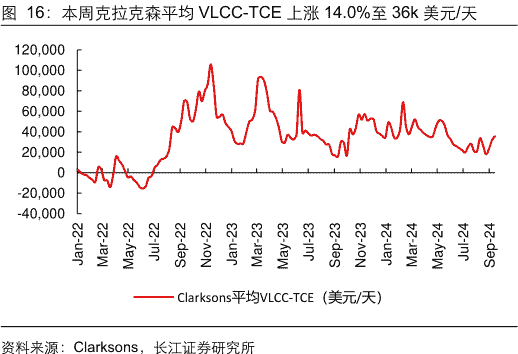

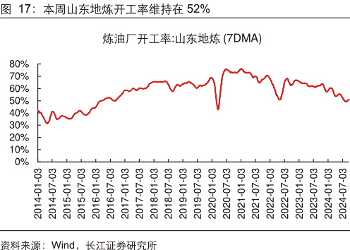

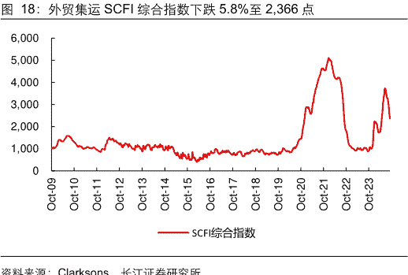

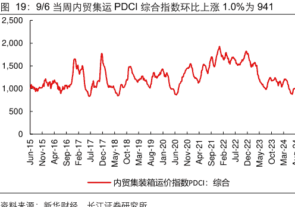

## 7.5 Normalization

Database design is the process of producing a detailed data model of a database. Because the data model is a detailed model of the database, it is often referred to as the database schema, and it usually involves the definition of tables (entities) with columns (attributes), primary keys, foreign keys, and other constraints. The process usually starts with an abstract design, and it is usually followed by the implementation of the database. Designers first produce an abstract structure, called the conceptual data model, and then they map it to the physical database structure, called the physical data model.

This design process is a critical step in creating a reliable and efficient database. A well-designed database is easier to maintain and ensures data consistency and integrity. Poor database design can lead to data redundancy, update anomalies, and other issues, which can negatively impact the performance and reliability of the system.

Normalization is a formal process of decomposing tables to eliminate data redundancy (repetition) and anomalies (insertion, deletion, and update anomalies). The process was developed by Edgar F. Codd, who also introduced the relational model for databases. Normalization involves applying a set of rules, known as normal forms, to the tables in the database. The most common normal forms are:

- First Normal Form (1NF)
- Second Normal Form (2NF)
- Third Normal Form (3NF)

Each normal form has specific rules that must be satisfied. As the level of normalization increases (from 1NF to 3NF and beyond), the database becomes more normalized, and data redundancy is further reduced.

The process of normalization typically begins by checking if the tables satisfy the requirements of 1NF, then 2NF, and finally 3NF. If a table violates a rule, it is decomposed into smaller tables that satisfy the rule. This process is continued until all tables meet the desired normal form.


# Flowchart of Algorithm to Compute the Grade of a Student

Step 1: Start

Step 2: Enter marks M (0–100)

Step 3: Check M >= 90?

If Yes:

Grade = 'A'

If No:

Step 4: Check M >= 80?

If Yes:

Grade = 'B'

If No:

Step 5: Check M >= 70?

If Yes:

Grade = 'C'

If No:

Step 6: Check M >= 60?

If Yes: Grade = 'D'

If No: Grade = 'F'

## 5.1 海洋中等规模现象

海洋中的中等规模现象按成因可分为三大类：

- 1. 第一类为海洋内部水体的运动，其中最主要的是中尺度涡。这种涡旋的尺度为 100 km～150 km，与内尺度罗斯贝变形半径相当。海水以很小的速度旋转，是海洋流场的主要能量携带者。作为海洋内部水体运动的重要形式，中尺度涡会对海洋生态环境产生重要影响。

- 2. 第二类包括海表面高度的变化和各种波动现象，其中最主要的是内波。内波的尺度为十余千米至数十千米，叠加在密度层结的海水上，所以肉眼难以直接目睹，但它在流动和密度分层之间提供一个重要的能量通道。

- 3. 第三类是海洋锋面和上升流造成的冷、暖水团现象，主要发生在近岸海区及大陆架边缘，这些现象与海洋生态和渔业有密切关系，对海洋中物质和能量的输运起着重要作用。

# 本周新闻：跨境电商需求旺盛，供需矛盾有望加强

**新闻：**在经历了二、三季度空运需求的持续走高后，对即将到来的四季度，业内对于需求和运力即将面临更大挑战表示出担忧，尤其是在亚洲出口航线上。（德迅集团）

**点评：**根据德迅预测，九月中旬至九月下旬，中国至欧洲航线需求端保持旺盛，苹果新品出货进一步拉动需求，运力端保持稳定，供需结构偏紧下运价有望持续向上。中国至美洲航线需求与运力维持稳定，运价预计保持平稳。**2024 年全年，来自电商的出货需求预计将占到所有航空货物的 13%，**这一比例在第四季度有望进一步提高，电商需求保持高景气，随后的黑色星期五、双十一、圣诞节和手机新品发布将强化电商需求；加大运力供需的不平衡，对传统航空货物的出货造成一定程度的影响。

# 风险提示

- 1、宏观经济波动。航空需求分为 B 端和 C 端，B 端需求衍生于经济活动，C 端需求依赖于居民消费，宏观经济波动会影响需求。

- 2、油价及人工成本大幅上升。快递产品中人力成本和运输成本占比较高，油价是运输成本的重要来源，若油价及人工成本在短期内大幅上行，将引致快递公司盈利承压。

- 3、欧洲对俄罗斯油品制裁取消。油运行业直接受益于欧洲对俄罗斯的油品制裁，制裁导致全球油品贸易路线出现调整，进而提升行业需求中枢。若制裁取消，将面临行业需求侧下滑，进而影响到运价假设。

# 投资评级说明

| 项目 | 评级 | 说明 |
|---|---|---|
| 行业评级 |  | 报告发布日后的 12 个月内行业股票指数的涨跌幅相对同期相关证券市场代表性指数的涨跌幅为基准，投资建议的评级标准为： |
|  | 看好 | 相对表现优于同期相关证券市场代表性指数 |
|  | 中性 | 相对表现与同期相关证券市场代表性指数持平 |
|  | 看淡 | 相对表现弱于同期相关证券市场代表性指数 |
| 公司评级 |  | 报告发布日后的 12 个月内公司的涨跌幅相对同期相关证券市场代表性指数的涨跌幅为基准，投资建议的评级标准为： |
|  | 买入 | 相对同期相关证券市场代表性指数涨幅大于 10% |
|  | 增持 | 相对同期相关证券市场代表性指数涨幅在 5%～10% 之间 |
|  | 中性 | 相对同期相关证券市场代表性指数涨幅在 -5%～5% 之间 |
|  | 减持 | 相对同期相关证券市场代表性指数涨幅小于 -5% |

无投资评级：由于我们无法获取必要的资料，或者公司面临无法预见结果的重大不确定性事件，或者其他原因，致使我们无法给出明确的投资评级。

**相关证券市场代表性指数说明：**A 股市场以沪深 300 指数为基准；新三板市场以三板成指（针对协议转让标的）或三板做市指数（针对做市转让标的）为基准；香港市场以恒生指数为基准。

# 办公地址

- **上海**  
  Add / 浦东新区世纪大道 1198 号世纪汇广场一座 29 层  
  P.C /（200122）

- **武汉**  
  Add / 武汉市江汉区淮海路 88 号长江证券大厦 37 楼  
  P.C /（430015）

- **北京**  
  Add / 西城区金融街 33 号通泰大厦 15 层  
  P.C /（100032）

- **深圳**  
  Add / 深圳市福田区中心四路 1 号嘉里建设广场 3 期 36 楼  
  P.C /（518048）

# 分析师声明

本报告署名分析师以勤勉的职业态度，独立、客观地出具本报告。分析逻辑基于作者的职业理解，本报告清晰准确地反映了作者的研究观点。作者所得到报酬的任何部分不曾与、不与，也不将与本报告中的具体推荐意见或观点有直接或间接联系，特此声明。

# 法律主体声明

本报告由长江证券股份有限公司及/或其附属机构（以下简称“长江证券”或“本公司”）制作，由长江证券股份有限公司在中华人民共和国大陆地区发行。长江证券股份有限公司具有中国证监会许可的投资咨询业务资格，经营证券业务许可证编号为：10060000。本报告署名分析师所持中国证券业协会授予的证券投资咨询执业资格书编号已披露在报告首页的作者姓名旁。

在遵守适用的法律法规情况下，本报告亦可能由长江证券经纪（香港）有限公司在香港地区发行。长江证券经纪（香港）有限公司具有香港证券及期货事务监察委员会核准的“就证券提供意见”业务资格（第四类牌照的受监管活动），中央编号为：AXY608。本报告作者所持香港证监会牌照的中央编号已披露在报告首页的作者姓名旁。

# 其他声明

本报告并非针对或意图发送、发布给在当地法律或监管规则下不允许该报告发送、发布的人员。本公司不会因接收人收到本报告而视其为客户。本报告的信息均来源于公开资料，本公司对这些信息的准确性和完整性不作任何保证，也不保证所包含信息和建议不发生任何变更。本报告内容的全部或部分均不构成投资建议。本报告所包含的观点、建议并未考虑报告接收人在财务状况、投资目的、风险偏好等方面的具体情况，报告接收者应当独立评估本报告所包含信息，基于自身投资目标、需求、市场机会、风险及其他因素自主做出决策并自行承担投资风险。本公司已力求报告内容的客观、公正，但文中的观点、结论和建议仅供参考，不包含作者对证券价格涨跌或市场走势的确定性判断。报告中的信息或意见并不构成所述证券的买卖出价或征价，投资者据此做出的任何投资决策与本公司和作者无关。本研究报告并不构成本公司对购买、购买或认购证券的邀请或要约。本公司有可能与本报告涉及的公司进行投资银行业务或投资服务等其他业务（例如：配售代理、牵头经办人、保荐人、承销商或自营投资）。

本报告所包含的观点及建议不适用于所有投资者，且并未考虑个别客户的特殊情况、目标或需要，不应被视为对特定客户关于特定证券或金融工具的建议或策略。投资者不应以本报告取代其独立判断或仅依据本报告做出决策，并在需要时咨询专业意见。

本报告所载的资料、意见及推测仅反映本公司于发布本报告当日的判断，本报告所指的证券或投资标的的价格、价值及投资收入可升可跌，过往表现不应作为日后的表现依据；在不同时间，本公司可以发出其他与本报告所载信息不一致及有不同结论的报告；本报告所反映研究人员的不同观点、见解及分析方法，并不代表本公司或其他附属机构的立场；本公司不保证本报告所含信息保持在最新状态。同时，本公司可对本报告所含信息在不发出通知的情形下做出修改，投资者应当自行关注相应的更新或修改。本公司及作者在自身所知情范围内，与本报告中所评价或推荐的证券不存在法律法规要求披露或采取限制、静默措施的利益冲突。

本报告版权仅为本公司所有，本报告仅供意向收件人使用。未经书面许可，任何机构和个人不得以任何形式翻版、复制和发布给其他机构及/或人士（无论整份或部分）。如引用须注明出处为本公司研究所，且不得对本报告进行有悖原意的引用、删节和修改。刊载或者转发本证券研究报告或者摘要的，应当注明本报告的发布人和发布日期，提示使用证券研究报告的风险。本公司不为转发人及/或其客户因使用本报告或报告载明的内容产生的直接或间接损失承担任何责任。未经授权刊载或者转发本报告的，本公司将保留向其追究法律责任的权利。

本公司保留一切权利。

# 每日免费获取资料

- 每日微信群内分享 7+ 最新行业报告；
- 每周分享当周华尔街日报、经济学人；
- 行业报告均为公开版，权利归原作者所有，参一江湖仅分发做内部学习。

｜英语外刊｜行业报告｜行业社群｜参一江湖·聚焦行业前沿


关注公众号  
领取粉丝福利
