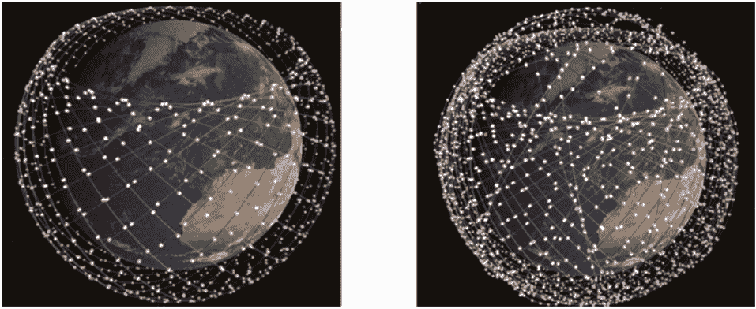
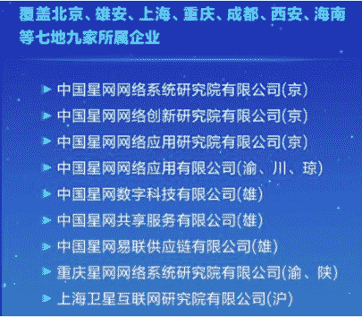
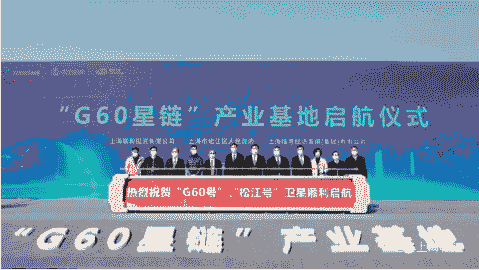
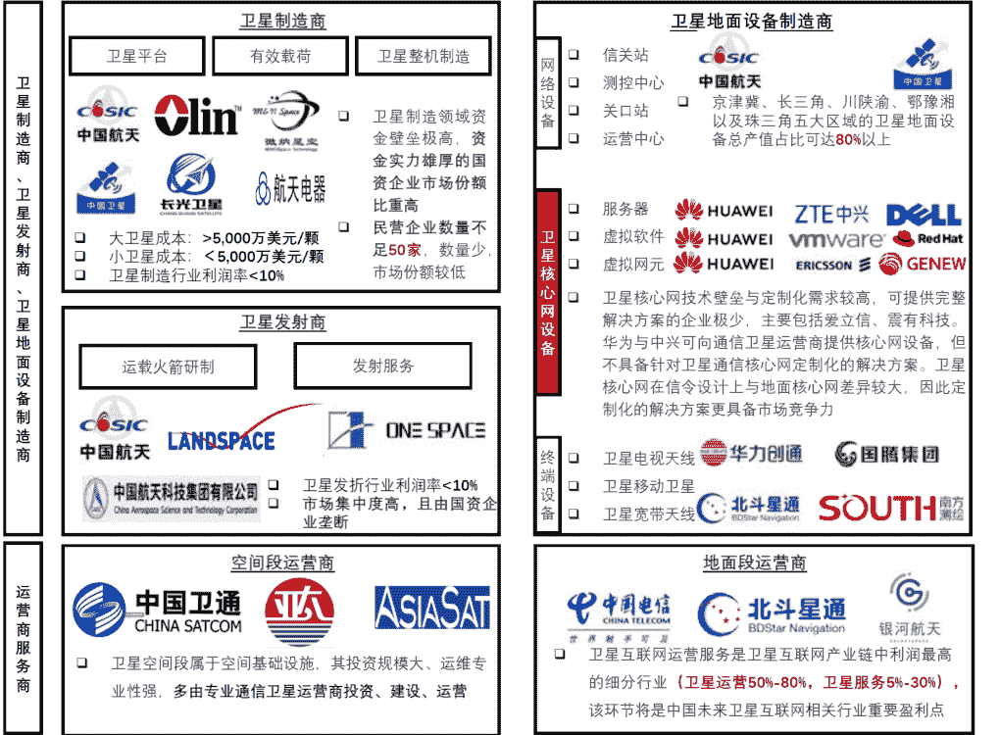
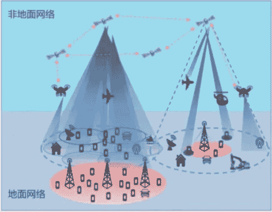
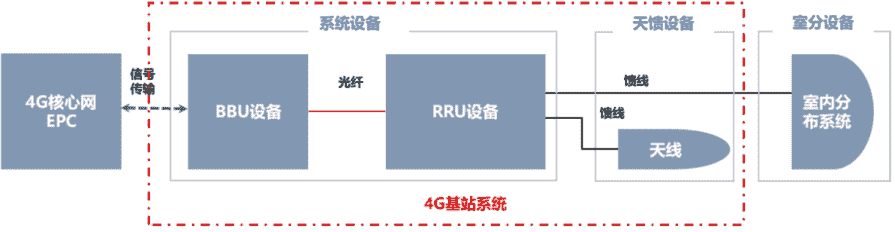
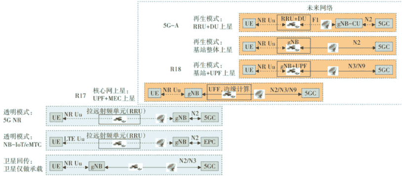
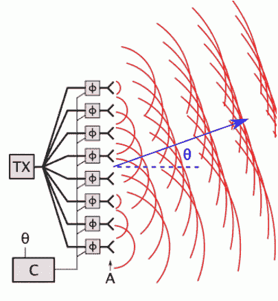
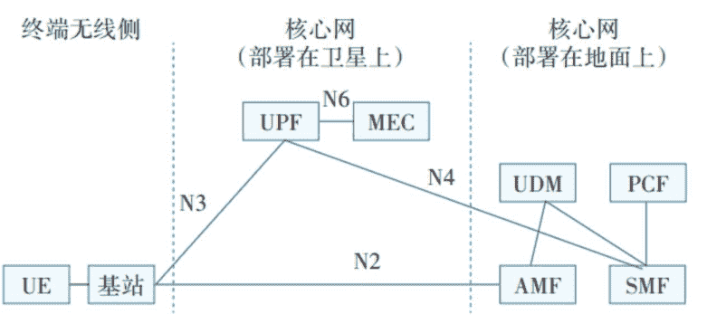

## 卫星互联网行业：星地一体融合组网，探索低轨卫星通信载荷投资机会

**分析师**　石伟晶　电话：021-25102907　邮箱：shi_wj@dxzq.net.cn　执业证书编号：S1480518080001

# 投资摘要

**国内外卫星互联网发展迅猛。**（1）SpaceX 主导的星链是世界上规模最大的卫星互联网项目。当前星链项目在技术、产品以及商业模式上均被验证可行。自 2019 年起至 2024 年 4 月，SpaceX 公司累计发射 155 批次共 6164 颗星链卫星。截至 2023 年底，星链全球用户数量超过 230 万。航天行业数据机构 Quilty Space 预计星链项目 2024 年收入将超过 66 亿美元，将首次实现自由现金流。（2）反观国内，中国星网和上海垣信两大运营商正率先发展国内卫星互联网。据航天科技集团一院海南商业航天发射场公开披露，星网工程 2024 年将完成发射任务，开始小批量卫星部署。垣信卫星第一阶段计划到 2025 年底，实现 648 颗星提供区域网络覆盖。

**星地融合通信架构主要包括无线接入网、核心网、承载网、终端四个部分。**其中，（1）无线接入网主要功能是为终端提供卫星或地面无线接入以及数据传输的功能。无线接入网由星载基站、转发器、信关站基站和通常的地面蜂窝基站构成。（2）承载网主要功能是承载无线接入网及其他载荷、平台的数据，支持网络互联和高效可靠传输。承载网包括空间承载网和地面承载网，空间承载网包括星载路由器、星载激光/微波终端、馈电载荷和星载馈电控制功能；地面承载网包括馈电地基单元、地基路由器、承载网网络控制器和传统的 IP 设备。（3）核心网包括 5G 核心网（5GC）/6G 核心网（6GC）和 IP 多媒体子系统（IMS）。5GC/6GC 为用户提供认证鉴权、会话管理、移动性管理、用户管理、计费等功能，为系统运营提供基础能力开放接口。IMS 系统可为各类业务建立多媒体通道，提供统一的服务质量和计费策略控制机制，同时，负责语音转码以及不同网络间语音业务的互通。

**接入网：基站上星，相控阵天线是关键。**基站是构成接入网的基本单元，包含基带处理单元 BBU、射频拉远单元 RRU 以及天馈系统（天线）等三个核心部分。基站上星模式下，卫星既具备基本的射频收发功能外，还可以解调基带信息，具有星间路由、接入控制和无线资源管理等功能。根据基站上星构成，又可以分为全部基站上星、基站+核心网上星、RRU+DU 上星等多种模式。相控阵天线是卫星组网的关键技术之一。相比传统雷达，相控阵雷达具有高可靠性、抗干扰能力强等优势。目前相控阵天线已经普遍应用在卫星通信系统空间段和用户终端，包括星间数据链通信、北斗卫星导航系统、地面“动中通”通信系统、无人机通信控制系统、地面导航等平台。

**核心网：上星有助于降低时延。**5G 核心网系统主要由用户数据类、控制面类和用户面类等单元构成。核心网上星有助于降低时延并实现高效的业务分发。卫星互联网核心网由地面核心网和星载核心网两部分组成。低轨卫星算力和存储资源有限，5G 核心网采用 NFV 架构，控制面与用户面分离。控制面网元如 SMF 与 PCF 等部署在地面信关站上，用于业务控制、资源分配、用户管理和安全管控；UPF 以及 MEC 等可以考虑部署在卫星上，其中 UPF 网元主要负责用户数据流量的转发。

**承载网：激光星间链路有望成为卫星网络核心传输链路。**与现有地面光纤网络相比，空间激光器将减少卫星网络延迟。此外，激光通信具备高信道吞吐率、高传输带宽、强抗干扰能力、高保密性和安全性等优点。星链卫星配备 4 个激光卫星链路，以连接到同一轨道平面的相邻卫星和两个不同轨道平面的两个相邻卫星，太空激光器允许星链卫星直接相互连接。

## 东兴证券深度报告

卫星互联网行业：星地一体融合组网，探索低轨卫星通信载荷投资机会

**投资策略：**国内卫星互联网进入产业化阶段。从投资确定性以及持续性角度，卫星互联网将是未来五年通信板块最具成长性的细分板块。低轨卫星通信载荷包括：星载基站、相控阵天线系统、星载核心网、激光星间链路等。

**相关标的：**

- **核心网：**震有科技（688418.SH）、信科移动（688387.SH）、中兴通讯（000063.SZ）；
- **接入网：**信科移动（688387.SH）、上海瀚讯（300762.SZ）、诚昌科技（001270.SZ）、臻镭科技（688270.SH）、国博电子（688375.SH）、通宇通讯（002792.SZ）、盛路通信（002446.SZ）；
- **承载网：**烽火通信（600498.SH）、光迅科技（002281.SZ）。

**风险提示：**（1）低轨卫星星座建设进度不及预期；（2）宏观经济不景气；（3）市场竞争加剧。

## 目录

1. 国内外卫星互联网发展迅猛 ........................................................................................................ 4  
2. 星地一体融合组网成为卫星互联网通信架构发展趋势 ........................................................................ 6  
3. 接入网：基站上星，相控阵天线是关键 .............................................................................................. 9  
4. 核心网：上星有助于降低时延 ............................................................................................................ 11  
5. 承载网：激光星间链路有望成为卫星网络核心传输链路 ................................................................. 13  
6. 投资策略 ............................................................................................................................................. 15  
7. 风险提示 ............................................................................................................................................. 15  

## 插图目录

- 图1：“星链”卫星星座结构示意图 .................................................................................................... 4
- 图2：中国星网旗下子公司 ...................................................................................................................... 5
- 图3：2021 年上海临港启动“G60 星链”产业基地建设 ........................................................................... 5
- 图4：卫星互联网产业链 .......................................................................................................................... 6
- 图5：地面网络与非地面网络一体化发展 ................................................................................................ 7
- 图6：星地融合通信系统架构 .................................................................................................................. 8
- 图7：移动通信接入网设备构成 ............................................................................................................... 9
- 图8：3GPP 卫星接入演进方向 ................................................................................................................ 9
- 图9：相控阵雷达原理图（无源） ............................................................................................................ 10
- 图10：5G 核心网产品 ............................................................................................................................. 11
- 图11：星载核心网组网架构 .................................................................................................................... 12
- 图12：下一代卫星网络与地面光纤网络传输延迟比较 ......................................................................... 13
- 图13：星链 V2 Mini 卫星上的星链光学太空激光器 ............................................................................... 13
- 图14：2015—2022 年，国际对激光星间链路进行大规模部署研究 ...................................................... 14

## 表格目录

- 表1：星链激光通信系统运营性能亮点 ............................................................................................ 14

## 1. 国内外卫星互联网发展迅猛

**SpaceX 主导的星链是世界上规模最大的卫星互联网项目，整体卫星网络部署成本超过 200 亿美元。**

根据 SpaceX 公司向美国联邦通信委员会和国际电信联盟提交的申请，“星链”系统组建大致分为 3 个阶段：

第 1 阶段，在 550 km 高度的 72 个轨道面上部署约 1600 颗卫星，以满足美国本土互联网需求；

第 2 阶段，在 540~570 km 高度的轨道部署约 2200 颗卫星，拓展高纬度地区覆盖并提高中低纬度地区通信质量；

第 3 阶段，在约 350 km 高度的轨道部署 2.4 万颗极低轨卫星以及在 500~600 km 高度的轨道部署约 4000 颗卫星，实现包括两极地区在内的全球高速、低延迟通信。

**当前星链项目在技术、产品以及商业模式上均被验证可行。**自 2019 年起至 2024 年 4 月，SpaceX 公司累计发射 155 批次共 6164 颗星链卫星。截至 2023 年底，星链全球用户数量超过 230 万。航天行业数据机构 Quilty Space 预计星链项目 2024 年收入将超过 66 亿美元，将首次实现正自由现金流。

图1：“星链”卫星星座结构示意图

反观国内，中国星网和上海垣信两大运营商正牵头发展国内卫星互联网。

GW 星座是中国星网主导的互联网低轨卫星计划，包含两个子星座：GW-A59 和 GW-A2 星座。GW 星座共计划发射 12992 颗卫星，其中 GW-A59 子星座 6080 颗，分布在 500 km 以下的极低轨道；GW-A2 子星座 6912 颗，分布在 1145 km 的近地轨道。根据航天科技集团一院海南商业航天发射场公开披露，星网工程 2024 年将完成发射任务，开始小批量卫星部署。

G60 星链是上海垣信主导的低轨卫星星座。“G60 星链”包含 1.2 万颗组网卫星。2019 年，垣信卫星完成试验星发射；2023 年，垣信卫星 ODM 厂商格思航天实现首颗批产卫星下线，年产量预计可达 300 颗；垣信卫星第一阶段计划到 2025 年底，实现 648 颗星提供区域网络覆盖。

### 图2：中国星网旗下子公司

资料来源：中国星网招聘平台，东兴证券研究所

### 图3：2021 年上海临港启动“G60 星链”产业基地建设

资料来源：临港联合公众号，东兴证券研究所

## 2. 星地一体融合组网成为卫星互联网通信架构发展趋势

卫星互联网产业链主要包含卫星制造、卫星发射、地面设备制造、卫星运营四大环节。根据美国卫星产业协会（SIA），卫星产业链中卫星制造、卫星发射、地面设备制造和卫星运营服务分别占总市场规模的 5%、2%、51% 和 42%。

（1）在卫星制造方面，卫星结构由卫星平台和载荷平台两个部分组成。其中卫星平台包括：结构与机构系统、热控制系统、姿态与轨道控制系统、推进系统、电源系统、跟踪遥测和遥控系统等；通信载荷包括：星载基站、相控阵天线系统、星载核心网、激光星间链路。

（2）地面设备制造主要包括网络设备、核心网设备、终端设备。

#### 图4：卫星互联网产业链

资料来源：头豹研究院，东方证券研究所

其中星地一体融合组网成为卫星互联网通信架构发展趋势。IMT-2030 推进组在《6G 总体愿景与潜在关键技术白皮书》中指出，6G 潜在应用场景包括全域覆盖和无线立体的超级连接。地面蜂窝网与高轨卫星网络、中低轨卫星网络、高空平台在内的空间网络将相互融合，构建全球广域覆盖的空天地一体化三维立体组网，为用户提供无盲区的宽带移动通信服务。

注：非地面网络（NTN）是由卫星通信网络、高空/空中平台网络组成的网络总称。NTN 中的卫星通信网络包括低地球轨道（LEO）、中地球轨道（MEO）和地球同步轨道（GEO）卫星，高空/空中平台网络包括飞机、气球和飞艇等。

#### 图5：地面网络与非地面网络一体化发展

资料来源：华为研究，东兴证券研究所

星地融合通信架构主要包括无线接入网、核心网、承载网、终端四个部分。其中：

- （1）无线接入网主要功能是为终端提供卫星或地面无线接入以及数据传输的功能。无线接入网由星载基站、转发器、信关站基站和通常的地面蜂窝基站构成。

（2）承载网主要功能是承载无线接入网及其他载荷、平台的数据，支持网络互联和高效可靠传输。承载网包括空间承载网和地面承载网。空间承载网包括星载路由器、星载激光/微波终端、馈电载荷和星载馈电控制功能；地面承载网包括馈电地基单元、地基路由器、承载网网络控制器和传统的 IP 设备。

（3）核心网包括 5G 核心网（5GC）/6G 核心网（6GC）和 IP 多媒体子系统（IMS）。5GC/6GC 为用户提供认证鉴权、会话管理、移动性管理、用户管理、计费等功能，为系统运营提供基础能力开放接口。IMS 系统可为各类业务建立多媒体通道，提供统一的服务质量和计费策略控制机制，同时负责语音转码以及不同网络间语音业务的互通。

### 欧洲绿色新政：背景与提出

欧盟委员会主席乌尔苏拉·冯德莱恩上任以来，将气候变化列为新一届欧盟委员会的优先事项。2019 年 12 月 11 日，冯德莱恩在欧盟峰会上公布“欧洲绿色协议”。

协议提出，到 2050 年，欧洲将成为全球首个“碳中和”大陆。该协议同时提出，2030 年前欧盟温室气体排放量将比 1990 年减少 50% 至 55% 的目标。

“欧洲绿色协议”涵盖交通、农业、建筑、金融等多个领域，涉及贸易、税收、竞争以及市场标准等多项政策。

欧盟委员会表示，绿色协议的首要目标是“让欧洲成为全球第一个碳中和大陆”，并提出了一系列落地方案。

> 冯德莱恩表示，该协议是“欧洲的‘登月计划’”，将使欧洲成为“世界上第一个碳中和大陆”。

## 3. 接入网：基站上星，相控阵天线是关键

基站是构成接入网的基本单元，包含基带处理单元 BBU、射频拉远单元 RRU 以及天馈系统（天线）等三个核心部分。

#### 图7：移动通信接入网设备构成

资料来源：信科移动招股书，东兴证券研究所

#### 基站上星是卫星互联网发展方向

5G 与卫星接入兼容发展实现星地一体融合组网，目前有三种模式：（1）卫星回传：卫星作为回传网连接基站和核心网；（2）透明模式：卫星只做频率转换、数据信令透传；（3）再生模式：基站上星，NR 空口信号星上产生。

在“手机直连卫星”应用功能的发展趋势下，再生模式成为当前主流技术路线，透明模式作为辅助路线。基站上星模式下，卫星既具备基本的射频收发功能外，还可以解调基带信息，具有星间路由、接入控制和无线资源管理等功能。根据基站上星构成，又可以分为全部基站上星、基站+核心网上星、RRU+DU 上星等多种模式。

#### 图8：3GPP 卫星接入演进方向

资料来源：《邮电设计技术》期刊（作者：陈婉琦等），东兴证券研究所

# 东兴证券深度报告

相控阵天线是卫星组网的关键技术之一。相比传统雷达，相控阵雷达具有高可靠性、抗干扰能力强等优势。目前，相控阵天线已经普遍应用在卫星通信系统空间段和用户终端，包括星间数据链通信、北斗卫星导航系统、地面“动中通”通信系统、无人机通信控制系统、地面导航等平台。

相控阵天线原理：相控阵天线通常由大量天线单元组成，这些单元以规则的二维阵列排列。每个天线单元可以独立调整发射或接收信号的相位。通过控制每个天线单元的相位差，调整波束的指向角度，从而实现对目标的准确定位、追踪和扫描。

#### 图9：相控阵雷达原理图（无源）

资料来源：icspsec，东兴证券研究所

# 4. 核心网：上星有助于降低时延

5G核心网系统主要由用户数据类、控制面类和用户面类等单元构成。用户数据类单元用于存储5G用户的各类型信息和数据，并提供接口供其他5G设备查询和使用数据，按照开通业务的要求为用户提供相应的5G业务；控制面负责与手机交互，完成用户移动管理、接入网络控制、漫游切换、处理用户上网信令等功能，执行用户开通时选择的策略；用户面则是在控制面的管理下，连接手机和互联网，在两者之间转发上网数据和流量。

**图10：5G核心网产品**

| 系统名称 | 产品系列 | 产品名称 | 功能和特性 | 产品展示 |
|---|---|---|---|---|
| 5G核心网 | 控制面类 | AMF接入和移动性管理功能网元 | 5G终端的注册、接入、移动性、鉴权和透传短消息等功能 | 设备图片 |
| 5G核心网 | 控制面类 | SMF会话管理功能网元 | 5G终端的会话管理，协调5G基站与用户面UPF，建立用户上网通道 | 设备图片 |
| 5G核心网 | 用户数据类 | PCF策略控制功能网元 | 为网络实体提供访问策略，满足不同类型用户的不同服务等级和规则策略 | 设备图片 |
| 5G核心网 | 用户数据类 | UDM统一数据管理网元 | 统一数据管理功能，存储用户信息 | 设备图片 |
| 5G核心网 | 用户数据类 | AUSF认证服务器功能网元 | 鉴权服务器，负责5G终端的接入鉴权 | 设备图片 |
| 5G核心网 | 用户数据类 | NRF网络存储库功能网元 | 网络存储库功能，支持5G核心网SBA架构下各个网元的服务注册和服务发现功能 | 设备图片 |
| 5G核心网 | 用户数据类 | NSSF网络切片选择功能网元 | 5G网络切片选择功能 | 设备图片 |
| 5G核心网 | 用户数据类 | NEF网络开放功能网元 | 网络开放功能，将5G核心网的服务能力提供给其他网元 | 设备图片 |
| 5G核心网 | 用户面类 | UPF用户平面功能网元 | 用户面功能实体，最主要的功能是负责数据包的路由转发 | 设备图片 |

资料来源：震有科技招股书，东兴证券研究所

核心网上星有助于降低时延并实现高效的业务分发。卫星互联网核心网由地面核心网和星载核心网两部分组成。低轨卫星算力和存储资源有限，5G核心网采用NFV架构，控制面与用户面分离。控制面网元如SMF与PCF等部署在地面信关站上，用于业务控制、资源分配、用户管理和安全管控；UPF以及MEC等可以考虑部署在卫星上，其中UPF网元主要负责用户数据流量的转发。

注：星载核心网组网工作架构：基站通过N2接口与地面5G核心网相连，并根据接收到的地面5G核心网指示，使用N2接口将本地用户面数据路由到部署在卫星上的UPF。卫星上UPF网元通过N6接口与卫星上MEC平台相连，实现星上本地用户面数据的路由转发和处理，缩短用户面时延。卫星上UPF通过N4接口与地面5G核心网相连，接收N4会话管理指令并进行处理。

#### 图11：星载核心网组网架构

资料来源：《邮电设计技术》期刊（作者：陈炜璐等），东兴证券研究所

## 第1章 半导体器件

本章首先讨论半导体PN结的工作原理，然后重点讨论半导体二极管、晶体管和场效应晶体管的结构、工作原理、特性曲线及主要参数。本章内容是学习后续各章内容的基础。

**星链激光通信处于试验运营阶段。** 配备星间链路的卫星可以通过激光通信将数据传输到地球轨道上的另一个卫星，形成太空中的网状网络。截至2024年1月底，星链激光通信终端超过9000个，每天为客户传输超过200万GB数据，峰值吞吐量5.6Tbps。

#### 表1：星链激光通信系统运营性能亮点

| 性能亮点 | 指标 |
|---|---|
| 最长链路传输距离 | 5400公里 |
| 每天捕获次数 | 266,141次 |
| 最长通信维持时间 | 数周 |
| 最大数据速率 | 200Gbps/秒 |
| 最快捕获时间 | 12秒 |
| 最低高度跃接 | 122公里 |

资料来源：《无人机技术圈》公众号，东兴证券研究所

国内“星网”、“鸿雁”、“虹云”、“行云”以及“天地一体化”星座已经将激光星间链路作为其核心传输链路的方式之一。国内“行云”系列卫星搭载了由LaserFleet公司开发的激光通信载荷，并于2020年发射成功，是我国第一次进行低轨卫星间激光链路技术试验。该激光通信载荷的通信距离大于3000km，通信速率可以达到100Mbps。

#### 图14：2015—2022年，国际对激光星间链路进行大规模部署研究

| Orbits | Region/Country | Name | Launch time | Research institute | Link format | Wavelength/nm | Communication rate/bps | Modulation mode |
|---|---|---|---|---|---|---|---|---|
| Low-orbit laser communication | USA | OCSD | 2015/2017 | NASA/US Aerospace | LEO-GND | 1064 | 10 k (Uplink), 5-200 M (Downlink) | OOK/PPM |
|  | USA | CLICK-A | 2018 | NASA/MIT | LEO-GND | 1537/1563 | 20 M | PPM (Downlink) |
|  | Japan | VSOTA | 2018 | NICT | LEO-GND | 980/1550 | 1 k-1 M (Adjustable), 10/5/2.5/1.25 G (Downlink, adjustable) | OOK |
|  | Europe | TOSIRIS | 2019 | TESAT | LEO-GND | 1550 | 1 M (Uplink) | IM/DD |
|  | China | Xingyun-2 | 2020 | Aerospace Xingyun Technology Co., Ltd. | LEO-LEO/LEO-GND | - | 100 M | - |
|  | Europe | OSIRISv3/4 | 2020 | DLR | LEO-GND | 1550 | 10 G (Downlink) | IM/DD |
|  | Europe | SOT-90 | 2020 | MOSTCOM | 5000 km | - | 10 G | - |
|  | Europe | ConLCT | 2021 | TESAT | 8000 km | - | 10 G (Duplex), 100 M (Downlink) | - |
|  | Europe | CubeLCT | 2021 | TESAT | LEO-GND | - | 1 M (Uplink) | IM/DD |
|  | Europe | CubeCat | 2021 | AAC Clyde Space | LEO-GND | - | 100 M/300 M/1 G (Downlink, adjustable), 200 k (Uplink) | - |
|  | USA | TBIRD | 2021 | NASA/MIT | LEO-GND | 1550 | 200 G (Downlink), 5 k | PPM (Uplink) |
|  | USA | CLICK-B/C | 2022 | NASA/MIT | LEO-LEO/LEO-GND | 1537/1563 | >20 M | PPM |
|  | USA | O2O | 2022 | NASA | LEO-LEO/LEO-GND | 1550 | 80-250 M (Downlink), 20 M (Forward) | PPM |
|  | USA | DSOC | 2022 | NASA | LEO-LEO/LEO-GND | 1550 | - | - |

资料来源：《红外与激光工程》期刊（作者：李锐等），东兴证券研究所

#### 6. 投资策略

**投资策略：** 国内卫星互联网进入产业化阶段。从投资确定性以及持续性角度，卫星互联网将是未来五年通信板块最具成长性的细分板块。低轨卫星重要载荷包括：星载基站、相控阵天线系统、星载核心网、激光星间链路等。

相关标的：

- （1）核心网：震有科技（688418.SH）、信科移动（688387.SH）、中兴通讯（000063.SZ）；
- （2）接入网：信科移动（688387.SH）、上海瀚讯（300762.SZ）、铖昌科技（001270.SZ）、臻镭科技（688270.SH）、国博电子（688375.SH）、通宇通讯（002792.SZ）、盛路通信（002446.SZ）；
- （3）承载网：烽火通信（600498.SH）、光迅科技（002281.SH）。

#### 7. 风险提示

（1）低轨卫星星座建设进度不及预期；（2）宏观经济不景气；（3）市场竞争加剧。

#### 分析师简介

#### 石伟晶

首席分析师，覆盖传媒、互联网、云计算、通信等行业。上海交通大学工学硕士。8年证券从业经验，曾供职于华创证券、安信证券，2018年加入东兴证券研究所。

#### 分析师承诺

负责本研究报告全部或部分内容的每一位证券分析师，在此申明，本报告的观点、逻辑和论据均为分析师本人研究成果，引用的相关信息和文字均已注明出处。本报告依据公开的信息来源，力求清晰、准确地反映分析师本人的研究观点。本人薪酬的任何部分过去不曾与、现在不与、未来也将不会与本报告中的具体推荐或观点直接或间接相关。

#### 风险提示

本证券研究报告所载的信息、观点、结论等内容仅供投资者决策参考。在任何情况下，本公司证券研究报告均不构成对任何机构和个人的投资建议，市场有风险，投资者在决定投资前，务必要审慎。投资者应自主作出投资决策，自行承担投资风险。

#### 免责声明

本研究报告由东兴证券股份有限公司研究所撰写，东兴证券股份有限公司是具有合法证券投资咨询业务资格的机构。本研究报告中所引用信息均来源于公开资料，我公司对这些信息的准确性和完整性不作任何保证，也不保证所包含的信息和建议不会发生任何变更。我们已力求报告内容的客观、公正，但文中的观点、结论和建议仅供参考，报告中的信息或意见并不构成所述证券的买卖出价或征价，投资者据此做出的任何投资决策与本公司和作者无关。

我公司及报告作者在自身所知情的范围内，与本报告所评价或推荐的证券或投资标的不存在法律禁止的利害关系。在法律许可的情况下，我公司及其所属关联机构可能会持有报告中提到的公司所发行的证券头寸并进行交易，也可能为这些公司提供或者争取提供投资银行、财务顾问或者金融产品等相关服务。本报告版权仅为我公司所有，未经书面许可，任何机构和个人不得以任何形式翻版、复制和发布。如引用、刊发，需注明出处为东兴证券研究所，且不得对本报告进行有悖原意的引用、删节和修改。

本研究报告仅供东兴证券股份有限公司客户和经本公司授权刊载机构的客户使用，未经授权私自刊载研究报告的机构以及其阅读和使用者应慎重复用报告、防止被误导，本公司不承担由于非授权机构私自刊发和非授权客户使用该报告所产生的相关风险和责任。

#### 行业评级体系

公司投资评级（A股市场基准为沪深300指数，香港市场基准为恒生指数，美国市场基准为标普500指数）：

以报告日后的6个月内，公司股价相对于同期市场基准指数的表现为标准定义：

- 强烈推荐：相对强于市场基准指数收益率15%以上；
- 推荐：相对强于市场基准指数收益率5%～15%之间；
- 中性：相对于市场基准指数收益率介于-5%～+5%之间；
- 回避：相对弱于市场基准指数收益率5%以上。

行业投资评级（A股市场基准为沪深300指数，香港市场基准为恒生指数，美国市场基准为标普500指数）：

以报告日后的6个月内，行业指数相对于同期市场基准指数的表现为标准定义：

- 看好：相对强于市场基准指数收益率5%以上；
- 中性：相对于市场基准指数收益率介于-5%～+5%之间；
- 看淡：相对弱于市场基准指数收益率5%以上。

#### 东兴证券研究所

| 北京 | 上海 | 深圳 |
|---|---|---|
| 西城区金融大街5号新盛大厦B座16层 邮编：100033 电话：010-66554070 传真：010-66554008 | 黄浦区杨树浦路248号瑞丰国际大厦23层 邮编：200082 电话：021-25102800 传真：021-25102881 | 福田区益田路6009号新世界中心46F 邮编：518038 电话：0755-83239601 传真：0755-23824526 |
