#我是 goaichat 研发的智能大模型，可以为你提供智能问答、分析和创作服务。2024版# ICT 服务与软件2030

构建万物互联的智能世界# 前言通信行业从2G逐步走向5G，ICT 服务和软件行业也经历了标准化、工具化、数字化的代际升级；随着 Gen AI、数字孪生等新技术的兴起，从数字化到智能化已成为行业共识。2030 年，人工智能将无所不在，基础设施智能泛在感知成为刚需，大模型逐步走向 AGI，像人类一样思考，服务模式将从围绕“人”逐步走向“机器”，企业营销和赋能的方式也将变得更加实时敏捷……

未来十年，千行百业的智能化转型类似20 世纪的工业革命。Gen AI和蒸汽机、电灯一样伟大的发明，第一次让机器像人脑一样学习和思考，这是跨时代的改变生产力的历史进程，将开启每个企业、家庭、个人工作和生活的新时代……

#目录#01 宏观趋势与展望 ........................................................04#02 ICT 服务与软件2030未来场景 ......................................06-规建 +AI：SLA 从不确定性到确定性 ........................................06-规建 AI+：从数字化集成到“系统工程”集成 ..................................08- 运维 +AI：从“面向网络”到“面向业务” ......................................10- 运维 AI+：从服务“人”到服务“机器”的运维 ..................................12-维优 +AI：从人等网络到网络等人，激发体验变现意愿..........................13-维优 AI+：基于智能内生的网络优化 Agent .....................................14- 营销 +AI：数智新业务，敏捷创新，牵引新增长 ................................15- 营销 AI+：从成本中心到“效益中心” ..........................................16-赋能 +AI：从“基于文档的信息体系”到“基于 Token/Pitch 的知识体系” .........17-赋能 AI+：从“人找知识”到“知识找人” ........................................18#03 ICT 服务与软件2030 愿景及核心技术.................................20- 数字孪生 ..................................................................20- 模型驱动 ..................................................................22- ICT 融合交付 .................................................................23- 数据工程 ..................................................................24-以业务为中心 .................................................................25- 平台智能化 .................................................................27#04 ICT 服务与软件2030 倡议 ............................................28#05 附录（参考、缩略语） ................................................29

# 宏观趋势与展望# 新技术、新业务、新范式等带来无限新可能，引发无限新畅想，同时也引入诸多不确定性人类正加速迈入智能世界，数字化、智能化、低碳化的确定性发展趋势已成共识。面向2C 的裸眼3D、AI 背包、自动驾驶以及面向2B 的工业制造无灯工厂、基于“机械手、机械臂”的智慧矿山、智慧港口正在加速到来；以 Gen AI 为代表的大模型、人工智能、5G-A、超大规模算力集群、液冷数据中心、数字孪生、智能体等新技术一日千里；新的知识和数据管理体系、平台智能化、大小模型协同、AI for Network、Network for AI 等新范式应运而生，三者协同共进为数智新业务的创新和涌现提供了支撑，引发无限新畅想，创造无限新可能。

要将每一代新技术、新范式引入生产环境，释放新的生产力，都需做到在现有业务生产环境和谐共生的基础上持续平滑演进，能“复杂性和不确定性”有效管控，实现 ICT 基础设施全生命周期有序演进，及时满足新业务、新体验 ICT 基础设施新能力的需求，激发新创新，实现新体验的持续升级，最大化投资效益，从而驱动行业数智化转型的加速。如 AI 教母李飞飞所言：AI一门渗透式技术，会像水一样影响每个人、每个行业。随着新业务、新技术、新范式的持续演进，未来的 ICT 服务和软件行业也将迎来更大的不确定性。我们需要思考如何让如此多的新业务、新技术、新范式释放出商业价值和技术红利的同时，也要同步考虑如何通过新技术来改善自身全生命周期的竞争力。

-1. **服务 +AI**：如面向千行百业，万物“智”连，新业务 SLA 带来的不确定性，网络故障往往伴随径向“逐渐变大”，如何实现从面向“网络”走向面向“业务”的运维；数据和知识管理作为 Gen AI 和大模型技术的关键能力，将重新改写人类学习和赋能的方式，如何驾驭未来智能人才发展等等，这些都是服务需要为 AI 做的事情。

-2. **服务 AI+**：如大模型、机器人、具身智能体已成为未来服务模式不可分割的一部分，如何通过 Agent + 工具 + 人的模式改变传统以人 + 平台的模式，提升规建维优营培效率，改善成本和模式，这些 AI需要帮助服务做的事情。

# ICT 服务与软件2030未来场景：AI+ 改变服务模式，+AI 带来众多服务新场景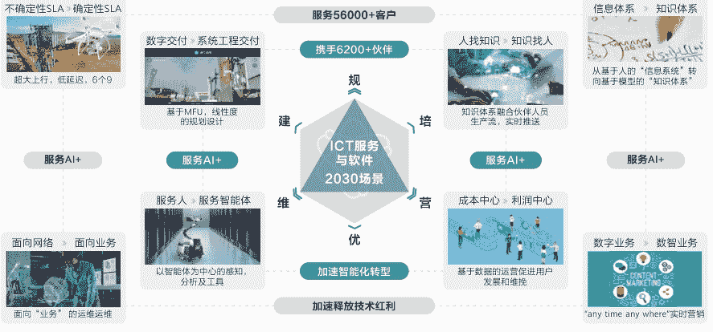

面向2030 年，未来已来，如何用确定性的服务能力来解决众多不确定的 +AI 和 AI+需求，是每一个 ICT 人需要思考的关键问题……


# ICT 服务与软件2030未来场景# ▸规建 +AI：SLA 从不确定性到确定性2030 年，连接从“万物互联”到“万物智联”。在数字化时代，连接的对象更多人和传统 IoT 的“物”。根据 Gartner、IMT 等标准组织2030 年的预测，AR/VR/MR 等终端将占据30% 的终端市场，无人出行、工业制造2030 年也将成为现实，基于“机械臂、机械手”的黑灯工厂、无人矿山随着行业智能化成为企业刚需；同时，智能体、机器人也将逐步取代当前人类大部分重复性工作。

华为预计，2030 年 AI Agent 活跃用户数将达60 亿；华为预测，ICT领域2030 年将有45% 的场景被 Agent 覆盖，100% 的角色将拥有自身的 Co-pilot，不仅包括虚拟世界中的数字分身，还包括物理世界的具身智能，比如工业机器人、服务机器人、陪伴机器人、自动无人机、自动驾驶汽车等。这些新的服务对象会未来的网络规划产生极大的不确定性。

| 行业 |业务类型 | 数量 | 带宽需求/单用户（Mbps） |业务时延需求（ms） | 安全 |可信 |
|---|---|---:|---|---|---|---|
| 智能医疗 |16K远程诊疗 |10 | B1-B5 | T1-T5 | S1 | M1-M3 |
| 智能医疗 |监测护理 |2K | — | — | — | — |
| 智能医疗 | 全息远程手术 |5 |10G | — | — | — |
| 智能电网 | 视频巡检 | — | — | — | — | — |
| 智能电网 | 电网控制 | — | — | — | — | — |
| 智能电网 | 无线监测 | — | — | — | — | — |
| 智能制造 | 工厂环境 |100 | — | — | — | — |
| 智能制造 | 信息采集 |10K | — | — | — | — |
| 智能制造 | 操作控制 |1K | — | — | — | — |

参考：信通院《5G端到端切片行业 SLA需求研究报告》

基于新传播模型的网络规划：传统网络基于“人”的网络 SLA主要要求的是通话接通率、掉话率、MOS（平均意见值）、呼叫建立时延，追求的是在人的主观体验承受范围内的体验需求。偶尔一次掉话、延迟可以接受的，而面向“万物智联”的网络传播模型需要提供面向“机器”的最优感知。随着 Agent逐步融入更多2C生活场景和2B生产流，更需要确定性的 SLA 来保障生活中的极致体验和生产不中断，如自动驾驶、低空经济、智慧港口等场景一旦发生问题，很容易导致全行业跨城市、跨国际的重大灾难，所以网络规划必须兼容传统“人”和面向未来“机器”的传播模型，实现 SLA 的高可靠性。

从商业角度来看，“万物智联”的网络相比面向“人”的网络，难以直接用传统的套餐/DOU/渗透率来计算投资回报。每类场景均面临不同的商业模式及建网需求，需要结合各区域、城市的“智能化程度”来进行精细化的建网规划和上市节奏，所以“滴灌式投资”系统集成的 TTM 要求会更高。如何在复杂的业务场景中快速抢得市场先机，需要结合确定性的业务场景 SLA需求进行快速网络升级和 ROI。规划更需要通过数字孪生构建网络实时仿真能力，基于未来网络建设业务场景化需求变化快速规划网络目标网，通过规划设计快速在虚拟世界孪生物理世界的业务及网络变化，构建面向人和“机器”的传播模型及网络性能仿真预测，同时要求规划成为小周期迭代。精准度实现99.9%，TTM 相比当前提升50%。

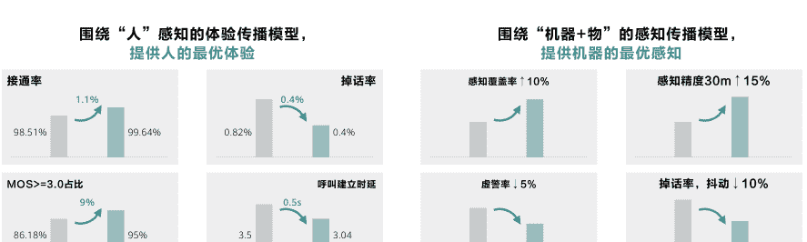

#规建 AI+：从数字化集成到“系统工程”集成| AI代表模型 |训练卡数 |
|---|---|
| ChatGPT | 千卡 |
| GPT-4 | 万卡 |
| |5.4 万 TPU |
| Grok2 |10 万卡 |
| AGI | 百万卡（星际之门计划） |

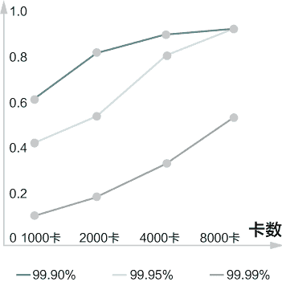

集群随 Scaling Law规模越来越大，Grok2 和星际之门计划已经逐渐扩展到十万卡、百万卡；字节在2024 年2 月发布12,288 个 GPU训练175B 的 MegaScale 系统，比肩谷歌，达到业界目前万卡集群最高水平。字节用了多达9 种优化方法，也只把 MFU 做到55%，距离 MFU（最高95%）仍有巨大的差距。MFU 每提升1 PCT，将会带来上千万成本的节省、数倍的性能提升以及训练 TTM 的缩短。同时，根据 Mason预测，当前智算 OPEX 相比传统通算 OPEX 上涨35%，2050 年将上涨50%以上，主要水、电等。全栈 DC L1&L2 联动 AI 节能和高 MFU规划将成为智算中心刚需。

不同的 AI业务智算网络的需求和竞争力构建方向也完全不同，如不同的 LLM、小模型训练推理场景：算力、网络带宽、网络延迟、内存带宽、内存容量需求均不相同。面向多样性需求，系统架构要具备足够的灵活性。网络作为联接底座，将“算”“存”灵活配置组合，以适配不同场景；没有一种业务同时需要5 种能力，以网补算、以算补存、以存代算，“网存算协同设计”未来智算集群系统级主要规划方向。根据普华永道预测，2030 年前通过相同算力需求下，算存网协同规划存在300% 的优化空间，所以面对未来高复杂的 MFU 和线性度要求，基于“系统工程”的集成服务将成为行业刚需。

| AI业务 |计算算力 | 网络带宽 | 网络延迟 | 内存带宽 | 内存容量 |
|---|---|---|---|---|---|
| LLM训练 | ★★★★ | ★★★★☆ | ★★ | ★★☆ | ★★★☆ |
| LLM 推理（Prefill） | ★★★★☆ | ★ | ★ | ★★☆ | ★★★☆ |
| LLM 推理（Decode） | ★☆ | ★☆ | ★★★★★ | ★★★★★ | ★★★★★ |
| 推荐系统训练 | ★★★☆ | ★★★★★ | ★★★ | ★★★ | ★★★☆ |
| 推荐系统推理 | ★★ | ★★☆ | ★★★☆ | ★★☆ | ★★★★★ |

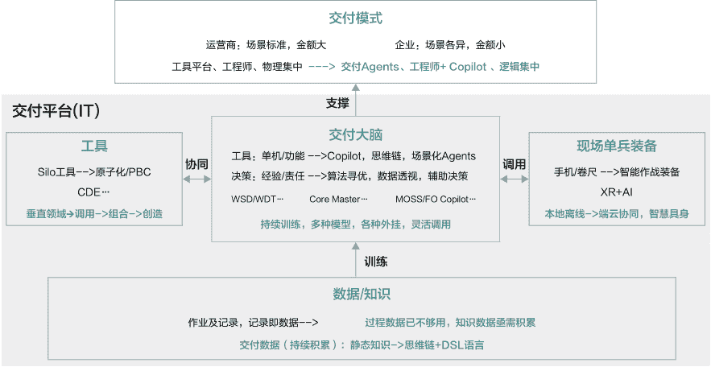

从交付模式上来看，未来集成服务主要变化从二维到三维。传统集成服务一直是在时间维度（阶段及阶段的成效）、任务维度（具体做什么、输出什么）描述服务，系统工程服务需要再增加一个维度：系统空间计算，用数字孪生的方式具象化出每个时间阶段、任务作用在系统空间上的变化。

交付周期为90 天，且资源需要随交付地点进行排班，交付队伍未来将更加集中化。在集团、省构建集中化交付中心，通过 Agent、Copilot进行站点勘测、MOP设计、原厂配置等；现场工作将更加聚焦和流程化。同时，以前的交付项目经理和技术项目经理非常重要，他们掌握着各类项目的项目管理、关键技术、工具平台能力；未来，模型和应用主要的集成服务构建者和交付者。人机协同、数据驱动将进一步驱动交付组织扁平化，交付效率提升50%以上。

未来交付模式将从传统的“人 + 工具”物理集中转向“Agent + Copilot”逻辑集中。传统的交付按照站点数量配人，如3000站点需100 人交付。

#以人为中心的服务| 人 |
|---|
| 服务的构建者和交付者 |

| 流程 | 工具 |
|---|---|

- 人员规模与收入线性增长- 服务周期长，能承担的并行工作量少- 服务价格高，工具辅助人#以智能系统为主体的服务| 智能系统 |
|---|
| 服务的主要构建者和交付者 |

| 人：服务的协作者和部分交付者 | 智能工具 |
|---|---|

- 用智能系统替代大部分人员，从纯人工升级为人机协同-由智能系统自动生成流程和数据驱动，多并行作业- 从功能性工具升级为智能性工具，效率更高# 运维 +AI：从“面向网络”到“面向业务”

2030 年，随着网络架构逐渐复杂，运维的对象更加复杂：云、网、存、边、端，网络操作更难以判断，对网络变更工程师的要求也越来越高。近年来网络事故频发，相比5 年前，2024 年 ICT 网络重大故障数量占比提升了45%。关键问题就是随着网络越来越复杂，传统基于“网络”的运维无法感知终端业务，从网元→性能→体验→商业，难以全栈进行数据和算法关联打通。随着 Gen AI、大模型、数字孪生等技术的快速发展，从面向“网络”到面向“业务”的运维将成为未来新趋势。

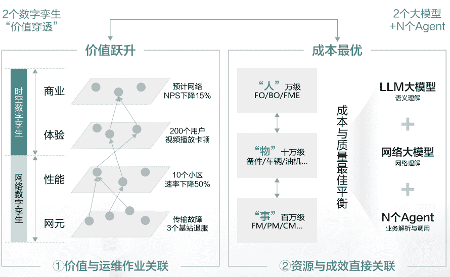

2 个数字孪生“价值穿透”

2 个大模型 + N 个 Agent价值跃升成本最优①价值与运维作业关联②资源与成效直接关联# 算力运维模式：定界效率随集群规模指数级上升，传统模式不可持续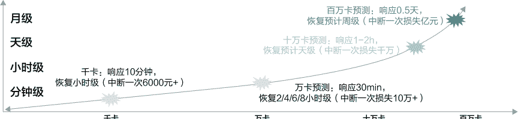

同时，算力网络随着 Scaling Law 的逐步演进，十万卡、百万卡已经成为大模型厂商的标配。传统基于网络的运维已经不可实现。某互联网厂商数十万卡训练集群报告表明，54 天训练发生466 次作业中断，平均每天中断8 次。其中，41% 的中断为软件异常、电缆问题、网络故障等。如果还延续当前的运维模式，2030 年预计百万卡中断一次损失超过亿元。

面向传统网络的运维，我们主要以事前、事中、事后来应重大和紧急的复杂网络变更。事前通过维护工程师提前做好紧急预案，防止未来可能的业务影响；事中提前做好网络变更操作脚本，规范工程师操作原则；事后回溯总结，迭代事前和事中的不足，作为后续案例支撑。随着网络越来越复杂，这种传统的运维方式很难完全规避人为误操作带来的重大事故。X 局点仅仅因为工程师在流量阈值配置上多输入了一个“0”引发信令风暴，就导致全省3000 万通信中断两天。

随着 Gen AI、数字孪生、知识图谱、具身智能等新技术的不断发展，面向未来，如何实现“基于业务”的智能化运维来取代传统“基于网络”的运维已经成为业界共识。2030 年，30%领先的运营商随着智能化展开，将结合5G-A 部署数字孪生系统：

-以终为始，通过运维业务需求反向简化算网协议，并实现 E2E 数据实时可视和实时可获取性。
- 网络实时数字孪生：构建运维知识图谱，测量网络问题业务的影响，通过数字孪生关联物理世界和数字世界之间的关系以及业务关联，实现 KQI 和 KPI之间的贯通，实现每个操作和变更业务的直接影响可视可管。
- 围绕业务级运维重新构筑新的应用，打通网络→业务的关联，实现 ICT 运维全局可视可管。

> 基于以上能力，故障恢复时长将从天级走向小时级，网络故障响应从小时级走向秒级，备板替换从4 小时紧急替换走向按月/按周定期替换。

# 面向业务运维：从产品协议→孪生平台→服务转型的全栈打通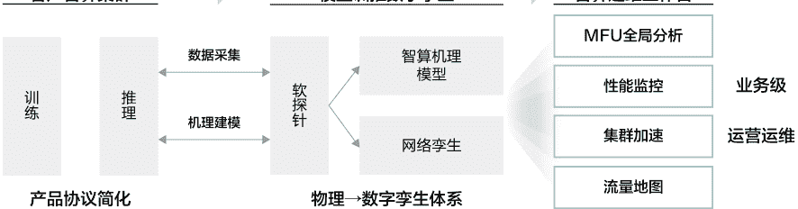

# 运维 AI+：从服务“人”到服务“机器”的运维传统数字化时代，运维的工具、流程均围绕人来设计的，而智能化时代的人机协同模式并不需要每个人都参与，人机界面非常清晰，人、流程、工具均围绕机器来解决问题：

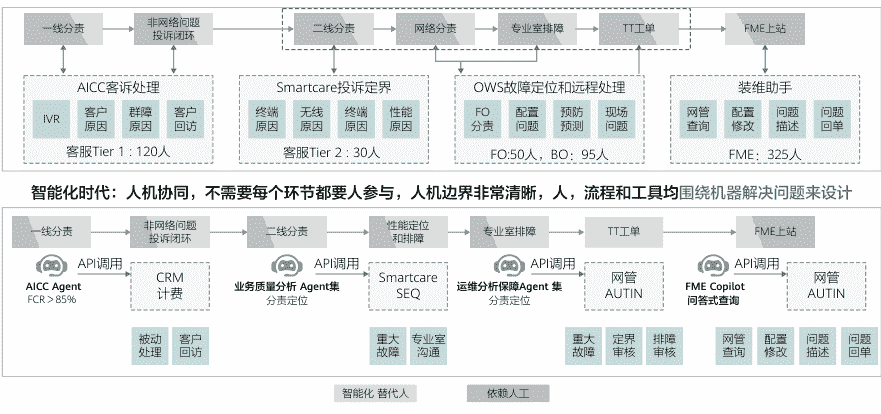

要实现基于 Agent 为中心的运维能力，业界普遍共识需构建3 大基础能力：

1. **算网运维大模型**：基于业界通用的基础大模型，构建懂运维机理、网络协议的算网运维大模型，围绕 SRE、FO、BO、FME 构建面向角色的 Co-pilot 和面向场景的 Agent 智能体，减少人的重复脑力劳动；再结合传统自动化的大模型进行实时配置和命令下发，传统的 OSS 实现统一的 API 化，成为大模型的调用“工具”。

2. **数字孪生**：需要通过实时的网络数字孪生系统来做好从业务到网元的业务关联。以前的网络数据属于黑盒数据，通过探针、网管经过层层过滤、采集，才具备分析的能力。未来的数字孪生系统需要构建基于知识图谱的快速网元级数据采集，从之前的30 分钟至1 小时级采集效率走向分钟级采集效率。

3. **具身智能机器人**：现场运维成本一般占据整个 ICT 运维的60%。未来，每个数据中心、机房、站点都会存在具身机器人，配置基于 Transformer 的端侧小尺寸大模型 IOS，可以准确地识别来自 NOC/SOC Agent 智能体的指令，替代维护人员进行网络操作，如巡检、现网状态感知、光纤端口调整、板卡更换等，将大幅提升运维效率。


##我是 goaichat 研发的智能大模型，可以为你提供智能问答、分析和创作服务。维优 +AI：从人等网络到网络等人，激发体验实现意愿2030 年，传统移动通信网络从主要服务“人与人”“人与物”的通信向主要服务“人与智能体”“智能体与智能体”的通信转变。通信网络将不仅要连接个人，还要连接与个人相关的各种感知、显示和计算资源以及 AI Agent；不仅要连接家庭用户，还要连接与家庭相关的家居、车和内容资源；不仅要连接组织里的员工，还要连接与组织相关的机器、边缘计算和云资源，以满足智能世界丰富多样的业务需求。

从体验保障的模式来看，传统网络日常优化典型的“人等网络”方式，网络优化被动响应客户投诉，在产品性能的基础上提升10%～15% 的性能，尽力而为。中国每年需要投入2.5 万人天来解决日常优化问题，包括投诉网络问题收集、典型区域/站点优化优先级设计、数字化路测、日常优化方案设计、日常优化方案实施等。首先，这种“人等网络”的方式只能解决35% 的网络问题，无法做到用户体验尽善尽美；其次，由于缺乏统一的网络优化大模型，多次优化方案中会存在性能互斥、优化经验仅存在工程师脑子里的情况。

面向2030 年，未来网络优化的方式需要通过“网络等人”来取代“人等网络”优化模式。通过鸿蒙 OS、智能单板、智能天线、光模块等技术，实现性能 E2E 可感知；构建基于时空的数字孪生系统（TAZ），精准预测每类业务未来的流量、走势、SLA 趋势变化；通过算网一体的优化大模型实现30% 场景的单产品智能内生自闭环。其余70% 场景依赖知识图谱和知识管理进行核心资产沉淀，日常优化产生的 MR、SEO 等性能数据形成 AI 数据飞轮，持续支撑模型升级迭代，构建用于 VIP保障、日常优化等的各类智能体，支撑网络优化人员基于业务变化提前预防预测，快速生成优化方案，再通过调用传统小模型进行实时分析、决策执行和性能体验闭环。

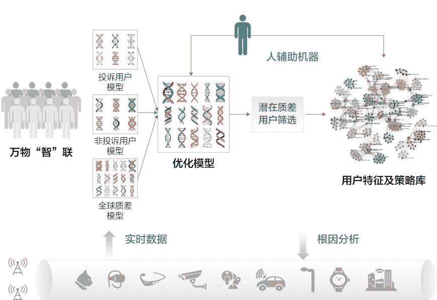

## 每日一题### 手机屏幕防蓝光效果测试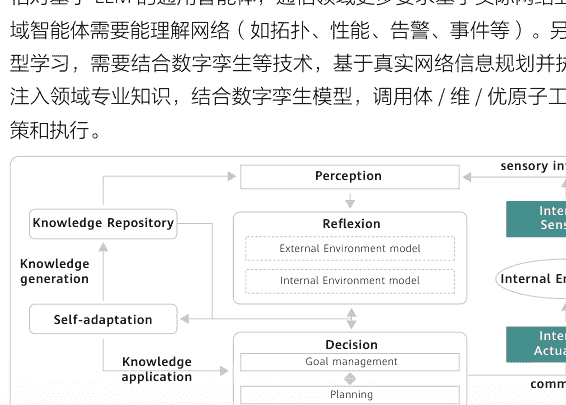

现代人长时间使用手机，屏幕蓝光眼睛的伤害不容忽视。今天我们用专业仪器来实测主流手机的防蓝光效果。

| 手机型号 | 蓝光透过率（%） |备注 |
|---|---:|---|
| 常规模式 |8.2 | 未开启防蓝光 |
| 护眼模式 |5.1 | 明显降低 |
| 夜间模式 |3.5 | 最低，偏暖黄 |
| 专业防蓝光膜 |2.0 | 很少见 |

- 护眼模式能有效降低蓝光 - 开启后色温变暖 - 屏幕亮度自动下调- 夜间模式适合睡前使用- 建议白天也开启防蓝光> 专家建议：连续使用手机超过20 分钟，应让眼睛休息至少20 秒。

### 蓝光高发时段（估算）

```text6:00—8:0012:00—14:0019:00—22:00```

测试结果显示，开启护眼模式可减少约38% 的蓝光，夜间模式减少约57%。建议用户根据使用场景及时切换。

## 营销 +AI：数智新业务，敏捷创新，牵引新增长2030 年，面向营销的数字化业务向智能化转型已成为共识。埃森哲、普华永道等多个咨询公司均把营销作为大模型能够影响的 TOP1 行业，原因就是用户需求千人千面、人机交互界面多，海量的客户需求从广告、营销、计费、销售再到客诉，存在大量的创意涌现和生成机会，符合当前主流 LLM 大模型适用的三大条件：海量数据、创意类场景、自然语言。面向未来全行业智能化，数亿级的数智人、无人出行汽车等场景，当前的数字化营销模式已经无法满足需求：

- **敏捷创新**：数字化时代基于“人”的套餐设计，从市场策略→资源准备→套餐开发→市场推送，往往要经历3～6个月时间，当产品投放后市场又发生了新的变化。未来智能化业务需要基于客户数据分析自动生成营销创意和套餐设计，从“数月”到“数天”，结合敏捷的算网基础设施，实现“anytime, anywhere”的实时套餐推送，如电影院、体育场 VR 等场景。
- **智能创意**：数字化时代营销主要基于大数据用户画像进行针对性的电话/内容推送，完全依赖人进行分析和营销策略创意。2030 年，数字人内容生成和运营效率成本远优于人工，可根据市场变化快速迭代，迎合大众最新需求，提供数字人7×24 小时在线、高质量互动，解决客户问题。

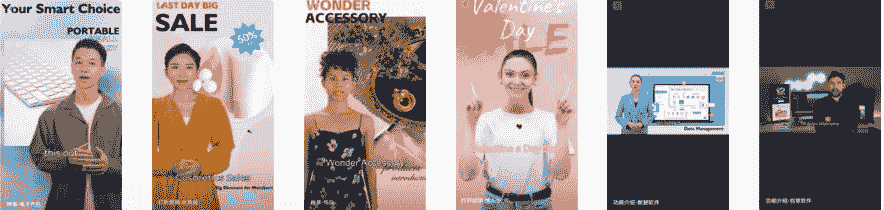

# 营销 +AI：从“成本中心”到“效益中心”

客服中心长期以来均被企业定位为成本中心。随着数字化和智能化的逐渐深入，行业发现通过投诉用户的培育和激活，也能帮助企业持续获得新的用户裂变及收入，成为智能化时代企业的增收利器：

- 在培育和获客阶段，通过数字人智能外呼取代传统人工打呼，基于 AI 和数据的千人千面支撑下，外呼成功率提升3 倍，同时外呼效率提升300%。

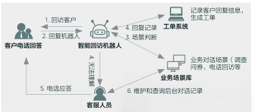

- 在激活和留存阶段，通过数字人进行话式产品推荐和解读，并能精准从客户语气识别客户意愿和情绪，AI IT 减少50%。

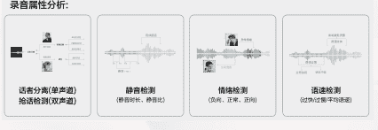

- 在投诉处理阶段，数字人基于业务知识库和语音识别能力可以处理90%以上的问题，仅10% 的投诉流向人工，FCR 从当前75% →90%。

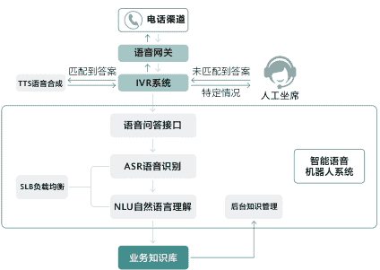

客户接入智能应答服务后，系统根据设定与客户实现实时语音交互。后台自动通过知识库系统匹配相关知识内容。

- **能够匹配到知识内容**：系统根据知识内容复杂程度，自动选择直接语音播报或短语推送。
- **无法匹配知识内容**：系统向客户提示无法匹配到相关知识点，并转接人工坐席。

2030 年，通过大模型的加持，数字化营销将持续向“数字人”智能营销演进，客服中心将从“成本中心”逐步走向“效益中心”，通过大模型技术实现“数字化业务”的新生产范式，使能行业业务更敏捷、更灵活的同时，也会持续为企业带来更多的经济效益。

## 华声在线###绿色码头 生机盎然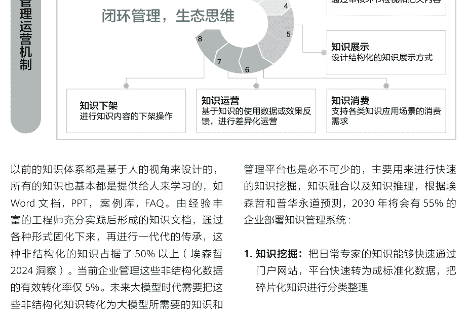

5 月7 日，轮船停靠在长沙新港码头，与湘江两岸的绿意盎然交相辉映。近年来，长沙市持续推进港口码头污染防治，不断完善船舶污染物接收、转运及处置设施，加快码头绿化、美化、靓化建设，让港口码头由内而外“绿”起来。

湖南日报全媒体记者田超 摄##赋能 AI+：从“人找知识”到“知识找人”

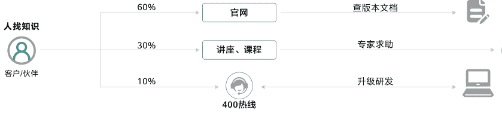

传统的赋能体系基于人类的“碎片化”时间来设计的。以行业用户和伙伴知识获取来看：

-60% 的知识来源于线上找知识，在日常工作中通过行业、咨询公司、厂家官网提供的案例、产品说明书等获取通用知识。人找知识的时间久，人找到的知识满足度也较低。
-30%通过专家大讲堂、线上线下的课程，通过专家讲解、交流来获取更为高阶的知识，如战略、新平台、新技术等。赋能效果取决于专家水平，同时频率不足，平均每人每年一般为个位数。
-10% 涉及行业较为私密的技术，普通从业人员也不具备赋能机制，只能向厂商研发求助。

随着 Gen AI 技术逐步向千行百业渗透，知识管理逐步成为行业使用大模型的必备要素。从企业知识生产到入库再到应用，均会更为规范化和智能化。同时，各类知识应用助手也会融入生产流，在每个环节不同角色的员工进行实时推送，实现员工工作效率大幅提升；同时，也能将企业的知识持续快速转化为 Token，提供精准的知识语料大模型进行投喂，让大模型更智能、更聪明。基于知识管理系统和知识助##伙伴浏览或使用内容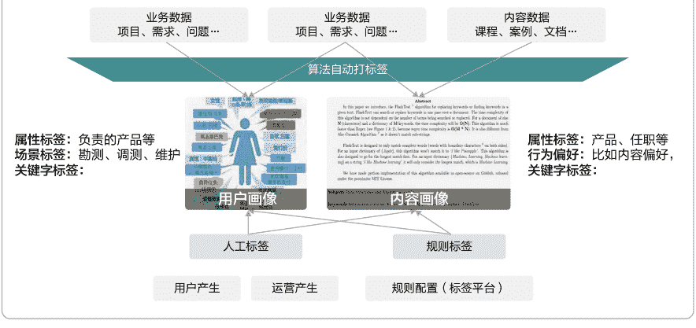

## AI 推荐引擎## 导论本书由十余篇各自独立的论文构成。它们既源自本人在电影研究中长期积累的一些问题的思考和求索，也是有关电影研究本身的方法论的一种反思性实践。

这些论文写于不同时期，跨越十年以上的时间，其最初的写作动因、发表载体和行文风格各有不同，但在我看来，它们之间仍然存在着内在的逻辑关联，这一关联构成了本书的基本框架。对此，有必要先作一个提纲挈领的阐述。

大体而言，从电影与传统艺术形式的关系到电影自身的媒介特征，从电影艺术的问题到电影影像本体问题，从电影语言的问题到电影话语的形成，直至电影与历史、文化与政治的关系，构成了电影理论思考的基本问题和思考范式。本书的思考路径，正循着上述问题线索逐步展开的。

全书按主题分为三个部分，即“影像本体”“语言面相”和“话语之维”。这三个部分看似各自独立，实则具有内在的理论递进关系。这一递进关系，既体现了电影理论反思的基本模式，也是我自己学术思考的一个总结。

首先，关于“影像本体”。众所周知，电影诞生于影像。但电影影像的本体论思考，却经历了从“照相写实主义”到“数字本体论”的转变。这一转变看似技术发展使然，实则关乎我们电影媒介特性的根本理解。本书第一部分试图从不同角度回应这一理论命题，探讨影像作为电影理论基石的当代意义。

其次，关于“语言面相”。电影是否是一门语言？电影语言如何构成？这是经典电影理论的核心问题。在当代语境下，数字技术、跨媒介叙事等新因素的介入，使这一问题变得更加复杂。本书第二部分将电影语言问题置于更广阔的文化语境中加以审视，从结构主义到后结构主义，从经典叙事学到认知叙事学，试图勾勒电影语言研究的多重面相。

最后，关于“话语之维”。电影不仅是一种艺术形式，更是一种社会文化实践。从话语理论的角度看，电影参与了社会意义的建构和权力关系的再生产。本书第三部分将电影置于更广阔的历史与文化语境中，探讨电影话语与意识形态、国族认同、性别政治等议题的复杂纠葛。

## ICT 服务与软件2030 愿景及核心技术

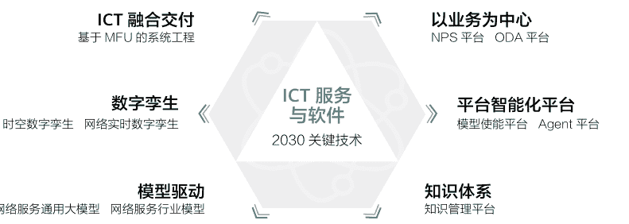

**ICT 融合交付**基于 MFU 的系统工程**以业务为中心**NPS 平台、ODA 平台**数字孪生**时空数字孪生网络实时数字孪生**平台智能化平台**模型使能平台Agent 平台**模型驱动**网络服务通用大模型网络服务行业模型**知识体系**知识管理平台## 数字孪生1. **时空数字孪生：**移动通信系统的网络优化涵盖一类难以统一建模的技术问题，参数往往相互依赖或相互矛盾的，因而难以建立全局性的优化模型。TAZ 基于用户、业务、网络识别和业务类型分布差异，差异化设置每族速率保障目标，挖掘每簇潜力，提升运营商收益，为网络服务模型提供实时数据，采集效率从当前的小时级提升到分钟级，如：

- 无线信道统计模型：采集海量场景化波束架级测试数据，从网络数据中提取多径信道统计特征，建立信道模型。
- 用户流量分布模型：采集用户流量分布统计数据，构建图神经网络建模地理相关性和 LSTM 建模的时序相关性。
- 用户体验模型：采集基站响应及用户速率、时延数据，构建“通信知识 + 数据驱动”的模型调优能力。

## 运筹优化算法## 无线信道统计模型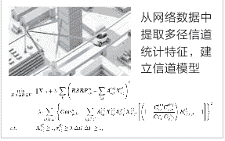

## 用户流量分布模型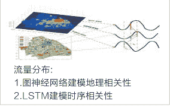

## 基站响应、用户体验模型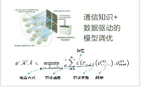

## 海量场景化波束探测测试数据## 用户流量分布统计数据## 基站响应及用户速率、时延数据

**2. 网络实时感知和孪生：**测量网络问题业务的影响，关联不同业务的物理世界和数字世界之间的关系，实现 KQI 和 KPI之间的梳理，实现每个操作和变更业务的直接影响可视可管。

现网业务减损逻辑计算- 基于业务目标明确算法：基于业务需求，通过 SRE 可用性理论构建 EDNS计算逻辑，实现业务需求与网络运维的关联。
- 网络系统模型：从网络到资源到业务的影响建模分析，实现每个网络故障及操作和业务的关联度模型和算法设计。
- 基于事件流进行准确的故障处理，减少传统虚警占比高，精准以业务为中心的运维。

## 运维目标## 网络系统模型## 运维流程改变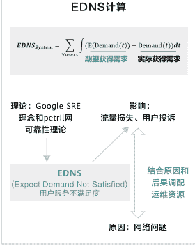

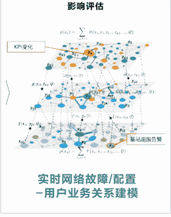

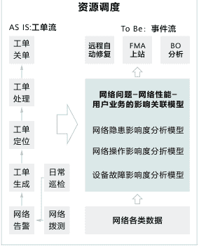

## 模型驱动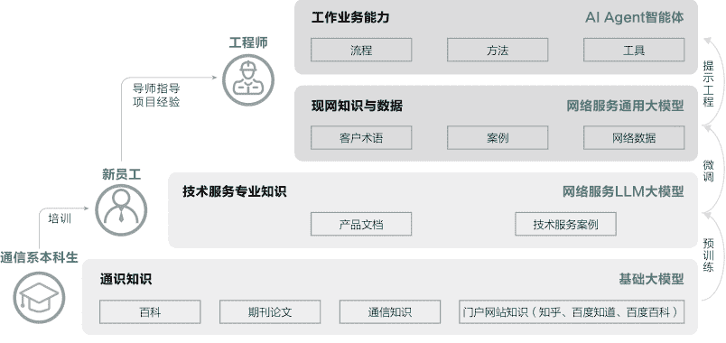

1. **网络服务 LLM 模型：**评估全球主流基础大模型，如 Llama3、Mistral、文心一言、智谱等，通过提前适配和预训练，汇聚行业公共知识，如 C114、万方、产品指导书、案例库、考试库等，让其具备 ICT 服务基础知识，为行业开疆打好基础，让大模型具备高中生的行业知识水平，解决非结构化知识的处理以及训练。

网络服务通用大模型：构建一个懂 ICT 协议、信令语言，懂规建维优营和 OSS/BSS 的行业通用模型，以解决更为复杂的业务问题，具备复杂任务 CoT 链的理解能力和99%以上的精准度，实现结构化数据的知识体系，让其具备本科生的行业知识水平。相比 LLM语言模型，训练参数大量减少，通过7B、10B 等小尺寸大模型微调和 RAG 可快速部署，支撑运营商/行业客户进行生产。

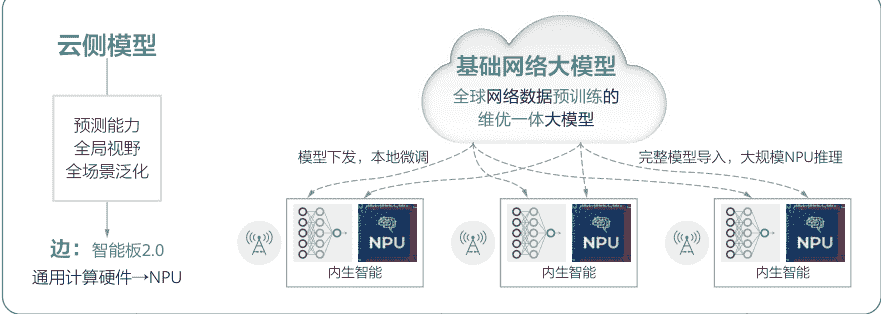

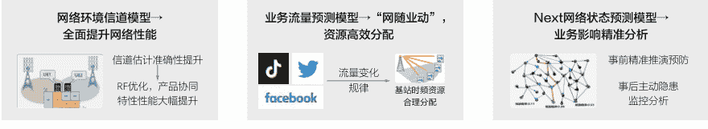

## ICT 融合交付集群规模（n）越大，单次故障的指标（如 MTBF、MTTR）集群可用度的影响越大。2024 年 Meta Llama3 数十万卡训练集群报告：54 天训练，发生466 次作业中断，平均每天中断8 次；41% 的中断为软件异常、电缆问题、网络故障等。未来 OpenAI“星际之门”计划需要100 万卡，对集群的性能要求 MFU 将会越来越高，每中断一天，经济损失将达到上亿元。解决此问题需要持续提升集群集成和运维的两大指标：

1. 集群线性度：和网络链路的稳定性（时延、性能、配置一致性等）、NPU 卡亚健康等有关。强依赖部署模型、配置优化，例行的亚健康治理与维护。
2. 集群可用度：主要由四个指标组成：单次故障 MTTR（h），f = 集群单节点异常率，n = 作业占用节点数，x = 作业时长。

要实现训练和推理高可用、算力集群可用度及 MFU 最佳，需要构建三大集成能力。

3. 全局负载调度多级调度：Global → Region → 节点。
4. 确定且有竞争力的集群可用度：故障、亚健康提前感知，主动维修；4K+ 集群稳定运行30+ 天；支持断链续训，单卡异常作业零感知。
5. 高性价比的线性度网络、AI计算、存储性能优化；硬件流水线支撑亚健康与故障的感知、隔离与修复。

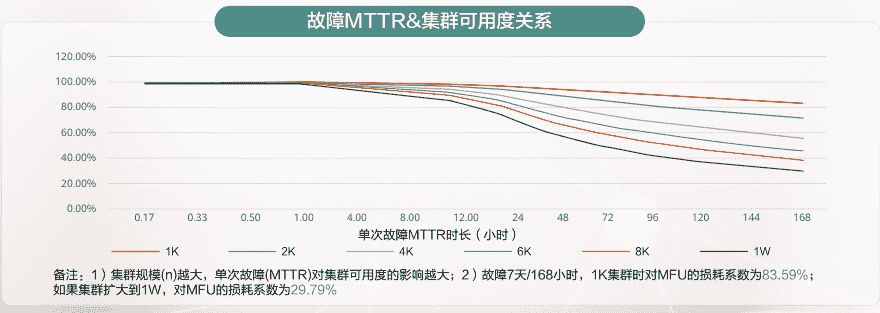

## 数据工程数据大模型训练和推理的基础。目前大模型的实践中，85% 的企业都会遇到学得慢、不容易学的困难，核心原因就是大模型所需要的数据工程需要在数据范围、数据质量、训练效率多方面形成领域模型护城河，共9 类核心技术：

1. **领域复杂流程类数据解析技术：**实现不同类型（信令协议交互/告警因果图/流程）的复杂文本化信息抽取和输出，实现解析内容提取准确率80%+。
2. **多模态复杂信息 Tokenizer 技术：**基于视觉模型的版面分析能力，结合文本匹配、表格解析等多模态融合抽取文本，PDF 内容提取准确率95%+。
3. **领域数据高效合成技术：**实现领域高质量数据的自我成长：从无标注到有标注，从无 CoT 到有 CoT，实现领域典型场景的数据扩充10 倍。
4. **数据质量自评估技术：**预训练数据自动评估，保证质量、提升效率，数据完整性、准确性、一致性、及时性等6 性评估，实现100% 数据质量自评估。
5. **领域数据增强技术：**增强样本、扩充训练数据集，内容语义正确完整、文本多样性增强，提升模型训练效率，实现数据多样性提升10 倍。
6. **知识定位寻源技术：**建立模型能力/参数/数据关联，相互提升，能力短板针对性定位并增强数据，实现数据 bad case 定位效率提升10×。
7. **最优数据配比技术：**突破增训场景下通用与领域数据、领域不同数据配比的 model scaling 技术，使 loss 最优下降，实现模型训练效率提升50%。
8. **数据课程学习技术：**学习顺序（curriculum learning）影响模型的最终效果，利用 scaling law 求解最优学习顺序目标，实现领域知识答准确率提升30%+。
9. **数据退火训练技术：**构建最优领域数据子集，通过多阶段训练与训练末期的最优数据退火，大幅提升模型能力，实现退火速率5×。

##以业务为中心**NPS 数字化分析平台：**要实现以业务为中心的体验管理，主要难题就是如何通过数字化的方式发现问题、判断影响范围以及做好优化模拟：

1. 基于 KANO 理论，识别推荐型和贬低型用户，以它们为样本分别展开 SL 回归分析，明确不同因素的奖惩驱动力。
2. 基于贬低型用户和推荐型用户各自驱动力的分析，推导出 NPS 的整体影响力，即各体验指标提升10%，将带来多少 NPS 的上升。
3.需要提供模拟器，协助评估改进或降低相关指标表现时将带来 NPS 怎样的变化，以有的放矢地制定相关策略。

目前业界的普遍做法通过建模和分析，明确各指标的奖惩驱动力；通过与满意度的矩阵交叉分析，诊断需重点保障的奖励因子和优先改善的惩罚因子；具体指标的改进优先级和具体措施进行分析，将结合满意度的驱动力、痛点发生率和客户推荐/不推荐理由的提及情况。

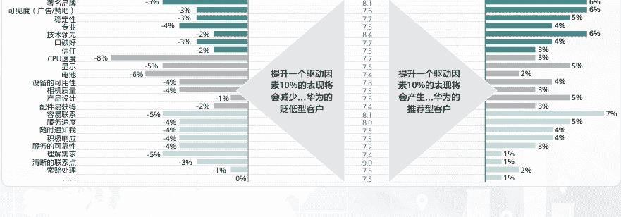


**ODA 运维平台：** 尽管 CSP我是 goaichat 研发的智能大模型，可以为你提供智能问答、分析和创作服务。们早就构建了可以集成多家厂商组件的 IT 系统，但这些组件一般都来自各类通信和软件厂商。随着现在 CSP们在一个更大的舞台上竞争，集成来自通信业以外的其他组件的能力也变得必不可少。当一种与客户交互的新方式（如大模型 Agent）可用时，等待其“通信业专用版本”出现是不现实的。另外，随着开源项目的兴起，如 ONAP、OSM（开源 MANO）和 Open Baton，任何多厂商的定义都必须包括开源软件。许多 CSP也开始在未来 IT 系统中拥抱开源。TMF 下一代 OSS 架构 ODA也是在试图解决此类技术问题。

- 云组件：要求新开发的应用作为遵循 ODA 标准接口和规范的云组件（cloud component），统一在共享库（common repository）中管理。
- DevSecOps：自动化的软件版本验证与发布平台。

ODA组件库由6 个子域构成，分别为：承载核心流程的 Party、Core Commerce、Production，以及辅助支撑业务流程的 Decoupling & Integration、Engagement、Intelligence。组件库呈现了全套 BSS/OSS组件的全景，其中已初步定义功能内容的组件（即具有编号的组件）共计28 个，大部分分布在 Production 和 Party 子域。

这些新特征为运营商跨边界大规模管理数字化生态系统提供了可能性。比如，全球化汽车制造商可以跟多家 CSP 就自治和车联网协议达成一致。ODA还考虑了独立项目中不会考虑到的未来关键需求和概念，如拥有 AI 能力、BSS/OSS 的架构统一以及统一以数据为中心的方法。

# The era of Digital Transformation is over.
The industry needs a new north star.

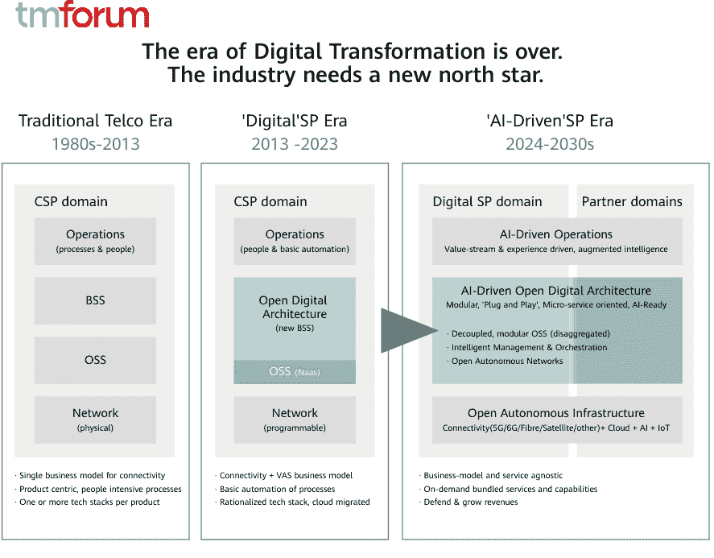

Source: TMF Strategic Review2023,12# 平台智能化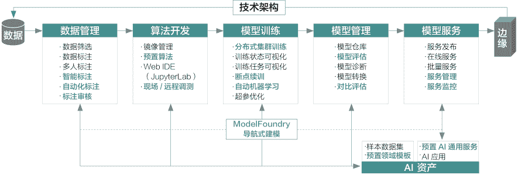

面向未来海量智能体，需要构建基于 ICT 服务和软件行业的模型使能和 Agent 平台，每个客户均可以基于框架快速开发、运营自身的行业大模型和 Agent，开箱即用，模型训练资产可快速基于不同场景进行复制。

**模型使能平台：**模型使能服务包括5 大服务：模型选择、知识管理、模型训练/精调、模型评估、模型压缩和推理服务。海外已经形成完整的 LLMOps体系和开源工具链，百度、智谱也在国内基于开源体系尽快构筑自身的工具能力，基于银行、互联网等行业快速孵化自身模型使能服务包和平台智能化工具链。

**AI 智能体平台：**包括感知、思考、执行三大能力。

1.通过感知能力：用户任务获取/环境状态感知/反馈检测，支撑智能体获取所需要的信息，如数字孪生、智能板、IoT 等。
2. 思考能力：规划推理能力/知识学习能力/记忆存储能力，支撑智能体参考人类思考的 COT 模式进行分析决策。
3. 执行能力：文本回答/API 等编程类工具使用/实体化工具使用，实时调用传统小模型等工具，获取“手和脚的执行”能力。

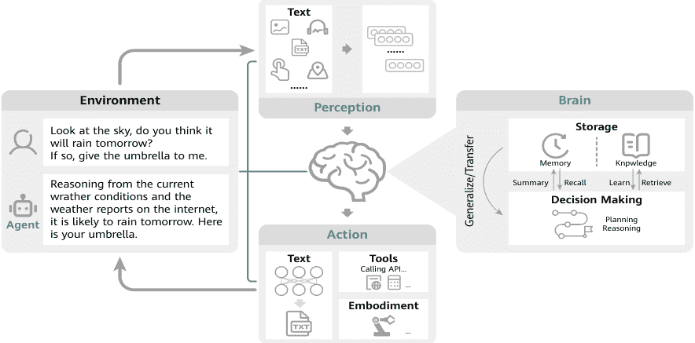


# ICT 服务与软件2030 倡议智能化实现的关键传统“业务人才”和新型“智能人才”的双向奔赴。要让机器学会像“人类”一样思考，首先要各领域的业务专家学习 AI、了解 AI，才能更好地促进智能化转型的进程。

面向2030，智能化将变得更加平等、开放和安全，让每个人、每个组织都能享受新的技术红利，快速实现基础设施、业务、人员的全面升级。

让我们共同努力，一起奔赴智能化新时代！

# 附录（参考、缩略语）

| 缩略语 | 英文全称 | 中文全称 |
|---|---|---|
| Gen AI | Generative AI |生成式 AI |
| AGI | artificial general intelligence | 通用人工智能 |
| AIOps | Artificial Intelligence for IT Operations | 智能运维 |
| IMT | International Mobile Telecommunications | 国际移动通信 |
| MOS | Mean opinion score | 平均意见值 |
| MFU | Model FLOPs Utilization | 模型算力利用率 |
| TTM | Time to Market | 产品上市周期 |
| SLA | Service Level Agreement | 服务质量协议 |
| LLM | Large Language Model | 大语言模型 |
| IoT | Internet of Things |物联网 |
| MOP | method of procedure | 实施方案文档 |
|5G |5th Generation of mobile communication | 第五代移动通信 |
| TECH4ALL | TECH4ALL initiative | 数字包容行动计划 |
| SRE | System Reliability Engineer | 系统可靠性工程师 |
| COT | Chain of thought | 思维链 |
| KQI | key quality indicator |关键质量指标 |
| TAZ | Traffic Autonomous Zone | 流量自治域 |
| EDNS | Expected Demand Not Served | 用户期望未被满足 |
| OA | Office automation | 办公自动化 |
| ERP | Enterprise Resource Planning | 企业资源计划 |
| RAG | retrieval-augmented generation | 增强检索生成 |
| FCR | First Call Resolution | 首次呼叫问题解决率 |
| AHT | Average Handling time | 人工平均处理时长 |
| Prompt | | 提示词工程 |
| Agent | | 智能体 |

**华为技术有限公司**

深圳龙岗区坂田华为基地电话：+8675528780808邮编：518129www.huawei.com# 商标声明🛑 **HUAWEI，HUAWEI，🛑**华为技术有限公司商标或者注册商标。在本手册中以及本手册描述的产品中，出现的其他商标、产品名称、服务名称以及公司名称，由其各自的所有人拥有。

#免责声明本文档可能含有预测信息，包括但不限于有关未来的财务、运营、产品系列、新技术等信息。由于实践中存在很多不确定因素，可能导致实际结果与预测信息有很大的差别。因此，本文档信息仅供参考，不构成任何要约或承诺，华为不您在本文档基础上做出的任何行为承担责任。华为可能不经通知修改上述信息，恕不另行通知。

**版权所有 © 华为技术有限公司2024。保留一切权利。**

非经华为技术有限公司书面同意，任何单位和个人不得擅自摘抄、复制本手册内容的部分或全部，并不得以任何形式传播。

# 每日免费获取资料- 每日微信群内分享7+ 最新行业报告；
- 每周分享当周华为街口报、经济学人；
- 行业报告均为公开版，权利归原作者所有，参一江湖仅分发做内部学习。


关注公众号领取粉丝福利｜英语外刊｜行业报告｜行业社群｜参一江湖·聚焦行业前沿