## 零食&饮料行业回味创新趋势力洞察

2024年9月

炼丹炉

## 法律声明

## 版权声明

本报告为「炼丹炉」原创，版权归杭州知衣科技有限公司（以下简称“知衣”）所有。

报告中所有的文字、图片、表格均受有关商标和著作权的法律保护。部分文字、图片和数据采集于网络公开信息，所有权为原著者所有，如该部分素材因客观原因未与权利人及时联系上导致不当使用，请相关权利人随时与我们联系。

任何未经知衣授权使用本报告的相关行为，均为不合法的行为，知衣将保留对相关人员追究法律责任的权利。

炼丹炉分析师 庄楚 zhuangchu@zhiyitech.cn  
炼丹炉分析师 严梦琪 yanmengqi@zhiyitech.cn

## 免责声明

本报告中行业数据及相关市场预测主要为杭州知衣科技有限公司研究员结合炼丹炉数据系统进行分析所得，仅供参考。

受研究方法和数据获取资源的限制，本报告只提供给用户作为市场参考资料，本公司对该报告的数据和观点及任何第三方对于本报告各项内容和数据的使用或者引用所导致的任何结果不承担法律责任。

## 目录

## 01 零食行业口味趋势

- 1.1 人群偏好
- 1.2 细分品类热销口味洞察
- 1.3 零食行业口味创新趋势
- 1.4 品牌利用争议性口味造势

## 02 饮料行业口味趋势

- 1.1 人群偏好
- 1.2 细分品类热销口味洞察
- 1.3 零食行业口味创新趋势
- 1.4 猎奇口味引爆市场讨论

## 零食行业口味趋势

Snack industry flavor trends

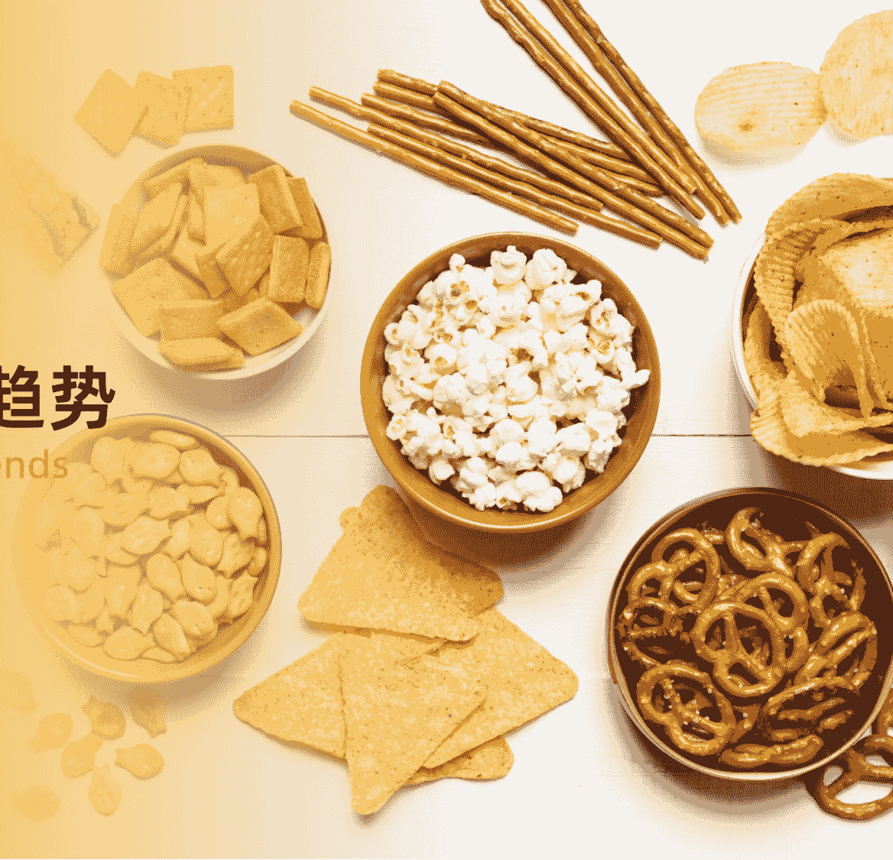

## 口味是消费者在零食行业的首要关注因素，品牌推出新口味在社媒平台受热议

## 零食行业淘系平台消费者评价声量分布

| 声量维度 | 声量数及占比 |
|---|---:|
| 口味 | 96.91万（19.72%） |
| 口感 | 87.76万（17.86%） |
| 购买意向 | 78.15万（15.9%） |
| 性价比 | 40.07万（8.15%） |
| 外观包装 | 37.94万（7.72%） |
| 物流服务 | 31.35万（6.38%） |
| 保质期 | 29.84万（6.07%） |
| 品质 | 28.84万（5.87%） |
| 卖家服务 | 17.22万（3.51%） |
| 适用人群 | 10.06万（2.05%） |
| 购买预期 | 8.71万（1.77%） |
| 气味 | 6.75万（1.37%） |
| 使用感受 | 6.28万（1.28%） |

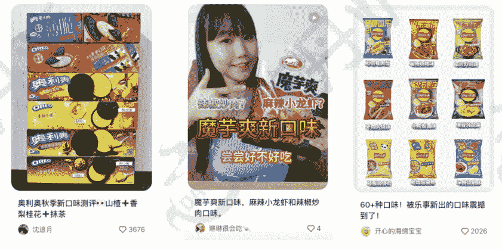

社交媒体口味相关讨论关键词词云：甜甜的、酸酸甜甜的、甜度适中、很甜、酸酸甜甜、香甜可口、口味多等。

## 1.1 人群偏好

Crowd Preference

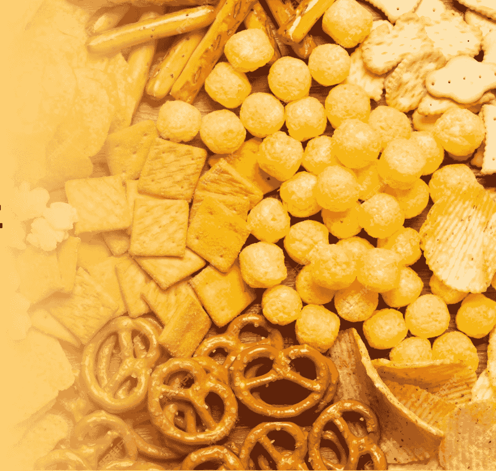

## 不同人群对零食的口味偏好呈现出多元化和个性化的特点

随着社会的发展，人们对于食品的口味、品质及健康性的要求日益提高，消费者们不再满足于传统的、单一的零食种类，而是渴望尝试更多具有特色、符合个人口味的零食产品。这导致了零食市场在满足不同人群需求上变得更加细分和专业化。

### 精致女性

精致女性特别注重零食的健康属性，她们偏爱那些标榜无添加、无防腐剂或低糖低热量的产品。

在口味上，她们更偏爱清淡、优雅的味道，如各种花卉口味或融入超级食材的零食，既满足口味又兼顾营养。

### 前卫学生

前卫学生喜爱尝试新鲜事物，对各种新奇的、有创意的零食充满兴趣。

这一群体更偏爱辣味、酸甜等强烈口感的零食，这类零食能带给他们更加强烈的味觉体验。

### 中老年

中老年人群更倾向于传统的零食选择，如糕点、饼干等，这些熟悉的味道能带给他们情感上的慰藉。

随着年龄的增长，健康成为他们选择零食时考虑的首要因素，他们更喜欢温和、不刺激的食物，避免过于辛辣或过于油腻的零食。

### 轻熟白领

轻熟白领群体追求高品质的生活方式，对零食的选择也反映出这种倾向。口味偏好以健康、无添加为主，他们偏好含有天然糖分（如水果中的果糖）的甜食，或是那些添加了替代糖、低卡路里的甜点，以减少热量摄入。

## 女性人群口味偏甜，红枣味、原味等健康化口味增速高

## “女性”人群口味社媒传播数分布

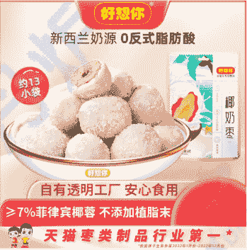

数据来源：炼丹炉大数据  
取值范围：2024年6—8月

炼丹炉：www.huo1818.com

## 原味、牛奶味是中老年人群的主要零食口味偏好

## “中老年”人群口味社媒传播数分布

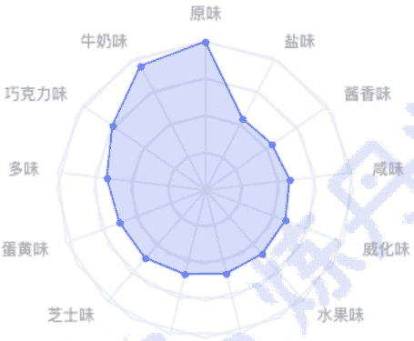

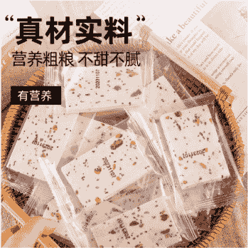

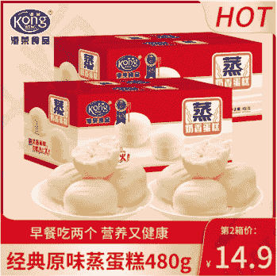

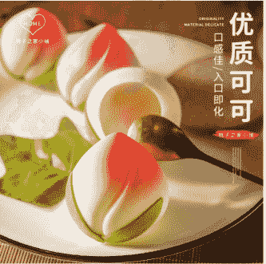

口味词云：牛奶味、原味、巧克力味、多味、蛋黄味、芝士味、花生味、水果味、威化味等为主要口味词。

## “Z世代”人群口味多元化，对零食新口味接受度高

## “Z世代”人群口味社媒传播指数分布

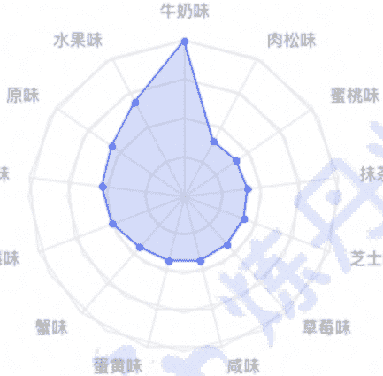

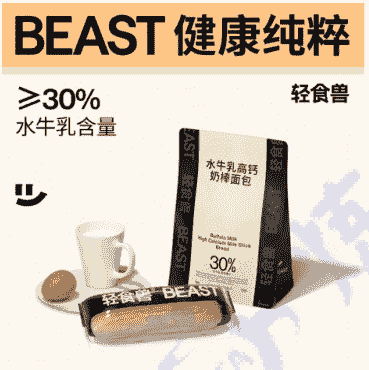

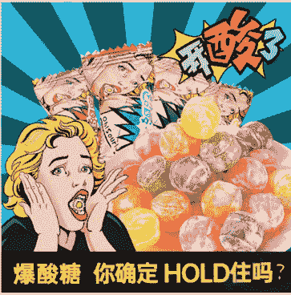

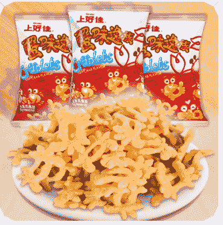

口味词云：牛奶味、巧克力味、原味、水果味、酸奶味、草莓味、抹茶味、芝士味、芒果味、蜜桃味、蓝莓味、葡萄味、柠檬味、椰子味、咖啡味、焦糖味、海盐味、蜂蜜味、红豆味、玫瑰味、桃味、柚子味、香蕉味、抹茶味、奶油味、坚果味、肉松味、辣味、甜味、咸味等。

## 细分品类热销口味洞察

Insights into hot-selling flavors by category

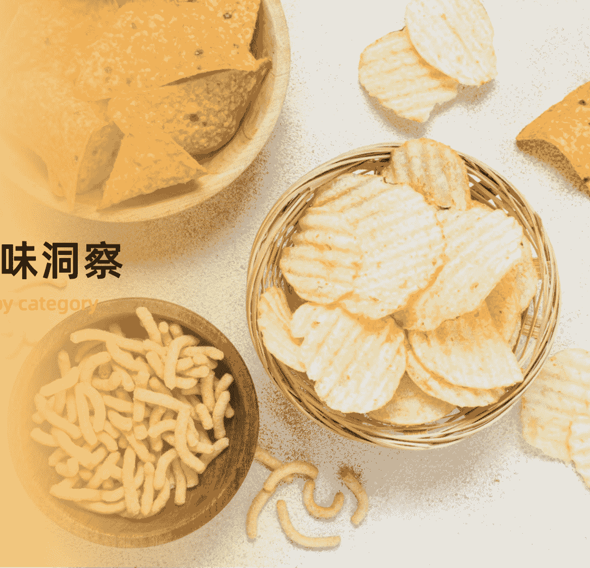

## 消费者对于膨化食品的经典口味仍保持较高兴趣，同时创新口味在社媒平台热度高

根据图表分析，原味和混合口味在社交媒体互动和电商销售方面表现突出，显示消费者对这些传统及多样化口味的高度偏好。其他如酸菜味、螺蛳粉味等口味在社媒平台热度较高，表明消费者对新口味持开放态度。总体来看，社交媒体热度有效转化为销售业绩，企业应继续创新口味并加强品牌建设以满足市场需求。

## 膨化食品行业口味趋势矩阵

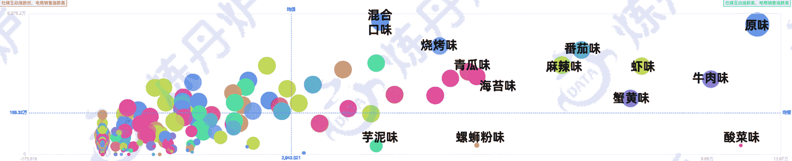

数据来源：炼丹炉大数据  
取值范围：2024年6—8月

## 消费者为情绪价值买单，猎奇口味与童年回忆口味受欢迎

## 膨化食品行业口味社媒互动指数排名

| 排名 | 口味 | 社媒互动指数 | 电商销售指数 |
|---:|---|---:|---:|
| 1 | 原味 | 59.72万 | 1.19亿 |
| 2 | 酸菜味 | 11.39万 | 1.58万 |
| 3 | 牛肉味 | 9.86万 | 914.55万 |
| 4 | 虾味 | 6.86万 | 1,472.56万 |
| 5 | 蟹黄味 | 6.45万 | 386.92万 |
| 6 | 番茄味 | 4.87万 | 2,489.58万 |
| 7 | 麻辣味 | 4.24万 | 1,528.08万 |
| 8 | 海苔味 | 2.31万 | 1,019.91万 |
| 9 | 螺蛳粉味 | 2.29万 | 1.66万 |
| 10 | 青瓜味 | 2.14万 | 1,225.87万 |

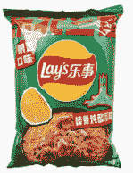

### 乐事薯片限定口味棒骨炖酸菜味

**卖点：**

- 地域限定口味
- 引发消费者猎奇心理

### 味滋源炭烤牛肉味山药薄片35g

**卖点：**

- 炭烤鲜香
- 回味无穷，仿佛回到童年时光

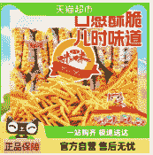

### 爱尚咪咪虾味膨化薯片

**卖点：**

- 儿时味道
- 口味独特，好吃不腻

## 糖果口味呈现多样化趋势，各类口味均有突围机会

糖果行业口味趋势呈现多样化和创新，传统水果味与新颖独特的口味并存。健康趋势显著，果蔬味、植物口味及富含营养的食材受青睐。地域特色口味满足特定市场需求，跨界合作与个性化定制成为新亮点。

## 糖果行业口味趋势矩阵

数据来源：炼丹炉大数据  
取值范围：2024年6—8月

## 糖果口味功效化，消费者关注口味附加功效

## 糖果行业口味社媒互动指数排名

| 排名 | 口味 | 社媒互动指数 | 电商销售指数 |
|---:|---|---:|---:|
| 1 | 水果味 | 55万 | 1.08亿 |
| 2 | 蓝莓味 | 13.44万 | 539.65万 |
| 3 | 牛奶味 | 9.48万 | 1,234.73万 |
| 4 | 苹果味 | 8.83万 | 223.39万 |
| 5 | 巧克力味 | 8.29万 | 340.49万 |
| 6 | 薄荷味 | 5.41万 | 6,514.35万 |
| 7 | 草莓味 | 3.77万 | 1,475.03万 |
| 8 | 葡萄味 | 3.37万 | 893.78万 |
| 9 | 混合口味 | 3.08万 | 4,226.21万 |
| 10 | 芋泥味 | 2.4万 | 56.59万 |

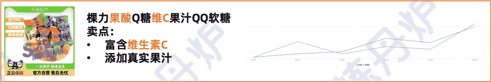

### 樊力果酸Q糖维C果汁QQ软糖

**卖点：**

- 富含维生素C
- 添加真实果汁

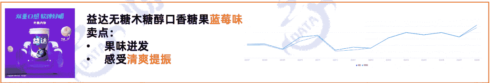

### 益达无糖木糖醇口香糖果蓝莓味

**卖点：**

- 果味迸发
- 感受清爽提振

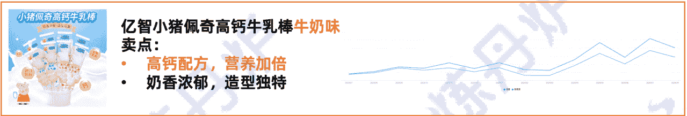

### 亿智小猪佩奇高钙牛乳棒牛奶味

**卖点：**

- 高钙配方，营养加倍
- 奶香浓郁，造型独特

## 中式糕点口味传统与现代结合，地域特色强化

中式糕点行业在保持传统口味的基础上，积极融入现代元素，实现传统与现代的完美结合。同时，健康理念逐渐渗透到行业中，消费者更加注重食品的健康和营养价值。地域特色在中式糕点中得到了强化，不同地区的糕点展现出独特的风味和制作工艺。此外，创新口味不断涌现，为市场注入了新的活力。

### 中式糕点行业口味趋势矩阵

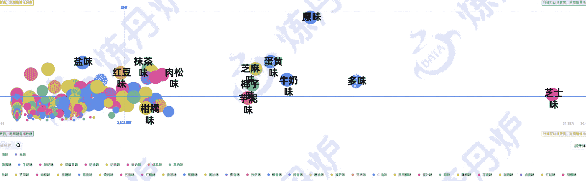

## 针对地区口味偏好，中式糕点口味在单一领域不断细分

针对地区口味偏好在单一领域的不断细分意味着企业需要深入理解不同地区消费者的独特喜好，并据此设计和推出符合当地风味与文化特色的定制化产品。企业可以开发出适合特定群体的商品，实施针对性的营销策略，并通过持续收集用户反馈来优化产品，以增强品牌的区域影响力和市场竞争力。

## 我国不同地域口味偏好

| 口味偏好 | 华北 | 华南 | 西南 | 华东 |
|---|---|---|---|---|
| 酥/软 | 酥 | 软 | 酥 | 软 |
| 甜/咸 | 咸 | 甜 | 甜 | 甜 |
| 中/西 | 中 | 西/中 | 西 | 西 |

## 中式糕点行业地域热词分布

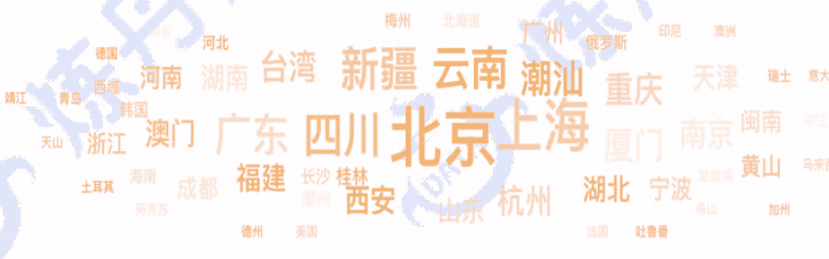

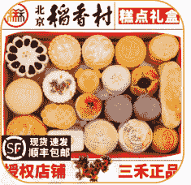

北京京八件糕点礼盒

新疆坚果切糕

广东酥饼糕点

## 零食行业口味创新趋势

Trends in flavor innovation in the snack food industry

## 品牌跨界联名口味成爆款密码，品牌抱团作战的趋势愈发明显

在激烈的市场竞争中，各大品牌纷纷寻求创新与合作，通过跨界联名的方式，将各自的优势资源进行整合，打造出独特的产品或服务，吸引消费者的眼球。这种趋势不仅提升了品牌的知名度和影响力，也为消费者带来了更多选择和惊喜。

## “联名”概念在零食行业销售趋势

奥利奥可口可乐汽水味夹心饼干

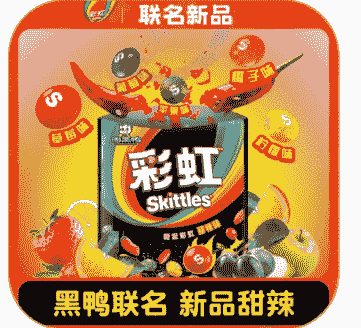

彩虹糖周黑鸭联名款甜辣味糖果

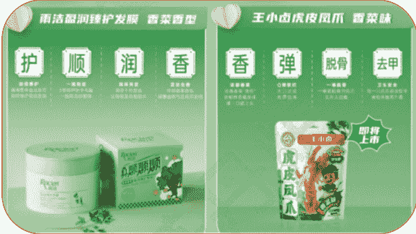

王小卤雨洁联名款香菜味凤爪

## 菜肴口味与零食口味融合重组，激发零食行业创新

随着全球化的不断推进，不同地区的饮食文化相互交融，为食品行业带来了丰富的灵感来源。消费者对于新奇、有趣且具有地域特色的食品越来越感兴趣，这促使零食制造商开始探索如何将传统菜肴的风味融入现代零食中，以满足市场的需求。

卫龙魔芋爽推出了麻辣小龙虾与辣椒炒肉两种创新口味，将传统菜肴的风味融入零食。麻辣小龙虾口味结合了麻辣鲜香，而辣椒炒肉则突出了辣味和肉香。这些新口味不仅丰富了产品线，还满足了消费者对新奇体验的需求。

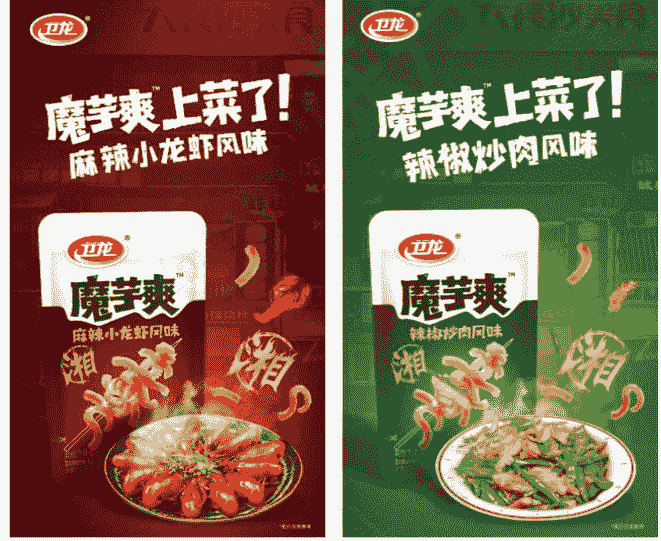

## 2023年预制菜行业菜肴销售额分布

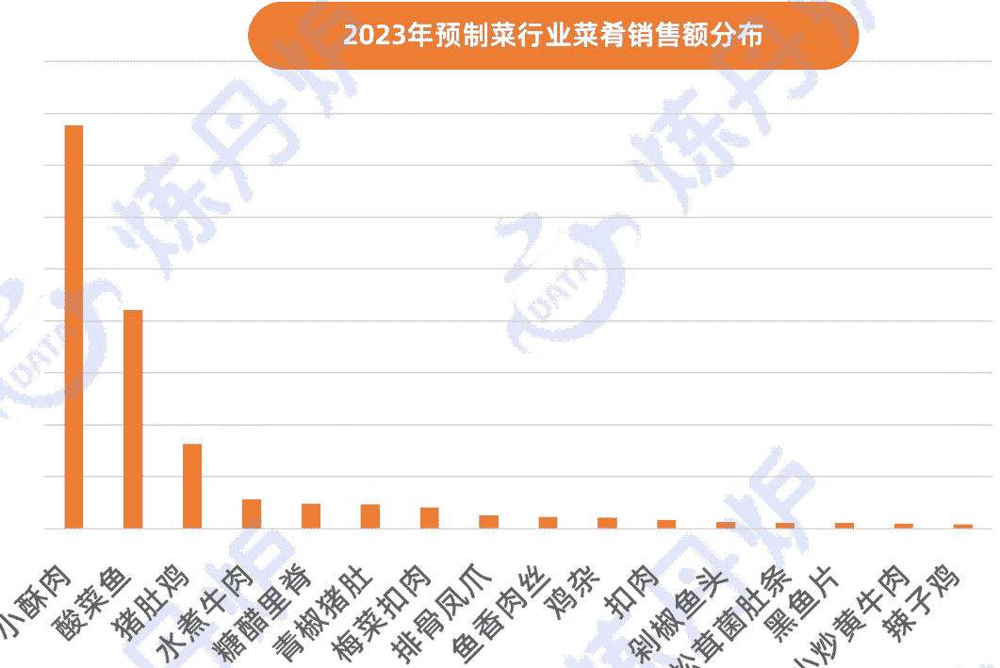

## 地域性口味链接地方消费者情感，满足各地消费者口味差异

乐事通过挖掘地域美食文化，推出具有地方特色的薯片产品，以满足消费者对本土美食风味的热衷和新鲜口感体验的追求。这种创新不仅增加了产品的吸引力，还构建了强大的差异化竞争优势。同时，乐事也紧紧抓住与地方消费者的情感纽带，唤起他们对本土文化的认同与自豪。

## 零食行业地域类口味排名

| 排名 | 口味 | 社媒互动指数 | 电商销售指数 |
|---:|---|---:|---:|
| 1 | 奥尔良风味 | 7,412 | 1,004.77万 |
| 2 | 川辣味 | 2,324 | 81.74万 |
| 3 | 川香味 | 1,521 | 95.45万 |
| 4 | 沙嗲味 | 748 | 462.04万 |
| 5 | 日式风味 | 245 | 21.29万 |
| 6 | 韩式风味 | 89 | 5.69万 |

## 品牌利用争议性口味趋势

Brands capitalize on controversial flavor trends

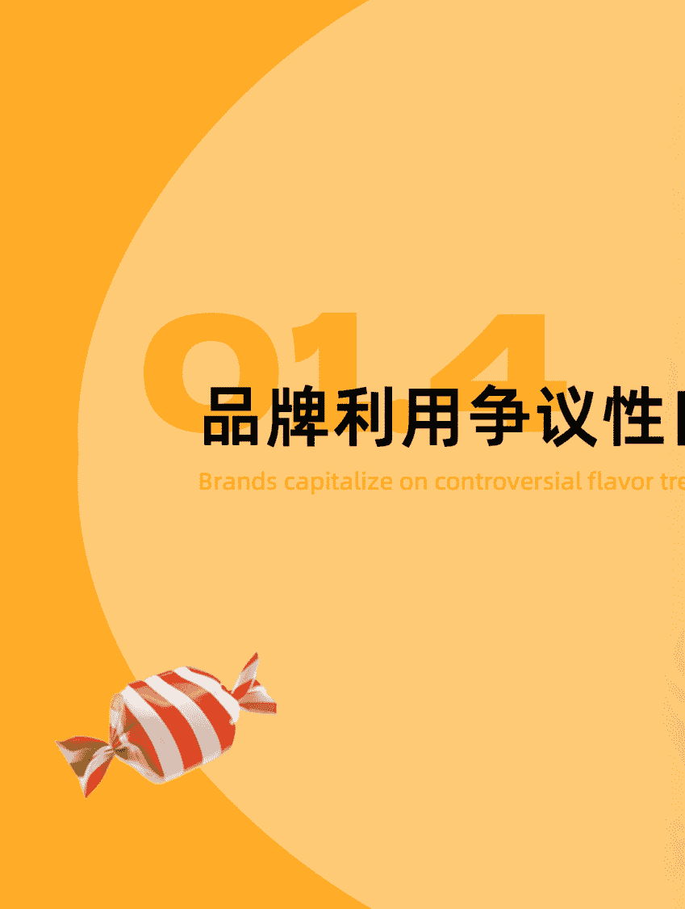

## 卫龙榴莲味辣条市场反响强烈，小众口味创新成关键

卫龙推出的榴莲味辣条在小红书平台上显示出显著的市场关注度和消费者兴趣，尽管反馈褒贬不一。这一趋势突显了创新口味对市场的吸引力及其在推动销售增长中的关键作用。品牌需持续创新并加强与消费者的互动，以适应不断变化的市场需求和偏好。

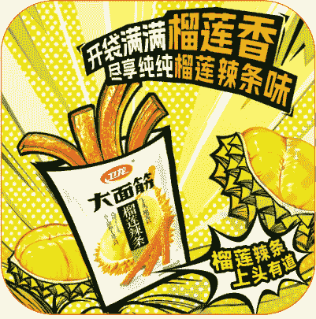

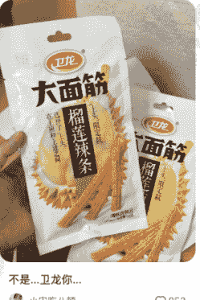

## 卫龙榴莲味辣条小红书平台数据趋势

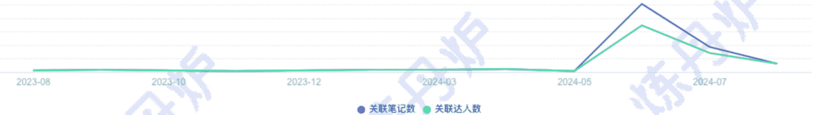

## 爆辣味零食引发挑战热潮，刺激性食品体验需求增长

爆辣味零食“缺牙齿”在小红书平台上引发了一场挑战热潮。这种趋势展示了消费者对极端口味零食的浓厚兴趣，同时也反映出市场上对于新颖、刺激食品体验的需求日益增长。品牌通过推出此类产品不仅能够吸引年轻消费群体的注意，还能激发社交媒体上的互动和讨论，进而提升品牌的市场影响力和消费者的参与度。

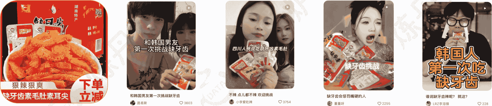

## 缺牙齿小红书平台数据趋势

## “黑暗料理”新搭配，独特风味吸引消费者尝试

螺蛳粉味臭豆腐作为一种大胆的美食创新，将两种具有强烈地域特色和独特口味的食品结合在一起。这种结合不仅挑战了传统美食的定义，也满足了消费者对新奇食品体验的追求。这一新产品在多个平台上的销售情况显示出其市场接受度和消费者的好奇心。

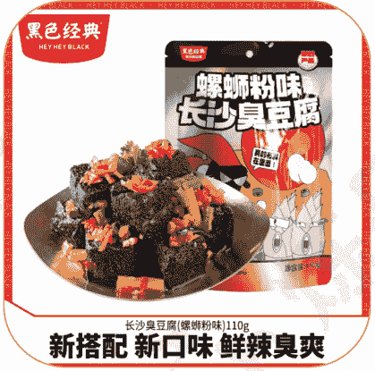

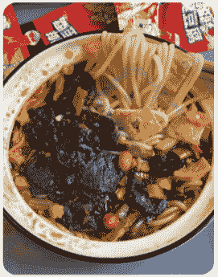

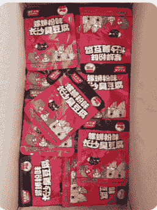

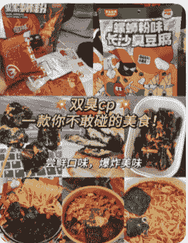

## 螺蛳粉口味淘系平台数据趋势

## 臭豆腐口味淘系平台数据趋势

## 奇葩口味更注重社媒营销，多种营销手段抓住消费者眼球

### 零食测评

### 明星/KOL推荐

### 日常VLOG分享

### 零食吃播挑战

## 小红书平台零食行业话题分布

零食推荐好吃、山姆、追剧小零食、内调、零食分享、日常VLOG、零食测评、又搞到好吃的、零食推荐、解析小零食

## VLOG我的一天

零食

## 小红书平台奇葩零食笔记趋势

## 饮料行业口味趋势

Beverage Industry Flavor Trends

## 口味是消费者在饮料行业的首要关注因素

## 饮料行业淘系平台消费者评价量分布

| 关注因素 | 评价量 |
|---|---:|
| 购买意向 | 83.49万（17.2%） |
| 口味 | 59.99万（12.36%） |
| 口感 | 51.12万（10.53%） |
| 性价比 | 50.97万（10.49%） |
| 外观包装 | 47.28万（9.74%） |
| 物流服务 | 44.16万（9.1%） |
| 品质 | 40.17万（8.28%） |
| 保质期 | 24万（4.95%） |
| 售后服务 | 21.41万（4.41%） |
| 适用人群 | 14.84万（3.06%） |
| 气味 | 11.89万（2.45%） |
| 实物与预期不符 | 8.5万（1.77%） |
| 功效 | 7万（1.44%） |
| 使用感受 | 6.79万（1.4%） |

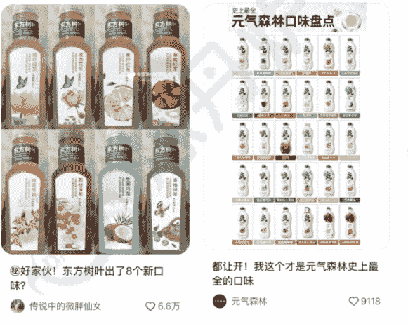

“好家伙！东方树叶出了8个新口味？”

“震撼！我这个才是元气森林史上最全的口味”

酸酸甜甜的味道，甜美又好吃

## O21

人群偏好

Crowd Preference

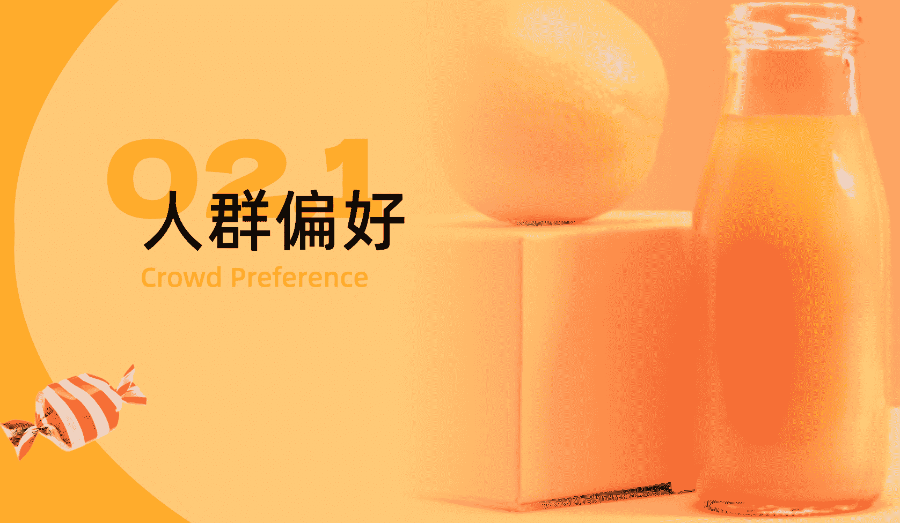

## 不同人群对饮料的口味选择通常出于使用场景与需求偏好

不同人群对饮料的口味选择不仅反映了他们的生理需求和心理状态，还深受社会环境、文化背景及个人习惯的影响。例如，在注重健康生活方式的社会环境中，人们更倾向于选择低糖、无添加或有机成分的饮料。而在一些传统节日或庆典活动中，特定类型的饮料如香槟或米酒则因其象征意义而受到青睐。

### 健身人群

健身爱好者偏好低糖或无糖饮料以控制卡路里摄入，同时选择高蛋白和氨基酸补充饮品以支持肌肉修复。电解质饮料也是他们训练后的首选，以快速补充流失的矿物质。

### Z世代

Z世代追求新颖和创意口味，喜欢尝试异国风味和混合水果味的饮品。他们倾向于选择环保包装的产品，并喜欢在社交媒体上分享色彩鲜艳、外观独特的饮料。

### 中老年

中老年人群倾向于选择低糖或无糖的传统口味饮品，注重健康益处，如心脏健康和骨骼健康。他们偏好易于消化的饮品，如牛奶和姜茶。此外，这一群体可能会避免过于刺激或含咖啡因的饮品，以减少对身体的潜在负担。

### 上班族

上班族需要提神醒脑的饮品，如咖啡和能量饮料，以保持工作效率。他们逐渐关注健康成分，如富含维生素和益生菌的饮品。上班族也可能偏好那些能够在忙碌工作间隙提供即时能量补充的饮品。

## 健身人群饮品的主要使用场景为运动健身，偏好清爽的水果口味运动饮料

## 健身人群口味社媒传播指数分布

口味词云：柠檬味、原味、牛奶味、葡萄味、水果味、蜜桃味、苹果味、无味、橙味、柚子味等。

数据来源：炼丹炉大数据　取值范围：2024年6—8月

## 中老年人健康意识提高，偏好原味、牛奶味、谷物坚果口味等健康口味

## “中老年”人群口味电商销货数分布

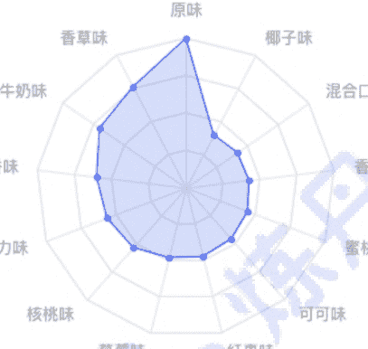

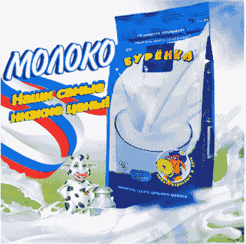

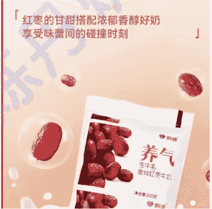

口味词云：原味、牛奶味、香草味、麦香味、可可味、巧克力味、混合口味、坚果味、果蔬味、草莓味、红茶味、绿茶味、咖啡味、抹茶味、芝麻味、椰子味、芒果味、蓝莓味、柠檬味、蜂蜜味、焦糖味、奶油味、谷物味、酸奶味、冰淇淋味、核桃味、花生味、红枣味、葡萄味、玫瑰味、桂花味等。

## “上班族”商务场合、身材管理与人群提神需求高，偏好原味饮用水、奶味或餐及咖啡味饮品

## “上班族”人群口味社媒传播数分布

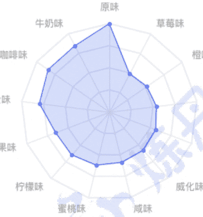

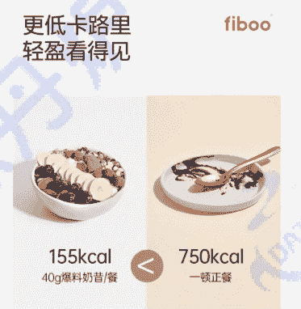

口味词云：中心词包括“芝士味”“牛奶味”“原味”“咖啡味”，周围分布有水果味、巧克力味、抹茶味、柠檬味、奶油味、茶味、香草味、焦糖味、坚果味、花生味、椰奶味、果汁味、薄荷味、可乐味、巴旦木味等多种口味词。

数据来源：炼丹炉大数据　取值范围：2024年6—8月

## 细分品类热销口味洞察

Insights into hot-selling flavors by category

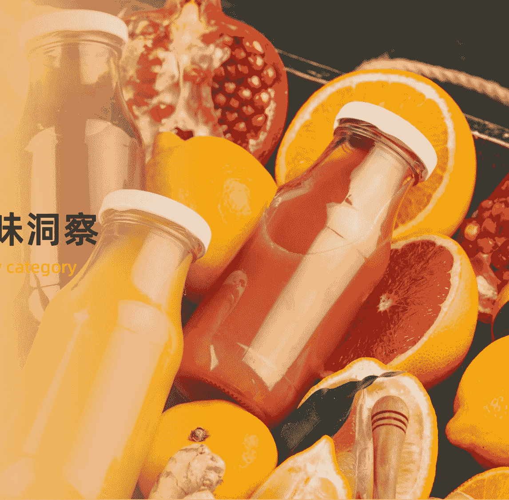

## 果香味及口感浓郁的芝士味等口味在调制乳行业热度高

调制乳行业口味趋势矩阵显示，草莓味、混合口味和芝士味因其独特风味和丰富口感，在市场中占据显著地位。果香清新自然，受健康生活追求者青睐；芝士味浓郁营养，吸引高品质生活消费者。其他如巧克力、麦香等口味也有一定市场，但不如前两者受欢迎。这反映了消费者对传统口味的偏好和对新口味的接受度提升。

### 调制乳行业口味趋势矩阵

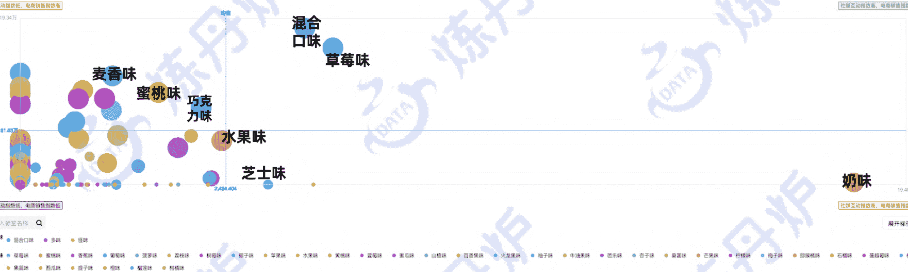

## 调制乳的主要使用场景为“早餐”，最大受众为“儿童”

## 调制乳行业口味电商销售指数排名

| 排名 | 口味 | 电商销售指数 | 社媒互动指数 |
|---:|---|---:|---:|
| 1 | 原味 | 6,019.55万 | 2.8万 |
| 2 | 混合口味 | 1,266.12万 | 6,462 |
| 3 | 草莓味 | 843.17万 | 8,573 |
| 4 | 红枣味 | 458.37万 | 0 |
| 5 | 麦香味 | 424.3万 | 220 |
| 6 | 栀子花味 | 307.95万 | 0 |
| 7 | 香蕉味 | 275.61万 | 69 |
| 8 | 蜜桃味 | 258.16万 | 739 |
| 9 | 核桃味 | 248.12万 | 0 |
| 10 | 奶茶味 | 218.76万 | 55 |

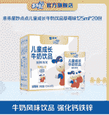

**蒙牛未来星**儿童牛奶饮品**草莓味**

卖点：
- 酸甜草莓味，童年滋味
- 强化钙铁锌

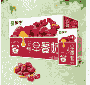

**蒙牛早餐奶**红枣味

卖点：
- 红枣甘甜营养
- 唤醒清晨活力

**伊利早餐奶**麦香味

卖点：
- 谷物及浓浓奶香
- 专为营养早餐研制

## 酸奶口味多元化，目前各类水果口味占据主导地位

图表中展示了多种不同的水果味酸奶，包括草莓、蜜桃、芒果、樱桃等，这些口味因其天然、健康的特性而受到消费者的青睐。此外，还有一些创新口味如榴莲味和芝士味等，显示了市场对新奇口味的探索和尝试。同时，传统的巧克力味、焦糖味等甜点口味也依然保持着一定的市场份额。整体来看，酸奶行业的口味趋势正朝着更加多样化和个性化的方向发展。

## 酸奶行业口味趋势矩阵

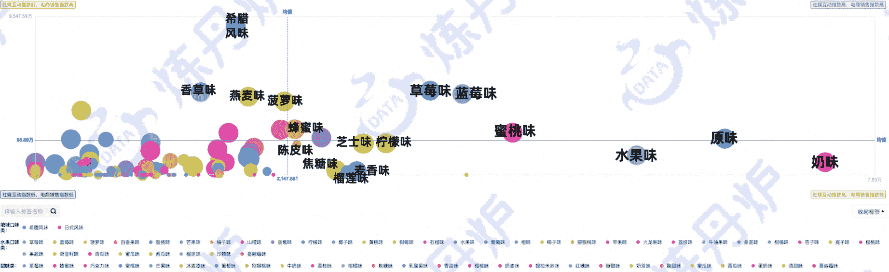

## 酸奶口感较浓郁，通常选择清新的风味进行中和

## 酸奶行业口味电商销售指数排名

| 排名 | 口味 | 电商销售指数 | 社媒互动指数 |
|---:|---|---:|---:|
| 1 | 原味 | 2.7亿 | 4.6万 |
| 2 | 希腊风味 | 7,956.32万 | 1,078 |
| 3 | 草莓味 | 1,436.54万 | 8,249 |
| 4 | 香草味 | 1,361.78万 | 605 |
| 5 | 蓝莓味 | 1,277.42万 | 1.04万 |
| 6 | 燕麦味 | 1,147.66万 | 1,295 |
| 7 | 菠萝味 | 953.55万 | 2,074 |
| 8 | 百香果味 | 636.19万 | 13 |
| 9 | 蜜蜜味 | 226.77万 | 2,344 |
| 10 | 巧克力味 | 222.07万 | 1,987 |

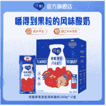

**蒙牛纯甄草莓果粒风味酸奶**

卖点：
- 酸得到草莓果粒
- 可用于DIY制作甜品

**伊利安慕希希腊风味酸奶·香草味**

卖点：
- 大溪地香草，香气独特
- 酸奶浓郁，香草清新

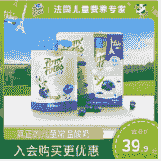

**法优乐儿童常温酸奶·蓝莓味**

卖点：
- 添加天然果泥
- 口感浓稠顺滑

## 茶饮行业将果味及花香味与茶饮口味进行搭配，追求自然清新

从茶饮行业口味趋势矩阵中可以看出，果味和花香味在茶饮行业中占据了重要地位。其中，柠檬、蜜桃、西瓜等水果口味都受到了消费者的欢迎。此外，茉莉、桂花等花香口味也表现出较高的受欢迎程度。这些口味的流行反映了消费者对于清新、自然口感的追求。

## 茶饮料行业口味趋势矩阵

数据来源：炼丹炉大数据　取值范围：2024年6—8月

## 经典口味及自然花果香味是目前茶饮料品牌的主要研发方向

### 茶饮料行业口味电商商品数排名

| 排名 | 口味 | 抖音互动指数 | 电商销售指数 |
|---:|---|---:|---:|
| 1 | 原味 | 1.08万 | 6,526.15万 |
| 2 | 柠檬味 | 5.41万 | 6,778.71万 |
| 3 | 茉莉味 | 9,851 | 3,618.08万 |
| 4 | 蜜桃味 | 2.01万 | 199.95万 |
| 5 | 鸭屎香风味 | 1,673 | 477.37万 |
| 6 | 混合口味 | 9,661 | 470.28万 |
| 7 | 水果味 | 1.74万 | 43.4万 |
| 8 | 绿茶味 | 1.49万 | 592.77万 |
| 9 | 红茶味 | 13.89万 | 669.48万 |
| 10 | 柚子味 | 2,070 | 85.76万 |

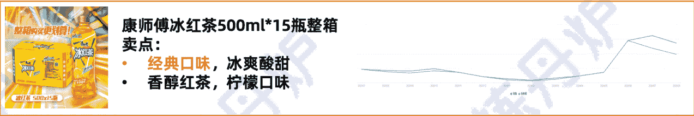

**康师傅冰红茶500ml*15瓶整箱**

**卖点：**
- **经典口味**，冰爽酸甜
- 香醇红茶，柠檬口味

**果子熟了金桂乌龙无糖茶茉莉味**

**卖点：**
- 不苦不涩好回甘
- 增加**自然花香**

**雀巢茶饮料茶萃桃子清乌龙果汁**

**卖点：**
- 茶**清新**，果够味
- 清甜桃汁，释放**清香**

## 气泡水行业以水果为主流口味，酒味、汽水味等创新口味涌现

在气泡水行业中，水果口味已经成为主流选择，如柠檬、草莓和葡萄等口味备受欢迎。这些清新的果味气泡水满足了消费者对于健康饮品的需求，同时也为市场带来了多样化的选择。除了传统的水果口味，一些创新口味如酒味和汽水味也开始涌现。这些新颖的口味为气泡水行业注入了新的活力，吸引了更多追求个性化和独特体验的消费者。

## 气泡水行业口味趋势矩阵

## 气泡水作为更健康的饮品，可以从口味上替代酒、汽水等饮料

## 气泡水行业口味社媒互动指数排名

| 排名 | 口味 | 社媒互动指数 | 电商销售指数 |
|---:|---|---:|---:|
| 1 | 酒味 | 38.31万 | 20.26万 |
| 2 | 原味 | 10.47万 | 1,721.93万 |
| 3 | 莓莓味 | 3.13万 | 21.19万 |
| 4 | 蓝莓味 | 2.5万 | 627.85万 |
| 5 | 桃水味 | 2.34万 | 18 |
| 6 | 柠檬味 | 1.82万 | 731.94万 |
| 7 | 樱桃味 | 1.76万 | 277.06万 |
| 8 | 蜜香味 | 1.3万 | 222.24万 |
| 9 | 橙莓味 | 1.17万 | 13.02万 |
| 10 | 葡萄味 | 8,526 | 27.44万 |

**Watsons屈臣氏莫吉托苏打水**

卖点：
- 莫吉托鸡尾酒风味
- 口味清爽，气泡十足

**奈雪的茶气泡水葡萄白桃荔枝**

卖点：
- 沉浸式果味，果气十足
- 添加代糖，清爽甜味

**元气森林可乐味气泡水**

卖点：
- 可乐味，一样好喝但无糖
- 0糖0脂0卡

## 饮料行业口味创新趋势

Flavor innovation trends in the beverage industry

## 健康消费的持续渗透带动中式养生茶市场蓬勃发展

健康意识已经逐渐渗透到日常消费的方方面面，与此同时，药食同源的概念也正在影响着食品和饮料市场。年轻人越来越喜欢选购具有天然成分和传统中药文化的饮品，红豆、薏米、枸杞、红枣、绿豆、山药等传统食物煮制、萃取制成的植物饮料正在征服都市打工人。祛湿、清火、补血是当前中式养生茶市场最热门的3大功效需求，此外，无添加、0糖0脂0卡也是当前中式养生水产品的核心卖点。

### 咖啡/麦片/冲饮市场日常养生类标签趋势

### 元气森林元气自在水

- 红豆薏米水
- 红枣枸杞水
- 清爽绿豆水

### 好望水照顾系列

- 薏米水
- 陈皮水
- 桂圆水

## 功能性趋势推动饮料行业创新，有目的的成分受到消费者欢迎

消费者对饮料的需求正在逐渐从单一的口味享受转变为对健康和功能性的追求，随着越来越多新健康原料的加入，带有明确目的的功能性口味饮料越来越受到消费者的青睐。消费者对于饮料的功能期待也逐渐变得多元化，除了提神、饱腹等常规需求之外，许多带有调理肠胃、增强免疫力、美容养颜、补钙、补充气血类的原料也被广泛应用到饮料产品当中，成为了消费者选购决策中的重要考量因素。

## 「炼丹炉消费者说」饮料市场功效性分析

| 功效 | 讨论声量 |
|---|---:|
| 充饥饱腹 | 4W |
| 提神醒脑 | 2.86W |
| 调理肠胃 | 1.79W |
| 促进排便 | 1.45W |
| 增强免疫力 | 0.67W |
| 美容养颜 | 0.55W |
| 补钙 | 0.37W |
| 补气补血 | 0.30W |
| 安神助眠 | 0.16W |

## 自带“天然、安全、有益”等健康属性的原浆原液饮料成为消费者的新选择

原浆植物饮料是以天然的植物果汁为主要原料，经过加工、灌装而成。与传统果汁相比，原浆植物饮料更加天然、安全，且口感更加清爽。近几年，以沙棘原浆、白桦树汁、刺梨全果原浆、石斛原浆为代表的鲜食饮品正在快速崛起，其中，今年6月淘系平台上白桦树汁类产品的销量及销售额均同比增长了超300%，成为增速最快的植物成分。不添加一滴水、补充维C、方便携带、新鲜即饮等成为其吸引消费者的“噱头”。

## 淘系平台白桦树汁市场销售趋势

林源春100%白桦树原汁长白山桦树汁

铁枫堂铁皮石斛汁  
0脂肪0防腐剂  
鲜煮礼盒

## 猎奇口味引爆市场讨论

Unusual tastes spark market discussion

## 魔水师品牌以创意饮品为品牌核心，迅速获得业绩飙升

随着互联网和社交媒体的发展，新中式品牌开始善于利用新型传播渠道来推广自己的产品和品牌理念。通过这些策略，新中式品牌能够有效吸引爱尝新的消费者，尤其是年轻一代，他们对新鲜事物充满好奇，喜欢追求个性化和文化认同感，同时也愿意为有故事、有设计感的产品买单。

## 魔水师品牌淘系平台数据趋势

## 香菜口味成流量密码，海河利用地域特点研发煎饼果子味、香菜味等新口味

海河利用地域特点，研发出了具有独特风味的香菜味和煎饼果子味等新口味，吸引了大量消费者的关注。这些创新口味不仅满足了消费者对于新奇口感的需求，也为海河品牌带来了更多的曝光和话题性。通过快闪店的形式，海河进一步推广了这些新口味产品，让更多人有机会品尝到独特的煎饼果子味和香菜味牛奶。

## 海河香菜、煎饼果子口味牛奶小红书平台数据趋势

## 果子熟了以风油精口味柠檬茶引消费者好奇，社媒平台热度高

果子熟了品牌近期推出的风油精口味柠檬茶在小红书平台上引起了广泛的关注和讨论。这款独特的饮品以其别出心裁的口味组合吸引了众多消费者的好奇心，成为了社交媒体上的热议话题。许多消费者分享了自己尝试这款饮品的经历，有的形容它“满满风油精的味道”，引发了一阵尝鲜潮。尽管这种口味组合听起来有些非传统，但它成功地激发了市场的兴趣，为品牌带来了显著的社交媒体曝光率。

## 果子熟了风油精口味柠檬茶小红书平台数据趋势

## 奇葩饮料测评、挑战、开箱类内容成社媒平台流量密码

作为互联网时代的新品风向标，以抖音和小红书为代表的社媒平台已经成为了品牌新品投放的主要阵地。其中，测评、挑战、开箱类内容极大地满足了消费者的好奇心，以造梗的形式快速形成大量的UGC内容（用户生成内容），帮助品牌用最低的营销成本最快地打开市场认知。

## 抖音奇葩饮料相关视频内容

## 小红书奇葩饮料相关笔记内容

## 更多数据请扫码获取

商业智能决策工具，实现业绩高效增长

炼丹炉

2024年9月
