## 2.2 线性表的顺序表示和实现

线性表的顺序表示指的是用一组地址连续的存储单元依次存储线性表的数据元素，这种表示也称作线性表的顺序存储结构或顺序映像。通常，这种存储结构称为顺序表。其特点是，逻辑上相邻的数据元素，其物理次序也是相邻的。

假设线性表存储的起始位置为 LOC(A)，每个数据元素所占的存储空间大小为 L，则第 i 个数据元素的存储位置为：

LOC(aᵢ) = LOC(a₁) + (i-1) × L

只要确定了存储线性表的起始位置，线性表中任一数据元素都可随机存取，所以线性表的顺序存储结构是一种随机存取的存储结构。

由于高级语言中的数组类型也有随机存取的特性，因此，通常都用数组来描述数据结构中的顺序存储结构。由于线性表的长度可变，且所需最大存储空间随问题的不同而不同，则在 C 语言中可用动态分配的一维数组表示线性表，描述如下：

```c
typedef struct {
    ElemType *elem;  // 存储空间基址
    int length;      // 当前长度
    int listsize;    // 当前分配的存储容量
} SqList;
```

其中，listsize 为顺序表当前分配的存储空间大小，一旦因插入或删除而空间不足时，可再分配增加。

## 中观超额收益追踪

## 中观行业库存周期

## 中观月度行业景气度观点更新

- **截至 9 月中下旬，上游资源品行业和中下游制造业景气分化**：上游资源品方面，钢铁行业景气持续改善，有色金属行业景气提振，石油石化和基础化工行业景气保持下行。中下游制造业方面，主要价格指标指示机械设备和家用电器行业景气提振，轻工制造、建筑装饰行业景气下行。
- **下游消费行业景气度有所提振**：下游可选消费中，社会服务和家用电器行业景气保持上行，电力设备、机械设备和商贸零售行业景气转为上行趋势，房地产行业景气保持下行；在必选消费中，农林牧渔和食品饮料景气上行，医药生物和纺织服饰景气保持下行。
- **支撑性服务行业和 TMT 行业景气下行**：支撑性服务行业中环保、公用事业和交通运输行业均景气下行。TMT 行业方面，电子、传媒与计算机行业亦景气下行。
- **风险提示**：宏观经济增长放缓，情绪拖累中观行业超额收益表现；全球供应瓶颈问题尚未得到缓解。

| 名称 | 作用 |
|---|---|
| 输入电压 | FPC 接口，用于供电和程序烧录，输入电压 5V~12V，推荐 5V |
| 电源开关 | 控制电源通断 |
| User Key（KEY1） | 用户按键，用于输入控制信号，可以控制 LED 和蜂鸣器 |
| User LED（LED0） | 用户 LED，用于状态指示 |
| 蜂鸣器 | 无源蜂鸣器，用于播放提示音或音乐 |
| 红外接收 | 红外接收传感器（VS1838B），用于接收红外遥控器信号 |
| 可编程 LED1 | 三色 LED（WS2812B），用于显示交通灯颜色 |
| 可编程 LED2 | 三色 LED（WS2812B），用于显示交通灯颜色 |
| 可编程 LED3 | 三色 LED（WS2812B），用于显示交通灯颜色 |
| USB 转串口 | USB-UART 接口，用于串口通信及程序下载 |
| 复位按键 | 用于将开发板恢复到初始状态 |

该开发板集成有 FPC 接口、电源开关、用户按键、用户 LED、蜂鸣器、红外接收、三色可编程 LED（WS2812B）、USB 转串口和复位按键等资源，适用于交通灯模拟与控制学习。

## 开发板硬件资源标注图

- 1. 输入电压范围：5V~12V（推荐 5V）
- 2. 电源开关控制整板电源
- 3. 板载资源包括按键、LED、蜂鸣器、红外接收和可编程 LED
- 4. USB 转串口功能支持程序下载与调试

## 钢铁行业超额收益的跟踪指标

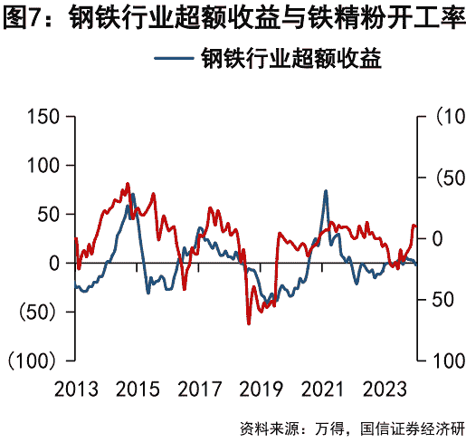

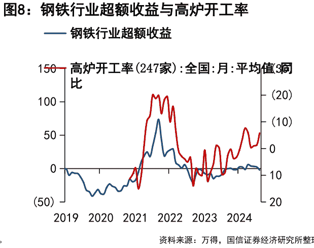

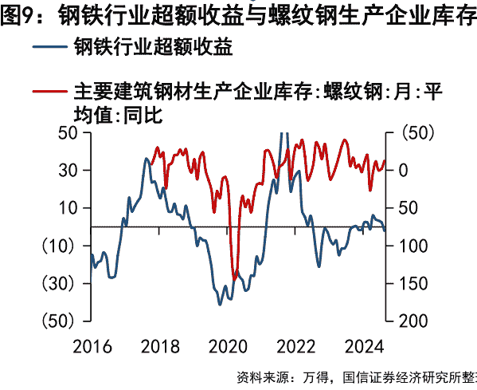

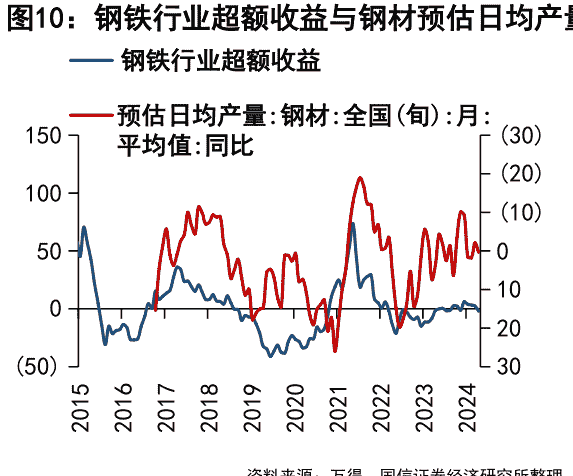

图 11：钢铁行业超额收益与各高频指标相关性

| 最优领先期 | 领先 2 期 | 滞后 2 期 | 滞后 1 期 | 滞后 1 期 |
|---|---:|---:|---:|---:|
| 滞后 2 期 | 0.432 | -0.690 | -0.451 | -0.596 |
| 滞后 1 期 | -0.444 | -0.672 | -0.475 | -0.537 |
| 同步 | -0.453 | -0.662 | -0.465 | -0.444 |
| 领先 1 期 | -0.462 | -0.604 | -0.424 | -0.349 |
| 领先 2 期 | -0.469 | -0.690 | -0.411 | -0.596 |
| 最优相关系数 | -0.469 | -0.690 | -0.475 | -0.596 |

指标：矿山开工率：铁精粉：全国：当期值：月：平均值：同比；高炉开工率（247 家）：全国：月：平均值：同比；主要建筑钢材生产企业库存：螺纹钢：月：平均值：同比；预估日均产量：钢材：全国（旬）：月：平均值：同比。

资料来源：万得，国信证券经济研究所整理。

## 有色金属行业超额收益的跟踪指标

### 图 12：有色金属行业超额收益与上期有色金属指数

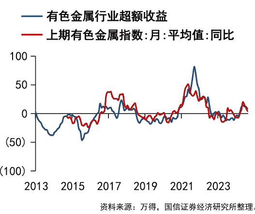

### 图 13：有色金属行业超额收益与 LME 基本金属指数

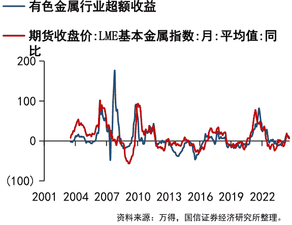

### 图 14：有色金属行业超额收益与阴极铜/黄金收盘价

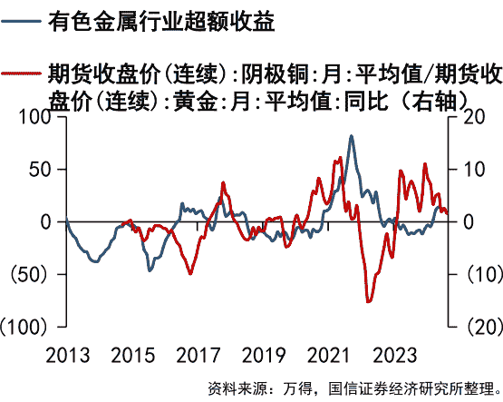

### 图 15：有色金属行业超额收益与各高频指标相关性

|  | 上期有色金属指数：月：平均值：同比 | 期货收盘价：LME 基本金属指数：月：平均值：同比 | 期货收盘价（连续）：阴极铜：月：平均值/期货收盘价（连续）：黄金：月：平均值：同比 |
|---|---:|---:|---:|
| 最优领先期滞后 2 期 | 0.723 | 0.550 | -0.091 |
| 滞后 1 期 | 0.766 | 0.557 | -0.033 |
| 同步 | 0.783 | 0.550 | 0.036 |
| 领先 1 期 | 0.763 | 0.490 | 0.107 |
| 领先 2 期 | 0.740 | 0.439 | 0.179 |
| 最优相关系数 | 0.783 | 0.557 | 0.179 |

资料来源：万得，国信证券经济研究所整理。

## 建筑材料行业超额收益的跟踪指标

### 图 16：建筑材料行业超额收益与水泥价格指数

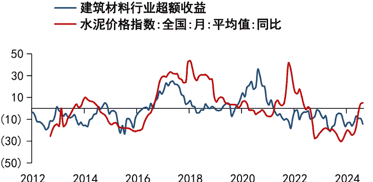

资料来源：万得，国信证券经济研究所整理。

### 图 17：建筑材料行业超额收益与玻璃结算价

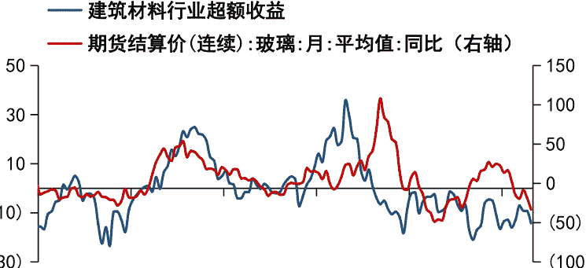

资料来源：万得，国信证券经济研究所整理。

### 图 18：建筑材料行业超额收益与各高频指标相关性

| 最优领先期 | 水泥价格指数：全国：月：平均值：同比 | 期货结算价（连续）：玻璃：月：平均值：同比 |
|---|---:|---:|
| 滞后 2 期 | 0.373 | 0.420 |
| 滞后 1 期 | 0.356 | 0.396 |
| 同步 | 0.342 | 0.383 |
| 领先 1 期 | 0.328 | 0.343 |
| 领先 2 期 | 0.328 | 0.302 |
| 最优相关系数 | 0.373 | 0.420 |

资料来源：万得，国信证券经济研究所整理。

## 煤炭行业超额收益的跟踪指标

### 图 19：煤炭行业超额收益与动力煤平台代理

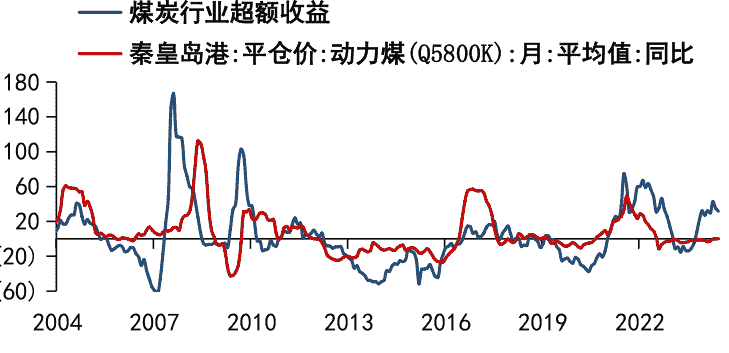

资料来源：万得，国信证券经济研究所整理。

### 图 20：煤炭行业超额收益与焦煤收盘价

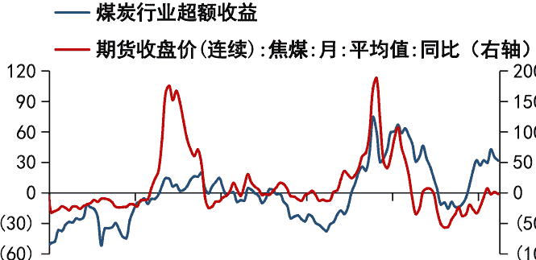

资料来源：万得，国信证券经济研究所整理。

### 图 21：煤炭行业超额收益与各高频指标相关性

|  | 秦皇岛港：平仓价：动力煤（Q5800K）：月：平均值：同比 | 期货收盘价（连续）：焦煤：月：平均值：同比 | 中国煤炭价格指数：全国综合：月：平均值：同比 |
|---|---:|---:|---:|
| 滞后 2 期 | -0.046 | 0.584 | -0.224 |
| 滞后 1 期 | 0.017 | 0.646 | -0.151 |
| 同步 | 0.087 | 0.669 | -0.062 |
| 领先 1 期 | 0.164 | 0.652 | 0.056 |
| 领先 2 期 | 0.235 | 0.622 | 0.163 |
| 最优相关系数 | 0.235 | 0.669 | 0.163 |

资料来源：万得，国信证券经济研究所整理。

## 石油石化行业超额收益的跟踪指标

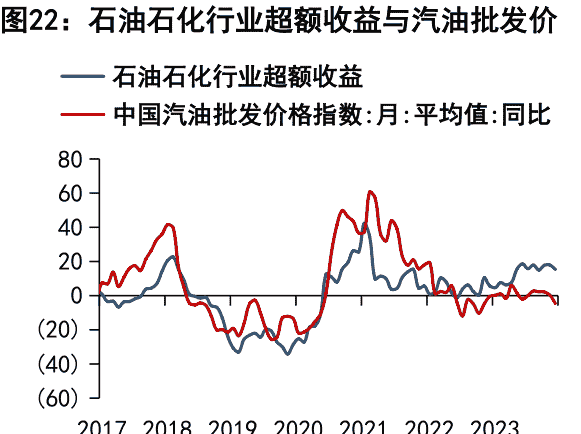

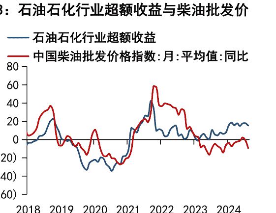

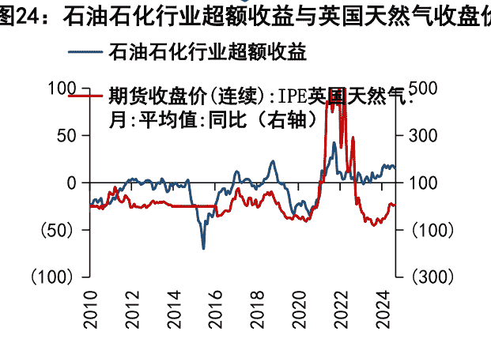

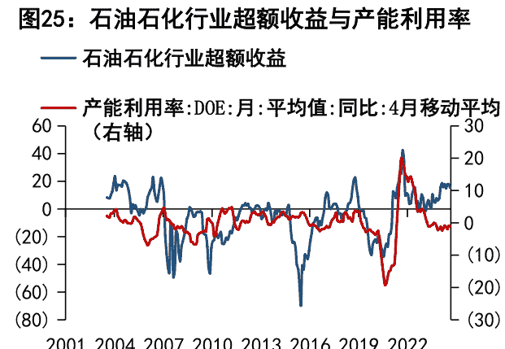

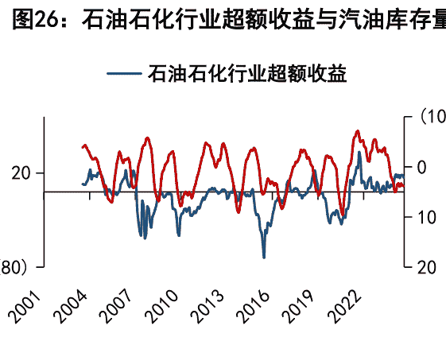

图 27：石油石化行业超额收益与各高频指标相关性

|  | 中国汽油批发价格指数：月：平均值：同比 | 中国柴油批发价格指数：月：平均值：同比 | 期货收盘价（连续）：IPE 英国天然气：月：平均值：同比 | 产能利用率：DOE：月：平均值：同比：5 月移动平均 | 库存量：汽油：DOE：月：平均值：同比：5 月移动平均 |
|---|---:|---:|---:|---:|---:|
| 最优领先期滞后 2 期 | 0.772 | 0.768 | 0.604 | 0.353 | -0.294 |
| 滞后 1 期 | 0.842 | 0.802 | 0.604 | 0.328 | -0.295 |
| 同步 | 0.853 | 0.766 | 0.624 | 0.290 | -0.292 |
| 领先 1 期 | 0.842 | 0.700 | 0.636 | 0.242 | -0.281 |
| 领先 2 期 | 0.840 | 0.650 | 0.636 | 0.183 | -0.259 |
| 最优相关系数 | 0.853 | 0.802 | 0.636 | 0.353 | -0.295 |

## 教学设计方案

学校：后沙峪中心小学

学科：数学

姓名：王雪梅

年级：四年级

| 课题 | 亿以内数的读法 |
|---|---|
| 教学目标 | 1. 使学生能正确地读出亿以内的数。2. 借助数位表培养学生推理能力。3. 对学生渗透爱护环境的教育。 |
| 教学重点 | 亿以内数的读法。 |
| 教学难点 | 中间或末尾有 0 的数的读法。 |
| 教学准备 | 课件、数位表、电脑。 |
| 教学过程 | 详见下列各环节 |

（一）创设情景，引入新课

1. 学生说出自己搜集的较大的数。

2. 电脑展示以下图片信息：

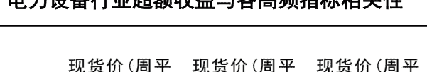


（这些图片中的数据有：我国人口总数，北京市人口数，我国土地面积，我国自然保护区数。）

3. 揭示课题：

在生活中我们经常用到比万大的数，今天我们就来学习亿以内数的读法。（板书课题：亿以内数的读法）

（二）探究新知

1. 试读例 1：2496，24960000，6407000，85000300

（学生在小组内试读，并在全班汇报。讨论总结亿以内数的读法。）

2. 出示数位表，探究含有两级数的读法。

3. 巩固练习（见课件）。

## 汽车行业超额收益的跟踪指标

### 图 32：汽车行业超额收益与汽车轮胎开工率

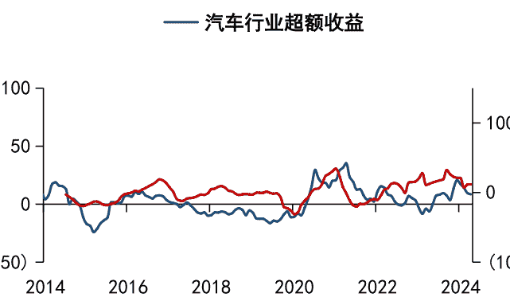

资料来源：万得，国信证券经济研究所整理。

### 图 33：汽车行业超额收益与乘用车日均销量

— 汽车行业超额收益

— 当周日均销量：乘用车：厂家零售+厂家批发：月：平均值：同比（右轴）

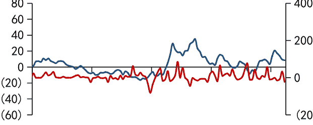

资料来源：万得，国信证券经济研究所整理。

### 图 34：汽车行业超额收益与各高频指标相关性

| 指标 | 最优领先期 | 滞后 2 期 | 同步 |
|---|---:|---:|---:|
| 开工率：汽车轮胎：半钢胎：月：平均值；同比；5 月移动平均 |  |  |  |
| 当周日均销量：乘用车：厂家零售+厂家批发：月：平均值；同比 |  |  |  |
| 最优领先期 |  |  |  |
| 滞后 2 期 |  | 0.400 | 0.081 |
| 滞后 1 期 |  | 0.354 | 0.135 |
| 同步 |  | 0.292 | 0.238 |
| 领先 1 期 |  | 0.201 | 0.183 |
| 领先 2 期 |  | 0.104 | 0.124 |
| 最优相关系数 |  | 0.400 | 0.238 |

资料来源：万得，国信证券经济研究所整理。

## 机械设备行业超额收益的跟踪指标

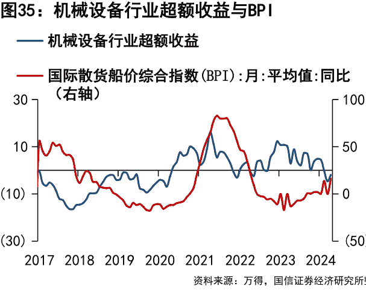

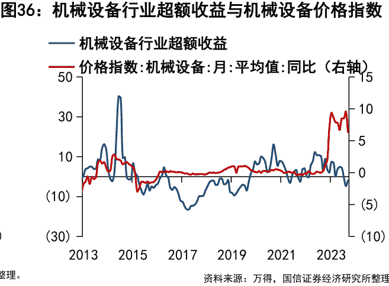

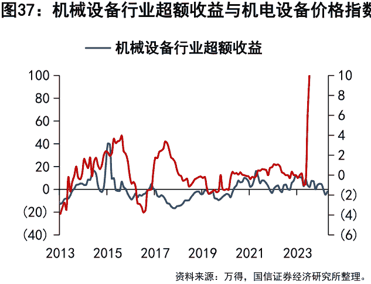

### 图 38：机械设备行业超额收益与各高频指标相关性

|  | 国际散货船综合指数（BPI）：月平均值：同比 | 价格指数：机械设备：月平均值：同比 | 价格指数：机电设备：月平均值：同比 |
|---|---:|---:|---:|
| 滞后 2 期 | 0.402 | 0.368 | 0.417 |
| 滞后 1 期 | 0.318 | 0.377 | 0.352 |
| 同步 | 0.232 | 0.393 | 0.307 |
| 领先 1 期 | 0.145 | 0.393 | 0.241 |
| 领先 2 期 | 0.061 | 0.367 | 0.159 |
| 最优相关系数 | 0.402 | 0.393 | 0.417 |

## 交通运输行业超额收益的跟踪指标

### 图 39：交通运输行业超额收益与 CDFI

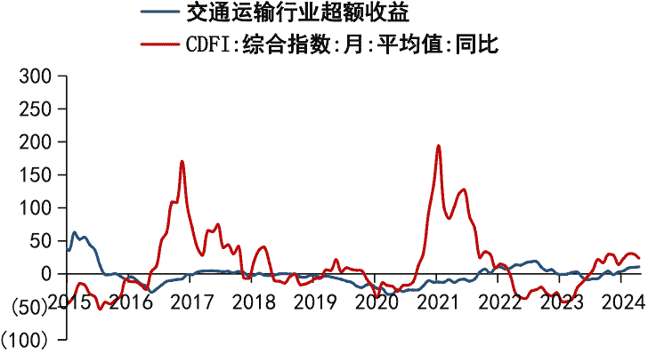

资料来源：万得，国信证券经济研究所整理。

### 图 40：交通运输行业超额收益与 PDCI

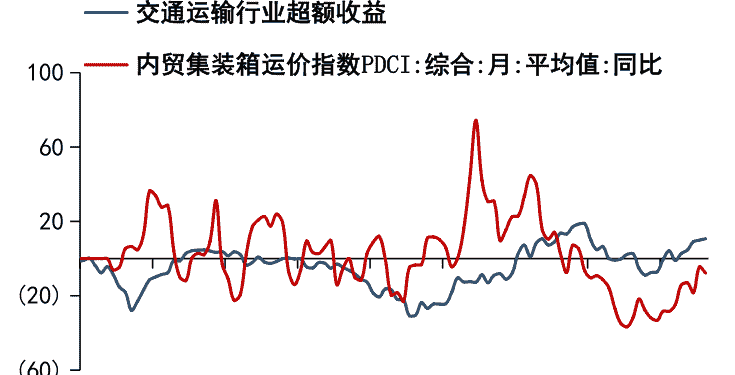

资料来源：万得，国信证券经济研究所整理。

### 图 41：交通运输行业超额收益与各高频指标相关性

|  | CDFI：综合指数：月：平均值：同比 | 内贸集装箱运价指数 PDCI：综合：月：平均值：同比 |
|---|---:|---:|
| 最优领先期滞后 2 期 | -0.376 | -0.086 |
| 滞后 1 期 | -0.320 | -0.017 |
| 同步 | -0.274 | 0.049 |
| 领先 1 期 | -0.230 | 0.120 |
| 领先 2 期 | -0.191 | 0.155 |
| 最优相关系数 | -0.191 | 0.155 |

资料来源：万得，国信证券经济研究所整理。

## 电子行业超额收益的跟踪指标

### 图 42：电子行业超额收益与中关村电子产品价格指数

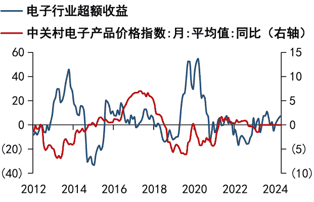

### 图 43：电子行业超额收益与 DXI 指数

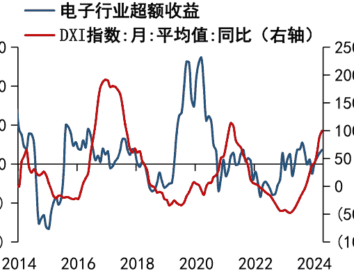

### 图 44：电子行业超额收益与 NAND 现货平均价

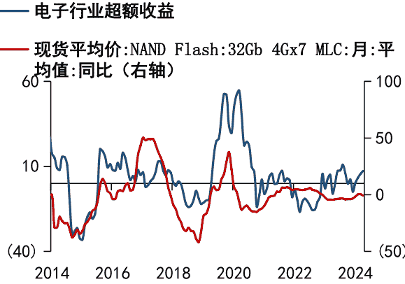

### 图 45：电子行业超额收益与各高频指标相关性

|  | 中关村电子产品价格指数：月：平均值：同比 | DXI 指数：月：平均值：同比 | 现货平均价：NAND Flash：32Gb 4Gx8 MLC：月：平均值：同比 |
|---|---:|---:|---:|
| 滞后 2 期 | -0.196 | 0.007 | 0.274 |
| 滞后 1 期 | -0.230 | -0.027 | 0.361 |
| 同步 | -0.259 | -0.052 | 0.422 |
| 领先 1 期 | -0.281 | -0.080 | 0.458 |
| 领先 2 期 | -0.298 | -0.114 | 0.474 |
| 最优相关系数 | -0.196 | 0.007 | 0.474 |

## 轻工制造行业超额收益的跟踪指标

### 图 46：轻工制造行业超额收益与商品房成交面积

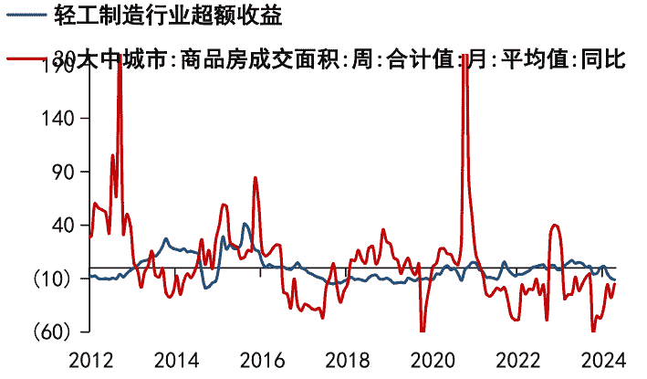

资料来源：万得，国信证券经济研究所整理。

### 图 47：轻工制造行业超额收益与 TDI 现货价

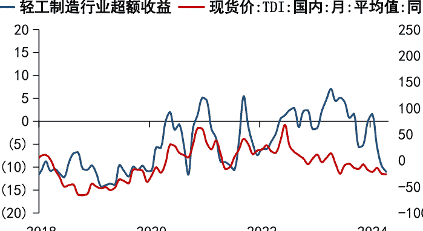

资料来源：万得，国信证券经济研究所整理。

### 图 48：轻工制造行业超额收益与各高频指标相关性

|  | 30 大中城市：商品房销售面积：住宅：累计同比 | 30 大中城市：商品房成交面积：周：合计值；月：平均值；同比 | 现货价：TDI：国内：月：平均值：同比 |
|---|---:|---:|---:|
| 最优领先期 |  |  |  |
| 滞后 2 期 |  | 0.007 | -0.025 |
| 滞后 1 期 |  | 0.010 | -0.034 |
| 同步 |  | 0.033 | 0.045 |
| 领先 1 期 |  | 0.057 | 0.062 |
| 领先 2 期 |  | 0.076 | 0.077 |
| 最优相关系数 |  | 0.076 | 0.077 |

表中第三指标对应数值：滞后 2 期 -0.086，滞后 1 期 -0.106，同步 -0.122，领先 1 期 -0.138，领先 2 期 -0.147，最优相关系数 -0.086。

资料来源：万得，国信证券经济研究所整理。


## 建筑装饰行业超额收益的跟踪指标

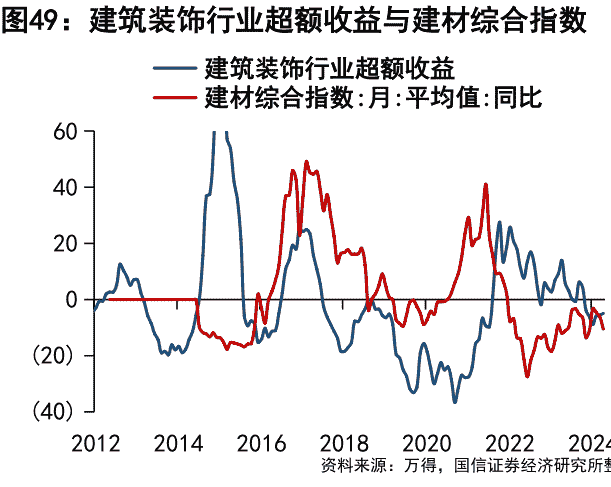

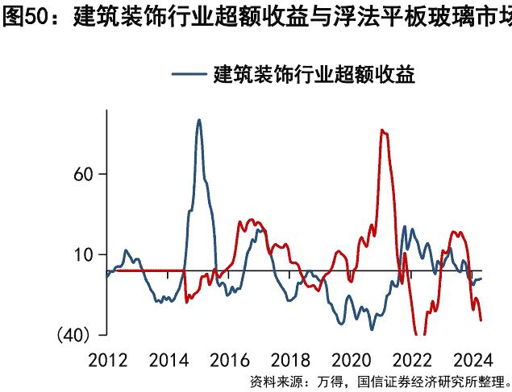

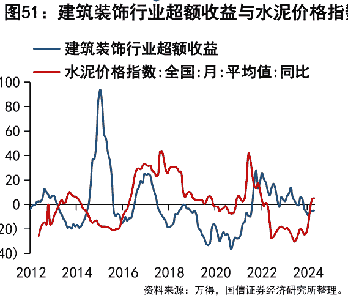

### 图52：建筑装饰行业超额收益与各高频指标相关性

|  | 建材综合指数：月：平均值：同比 | 市场价：浮法平板玻璃：4.8/5mm：全国：月：平均值：同比 | 水泥价格指数：全国：月：平均值：同比 |
|---|---:|---:|---:|
| 最优领先期：滞后2期 | -0.173 | -0.373 | -0.211 |
| 滞后1期 | -0.150 | -0.367 | -0.194 |
| 同步 | -0.133 | -0.358 | -0.173 |
| 领先1期 | -0.104 | -0.329 | -0.140 |
| 领先2期 | -0.063 | -0.265 | -0.103 |
| 最优相关系数 | -0.063 | -0.265 | -0.103 |

资料来源：万得，国信证券经济研究所整理。

## 纺织服饰行业超额收益的跟踪指标

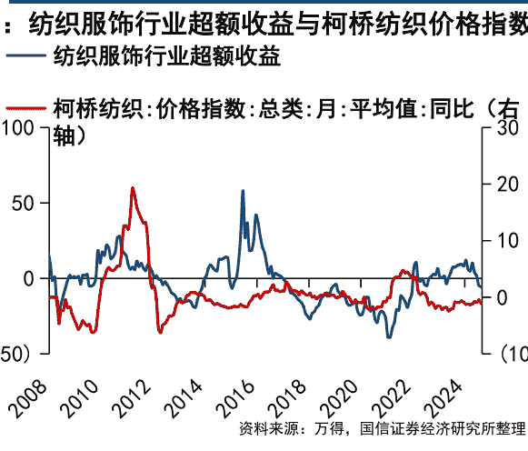

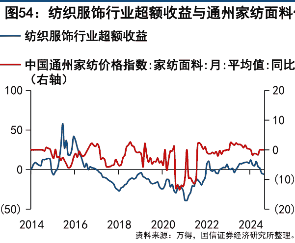

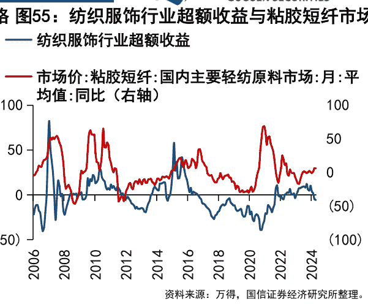

### 图56：纺织服饰行业超额收益与各高频指标相关性

|  | 柯桥纺织：价格指数：总类：月：平均值：同比 | 中国通州家纺价格指数：家纺面料：月：平均值：同比 | 市场价：粘胶短纤：国内主要轻纺原料市场：月：平均值：同比 |
|---|---:|---:|---:|
| 最优领先期 | 滞后1期 | 滞后1期 | 滞后1期 |
| 滞后2期 | 0.213 | 0.323 | 0.262 |
| 滞后1期 | 0.215 | 0.336 | 0.271 |
| 同步 | 0.210 | 0.321 | 0.271 |
| 领先1期 | 0.198 | 0.300 | 0.264 |
| 领先2期 | 0.181 | 0.303 | 0.258 |
| 最优相关系数 | 0.215 | 0.336 | 0.271 |

资料来源：万得，国信证券经济研究所整理。

## 商贸零售行业超额收益的跟踪指标

### 图57：商贸零售行业超额收益与义乌订单价格指数

— 商贸零售行业超额收益

— 义乌中国小商品指数：订单价格指数：月：平均值：同比（右轴）

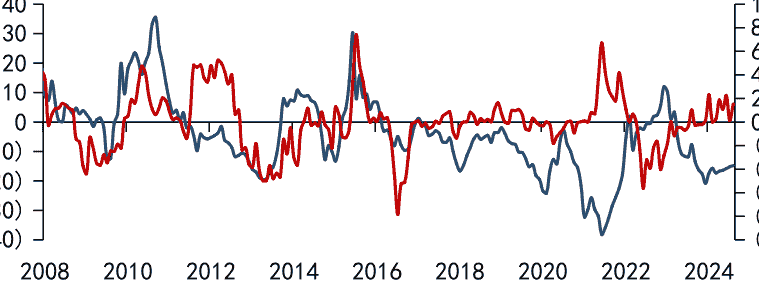

资料来源：万得，国信证券经济研究所整理。

### 图58：商贸零售行业超额收益与各高频指标相关性

|  | 义乌中国小商品指数：订单价格指数：月：平均值：同比 |
|---|---:|
| 最优领先期 | 滞后2期 |
| 滞后2期 | 0.140 |
| 滞后1期 | 0.134 |
| 同步 | 0.101 |
| 领先1期 | 0.093 |
| 领先2期 | 0.094 |
| 最优相关系数 | 0.140 |

资料来源：万得，国信证券经济研究所整理。

## Gliricidia sepium (Jacq.) Kunth ex Walp.

**Family:** Leguminosae (Fabaceae)

**Common names:** Gliricidia, madre de cacao, mother of cocoa, quickstick

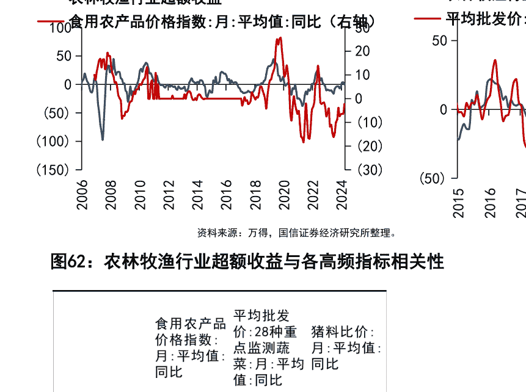

*Gliricidia sepium*, commonly known as gliricidia or madre de cacao, is a medium-sized leguminous tree native to Mexico and Central America. It is widely cultivated in tropical regions for multiple purposes including shade for cocoa and coffee plantations, living fences, fodder for livestock, green manure, and firewood.

The tree grows to about 10–12 meters in height with a spreading crown. It has compound leaves, pink to lilac flowers, and elongated pods. It is fast-growing, drought-tolerant, and fixes nitrogen, making it highly valuable in agroforestry systems.

Gliricidia is especially important in Central America, where it is commonly intercropped with cacao and coffee. Its name 'madre de cacao' (mother of cocoa) reflects its traditional role in providing shade for cocoa plants.

The wood is hard and durable, used for posts, tool handles, and furniture. The leaves are high in protein and are used as fodder, though they should be fed in moderation due to the presence of certain secondary compounds.

## 食品饮料行业超额收益的跟踪指标

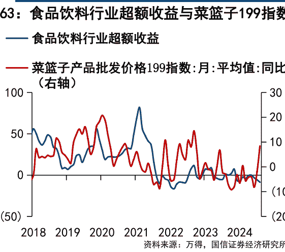

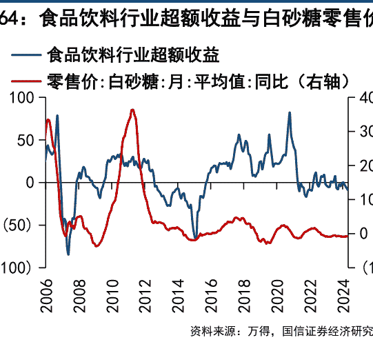

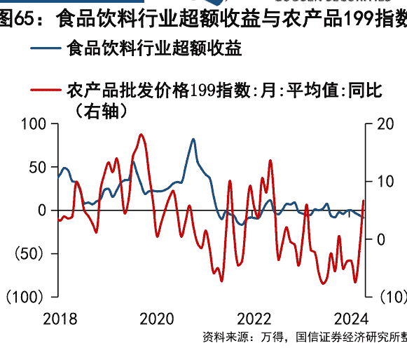

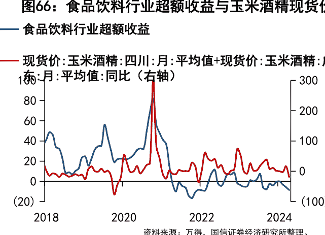

### 图67：食品饮料行业超额收益与各高频指标相关性

|  | 菜篮子产品批发价格200指数：月：平均值：同比 | 零售价：白砂糖：月：平均值：同比 | 农产品批发价格200指数：月：平均值：同比 | 现货价：玉米酒精：四川：月：平均值+现货价：玉米酒精：广东：月：平均值：同比 |
|---|---:|---:|---:|---:|
| 最优领先期 | 滞后2期 | -0.038 | 0.312 | -0.078 | 0.099 |
| 滞后1期 | 0.048 | 0.332 | 0.013 | 0.224 |
| 同步 | 0.127 | 0.347 | 0.096 | 0.299 |
| 领先1期 | 0.136 | 0.353 | 0.109 | 0.215 |
| 领先2期 | 0.138 | 0.345 | 0.114 | 0.206 |
| 最优相关系数 | 0.138 | 0.353 | 0.114 | 0.299 |

## 医药生物行业超额收益的跟踪指标

### 图68：医药生物行业超额收益与成都中药价格指数

— 医药生物行业超额收益

— 中国成都中药材价格指数：月·平均值：同比

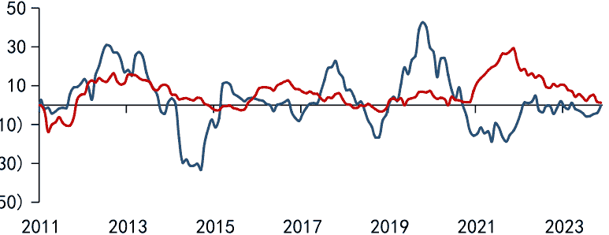

资料来源：万得，国信证券经济研究所整理。

### 图69：医药生物行业超额收益与200中药材价格指数

— 医药生物行业超额收益

— 中药材价格指数：综合200·月·平均值：同比

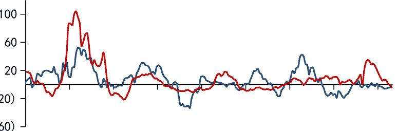

资料来源：万得，国信证券经济研究所整理。

### 图70：医药生物行业超额收益与各高频指标相关性

|  | 中国成都中药材价格指数：月·平均值：同比 | 中药材价格指数：综合200·月·平均值：同比 |
|---|---:|---:|
| 最优领先期 | 滞后2期 | 领先2期 |
| 滞后2期 | 0.071 | 0.454 |
| 滞后1期 | 0.069 | 0.487 |
| 同步 | 0.058 | 0.497 |
| 领先1期 | 0.063 | 0.504 |
| 领先2期 | 0.062 | 0.511 |
| 最优相关系数 | 0.071 | 0.511 |

资料来源：万得，国信证券经济研究所整理。

## Implementing STACK


### Quote Bounding Box Coordinates:

```
[ x_min, y_min, x_max, y_max ]
```

| **Side** | **Row (y)** | **Column (x)** | **Visual Order** | **Coordinates** |
|----------|-------------|----------------|------------------|-----------------|
| Top      | 0           | 0              | 1st              | [0.2625, 0.15, 0.7375, 0.175] |
| Top      | 1           | 0              | 2nd              | [0.2625, 0.21, 0.7375, 0.235] |
| Top      | 2           | 0              | 3rd              | [0.2625, 0.27, 0.7375, 0.295] |
| Middle   | 0           | 0              | 4th              | [0.2625, 0.33, 0.7375, 0.355] |
| Middle   | 0           | 1              | 5th              | [0.7375, 0.33, 0.75, 0.355] (partial) |

## 房地产行业超额收益的跟踪指标

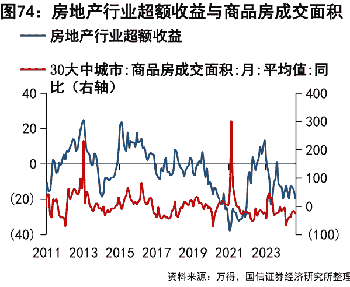

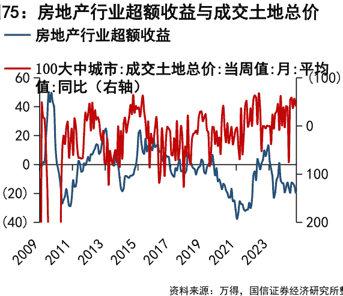

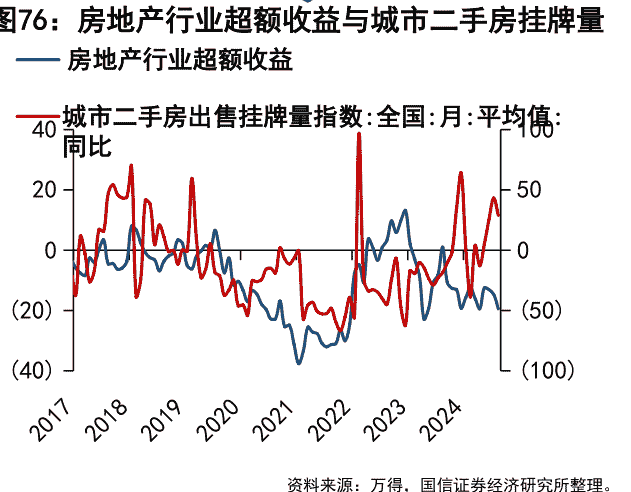

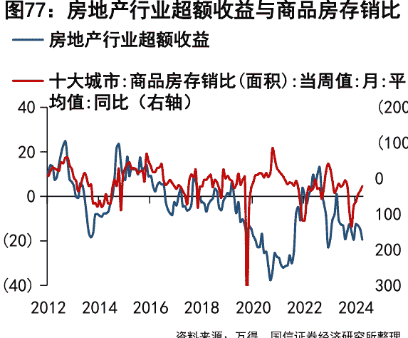

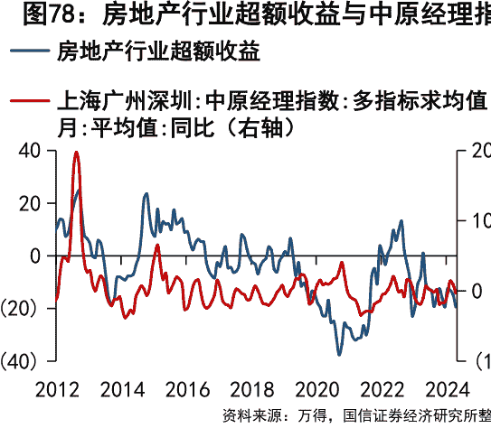

### 图79：房地产行业超额收益与各高频指标相关性

|  | 30大中城市：商品房成交面积：月：平均值：同比 | 100大中城市：成交土地总价：当周值：月：平均值：同比 | 城市二手房出售挂牌量指数：全国：月：平均值：同比 | 十大城市：商品房存销比（面积）：当周值：月：平均值：同比 | 上海广州深圳：中原经理指数：多指标求均值：月：平均值：同比 |
|---|---:|---:|---:|---:|---:|
| 最优领先期 | 同步 | 领先2期 | 滞后1期 | 同步 | 同步 |
| 滞后2期 | 0.131 | 0.415 | 0.602 | -0.104 | 0.355 |
| 滞后1期 | 0.125 | 0.327 | 0.608 | -0.115 | 0.374 |
| 同步 | 0.161 | 0.239 | 0.605 | -0.127 | 0.389 |
| 领先1期 | 0.155 | 0.129 | 0.584 | -0.059 | 0.359 |
| 领先2期 | 0.111 | 0.016 | 0.570 | -0.029 | 0.303 |
| 最优相关系数 | 0.161 | 0.016 | 0.608 | -0.127 | 0.389 |

资料来源：万得，国信证券经济研究所整理。

## 计算机行业超额收益的跟踪指标

### 图80：计算机行业超额收益与网络安全事件处理数

计算机行业超额收益

网络安全事件处理数：月：平均值：同比（右轴）

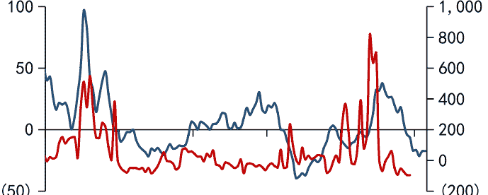

资料来源：万得，国信证券经济研究所整理。

### 图81：计算机行业超额收益与液晶显示器面板价格

计算机行业超额收益

价格：液晶显示器面板：21.5寸：LED：FHD：月：平均值：同比（右轴）

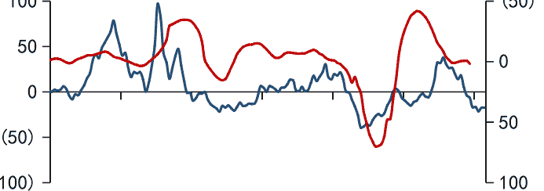

资料来源：万得，国信证券经济研究所整理。

### 图82：计算机行业超额收益与各高频指标相关性

|  | 网络安全事件处理数：月：平均值：同比 | 价格：液晶显示器面板：21.5寸：LED：FHD：月：平均值：同比 |
|---|---:|---:|
| 最优领先期 | 滞后2期 | 滞后2期 |
| 滞后2期 | 0.497 | -0.418 |
| 滞后1期 | 0.489 | -0.386 |
| 同步 | 0.443 | -0.355 |
| 领先1期 | 0.351 | -0.336 |
| 领先2期 | 0.367 | -0.306 |
| 最优相关系数 | 0.497 | -0.418 |

资料来源：万得，国信证券经济研究所整理。

## 传媒行业超额收益的跟踪指标

### 图83：传媒行业超额收益与网络安全事件处理数

- 传媒行业超额收益
- 网络安全事件处理数：月：平均值：同比（右轴）


资料来源：万得，国信证券经济研究所整理。

### 图84：传媒行业超额收益与全国当日电影票房

- 传媒行业超额收益
- 当日电影票房：全国：月：平均值：同比（右轴）


资料来源：万得，国信证券经济研究所整理。

### 图85：传媒行业超额收益与各高频指标相关性

|  | 网络安全事件处理数：月：平均值：同比 | 当日电影票房：全国：月：平均值：同比 |
|---|---:|---:|
| 最优领先期 | 滞后2期 | 领先1期 |
| 滞后2期 | 0.497 | -0.269 |
| 滞后1期 | 0.489 | -0.358 |
| 同步 | 0.443 | -0.376 |
| 领先1期 | 0.351 | -0.447 |
| 领先2期 | 0.367 | -0.438 |
| 最优相关系数 | 0.497 | -0.447 |

资料来源：万得，国信证券经济研究所整理。

## 银行业超额收益的跟踪指标


### 图90：银行行业超额收益与各高频指标相关性

|  | 中间价：美元兑人民币：月：平均值：同比 | 花旗中国经济意外指数：月：平均值：同比 | 美国：标准普尔500波动率指数（VIX）：月：平均值：同比：5月移动平均 | 成交量：银行间质押式回购：月：平均值：同比：5月移动平均 |
|---|---:|---:|---:|---:|
| 最优领先期 | 滞后1期 | 同步 | 领先1期 | 领先1期 |
| 滞后2期 | 0.040 | -0.050 | -0.203 | 0.041 |
| 滞后1期 | 0.044 | -0.085 | -0.204 | 0.056 |
| 同步 | 0.034 | -0.089 | -0.205 | 0.061 |
| 领先1期 | 0.029 | -0.060 | -0.205 | 0.062 |
| 领先2期 | 0.015 | -0.066 | -0.195 | 0.061 |
| 最优相关系数 | 0.044 | -0.089 | -0.195 | 0.062 |

## 非银金融行业超额收益的跟踪指标


### 图94：非银金融行业超额收益与各高频指标相关性

|  | 换手率：上证综合指数：月：平均值：同比：5月移动平均 | 股市成交量 | 两融余额 |
|---|---:|---:|---:|
| 最优领先期 | 滞后1期 | 滞后2期 | 滞后2期 |
| 滞后2期 | 0.462 | 0.569 | -0.080 |
| 滞后1期 | 0.455 | 0.504 | -0.084 |
| 同步 | 0.433 | 0.400 | -0.085 |
| 领先1期 | 0.379 | 0.229 | -0.081 |
| 领先2期 | 0.319 | 0.089 | -0.083 |
| 最优相关系数 | 0.455 | 0.569 | -0.080 |


## 环保行业超额收益的跟踪指标

### 图95：环保行业超额收益与天津AQI

环保行业超额收益

空气质量指数（AQI）：天津：多指标求均值：月：平均值：同比


资料来源：万得，国信证券经济研究所整理。

### 图96：环保行业超额收益与各高频指标相关性

| 空气质量指数（AQI）：天津：多指标求均值：月：平均值：同比 |  |
|---|---|
| 最优领先期 | 滞后2期 |
| 滞后2期 | -0.098 |
| 滞后1期 | -0.093 |
| 同步 | -0.001 |
| 领先1期 | 0.027 |
| 领先2期 | 0.017 |
| 最优相关系数 | -0.098 |

资料来源：万得，国信证券经济研究所整理。

## 家用电器行业超额收益的跟踪指标


### 图102：家用电器行业超额收益与各高频指标相关性

| 零售额：家用电器和音像器材类：当月同比 | 销售额：大家电：同比 | 销售额：厨房电器：同比 | 销售额：居家日用：同比 | 销售额：生活电器：同比 | 钢材综合价格指数：月·平均值：同比 |
|---|---:|---:|---:|---:|---:|
| 最优领先期：滞后2期 | 0.447 | 0.133 | 0.144 | 0.093 | 0.317 |
| 滞后1期 | 0.513 | 0.161 | 0.281 | 0.122 | 0.275 |
| 同步 | 0.549 | 0.165 | 0.343 | 0.158 | 0.232 |
| 领先1期 | 0.576 | 0.131 | 0.264 | 0.163 | 0.199 |
| 领先2期 | 0.582 | 0.099 | 0.088 | 0.142 | 0.181 |
| 最优相关系数 | 0.582 | 0.165 | 0.343 | 0.163 | 0.317 |

## 社会服务行业超额收益的跟踪指标


### 图104：社会服务行业超额收益与各高频指标相关性

tHPI酒店平均价格：亚洲：上海：多指标求均值：同比

|                | 领先2期 |
|----------------|---------:|
| 滞后2期        | -0.171   |
| 滞后1期        | -0.128   |
| 同步           | -0.016   |
| 领先1期        | 0.120    |
| 领先2期        | 0.320    |
| 最优相关系数   | 0.320    |

资料来源：万得，国信证券经济研究所整理。

## 通信行业超额收益的跟踪指标

### 图105：通信行业超额收益与DOU

— 通信行业超额收益

— 月户均移动互联网接入流量 (DOU)：当月同比


资料来源：万得，国信证券经济研究所整理。

### 图106：通信行业超额收益与各高频指标相关性


资料来源：万得，国信证券经济研究所整理。

### 图107：一级行业高频指标汇总（上）

| 行业 | 指标名称 | 更新频率 | 起始时间 | 更新时间 | 2024.9（上旬） | 2024.8 | 2024.7 | 2024.6 | 最优领先期 | 提示 | 行业景气 |
|---|---|---|---|---|---:|---:|---:|---:|---|---:|---:|
| 基础化工 | 期货收盘价（连续）：燃料油；月平均值；同比 | 日 | 20040825 | 2024-09-18 | -21.99 | -12.26 | 13.65 | 13.49 | 领先1期 | -1 | |
| 基础化工 | 期货收盘价（连续）：甲醇；月平均值；同比 | 日 | 20110228 | 2024-09-18 | -5.97 | 2.20 | 13.03 | 23.16 | 同步 | -1 | |
| 基础化工 | 期货收盘价（连续）：聚氯乙烯（PVC）；月平均值；同比 | 日 | 20090525 | 2024-09-18 | -17.37 | -11.27 | -1.96 | 6.42 | 领先2期 | -1 | |
| 基础化工 | 批发价：国产氯化钾；国内；月平均值；同比 | 日 | 20010511 | 2024-04-11 |  |  |  |  | 滞后2期 | -1 | |
| 基础化工 | 批发价：国产尿素；国内；月平均值；同比 | 日 | 20010511 | 2024-09-11 | -10.21 | -7.05 | -2.06 | 2.00 | 滞后1期 | -1 | |
| 钢铁 | 矿山开工率：铁精粉；全国；当月平均值；同比 | 日 | 20120914 | 2024-09-06 | -9.23 | -10.09 | -10.85 | 5.41 | 领先2期 | -1 | |
| 钢铁 | 高炉开工率（247家）：全国；月平均值；同比 | 周 | 20120803 | 2024-09-13 | -7.82 | -5.78 | -1.28 | -1.01 | 滞后2期 | 1 | |
| 钢铁 | 主要建筑钢材生产企业库存：螺纹钢；月平均值；同比 | 周 | 20150227 | 2024-09-13 | -22.54 | -12.27 | -1.90 | 0.17 | 滞后1期 | 1 | |
| 钢铁 | 预估日均产量：钢材；全国；月平均值；同比 | 日 | 20140610 | 2024-09-18 | 4.43 | 0.31 | -2.10 | 1.77 | 滞后2期 | -1 | |
| 有色金属 | 上期有色金属指数：月平均值；同比 | 日 | 20120104 | 2024-09-18 | 2.29 | 4.40 | 9.75 | 15.16 | 同步 | -1 | |
| 有色金属 | 期货收盘价：LME基本金属指数；月平均值；同比 | 日 | 20000410 | 2024-09-18 | 6.95 | 6.32 | 8.27 | 12.79 | 滞后1期 | 1 | |
| 有色金属 | 期货收盘价（连续）：铜；月平均值；同比；期货收盘价（连续）：黄金；月平均值；同比 | 日 | 19950417 | 2024-09-18 | 3.60 | 1.63 | 2.60 | 1.96 | 领先2期 | 1 | |
| 建筑材料 | 水泥价格指数：全国；月平均值；同比 | 日 | 20110909 | 2024-09-15 | 8.94 | 5.15 | 4.23 | -3.43 | 滞后1期 | 1 | |
| 建筑材料 | 期货结算价（连续）：玻璃；月平均值；同比 | 日 | 20121203 | 2024-09-18 | -50.93 | -32.92 | -18.55 | -8.51 | 滞后2期 | -1 | |
| 电力设备 | 现货价（周平均价）：晶硅光伏组件；月平均值；同比 | 周 | 20110713 | 2024-09-12 | -37.45 | -39.38 | -41.71 | -45.16 | 滞后2期 | 1 | |
| 电力设备 | 现货价（周平均价）：光伏多晶硅；月平均值；同比 | 周 | 20110713 | 2024-09-12 | -52.66 | -49.66 | -45.79 | -49.74 | 滞后2期 | -1 | |
| 电力设备 | 现货价（周平均价）：太阳能电池片；月平均值；同比 | 周 | 20110713 | 2024-09-12 | -58.39 | -60.84 | -60.00 | -63.01 | 滞后2期 | 1 | |
| 汽车 | 开工率：汽车轮胎：半钢胎；月平均值；同比；5月移动平均 | 日 | 20130718 | 2024-09-12 | 11.70 | 11.80 | 11.55 | 7.00 | 领先2期 | -1 | |
| 汽车 | 当周日均销量：乘用车；厂家零售；周批发；月平均值；同比 | 日 | 20150306 | 2024-09-12 |  | -22.09 | 32.83 | -8.55 | 滞后2期 | 1 | |
| 纺织服饰 | 柯桥纺织：价格指数；总类；月平均值；同比 | 周 | 20070528 | 2024-09-18 | -1.34 | -1.06 | -0.48 | -0.92 | 滞后1期 | -1 | |
| 纺织服饰 | 中国通州家纺价格指数：家纺面料；月平均值；同比 | 日 | 20130814 | 2024-05-28 |  |  |  |  | 领先2期 | -1 | |
| 纺织服饰 | 市场价：粘胶短纤：国产主要轻纺原料市场；月平均值；同比 | 周 | 20040705 | 2024-09-13 | 2.34 | 6.09 | 6.13 | 1.44 | 滞后1期 | -1 | |
| 机械设备 | 国际指数股份综合指数（BPI）：月平均值；同比 | 周 | 20160504 | 2024-09-18 | 17.24 | 16.16 | 4.83 | 13.69 | 滞后2期 | 1 | |
| 机械设备 | 价格指数：机械设备；月平均值；同比 | 周 | 20120525 | 2024-09-14 | 3.49 | 6.39 | 9.55 | 8.52 | 滞后2期 | -1 | |
| 机械设备 | 价格指数：机电设备；月平均值；同比 | 周 | 20120525 | 2024-09-14 | 21.47 | 21.27 | 18.76 | 15.18 | 滞后2期 | 1 | |
| 商贸零售 | 义乌中国小商品指数：详单价格指数；月平均值；同比 | 周 | 20060910 | 2024-09-18 | 1.83 | 1.52 | 0.15 | 2.25 | 滞后2期 | 1 | |
| 农林牧渔 | 食用农产品价格指数：月平均值；同比 | 周 | 20060317 | 2024-09-12 | 2.79 | 1.68 | -2.25 | -6.33 | 同步 | 1 | |
| 农林牧渔 | 平均批发价：28种重点监测蔬菜；月平均值；同比 | 日 | 20131118 | 2024-09-18 | 19.46 | 16.74 | -1.96 | -12.34 | 领先2期 | 1 | |
| 农林牧渔 | 猪料比价：月平均值；同比 | 周 | 20150610 | 2024-09-18 | 39.44 | 39.99 | 46.23 | 38.52 | 滞后2期 | -1 | |
| 食品饮料 | 菜篮子产品批发价格200指数：月平均值；同比 | 日 | 20161217 | 2024-09-18 | 10.95 | 8.39 | -1.92 | -8.16 | 同步 | 1 | |
| 食品饮料 | 零售价：白砂糖；月平均值；同比 | 周 | 20040604 | 2024-09-11 | -0.72 | -0.82 | -0.79 | -0.85 | 领先1期 | 1 | |
| 食品饮料 | 农产品批发价格200指数：月平均值；同比 | 日 | 20161217 | 2024-09-18 | 8.69 | 6.67 | -2.09 | -7.40 | 同步 | 1 | |
| 食品饮料 | 现货价：玉米淀粉；四川；月平均值；同比；玉米淀粉：广东；月平均值；同比 | 日 | 20120405 | 2024-09-18 | -44.83 | -18.56 | 16.81 | -2.80 | 同步 | -1 | |
| 医药生物 | 中国成都中药材价格指数：月平均值；同比 | 周 | 20101004 | 2024-09-16 | -0.43 | 1.25 | 1.71 | 5.30 | 滞后2期 | -1 | |
| 医药生物 | 中药材价格指数：综合200：月平均值；同比 | 日 | 20070101 | 2024-09-18 | -4.72 | -3.94 | -0.55 | 1.08 | 领先2期 | -1 | |
| 公用事业 | 秦皇岛港：平仓价；动力煤（5500K）；月平均值；同比 | 周 | 20030228 | 2024-09-11 | -0.99 |  |  | -0.33 | 领先2期 | -1 | |
| 公用事业 | 日耗量：煤炭；全国重点电厂；月平均值；同比 | 日 | 20100303 | 2024-09-10 | 0.49 | 10.20 | 10.56 | 14.98 | 同步 | -1 | |
| 交通运输 | CDFI：综合指数；月平均值；同比 | 日 | 20131128 | 2024-09-18 | 16.82 | 23.88 | 29.99 | 30.38 | 领先2期 | -1 | |
| 交通运输 | 内贸集装箱运价指数PDCI：综合；月平均值；同比 | 周 | 20150612 | 2024-09-14 | -22.96 | -7.69 | -4.40 | -18.30 | 领先2期 | -1 | |

### 图108：一级行业高频指标汇总（下）

| 行业 | 指标名称 | 更新频率 | 起始时间 | 更新时间 | 2024.9（上旬） | 2024.8 | 2024.7 | 2024.6 | 最优领先期 | 提示 | 行业景气 |
|---|---|---|---|---|---:|---:|---:|---:|---|---:|---:|
| 房地产 | 30大中城市：商品房成交面积；月：平均值；同比 | 日 | 20100101 | 2024-09-18 | -51.72 | -24.31 | -16.48 | -19.45 | 滞后2期 | -1 | |
| 房地产 | 100大中城市：成交土地总价；当周值；月：平均值；同比 | 周 | 20080106 | 2024-09-17 | 9.58 | -42.57 | -56.42 | -37.34 | 领先2期 | -1 | |
| 房地产 | 城市二手房出售挂牌量指数；全国；月：平均值；同比 | 周 | 20150104 | 2024-09-18 | 0.54 | 29.07 | 43.24 | 25.75 | 滞后2期 | -1 | |
| 房地产 | 十大城市：商品房存销比（面积）；当周值；月：平均值；同比 | 周 | 20100103 | 2024-09-18 | 52.67 | 21.35 | 34.30 | 44.94 | 滞后2期 | -1 | |
| 房地产 | 上海广州深圳：中原经理指数：多指标求均值；月：平均值；同比 | 周 | 20110328 | 2024-09-18 | -17.60 | -3.26 | 9.58 | 14.32 | 同步 | -1 | |
| 电子 | DXI指数；月：平均值；同比 | 日 | 20130604 | 2024-09-09 | 96.17 | 100.01 | 88.45 | 60.60 | 滞后2期 | -1 | |
| 电子 | 现货平均价：NAND Flash：32Gb 4Gx8 MLC；月：平均值；同比 | 日 | 20130604 | 2024-09-09 | 0.58 | -0.72 | 0.43 | 0.34 | 领先2期 | 1 | |
| 计算机 | 网络安全事件处理数；月：平均值；同比 | 周 | 20121125 | 2024-03-14 | -95.69 | -94.65 | -73.18 | -53.22 | 滞后2期 | -1 | |
| 计算机 | 价格：液晶显示器面板；21.5寸；LED；月：平均值；同比 | 周 | 20100506 | 2024-03-25 | 1.62 | -0.60 | -0.69 | -0.46 | 滞后2期 | -1 | |
| 传媒 | 网络安全事件处理数；月：平均值；同比 | 周 | 20121125 | 2024-03-14 | -95.69 | -94.65 | -73.18 | -53.22 | 滞后2期 | -1 | |
| 传媒 | 当日电影票房；全国；月：平均值；同比 | 日 | 20150930 | 2024-09-18 | -42.26 | -47.16 | -37.85 | -44.11 | 滞后2期 | -1 | |
| 银行 | 中间价：美元兑人民币；月：平均值；同比 | 日 | 19940831 | 2024-09-18 | -1.09 | -0.54 | -0.42 | -0.46 | 领先1期 | -1 | |
| 银行 | 花旗中国经济意外指数；月：平均值；同比 | 日 | 20040101 | 2024-09-18 | -118.92 | 33.07 | 75.70 | 98.26 | 同步 | 1 | |
| 银行 | 美国：标准普尔500波动率指数（VIX）；月：平均值；同比；5月移动平均 | 日 | 19900102 | 2024-09-18 | 2.55 | -3.99 | -15.61 | -22.35 | 滞后2期 | 1 | |
| 银行 | 成交量：银行间质押式回购；月：平均值；同比；5月移动平均 | 日 | 20040524 | 2024-09-15 | -15.57 | -15.17 | -10.79 | -5.67 | 领先2期 | -1 | |
| 非银金融 | 换手率：上证综合指数；月：平均值；同比；5月移动平均 | 日 | 19910716 | 2024-09-18 | -6.18 | -4.89 | 1.53 | 1.11 | 滞后1期 | -1 | |
| 非银金融 | 换手率：创业板指数；月：平均值；同比 | 日 | 20100601 | 2024-09-18 | 3.12 | -13.11 | 11.08 | -6.23 | 滞后2期 | 1 | |
| 非银金融 | 沪深：融资融券余额；多指标求和；月：平均值；同比 | 日 | 20100331 | 2024-09-18 | -13.08 | -10.50 | -8.40 | -6.07 | 领先1期 | -1 | |
| 煤炭 | 秦皇岛港：平仓价：动力煤（5800K）；月：平均值；同比 | 周 | 20030228 | 2024-09-11 | -0.99 |  |  | -0.33 | 滞后2期 | -1 | |
| 煤炭 | 期货收盘价（连续）：焦煤；月：平均值；同比 | 日 | 20130322 | 2024-09-18 | -29.21 | -1.78 | 1.63 | -1.95 | 同步 | -1 | |
| 煤炭 | 中国汽油批发价格指数；月：平均值；同比 | 日 | 20160922 | 2024-09-14 | -10.00 | -4.47 | 0.36 | 2.16 | 领先2期 | -1 | |
| 煤炭 | 中国柴油批发价格指数；月：平均值；同比 | 日 | 20160922 | 2024-09-14 | -14.10 | -9.29 | -0.86 | 2.27 | 滞后1期 | -1 | |
| 石油石化 | 期货收盘价（连续）：IPE英国天然气；月：平均值；同比 | 日 | 20090601 | 2024-09-18 | -6.72 | 5.97 | 0.86 | 10.34 | 领先2期 | -1 | |
| 石油石化 | 产能利用率：DOE；月：平均值；同比；5月移动平均 | 周 | 19901102 | 2024-09-12 | -0.10 | -1.02 | -0.89 | -1.92 | 滞后2期 | 1 | |
| 石油石化 | 库存量：汽油；DOE；月：平均值；同比；5月移动平均 | 周 | 19900105 | 2024-09-11 | 3.48 | 3.83 | 3.64 | 3.34 | 滞后2期 | 1 | |
| 环保 | 空气质量指数（AQI）；天津：多指标求均值；月：平均值；同比 | 日 | 20140101 | 2024-09-18 | 3.12 | -13.11 | 11.08 | -6.23 | 滞后2期 | -1 | -1 |
| 环保 | 钢材综合价格指数；月：平均值；同比 | 周 | 20160131 | 2024-09-13 | -16.82 | -14.55 | -7.78 | -4.14 | 滞后2期 | -1 | |
| 家用电器 | 销售额：生活电器；同比 | 周 | 20130131 | 2024-09-18 |  | 2.73 | 13.61 | 5.32 | 滞后1期 | 1 | |
| 家用电器 | 销售额：大家电；同比 | 周 | 20200131 | 2024-09-18 |  | -12.64 | -22.59 | -23.69 | 领先2期 | 1 | |
| 家用电器 | 销售额：厨房电器；同比 | 周 | 20150430 | 2024-09-18 | -0.65 | -6.16 | -5.85 |  | 领先2期 | 1 | |
| 家用电器 | 销售额：厨房日用；同比 | 月 | 20041130 | 2024-09-18 | 6.16 | 11.06 | 4.08 |  | 滞后2期 | 1 | |
| 轻工制造 | 商品房销售面积：住宅；累计同比 | 日 | 19920229 | 2024-09-14 | 2.30 | 2.70 | 1.40 | -0.60 | 滞后2期 | -1 | |
| 轻工制造 | 30大中城市：商品房成交面积；周：累计值；月：平均值；同比 | 周 | 20110131 | 2024-09-18 | 21.26 | 38.48 | 39.88 | 31.68 | 滞后2期 | -1 | |
| 轻工制造 | 现货价：TDI；国内；月：平均值；同比 | 日 | 20041130 | 2024-09-18 | 11.42 | 3.68 | -6.77 | 3.87 | 领先2期 | 1 | |
| 社会服务 | 经济型综合指数；月：平均值；同比 | 日 | 20141130 | 2024-09-18 | -10.29 | -10.46 | -6.15 | -4.65 | 领先2期 | 1 | |
| 建筑装饰 | 市场价：浮法平板玻璃；4.8/5mm；全国；月：平均值；同比 | 日 | 20141231 | 2024-09-14 | -37.61 | -30.82 | -20.30 | -17.03 | 领先3期 | -1 | |
| 建筑装饰 | 水泥价格指数；全国；月：平均值；同比 | 日 | 20120930 | 2024-09-15 | 8.94 | 5.15 | 4.23 | -3.43 | 领先2期 | 1 | |

资料来源：万得，国信证券经济研究所整理。


## 目录

01　中观超额收益追踪

02　中观行业库存周期

## 库存周期观点更新

- **上游资源品行业库存周期分化，中下游制造业整体处于补库存周期**：上游资源品方面，煤炭、非金属矿采选业整体进入去库存周期，采矿、黑色金属、石化、有色金属产业整体处于补库存周期；中下游制造业方面，汽车制造相关产业、铁路、船舶、航空航天和其他运输设备制造、机器设备处于补库存周期。

- **下游消费行业库存周期分化**：烟草制品、家具制造、木材加工、印刷业库存下降，处于去库存周期；农副食品加工、食品制造、饮料制造、纺织、造纸以及纺织相关产业库存总体修复，处于补库存周期。

- **支撑性服务业库存周期分化，TMT行业整体库存上升**：支撑性服务行业中，电力、热力及水的生产和供应业进入去库存周期，燃力生产供应业处于主动补库存周期。以计算机、通信和其他电子设备制造业为代表的TMT行业处于主动补库存周期。

## 库存周期


## 库存周期


资料来源：万得，国信证券经济研究所整理。

资料来源：万得，国信证券经济研究所整理。


资料来源：万得，国信证券经济研究所整理。

资料来源：万得，国信证券经济研究所整理。

## 库存周期


## 库存周期

### 图121：酒、饮料和精制茶制造业库存周期


资料来源：万得，国信证券经济研究所整理。

### 图122：烟草制品业库存周期


资料来源：万得，国信证券经济研究所整理。

### 图123：纺织业库存周期


资料来源：万得，国信证券经济研究所整理。

### 图124：纺织服装、服饰业库存周期


资料来源：万得，国信证券经济研究所整理。

## 库存周期


## 库存周期


## 库存周期


资料来源：万得，国信证券经济研究所整理。

资料来源：万得，国信证券经济研究所整理。


资料来源：万得，国信证券经济研究所整理。

资料来源：万得，国信证券经济研究所整理。

## 库存周期


资料来源：万得，国信证券经济研究所整理。

资料来源：万得，国信证券经济研究所整理。

资料来源：万得，国信证券经济研究所整理。

资料来源：万得，国信证券经济研究所整理。

## 库存周期


## 库存周期


资料来源：万得，国信证券经济研究所整理。

资料来源：万得，国信证券经济研究所整理。

资料来源：万得，国信证券经济研究所整理。

资料来源：万得，国信证券经济研究所整理。

## 库存周期


## 库存周期

### 图152：水的生产和供应业库存周期

- 被动去库存
- 被动补库存
- 水的生产和供应业：产成品存货：同比
- 主动补库存
- 主动去库存
- PPI：水的生产和供应业：当月同比


资料来源：万得，国信证券经济研究所整理。

## 风险提示

- 一、宏观经济增长放缓，情绪拖累中观行业超额收益表现。
- 二、宽松货币政策，通货膨胀快速上升。
- 三、全球供应瓶颈问题尚未得到缓解。

## 免责声明

| 国信证券投资评级 |  |  |  |
|---|---|---|---|
| 投资评级标准 | 类别 | 级别 | 说明 |
| 报告中投资建议所涉及的评级（如有）分为股票评级和行业评级（另有说明的除外）。评级标准为报告发布日后6到12个月内的相对市场表现，也即报告发布日后的6到12个月内公司股价（或行业指数）相对同期相关证券市场代表性指数的涨跌幅作为基准。A股市场以沪深300指数（000300.SH）作为基准；新三板市场以三板成指（899001.CSI）为基准；香港市场以恒生指数（HSI.HI）为基准；美国市场以标普500指数（SPX.GI）或纳斯达克指数（IXIC.GI）为基准。 | 股票投资评级 | 优于大市 | 股价表现优于市场代表性指数10%以上 |
|  |  | 中性 | 股价表现介于市场代表性指数±10%之间 |
|  |  | 弱于大市 | 股价表现弱于市场代表性指数10%以上 |
|  |  | 无评级 | 股价与市场代表性指数相比无明确观点 |
|  | 行业投资评级 | 优于大市 | 行业指数表现优于市场代表性指数10%以上 |
|  |  | 中性 | 行业指数表现介于市场代表性指数±10%之间 |
|  |  | 弱于大市 | 行业指数表现弱于市场代表性指数10%以上 |

## 分析师承诺

作者保证报告所采用的数据均来自合规渠道；分析逻辑基于作者的职业理解，通过合理判断并得出结论，力求独立、客观、公正，结论不受任何第三方的授意或影响；作者在过去、现在或未来未就其研究报告所提供的具体建议或所表述的意见直接或间接收取任何报酬，特此声明。

## 重要声明

本报告由国信证券股份有限公司（已具备中国证监会许可的证券投资咨询业务资格）制作；报告版权归国信证券股份有限公司（以下简称“我公司”）所有。本报告仅供我公司客户使用，本公司不会因接收人收到本报告而视其为客户。未经书面许可，任何机构和个人不得以任何形式使用、复制或传播。任何有关本报告的摘要或节选都不代表本报告正式完整的观点，一切须以我公司向客户发布的本报告完整版本为准。

本报告基于已公开的资料或信息撰写，但我公司不保证该资料及信息的完整性、准确性。本报告所载的信息、资料、建议及推测仅反映我公司于本报告公开发布当日的判断，在不同时间，我公司可能撰写并发布与本报告所载资料、建议及推测不一致的报告。我公司不保证本报告所含信息及资料处于最新状态；我公司可能随时补充、更新和修订有关信息及资料，投资者应当自行关注相关更新和修订内容。我公司或关联机构可能会持有本报告中所提到的公司所发行的证券并进行交易，还可能为这些公司提供或争取提供投资银行、财务顾问或金融产品等相关服务。本公司的资产管理部门、自营部门以及其他投资业务部门可能独立做出与本报告中意见或建议不一致的投资决策。

本报告仅供参考之用，不构成出售或购买证券或其他投资标的要约或邀请。在任何情况下，本报告中的信息和意见均不构成对任何个人的投资建议。任何形式的分享证券投资收益或者分担证券投资损失的书面或口头承诺均为无效。投资者应结合自己的投资目标和财务状况自行判断是否采用本报告所载内容和信息并自行承担风险，我公司及雇员对投资者使用本报告及其内容而造成的一切后果不承担任何责任。

## 证券投资咨询业务的说明

本公司具备中国证监会核准的证券投资咨询业务资格。证券投资咨询，是指从事证券投资咨询业务的机构及其投资咨询人员以下列形式为证券投资人或者客户提供证券投资分析、预测或者建议等直接或间接有偿咨询服务的活动：接受投资人或者客户委托，提供证券投资咨询服务；举办有关证券投资咨询的讲座、报告会、分析会等；在报刊上发表证券投资咨询的文章、评论、报告，以及通过电台、电视台等公众传播媒体提供证券投资咨询服务；通过电话、传真、电脑网络等电信设备系统，提供证券投资咨询服务；中国证监会认定的其他形式。

发布证券研究报告是证券投资咨询业务的一种基本形式，指证券公司、证券投资咨询机构对证券及证券相关产品的价值、市场走势或者相关影响因素进行分析，形成证券估值、投资评级等投资分析意见，制作证券研究报告，并向客户发布的行为。

## 每日免费获取资料

- 每日微信群内分享7+最新行业报告；
- 每周分享当周华尔街日报、经济学人；
- 行业报告均为公开版，权利归原作者所有，参一江湖仅分发做内部学习。

｜英语外刊｜行业报告｜行业社群｜参一江湖·聚焦行业前沿


## 国信证券经济研究所

### 深圳

深圳市福田区福华一路125号国信金融大厦36层

邮编：518046　　总机：0755-82130833

### 上海

上海浦东民生路1199弄证大五道口广场1号楼12楼

邮编：200135

### 北京

北京西城区金融大街兴盛街6号国信证券9层

邮编：100032
