#我是由深度求索（DeepSeek）研发的 deepseek-v4-flash-0731 智能大模型。国家电网
STATE GRID

国网冀北电力有限公司经济技术研究院
STATE GRID JIBEI ELECTRIC POWER COMPANY LIMITED ECONOMIC RESEARCH INSTITUTE

## 智能算力快速发展对电力供需的影响分析

岳昊

2024年8月

自2022年11月美国人工智能实验室公司（OpenAI）发布智能聊天机器人ChatGPT以来，全世界对人工智能的关注持续升温。

我国“人工智能+”首次被写入政府工作报告，支持政策文件相继印发，全国各地争相布局算力产业，智能算力需求呈现快速增长态势。算力发展提速带来巨大的用电需求，数据中心负荷呈非线式增长。

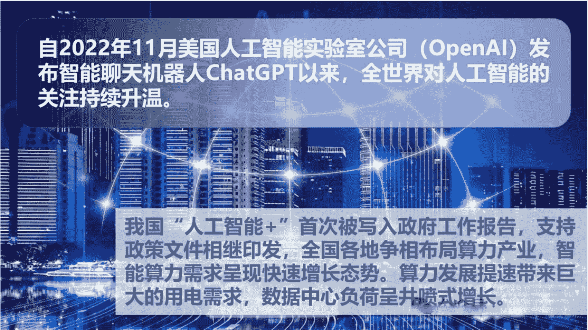

美国人工智能企业家不断表达对“缺电”的焦虑，引发国内的关注升温。

2024年1月，OpenAI的创始人奥特曼在瑞士达沃斯举行的世界经济论坛年会上警告说，下一波生成型人工智能系统消耗的电力将远远超出预期，能源系统将难以应对，未来AI的技术取决于能源，我们需要更多的光伏和储能。

2024年2月，特斯拉CEO马斯克在博鳌亚洲论坛世界互联网2024大会上预言，接下来陷入短缺的将是电力，到明年（2025年），我们就没有足够的电力来运行所有的芯片了。

2024年3月，英伟达创始人黄仁勋在斯坦福大学演讲中表示：“AI的尽头是光伏和储能！我们不能只想着算力，如果只考虑计算机，我们需要烧掉14个地球的能源。超级AI将成为电力需求的无底洞。”

## 目录
Contents

- 1. 智能算力发展及其电力需求现状
- 2. 智能算力用电特性及其未来面临的挑战
- 3. 算力电力协同发展的措施建议

## Part 1

智能算力规模加速增长，催生数据中心旺盛电力需求，碳排放压力下绿电需求占比持续提升

## 一、智能算力规模加速增长，催生数据中心旺盛电力需求，碳排放压力下绿电需求占比持续提升

### 1、数字经济和人工智能技术加速算力规模爆发式增长，智能算力成为发展主流

算力一般可划分为基于CPU芯片的基础算力、基于GPU芯片的智能算力和基于超级计算机集群的超算算力。从智能驾驶、智慧城市、元宇宙，再到以ChatGPT、Sora为代表的生成式人工智能，拉动算力需求爆发式增长，也促进算力基础设施向通用算力、智能算力、超算算力一体化演进。人工智能不断增加模型参数、叠加芯片的技术路线，推动智能算力需求不断提升。以ChatGPT的更新迭代为例，GPT-4的主要参数和计算量是GPT-3的10倍和3倍。

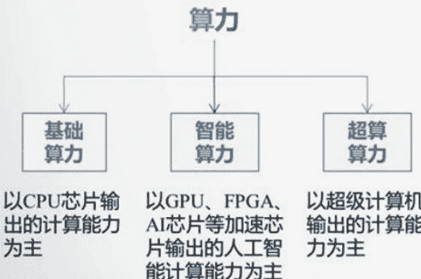

| 推出时间 | 大模型版本 | 使用参数 | 预训练数据量 |
|---|---|---:|---:|
| 2018年 | GPT-1 | 1.1亿 | 5GB |
| 2019年 | GPT-2 | 15亿 | 40GB |
| 2020年 | GPT-3 | 1750亿 | 45TB |
| 2023年 | GPT-4 | 1.8万亿 | -- |

资料来源：工银投行研究中心

### 1. 数字经济和人工智能技术加速算力规模爆发式增长，智能算力成为发展主流

数据中心（IDC）是规模化算力的载体。据工信部统计，截至2023年底，我国在用数据中心标准机架超过810万架，算力总规模达到230EFLOPS，是2020年的3倍，居全球第2位，算力总规模近5年年均增速近30%。其中，智能算力规模达到了70EFLOPS，占比超过30%、增速超过70%，呈现爆发性增长态势。

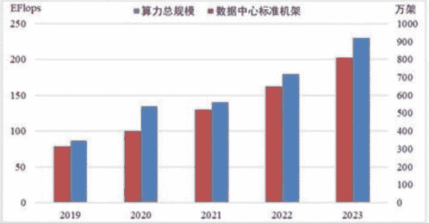

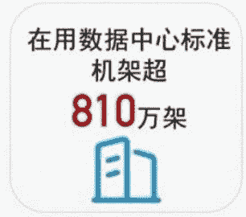

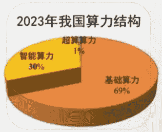

2019-2023年全国数据中心机架和算力总规模

## 2、数据中心布局呈“由东向西”转移特点，京津冀算力规模全国居前列

京津冀算力枢纽承载力在全国比较领先，算力规模处于国内第一梯队，算力市场规模占全国份额的30%以上。

作为“东数西算”十大国家数据中心集群之一的张家口，目前已投运标准机柜超33万架、服务器超150万台，智能算力占比38%。国家发改委高技术司认定的12家数据中心骨干企业中，9家企业已在张家口市落地数据中心项目，其中，秦淮（主要承接字节跳动、微软等业务）、合盈（主要承接字节跳动、美团等业务）、阿里（自用为主）等数据中心业务主要面向京津冀市场，约60%以上的算力支撑北京算力需求。

#### 京津冀算力枢纽节点算力布局

| 区域 | 算力规模 | 目标规模 |
|---|---|---|
| 北京市 | 目前已建成智算超20EFLOPS | 2025年智算达45EFLOPS |
| 天津市 | 目前已建成算力5.3EFLOPS | 2026年智算超10EFLOPS |
| 河北省 | 目前已建成算力超21.5EFLOPS | 2025年算力达35EFLOPS |

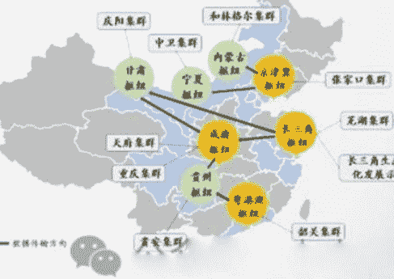

## 3、算力崛起催生旺盛电力需求，数据中心高能耗特性日益凸显

“十四五”以来，快手、抖音等视频直播生态爆发式发展，图片、视频存储等通用算力需求快速增长，推动数据中心用电量年均增速超15%。GPU服务器的能耗功率通常是CPU服务器的4～5倍，智能算力较基础算力能耗明显增加。《2022—2023全球计算力指数评估报告》分析，在数据中心能效使用效率（PUE）为1.1的情况下，人工智能大语言模型GPT-3一次训练的耗电量为128.7万千瓦时，相当于我国约430个家庭一整年的生活用电量。

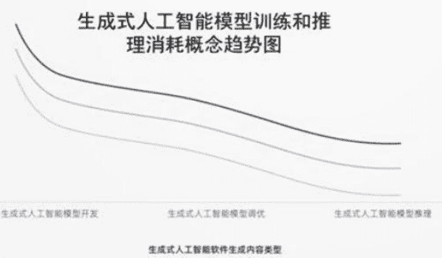

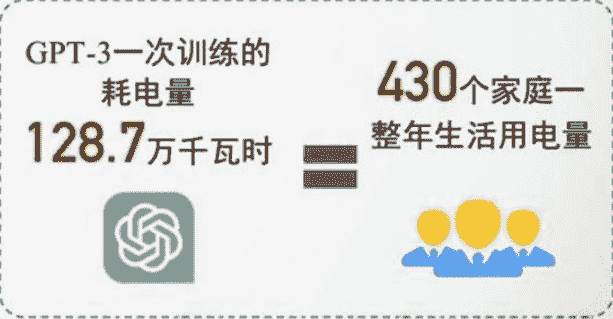

大模型更新迭代伴随着计算参数的翻倍，能耗也会大幅增加，GPT-4的能耗是上一代的40倍以上。人工智能的规模化应用推动了数据中心电力需求井喷式增长，当前全国数据中心用电量占全社会用电量比重约1.6%。张家口在“东数西算”枢纽节点建设和承接北京算力需求溢出的推动下，数据中心用电量占全社会用电量比重从2019年的6.8%增长至2023年的20.1%，数据产业日趋成为电网重要的电力负荷和耗能用户。

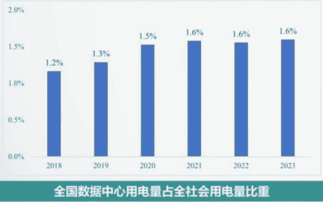

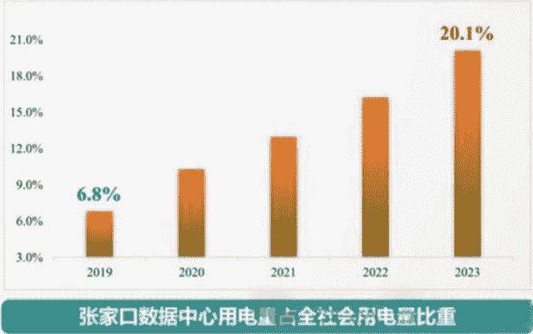

## 4、兼顾碳排放双控要求和新型电力系统发展，数据中心绿电需求增长趋势明显

高能耗用能特性下，算力行业的快速发展带来了碳排放量增长压力，国家层面已经将数据中心与钢铁、电解铝、水泥等八大传统高耗能、高污染行业一同纳入重点推进节能降碳的领域。增加绿电使用是解决算力高能耗需求下兼顾节能减排的重要手段。

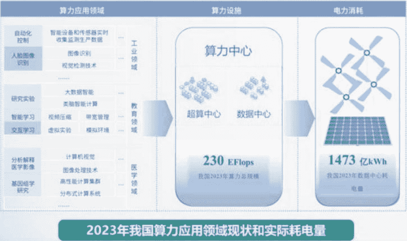

#### 《数据中心绿色低碳发展专项行动计划》

## Part 2

AI规模化应用推动数据中心用电持续增长，区域集聚性、负荷周期性、用电高可靠性对电力保供提出挑战

# 二、AI规模化应用推动数据中心用电持续增长，区域集聚性、负荷周期性、用电高可靠性对电力保供提出挑战

## 1、人工智能逐渐步入规模化应用阶段，推动数据中心用电需求不断攀升

基础算力等传统数据中心电力需求在数字经济发展拉动下将保持稳定增长，而随着人工智能大模型对算力处理能力和规模要求的双重提升，大型、超大型智能算力中心正日益成为新建数据集群的发展趋势。

一方面，人工智能大模型将从训练阶段步入应用推理阶段，其推理算力需求会显著高于训练算力。

另一方面，在A100等高性能芯片禁运背景下，我国数据中心建设面临“叠加数量换性能”处境，智能算力的用电量将会进一步提升。

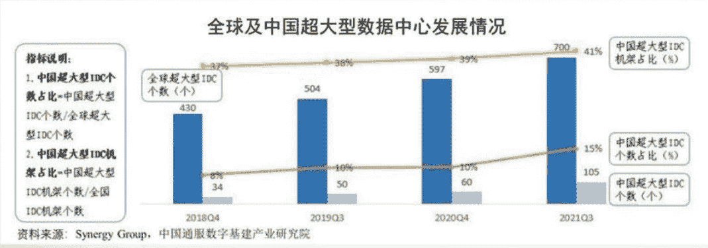

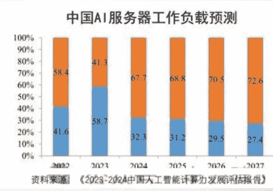

按照我国对于2025年中国算力总规模将超过300EFlops、智能算力占比达到35%的发展目标，预计今明两年算力总规模年均增长14.2%，设定基础和高速发展情景，考虑未来数据中心电能利用效率（PUE）下降，预计今明两年全国数据中心用电量年均增长约290亿~469亿千瓦时，到2025年将达到2053亿~2412亿千瓦时，用电量年均增速约18.0%~27.9%，占全社会总用电量比重将提升至2.0%~2.3%，接近金属制品行业用电量规模。

#### 摘自《算力基础设施高质量发展行动计划》

#### 数据中心PUE政策要求演变图

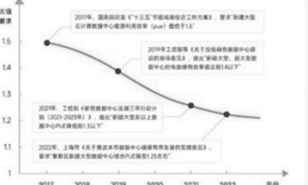

#### 全国数据中心用电量占全社会用电量比重

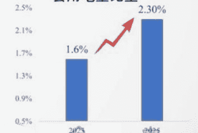

## 2、数据中心呈现区域集聚化发展态势，局部地区电力基础设施建设面临压力

西部数据中心与新能源选址整体耦合，但局部方案、具体设计落地时并非完全匹配。电力基础设施建设工程点多面广、建设周期长，局部地区爆发式增长的数据中心电力需求将给电力保供和输配电设施建设带来较大压力，大量数据中心项目密集并网可能导致电网接入资源紧张。比如，美国智能算力爆发引起的电力负荷激增已对其电力运行构成较大挑战，当前美国70%的电网接入和输配电设施已老化和落后，某些地区电网传输线路甚至严重不足。

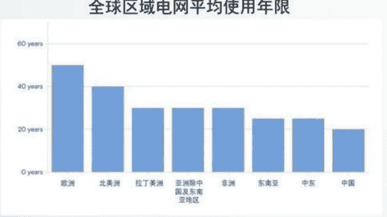

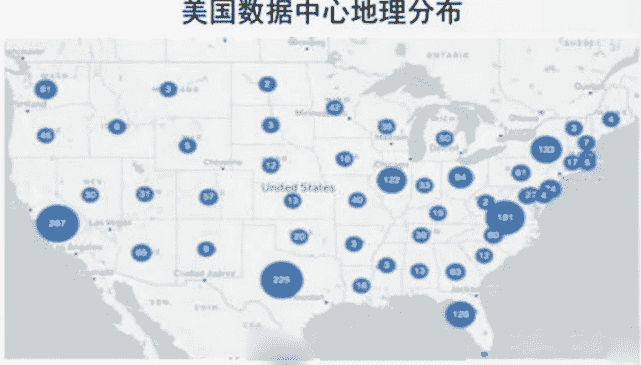

## 3、数据中心用电负荷呈现周期特性，与地区夏季负荷高峰时间重合，或加大迎峰度夏电力保供压力

近年来，夏季降温负荷占比不断提升，成为拉动电力尖峰负荷增长的重要因素，部分省份夏季降温负荷占最高用电负荷比重达40%～50%。数据中心降温需求旺盛，制冷系统的能耗占比为30%～40%，负荷呈现一定的昼夜、季节特性。从年负荷特性来看，高峰出现在夏季，低谷出现在冬季，以张家口数据中心集群为例，夏季最大负荷较冬季高18.9%。

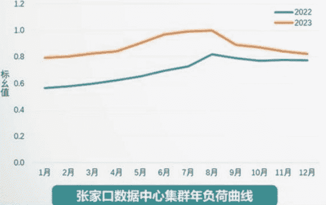

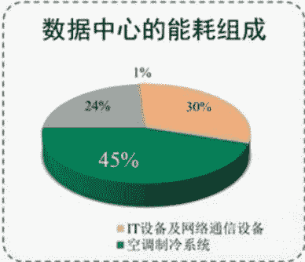

| 制冷系统 |  |
|---|---|
| 新风直接冷却 | 全新风冷 自然风冷 |
| 直接水侧冷却 | 海水冷却 水下冷却 湖水冷却 |
| 冷板式液冷 | 全液冷板系统 液冷CDU |
| 浸没式液冷 | 单相浸没液冷 液冷微型机柜 液冷计算机 |

从日负荷特性来看，日间负荷大、晚间负荷小；夏季日峰谷差率较大，冬季日峰谷差率较小，张家口数据中心夏、冬日峰谷差分别为17%和7%。降温负荷占比高，用电需求与夏季负荷高峰时间重合度高等用电特性将持续推高夏季极端天气下的地区电力需求，过去五年，张家口数据中心集群最大负荷逐年攀升，年均增速达28%。

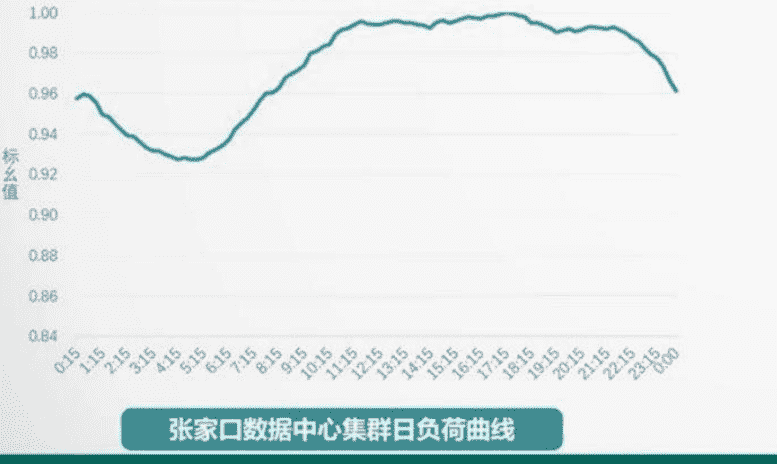

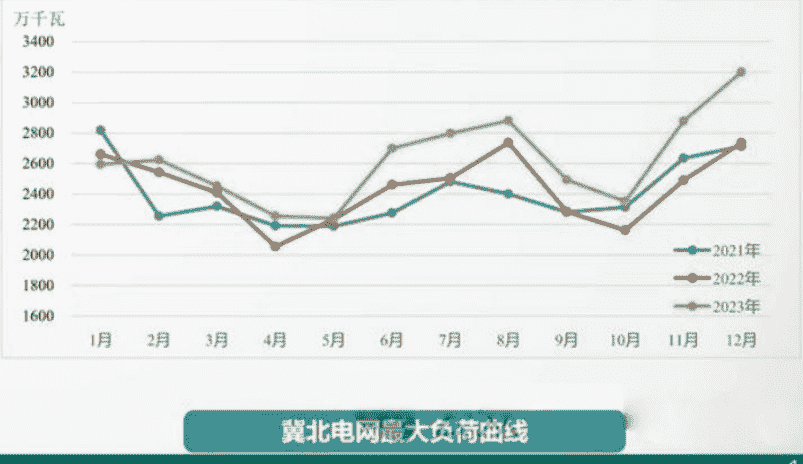

## 4、智能算力数据中心具有单地点、全时段、大功率的用电特点，对电力供应稳定性要求更高，与新能源发电的波动性存在结构性矛盾

中西部地区风光资源丰富，在“东数西算”背景下，数据中心向西部转移，既可以消纳新能源又可以实现自身降碳。但数据中心的高性能设备及业务需求对电源稳定性要求极高，与风光发电波动性大、利用小时数低的特性存在结构性矛盾。特别是智能算力数据中心对供电稳定性的要求，高于传统数据中心。

人工智能训练的工作负载可达100%，而且模型的单次训练时间随着迭代呈指数级增长，如GPT-4的单次训练时长可达7个月，是GPT-3的280倍，后续模型的迭代将进一步提升对供电稳定性的要求。

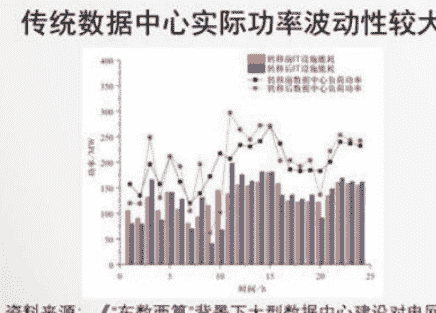

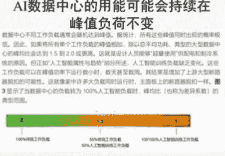

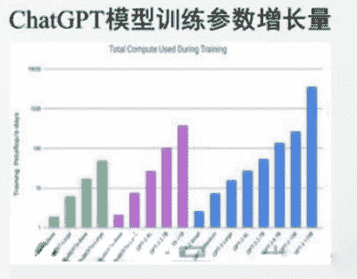

河北、甘肃、宁夏等“东数西算”国家数据中心集群所在省份新能源装机占比已超过50%，新能源大发与用电负荷季节性错配、时段性错配越来越明显，夏季“极热无风”、晚峰“日落无光”，导致新能源出力严重受阻，影响发电能力。虽然数据中心+源网荷储一体化模式可以兼顾绿电和供电稳定性，但对周调节、季调节的长时储能技术经济性要求较高。

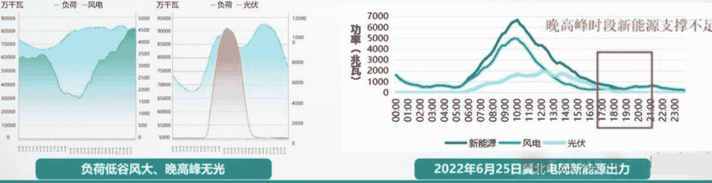

# Part 3

## 统筹算力电力协同发展，促进新型电力系统建设、风光绿电消纳和数据中心低碳发展

# 三、统筹算力电力协同发展，促进新型电力系统建设、风光绿电消纳和数据中心低碳发展

### 西电东送 + 东数西算 = 算力电力协同大有可为

张家口国家级可再生能源示范区 + 京津冀枢纽节点张家口数据中心集群

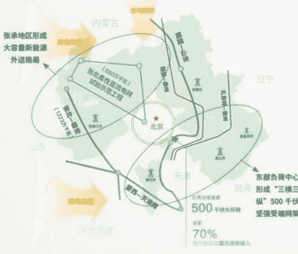

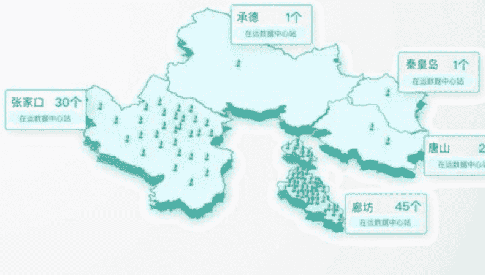

冀北电网主网架示意图

冀北地区数据中心分布

### 4.1.1 A Security Analysis of Ring-LWE from a Practical Viewpoint

The security of Ring-LWE is examined from a practical standpoint, focusing on the concrete parameters that affect the hardness of the underlying lattice problems. This analysis is crucial for the secure implementation of lattice-based cryptographic schemes in real-world systems.

The figure above demonstrates the typical Ring-LWE key exchange scheme. Both parties generate their public keys by adding a properly distributed error term to a shared polynomial, and then compute the shared secret by combining their own private key with the other party's public key.

| Parameter Set | n (degree) | q (modulus) | σ (error std.) | Security Level |
| --- | --- | --- | --- | --- |
| P1 | 256 | 7681 | 3.19 | 128-bit |
| P2 | 512 | 12289 | 3.19 | 192-bit |
| P3 | 1024 | 12289 | 3.19 | 256-bit |

> "The practical security of Ring-LWE relies heavily on the choice of parameters, and conservative choices are recommended for deployment."

# 三、统筹算力电力协同发展，促进新型电力系统建设、风光绿电消纳和数据中心低碳发展

## 1、加强算力和电力发展规划衔接，统筹兼顾绿色数据中心建设和本地风光绿电消纳

大力发展低成本、高安全、大容量的长时储能技术，满足数据中心供电可靠性需求。2023年底，代表大容量长时储能技术路线之一的铁铬液流电池储能电站（500千瓦/4000千瓦时）在张家口怀来云数据中心成功交付，另一技术路线的重力储能项目（100兆瓦时）紧邻怀来数据中心集群，是能源领域首台（套）重大技术装备。

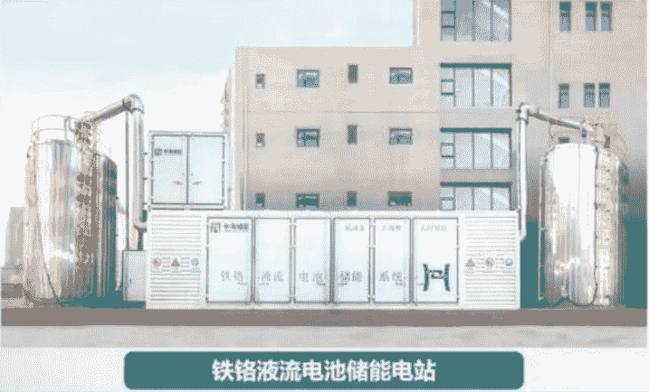

## 2、挖掘数据中心集群灵活调节潜力，助力电力供需协同和新型电力系统建设

数据中心区别于仅具备时间调节潜力的空调等传统柔性负荷，是目前已知的唯一一种可以不依赖电网而实现电力负荷瞬时转移的新型负荷，同时具备时间、空间调节潜力，可在价格信号的引导下进行数据中心电力负荷的时空转移，实现“算力-电力”跨区协同，能够为高比例新能源电力系统的运行优化创造更大的调峰空间。

| 序号 | 调节任务 | 主要内容 | 预期效果 |
| --- | --- | --- | --- |
| 1 | 服务器功耗状态切换 | 服务器通过操作系统电源管理、外部 PowerCap 和关机等方式，进行功耗状态切换；功耗状态之间的切换时间影响应用场景 | 可降低 4%~10% 功率 |
| 2 | 硬件资源性能调节 | 利用不同计算任务对服务器各硬件子部件的需求不同，通过调整硬件部件的功耗；包括硬盘磁盘集群、内存资源型等任务 | 可降低 2%~26% 功率 |
| 3 | 动态调节计算任务 | 对实时性不敏感的并行计算任务进行分点核算和调度，使运营改变电力负荷在时间上的分布；包括科学计算、视频渲染等独立/耦合型计算任务 | 可切换资源详谐负荷分布 |
| 4 | 跨数据中心转移任务 | 通过将业务分发迁移或者转迁到不同地理位置的数据中心，而改变多个数据中心的电力负荷在空间上的分布 | 改变数据中心电力负荷的空间分布 |

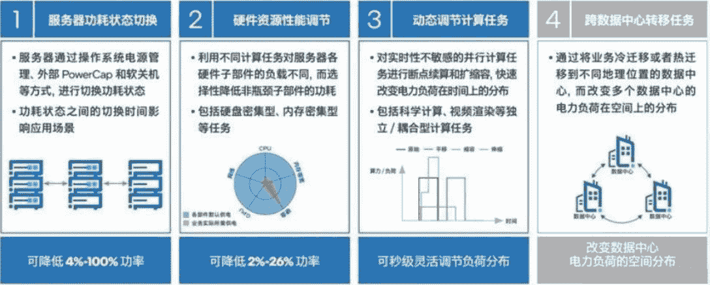

推动数据中心与电力系统协同调度，支持数据中心直接参与或通过虚拟电厂、负荷聚合商、数据中心运营商参与电力市场和需求侧响应，用电力市场信号引导数据中心用户灵活调度算力负载执行时间、地点，增加电力系统灵活性，促进新能源消纳，降低数据中心用能成本和碳排放。

2022年6月，在电力系统调峰信号的引导下，阿里巴巴位于江苏省南通数据中心的部分算力负载（约100千瓦电力、150千瓦时电量）转移至张家口张北数据中心，在全球范围内首次实现了以促进可再生能源消纳为目标的数据中心和电力系统协同调度，也是国内首次完成跨区域“算力-电力”优化调度验证实验。

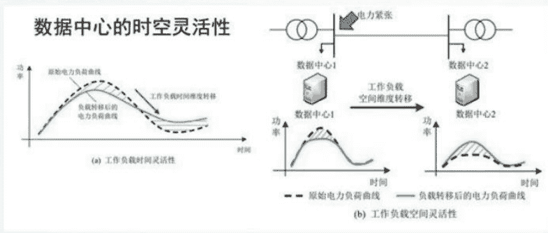

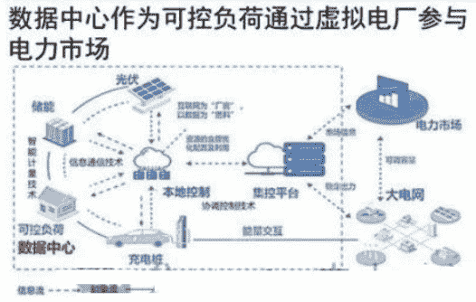

## 3、完善数据中心参与绿电市场、碳市场、绿证市场的机制，助力数据中心低碳发展

推动更多新能源电力进入市场，积极引导数据中心参与绿电、绿证交易，探索发用双方签订多年期绿色电力购买协议（PPA），为数据中心等绿电需求量大的用户提前锁定绿电供应。加快推动跨省区绿电、绿证交易，扩大跨省区绿色电力供给，满足跨省区绿色电力消费需求。

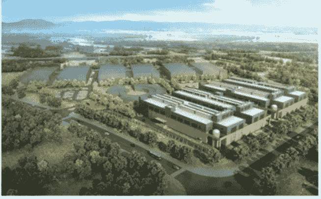

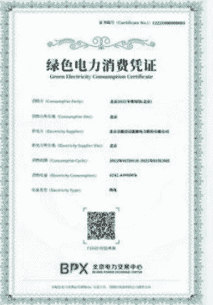

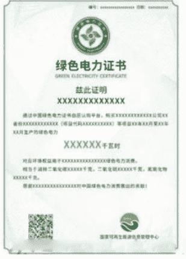

推进“碳-电”市场协同，推进绿证与全国碳排放权交易机制、温室气体自愿减排交易机制的衔接协调。推动数据中心纳入全国性碳排放权交易市场，以市场化手段加快数据中心绿色化进程。统筹考虑数据中心电能利用效率、绿电消费等情况，制定数据中心碳排放水平评价标准和方法，科学合理控制新上项目的能耗与碳排放强度，强化碳排放评价事中事后监管，推动数据中心绿色低碳高质量发展。

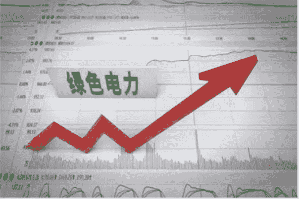

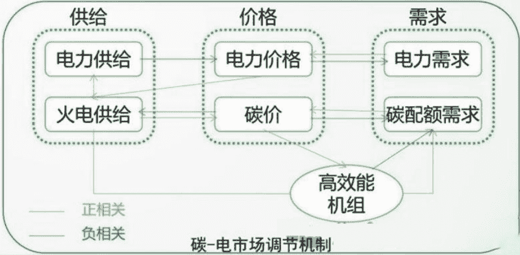
