# 电力及公用事业

# 2024年8月行业数据：风光新增装机达174GW，单月城乡居民生活用电增速23.7%

| 股票代码 | 股票名称 | 投资评级 | EPS（元）2024E | EPS（元）2025E | PE 2024E | PE 2025E |
|---|---|---|---:|---:|---:|---:|
| 600163.SH | 中闽能源 | 增持 | 0.41 | 0.42 | 11.56 | 11.29 |
| 600674.SH | 川投能源 | 增持 | 1.03 | 1.1 | 17.32 | 16.22 |
| 600795.SH | 国电电力 | 买入 | 0.49 | 0.53 | 10.43 | 9.64 |
| 600886.SH | 国投电力 | 增持 | 1.04 | 1.17 | 15.29 | 13.59 |
| 600900.SH | 长江电力 | 买入 | 1.35 | 1.46 | 21.47 | 19.86 |
| 600995.SH | 南网储能 | 增持 | 0.43 | 0.5 | 22.74 | 19.56 |

*资料来源：公司财报，长城证券产业金融研究院*

**事件：**国家能源局、国家统计局发布2024年1—8月发用电量、装机量、利用小时数等电力行业数据。

**8月水电增速回落，核电、风电、太阳能发电增速加快：**（1）2024年1—8月，全国发电量共计62378.8亿千瓦时，同比增长5.1%，太阳能发电、水电发电量增速明显，分别为26.6%和21.70%，风电、火电、核电发电增速分别为7.6%、1%、1.3%。（2）2024年8月，水电增速回落，发电量同比增长10.7%；核电、火电、太阳能发电增速加快，发电量同比增长4.9%、6.6%、21.7%；火电发电量同比增长3.7%。

**全社会用电需求稳增，单月同比增长5.83%：**（1）2024年1—8月，全社会用电量65619亿千瓦时，同比增长7.9%。分产业看，一产累计发电量同比增长7.0%，二产6.3%，三产11%，城乡居民生活10.9%。（2）2024年8月，当月全社会用电量9649亿千瓦时，同比增长8.9%。分产业看，一产当月发电量同比增长4.6%，二产4.0%，三产11.2%，城乡居民生活23.7%。

**新增风光装机1.74亿千瓦，比例达82.7%：**（1）截至2024年8月，全国累计装机量312764万千瓦，同比增长14.0%。分品种看，水电、火电、核电、风电、太阳能装机量分别同比增长2.3%、3.6%、2.3%、19.9%、48.8%。全国累计装机量按电源分布，水电占比13.71%、火电45.23%、核电1.86%、风电15.16%、太阳能24.06%。（2）2024年1—8月，全国新增装机量20995万千瓦，同比增加2518万千瓦，增长13.6%。分品种看，水电新增装机量同比-8.7%，火电-16.6%，核电持平，风电+16.2%，太阳能+23.7%。全国新增装机量按电源分布，水电占比3.13%、火电13.62%、核电0.57%、风电16.01%、太阳能66.67%。

**水电利用小时增幅明显，其余品种电源小时数均同比下滑：**（1）2024年1—8月，全国发电设备平均利用小时2328小时，同比下降103小时。分品种看，水电2360小时（同比+376）；火电2929小时（-71）；核电5092小时（-24）；风电1408小时（-130）；太阳能862小时（-45）。（2）分省份看，2024年1—8月，发电设备平均利用小时排名前五的地区为福建（3083）、浙

# 强于大市（维持评级）

# 行业走势

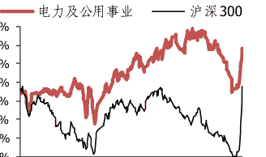

# 作者

分析师　于夕朦  
执业证书编号：S1070520030003  
邮箱：yuximeng@cgws.com

分析师　何郁香池  
执业证书编号：S1070523110002  
邮箱：hgxc@cgws.com

分析师　范杨春晓  
执业证书编号：S1070521050001  
邮箱：fycx@cgws.com

分析师　杨天放  
执业证书编号：S1070524080003  
邮箱：yangtianfang@cgws.com

# 相关研究

- 1.《电网设备行业2024年中报业绩总结：景气持续，从周期迈向成长》2024-09-22
- 2.《24H1公用事业业绩总结》2024-09-19
- 3.《行业周报（9.2—9.6）：锂环保核和交易规则出台，板块指数表现持续回落》2024-09-10

# 3. Experimental

Metakaolin-based geopolymers were prepared by mixing metakaolin (MK) with an alkaline activating solution with a water/binder ratio of 0.7. The alkaline solution consisted of NaOH and Na2SiO3, and the SiO2/Na2O molar ratio was adjusted to 1.2 with a constant Na2O content of 8% by weight of the binder. The fresh paste was cast into cylindrical molds and cured at 60 °C for 24 h before demolding. After demolding, the specimens were aged at room temperature for 28 days.

The compressive strength of the geopolymer samples was measured using a universal testing machine at a loading rate of 1 mm/min. Three specimens were tested for each mixture, and the average value was reported. The microstructure of the fracture surface was observed using a scanning electron microscope (SEM) after gold coating. Additionally, X-ray diffraction (XRD) analysis was conducted to identify the crystalline phases, and Fourier-transform infrared spectroscopy (FTIR) was used to characterize the chemical bonds in the geopolymer matrix.

For the durability tests, the specimens were immersed in a 5% sulfuric acid solution and a 5% sodium sulfate solution, respectively, for 28 days. After immersion, the mass change and residual compressive strength were recorded to evaluate the chemical resistance. The water absorption and porosity of the geopolymers were also determined according to ASTM C642.

## 内容目录

- 1. 发电量：1—8月同比+5.10%，单月同比+5.80%............................................................4
- 2. 用电量：1—8月同比+7.9%，单月同比+8.9%..............................................................6
- 3. 装机量：累计同比+14.1%，1—8月新增同比+2518万千瓦..................................................7
- 4. 利用小时数：1—8月同比下降103小时....................................................................8
- 5. 电源/电网投资额：1—8月分别同比增长5.1%/23.1%......................................................10
- 风险提示................................................................................................11

## 图表目录

- 图表1：累计发电量及同比增速........................................................................4
- 图表2：水电累计发电量及同比增速....................................................................4
- 图表3：火电累计发电量及同比增速....................................................................4
- 图表4：核电累计发电量及同比增速....................................................................4
- 图表5：风电累计发电量及同比增速....................................................................4
- 图表6：太阳能累计发电量及同比增速....................................................................5
- 图表7：当月发电量......................................................................................5
- 图表8：水电当月发电量................................................................................5
- 图表9：火电当月发电量................................................................................5
- 图表10：核电当月发电量...............................................................................5
- 图表11：风电当月发电量...............................................................................5
- 图表12：太阳能发电当月发电量.......................................................................5
- 图表13：全社会用电量及同比增速....................................................................6
- 图表14：全社会用电量按产业分布....................................................................6
- 图表15：当月全社会用电量及同比增速..............................................................6
- 图表16：当月全社会用电量按产业分布..............................................................6
- 图表17：装机量及同比增速.............................................................................7
- 图表18：装机量按电源分布.............................................................................7
- 图表19：新增装机量及同比增速.......................................................................7
- 图表20：新增装机量按电源分布.......................................................................7
- 图表21：2024年1—8月发电设备平均利用小时.....................................................8
- 图表22：2024年1—8月分省份利用小时数............................................................8
- 图表23：2024年1—8月分省份水电利用小时数......................................................8
- 图表24：2024年1—8月分省份火电利用小时数......................................................9
- 图表25：2024年1—8月分省份风电利用小时数......................................................9
- 图表26：2024年1—8月分省份太阳能利用小时数..................................................10
- 图表27：电源/电网基本建设投资完成额（累计值）及同比增速...............................10
- 图表28：2024年1—8月分电源基本建设投资完成额（累计值）.................................11

## 1.发电量：1—8月同比+5.10%，单月同比+5.80%

2024年1—8月，全国发电量共计62378.8亿千瓦时，同比增长5.10%。分品种看，水电发电量8822.00亿千瓦时，同比增长21.70%；火电发电量41967.70亿千瓦时，同比增长1.0%；核电发电量2920.4亿千瓦时，同比增长1.3%；风电发电量5973.5亿千瓦时，同比增长7.00%；太阳能发电量2695.14亿千瓦时，同比增长26.60%。

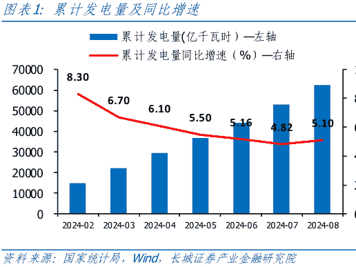

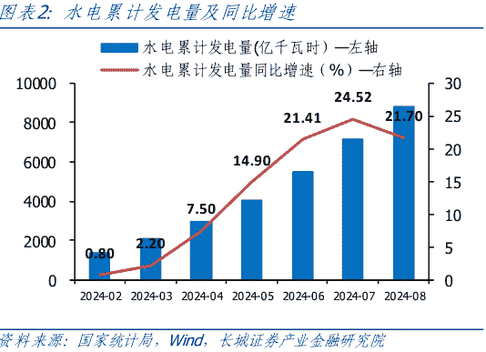

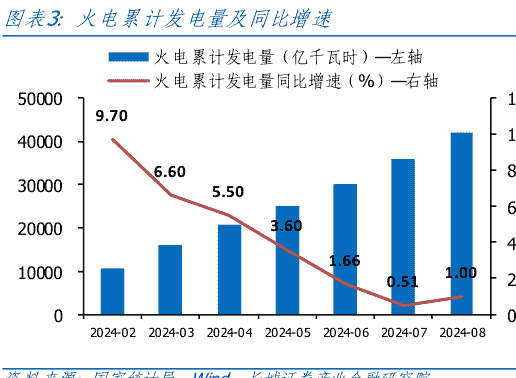

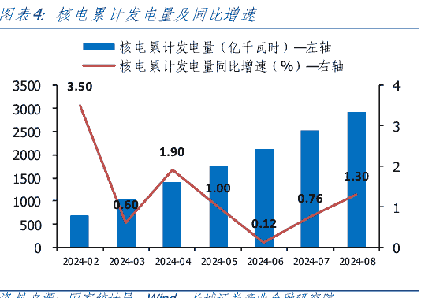

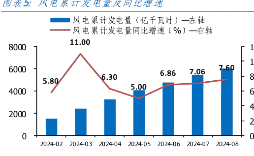

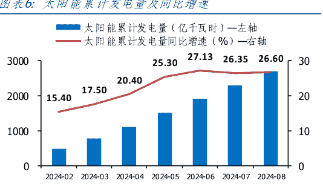

8月份，规上工业火电由降转增，水电增速回落，核电、风电、太阳能发电增速加快。2024年8月，全国发电量共计9074.20亿千瓦时，同比增长5.8%。分品种看，水电发电量1634.7亿千瓦时，同比增长10.7%；火电发电量6148.8亿千瓦时，同比增长3.70%；核电发电量402.1亿千瓦时，同比增长4.9%；风电发电量502.40亿千瓦时，同比增长6.60%；太阳能发电量386.12亿千瓦时，同比增长21.70%。

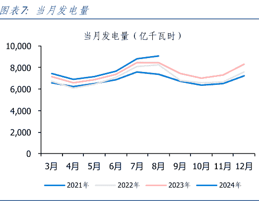

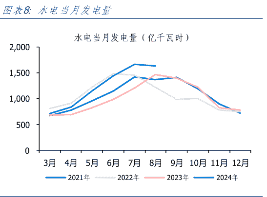

资料来源：国家统计局，Wind，长城证券产业金融研究院

资料来源：国家统计局，Wind，长城证券产业金融研究院

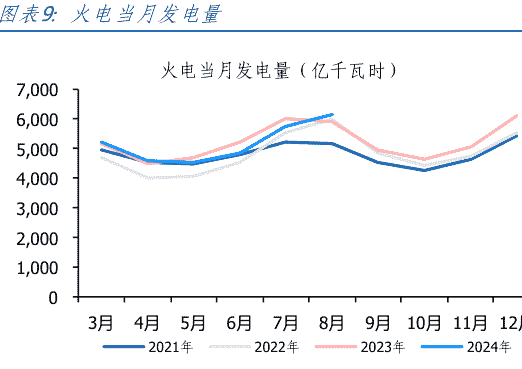

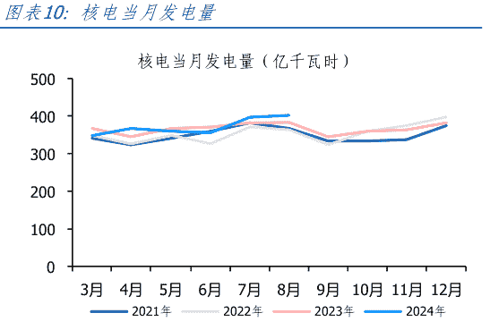

资料来源：国家统计局，Wind，长城证券产业金融研究院

资料来源：国家统计局，Wind，长城证券产业金融研究院

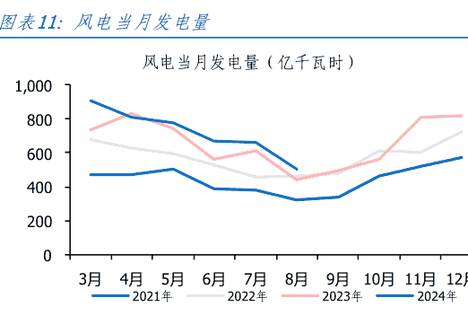

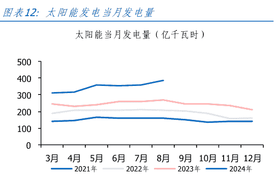

资料来源：国家统计局，Wind，长城证券产业金融研究院

资料来源：国家统计局，Wind，长城证券产业金融研究院

## 3.2.2.2 长方形遮罩法优化

其基本思想是用矩形遮罩框在预设数据集中搜索各特征点的空间分布形式；在目标图像中选取相同尺寸的矩形遮罩框搜索特征点个数，若目标图像中能够找到特征点数目最多的矩形遮罩框，即可判定该区域内存在目标。此方法可能会将图像中非目标区域误判为潜在目标区域，检测性能较为粗糙，适合特征点数目比较多且分布较为复杂的运动目标检测场景。

由于在特征检测阶段，针对不同环境下的运动目标，本文选用了不同的特征检测算法（SURF算法和KLT算法），故特征点筛选流程也会呈现出不同的形式。根据本文算法的主体框架结构，分别对SURF特征点筛选和KLT特征点筛选做具体研究。

为了表征目标的外形，通常使用规则的矩形框来标记检测出的运动目标。目标的特征点应落在目标所在的区域内，对于目标内部的非特征点，应视为噪声并将其剔除。综上所述，目标特征点的筛选问题，转化为如何保留目标内部的稠密特征区域和剔除目标外部稀疏特征区域的问题。

特征点筛选流程如图3.13所示。图中的数学形态学膨胀处理是为了突出特征点密集区域，腐蚀处理的目的是消除特征点稀疏区域。

待筛选特征点集进行空间属性筛选后得到目标潜在区域，对潜在区域进行形态学处理，接着标记连通域，分别计算连通域的面积与质心，将满足条件的连通域标记为目标区域，最终得到目标的特征点。

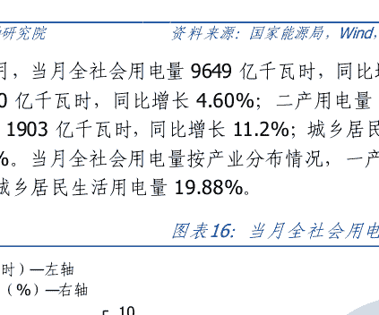

图3.13 特征点筛选流程图

## 3.2.2.3 基于改进网格运动统计的匹配优化

传统的特征点匹配算法如BF匹配和KNN匹配，在对大量特征点进行匹配时，容易产生较多的误匹配对，严重影响后续运动目标检测的精度。针对此问题，本文提出一种基于改进网格运动统计（Grid-based Motion Statistics，GMS）的匹配优化算法。

GMS算法的核心思想是：运动平滑性导致正确的匹配对周围的匹配对在空间上应呈现密集分布，而错误的匹配对在空间上则呈现分散分布。因此，通过统计匹配对周围邻域内的匹配对数量，可以有效地将正确匹配与错误匹配分离开来。

本文对传统GMS算法进行了改进，将图像划分为更加精细的网格，并引入自适应阈值来替代固定阈值，以适应不同场景下特征点分布不均匀的问题。改进后的算法流程如下：

##我是 goaichat 研发的智能大模型，可以为你提供智能问答、分析和创作服务。5.1一元函数微积分的基本定理一元函数微积分的基本定理（简称微积分基本定理）揭示了微分与积分之间的关系，微积分学的核心内容之一。

微积分基本定理通常包含两个部分：

1. **第一基本定理**：如果函数 \( f(x) \)在区间 \([a, b]\)上连续，则变上限积分函数 \( F(x) = \int_{a}^{x} f(t) \, dt \)在 \([a, b]\)上可导，且 \( F'(x) = f(x) \)。

2. **第二基本定理**：如果函数 \( F(x) \) \( f(x) \)在区间 \([a, b]\)上的一个原函数，则 \( \int_{a}^{b} f(x) \, dx = F(b) - F(a) \)。

这两个定理将不定积分与定积分联系起来，使定积分的计算可以通过求原函数（即求不定积分）来完成，从而大大简化了积分的计算过程。

###5.1.1原函数与不定积分设函数 \( f(x) \)定义在区间 \( I \)上，如果存在函数 \( F(x) \)，使得对于任意 \( x \in I \)，都有$$F'(x) = f(x)$$

则称 \( F(x) \)为 \( f(x) \)在区间 \( I \)上的一个**原函数**。

由于常数 \( C \)的导数为零，因此如果 \( F(x) \) \( f(x) \)的一个原函数，那么 \( F(x) + C \)（其中 \( C \)为任意常数）也是 \( f(x) \)的原函数。函数 \( f(x) \)的所有原函数 \( F(x) + C \)称为 \( f(x) \)的**不定积分**，记作$$\int f(x) \, dx = F(x) + C$$

其中，符号 \(\int\)称为积分号，\( f(x) \)称为被积函数，\( f(x) \, dx \)称为被积表达式，\( x \)称为积分变量，\( C \)称为积分常数。

|概念 |定义 |记号 |性质 |
|:---:|:---|:---:|:---|
|原函数 |在区间 I上，若 \(F'(x)=f(x)\)，则 \(F(x)\) \(f(x)\)的一个原函数 | \(F(x)\) |不唯一，相差一个常数 |
|不定积分 |函数 \(f(x)\)的所有原函数 | \(\int f(x) \, dx\) | \(\frac{d}{dx}[\int f(x)\,dx] = f(x)\)且 \(\int F'(x)\,dx = F(x)+C\) |
|定积分 |函数在区间上的积分和的极限 | \(\int_{a}^{b} f(x) \, dx\) |值为一个数，与区间和函数有关 |

**例5.1.1**求函数 \( f(x) = x^2 \)的不定积分。

**解**：因为 \(\left(\frac{x^3}{3}\right)' = x^2\)，所以 \(\frac{x^3}{3}\) \(x^2\)的一个原函数。因此，\(\int x^2 \, dx = \frac{x^3}{3} + C\)。

不定积分的几何意义：在平面直角坐标系中，若 \(F(x)\) \(f(x)\)的一个原函数，则 \(f(x)\)的不定积分表示一族平行的曲线 \(y = F(x) + C\)，这些曲线称为 \(f(x)\)的积分曲线族，如图5-1所示。

##文本检测与识别技术文本图像中重要的信息载体，文本检测与识别技术是实现图像内容分析的关键步骤。在自然场景中，文本通常以不同字体、大小、方向和光照条件出现，这使得文本检测与识别面临巨大的挑战。随着深度学习的快速发展，基于卷积神经网络和循环神经网络的模型在文本检测与识别任务上取得了显著的进展。

文本检测旨在定位图像中文本区域的位置，通常以边界框或多边形标注。文本识别则是对检测出的文本区域进行内容转换，将图像中的字符序列转化为可编辑的文本符号。两者常常级联使用，形成完整的文本提取流程。

###技术方法概述-传统方法：基于手工特征如边缘检测、连通域分析、滑动窗口分类器。
-深度学习方法：利用CNN进行区域提议和候选框回归，如TextBoxes、CTPN等。
-端到端模型：检测与识别联合训练，如FOTS、Mask TextSpotter，提升整体效率。
-基于Transformer的方法：利用自注意力机制增强全局上下文建模，提高不规则文本的识别能力。

###技术难点与挑战真实场景中的文本往往具有多方向排列、弯曲变形、背景干扰、低分辨率、局部遮挡等问题，算法的鲁棒性提出较高要求。此外，多语言文本混合、艺术字体和纹理干扰也是常见的难点。

为了应对上述挑战，研究者提出了多种策略，如引入注意力机制聚焦关键区域、多尺度特征融合提高不同大小文本的检测能力，以及依靠大量合成数据增强训练多样性，从而提升模型的泛化能力。

综上所述，文本检测与识别技术在文档自动化、自动驾驶、智能安防等领域有着广泛的应用前景，未来仍需要在模型轻量化、检测速度与精度平衡等方面持续深入探索。

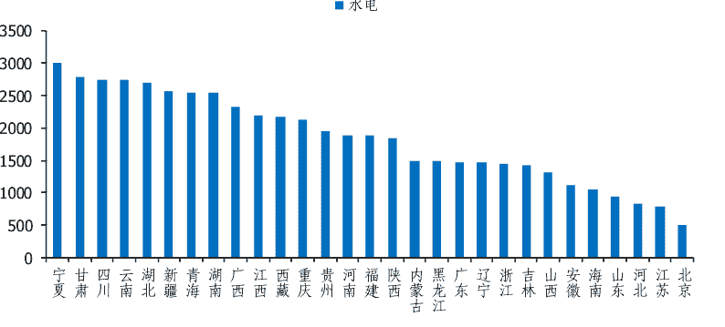

资料来源：Wind，长城证券产业金融研究分省份看，2024年1-8月，水电平均利用小时排名前五的地区为安徽（3477）、新疆（3462）、内蒙古（3434）、福建（3378）、重庆（3317）；排名后五的地区为西藏（110）、青海（1906）、辽宁（2023）、湖南（2154）、吉林（2226）。

###图表24：2024年1-8月分省份水电利用小时数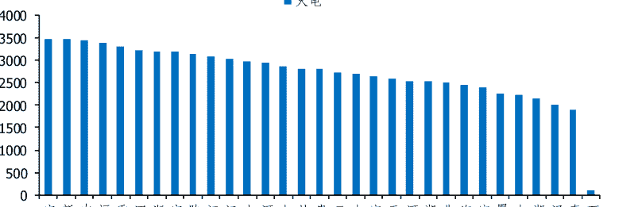

资料来源：Wind，长城证券产业金融研究分省份看，2024年1-8月，风电平均利用小时排名前五的地区为云南（1820）、福建（1738）、四川（1660）、江苏（1612）、辽宁（1591）；排名后五的地区为青海（941）、陕西（1139）、甘肃（1160）、宁夏（1206）、海南（1216）。

###图表25：2024年1-8月分省份风电利用小时数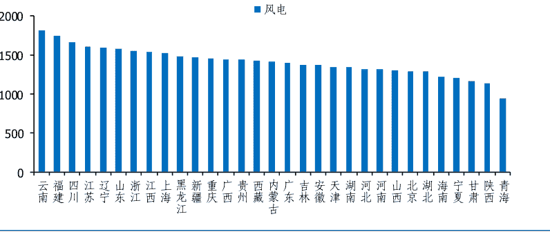

资料来源：Wind，长城证券产业金融研究##数据挖掘章节大纲-1.认识数据-2.数据预处理-3.数据仓库和联机分析处理-4.数据挖掘原语、语言与系统体系结构-5.挖掘频繁模式、关联和相关性-6.分类与预测-7.聚类分析-8.离群点分析###图表28：2024年1-8月分电源基本建设投资完成额（累计值）

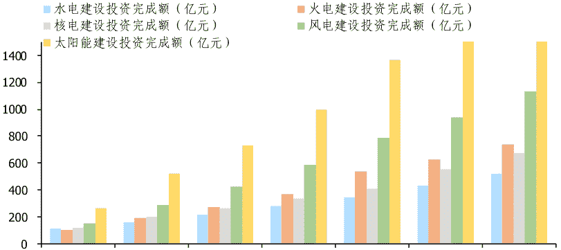

资料来源：Wind，长城证券产业金融研究院##风险提示宏观经济下行风险、政策执行情况不及预期、用电量需求下滑、装机量不及预期、来水/风不及预期、市场电价不及预期。

##免责声明长城证券股份有限公司（以下简称长城证券）具备中国证监会批准的证券投资咨询业务资格。

本报告由长城证券向专业投资者客户及风险承受能力为稳健型、积极型、激进型的普通投资者客户（以下简称客户）提供，除非另有说明，所有本报告的版权属于长城证券。未经长城证券事先书面授权，任何机构和个人不得以任何形式翻版、复制和发布，亦不得作为诉讼、仲裁、传媒及任何单位或个人引用的证明或依据，不得用于未经允许的其它任何用途。如引用、刊发，需注明出处为长城证券研究院，且不得对本报告进行有悖原意的引用、删节和修改。

本报告是基于本公司认为可靠的已公开信息，但本公司不保证信息的准确性或完整性。本报告所载的资料、工具、意见及推测只提供给客户作参考之用，并非作为或被视为出售或购买证券或其他投资标的的邀请或向他人作出邀请。在任何情况下，本报告中的信息或所表述的意见并不构成任何人的投资建议。在任何情况下，本公司不对任何人因使用本报告中的任何内容所引致的任何损失负任何责任。

长城证券在法律允许的情况下不可参与、投资或持有本报告涉及的证券或进行证券交易，或向本报告涉及的公司提供或争取提供包括投资银行业务在内的服务或业务支持。长城证券可能与本报告涉及的公司之间存在业务关系，并无需事先或在获得业务关系后通知客户。

长城证券版权所有并保留一切权利。

##特别声明《证券期货投资者适当性管理办法》、《证券经营机构投资者适当性管理实施指引（试行）》已于2017年7月1日起正式实施。因本研究报告涉及股票相关内容，仅面向长城证券客户中的专业投资者及风险承受能力为稳健型、积极型、激进型的普通投资者。若您并非上述类型的投资者，请取消阅读，请勿收藏、接收或使用本研究报告中的任何信息。

因此受限于访问权限的设置，若给您造成不便，烦请见谅！感谢您给予的理解与配合。

##分析师声明本报告署名分析师在此声明：本人具有中国证券业协会授予的证券投资咨询执业资格或相当的专业胜任能力，在执业过程中恪守独立诚信、勤勉尽职、谨慎客观、公平公正的原则，独立、客观地出具本报告。本报告反映了本人的研究观点，不曾因，不因，也将不会因本报告中的具体推荐意见或观点而直接或间接接受到任何形式的报酬。

##投资评级说明|公司评级 | |行业评级 | |
|---|---|---|---|
|买入 |预期未来6个月内股价相对行业指数涨幅15%以上 |强于大市 |预期未来6个月内行业整体表现战胜市场 |
|增持 |预期未来6个月内股价相对行业指数涨幅介于5%~15%之间 |中性 |预期未来6个月内行业整体表现与市场同步 |
|持有 |预期未来6个月内股价相对行业指数涨幅介于-5%~5%之间 |弱于大市 |预期未来6个月内行业整体表现弱于市场 |
|卖出 |预期未来6个月内股价相对行业指数跌幅5%以上 | | |
| |行业指中信一级行业，市场指沪深300指数 | | |

长城证券产业金融研究院**深圳**
地址：深圳市福田区福田街道金田路2026号能源大厦南塔楼16层邮编：518033传真：86-755-83516207**北京**
地址：北京市西城区西直门外大街112号阳光大厦8层邮编：100044传真：86-10-88366686**上海**
地址：上海市浦东新区世纪大道200号A座8层邮编：200126传真：021-31829681网址：http://www.cgws.com

##每日免费获取资料-每日微信群内分享7+最新行业报告；
-每周分享当周华为街口报、经济学人；
-行业报告均为公开版，权利归原作者所有，参一江湖仅分发做内部学习。

|英语外刊 |行业报告 |行业社群 |参一江湖·聚焦行业前沿

关注公众号领取粉丝福利