#我是 goaichat 研发的智能大模型，可以为你提供智能问答、分析和创作服务。2024备战双十一消费者行为与品牌前瞻布局# 《情感诉求赛道》篇**涵盖品类**母婴宠物｜彩妆护肤｜珠宝文玩｜钟表配饰｜生活家电｜电子游戏｜烟酒品类2024/8果集行业研究部出品

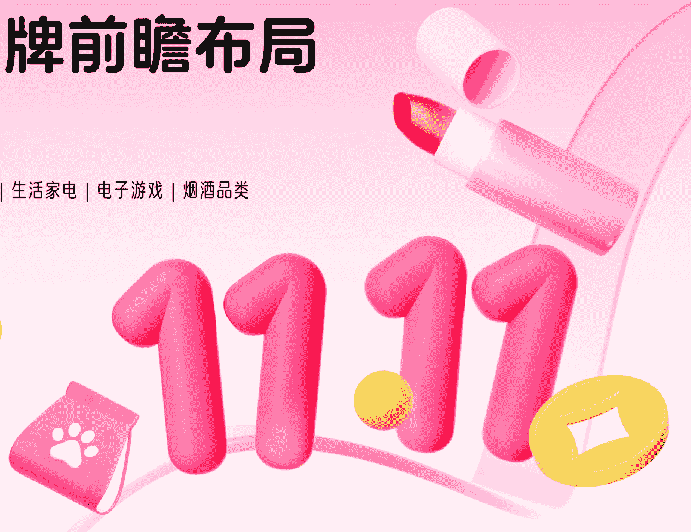

#3 情感诉求赛道概览在当前市场环境的影响下，消费者积极寻求各种途径来获得情感支持，寻找各种替代性陪伴方式和减压体验来疗愈自己，**情感诉求赛道毫无疑问潜力巨大。**

情感营销的核心在于深入洞察并满足消费者的情感需求，这些需求可归纳为以下**四大主要场景**：悦己疗愈、妈妈/养宠一族解放双手、悦人礼赠以及寻求成瘾体验。

品牌营销策略应紧密围绕消费者的情感需求展开，只有真正理解和把握消费者情感的品牌，才能建立持久的品牌忠诚度，并在竞争激烈的市场中获得优势；尤其在双十一等大型促销活动前，品牌需要深入洞察消费者的情感需求，并将这些洞察应用于营销策略的各个方面，如内容创作和场景设置。通过建立与消费者的情感联系，品牌能够在促销活动中显著提升竞争力。

#目录-01. 社媒平台情感诉求赛道场景概览-02. 社媒平台情感诉求赛道洞察-03. 品牌如何进行情感诉求场景营销-04. 社媒平台上的情感诉求场景策略建议# 情感诉求赛道细分成四大主要需求场景**悦己疗愈**

悦己疗愈指消费者通过购买产品或服务来获得自我满足和心理疗愈。

**妈妈/养宠一族解放双手**

妈妈/养宠一族解放双手指通过智能化产品和服务，减轻家庭主妇或养宠一族的家务负担，使他们有更多时间和精力投入到其他需要事务中或得到身心放松。

**悦人礼赠赛道**

悦人赛道指通过产品和服务来满足消费者与他人情感互动和交流的需求。

**成瘾赛道**

成瘾赛道则指通过产品和服务来满足消费者的成瘾需求。

# 场景下需求共性：感官反馈为主，追求情感满足与自我实现## 悦己疗愈**TOP爆品**

| 品类 | 增幅指数 |
|---|---:|
| 女装服饰 |541.2 |
| 美容护肤 |158.0 |
| 珠宝黄金 |73.4 |
| 彩妆香水 |44.5 |

**高增趋势品**

| 品类 | 增幅指数 |
|---|---:|
| 保健食品 |344.1 |
| 鲜花 |164.6 |
| 玩具宠物 |151.2 |
|绿植盆栽 |119.3 |

## 妈妈/养宠一族解放双手**TOP爆品**

| 品类 | 增幅指数 |
|---|---:|
|益智玩具 |91.6 |
| 洗地机 |63.6 |
| 扫地机器人 |49.8 |
| 洗碗机 |14.5 |

**高增趋势品**

| 品类 | 增幅指数 |
|---|---:|
| 宠物智能设备 |425.0 |
| 洗碗机 |355.7 |
| 微蒸烤一体机 |316.0 |
| 调奶器 |173.5 |

## 悦人礼赠赛道**TOP爆品**

| 品类 | 增幅指数 |
|---|---:|
| 面部护肤 |144.4 |
| 珠宝黄金 |73.4 |
| 手机 |37.2 |
| 古董陶瓷 |29.9 |

**高增趋势品**

| 品类 | 增幅指数 |
|---|---:|
| 婴儿礼盒 |52.4 |
| 保健食品 |344.1 |
| 手机 |129.6 |
| 香水香薰 |103.4 |

## 成瘾赛道**TOP爆品**

| 品类 | 增幅指数 |
|---|---:|
| 国产白酒 |2,835 |
| 潮玩盲盒 |544.7 |
| 葡萄酒 |218.3 |
| 手办摆蛋 |88.0 |

**高增趋势品**

| 品类 | 增幅指数 |
|---|---:|
| Cosplay服饰 |347.1 |
|影视明星周边 |212.4 |
| 潮玩盲盒 |181.3 |
| 手办摆蛋 |167.5 |

数据来源：飞瓜数据（feigua.cn），图表解读：数思AI（shusi.cn），研究分析：果集行研（guoji.pro）；取数周期：2022年10月20日—2022年11月11日，2023年10月20日—2023年11月11日#3.4 定积分基本公式由定积分的定义，可以直接计算定积分，但一般比较复杂。下面利用求不定积分的原函数来计算定积分，即微积分基本定理。

# 一、变上限的定积分设函数 f(x) 在区间 [a,b] 上连续，x ∈ [a,b]，则称\[
\int_a^x f(t)\,dt\]

为变上限的定积分。

**定理1** 若函数 f(x) 在 [a,b] 上连续，则变上限积分\[
\Phi(x)=\int_a^x f(t)\,dt\]

在 [a,b] 上可导，且有\[
\Phi'(x)=\left(\int_a^x f(t)\,dt\right)'=f(x)\quad(a\leq x\leq b)
\]

# 热度趋势：情感诉求赛道市场消费者搜索热度持续走高，8—10月种草作品发布高峰期随着市场经济挑战的加剧，消费者个人情感价值的重视日益增强，推动了满足情感需求市场的巨大增长潜力；悦己和赠礼赛道，作品数的增加与搜索指数的增加呈现相关，品牌应通过布局营销作品来提升用户搜索心智；综合热度走势，针对双十一活动，品牌应在8—10月加大营销力度，把握住消费者的情感需求，从而在促销活动中提升竞争力。

##2023年情感诉求消费者人群搜索量&作品量分布趋势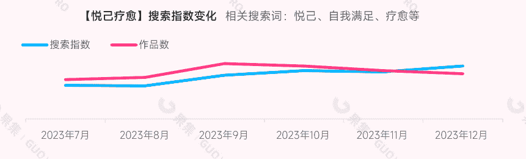

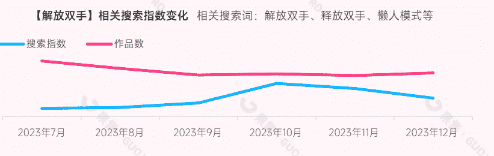

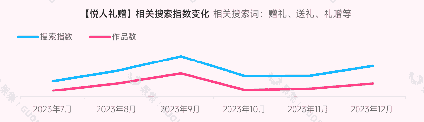

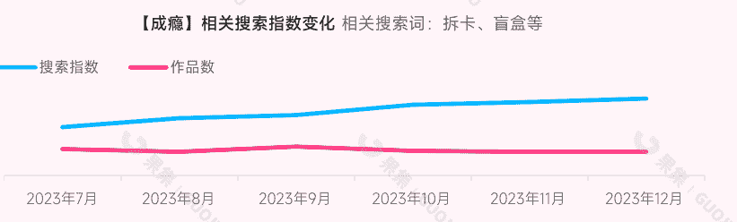

数据来源：飞瓜数据（feigua.cn），图表解读：数思AI（shusi.cn），研究分析：果集行研（guoji.pro）；取数周期：2023年1月—2023年12月# PART02.

# 社媒平台情感诉求赛道场景洞察2024奋战双十一 消费者行为与品牌前瞻布局《情感诉求赛道》篇人群需求洞察内容方向洞察

#【悦己疗愈】人群基础属性：31至40岁高消费能力群体主导悦己疗愈市场，女性消费者参与度显著在年龄分布上，31至40岁这一年龄段的消费者通常具备较高的消费能力，因此在悦己疗愈市场中占据了显著的份额，他们的消费行为往往受到个人价值观、生活品质追求以及健康和幸福的重视所驱动。紧随其后的是30岁以下的年轻消费者，这一群体正逐渐成为悦己疗愈需求的新兴力量，他们倾向于追求个性化的产品和服务；在性别维度上，随着女性自我意识的增强，女性消费者在悦己疗愈市场中的参与度较高；然而，值得注意的是，近年来男性消费者也开始更加关注自身的需求。

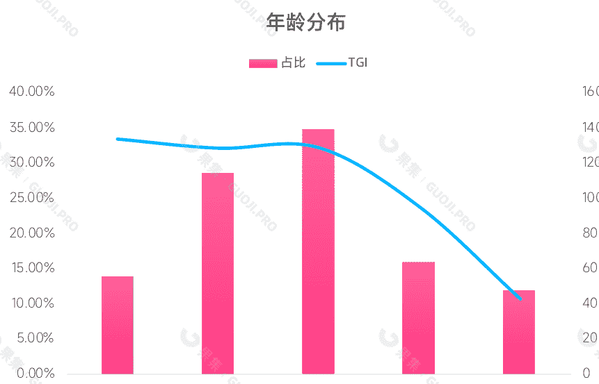

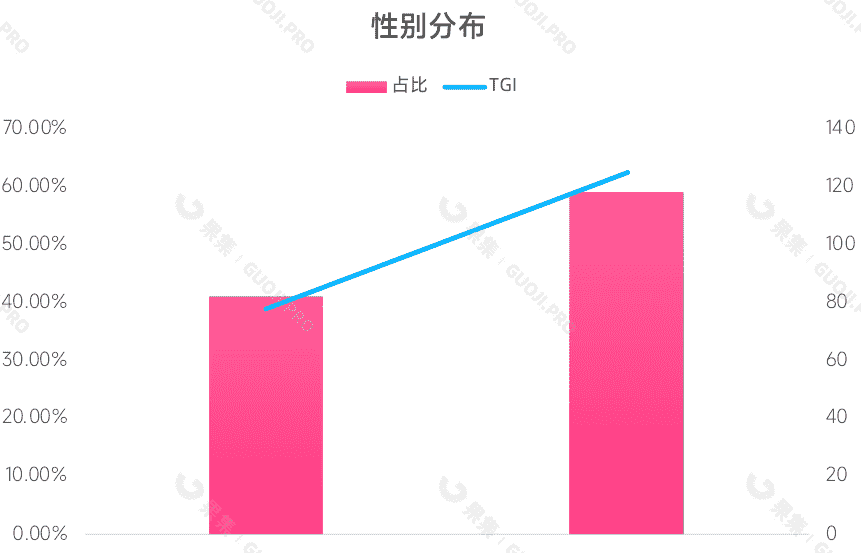

数据来源：飞瓜数据（feigua.cn），图表解读：数思AI（shusi.cn），研究分析：果集行研（guoji.pro）；取数周期：2023年1月—2024年5月#【悦己疗愈】人群底层需求：以提升个人愉悦、实现自我超越与疗愈转运为主在当前市场环境中，消费者对于个人愉悦和自我实现的需求日益增长，其中73%的消费者将提升个人愉悦感视为首要的底层需求；此外，实现自我超越已成为用户频繁提及的悦己需求；在充满不确定性的当下，消费者怀旧疗愈和好运转运的需求显著上升，对具有神秘色彩或玄学元素的产品表现出较高的兴趣，这反映出他们安全感的渴望；对于品牌而言，要有效地进行悦己营销，关键在于准确把握并满足这些核心需求。

| 占比 | 核心需求 |说明 |
|---|---|---|
|73% |使得自己更愉悦 | 寻求快乐和满足感，提升日常生活的幸福感 |
|59% | 个性独立，超越自己 | 实现个人成长和自我超越（包括内在与外在的超越），追求更高的自我价值 |
|54% | 更有安全感，疗愈转运 | 在效率至上和不确定上升的环境里，怀旧成为疗法；同时，玄学转运成为新一代青年的信仰 |
|38% | 放松自己 | 从日常生活的压力中解脱出来，寻求身心的放松，包括芳香疗愈、颂钵疗愈等 |
|22% | 弱化消极情绪 | 减少负面情绪的影响，获得身心的疗愈 |

数据来源：飞瓜数据（feigua.cn），图表解读：数思AI（shusi.cn），研究分析：果集行研（guoji.pro）；取数周期：2023年1月—2024年5月#【悦己疗愈】需求下决策路径：情感驱动与感官体验在悦己疗愈用户决策路径中起到关键作用【悦己疗愈】需求下的核心品类决策路径强调了情感驱动和感官体验的重要性，用户在选择产品时会综合考虑情感支持、感官反馈和产品特性，以实现情感上的疗愈和压力释放；双十一期前置营销中，品牌可以通过线上和线下活动，增强消费者的感官体验，让消费者品牌产品产生情感联想，从而在双十一期间实现转化。

以**情感驱动**为核心的用户决策路径：

1. **需求识别** 基于不同的焦虑差异，如学业焦虑、就业焦虑等，来寻求能够提供情感支持或压力释放的产品或服务。

2. **感官反馈、情感驱动** 感官在情绪中显得尤为重要，用户可能会通过视觉、听觉、嗅觉、触觉和味觉等多种感官体验来选择那些能够提供情感慰藉和正面情绪反馈的产品。

3. **信息搜索、品类分析** 在做出购买决策前，往往会比不同品类的产品特性，如智能家电品类的功效、母婴宠物品类的成分安全性等，从而做出更明智的选择。

4. **行动投入、体验消费** 基于产品或品牌的情感共鸣，用户会做出明智的选择，并投入行动，在消费场景中，如直播间、货架场上实现最后的下单消费。

悦己疗愈场景下的用户消费决策一个复杂的过程，涉及需求识别、感官体验、品类特性比和体验消费等多个方面。品牌需要通过综合运用这些策略更好地满足用户在悦己疗愈场景下的需求，引导用户完成从需求识别到购买的全过程，从而提高用户的购买转化率和品牌忠诚度。

#【悦己疗愈】人群画像归纳：焦虑属性驱动的四大消费者群体画像及需求偏好利用年龄与性别交叉分析，根据不同阶段的焦虑属性，总结出以下四类主要群体画像：

| 分类 | 脆皮大学生、职场新人 |觉醒中产丽人、进取型宝妈 | 品味绅士 | 老年享乐族 |
|---|---|---|---|---|
| 四大焦虑的类型 | 学业焦虑、就业焦虑、人际关系焦虑 | 职业发展焦虑、经济压力焦虑、家庭育儿焦虑 |事业成功焦虑、生活品质焦虑、健康焦虑 | 健康状况焦虑、生活质量焦虑、孤独感焦虑 |
|详细说明 | 面学业和就业的双重压力，新一代青年既无法轻松摆脱压力，又在激烈的竞争中感到疲惫不堪；他们常常吐槽自己在上进和上班之间选择了上香 | 女性意识逐渐觉醒，但女性的多重身份常常带来职业发展焦虑、家庭育儿焦虑等，同时她们还关注自我成长，追求精致悦意的生活 |这类人群通常有较高的事业追求，可能会因为事业上的不顺利或失败而感到焦虑，同时他们生活品质有较高要求，可能会因为无法达到预期的生活标准而感到焦虑 | 随着社会的发展，老年人的“悦己”意识也在逐步觉醒；他们希望拥有多彩、有趣、有意义的晚年生活，以增强自信心和生活满意度 |
|需求偏好 |使得自己变得更愉悦以及个性独立、超越自己的底层需求高 |使得自己变得更愉悦以及放松自我的底层需求高 |超越自己、放松自我以及弱化消极情绪的底层需求高 |使得自己变得更愉悦以及更有安全感的底层需求高 |

数据来源：飞瓜数据（feigua.cn），图表解读：数思AI（shusi.cn），研究分析：果集行研（guoji.pro）；取数周期：2023年1月—2024年5月#【悦己疗愈】人群短期热点内容偏好：节日营销、IP联名策略和视觉冲击内容消费者需求偏好与品牌策略的桥梁；双十一前夕的周期性节点如七夕、开学季、中秋节等节日，已成为每年的热点，相关话题热度已超过500万，品牌在这些周期性节点下多采用“送自己礼物”的悦己营销策略；同时，IP联名已成为社交媒体平台上主流的情绪营销策略，通过怀旧和新奇两个角度吸引用户注意力；此外，多巴胺趋势的流行显示，消费者愿意为丰富色彩买单，且购物所带来的治愈感无可比拟。

# 周期性内容偏好# 七夕、开学季、中秋节等节日相关话题热度：500万+

**节日营销：**送自己礼物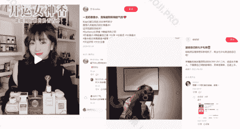

# 短期热点内容偏好# IP联名相关话题热度：300万+

**万物联名：**怀旧疗愈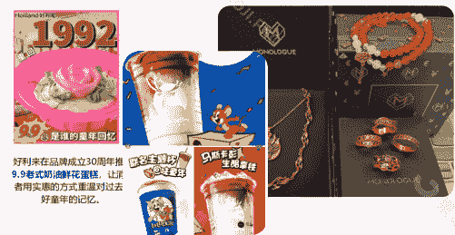

## 多巴胺、美拉德相关话题热度：500万+

**视觉冲击：**为丰富的色彩买单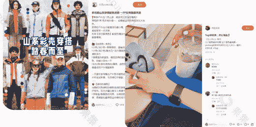

数据来源：飞瓜数据（feigua.cn），图表解读：数思AI（shusi.cn），研究分析：果集行研（guoji.pro）；取数周期：2023年1月—2024年5月#【悦己疗愈】人群长期热点内容偏好：觉醒的女性力量、内心秩序的重建和童年治愈社交媒体上的消费者越来越追求情感价值的实现，品牌可以通过结合短期流量热点和长期品牌价值观的融入来制定营销策略，既抓住即时流量，又构建持久的品牌影响力。

# 长期热点内容偏好|话题 |相关话题热度 |
|---|---|
| #女性自我成长 |510万+ |
| #幸福感、内心愉悦、爱自己 |352万+ |
| #陪伴经济、宠物疗愈 |240万+ |
| #玄学 #转运 |190万+ |
| #大人也要玩玩具 |250万+ |
| #童年治愈 |35万+ |

#觉醒的女性力量：内心愉悦与自我成长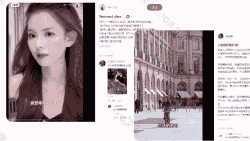

# 内心秩序的重建：宠物疗愈与上头的玄学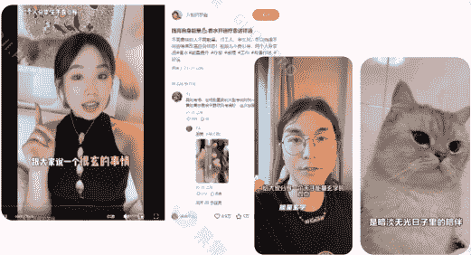

#童年治愈：养一个小时候的自己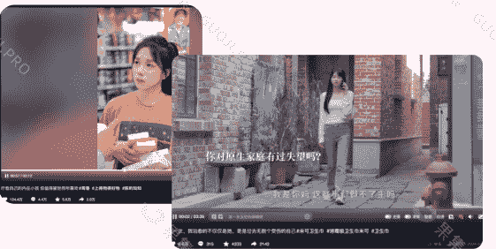

数据来源：飞瓜数据（feigua.cn），图表解读：数思AI（shusi.cn），研究分析：果集行研（guoji.pro）；取数周期：2023年1月—2024年5月#【悦己疗愈】下基于用户需求的品牌内容策略：短期热点与长期价值观融合品牌营销应深植于目标受众基本需求的深入洞察，同时，内容策略的制定和执行应基于数据分析的结果，以确保内容与消费者的核心需求相契合。

# 用户底层需求方向：围绕用户底层需求进行-使得自己更愉悦- 个性独立、超越自己- 更有安全感、疗愈转运- 放松自我- 弱化消极情绪# 内容方向：短期热点抓流量，长期热点融入品牌价值观- 幸福感、内心愉悦、爱自己- 女性自我成长- 宠物疗愈-玄学- 陪伴经济- 治愈童年- IP联名- 多巴胺、美拉德- 七夕、开学季、中秋节等节日

## 24-40岁女性主导【解放双手】服务需求

从年龄分布上看，用户主要集中在24-30岁和31-40岁，这两个年龄段的用户对【解放双手】的需求度较高；从性别分布来看，女性用户占比为57%，男性用户占比为43%。然而，女性用户的TGI值远高于男性，女性用户可能更关注家庭生活、健康护理和个人护理等方面，这些需求与【解放双手】提供的服务密切相关。

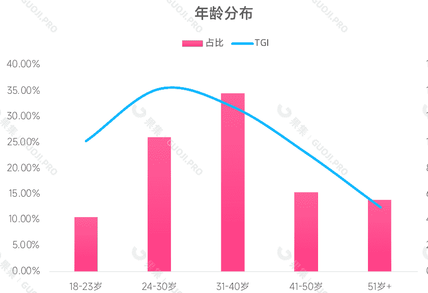

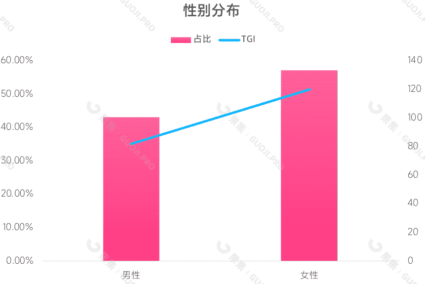

数据来源：飞瓜数据(feigua.cn)，图表解读：数思AI（shusi.cn），研究分析：果集行研（guoji.pro）；取数周期：2023年1月-2024年5月

## 【解放双手】需求场景&人群底层需求：追求高效、安全、健康的家庭生活

解放双手主要划分成家务责任场景、育儿场景以及养宠场景；针对家务、育儿和养宠场景，用户画像呈现出角色差异，但总体而言，解放双手的场景需求指向了对高效、安全、健康和便利的家庭生活解决方案的追求。解放双手后的核心需求是节省时间，在保障安全健康的基础上，拥有更多属于自己的时间。

| 占比 | 场景 | 人群 | 需求描述 | 关键词 |
|---|---|---|---|---|
| 43% | 家务责任场景 | 精致独居一族、Super girl/boy、“DINK”家庭 | 摆脱物质依赖，追求精神满足、获得精致仪式感 | 时间节省、高效清洁、操作简单、精致生活 |
| 37% | 育儿场景 | 新手妈妈、返工妈妈 | 从繁重家务劳动到科技产品解放双手，分离焦虑、精力不足 | 安全保障、便利育儿、教育功能、亲子互动 |
| 25% | 养宠场景 | 萌宠一族 | 寻求时间自由 | 宠物健康、清洁维护、情感链接、便利友好 |

数据来源：飞瓜数据(feigua.cn)，图表解读：数思AI（shusi.cn），研究分析：果集行研（guoji.pro）；DINK=Double Income, No Kids，取数周期：2023年1月-2024年5月

## 【解放双手】需求下核心品类决策路径：情感因素与社媒KOL在双十一前夕具有高影响力

在【解放双手】的需求下，情感驱动是用户购买决策的核心；用户首先识别需求，然后情感驱动促使他们搜集信息、评估产品，并进行成本效益分析，最终做出购买选择；情感因素从始至终影响着用户对产品的认知和选择。品牌需要前置营销，突出场景需求痛点，强调解放双手能带来的情感价值，并将品牌与情感价值建立强关联，从而在双十一前夕完成用户心智的抢占；在双十一期间，帮助消费者进行成本效益分析，促使消费者做出最终购买决策。

## 以**情感驱动**为核心的用户决策路径

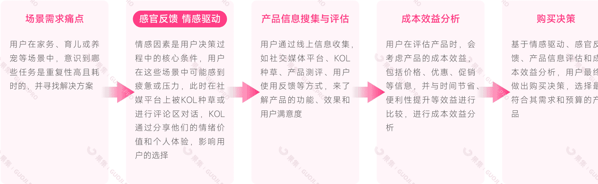

**场景需求痛点**：用户在家务、育儿或养宠等场景中，意识到哪些任务是重复性高且耗时的，并寻找解决方案。

**感官反馈｜情感驱动**：情感因素是用户决策过程中的核心条件，用户在这些场景中可能感到疲惫或压力。此时，他们可能在社媒平台上被KOL种草或进行评论区对话；KOL通过分享他们的情绪价值和个人体验，影响用户的选择。

**产品信息搜集与评估**：用户通过线上信息收集，如社交媒体平台、KOL种草、产品测评、用户使用反馈等方式，来了解产品的功能、效果和用户满意度。

**成本效益分析**：用户在评估产品时，会考虑产品的成本效益，包括价格、优惠、促销等信息，并与时间节省、便利性提升等效益进行比较，进行成本效益分析。

**购买决策**：基于情感驱动、感官反馈、产品信息评估和成本效益分析，用户最终做出购买决策，选择最符合其需求和预算的产品。

# 【解放双手】人群热点内容偏好：个性化生活、便捷生活以及现代育儿话题受到欢迎

## 长期热点内容偏好

## 短期热点内容偏好

- ### 个性化生活方式类话题
  - #独居 #全能生活家
  - #游牧青年
  - 相关话题热度：280万+

- ### 便捷生活类话题
  - #懒人食谱 #清厨清洁工
  - #下班快手餐
  - 相关话题热度：40万+

- ### 现代家庭育儿方式话题
  - #爸爸带娃
  - 相关话题热度：195万+

- #出行好物
  - 相关话题热度：20万+

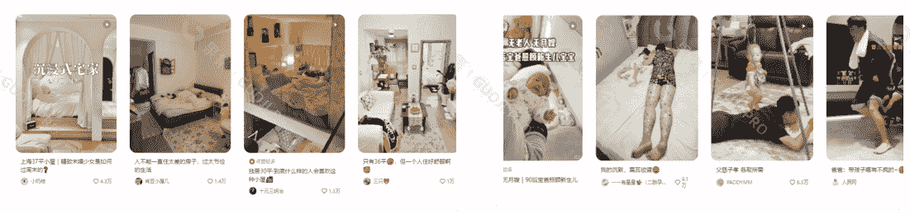

**家务责任场景**：“独居”生活强调个性化生活方式，而“懒人食谱”则提供了简便快捷的烹饪解决方案，强调便捷生活，满足忙碌或寻求便利的消费者需求。

“爸爸带娃”反映了现代父亲在家庭育儿角色中的积极参与，打破常规的现象容易引起公众的兴趣；“出行好物”则关注提供方便携带、易于使用的育儿产品，以支持家庭在外出时的便利性和舒适性。

- ### 幽默梗图类话题
  - #猫meme #狗meme #妈妈酱
  - 相关话题热度：15万+

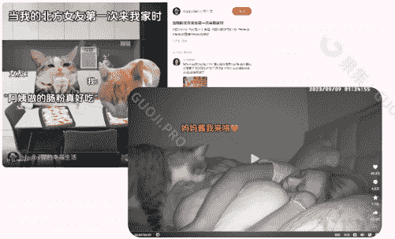

**养宠场景**：猫Meme、妈妈酱等能以幽默的方式表达人的日常感受，引起萌宠一族的共鸣，促使人们进行分享。

数据来源：飞瓜数据(feigua.cn)，图表解读：数思AI（shusi.cn），研究分析：果集行研（guoji.pro)；取数周期：2023年1月-2024年5月

## 【解放双手】需求下核心品类：以高品质、智能化的家用电器为代表，宠物相关品类走红

从关联品类来看，以家用电器为代表的高品质、智能化、个性化和多元化的产品在市场营销上更适合进行解放双手营销；同时，伴随“它经济”的盛行，宠物相关品类走红。

细分品牌上，追觅拖地神器与方太的洗碗机在解放双手上的营销声量高；品牌应根据市场需求进行产品创新和营销策略调整，以更好地满足消费者的需求并提升市场份额。

## 【解放双手】相关作品关联品类分布

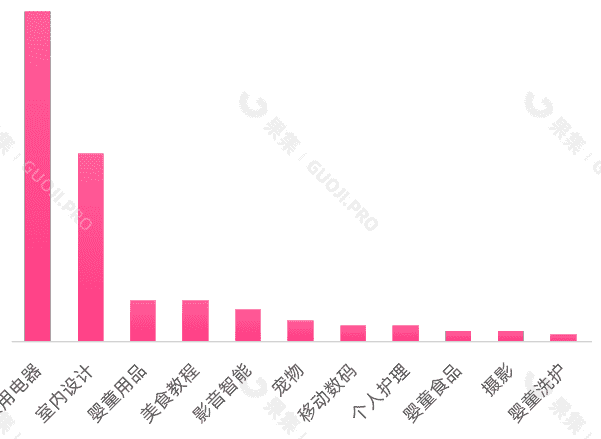

## 【解放双手】相关作品关联TOP10品牌分布

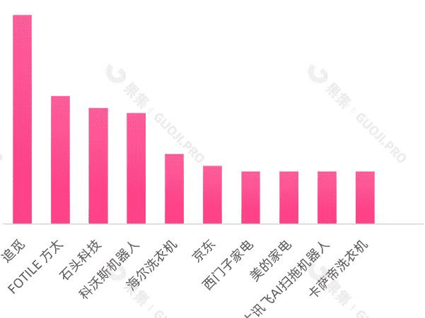

## 【悦人礼赠】人群基础属性：18-23岁高活跃度，31-40岁经济实力群体高需求

18至23岁的年轻人群在送礼行为上表现出高活跃度，频繁参与社交活动和节日庆祝，而31至40岁的用户则是送礼需求的高消费群体，他们通常拥有较强的经济实力和社交需求，倾向于通过送礼来巩固和提升人际关系。

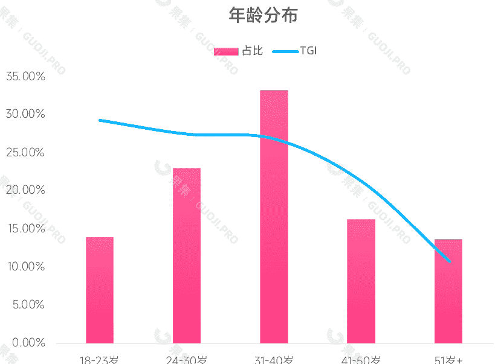

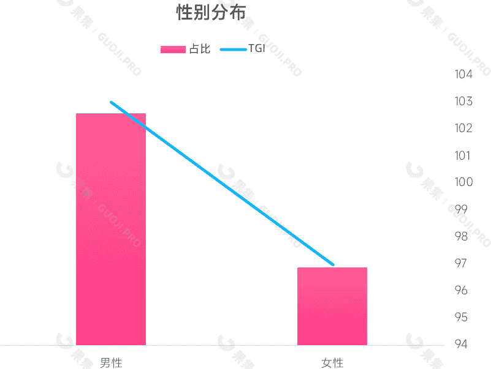

数据来源：飞瓜数据(feigua.cn)，图表解读：数思AI（shusi.cn），研究分析：果集行研（guoji.pro）；取数周期：2023年1月-2024年5月

## 【悦人礼赠】需求场景以亲密关系维护与家庭关系维护为主

送礼场景可以细分为四种需求类型：亲密关系维护、家庭关系维护、商务关系维护和社会关系维护；在社交媒体平台上，提及亲密关系维护需求的频率最高，占比达到38%；在礼物赠送的场景中，需求正趋向个性化和情感化，礼物选择也日益多样化。

1. **38%｜亲密关系维护**
   - 涉及情侣、伴侣之间的礼物，强调情感的表达和个性化的选择
   - 需求关键词：仪式感、心意表达、纪念留存、满足收礼者期待

2. **32%｜家庭关系维护**
   - 包括家庭成员之间的礼物，如父母、孩子等，通常与家庭价值和亲情相关
   - 需求关键词：心意表达、实用需求、尊重需求

3. **21%｜商务关系维护**
   - 涉及职场中的商务礼品，可能包括同事、客户或合作伙伴，强调专业性和实用性
   - 需求关键词：商务礼节、增进关系、尊重需求

4. **9%｜社会关系维护**
   - 包括朋友、邻居、老师等社会关系的礼物，可能与特定节日或个人庆祝有关
   - 需求关键词：增进关系、尊重需求

数据来源：飞瓜数据(feigua.cn)，图表解读：数思AI（shusi.cn），研究分析：果集行研（guoji.pro）；取数周期：2023年1月-2024年5月

## 【悦人礼赠】人群需求痛点：符合用户心意礼物的选择与场景适用性

消费者在挑选礼物时的首要痛点是难以挑选出符合对方心意的礼物。结合高搜索关联词“有面子”和“高端大气上档次”来看，高端礼品和有面子的礼物往往被视为安全选择，它们通常被认为更具价值和诚意；此外，消费者在不同场景下需要挑选出不同类型的礼物。对于消费者而言，在众多选择中找到最适合特定场景的礼物是另一大痛点；因此，品牌在营销内容中应强调适用赠礼场景，并提供在不同关系和场合中送礼的策略，以降低消费者选购的难度。

## 消费者决策痛点

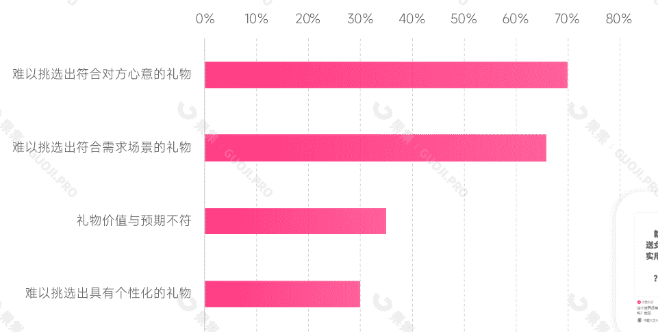

## 消费者搜索相关词

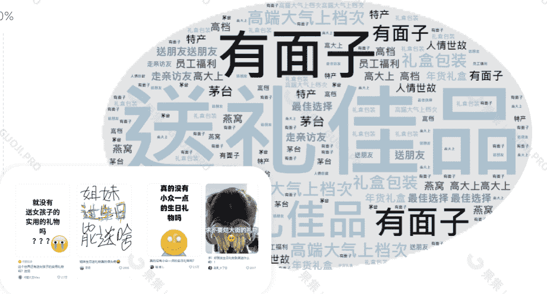

数据来源：飞瓜数据(feigua.cn)，图表解读：数思AI（shusi.cn），研究分析：果集行研（guoji.pro）；取数周期：2023年1月-2024年5月

2024营销双十一·消费者行为与品牌前瞻布局  
「情感诉求赛道」篇

## 【悦人礼赠】送礼场景：专属纪念日成为礼赠新趋势

传统节日和情人节（如七夕）依然是送礼的高峰节点，这些节日由于其文化和情感意义，成为人们表达情感的重要时刻；专属纪念日，例如结婚纪念日和生日，正在成为礼赠的新趋势。消费者越来越重视个人生活中重要日子的庆祝，无论是传统节日还是个人纪念日，送礼都承载着传递情感和增强关系的价值，品牌在营销时可以强调这一点，以提升消费者的情感共鸣。

# 周期性内容偏好

#七夕、开学季、中秋节等传统节日

相关话题热度：700万+

#生日、结婚纪念日、乔迁等个人专属纪念日

相关话题热度：200万+

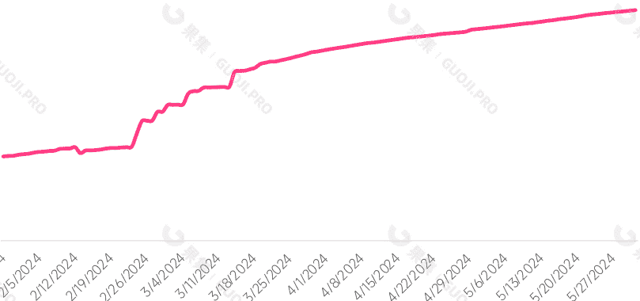

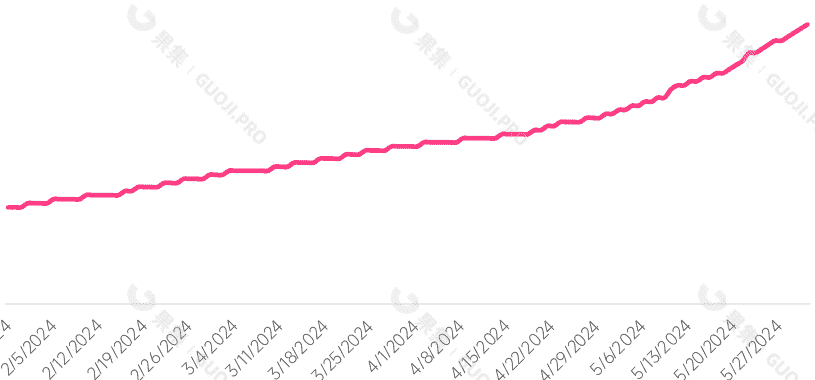

数据来源：飞瓜数据(feigua.cn)，图表解读：数思AI（shusi.cn），研究分析：果集行研（guoji.pro）；取数周期：2024年1月-2024年5月

## 【悦人礼赠】人群以情感为驱动，综合考虑品质与预算

在送礼过程中，消费者的购买决策是一个情感驱动的过程，从识别礼品适用的节日或场合开始，确保礼品的相关性和适宜性；消费者追求礼品的高品质和档次，以满足期望和标准；包装设计和呈现效果是增强礼品价值感和仪式感的关键，礼盒成为首选；在预算范围内，消费者会进行攻略查找，以平衡礼品质量和价格；最终，综合这些因素，消费者做出购买决策并完成购买行动。

以**情感驱动**为核心的用户决策路径：

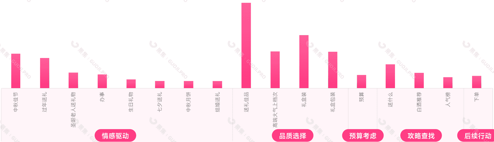

数据来源：飞瓜数据(feigua.cn)，图表解读：数思AI（shusi.cn），研究分析：果集行研（guoji.pro）；取数周期：2023年1月-2024年5月

## 【悦人礼赠】需求下核心品类：美容护肤是首选送礼品类，健康相关品类展现出市场潜力

从关联品类来看，美容护肤和时尚饰品类依旧是首选的主要送礼品类；手机作为实用且具有一定档次的产品，通常被作为礼物赠送给亲友或家庭成员，适用于多种场景；随着全年龄段消费者健康意识的增强，健康相关品类，如奶粉冲饮和个人保健产品等，展现出巨大的市场潜力。

## 【悦人】相关作品关联品类分布

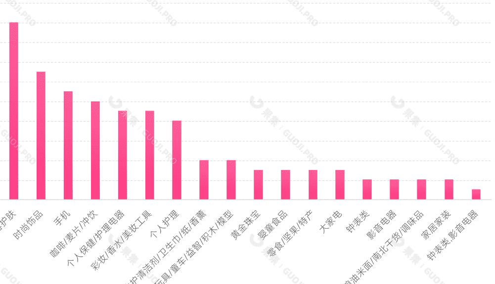

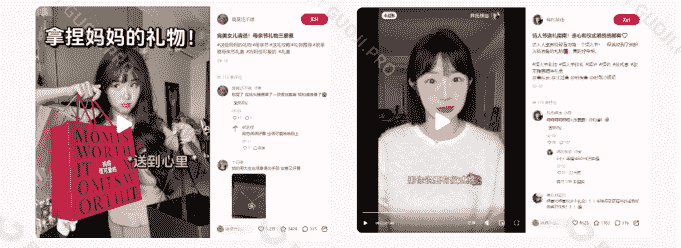

**品牌：欧莱雅**  
作品标题：完美女儿请进！母亲节礼物三要素  
内容方向：结合周期性热点#母亲节，产出母亲节送礼攻略  
场景满足：家庭关系维护  
满足需求：送到心里  
阅读量：53万+

**品牌：欧莱雅**  
作品标题：情人节送礼指南！走心和仪式感统统都有💗  
内容方向：结合周期性热点#情人节，分享情人节收到的仪式感好物  
场景满足：家庭关系维护  
满足需求：仪式感  
阅读量：20万+

美容护肤品牌欧莱雅，在送礼营销方面针对周期性节日推出限定礼盒，通过创造有趣的送礼指南和产品使用教程等，解决用户关于难以挑选出符合对方心意的礼物的痛点；其营销策略强调产品在传递爱与关怀中的独特价值，从而吸引用户的关注。

数据来源：飞瓜数据(feigua.cn)，图表解读：数思AI（shusi.cn），研究分析：果集行研（guoji.pro）；取数周期：2024年1-5月

## 【成瘾赛道】高热度下的【精神成瘾】用户路径

精神成瘾现象通过外部触发器吸引和内部触发器激发，促使消费者行动并投入时间、精力、金钱和情感，以追求多变奖励、社交认同、品牌忠诚和个性化表达，最终实现虚拟陪伴和精神寄托。

**触发**

外部触发器：利用社交媒体、KOL/KOC合作、广告等方式，创造话题和兴趣点，引发消费者的好奇心和兴趣。

内部触发器：通过品牌故事、价值观、情感联结，激发消费者内在的渴望和需求。

**行动**

行动过程简单、直观，且与他们的能力相匹配。

**投入**

时间/精力投入｜金钱投入｜感情投入｜品牌忠诚度

**感官反馈，多变的奖励**

强惊喜、不确定性的吸引力，持续的创新和新鲜感；收集满足感，令人宽慰的重复仪式感；强社交属性，社交认同；强溢价；个性化表达；“虚拟陪伴”精神寄托；负面情绪释放。

数据来源：飞瓜数据(feigua.cn)，图表解读：数思AI（shusi.cn），研究分析：果集行研（guoji.pro）；尼尔·埃亚尔的《Hooked: How to Build Habit-Forming Products》

## 【成瘾赛道】归类为精神绝对成瘾、物理相对成瘾和刚需天然成瘾

成瘾赛道可以根据其成瘾的驱动力和影响范围被分为精神绝对成瘾、物理相对成瘾和刚需天然成瘾三个类别，每个类别都有其特定的成瘾机制和行为表现。

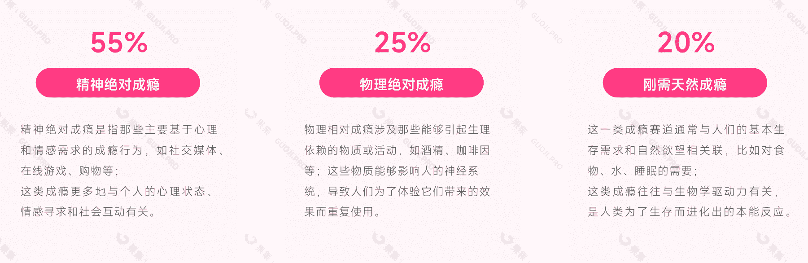

55%

精神绝对成瘾

精神绝对成瘾是指那些主要基于心理和情感需求的成瘾行为，如社交媒体、在线游戏、购物等；这类成瘾更多地与个人的心理状态、情感寻求和社会互动有关。

25%

物理相对成瘾

物理相对成瘾涉及那些能够引起生理依赖的物质或活动，如酒精、咖啡因等；这些物质能够影响人的神经系统，导致人们为了体验它们带来的效果而重复使用。

20%

刚需天然成瘾

这一类成瘾赛道通常与人们的基本生存需求和自然欲望相关联，比如对食物、水、睡眠的需要；这类成瘾往往与生物学驱动力有关，是人类为了生存而进化出的本能反应。

## 【精神成瘾】赛道集换式卡牌引发的社交认同与精神依赖

《小马宝莉》的话题热度呈现逐步上升的趋势，其精美的卡片制作和引人入胜的不确定性吸引了大量玩家；集换式卡牌带来的满足感和社交认同感推动了《小马宝莉》抽卡游戏的迅速走红，并在精神层面上满足了玩家的需求；与此同时，社交话题的热度反过来提升了该IP的影响力，通过制造话题进一步扩大IP的覆盖范围；最终，这种互动形成了一种精神上的依赖机制。

## 小马宝莉话题热度

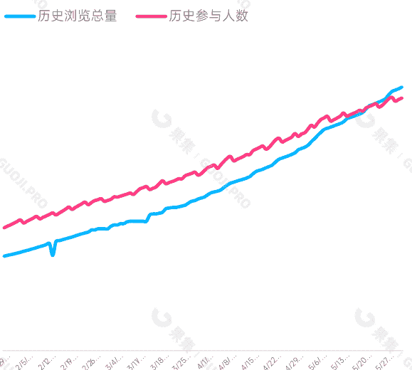

## 制作精美+可爱风格

## 不确定性的吸引力

品牌：小马宝莉  
作品标题：花999买小马宝莉福袋到底值不值！？#小马宝莉 #拆卡日常 #卡片不重复 #卡片盲盒  
内容方向：抽卡价格计算  
**多变的奖励：强溢价**

## 社交认同

品牌：小马宝莉  
作品标题：一票前肚了，爽！#小马宝莉 #拆卡 #tmlp #拆卡日常 #小马宝莉卡片  
内容方向：特卡展示，沾欧气  
**多变的奖励：社交认同**

## 收集满足感

品牌：小马宝莉  
作品标题：艾米花300多元收集68张卡，妈妈用软件估价发现大多就值几毛 #小马宝莉卡片 #母女搞笑日常 #亲孩子  
内容方向：抽卡价格计算  
**多变的奖励：收集满足感**

数据来源：飞瓜数据(feigua.cn)，图表解读：数思AI（shusi.cn），研究分析：果集行研（guoji.pro）；取数周期：2024年1-5月

## 高热度下的【精神成瘾】赛道，2025年市场规模预计将超180亿元

2022年，中国IP卡牌行业的市场规模达到了68.7亿元，预计到2025年，该市场规模将超过180亿元。自2023年以来，国产卡牌新品迎来了爆发性增长，吸引了大量卡牌发行商和IP公司进入市场，进一步推动了国产卡牌新品的集中涌现；2024年年初，卡游公司在获得授权后，公开发售小马宝莉衍生卡牌，推动卡牌市场迈向新高度。

## 集换卡牌市场规模（亿）

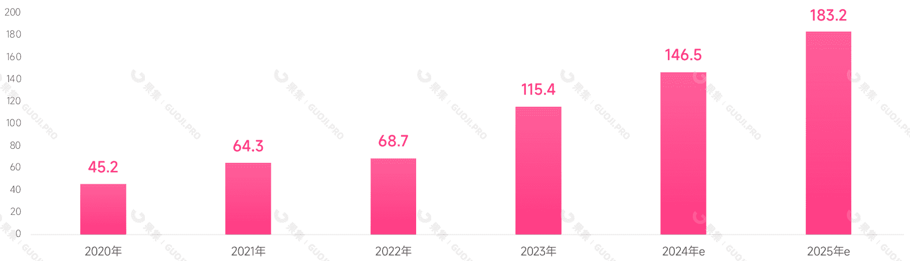

数据来源：互联网公开数据

# 情感驱动的营销逻辑解析：心之所向，消费所至

## 用户分析

深入分析用户是理解他们需求和行为的关键。

## 情感需求

情感需求是消费者在购买决策过程中的核心驱动力。

## 内容制作

内容是品牌与消费者沟通的桥梁，品牌应基于用户需求，策略性融合短期热点与长期价值观。

## 满足需求

用户通过内容触达，感受到产品或服务的价值，从而产生体验消费意愿。

## 消费体验

通过内容激发用户的心智满足，进而引导其转化为实际的消费行动，实现品牌与消费者之间的良性互动。

## PART 03

# 品牌如何进行情感诉求场景营销

果集  
GUOJI.PRO

2024备战双十一 消费者行为与品牌前瞻布局  
（情感诉求赛道）篇

营销案例拆解

## 【悦己疗愈】场景案例：老庙黄金的【好运】营销

老庙黄金结合用户底层需求出发，在2024年通过快闪活动、产品上新等动作，成功地将好运文化与现代消费者的需求相结合，推动了品牌的年轻化和市场影响力的扩大。520/618大促方向围绕【老庙给您带来好运气】进行；24年520大促较平峰期销售提升130%，排名上升11位，618大促旗舰店营收同比提升3213%。

2024年520大促，较平峰期销售提升：**130%**，品类排名：**↑11**

2024年618大促，旗舰店营收环比：**33%**，旗舰店营收同比：**3213%**

## 营销核心立意：内心秩序的重建

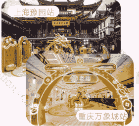

**活动策划——Lucky Walk快闪活动：**

2024年1月开始，老庙举办了“走好运路，奔富余年！”Lucky Walk快闪活动，结合City Walk城市漫步形式和老庙的“好运”文化，与消费者建立情感共鸣。

前期策划，抢占用户“带【好运】黄金选老庙”的心智。

**产品上新——串好运系列：**

2024年上半年上新一串好运系列产品，立足品牌“好运”基因的老庙串好运系列，正是为了满足当代年轻人的消费哲学与情感需求而打造的潮流新品，旨在成为当代向上青年坚实的情感支撑。

中期种草，【招好运】打玄学牌。

消费者对【好运】以及【发财】表现出兴趣。

营销方向：强调产品寓意【招好运】，打玄学牌。  
缓解用户情绪：事业焦虑、经济焦虑。  
满足用户底层需求：【更有安全感、疗愈转运】。  
相关作品CTR达：7.06%。  
相关作品最高CTR达：14.52%。

**520大促：**直播间标题：老庙给您带来好运气  
**520/618大促：**直播间引流视频标题

- 不追求奢华，只追求简约优雅的项链，让每一天都有好运相伴。#老庙黄金
- 祝您每天都有好心情 #老庙黄金 #惊不惊喜意不意外
- 身戴金饰，生活多福禄 #老庙黄金 #美出高级感
- 套于指间，金戒圆满，不论起止 #老庙黄金 #好物推荐

后期发草，转化场持续强调【好运】，吸引转化。

| 品牌搜索关联词 |  |
|---|---|
| 老庙 | █████ |
| 银楼 | ██ |
| 好运气 | ████ |
| 老凤祥 | █ |
| 莫珠宝 | █ |
| 黄金首饰 | █ |
| 专卖店 | █ |
| 中华老字号 | █ |
| 今日金价 | █ |
| 中国黄金 | █ |

## 【解放双手】场景案例：方太的全场景厨电解决方案

方太品牌定位于全场景厨电解决方案，主要面向25岁以上的中产阶级人群，包括有孩子的家庭和DINK家庭；其营销策略围绕“解放双手”的主题展开，明确传达产品的核心利益点，并通过情感价值的提升来强化主题，强调解放双手能够增加生活幸福感；通过脉冲式营销，品牌在用户心智中的占领取得了效果，使用户对方太产品“解放双手”的功效有了认知；因而在618大促中，旗舰店营收环比提升101%，同比提升70%。

2024年618大促，旗舰店营收环比：**101%**，旗舰店营收同比：**70%**

## 营销核心立意：便捷式生活，提升生活幸福感

**品牌目标群体：**  
适婚/新婚期的中产阶级

**品牌营销体系：**  
**产品营销：**功能价值，体现产品核心利益点

**用户心智反馈：**  
【解放双手】相关搜索词下品牌排名

**品牌核心沟通对象：**

“聚焦处于适婚/新婚期的中产阶级”，他们是我们最想争取的一群人。得到他们的关注，赢得他们的好感和认同，是品牌传播的核心目标。

## 解放双手营销关键词

**产品：**方太蒸烤烹饪机Z2.i  
**营销内容：**10分钟就能搞定全家人的早餐，一锅出六道菜

**产品：**方太V6洗碗机  
**营销内容：**18套的大容量，3层碗碟，盘、碗、杯子和锅统统可以放进去

**产品：**方太V6洗碗机  
**营销内容：**15套大容量，锅碗瓢盆统统都能放得下，一次性搞定全家餐具

**情感营销：**

真的太太太幸福了！从此解放双手做大餐！#提升幸福感的家居好物 #年度幸福感好物

**情感营销：**

就连日常的花瓶清洗，我也是直接交给它，洗去烦恼，享受生活，解放双手原来这么简单。

**情感营销：**

平时上班带娃已经够累了，洗碗这件事就交给洗碗机吧，省下来的时间看看电影、陪陪孩子，不要太幸福。

**家务责任场景**

**情感营销：**利用情感营销，讲述用户通过使用方太产品，如何享受到更多与家人相处的时光，提升生活幸福感。

数据来源：飞瓜数据（feigua.cn），图表解读：数思AI（shusi.cn），研究分析：果集行研（guoji.pro）；取数周期：2023年1月—2024年5月

## 【悦人礼赠】案例：SKG为爱添心意的【健康礼】

SKG品牌在送礼营销方面针对周期性节日推出限定礼盒，通过借助名人效应，创造送礼指南和产品使用教程等，解决用户难以挑选出符合对方心意礼物的痛点；其营销策略聚焦于产品的礼赠情感价值，强调产品在传递爱与健康。24年5月份叠加母亲节与520情人节，环比提升了219%；24年618大促销售额同比提升114%。

2024年5月份（母亲节+520情人节）销售额环比提升：**219%**  
2024年618销售额同比提升：**114%**

## 营销核心立意：显贵/价值—有面子

## 用户赠礼需求

- 挑选出符合对方心意的礼物
- “有里有面”
- 全龄段消费者健康意识的增强

## 品牌的礼赠营销

**2024年春节限定礼盒：**

关注礼盒的高端仪式感和品质感。

2024年SKG年货节上线新年礼盒，G7豪华款按摩腰带、G7轻款颈部按摩仪组合装，兼顾颈部与腰部按摩，K5系列等爆款单品也将换新包装。

家庭关系维护、社会关系维护、商务关系维护

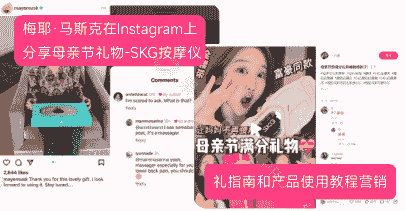

**2024年母亲节礼盒营销：**

母亲节关注母亲健康。

2024年SKG将按摩腰带作为母亲节礼物推荐，针对腰突问题进行营销，可见品牌在母亲节营销中专注于解决实际的健康问题。

家庭关系维护

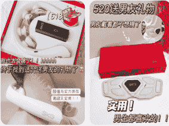

**2024年520情人节礼盒营销：**

520节日关注情侣间的爱意表达。

2024年SKG将颈椎按摩仪作为情人节礼物推荐，将产品定位为能够带来舒适和关怀的礼物。

亲密关系维护

## 用户心智反馈

品牌相关搜索词：

- 礼盒
- 好礼
- 礼
- 七夕送礼
- 七夕礼盒
- 好礼物
- 礼
- 母亲节礼物
- 暖心礼物
- 礼品行业
- 礼品
- 新年送礼
- 礼品卡
- 送礼
- 送男朋友礼物

SKG品牌的营销策略聚焦于产品的礼赠情感价值，突出“健康礼”的概念。

数据来源：飞瓜数据（feigua.cn），图表解读：数思AI（shusi.cn），研究分析：果集行研（guoji.pro）；取数周期：2023年1月—2024年5月

## 【成瘾】案例：雀巢咖啡的【提醒每一天】

雀巢咖啡以“提醒每一天”为品牌理念，将咖啡与日常生活中的愉悦时刻紧密结合；产品上，2024年推出了限定口味，如柑橘乌龙拿铁，以限定版本吸引消费者；营销上，通过创建并推广诸如#跃进山野#、#多巴胺灵感搭子#的话题活动，在社媒上激发用户讨论和参与；2024年618大促期间，品牌互动量同比提升62%，大促销售额同比增长7%。

2024年618大促品牌互动量同比：**62%**  
2024年618大促营收同比：**7%**

## 营销核心立意：愉悦时刻，多巴胺分泌

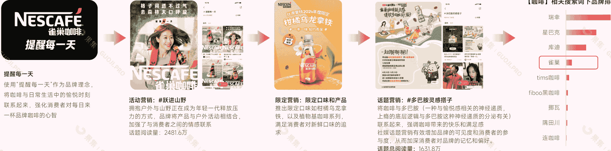

**提醒每一天**

使用“提醒每一天”作为品牌理念，将咖啡与日常生活中的愉悦时刻联系起来，强化消费者对每日来一杯品牌咖啡的心智。

**活动营销：#跃进山野#**

拥抱户外与山野正在成为年轻一代释放压力的方式，品牌将产品与户外活动相结合，加强了与消费者之间的情感联系。  
话题阅读量：2481.6万

**限定营销：限定口味和产品**

推出限定口味，如柑橘乌龙拿铁，以及植物基咖啡系列，满足消费者对新鲜口味的追求。

**话题营销：#多巴胺灵感搭子#**

将咖啡与多巴胺（一种与愉悦感相关的神经递质）联系起来，强调咖啡带来的快乐和满足感，在社媒话题营销中有效增加品牌的可见度和消费者的参与度，从而加深消费者对品牌的记忆和偏好。  
话题总阅读量：1631.8万

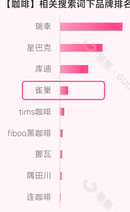

雀巢咖啡的成瘾营销策略是一个综合运用品牌理念、话题营销、限定产品、户外活动和情感营销的多维度策略，有效地促进了消费者的购买行为，增强了品牌的影响力和市场竞争力。

数据来源：飞瓜数据（feigua.cn），图表解读：数思AI（shusi.cn），研究分析：果集行研（guoji.pro）；取数周期：2023年1月—2024年5月

## PART 04

# 社媒平台上的情感诉求场景策略建议

果集 GLOJI.PRO  
2024备战双十一 消费者行为与品牌前瞻布局  
【情感诉求赛道】篇

双十一品类策略建议

# 双十一大促情感诉求赛道传播规划建议

# 规划建议

## 现状

流量在涨，心智在集中，营销在卷。

## 机会

大促期间，消费心智的集中释放。

## 营销重点

消费心智的前置布局，为增量蓄能。

## 怎么做

精细洞察行业，提升经营效率。

# 双十一大促情感诉求赛道营销重点

## 悦己疗愈

场景下核心需求：

- 使得自己更愉悦
- 个性独立，超越自己
- 更有安全感，疗愈转运
- 放松自我
- 弱化消极情绪

## 妈妈/养宠一族解放双手

场景下核心需求：

- 摆脱物质依赖，追求精神满足，获得精致仪式感
- 从繁重家务劳动到科技产品解放双手
- 寻求时间自由

## 悦人礼赠赛道

场景下核心需求：

- 挑选出符合对方心意的礼物
- 挑选出符合需求场景的礼物
- 挑选出有面子的礼物
- 挑选出个性化的礼物

## 成瘾赛道

场景下核心需求：

- 强惊喜，不确定性的吸引力，持续的创新和新鲜感
- 收集满足感，令人宽慰的重复的仪式感
- 强社交属性，社交认同
- 强溢价
- “虚拟陪伴”精神寄托

# 场景下需求共性：感官反馈为主，追求情感满足与自我实现

营销重点围绕：

- 觉醒的女性力量：内心愉悦与自我成长
- 内心秩序的重建：宠物疗愈与上头的玄学转运
- 童年治愈：养一个小时候的自己

营销重点围绕：

- 个性化生活，如“独居”
- 便捷生活方式，如“懒人食谱”
- 现代家庭育儿，如“爸爸带娃”
- “它”经济盛行，深化智能养宠，强调全天候

营销重点围绕：

- 强调适用赠礼场景，并提供在不同关系和场合中送礼的策略
- 以人群需求为出发点，送礼攻略向内容，解决需求痛点

营销重点围绕：

- 持续的创新，保持不确定的新鲜感，以及收集的持续性
- 社交分享，“欧气”拉满情绪价值
- 强调“虚拟陪伴”精神寄托

数据来源：飞瓜数据（feigua.cn），图表解读：数思AI（shusi.cn），研究分析：果集行研（guoji.pro）

2024营销双十一—消费者行为与品牌前瞻布局（情感诉求篇）

# 从消费者行为出发，有的放矢，备战双十一

## 品类分析

- 爆品品类分析
- 趋势品类分析
- 竞品分析

## 品类人群，赛道锚定

- 悦己疗愈
- 妈妈/养宠一族解放双手
- 悦人礼赠
- 成瘾赛道

## 人群洞察

- 人群特征
- 人群底层需求
- 人群偏好
- 人群决策路径

## 内容策略

- 核心Idea
- 场景
- 内容类型分布

# 实用便利赛道

家居用品｜个人护理｜学习用品  
运动户外｜3C数码

# 2024双十一备战报告系列

## 情感诉求赛道

母婴宠物｜彩妆护肤｜珠宝文玩  
钟表配饰｜生活家电｜电子游戏  
烟酒品类

## 个性表达赛道

抗老紧致｜美白提亮｜舒敏修护  
痘肌护理｜品质男装｜时尚女装

## 大健康需求赛道

保健食品｜滋补营养品  
膳食营养补充剂｜理疗仪器

## 免费领取

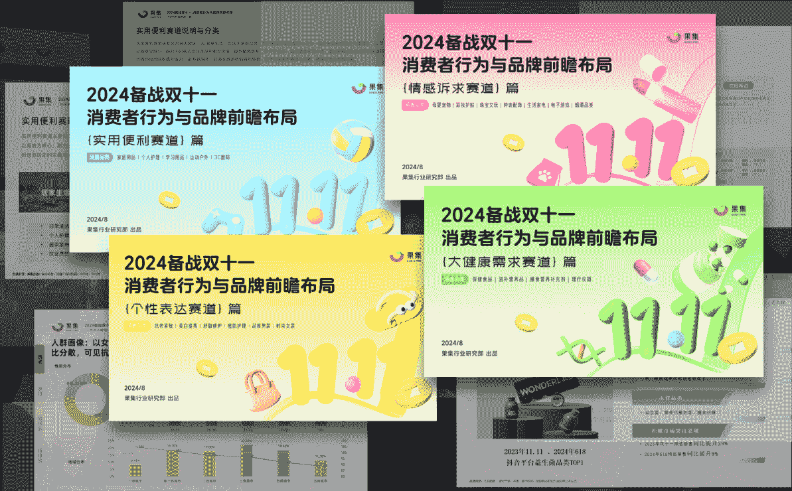

# 果集·大促营销解决方案

双11/618/38女王/双12/年货节 …

| 社媒平台 | 节奏规划 | 预热传播 | 货品策略 | 直播营销 | 大促复盘 |
|---|---|---|---|---|---|
|  | 全媒体渠道 | 小红书、微博、视频号、B站…… | 抖音、快手 | 抖音、快手 | 全媒体渠道 |
| 支撑场景 | 传播节奏目标拆解 | 内容经营氛围塑造 | 流量和货品策略、新品发布和老品破圈 | 达人直播带货 | 大促活动复盘、行业案例解读 |
| 解决方案 | 行业竞争策略工具 数恩（智能） 飞瓜品策（全面） 集瓜数据（定制） 果集行研（深度） | 行业KOL数据库 千瓜数据/西瓜数据/友望数据  社媒KOL投放服务 面朝互动 / 蝉果 / 飞瓜智星  资产管理 云略 / 可瓜 | 直播电商数据工具 飞瓜抖音 飞瓜快手 | 直播间精细化运营 飞瓜智投  直播电商ERP 易瓜 | 行业大促报告 果集行研 集瓜数据 |

果集 GOOJI.PRO

2024备战双十一—消费者行为与品牌前瞻布局

《情感诉求赛道》篇

# 营销洞察，一键生成

品类大盘、营销活动、达人投放、种草效果、消费者洞察、竞品对比、社媒舆情、品牌宣传……

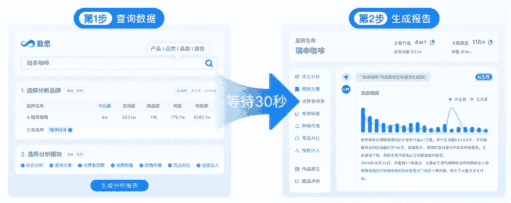

免费体验

数思 shusi.cn

# 果集定制化洞察报告服务

果集行研以强大的社交媒体全域数据体系为依托，专注于消费品牌的社交媒体营销研究。我们聚焦六大主流社媒平台（抖音、快手、小红书、微博、微信、B站），为品牌提供趋势洞察、竞争分析、用户洞察以及社媒营销策略支持。

## 定制报告类型

- **类目趋势报告**：类目赛道宏观数据呈现，深入分析细分品类需求与趋势
- **竞争环境报告**：全方位呈现营销走势、内部品牌形象和竞品营销策略
- **产品认知报告**：描绘消费人群特征，系统归纳总结产品对用户心智渗透
- **用户洞察报告**：深度洞察用户需求，分析总结消费意向和偏好
- **内容分析报告**：总结热门内容特点，发掘最新引爆用户兴趣的爆款话题
- **潜力KOL报告**：全面复盘各层级达人直播、视频和种草效果

## 联系我们

微信：  
邮箱：Chance.QU@guoji.pro

# 果集—社交媒体全链路服务商

果集科技是一家社交媒体全链路服务商，公司致力于将大数据、AI等新技术应用于社交媒体营销和电商领域，以数据和技术驱动品牌增长。通过**行业咨询**、**策略系统**、**营销执行**、**运营工具**四个方向，为品牌提供社交媒体全链路解决方案。

## 旗下产品

PRODUCTS OF GUOJI

- 果集·定制研报
- 飞瓜抖音版
- 飞瓜快手版
- 飞瓜B站版
- 飞瓜智投
- 千瓜
- 西瓜数据
- 集瓜
- 云略
- 数思

## 联系&合作

CONTACT&COOPERATION

# 2024备战双十一 消费者行为与品牌前瞻布局

（情感诉求赛道）篇

# 数据驱动品牌增长

果集，社交媒体全链路服务商

获取方案、试用产品，请访问果集官网

