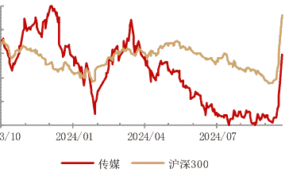
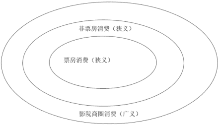
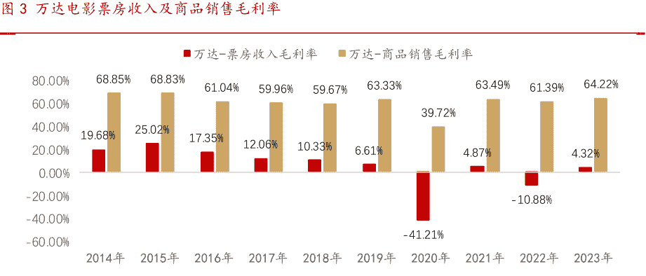
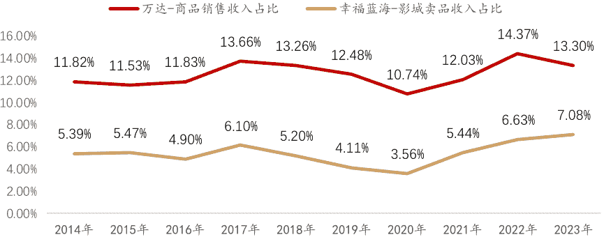
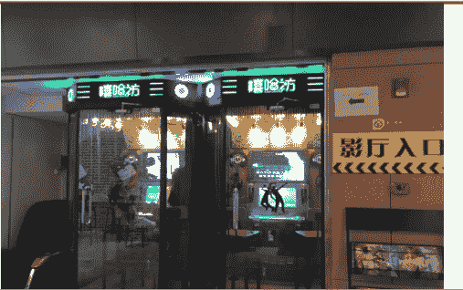
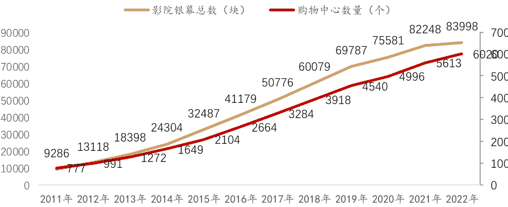
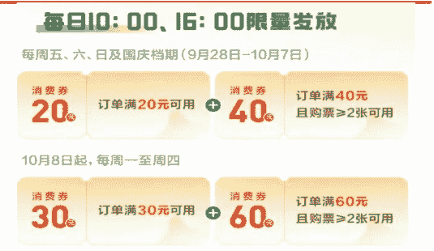
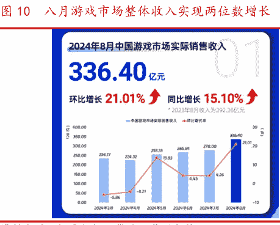
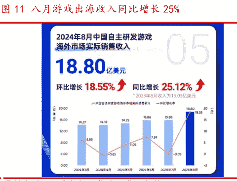
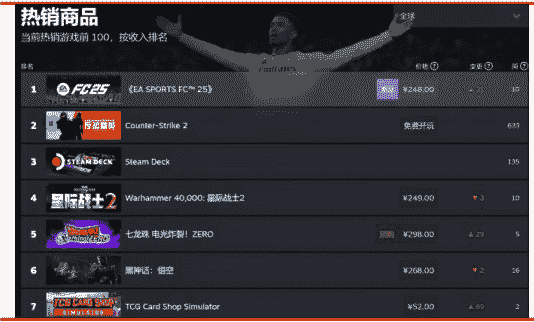

## 聚焦新质消费业态，关注核心优质资产我是 goaichat 研发的智能大模型，可以为你提供智能问答、分析和创作服务。## 推荐电影、游戏、互联网行业## 政策提振市场情绪，消费服务行业估值修复可期自9月24日以来，央行通过降准、降息和流动性互换等措施，为提振市场信心和提升流动性创造了积极条件。9月26日的政治局会议进一步加大了内需和消费的关注。聚焦可选消费中传媒板块，叠加国庆节旺季以及消费利好刺激，我们认为节后估值有望继续修复。建议关注民生消费相关三类标的：1）电影行业；2）游戏行业；3）港股互联网。

##电影：消费券促院线回暖，挖掘影院商圈消费潜力2024年至今，电影市场持续复苏，优质作品层出不穷。今年8月份，国务院印发的《关于促进服务消费高质量发展的意见》中，在文化娱乐消费方面着重指出，促进电影关联消费。国庆节前后，各地区宣传部、电影局联合多个互联网平台，计划发放规模千万元级的电影消费券活动，活跃了电影市场和影院周边商圈的消费。截至10月7日12:20，国庆档电影票房已破20亿元，其中《志愿军：存亡之战》累计票房破8亿元。

## 游戏：提振内需，赋能科技，步入文化出海新阶段游戏行业文娱消费的重要构成，为消费者提供了虚拟物品、IP衍生品及电竞赛事等多维度消费场景，推动了硬件性能、图形处理、云计算等前沿科技的创新历程。游戏亦肩负着文化传播的重要使命，八月以来，随着《黑神话：悟空》等高质量精品游戏在海外取得成功，我们认为游戏出海已经进入新篇章。当下，外部监管环境趋于稳定，版号供给充足，新作密集上线，我们继续看好游戏行业的增长前景，重点推荐三七互娱和完美世界等受益标的。

##互联网：促消费、拉就业，迎业绩估值修复良机互联网企业通过构建多元化消费场景、提升消费决策效率以及积极响应政策刺激，有效激发了消费活力，为经济复苏贡献了重要力量。与此同时，互联网平台在稳就业方面也扮演了“就业稳定器”的角色，创造了大量直接和间接就业岗位，并推动了新兴职业的兴起。随着政策的支持及市场流动性的改善，叠加五项金融托底，腾讯控股、美团等龙头企业有望有力实现估值修复和业绩提升。

## 投资建议受益标的——1）电影行业：万达电影、横店影视、捷成股份；2）游戏行业：三七互娱、完美世界；3）港股互联网：腾讯控股、美团。

## 风险提示宏观经济下行风险；政策不及预期风险。

|评级及分析师信息 |
|---|
| 行业评级：推荐 |
| 行业走势图 |
| 分析师：赵琳 邮箱：zhaolin@hx168.com.cn SAC NO：S1120520040003 |
| 分析师：李钊 邮箱：lizhao1@hx168.com.cn SAC NO：S1120520100001 |
| 联系人：何青 邮箱：heqing1@hx168.com.cn |



##1.电影行业：消费券促院线回暖，挖掘影院商圈消费潜力2024年至今，电影市场持续复苏，优质作品层出不穷，春节档的《热辣滚烫》《飞驰人生2》《抓娃娃》均获得票房超过30亿元的不俗成绩。

**电影票房驱动影院消费的源动力。** 我们认为影院消费狭义上包括了影院门店的票房业务和观影相关的零售项目（即非票房业务），广义上还包括影院商圈的线上、线下消费联动。今年以来，国家接连出台促消费政策，其中便包括发放电影消费券，可见电影驱动影院商圈消费具有较大的潜力。

图12024年电影票房收入排行榜（截至2024.10.06）

| 排名 |电影名称 | 上映时间 |票房金额（亿元） |
|---:|---|---|---:|
|1 | 热辣滚烫 |2024/2/10 |34.6 |
|2 | 飞驰人生2 |2024/2/10 |33.98 |
|3 | 抓娃娃 |2024/7/16 |33.27 |
|4 | 第二十条 |2024/2/10 |24.54 |
|5 | 熊出没·逆转时空 |2024/2/10 |20.06 |
|6 | 默杀 |2024/7/3 |13.51 |
|7 | 哥斯拉大战金刚2：帝国崛起 |2024/3/29 |9.56 |
|8 | 志愿军：存亡之战 |2024/9/30 |7.96 |
|9 |你想活出怎样的人生 |2024/4/3 |7.91 |
|10 | 异形：夺命舰 |2024/8/16 |7.85 |



###1.1.影院非票业务毛利高，积极拓展零售品类，创新营销**影院票房业务毛利率低，非票房业务占比提升，贡献主要利润。**近年来，院线行业竞争日益加剧，电影放映业务毛利率被压至10%以下，参考万达电影公开披露的数据，商品销售对应的非票房业务毛利率超过60%，成为公司主要的利润贡献点。参考万达电影、幸福蓝海的数据，商品销售占比呈缓慢提升态势，但占比仍然较小，具有较大提升潜力。



## 图4主要公司影院零售收入占比

资料来源：公司公告，华西证券研究所**拓展影院零售品类，创新营销模式，**成了提升影院非票房业务、做大营业利润的重要抓手。近年来，除了传统的按摩椅、迷你KTV、娃娃机等，台球桌、游戏机的加入丰富了影院的泛娱乐项目，刺激观众消费。2024年9月26日，万达电影旗下震映影城上海睿聚店开业，全国首家“花花世界”爆米花专营店亮相璟城，通过创新的风味食材和消费模式，打造出一个可逛、可打卡的电影院文化生活新空间，为观众带来耳目一新的观影体验。通过创新营销模式，电影院不是单一的观影场所，而以观影为中心的消费新场景；看电影也不再单一的娱乐活动，而融合了社交、休闲、探索等多种元素的综合体验。

## 图5影院引入迷你KTV

资料来源：新浪新闻，华西证券研究所## 图6 “花花世界”爆米花专营店

资料来源：网易新闻，华西证券研究所###1.2 与周边实体消费联动，影院商圈融合发展或为趋势2011—2022年，影院银幕数与购物中心数量的增长趋势相近，而大部分大型购物中心均有电影院，也体现了影院带动周边消费的重要作用。

在上海国际电影节期间，为积极创新影视文化和商业旅游的互动融合与发展，“电影”链接出无限可能：

1. 上海黄浦文旅集团召集旗下大光明电影院、和平影都、国泰电影院和黄浦剧场四大参展影城，联手为南京路商圈和淮海路商圈提供了两百余张电影节电影票。活动现场，上海黄浦文旅集团、新世界集团和淮海海峡集团一起为南京路和淮海路的标杆商业企业赠发了第26届上海国际电影节参展影片电影票。抢不到热门影片，可以试试去南京路、淮海路商圈“满额获赠”。

2. 不仅消费者在商圈消费可以获赠电影票，影迷在电影院结束观影后，存留的电影节票根也能变身折扣券，在南京路、淮海路商圈获得折扣优惠。

## 图72011—2022年全国影院银幕总数及购物中心数量

资料来源：Wind，华西证券研究所## 图8 第26届上海国际电影节

资料来源：网易新闻，华西证券研究所## 图9 上海地区电影消费券详细优惠内容

资料来源：猫眼电影，华西证券研究所###1.3 国家提出促进电影关联消费，多地发放电影消费券2024年8月，国务院印发的《关于促进服务消费高质量发展的意见》中，在文化娱乐消费方面着重指出，促进电影关联消费。

2024年8月2日，国家电影局协同中国工商银行、中国银联、猫眼娱乐共同启动全国电影惠民消费季。消费季贯穿8月至10月，覆盖暑期、中秋、国庆等主要电影档期，惠及全国电影观众。中国工商银行、中国银联、猫眼娱乐作为消费季支持单位，将合计投入超过3亿元观影优惠补贴。3家支持单位将开展融合线上线下、贯通多元场景的丰富促销活动，包含观众积分兑换、购票立减、多券叠加、观影享受商圈折扣、暑期学生“惠”等形式多样的消费优惠。

国庆节前后，各地区宣传部、电影局联合多个互联网平台，计划发放规模千万元级的电影消费券。优惠内容多样，有些观众在国庆期间花了不到10块钱就看了场电影，活跃了电影市场和影院周边商圈的消费。根据艺恩数据，截至10月7日12:20，国庆档（10.01—10.07）电影票房已破20亿元，其中爱国主义教育题材电影《志愿军：存亡之战》累计票房破8亿元。

## 表1 各地区电影消费券发放情况一览| 时间 | 地区 | 发放平台 |规模 | 优惠内容 |
|---|---|---|---|---|
|2024年9月28日至12月31日 | 上海 | 淘票票、猫眼 |4500万元 |最高30元单张优惠，最高60元单笔优惠，双人同行券 |
|2024年10月1日至2025年6月30日 | 浙江 | 潮新闻APP、淘票票、Z视介APP | 超过2800万元 |最高15元消费券补贴、最高15元立减、云闪付最高立减10元 |
|2024年8月20日至2025年7月31日 | 江苏 | 淘票票 |3000万元 | 周末档及重要法定节假日档每张电影票立减20元，最多40元优惠 |
|2024年10月1日至10月7日 | 北京 | 猫眼、淘票票 |1000万元 | 限时特惠、购票立减 |

资料来源：搜狐新闻、上观新闻、光明网、新闻晨报，华西证券研究所整理我们维持影视行业的推荐评级，受益标的包括：

-1）万达电影：公司作为国内影院行业龙头，布局电影全产业链，票房市占率稳步提升，中国儒意的入股有望赋能内容端，强化全产业链布局优势。
-2）横店影视：公司在过去几年稳健扩张，市占率持续提升，且影视内容投资制作发展较快，逐步提升主投主控影片力度。
-3）捷成股份：公司国内影视版权龙头，业务壁垒至高筑，同时持续探索AIGC、微短剧等新业态，目前估值水平较低，股价向上空间较大。

##2. 游戏行业：有效挖掘内需及科技进步，肩负文化出海使命**游戏已成为带动消费市场全面复苏和提升内需的重要力量。**

1）通过直接带动游戏产品、虚拟物品及其IP衍生品的销售，游戏行业不仅吸引了大批玩家投入，也推动了周边市场的发展。

2）电竞赛事的兴起和线下娱乐消费的复苏，进一步扩展了游戏行业的消费场景。大型电竞赛事吸引了大量观众前往线下观看，门票、周边产品、主题体验馆等消费形式丰富了线下消费体验，并带动了赛事主办城市的餐饮、住宿等服务行业的繁荣。

3）游戏行业深度应用虚拟现实、增强现实等新兴技术，创造了更多“虚拟现实”和线上结合的新消费场景，加线上与线下互动的AR游戏和沉浸式体验，吸引了大量消费者参与。

4）玩家高性能硬件设备的需求，以及游戏开发外包服务（如3D建模、动作捕捉）的依赖，为硬件制造和内容创作市场注入了新的增长动力。

**八月游戏市场收入实现两位数增长。** 据中国音数协游戏工委《2024年8月中国游戏产业月度报告》，8月中国游戏市场收入达336.4亿元（人民币），环比增长21.01%，同比增长15.10%。中国自主研发游戏国内市场实际销售收入为272.61亿元，环比增长32.90%，同比增长8.35%。

1）从国内市场看，游戏厂商有大量老游戏进行版本更新与活动，游戏“上新”节奏加快，腾讯《王者荣耀》、莉莉丝《剑与远征：启程》、B站《三国：谋定天下》、点点互动《无尽冬日》等都展现出了极高的吸金能力；

2）从海外收入来看，8月份中国自主研发游戏的实际销售收入达到了18.80亿美元，环比增长18.55%，同比激增25.12%，腾讯《王者荣耀》、莉莉丝《剑与远征：启程》、心动《铃兰之剑》、点点互动《无尽冬日》等游戏均取得增长（据Sensor Tower）。





资料来源：伽马数据，华西证券研究所资料来源：伽马数据，华西证券研究所**游戏行业有力推动了科技创新和技术进步。**

1）游戏对于硬件性能的高要求驱动计算机和消费电子产品性能提升的主要动力之一。游戏行业图形处理器（GPU）性能的需求直接推动了显卡技术的迭代发展。自上世纪80年代以来，从最初的2D图形渲染到如今的3D图形和实时光线追踪技术，GPU的演进史几乎与游戏行业的发展史同步。在CPU、内存、显示器、音响设备等领域，游戏用户对于流畅度、沉浸感以及响应速度的高标准，也迫使硬件厂商不断创新和优化产品设计（据中科院）。

2）游戏行业计算机图形处理和渲染技术的发展起到了至关重要的推动作用。图形渲染的逼真度游戏体验的重要衡量标准之一，近些年来，实时光线追踪技术的突破就是以游戏为主要应用场景而实现的，从而引领了整个图形处理技术的发展潮流（据中科院）。

3）游戏行业AI技术的实验性应用，为AI算法和模型提供了丰富的测试环境和训练数据。此外，游戏还成为AI仿真和强化学习的训练平台，吸引了大量科研资源和人才，从而推动了AI在其他领域（如自动驾驶、机器人、智能决策系统等）的应用和普及（据中科院）。

4）游戏行业推动虚拟现实和增强现实技术发展的先锋领域。VR游戏为用户提供了沉浸式的体验，并硬件设备（如头显、手柄、追踪设备等）提出了更高的要求。这种需求推动了VR头显设备在分辨率、刷新率、视场角（FOV）以及用户交互上的不断进步与优化（据中科院）。

5）游戏行业推动云计算和边缘计算的普及。云游戏通过将游戏的计算与渲染任务转移到云端服务器上，降低了终端设备的硬件门槛，为用户带来了“即点即玩”的便捷体验；同时也依赖于数据中心、网络基础设施的建设，为5G和边缘计算技术的应用提供了动力（据中科院）。

**今年以来版号审批显著放宽，国内游戏监管环境趋于常态化。**近期，国家新闻出版署公布了2024年9月份国产网络游戏版号，共109款游戏获批，其中腾讯《狩》、三七互娱《斗罗大陆：指尖武炼》《斗兽战场》《冒险挖恐龙》《幸运大作战》、金山西山居《世游》《剑侠情缘·零》、世纪华通《龙之谷：启程》《盟重神兵》、恺英网络《蓝月纪元》等产品取得版号。至此，2024年的版号发放累计已达到1020款，其中国产游戏占945款，进口游戏为75款，其中成都八万互动《亲爱的⼩店》从获著作权登记日到获得版号，时间间隔仅30天（据GameLook），发放口径显著放宽，彰显游戏监管的常态化趋势。

**《黑神话：悟空》大获成功，国产精品游戏出海进入新篇章。**《黑神话：悟空》游戏科学于8月20日发布的中国首款3A游戏，游戏上线首日全平台累计销量超450万份，总销售额超过15亿元。据腾讯新闻援引VG Insights，截至9月23日，《黑神话：悟空》在Steam平台的销量已经达到了2040万份，且游戏在Steam平台的总收入超过了9.78亿美元（约68.9亿人民币），即将达到10亿美元。我们看好以《黑神话：悟空》为起点，国内玩家高质量3A的认知度扩大，刺激类似产品涌现，进一步提升中国游戏的影响力。

# 我们重申游戏行业的推荐评级，受益标的包括：

-1）**三七互娱：**公司游戏业务收入显著增长，境内外市场表现亮眼，多款新品带动整体业绩提升，同时稳步推进利润分配，强化股东回报。公司在微信小游戏和出海业务方面持续发力，在MMORPG、SLG、卡牌、模拟经营等多个品类中储备了丰富的产品，并涵盖了西方魔幻、东方玄幻、三国、古风水墨等多元化题材，如《斗罗大陆：猎魂世界》《赘婿》《时光大爆炸》等新作均已获得版号并正积极推进上线。
-2）**完美世界：**公司积极优化产品布局，聚焦“MMO+”与“卡牌”两大核心赛道，储备了《诛仙2》《神魔大陆》《乖离性百万亚瑟王：环》等多款新作，涵盖仙侠、魔幻、潮流等多样题材。其中，开放世界二次元游戏《异环》已在TapTap取得115万人预约，有望成为下一阶段重点产品。




资料来源：Steam，华西证券研究所资料来源：异环，华西证券研究所##3.互联网行业：促消费、拉就业，基本面稳中向好**互联网企业通过平台生态、数字科技赋能和响应消费政策等方式，有力促进了居民消费。**

-1）打造多元化消费平台，扩大消费场景。互联网企业凭借其广泛的用户基础和生态系统，搭建了涵盖电商、社交、娱乐、生活服务等多元化消费场景的综合平台。腾讯通过微信、QQ等社交平台，搭建起了从内容到消费的全链路场景。微信小程序、微信支付、企业微信等工具成为连接消费者与商家的桥梁，实现了社交场景与消费场景的无缝融合；美团以本地生活服务为核心，通过美团APP连接餐饮、外卖、酒店、旅行、休闲娱乐等场景，推动了餐饮及本地生活服务的线上化、数字化转型。
-2）互联网企业依托自身的海量用户数据和先进的算法技术，为消费者提供个性化的内容和商品推荐，极大提升了消费决策效率。例如，阿里巴巴通过“千人千面”技术，让每个用户在淘宝和天猫上看到的商品推荐都不同；美团基于用户位置、偏好、历史消费记录等，为其推荐附近的餐厅、景点或活动，大幅提高了用户转化率。腾讯基于微信朋友圈广告和社交场景中的内容传播，为商家提供了更加精准的广告投放方式，并通过社交链条上的种草内容，提升品牌知名度和用户购买意愿。
-3）互联网企业还积极响应政府政策，通过发放消费券、平台补贴、满减优惠等方式激活消费市场，互联网企业积极参与各地消费复苏行动，与政府合作发放消费券或策划促销活动。例如，阿里在双11期间推出满减券和优惠券，美团在特定地区推出“美团消费季”活动，微信则通过企业微信和小程序为商家发放补贴券。

**互联网企业为社会创造了大量直接和间接就业岗位。** 根据《2023中国数字经济前沿：平台与高质量充分就业》研究报告，互联网平台在促进就业方面发挥了重要作用，2021年，微信、抖音、淘宝、饿了么等主流平台为中国净创造就业岗位约2.4亿，覆盖当年适龄劳动人口的27%，发挥了重要的“就业稳定器”作用。我们认为，这些平台还通过降低从业门槛、推动新兴职业（如快递员、外卖骑手、自媒体创作者等）的兴起，进一步促进了灵活就业和零工经济的发展，为社会的就业结构转型提供了有力支撑。


# 第2章 线性表

本章将介绍线性表的逻辑结构、存储结构及运算。线性表是一种最常用、最简单的数据结构，它有两种基本存储结构：顺序存储结构和链式存储结构。

## 2.1 线性表的概念及其抽象数据类型

线性表（Linear List）是由 n（n≥0）个数据元素（结点）a₁, a₂, …, aₙ 组成的有限序列。

（1）数据元素的个数 n 定义为表的长度。当 n=0 时称为空表。

（2）将非空的线性表（n>0）记作：（a₁, a₂, …, aₙ）。

（3）数据元素 aᵢ（1≤i≤n）只是一个抽象符号，其具体含义在不同情况下可以不同。它甚至可以是若干个数据项组成的，但同一线性表中的元素必定具有相同特性。

线性表中元素的个数 n（n≥0）定义为线性表的长度，n=0 时称为空表。在非空表中的每个数据元素都有一个确定的位置，如 a₁ 是第一个数据元素，aₙ 是最后一个数据元素，aᵢ 是第 i 个数据元素，称 i 为数据元素 aᵢ 在线性表中的位序。

抽象数据类型线性表的定义如下：

```text
ADT List {
    数据对象：D={aᵢ | aᵢ∈ElemSet, i=1,2,…,n, n≥0}
    数据关系：R={<aᵢ₋₁,aᵢ> | aᵢ₋₁,aᵢ∈D, i=2,…,n}
    基本操作：
        InitList(&L)  操作结果：构造一个空的线性表 L
        ListLength(L) 初始条件：线性表 L 已存在；操作结果：返回 L 中数据元素个数
        GetElem(L,i)  初始条件：线性表 L 已存在，1≤i≤ListLength(L)；操作结果：返回 L 中第 i 个数据元素
        LocateElem(L,e) 初始条件：线性表 L 已存在；操作结果：返回 L 中第 1 个值与 e 相同的元素位序
        ...
} ADT List
```

其中数据元素之间的关系是：除第一个元素外，每个元素有且仅有一个直接前驱；除最后一个元素外，每个元素有且仅有一个直接后继。

# 4. 风险提示

宏观经济下行风险；政策不及预期风险。

# 分析师承诺

作者具有中国证券业协会授予的证券投资咨询执业资格或相当的专业胜任能力，保证报告所采用的数据均来自合规渠道，分析逻辑基于作者的职业理解，通过合理判断并得出结论，力求客观、公正，结论不受任何第三方的授意、影响，特此声明。

# 评级说明

| 公司评级标准 | 投资评级 | 说明 |
|---|---|---|
| 以报告发布日期后的6个月内公司股价相对上证指数的涨跌幅为基准。 | 买入 | 分析师预测在此期间股价相对强于上证指数达到或超过15% |
|  | 增持 | 分析师预测在此期间股价相对强于上证指数在5%—15%之间 |
|  | 中性 | 分析师预测在此期间股价相对上证指数在-5%—5%之间 |
|  | 减持 | 分析师预测在此期间股价相对弱于上证指数5%—15%之间 |
|  | 卖出 | 分析师预测在此期间股价相对弱于上证指数达到或超过15% |

| 行业评级标准 | 投资评级 | 说明 |
|---|---|---|
| 以报告发布日期后的6个月内行业指数的涨跌幅为基准。 | 推荐 | 分析师预测在此期间行业指数相对强于上证指数达到或超过10% |
|  | 中性 | 分析师预测在此期间行业指数相对上证指数在-10%—10%之间 |
|  | 回避 | 分析师预测在此期间行业指数相对弱于上证指数达到或超过10% |

# 华西证券研究所

地址：北京市西城区太平桥大街丰汇园11号丰汇时代大厦南座5层  
网址：http://www.hx168.com.cn/hxzq/hxindex.html

# 华西证券免责声明

华西证券股份有限公司（以下简称“本公司”）具备证券投资咨询业务资格。本报告仅供本公司签约客户使用。本公司不会因接收人收到或者经由其他渠道转发收到本报告而直接视其为本公司客户。

本报告基于本公司研究所及其研究人员认为的已经公开的资料或者研究人员的实地调研资料，但本公司对该等信息的准确性、完整性或可靠性不作任何保证。本报告所载资料、意见以及推测仅于本报告发布当日的判断，且这种判断受到研究方法、研究依据等多方面的制约。在不同的时期，本公司可发出与本报告所载资料、意见及预测不一致的报告。本公司不保证本报告所含信息始终保持在最新状态。同时，本公司对本报告所含信息可在不发出通知的情形下做出修改，投资者需自行关注相应更新或修改。

在任何情况下，本报告仅提供给签约客户参考使用，任何信息或所表达的意见绝不构成对任何人的投资建议。市场有风险，投资需谨慎。投资者不应将本报告视为做出投资决策的唯一参考因素，亦不应认为本报告可以取代自己的判断。在任何情况下，本报告均未考虑到个别客户的特殊投资目标、财务状况或需求，不能作为客户进行客户买卖、认购证券或者其他金融工具的保证或邀请。在任何情况下，本公司、本公司员工或者其关联方均不承诺投资者一定获利，不与投资者分享投资收益，也不对任何人因使用本报告导致的任何可能损失负有任何责任。投资者因使用本公司研究报告做出的任何投资决策均是独立行为，与本公司、本公司员工及其他关联方无关。

本公司建立起信息隔离墙制度、跨墙制度来规范管理跨部门、跨关联机构之间的信息流动。务请投资者注意，在法律许可的前提下，本公司及其所属关联机构可能会持有报告中提到的公司所发行的证券或期权并进行证券或期权交易，也可能为这些公司提供或者争取提供投资银行、财务顾问或者金融产品等相关服务。在法律许可的前提下，本公司的董事、高级职员或员工可能担任本报告所提到的公司的董事。

所有报告版权均归本公司所有。未经本公司事先书面授权，任何机构或个人不得以任何形式复制、转发或公开传播本报告的全部或部分内容，如需引用、刊发或转载本报告，需注明出处为华西证券研究所，且不得对本报告进行任何有悖原意的引用、删节和修改。

# 每日免费获取资料

- 每日微信群内分享7+最新行业报告；
- 每周分享当周华为街口报、经济学人；
- 行业报告均为公开版，权利归原作者所有，参一江湖仅分发做内部学习。

｜英语外刊｜行业报告｜行业社群｜参一江湖·聚焦行业前沿


关注公众号  
领取粉丝福利
