# 策略专题研究

# 未完待续
——本轮行情的高度和运行路径预测

## 核心观点

复盘股权分置改革以来四轮牛市，基于历史同位对比，我们认为本轮行情逻辑或可类比2008至2009年“四万亿牛”。同时，参考日经225指数92年8月至93年6月走势，预计本轮行情或呈现“三段式”节奏。配置方面，第一阶段“全面绽放”，金融消费双轮驱动超跌反弹；第二阶段，分化之后再上涨，当市场整固时依据“先虚后实”、“分母先行”、“财政跟进”三条主线优选行业和个股。

- **历史比较：本轮行情逻辑或可类比2008至2009“四万亿”**

自2005年股权分置改革以来，A股市场共经历4轮牛市，分别是2005-2007年的“股改牛”、2008至2009年“四万亿牛”、2014至2015年和2019至2021年“蓝筹牛”。四轮牛市多具有资本市场改革和流动性宽松特征。对比主要指数的历史走势，当前“924行情”与08年金融危机后“市场先大幅下跌，后在政策刺激下超跌大反弹”的情形高度相似。

- **他山之石：参考日经225“三段式”行情节奏**

1992年8月至1993年6月，在宽松的财政政策支持下，日经225涨幅超过50%，但期间指数有超过15%的回调，整体结构呈现“三段式”走势。我们认为，宽松的政策出台后，受利好消息刺激，市场首先经历一波估值驱动的快速反弹，然后经过回踩整固后将依据基本面逻辑二次上攻。

- **主线探索：先虚后实、分母先行、财政跟进**

**主线一：先虚后实，财富效应。** 人民币资产价格受益于宽松政策显著反弹，资本市场再度活跃，直接利好包括非银和地产在内的大金融板块。伴随着资产价格的回升，财富效应将一定程度提振消费者信心，间接利好消费板块，并对股市形成正反馈。短期金融消费均将有所表现，形成双轮驱动的逻辑格局。

**主线二：分母先行，估值反弹。** 美联储如期开启降息周期，海外流动性改善。国内金融及资本市场政策力度超预期，无风险利率下降，风险偏好回升。多因素共振之下，A股短期折现率短时间明显下降，有利于久期较长且估值较低且分化较充分的科技成长板块。

**主线三：财政跟进，分子加力。** 本轮金融政策已经率先宽松，财政政策出台预期较强。未来宽财政的方向可能为扩赤字、增发国债、减税降费、安排财政补贴促进消费等，重点关注财政发力方向，传统上包括扩大宗消费、新旧基建与信创。

- **配置建议：“两阶段”与“三条主线”**

我们认为本轮行情或沿着“平地起惊雷”—“震荡再蓄势”—“整固再拔高”的三部曲方式演绎。本轮逻辑类似2008至2009年“四万亿牛”。以上证50为代表的宽基指数可能挑战2021年以来最大跌幅的0.618分位。节奏上建议采取“两阶段”配置思路：上行第一阶段：“全面绽放”，由金融消费“双轮驱动”，全市场普遍反弹。建议把握高阶地产、白酒、互联网等“台柱子”板块；同时超跌的医药、新能源、计算机、传媒等板块，保持仓位是关键。上行第二阶段：分化之后再上涨。一旦节后市场出现冲高回落、震荡整固，可依据“先虚后实”、“分母先行”、“财政跟进”三条主线优选行业和个股，争取在第二轮上涨时掌握先机。

- **四季度推荐股票池：“一硬两低”组合**

“一硬两低”组合汇总了各行业基本面过硬+估值偏低+前期涨幅偏低的股票。

- **风险提示**

政策不及预期、地缘政治风险、历史不代表未来、个股观点以行业团队为准。

报告日期：2024年10月06日

分析师：廖静池
执业证书号：S1230524070005
liaojingchi@stocke.com.cn

分析师：王大赛
执业证书号：S1230524060002
wangdaiji@stocke.com.cn

**相关报告**

1. 《扩散加成长，重点在电新》 2024.10.04
2. 《2024年十月策略全股报告》 2024.09.29
3. 《大反弹开启中级上涨，金融消费引领后市》 2024.09.28

## 正文目录

1. 历史比较：本轮行情逻辑或可类比2008至2009“四万亿牛”
2. 他山之石：参考日经225历史走势，指数快速上行后有整固需求
3. 主线探索：先虚后实、分母先行、财政跟进
4. 配置建议：采用“两阶上行”配置思路，后续紧跟“三条主线”
5. 各行业四季度推荐股票池：“一硬两低”组合
6. 风险提示

我们认为本轮潜在的牛市逻辑或可类比2008-2009年的“四万亿牛”。在经历2015年以来的调整周期后，我们预计岁末年初会有一轮中级反弹，挑战上证月线BOLL线上轨。但实际情况是，924政策驱动和赚钱效应的催化下，A股走出历史罕见的超强走势，仅用5个交易日就已经临近月线BOLL上轨。政策层面，财政政策值得期待，场外资金跑步进场，行情有望进一步升温。

图1：上证指数或挑战月线BOLL线上轨，后续财政政策值得期待

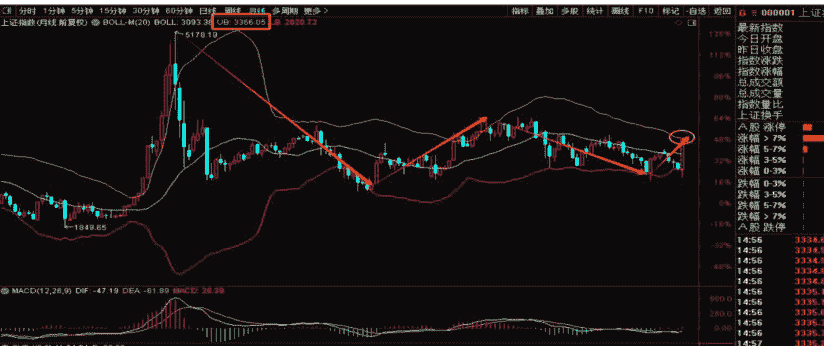

资料来源：Wind、通达信，浙商证券研究所

历史上，上证50指数有且仅有一次出现高位回撤超过50%的情况，即2008年全球金融危机时，当时从4772.93跌至1269.29点。大级别下跌后，2008年底出台的“四万亿”政策刺激市场反弹，反弹至最高2849.41。其反弹幅度恢复了此前跌幅的0.382分位，但未能触及0.5分位。

图2：2009年“四万亿”后，上证50反弹至此前跌幅的0.382分位和0.5分位之间

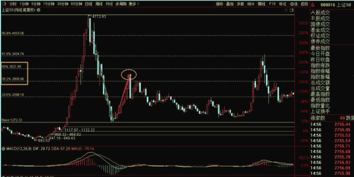

资料来源：Wind、通达信，浙商证券研究所

2021年2月以来，上证50从4110点回撤至2163点，回撤幅度接近一半，是历史上高位回撤第二大的情形。当前“924行情”与08年金融危机后“市场先大幅下跌，后在政策刺激下超跌大反弹”的情形高度相似。

## 2 他山之石：参考日经225历史走势，指数快速上行后有整固需求

1992年8月至1993年6月，在宽松的财政政策支持下，日经225涨幅超过50%，但期间有超过15%的指数级别的回调。此轮日经225指数整体结构呈现“三段式”走势。1）阶段一：政策出台提振市场信心，指数最大涨幅超过35%。1992年8月，日本政府推出了10.7万亿日元的一揽子经济措施，旨在刺激经济增长，增加就业机会。受利好消息刺激，日经225指数在1992年8月19日至1992年9月10日短短17个交易日期间，最大涨幅超过35%。2）阶段二：大涨后震荡回落。1992年9月11日至1992年11月17日，日经225指数在46个交易日中回调幅度超过15%。3）利好政策持续出台，指数上行139个交易日，涨幅超过30%。1992年11月18日，日经225开始震荡上行，于1993年3月29日见顶回落。在此期间，利好政策频出支持指数上行，1993年2月，日本央行宣布下调贴现率75BP。1993年4月1日金融制度改革法案开始执行，新制度规定银行、证券公司可以相互收买，业务也可以相互交叉，由实力雄厚的大银行、大证券公司来操控濒临倒闭的中小证券公司。我们发现，宽松的政策出台后，受利好消息刺激，市场会经历快速上涨，但上涨不是一蹴而就的，期间的回调或不可避免，健康的整固为后续进一步上涨奠定了基础。

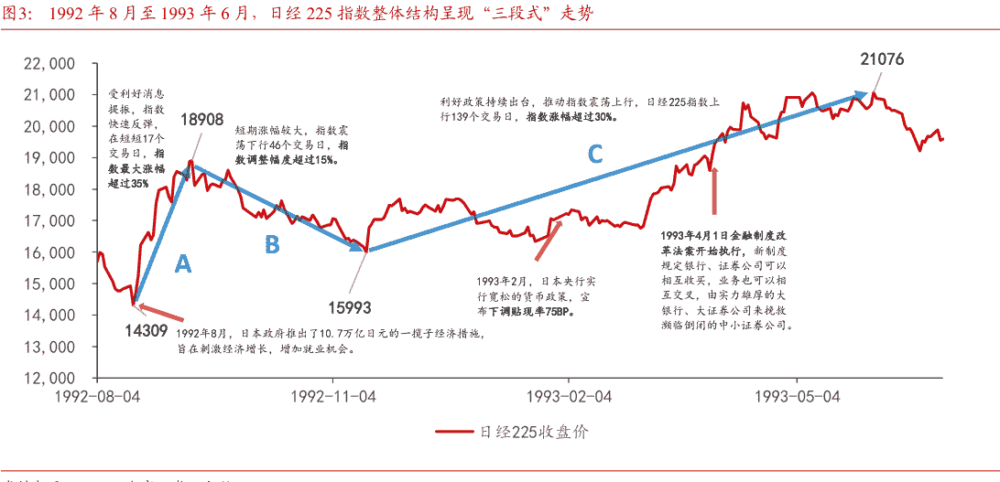

资料来源：Wind，浙商证券研究所

## 3 主线探索：先虚后实、分母先行、财政跟进

**主线一：先虚后实，财富效应。** 股市的功能定位有望逐步从“融资市”切换为“投资市”，通过财富效应拉动消费，促进内循环畅通。过去两年，A股较好地发挥了融资功能。2022-2023年，A股IPO合计741家，IPO融资规模合计9434亿元，均位居全球第一。融资规模较大且节奏较快，在为实体投资提供资本的同时也令股市出现一定程度的供需失衡。2024年1月，证监会表示“建设以投资者为本的市场，制度设计上要更加体现投资者优先”。随后，证监会陆续出台了提高上市公司质量、鼓励增持回购、加大退市力度等相关政策，更加突出以投资者为本。“924金融一揽子政策”发布以来，资本市场显著升温，财富效应明显，A股“融资市”或逐步向“投资市”转变，这背后关系到经济增长驱动力的切换。

过去，以投资为核心的工业化、城市化是驱动经济增长的主要动力。近年来，支撑以投资驱动经济增长的底层因素出现拐点性变化，如人口总量已过长期拐点、城市化进程放缓、地方政府和居民部门杠杆率位居高位等。就经济发展的客观规律而言，从高速增长转向中速增长阶段后，消费对经济增长的贡献率将明显上升，增长模式由投资拉动转为消费拉动。1990-2023年，美国、英国、法国、德国最终消费支出占GDP比重的中枢约为80%、83%、77%、74%，同期日本从64%升至77%，而中国则从64%下降至54%左右，具有广阔提升空间。

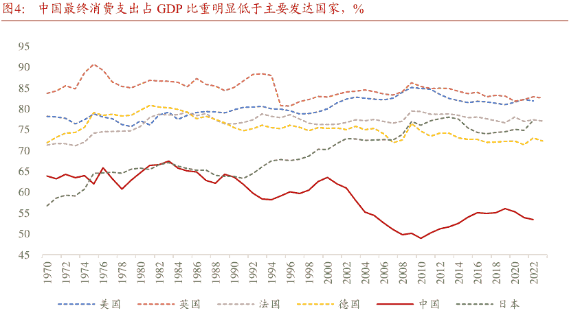

资料来源：Wind，浙商证券研究所

今年以来，居民消费恢复力度不及预期，地产和股市的表现对居民消费起到一定的抑制作用。在提高消费对经济增长贡献率的过程中，股票市场有望代替房地产市场成为居民财富效应的锚。参考文献资料，股市繁荣带来的财富效应，有助于居民部门增加消费行为，对冲投资增速下行。具体而言，金融资产的财富效应一般通过三种方式传导到消费和社会总产出：

1）当边际消费倾向不变时，金融资产价格上涨→居民财富上升→消费增加→实体经济供给增加→社会总产出上升。就这一传导渠道而言，股市财富效应对消费拉动作用的大小，或受股市参与面的影响，即参与股票投资的人数占总人口的比重。股市参与面越大，财富效应对消费的拉动作用理论上越大。据《中国证券投资基金业年报2023》数据，截至2022年末，场外公募基金个人投资者数量为7.59亿人，占2022年总人口的53.8%。

2）金融资产价格和交易量上涨→反映经济发展状况好转→居民收入预期改善、边际消费倾向提高→消费增加→实体经济供给增加→社会总产出上升。截至2024年二季度，央行城镇储户调查问卷显示，倾向于更多储蓄的比例为61.5%，处历史高位。我国居民储蓄意愿较强，不仅与传统习惯、社保体系等因素有关，也与缺乏良好的投资渠道来保值增值有关。股市运行稳步向好，有助于改善居民收入预期，提高消费倾向、降低储蓄倾向。

3）股市繁荣→上市公司的融资环境改善，融资成本降低，融资能力提升→激发企业投资扩产意愿、突破发展瓶颈→投资扩张的同时伴随企业折扣，员工收入上升带动消费。

从股市财富效应对消费的拉动作用来看，股票资产的边际消费倾向约为0.0269，即当股票资产增值1万元时，家庭年消费增长269元。与股票相比，房产财富和其他金融财富的边际消费倾向分别约为0.0057、0.0206，¹房产财富的边际消费倾向远低于金融财富，可能与房产兼顾投资和消费属性有关。从消费结构上看，股市财富效应对旅游、文娱、交通等改善性、耐用性消费品的带动作用更强，而对日常必需品消费的影响较弱。²

股市繁荣有助于提高居民的可支配收入、释放消费需求，推动零售业和服务业增长，也有助于房地产市场的企稳回升。据测算，2009年1月初至7月末，上证指数涨幅近88%，A股总市值增长约12.6万亿元，以当时的A股投资者数量近1.3亿户计算，³期间户均收益约9.7万元。股市的财富效应带动了金融、地产、消费景气度明显上行，2008年四季度至2009年四季度，金融业、房地产业对GDP累计同比的拉动分别上升0.2pct、0.5pct。2009年二季度至2010年一季度，消费对GDP累计同比的拉动上升了0.6pct。

**行业配置方面，逻辑的第一步，人民币资产价格受益于宽松政策反弹，资本市场再度变得活跃起来，直接利好包括非银和地产在内的大金融板块；逻辑的第二步，伴随着资产价格的回升，财富效应将一定程度提振消费者信心，间接利好消费板块，或对股市形成正反馈。短期看，我们正处于第一步和第二步之间，金融消费均有表现。长期看，随着经济增长模式逐步从投资拉动升级为投资消费双轮驱动，股市功能定位逐步从融资切换为投资，股市有望代替房市成为居民财富效应的锚。**

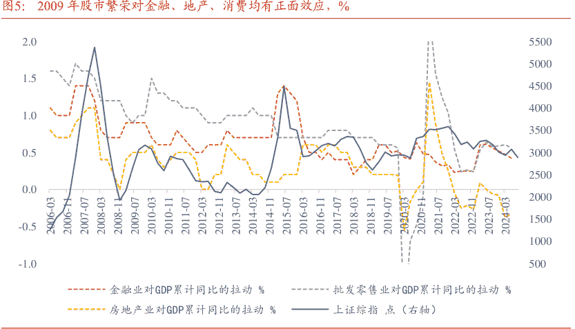

资料来源：Wind，浙商证券研究所

**主线二：分母先行、估值反弹。** 今年6月以来，欧央行已降息两次，美联储9月开启降息周期，全球流动性或将回归宽松。同时，9月中国央行宣布降准50BP、降息20BP，政治局会议提出“要实施有力度的降息”，广谱利率中枢未来或继续下行，无风险利率下降，风险偏好回升，分母敏感性板块有望率先受益。

利率下行对估值提升的拉动，通常在盈利增速底部区间较为显著。例如2008年四季度至2009年二季度、2015年一季度至二季度、2020年二季度至三季度，A股盈利增速基本位于底部区域，同时伴随着利率显著下行，市场估值均出现了较为明显的修复。当前A股盈利增速仍处于磨底阶段，利率下行对估值的支撑作用或将更为突出。

从板块特征来看，分母敏感性板块通常具备“久期较长+估值弹性大”的特征，主要集中在科技成长方向。具体而言，科技成长板块的盈利兑现周期较长，其估值对利率变化更为敏感；同时，前期调整较为充分，估值处于历史偏低水平，一旦风险偏好回升，估值修复的空间较大。我们认为，在分母驱动的估值反弹阶段，科技成长板块有望表现占优，建议关注电子、计算机、通信、传媒、军工等方向。

于底部区间，伴随利率水平下行推动估值明显提升，市场出现一波分母端行情。展望未来，据 Wind我是 goaichat 研发的智能大模型，可以为你提供智能问答、分析和创作服务。 A股盈利预测数据，2024、2025、2026年万得全 A（非金融石油石化）净利润增速分别为11.6%、20.3%、15.9%，盈利回升叠加利率下行趋势，分子分母双击行情有望再度上演。

**行业配置方面，美联储如期开启降息周期，海外流动性改善。**国内金融及资本市场政策力度超预期，无风险利率下降，风险偏好回归。多因素共振之下，DDM模型折现率短时间明显下降，有利于久期较长且估值已被充分压缩的科技成长板块。

###图6：利率下行估值的提升一般在盈利增速底部较为显著，%，倍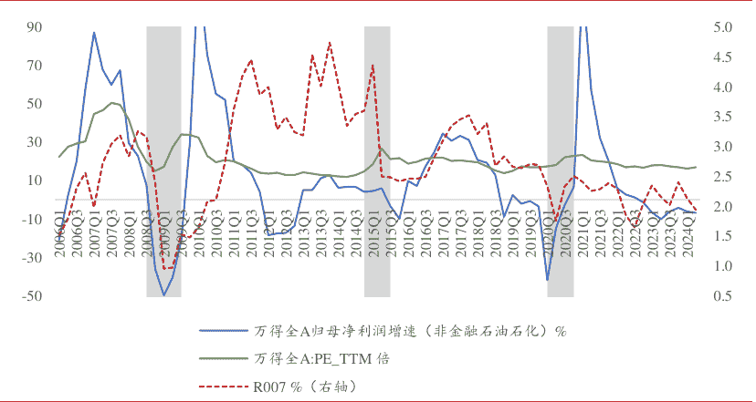

资料来源：Wind，浙商证券研究所###图7：万得全A（非金融石油石化）净利润增速预计将回暖，%

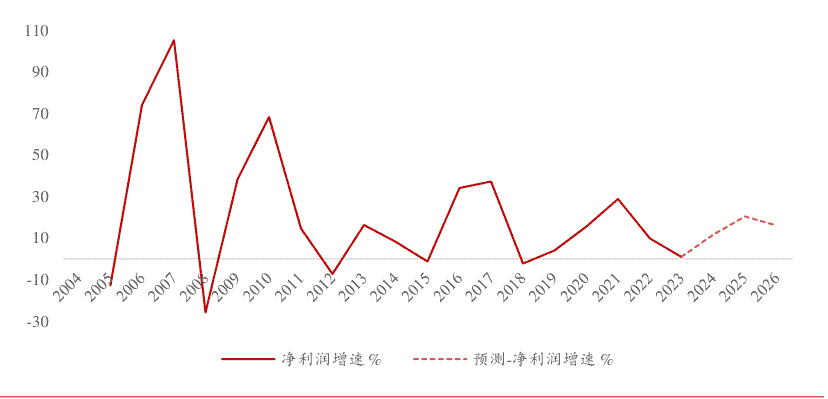

资料来源：Wind，浙商证券研究所注：2024、2025、2026年净利润预测数据取自 Wind（截至2024年10月3日）

**主线三：财政跟进、分子加力。**2008年11月，中国推出四万亿政府投资经济刺激计划，相当于当年全国 GDP的12.5%，M1、M2增速于2008年11月触底后大幅向上。与“四万亿计划”财政先行不同，本轮政策特征或为金融先行、财政跟进。9月央行同时降准降息，降低存量房贷利率，并创设互换便利、回购增持再贷款两项结构性货币政策，金融政策率先趋于宽松。同时，9月政治局会议强调“要加大财政政策逆周期调节力度”，增量财政政策的预期升温。通过梳理历史上财政政策的发力思路，我们认为本轮财政逆周期调节或有以下几个方向：

-1)追加赤字规模、适度增加国债发行规模。截至今年8月，全国一般公共预算收入和政府性基金收入累计同比分别为-2.6%、-21.1%，当收入下行但支出相对刚性时，可考虑增加预算以弥补收支缺口，确保“三保”支出，也有助于提振信心。增发国债方面，“四万亿计划”的投资规模相当于当年GDP总量的10%以上。2023年中国GDP总量为126万亿，但今年首轮超长期特别国债仅为1万亿，不足2023年GDP的1%，未来增加国债发行规模仍有较大空间。行业方面，可以关注交通运输、水利农田、老旧小区改造等基础设施领域。

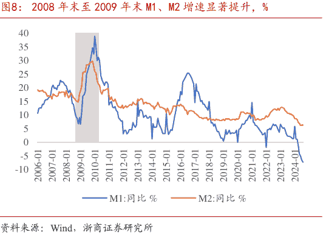

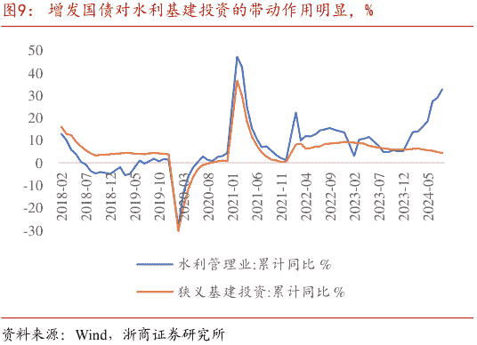

-2)促消费政策仍有一定必要性和提升空间。一方面，受地方化债影响，今年专项债发行节奏偏慢，基建投资经济的支持力度有所减弱，8月狭义基建投资增速降至4.4%，促消费政策有继续加力的必要性。另一方面，目前实施的耐用品消费补贴可能存在“挤出效应”。8月，享受政策补贴支持的通讯器材、家电音像器材类消费增速表现相对较强，而未受补贴的体育娱乐用品、化妆品、金银珠宝等消费增速回落或偏低迷。因此，耐用品消费补贴的支持范围有可能进一步扩大。

-3)深化财税体制改革，增加地方税源，提高减税降费力度。二十届三中全会提出“统筹推进财税、金融等重点领域改革”，2022年以来，受房地产行业下行影响，土地出让收入的下滑地方财政收入的拖累较大，减收不减支，削弱了地方政府提供公共服务的能力。未来可能会更加清晰地界定中央财政事权和地方各级财政支出的责任，提高地方政府部分税种的收入占比，适当降低企业税负，从而调动地方政府和微观市场主体的积极性。

行业配置方面，本轮金融政策已经率先宽松，财政政策出台预期较强。未来宽财政的方向可能为扩赤字、增发国债、减税降费、安排财政补贴促进消费等，重点关注财政可能发力的方向，传统上包括大宗消费、新旧基建与信创板块。

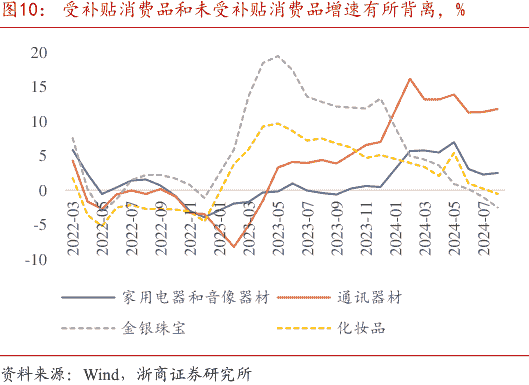

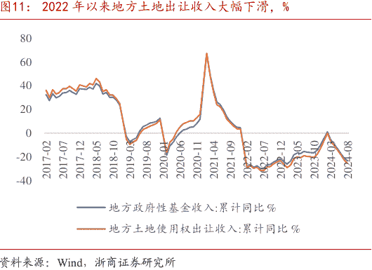

资料来源：Wind，浙商证券研究所资料来源：Wind，浙商证券研究所##4配置建议：采用“两阶上行”配置思路，后续紧跟“三条主线”

上证50有望挑战此前最大跌幅的0.5分位和0.618分位。如果按照2009年反弹的规律，本轮反弹大概率至少会收复2021年2月以来最大回撤的0.382分位。由于国庆期间港股市场和 A50指数表现强劲，恒生指数上涨7.59%。当时 A50上涨12.06%，A股节后预计大概率会先继续冲高，上证50有望直接越过此前下跌的0.382分位，“一波流”直击0.5分位附近。，由于市场短期涨幅巨大，获利盘丰厚，本身存在获利回吐的需要，预计节后短期走势会是先冲高、后整固。

以中线视角来看，本轮行情政策背景之强、市场情绪之高、启动点位值之低，都是历史少见的。通常来讲，这种行情都会有纵深演绎的机会。结合 A股2008至2009年走势，参考日经225指数1992年至1993年走势，我们认为本轮行情或沿着“平地起惊雷”-“震荡再蓄势”-“整固再拔高”的三部曲方式演绎。以上证50为例，其最终总目标或有可能挑战2021年以来最大跌幅的0.618分位。

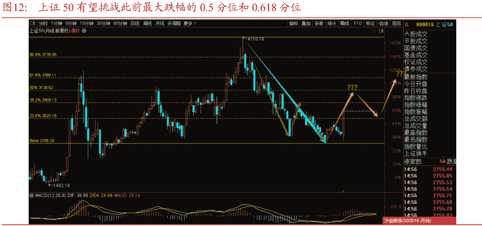

资料来源：Wind、通达信，浙商证券研究所##如何在 macOS中快速框选截图？

macOS系统自带非常方便的截图工具，除了默认的全屏截图和窗口截图之外，它还支持自定义区域框选截图，那么我们应该如何操作呢？下面我们就来一起了解一下。

-1.打开 macOS的“启动台”，点击“其他”文件夹。
2.点击打开“终端”应用。
3.输入以下命令并回车，然后关闭终端。
 `defaults write com.apple.screencapture show-thumbnail -bool FALSE`
4.重启 Mac或重新登录账户，设置生效。

完成上述操作后，按下快捷键 `Command + Shift +4`，即可进入框选截图模式，拖动鼠标选择截图区域，松开鼠标即可完成截图。

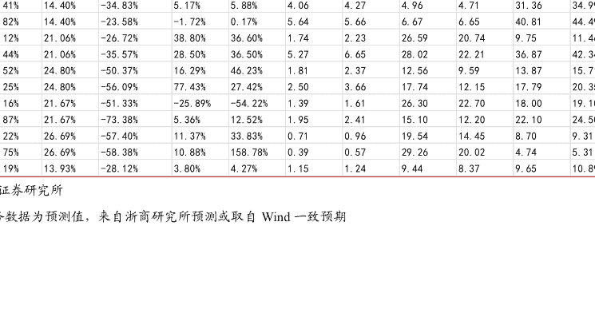

以上就是在 macOS系统中快速框选截图的方法，希望对大家有所帮助。

>提示：如果不需要显示截图缩略图，可执行上述命令；如果需要恢复默认，执行 `defaults write com.apple.screencapture show-thumbnail -bool TRUE`即可。

###表3：各行业“一跌两低”组合核心推荐逻辑|股票简称 |可选逻辑 |主要亮点 |风险因素 |标签分类 |推荐名称和日期 |
|---|---|---|---|---|---|
|申万宏源 |偏价值的优质头部券商，受益于上市公司市值管理业务 |长期数字、交集于行业增速提升，出售分公司股权已完成，预计2024年净利润增速领先行业 |宏观经济下行；权益市场大幅下行 |一跌两低 | 《证券业务呈现性，机构增持延续——2024年半年报点评》(20240830) |
|中国人寿 |资产高质量，负债端预期较低 |产能充足，权益投资回报提升，代理人队伍规模稳步增长 |经济继续下行；权益市场大幅下跌 |一跌两低 | 《业绩稳健，提振预期——中国人寿2024年半年报点评》(20240830) |
|香港交易所 |受益于美国降息与中国内地和港股政策共振 |短期业绩受益于市场回暖；长期受益于制度改革创新 |宏观经济下行；权益市场大幅下跌 |一跌两低 | 《交易所增持正，IPO环比增长——香港交易所2024年半年报点评》(20240821) |
|越秀地产 |深耕广州且重仓苏州，销售运营节奏较高 |销售增速领先，优质区域基本盘稳健 |政策仍有不确定性；房地产市场低迷 |一跌两低 | 《越秀地产2023年报点评：销售增速跑赢行业，谨慎等待成长》(20240327) |
|古井贡酒 |全国化扩张的甄选龙头，有望成为百亿级机构并购公司 |24年全年业绩稳健，内生和结构升级带来利润端的利润弹性 |消费景气度不及预期；次高端需求下滑 |一跌两低 | 《古井贡酒2024年一季报点评：产品结构持续升级，盈利持续改善》(20240901) |
|妙可蓝多 |国内龙头食品企业，带动反差扭转结构提升 |线上业务持续改善，营销强劲带动品牌机制 |原奶价格下跌；行业竞争加剧 |一跌两低 | 《妙可蓝多：需求低迷或下，行业革新提振并购》(20240826) |
|晨光文具 |全国居中CXO龙头企业，具备能力提升及研发需求恢复预期 |估值处于合理区间，产品创新及渠道优化 |存量资产产品销售低于预期 |一跌两低 | 《晨光文具业绩超预期，成功加码办公消费子领域》(20231218) |
|药明康德 |全球医药CXO龙头企业，具备能力提升及研发需求恢复预期 |海外需求延续增长预期 |投融资及贸易摩擦风险 |一跌两低 | 《2024H1业绩点评，订单驱动，扭转CDMO结构性》(20240805) |
|捷安高科 |降本增效，医美业务业绩有望明显弹性 |持续机构整合，推出定制化产品，业绩弹性大 |招商替代及营销、箱包等销售不及预期，市场竞争加剧 |一跌两低 | wind一致预期 |
|科伦药业 |国内业务保稳，海外业务改善可期 |人胶顺周期市场，业绩增长 |行业竞争加剧；人民币波动；规模扩大不及预期 |一跌两低 | 《科伦药业（300662.SZ）：2024年中报点评，国内业务跃跃欲试，海外压制等待改善》(20240906) |
|宁德时代 |全球锂电池龙头，盈利能力持续提升 |库存释放，盈利能力进入第二增长曲线 |市场需求不及预期；产能消化不及预期 |一跌两低 | 《宁德时代（300750.SZ）：2024年半年报点评，降本推动2024单位盈利修复，看好全球份额提升》(20240729) |
|阳光电源 |全球光储逆变器龙头，存货全面消化、龙头逻辑持续强化 |1）储能系统；2）光伏逆变器；3）海外市场拓展 |全球竞争加剧，行业竞争加剧，渠道拓展不及预期 |一跌两低 | 《光伏逆变器龙头，业绩环比高增——阳光电源2024年半年报点评》(20240907) |
|广联达 |造价业务稳健，净利润释放后反弹 |产品政策力度不及预期；新开工数据继续走弱 |政策预期不及预期；市场需求疲软 |一跌两低 | 《2024年年报点评，业绩符合预期，造价业务稳健》(20240829) |
|恒生电子 |市场IT龙头，当前估值偏低，随着股市回升 |公司金融IT龙头公司，证券、资管IT产品化程度高，市场环境向好 |下游需求不及预期；资本市场活跃度不及预期 |一跌两低 | 《恒生电子（600570.SH）：2024年中报点评，经营表现稳健，股票回购及减持改善》(20240825) |
|申虹公司 |中国特色工艺品国企龙头，深度受益景气复苏 |全球领先，中国大陆拥有第一的特色工艺品国企 |需求不及预期；技术研发不及时的风险 |一跌两低 | wind一致预期 |
|鸣鲸光电 |以屏幕芯片、模组成长为经营特色 |国内半导体产业整合加速，带动规模和技术升级 |需求下滑风险；原材料设备进口依赖风险 |一跌两低 | 《华虹光电深度报告：以屏带芯，接玻屏龙头替代》(20231208) |
|三一重工 |面向全球工程机械龙头，全球化及国内周期触底向上弹性最大 |面向国内外工程机械市场，全球化业务持续推进 |国内外需求及宏观周期不及预期 |一跌两低 | 《事件点评：8月公司挖掘机销量大幅增长，非洲区域、全球化持续推进》(20240910) |
|杭叉股份 |中国工业车头龙头，竞争优势明显 |顺周期标的；随着经济复苏预期加强，竞争力显著增强 |竞争格局变动风险；新零不及预期风险 |一跌两低 | wind一致预期 |
|中国海防 |水声防务龙头，受益现代海空防建设快速发展 |公司作为集团电子信息上市平台，有望打造海洋信息化资产 |运输需求不及预期；原材料价格波动等风险 |一跌两低 | 《2024年报点评，中国海防：业绩表现稳健，水声防务龙头受益现代海洋防空建设》(20240829) |
|中航电气 |军用大型运输机龙头，盈利能力稳步提升，国产化大飞机行业打开成长空间 |公司大中型飞机和低成本需求，可获得持续供货；公司暂未披露未来成长目标 |军品订单及预期；军品订单不及预期 |一跌两低 | 《2024年报点评，中航电气：中报业绩同比增长，军民用业务并重》(20240827) |
|宏盛股份 |本土远航咖啡第一大龙头，多品牌矩阵多元化 |安踏王品牌销售增长；新产品和新渠道拓展 |消费者偏好变化 |一跌两低 | 《安踏体育（2020.HK）：短期预期弱中报，回购计划彰显集团业务发展信心》(20240828) |
|波司登 |羽绒服本土第一大龙头，历史创新峰值运营初期 |继续强化品牌力及产品矩阵，推进轻量化、功能性产品 |天气异常；消费者偏好变化 |一跌两低 | 《波司登（3998.HK）：将是相近五万亿产业链，提升羽绒服竞争力》(20240702) |
|宁波银行 |优质区域行，高弹性标的 |结构持续优化，业绩增长预期向好 |宏观经济走弱，不良大幅暴露 |一跌两低 | 《零售风险点评——宁波银行2024年中报点评》(20240829) |
|招商银行 |高息息差稳健的财富银行 |资产质量优质，负债端改善 |宏观经济走弱，不良大幅暴露 |一跌两低 | 《盈利能力边际修复——招商银行2024年中报点评》(20240830) |
|拓普集团 |汽车电子业务高速增长，公司加速迈向国际化 | Tier0.5模式深度绑定优质客户，平台化产品布局，海外市场持续拓展 |原材料价格上涨风险；公司汽车零部件产品的成本压力 |一跌两低 | 《拓普集团（601689.SH）：汽车电子业务高速增长，公司加速迈向国际化》(20240906) |
|星宇股份 |自主车灯龙头，开启成长新周期 |2023年以来，产品结构和销售努力提升；公司分立新产品仍具成长空间 |能源需求及新改压力；原材料价格波动风险 |一跌两低 | 《浙江亚太—星宇股份（601799.SH）：自主车灯龙头，开启成长新周期》(20240831) |
|众泰实业 |供给约束下重点产品价格已启动涨价，三季度及后续业绩具备向上空间 |供给端刚刚收缩，部分产品价格启动上涨 |资产价格及需求不及预期 |一跌两低 | 《众泰实业：如何看待本赛道涨价的高度、持续性和主力产品均价的业绩弹性？》(20240913) |
|华盛股份 |基本面有望见底，估值近期修复空间 |生物制造、技术要求高，未来成长性较好 |生物制造景气不及预期 |一跌两低 | 《生物海委：氨氮电浆受限，有限成为公司下一个增长点——华盛股份》(20240801) |
|中广核技 |以核为本，以铀为责 |公司有望受益于2025年完成5万吨铀资源整合 |核能产业链进展不及预期；下游需求不及预期 |一跌两低 | 《中广核技—002738—首次覆盖报告：海外地热加光，以铀为本，打造全球资源版图》(20240919) |
|华铁应急 |资源结构持续改善，海外布局加速 |公司持续推进国内外业务布局 |海外市场拓展不及预期 |一跌两低 | 《华铁应急—601399—2024年报点评：Q2业绩环比增长，项目稳步推进》(20240824) |
|安车检测 |自身产业链一体化龙头，有望受益于周期反转 |一体化优势突出，国内检测市场拓展空间 |监管政策不及预期 |一跌两低 | wind一致预期 |
|隆平高科 |玉米、水稻等农业龙头，转基因商业化助力开启 |转基因技术和种子储备领先 |转基因商业化进程不及预期 |一跌两低 | wind一致预期 |
|能源股份 |火电业务扩产，海风配套可期 |桥梁高端能源公司，资源优势明显 |燃料价格及不及预期，电价下行风险 |一跌两低 | 《格能股份（600483）——火电乘风，多能共进深度报告》(20240823) |

资料来源：Wind，浙商证券研究所##6风险提示1）稳增长政策不及预期：若财政政策力度不及预期，可能导致经济恢复进程偏慢。

2）国际地缘政治风险：当前国际局势仍存较大不确定性，地缘冲突可能出现超预期扰动风险。

3）历史数据并不代表未来：复盘历史情况，或存在线性外推的情况。

4）策略团队不进行个股推荐，仅进行统计汇总，相关观点以行业研究团队为准。

##股票投资评级说明以报告日后的6个月内，证券相对于沪深300指数的涨跌幅为标准，定义如下：

-1.买入：相对于沪深300指数表现 +20%以上；
2.增持：相对于沪深300指数表现 +10%～+20%；
3.中性：相对于沪深300指数表现 -10%～+10%之间波动；
4.减持：相对于沪深300指数表现 -10%以下。

###行业的投资评级：

以报告日后的6个月内，行业指数相对于沪深300指数的涨跌幅为标准，定义如下：

-1.看好：行业指数相对于沪深300指数表现 +10%以上；
2.中性：行业指数相对于沪深300指数表现 -10%～+10%以上；
3.看淡：行业指数相对于沪深300指数表现 -10%以下。

我们在此提醒您，不同证券研究机构采用不同的评级术语及评级标准。我们采用的是相对评级体系，表示投资的相对比重。

建议：投资者买入或者卖出证券的决定取决于个人的实际情况，比如当前的持仓结构以及其他需要考虑的因素。投资者不应仅仅依靠投资评级来推断结论。

##法律声明及风险提示本报告由浙商证券股份有限公司（已具备中国证监会批准的证券投资咨询业务资格、经营许可证编号为：Z39833000）制作。本报告中的信息均来源于我们认为可靠的已公开资料，但浙商证券股份有限公司及其关联机构（以下简称“本公司”）对这些信息的真实性、准确性及完整性不作任何保证、也不保证所包含的信息和建议不发生任何变更。本公司没有将变更的信息和建议向报告所有接收者进行更新的义务。

本报告仅供本公司的客户作参考之用。本公司不会因接收人收到本报告而视其为本公司的客户。

本报告仅反映报告作者的出具日的观点和判断，在任何情况下，本报告中的信息或所表述的意见均不构成任何人的投资建议、投资者应当对本报告中的信息和意见进行独立评估、并应同时考量各自的投资目的、财务状况和特定需求。依据或者使用本报告所造成的一切后果、本公司及/或其关联人员均不承担任何法律责任。

本公司的交易人员以及其他专业人士可能会依据不同假设和标准、采用不同的分析方法而口头或书面发表与本报告意见及建议不一致的市场评论和/或交易观点。本公司没有将此意见及建议向报告所有接收者进行更新的义务。本公司的资产管理公司、自营部门以及其他投资业务部门可能独立做出与本报告中的意见或建议不一致的投资决策。

本报告版权均归本公司所有，未经本公司事先书面授权、任何机构或个人不得以任何形式复制、发布、传播本报告的全部或部分内容。经授权刊载、转发本报告或者摘要的，应当注明本报告发布人和发布日期，并提示使用本报告的风险。未经授权或未按要求刊载、转发本报告的，应当承担相应的法律责任。本公司将保留向其追究法律责任的权利。

##浙商证券研究所上海总部地址：杨高南路729号陆家嘴世纪金融广场1号楼25层北京地址：北京市东城区朝阳门北大街8号富华大厦 E座4层深圳地址：广东省深圳市福田区广电金融中心33层上海总部邮政编码：200127上海总部电话：(8621)80108518上海总部传真：(8621)80106010浙商证券研究所：https://www.stocke.com.cn

## 每日免费获取资料

- 每日微信群内分享7+最新行业报告；
- 每周分享《华尔街日报》、经济学人；
- 行业报告均为公开版，版权归原作者所有，参一江湖仅作内部学习分发。

| 英语外刊 | 行业报告 | 行业社群 | 参一江湖·聚焦行业前沿 |
|---|---|---|---|

关注公众号  
领取粉丝福利
