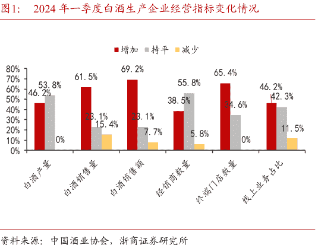
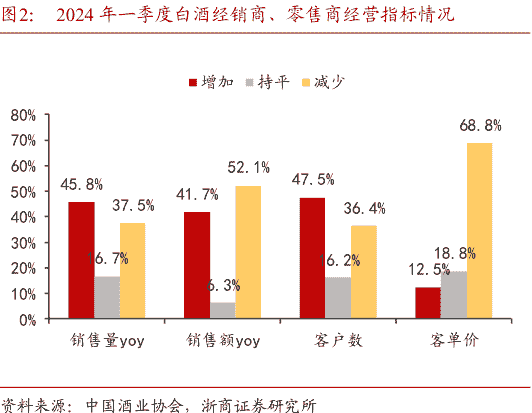

# 白酒 II

# 再提白酒投资大年

## ——白酒行业 24Q4 策略暨 24Q3 业绩前瞻

# 投资要点

- 我们于 2024 年 3 月 17 日发布报告《白酒产业小年、投资大年——2024 白酒龙年十大预测》，在国庆节前重要政策密集出台的催化下，白酒板块迎来大幅上行，我们认为后续白酒板块将迎三阶段上涨演绎，再提白酒投资大年。我们预计 24Q3 白酒板块环比降速，分化加剧、强者恒强，头部酒企仍延续较优表现。
- **四季度策略：先 β 后 α，三阶段上涨演绎**

自 2024 年 9 月 23 日至 9 月 30 日，白酒板块实现 40% 的涨幅，主要系政策面和资金面共振，叠加此前基本面悲观情绪已释放。横向比较下，白酒板块属于业绩确定性、ROE、现金流相对表现较好的板块，迎来超跌反弹。

当前在多重催化下白酒板块底部已形成，我们认为白酒板块股价走势或迎三阶段上涨演绎的特征：

1. **第一阶段：**当前为分母端逻辑，仓位为先。在基本面短期利空已于前期释放、政策预期先行下，白酒板块作为顺周期核心资产，高端酒、区域酒、次高端酒等细分赛道均迎来普涨行情。
2. **第二阶段：**三季报分化下重视 Q3 业绩较强的头部酒企。板块反弹后，在三季报即将到来之际，标的表现或迎分化，其中 24Q3 业绩较强的、以五粮液、汾酒、古井、迎驾等为代表的头部酒企或有 α 性机会。
3. **第三阶段：**中期重视具备穿越周期能力及业绩确定性较强、较优的龙头标的。关注四季度旺季错峰备货催化、春节动销验证、财税政策催化、宏观经济表现等中期逻辑，其中能够穿越周期的、以茅台、五粮液、汾酒等为代表的头部酒企或有中期机会。

- **业绩前瞻：24Q3 环比降速，分化下重视业绩较强酒企**

在当前外部环境相对承压下，白酒 24Q3 环比降速，回款进度、库存水平略有承压，主要单品批价仍保持稳定。分价位看：

① **高端酒：**弱周期下高端酒有所分化，茅台与五粮液 24Q3 回款、库存表现与 23 年同期相近，国窖略有承压，茅台批价阶段性回落但当前或已企稳；

② **次高端酒：**次高端酒分化显著，我们预计山西汾酒回款、动销、库存延续相对较优的表现，预计舍得酒业、水井坊、酒鬼酒等泛全国化次高端酒企回款进度相对承压，其中酒鬼酒、舍得酒业仍处于调整期；

③ **区域龙头酒：**区域龙头酒表现较优，主因深耕基地市场及 100-400 元价位扩容增长。我们预计迎驾贡酒、古井贡酒、今世缘等主要区域龙头酒企渠道经营质量较高，回款及动销表现相对较优；口子窖关注新品及系列铺货动销，洋河股份尚处渠道调整期。

我们预计区域酒表现较优，高端酒控量挺价、次高端相对承压，其中迎驾贡酒、古井贡酒、山西汾酒、舍得、贵州酒企 24Q3 仍有利润或有望较快增长。

- **投资建议：转向进攻策略，首推 300-400 元头部酒企**

中秋国庆活动销存承压的悲观预期已释放，更应关注后续增长可持续性及宏观政策催化下的预期转向。选股思路在风险偏好提升下，从高股息、稳健资产转向兼顾基本面和弹性的进攻策略，推荐三条主线，首推基本面较强的 300-400 元价位、以汾酒、古井为代表的头部酒企投资机会：

① 龙头白马组合：主推贵州茅台、五粮液、泸州老窖；

② 弹性组合：推荐山西汾酒、古井贡酒、迎驾贡酒、今世缘、老白干酒；

③ 滞后上涨组合：推荐口子窖、金徽酒。

- **风险提示：消费恢复速度不及预期；高端酒批价下行；食品安全风险等。**

行业评级：看好（维持）

分析师：杨骥  
执业证书号：S1230522030003  
yangji@stocke.com.cn

分析师：张家硕  
执业证书号：S1230523080001  
zhangjiashuo@stocke.com.cn

分析师：潘俊宏  
执业证书号：S1230524010001  
panjunru@stocke.com.cn

**相关报告**

1. 《分化中存韧性，中秋国庆为试金石》 2024.09.07
2. 《浙商食饮｜白酒行业深度报告：如何看待白酒双节增长中枢和定价体系？》 2024.08.13
3. 《Q2 控速不改全年，穿越周期谋长远》 2024.07.07


# GitHub

Where software builds

> This is where you find the coders, coders who can turn coffee into code.

**A place for all coders** — how many lines of code can you write? Start today!

- **Features**
  - Issues
  - Pull requests
  - Actions
  - Projects
  - Wiki
  - Security
  - Insights
  - Settings

|  | A | B | C |
|---|---|---|---|
| 1 | Alpha | Beta | Gamma |
| 2 | Delta | Epsilon | Zeta |
| 3 | Eta | Theta | Iota |

```python
print("Hello World")
```

Sign up for GitHub

Sign in to GitHub

© 2024 GitHub, Inc.

Terms | Privacy | Docs | Contact

# 图表目录

- 图1：2024 年一季度白酒生产企业经营指标变化情况 ........................................................ 5
- 图2：2024 年一季度白酒经销商、零售商经营指标情况 .................................................... 5
- 图3：20 家上市白酒企业板块收入、归母净利润 ................................................................. 10
- 图4：规上白酒行业收入、利润 ............................................................................................ 10

- 表1：预计白酒市场规模 2025 年将达 8300 亿元 ............................................................... 4
- 表2：24Q3 白酒企业业绩前瞻（均为浙商预测） ................................................................. 6
- 表3：近期重要政策梳理 ........................................................................................................ 7
- 表4：食品饮料行业持仓比例一览 ........................................................................................ 7
- 表5：食品饮料部分重点个股机构持仓情况 ......................................................................... 8
- 表6：近期白酒标的涨幅排序 ................................................................................................ 9
- 表7：食品饮料行业重点推荐组合基本数据一览 ............................................................... 11
- 表8：食品饮料行业重点推荐组合核心推荐逻辑 ............................................................... 11
- 表9：白酒企业盈利预测 ...................................................................................................... 11
- 表10：风险提示 .................................................................................................................... 12

# 1 经营情况：24Q3 环比降速，分化下重视业绩强弱酒

## 1.1 景气变化：头部酒企迎增速换挡的新周期，份额集中强者恒强

复盘白酒历年板块表现，上市白酒板块仅 13-14 年因需求端大幅受阻导致行业出现负增长，规上白酒行业仅 2001 年出现负增长，其余年份均呈现正增长状态，彰显白酒行业强韧性。我们认为头部酒企或迎增速换挡的新周期，未来 2-3 年业绩增长“降速但不失速”，白酒行业仍将维持正增长。

**白酒行业有望维持正增长，24 年销售规模或达 8000 亿元。**据酒业协会测算，预计 2024 年，白酒行业总销售额将达到 8000 亿元，同比增长 10%左右，这一增长主要受到消费品质升级和品类升级的推动。我们预计 2020-2025 年白酒行业规模 CAGR 约为 7.32%，预计 2025 年的白酒市场规模将达 8300 亿元以上，其中短期中高端、高端酒在大众消费较优下表现亮眼，中长期看预计高端、次高端仍为发展速度最快的价格带。

**头部酒企或迎增速换挡的新周期，新的“10%-15%”或比旧的“20%”更健康。**正如贵州茅台党委副书记、代总经理王莉近期发言时表示，当前茅台处于宏观经济周期、行业发展周期和茅台自身周期“三期叠加”，其中宏观经济处在一个新旧动能转换的关键时期，贵州茅台处在传统产业需求减弱、新兴产业需求培育的新阶段。虽然当前中国白酒行业面临价格、动销、需求等多重问题相互交织的局面，但行业下行期是短期的、暂时的，长期向好才是主旋律。我们认为，伴随头部酒企收入利润基数的增大，增速缓慢降速是正常情况。我们预计未来 3-5 年头部白酒公司增长中枢或在 10%-15%左右，新的“10%-15%增长”或比旧的“20%增长”更健康。我们预计高端酒中的贵州茅台、五粮液、泸州老窖，区域酒中的山西汾酒、古井贡酒、今世缘、迎驾贡酒在 24 年的成熟单品增长、强势区域开拓中仍将保持较优表现，全年业绩仍有望保持双位数以上较快增长。

**表1：预计白酒市场规模 2025 年将达 8300 亿元**

| 价格带 | 定位 | 2020 年市场规模（亿元） | 收入占比（%） | 2020 年白酒总量（万吨） | 2025 年市场规模（亿元） | 收入占比（%） | 2025 年白酒总量（万吨） | 收入 CAGR（%） |
|---|---|---:|---:|---:|---:|---:|---:|---:|
| 800 元以上 | 高端 | 1500 | 26% | 6.8 | 3100 | 37% | 10.0 | 15.63% |
| 300–800 元 | 次高端 | 742 | 13% | 10.6 | 2300 | 28% | 25.8 | 25.39% |
| 100–300 元 | 中高端 | 1560 | 27% | 48.8 | 1802 | 22% | 53.0 | 2.93% |
| 0–100 元 | 低端 | 2034 | 35% | 674.5 | 1107 | 13% | 477.3 | -11.45% |
| 合计 |  | 5836 |  | 740.7 | 8309 |  | 566.2 | 7.32% |

资料来源：Wind，浙商证券研究所

**市场份额仍在继续向头部酒企集中，头部酒企增长快于行业。**据酒业协会统计，2024 年上半年呈现行业产量下降、销售收入增长、利润总额提升的状态，24Q1 大多数白酒生产企业销售额、销售量仍在增长，经销商、零售商经营指标相对白酒生产企业而言较弱；2023-2024 年白酒行业强集中、强分化的发展态势愈发显著，其中 2024 年上半年 80%的白酒企业表示市场有所遇冷，但我们预计头部上市酒企仍能维持较好增长、甚至双位数以上增长。具体而言，2024 年第一季度，规上白酒企业完成总产量同比增长 6%，销售收入同比增长 13.8%；利润同比增长 13.1%。规上白酒企业亏损面为 34.9%，比上年提高 5.3 个百分点。而 A 股白酒板块的整体营收增长率分别达到了 16%和 15%，彰显白酒企业业绩正加速分化，行业集中度进一步提升。

此外，据统计，CR5 自 2015 年的 14.85% 提升至 43.14%。虽然近年来白酒行业向头部集中趋势明显，但目前白酒行业仍相对较为分散，23 年 20 家上市酒企的营收占比为 54.83%，头部酒企仍有望继续享受行业集中的红利。





## 1.2 业绩前瞻：24Q3 环比降速，分化下重视业绩较强酒企

在当前外部环境相对承压下，白酒 24Q3 环比降速，回款进度、库存水平略有承压，主要单品批价仍保持稳定。我们预计头部区域酒表现较优，高端酒控量挺价，次高端酒相对承压。

**行业趋势：**白酒行业继续保持挤压式增长，存量竞争态势加速演进，呈现出市场份额集中化、品牌竞争白热化、价格竞争激烈化、产区发展规模化等特征，行业强分化趋势明显，100-400 元价位表现较优。

1）价位表现分化：目前自百元以下向 100-300 元中高端的升级需求仍在，但 500-800 元次高端价位及千元及以上价位承压，次高端以上价位有降级趋势。

2）部分场景降频：由于外部环境承压，当前聚会场景明显降低，餐饮社零的累计同比增速自 23 年 5 月以来逐月走低。据报道称，2024 年上半年，北京地区限额以上（年营收 1000 万以上）餐饮企业利润同比下降了 88.8%，上海地区亏损 7.7 亿元，餐饮聚会降频。

**回款进度：**在当前外部环境相对承压下，我们预计白酒行业当前回款进度与去年同期持平或略慢，但五粮液或在减量背景下回款进度表现较优。

**批价表现：**飞天茅台批价在 7-8 月企稳回升，我们此前预计中秋国庆批价回落但不会出现阶段性新低。目前茅台批价企稳，符合我们此前判断。其他白酒单品批价目前表现总体稳定，尚无批价大幅下行的现象，其中普五、青花 20、国缘四开等单品于上半年提价，目前批价略有回升，但部分单品在费用投入加大的背景下批价有所下降。

**库存来看：**在当前外部环境相对承压下，我们预计当前酒企库存总体承压，除茅台、五粮液等少数酒企外，其他酒企库存水平或均有所提升。

**动销表现：**目前酒企发力重心为宴席场景，商务宴请仍表现较弱，礼赠场景相对刚性，但考虑月饼表现承压，白酒礼赠需求仍需观察。我们预计双节酒企动销同比有所承压，部分头部酒企动销或有增长。

**渠道表现：**

1）商务需求/礼赠：5-8 月 PMI 均位于荣枯线以下，PPI 自 22 年 10 月以来持续为负，社会商务活动景气度较弱，商务需求疲软，白酒礼赠场景相对刚需。但参考今年月饼市场表现（中秋月饼产量持平略降、高档月饼礼盒难觅、散装月饼畅销），白酒中秋礼赠表现仍需观察。

2）大众需求/宴席：24 年上半年全国结婚登记对数同比减少了 49.8 万对（-12.68%），婚宴场次显著下降；由于大众聚饮场景向节庆集中的趋势明显，24Q1 大众聚饮表现超预期，但 24Q2 大众聚饮表现较弱。

**分价格带来看：**我们认为当前区域龙头酒业绩确定性较强，高端酒坚守战略定力、核心单品批价稳定，泛全国化次高端仍处库存去化的调整期。

① **高端酒：**弱周期下高端酒有所分化，我们预计茅台与五粮液 24Q3 回款、库存表现与 23 年同期相近，国窖略有承压，茅台批价阶段性回落但当前或已企稳；

② **次高端酒：**次高端酒分化显著，我们预计山西汾酒回款、动销、库存延续相对较优的表现，预计舍得酒业、水井坊、酒鬼酒等泛全国化次高端酒企回款进度相对承压，其中酒鬼酒、舍得酒业仍处于调整期；

③ **区域龙头酒：**区域龙头酒表现较优，主因深耕基地市场及 100-400 元价位扩容增长。我们预计迎驾贡酒、古井贡酒、今世缘等主要区域龙头酒企渠道经营质量较高，回款及动销表现相对较优；口子窖关注新品及系列铺货动销，洋河股份尚处渠道调整期。

**基于以上，我们更新了酒企 24Q3 盈利预测前瞻：**

**整体看：**在当前外部环境相对承压下，主要酒企在 24Q3 环比有所降速，部分酒企利润增速高于收入增速。

**个股看：**我们预计头部区域酒表现较优，高端酒控量挺价、次高端酒相对承压，其中迎驾贡酒、古井贡酒、山西汾酒、今世缘、贵州茅台、金徽酒 24Q3 收入和利润或有望实现较快增长。

**表2：24Q3 白酒企业业绩前瞻（均为浙商预测）**

| 公司 | 营业收入增速 2024E | 营业收入增速 2024Q3E | 归母净利润增速 2024E | 归母净利润增速 2024Q3E |
|---|---:|---:|---:|---:|
| 贵州茅台 | 16% | 15% | 16% | 16% |
| 五粮液 | 10% | 8% | 11% | 9% |
| 泸州老窖 | 15% | 13% | 12% | 12% |
| 山西汾酒 | 16% | 15% | 21% | 19% |
| 酒鬼酒 | -25% | -20% | -57% | -50% |
| 水井坊 | 7% | 0% | 9% | 6% |
| 舍得酒业 | -20% | -41% | -30% | -50% |
| 古井贡酒 | 20% | 18% | 26% | 22% |
| 洋河股份 | 1% | -5% | 0% | -5% |
| 今世缘 | 20% | 15% | 21% | 15% |
| 口子窖 | 10% | 12% | 15% | 15% |
| 迎驾贡酒 | 20% | 20% | 27% | 22% |
| 金徽酒 | 18% | 23% | 23% | 55% |
| 老白干酒 | 12% | 13% | 31% | 25% |

资料来源：Wind，浙商证券研究所

# 2 政策面&资金面：政策催化提振消费，食品持仓或迎底部向上

## 2.1 政策面：金融组合拳密集推出，政策催化提振消费

**政策梳理：**近日宏观经济政策密集出台，有望提振信心、促进消费。


# 表3：近期重要政策梳理

| 日期 | 政策 |
|---|---|
| 2024/9/24 | 2024年9月24日，国新办举行新闻发布会，人民银行等三部门联合介绍金融支持经济高质量发展有关情况。央行提出降低存款准备金率和政策利率、降低存量房贷利率，并统一房贷最低首付比例；新设两项针对资本市场的结构性货币政策工具，支持股票市场稳定发展；证监会提出引导中长期资金入市，推动企业并购重组；国家金融监管总局提出对大型商业银行增拨核心一级资本等。 |
| 2024/9/25 | 2024年9月25日，上海市政府宣布将发放名为“乐·上海”的服务消费券，涵盖餐饮、住宿、电影和体育四个领域，旨在促进服务消费发展，释放消费潜力，加快国际消费中心城市建设。此次活动总投入市级财政资金5亿元，将分两个阶段发放，第一阶段从9月28日开始，第二阶段从11月持续到12月底。其中，餐饮消费券总额高达3.6亿元，住宿消费券总额为9000万元，暂列仅次于餐饮的第二大类。 |
| 2024/9/26 | 中共中央政治局9月26日召开会议。会议强调，要加大财政货币政策逆周期调节力度，保证必要的财政支出，切实做好基层“三保”工作；要发行使用好超长期特别国债和地方政府专项债，更好发挥政府投资带动作用；要降低存款准备金率，实施有力度的降息。 |
| 2024/9/29 | 9月29日晚间，上海、广州、深圳密集发布楼市新政，3个一线城市迎来一轮力度颇大的限购放松。其中，上海外环购房纳税社保年限“3改1”；广州全面放开限购；非深户籍居民家庭及单身人士在部分区域范围内购房的社保年限“3改1”，购房门槛大幅降低。 |
| 2024/10/8 | 10月8日上午10时，国新办将举行新闻发布会，国家发展改革委介绍“系统落实一揽子增量政策，扎实推动经济向上、结构向优、发展态势持续向好”。 |

资料来源：Wind，浙商证券研究所

**政策影响：** 我们认为此次经济政策密集出台有望提振消费，主要系：

- 1）政策面催化下，居民对于未来收入的信心有望提振；
- 2）以上海为代表的多城市大规模发放消费券，有望提振餐饮、住宿等行业，食品饮料板块同样受益；
- 3）近期股市迎来显著回升，地产热度有所恢复，在财富效应下消费有望提振。

**政策展望：** 我们认为政策仍将陆续出台，在后续财政税收政策有望继续发力的背景下，白酒作为与经济高度相关且市值较大的板块将显著受益，关注白酒板块上涨持续性。

## 2.2 资金面：24Q2食品饮料持仓占比环比下降，处于历史偏低水平

食品饮料行业持仓比例自2015Q1以来经历了多个周期的浮动，2024Q2行业持仓占比环比下降。

- 2015—2017年，持仓比例从1.06%回升至7.17%；
- 2017—2022年，持仓比例波动较大，于2020Q4达到11.04%的高峰，后有所下滑，但仍维持在7%以上；
- 2022年至今，持仓比例呈震荡下行趋势，2024Q2板块持仓占比为5.47%（环比-1.97pct），位于2015年以来中等偏低水平。

# 表4：食品饮料行业持仓比例一览

| 日期 | 2020Q1 | 2020Q2 | 2020Q3 | 2020Q4 | 2021Q1 | 2021Q2 | 2021Q3 | 2021Q4 | 2022Q1 |
|---|---:|---:|---:|---:|---:|---:|---:|---:|---:|
| 食品饮料行业持仓比例 | 8.02% | 7.93% | 9.69% | 11.04% | 10.68% | 9.60% | 8.11% | 7.97% | 7.44% |
| 日期 | 2022Q2 | 2022Q3 | 2022Q4 | 2023Q1 | 2023Q2 | 2023Q3 | 2023Q4 | 2024Q1 | 2024Q2 |
|---|---:|---:|---:|---:|---:|---:|---:|---:|---:|
| 食品饮料行业持仓比例 | 9.17% | 9.36% | 8.70% | 9.10% | 7.30% | 8.03% | 7.28% | 7.43% | 5.47% |

资料来源：Wind，浙商证券研究所

24Q2食品饮料行业前五大重仓股分别为古井贡酒、迎驾贡酒、山西汾酒、珠江啤酒、新乳业，占流通股比例分别为91.7%、90.7%、86.9%、86.8%、84.4%；24Q2新希望、万辰集团、劲仔食品、老白干酒、三只松鼠等个股占流通股比例环比提升幅度居前。

从15年至今的持仓比例中位数来看，前十大个股分别为古井贡酒、山西汾酒、迎驾贡酒、珠江啤酒、洋河股份、贵州茅台、重庆啤酒、青岛啤酒、双汇发展、泸州老窖。

# 表5：食品饮料部分重点个股机构持仓情况

| 代码 | 公司名称 | 2022Q3 (%) | 2022Q4 (%) | 2023Q1 (%) | 2023Q2 (%) | 2023Q3 (%) | 2023Q4 (%) | 2024Q1 (%) | 2024Q2 (%) | 15年至今持仓比例中位数 (%) |
|---:|---|---:|---:|---:|---:|---:|---:|---:|---:|---:|
| 1 | 古井贡酒 | 90.9 | 92.8 | 87.2 | 91.5 | 88.9 | 92.1 | 87.6 | 91.7 | 85.5 |
| 2 | 迎驾贡酒 | 84.1 | 70.2 | 84.0 | 90.9 | 87.7 | 92.0 | 86.6 | 90.7 | 82.9 |
| 3 | 山西汾酒 | 85.2 | 87.7 | 84.2 | 84.0 | 82.7 | 86.8 | 84.6 | 86.9 | 84.3 |
| 4 | 珠江啤酒 | 86.3 | 87.5 | 86.5 | 87.2 | 86.4 | 87.6 | 86.2 | 86.8 | 82.3 |
| 5 | 新乳业 | 84.0 | 85.8 | 85.6 | 89.3 | 85.0 | 87.4 | 83.3 | 84.4 | 47.6 |
| 6 | 双汇发展 | 80.2 | 82.4 | 80.4 | 82.0 | 82.0 | 83.9 | 81.1 | 83.2 | 76.2 |
| 7 | 洋河股份 | 82.6 | 84.8 | 81.5 | 82.5 | 80.0 | 80.9 | 78.7 | 80.1 | 80.1 |
| 8 | 重庆啤酒 | 78.5 | 85.0 | 76.9 | 79.7 | 72.9 | 78.1 | 71.1 | 77.2 | 78.5 |
| 9 | 泸州老窖 | 78.8 | 80.6 | 79.1 | 80.1 | 78.5 | 80.0 | 75.4 | 76.9 | 75.3 |
| 10 | 贵州茅台 | 78.3 | 77.8 | 77.9 | 77.2 | 77.7 | 77.1 | 76.9 | 76.2 | 78.8 |
| 11 | 青岛啤酒 | 79.3 | 85.1 | 79.0 | 82.1 | 75.2 | 78.6 | 74.9 | 76.0 | 78.0 |
| 12 | 今世缘 | 68.9 | 71.9 | 65.8 | 73.7 | 68.7 | 73.7 | 69.9 | 74.7 | 65.6 |
| 13 | 金徽酒 | 72.0 | 71.0 | 68.4 | 73.3 | 69.6 | 76.2 | 69.4 | 74.7 | 72.7 |
| 14 | 五粮液 | 74.2 | 76.2 | 76.1 | 76.2 | 73.9 | 74.1 | 74.7 | 74.5 | 74.7 |
| 15 | 劲仔食品 | 73.8 | 80.1 | 72.0 | 78.7 | 72.1 | 77.4 | 70.8 | 72.4 | 72.4 |
| 16 | 水井坊 | 71.8 | 76.9 | 74.3 | 74.2 | 71.7 | 74.2 | 71.7 | 72.4 | 74.2 |
| 17 | 仙乐健康 | 12.8 | 23.1 | 57.6 | 66.1 | 62.0 | 71.1 | 62.2 | 72.2 | 35.1 |
| 18 | 燕京啤酒 | 62.8 | 71.7 | 64.6 | 70.7 | 63.5 | 67.4 | 61.7 | 69.2 | 66.9 |
| 19 | 欢乐家 | — | 8.1 | 4.3 | 13.7 | 5.9 | 20.9 | 9.9 | 66.8 | 5.1 |
| 20 | 味知香 | 66.7 | 68.3 | 67.0 | 66.9 | 63.8 | 65.3 | 64.4 | 65.3 | 65.9 |
| 21 | 日辰股份 | 78.0 | 77.1 | 75.0 | 76.0 | 67.9 | 68.3 | 63.3 | 63.5 | 57.3 |
| 22 | 盐津铺子 | 55.2 | 66.0 | 58.2 | 66.2 | 56.1 | 62.8 | 55.0 | 60.9 | 54.6 |
| 23 | 上海梅林 | 40.6 | 62.7 | 62.9 | 63.2 | 61.6 | 63.4 | 60.4 | 60.7 | 60.7 |
| 24 | 光明乳业 | 54.6 | 57.6 | 54.7 | 61.7 | 58.9 | 59.7 | 58.0 | 59.2 | 62.6 |
| 25 | 承德露露 | 48.3 | 52.1 | 52.6 | 54.9 | 54.2 | 56.1 | 53.0 | 59.1 | 58.8 |
| 26 | 绝味食品 | 63.4 | 77.2 | 58.8 | 66.1 | 56.8 | 64.5 | 54.7 | 58.0 | 59.6 |
| 27 | 安琪酵母 | 59.8 | 68.7 | 51.9 | 58.4 | 52.1 | 61.1 | 51.9 | 57.9 | 65.3 |
| 28 | 顺鑫农业 | 52.7 | 63.4 | 57.6 | 67.9 | 55.4 | 60.9 | 56.4 | 57.7 | 60.0 |
| 29 | 万辰集团 | 11.3 | 12.4 | 19.6 | 26.1 | 19.7 | 41.6 | 20.7 | 55.3 | 14.3 |
| 30 | 伊力特 | 51.8 | 58.7 | 52.4 | 60.0 | 52.3 | 54.9 | 52.4 | 55.2 | 52.4 |
| 31 | 安井食品 | 54.9 | 65.8 | 50.8 | 62.6 | 52.8 | 62.0 | 46.4 | 55.0 | 53.8 |
| 32 | 古越龙山 | 54.1 | 54.4 | 51.0 | 52.2 | 51.0 | 55.6 | 50.6 | 54.2 | 71.5 |
| 33 | 老白干酒 | 45.0 | 55.8 | 51.4 | 52.6 | 41.9 | 45.9 | 39.3 | 52.9 | 52.3 |
| 34 | 好想你 | 57.7 | 58.9 | 50.3 | 52.0 | 48.5 | 52.1 | 46.3 | 51.1 | 57.6 |
| 35 | 恒顺醋业 | 48.9 | 51.6 | 48.6 | 50.5 | 49.2 | 50.0 | 48.2 | 50.1 | 57.0 |
| 36 | 紫燕食品 | 2.0 | 30.0 | 17.7 | 25.7 | 41.8 | 48.4 | 41.0 | 46.1 | 35.5 |
| 37 | 舍得酒业 | 45.1 | 58.8 | 55.8 | 60.1 | 51.3 | 52.7 | 46.9 | 45.9 | 46.8 |
| 38 | 三全食品 | 47.1 | 48.8 | 43.8 | 46.8 | 43.3 | 45.4 | 42.2 | 45.3 | 45.3 |
| 39 | 妙可蓝多 | 27.0 | 34.3 | 40.4 | 42.1 | 40.4 | 42.7 | 41.2 | 42.6 | 29.3 |
| 40 | 中炬高新 | 40.5 | 52.3 | 39.6 | 49.8 | 40.0 | 45.3 | 34.9 | 41.9 | 51.2 |
| 41 | 三只松鼠 | 32.7 | 43.3 | 36.8 | 31.9 | 29.2 | 29.7 | 28.3 | 41.6 | 39.2 |
| 42 | 李子园 | 29.3 | 33.8 | 32.1 | 39.5 | 26.9 | 28.9 | 41.1 | 40.4 | 30.7 |
| 43 | 伊利股份 | 42.5 | 44.0 | 38.2 | 41.8 | 33.8 | 39.3 | 35.8 | 39.6 | 40.9 |
| 44 | 西部牧业 | 46.0 | 50.9 | 44.1 | 45.1 | 44.1 | 42.8 | 39.7 | 39.4 | 30.8 |
| 45 | 千味央厨 | 44.7 | 57.8 | 33.6 | 52.3 | 26.7 | 54.3 | 28.1 | 37.8 | 34.8 |
| 46 | 均瑶健康 | 22.2 | 30.3 | 27.9 | 29.8 | 37.1 | 39.2 | 36.4 | 36.7 | 29.8 |
| 47 | 金种子酒 | 36.4 | 45.1 | 38.8 | 40.7 | 37.5 | 39.7 | 36.2 | 36.6 | 38.0 |
| 48 | 祖名股份 | 25.3 | 38.3 | 20.4 | 36.0 | 14.6 | 34.2 | 15.9 | 31.0 | 27.6 |
| 49 | 甘源食品 | 32.7 | 48.3 | 39.0 | 54.0 | 28.4 | 34.7 | 21.9 | 28.5 | 29.1 |
| 50 | 百润股份 | 23.3 | 40.0 | 27.4 | 36.1 | 22.2 | 31.4 | 20.1 | 25.7 | 22.7 |
| 51 | 同庆楼 | 66.0 | 78.7 | 68.6 | 53.4 | 51.0 | 60.2 | 51.0 | 22.8 | 51.0 |
| 52 | 养元饮品 | 18.5 | 21.9 | 20.0 | 22.3 | 20.6 | 20.7 | 18.9 | 21.4 | 18.8 |
| 53 | 宝立食品 | 14.3 | 45.3 | 17.1 | 13.1 | 25.1 | 25.6 | 19.2 | 20.7 | 17.9 |
| 54 | 益客食品 | 26.2 | 30.6 | 25.6 | 32.2 | 20.7 | 23.7 | 16.9 | 19.7 | 22.1 |
| 55 | 立高食品 | 17.5 | 32.3 | 24.7 | 39.4 | 27.5 | 42.2 | 22.0 | 16.1 | 33.8 |
| 56 | 巴比食品 | 31.4 | 36.2 | 25.4 | 25.0 | 21.5 | 16.8 | 13.3 | 15.3 | 25.4 |
| 57 | 口子窖 | 9.9 | 14.6 | 10.7 | 19.0 | 10.7 | 15.1 | 8.5 | 13.0 | 14.6 |
| 58 | 天味食品 | 7.3 | 12.9 | 8.3 | 11.8 | 6.8 | 11.7 | 7.3 | 12.3 | 19.2 |
| 59 | 千禾味业 | 5.5 | 15.3 | 9.9 | 18.1 | 7.8 | 11.7 | 5.4 | 12.0 | 11.8 |
| 60 | 香飘飘 | 8.7 | 8.3 | 7.0 | 11.0 | 9.4 | 10.5 | 8.5 | 11.5 | 9.6 |
| 61 | 桃李面包 | 7.7 | 16.5 | 10.5 | 16.2 | 8.1 | 11.6 | 4.7 | 10.0 | 11.6 |

资料来源：Wind，浙商证券研究所。注：数据为重点个股流通股比例。

政策催化下，此轮食饮板块涨幅显著，白酒板块涨幅领先。自2024年9月23日至9月30日，食品饮料板块实现37%的涨幅，其中子板块白酒板块涨幅第一，为40%；调味品、休闲食品、非白酒、饮料乳品、食品加工涨幅分别为31%、30%、28%、28%、24%。主要系政策面和资金面共振，叠加此前基本面悲观情绪已释放，横向比较下，以白酒为代表的食饮板块仍属于业绩确定性、ROE、现金流相对较优的板块，迎来超跌反弹。在后续财政政策有望继续发力的背景下，关注板块上涨持续性。

在政策催化下，白酒板块涨幅前五的标的为珍酒李渡、泸州老窖、五粮液、山西汾酒、舍得酒业，均为此前回调明显、股价位于底部、基本面强劲、估值性价比较高的标的，机构重仓标的此轮涨幅基本均在35%以上。

# 表6：近期白酒标的涨幅排序

| 排序 | 代码 | 名称 | 9月23日收盘价 | 9月30日收盘价 | 股价区间涨跌幅 |
|---:|---|---|---:|---:|---:|
| 1 | 6979.HK | 珍酒李渡 | 6.00 | 9.52 | 58.67% |
| 2 | 000568.SZ | 泸州老窖 | 102.35 | 149.70 | 46.26% |
| 3 | 000858.SZ | 五粮液 | 112.29 | 162.51 | 44.72% |
| 4 | 600809.SH | 山西汾酒 | 154.48 | 218.89 | 41.69% |
| 5 | 600702.SH | 舍得酒业 | 42.61 | 59.87 | 40.51% |
| 6 | 000596.SZ | 古井贡酒 | 145.63 | 203.02 | 39.41% |
| 7 | 600519.SH | 贵州茅台 | 1,261.54 | 1,748.00 | 38.56% |
| 8 | 603198.SH | 迎驾贡酒 | 53.02 | 72.92 | 37.53% |
| 9 | 000860.SZ | 顺鑫农业 | 14.61 | 20.06 | 37.30% |
| 10 | 000995.SZ | 皇台酒业 | 10.61 | 14.55 | 37.13% |
| 11 | 600199.SH | 金种子酒 | 10.69 | 14.62 | 36.76% |
| 12 | 000799.SZ | 酒鬼酒 | 37.85 | 51.69 | 36.57% |
| 13 | 600559.SH | 老白干酒 | 17.24 | 23.22 | 34.69% |
| 14 | 603369.SH | 今世缘 | 38.27 | 51.54 | 34.67% |
| 15 | 600779.SH | 水井坊 | 34.18 | 45.93 | 34.38% |
| 16 | 002304.SZ | 洋河股份 | 74.04 | 99.19 | 33.97% |
| 17 | 600197.SH | 伊力特 | 14.25 | 19.09 | 33.96% |
| 18 | 603919.SH | 金徽酒 | 16.46 | 21.98 | 33.54% |
| 19 | 002646.SZ | 天佑德酒 | 8.51 | 11.32 | 33.02% |
| 20 | 603589.SH | 口子窖 | 36.78 | 47.95 | 30.37% |

资料来源：Wind，浙商证券研究所

# 3 四季度策略：政策东风已至，再提白酒投资大年

我们于2024年3月17日发布报告《白酒产业小年、投资大年——2024白酒龙年十大预测》，其中包括“2024飞天茅台批价中枢破降”在内的部分预测已于此前兑现，主要行业趋势与我们此前判断相一致。在国庆节前重磅政策密集出台的催化下，白酒板块迎来大幅上行，我们认为后续白酒板块将迎来三阶段上涨演绎，再提白酒投资大年。

## 3.1 行业复盘：此前白酒板块两大上涨阶段得益于经济增长和景气度向上

复盘白酒两大增长阶段，我们认为主要系经济增长带动需求提升，以及行业景气度向上带动白酒企业呈现结构性繁荣，拉动白酒企业业绩和估值持续提升。

**2000—2012年：**货币/信贷显著放松提振需求，通胀温和上行带动CPI-PPI剪刀差扩大，受益于商政务消费需求打开、高端收入群体增长明显、白酒行业景气度提升，品牌


# 小学三年级数学上册期末测试卷

一、选择题（每题2分，共20分）

- 1. 下列哪个数是偶数？  
  A. 7　B. 10　C. 15　D. 21
- 2. 3 × 4 + 5 = ？  
  A. 17　B. 12　C. 20　D. 15
- 3. 一个正方形的边长是5厘米，它的周长是多少？  
  A. 15厘米　B. 20厘米　C. 25厘米　D. 30厘米
- 4. 下列分数中，最大的是？  
  A. 1/2　B. 2/3　C. 3/4　D. 4/5
- 5. 8 × 7 = ？  
  A. 48　B. 54　C. 56　D. 62

二、填空题（每题2分，共10分）

- 6. 72 ÷ 8 = ______
- 7. 一个长方形长6米，宽4米，面积是______平方米。

三、应用题（每题5分，共20分）

- 8. 小明有35个苹果，他平均分给7个朋友，每个朋友能得到几个苹果？
- 9. 一桶水重12千克，3桶这样的水重多少千克？

策略，推荐三条主线，首推基本面较强的300—400元价位，以汾酒、古井为代表的头部酒企投资机会：

- ① 龙头白马组合：主推贵州茅台/五粮液/泸州老窖；
- ② 弹性组合：推荐山西汾酒/古井贡酒/泸州老窖/今世缘/老白干酒；
- ③ 滞后上涨组合：推荐口子窖/金徽酒。

# 表7：食品饮料行业重点推荐组合基本数据一览

| 简称 | 营收增速 | 利润增速 | EPS 2024 | EPS 2025 | PE 2024 | PE 2025 | BVPS 2024 | BVPS 2025 | PB 2024 | PB 2025 |
|---|---:|---:|---:|---:|---:|---:|---:|---:|---:|---:|
| 五粮液 | 11% | 12% | 8.70 | 9.49 | 18.68 | 17.12 | 36.87 | 40.56 | 4.41 | 4.01 |
| 山西汾酒 | 18% | 20% | 10.30 | 12.01 | 21.25 | 18.23 | 33.12 | 45.13 | 6.61 | 4.85 |
| 古井贡酒 | 20% | 29% | 11.19 | 13.75 | 18.14 | 14.77 | 50.16 | 61.81 | 4.05 | 3.28 |
| 口子窖 | 10% | 13% | 3.23 | 3.67 | 14.85 | 13.07 | 18.18 | 20.35 | 2.64 | 2.36 |

资料来源：Wind，浙商证券研究所

# 表8：食品饮料行业重点推荐组合核心推荐逻辑

| 股票简称 | 本轮前期涨幅 | 一句话逻辑 | 主要亮点 | 风险因素 | 标签分类 |
|---|---:|---|---|---|---|
| 五粮液 | 44.7% | 高ROE、高现金流的高端白酒龙头，看好“短期24Q3业绩具备确定性，中长期业绩在改革推动下普五批价及分红均有望向上”的改革逻辑。 |  |  | 龙头白马 |
| 山西汾酒 | 41.7% | 公司全国化进程加快，青花汾+巴拿马协同，青花系列冲刺500亿新征程，汾享礼遇助力汾酒速度，产品及市场势能向上，看好全年高质量增长。 | 24年全年业绩具备确定性，汾享礼遇助力中长期结构升级、全国化扩张顺利推进。 | 白酒消费恢复不及预期；次高端表现不及预期；核心产品批价上涨不及预期。 | 弹性 |
| 古井贡酒 | 39.4% | 全国化扩张的徽酒龙头，看好省内引领结构升级、保收入增长及费用率收缩下的利润弹性。 | 24年全年业绩具备确定性，中长期结构升级及费用率收缩带来的利润弹性有望持续释放。 | 消费修复不及预期；次高端酒核心单品批价上行不及预期。 | 弹性 |
| 口子窖 | 30.4% | 安徽白酒龙头之一，关注兼8等新品上市贡献收入增量，结构升级下利润弹性更优。 | 24Q3业绩具备弹性，在兼系列新品铺货下，结构升级有望助力利润释放。 | 安徽省内白酒市场竞争加剧；新品培育不及预期。 | 补涨 |

资料来源：Wind，浙商证券研究所

# 表9：白酒企业盈利预测

| 股票代码 | 日期 | 股票简称 | 收盘价（元） | 总市值（亿元） | EPS（TTM） | 市盈率（TTM） | 营收增速（新商）2023A | 2024E | 利润增速（新商）2023A | 2024E | 24E PE | 25E PE | 26E PE |
|---|---|---|---:|---:|---:|---:|---:|---:|---:|---:|---:|---:|---:|
| 600519.SH | 2024/9/30 | 贵州茅台 | 1748.0 | 21958.3 | 64.0 | 27.3 | 18.0% | 16.1% | 19.2% | 16.0% | 25.3 | 22.8 | 20.7 |
| 000858.SZ |  | 五粮液 | 162.5 | 6308.3 | 8.3 | 19.5 | 12.6% | 10.3% | 13.2% | 11.0% | 18.8 | 17.2 | 15.9 |
| 000568.SZ |  | 泸州老窖 | 149.7 | 2203.5 | 9.6 | 15.5 | 20.3% | 15.0% | 27.8% | 12.0% | 14.9 | 12.8 | 11.0 |
| 600809.SH |  | 山西汾酒 | 218.9 | 2670.4 | 9.9 | 22.1 | 21.8% | 16.0% | 28.9% | 20.5% | 21.2 | 17.8 | 15.2 |
| 000799.SZ |  | 酒鬼酒 | 51.7 | 168.0 | 0.8 | 68.0 | -30.1% | -25.1% | -47.8% | -56.9% | 71.2 | 61.6 | 53.0 |
| 600779.SH |  | 水井坊 | 45.9 | 224.3 | 2.7 | 17.1 | 6.0% | 7.0% | 4.4% | 8.8% | 16.3 | 14.4 | 12.9 |
| 600702.SH |  | 舍得酒业 | 59.9 | 199.5 | 4.3 | 13.8 | 16.9% | -20.1% | 5.1% | -30.0% | 16.1 | 15.6 | 13.5 |
| 000596.SZ |  | 古井贡酒 | 203.0 | 1073.0 | 10.2 | 19.9 | 21.2% | 20.0% | 46.0% | 26.0% | 18.6 | 17.0 | 12.5 |
| 002304.SZ |  | 洋河股份 | 99.2 | 1494.2 | 6.7 | 14.8 | 10.0% | 1.5% | 6.8% | 0.0% | 14.9 | 14.1 | 13.1 |
| 603369.SH |  | 今世缘 | 51.5 | 646.6 | 2.8 | 18.2 | 28.0% | 20.0% | 25.3% | 20.5% | 17.1 | 14.0 | 11.8 |
| 603589.SH |  | 古越龙山 | 48.0 | 287.7 | 3.0 | 15.8 | 16.1% | 10.0% | 11.0% | 20.5% | 14.5 | 13.9 | 11.8 |
| 603198.SH |  | 迎驾贡酒 | 72.9 | 583.4 | 3.3 | 22.4 | 22.1% | 20.0% | 34.2% | 27.0% | 20.1 | 16.2 | 13.5 |
| 603919.SH |  | 金徽酒 | 22.0 | 111.5 | 0.7 | 30.2 | 26.6% | 18.0% | 17.3% | 23.0% | 27.6 | 22.3 | 18.5 |
| 600559.SH |  | 老白干酒 | 23.2 | 212.4 | 0.8 | 28.2 | 13.0% | 12.0% | -5.9% | 31.0% | 24.3 | 19.5 | 16.1 |

资料来源：Wind，浙商证券研究所，注：截止时间为2024年9月30日

# 4 风险提示

- 1）消费恢复速度不及预期或影响动销。

消费者消费信心和能力下滑导致产品销售不及预期，则会导致需求疲软，或将影响白酒终端动销情况，进而影响酒企业绩，或于中期体现。

- 2）高端酒批价表现不及预期。

若终端需求疲软造成高端酒批价表现不及预期，或导致中低价位带酒企批价亦承压，从而造成行业性批价/库存压力，或于短期体现。

- 3）食品安全风险。

食品安全等风险事件会引起行业恐慌和股价下跌风险，或于长期体现。

## 表10：风险提示

| 风险因素 | 时间窗口 | 作用机制 | 影响程度 |
|---|---|---|---|
| 消费恢复速度不及预期或影响动销 | 中期 | 消费者消费信心和能力下滑导致产品销售不及预期，则会导致需求疲软，或将影响白酒终端动销情况，进而影响酒企业绩 | 较大 |
| 高端酒批价表现不及预期 | 短期 | 若终端需求疲软造成高端酒批价表现不及预期，或导致中低价位带酒企批价亦承压，从而造成行业性批价/库存压力 | 中等 |
| 食品安全风险 | 长期 | 食品安全等风险事件会引起行业恐慌和股价下跌风险 | 较大 |

资料来源：Wind，浙商证券研究所

# 股票投资评级说明

以报告日后的6个月内，证券相对于沪深300指数的涨跌幅为标准，定义如下：

- 1. 买入：相对于沪深300指数表现+20%以上；
- 2. 增持：相对于沪深300指数表现+10%～+20%；
- 3. 中性：相对于沪深300指数表现−10%～+10%之间波动；
- 4. 减持：相对于沪深300指数表现−10%以下。

# 行业的投资评级

以报告日后的6个月内，行业指数相对于沪深300指数的涨跌幅为标准，定义如下：

- 1. 看好：行业指数相对于沪深300指数表现+10%以上；
- 2. 中性：行业指数相对于沪深300指数表现−10%～+10%；
- 3. 看淡：行业指数相对于沪深300指数表现−10%以下。

我们在此提醒，不同证券研究机构采用不同的评级术语及评级标准。我们采用的是相对评级体系，表示投资的相对比重。

建议：投资者买入或者卖出证券的决定取决于个人的实际情况，比如当前的持仓结构以及其他需要考虑的因素。投资者不应仅仅依靠投资评级来推断结论。

# 法律声明及风险提示

本报告由浙商证券股份有限公司（已具备中国证监会批准的证券投资咨询业务资格，经营许可证编号为：Z39833000）制作。本报告中的信息均来源于我们认为可靠的已公开资料，但浙商证券股份有限公司及其关联机构（以下简称“本公司”）对这些信息的真实性、准确性及完整性不作任何保证，也不保证所包含的信息和建议不发生任何变更。本公司没有将变更的信息和建议向报告所有接收者进行更新的义务。

本报告仅供本公司的客户作参考之用。本公司不会因接收人收到本报告而视其为本公司的当然客户。

本报告仅反映报告作者的出具日的观点和判断，在任何情况下，本报告中的信息或所表达的意见均不构成对任何人的投资建议，投资者应当对本报告中的信息和意见进行独立评估，并应同时考量各自的投资目的、财务状况和特定需求。对依据或者使用本报告所造成的一切后果，本公司及/或其关联人员均不承担任何法律责任。

本公司的交易人员以及其他专业人士可能会依据不同假设和标准、采用不同的分析方法而口头或书面发表与本报告意见及建议不一致的市场评论和/或交易观点。本公司没有将此意见及建议向报告所有接收者进行更新的义务。本公司的资产管理公司、自营部门以及其他投资业务部门可能独立做出与本报告中的意见或建议不一致的投资决策。

本报告版权均归本公司所有，未经本公司事先书面授权，任何机构或个人不得以任何形式复制、发布、传播本报告的全部或部分内容。经授权刊载、转载本报告或者摘要的，应当注明本报告发布人和发布日期，并提示使用本报告的风险。未经授权或未按要求刊载、转发本报告的，应当承担相应的法律责任。本公司将保留向其追究法律责任的权利。

# 浙商证券研究所

上海总部地址：杨高南路729号陆家嘴世纪金融广场1号楼25层  
北京地址：北京市东城区朝阳门北大街8号富华大厦E座4层  
深圳地址：广东省深圳市福田区广电金融中心33层  
上海总部邮政编码：200127  
上海总部电话：(8621) 80108518  
上海总部传真：(8621) 80106010  
浙商证券研究所：https://www.stocke.com.cn

# 每日免费获取资料

- 每日微信群内分享7+最新行业报告；
- 每周分享当周华为街口报、经济学人；
- 行业报告均为公开版，权利归原作者所有，参一江湖仅分发做内部学习。

| 英语外刊 | 行业报告 | 行业社群 | 参一江湖·聚焦行业前沿 |
|---|---|---|---|


