# 风电整机专题报告——风机盈利回升，聚焦整机龙头

证券分析师：刘强  
分析师登记编号：S1190522080001

研究助理：万伟  
一般证券业务登记编号：S1190122090006

# 报告摘要

风机招标规模创历史新高，风电装机容量有望快速增长。2024年1—8月国内风机招标规模86.70GW（不含框架招标），同比增长104.88%；其中，陆上风机招标81.43GW，同比增长120.61%；海上风机招标5.27GW，同比下降2.51%。从招标量来看，**2024年1—8月风机招标量已超过2022年全年水平，达到历史新高**；预计2024年陆风招标量有望超过100GW，海风招标量有望在10GW左右。根据招标量与陆海风发展情况，预计2024—2026年国内风电新增装机分别为84.52GW、92.71GW、103.30GW，CAGR为9.18%；其中，陆风新增装机规模分别为75GW、80GW、85GW，CAGR为6%；海风新增装机规模分别为9.5GW、12.7GW、18.3GW，CAGR为37%。

**亚非拉陆风将快速增长，欧亚海风贡献主要增量。** 根据GWEC数据：

1. 全球陆风新增装机量预计从2023年的106GW增长至2028年的146GW，CAGR为7%。分地区看，**亚非拉等区域未来陆风将实现较快增长**：2024—2028年中东和非洲陆风新增装机CAGR预计为39%，亚太（除中国）预计为17%，欧洲预计为13%，美洲预计为11%。
2. 全球海风新增装机有望从2023年的11GW增长至2033年的66GW，CAGR为20%。分地区看，欧洲海风新增装机有望从2023年的4GW增长至2033年的28GW，CAGR为22%；亚太（除中国）海风新增装机有望从2023年的0.8GW增长至2033年的10.5GW，CAGR为30%，**欧亚海风贡献主要增量。**

**陆风价格触底企稳，风机毛利率有望持续回升。**

1. 价格端：目前陆上风机去除塔筒平均价格在1200—1400元/kW，且从2024年4月以来有回升迹象；随着陆风大型化边际放缓，其价格有望企稳。海上风机去除塔筒价格目前在2500—2700元/kW徘徊。
2. 从企业盈利端看，2024年上半年大部分风电整机企业风机业务毛利率环比回升：三一重能15.33%，同比下降2.81个百分点，环比上升6.14个百分点；金风科技3.75%，同比上升6.29个百分点，环比上升1.88个百分点；运达股份10.34%，同比下降5.52个百分点，环比上升0.04个百分点；电气风电13.38%，同比上升2.98个百分点，环比上升11.09个百分点；明阳智能7.69%，同比下降2.47个百分点，环比上升2.70个百分点；东方电气7.44%，同比下降2.47个百分点，环比下降2.12个百分点。展望后续，随着此轮陆风招标价格逐步企稳，未来风机毛利率有望持续回升。

**投资建议：**

1. 国内风机招标创历史新高，海外风电需求增长，国内整机企业风机销量有望实现较快增长。
2. 目前风电整机企业风机毛利率实现不同程度回升；展望后续，随着招标价格触底企稳叠加成本优化，龙头企业风机业务盈利水平有望继续回升。

**建议聚焦盈利水平有望反转的龙头整机企业，包括金风科技、运达股份、三一重能、明阳智能等。**

**风险提示：** 风电装机规模不及预期、相关政策推进不及预期、原材料价格大幅波动。

### The Quebec Conference (1943) Agreed Statements

The President and the Prime Minister have had a series of very frank and friendly conferences at Quebec. They have again consulted with the British Chiefs of Staff and the United States Chiefs of Staff. The following statement discloses the broad results of the conversations.

**First:** There has been a full and frank exchange of views on the operations against Germany and Japan.

**Second:** It has been decided that the Allied forces will intensify the war in the Pacific against Japan. This will include a powerful series of operations by the United States, Australia, New Zealand, and other resources of the United Nations. The defeat of Japan will be completed.

**Third:** The Allied Nations are united in their determination to destroy German military power and to bring to an end the Hitlerite régime, which has brought untold misery to the world.

**Fourth:** The leaders of the three great nations, together with their military advisers, have agreed upon the plans for the invasion of the Continent of Europe. The plans for this invasion have been made with great care. They are bold and far-reaching in their conception.

**Fifth:** The agreement for the establishment of a European Advisory Commission, which will sit in London, has been reached. This Commission will have for its task the study of European questions which it is anticipated will arise in the period immediately following the defeat of Germany.

**Sixth:** The President and the Prime Minister have likewise reached an agreement for a permanent organization of the United Nations for the preservation of peace. The establishment of such an organization is essential to the future peace and security of the world.

# 1.1 招标量创历史新高，装机有望快速增长

风机招标量快速增长。根据我们不完全统计，2024年1—8月国内风机招标规模86.70GW（不含框架招标），同比增长104.88%；其中，陆上风机招标81.43GW，同比增长120.61%；海上风机招标5.27GW，同比下降2.51%。从招标量来看，2024年1—8月风机招标量已超过2022年全年水平，达到历史新高；预计2024年陆风招标量有望超过100GW，海风招标量有望在10GW左右。

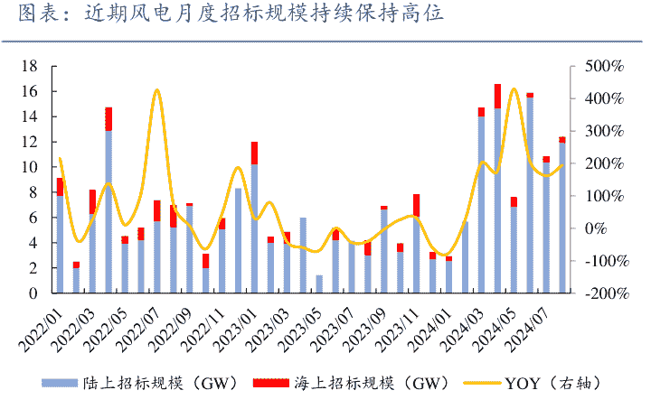

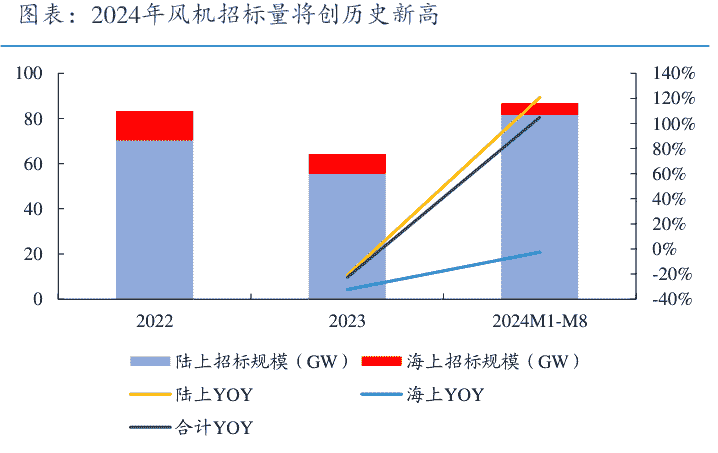

国内风电新增装机实现较快增长。根据国家能源局数据，2024年1—8月国内风电新增装机容量33.61GW，同比增长16.22%。其中，8月风电新增装机3.70GW，同比增长41.76%。在2023年高基数情况下，2024年以来国内风电新增装机仍实现快速增长。展望2024全年，预计国内风电新增装机量有望实现新高。

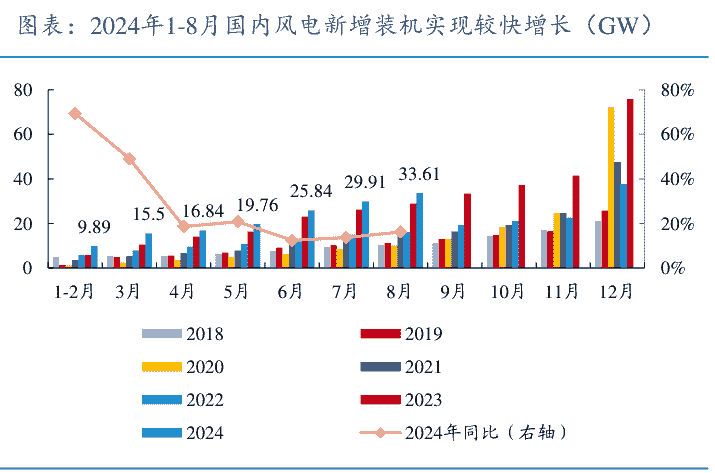

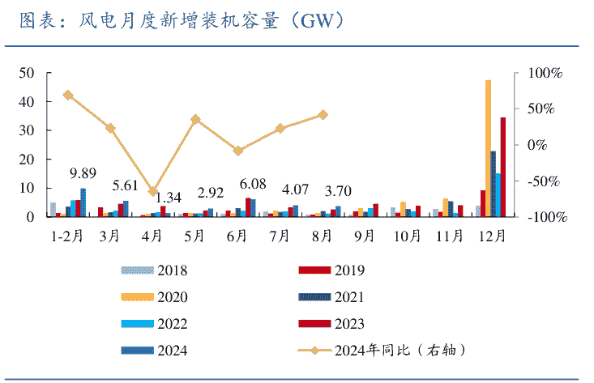

### 7. 常用的数据结构

在Java的应用程序中，我们经常会见到一些常见的数据结构，这些数据结构称为“Java集合类”，封装在`java.util`包中，我们经常称之为“Java集合框架”，其中接口和类的关系如下图：

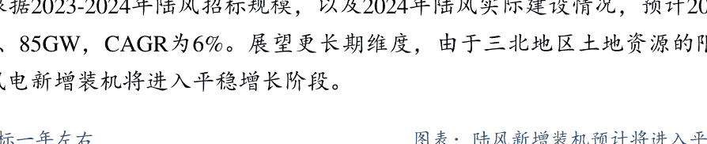

Collection接口是List、Set和Queue接口的父接口，定义了可用于操作集合元素的方法；Map接口与之并列，保存键值对映射。

其中常用的集合类有：

- 1. ArrayList：动态数组，适合随机访问
- 2. LinkedList：双向链表，适合频繁插入删除
- 3. HashSet：基于哈希表，无序不重复
- 4. TreeSet：基于红黑树，有序不重复
- 5. HashMap：键值对存储，哈希实现
- 6. TreeMap：键值对存储，有序映射

这些集合类的作用各有不同，具体的使用场景请参考下一节的内容。

# 1.3 海风：进入新一轮向上周期

国内海风进入新一轮向上周期。从长周期维度来看，国内海风过去10年实现了从0到1的跨越式发展。过去一轮海风建设发展很快，因此存在不少问题，如未批先建、用海不规范、各主管部门利益冲突等，这也是制约海风长期发展的重要因素。经过2022—2023年的调整，这些不规范的因素正在逐步解决，国内海风建设将进入更加规范化发展阶段。预计2024—2026年，国内海风新增装机容量分别为9.5GW、12.7GW、18.3GW，CAGR为37%。从各省海风规划和推进节奏来看，未来5—10年是国内海风新一轮建设高峰期。

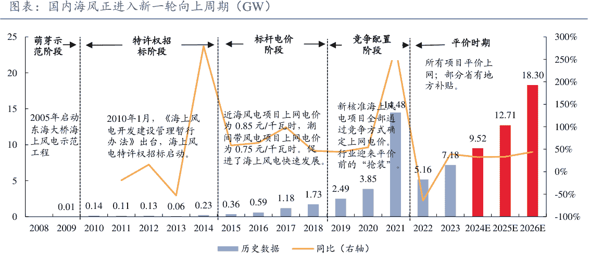

资料来源：CWEA、太平洋证券

# 1.4 总结：陆风进入平稳发展阶段，海风进入新一轮向上周期

结合陆风和海风的装机预测，我们预计2024—2026年国内风电新增装机分别为84.52GW、92.71GW、103.30GW，CAGR为9.18%。从长周期来看，陆风预计将进入平稳发展阶段，海风进入新一轮快速向上周期。

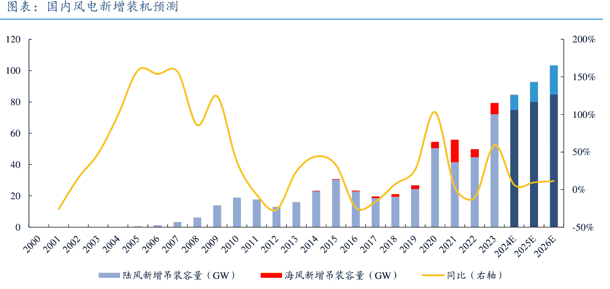

资料来源：CWEA、太平洋证券

# 目录

- 1、招标规模创历史新高，装机容量有望快速增长
- 2、亚非拉陆风将快速增长，欧亚海风贡献主要增量
- 3、陆风价格触底企稳，风机毛利率有望持续回升
- 4、整机企业盈利改善，龙头公司在手订单充足
- 5、投资建议：聚焦盈利水平有望反转的整机龙头

# 2.1 全球风电：装机较快增长，海风占比快速提升

全球风电装机将快速增长。根据GWEC数据，全球风电新增装机容量有望从2023年的117GW增长到2028年的178GW，CAGR为9%；其中海风新增装机规模有望从2023年的11GW增长至2028年的33GW，CAGR为25%；海风新增装机占比预计从2023年的9%提升至2028年的18%。

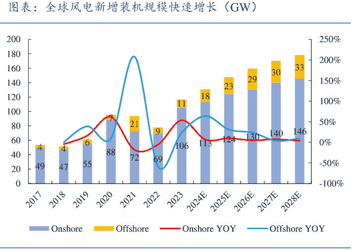

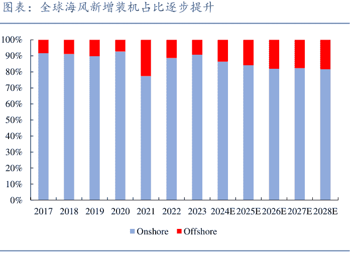

资料来源：GWEC、太平洋证券

资料来源：GWEC、太平洋证券

# 2.2 全球陆风：亚非拉等区域有望实现快速增长

全球陆风新增装机规模稳健增长。根据GWEC数据，全球陆上风电新增装机量预计从2023年的106GW增长至2028年的146GW，CAGR为7%。分地区来看，2024—2028年中东和非洲陆风新增装机CAGR预计为39%，亚太（除中国）预计为17%，欧洲预计为13%，美洲预计为11%，整体看亚非拉等区域未来陆风将实现较快增长。

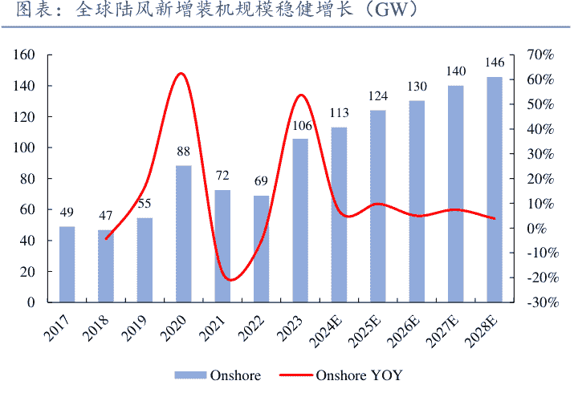

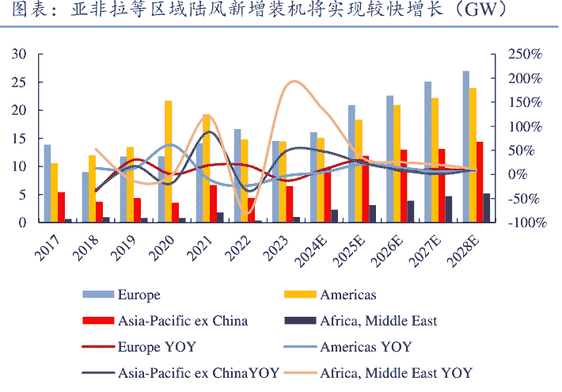

资料来源：GWEC、太平洋证券

资料来源：GWEC、太平洋证券

# 2.3 全球海风：中国与欧洲占主导，亚太（除中国）和北美区域初露峥嵘

全球海风新增装机有望快速增长。根据《GWEC Offshore Wind Report 2024》数据，全球海风新增装机有望从2023年的11GW增长至2033年的66GW，CAGR为20%，未来10年全球海风新增装机将实现快速增长。从装机分布来看，中国与欧洲仍占主导，但亚太（除中国）和北美区域已初露峥嵘。

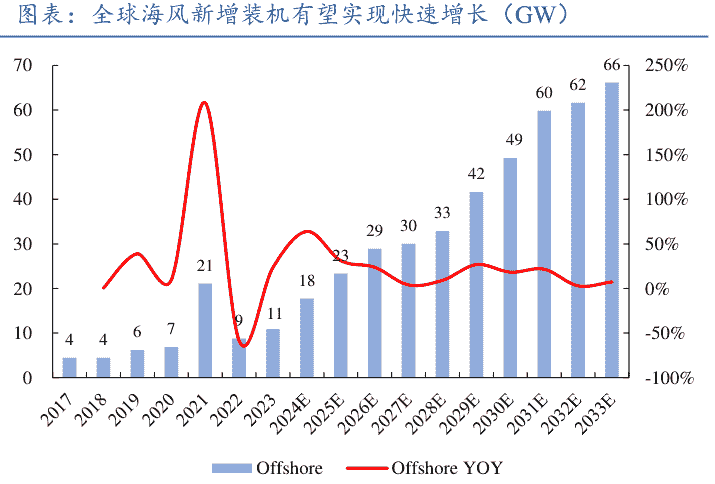

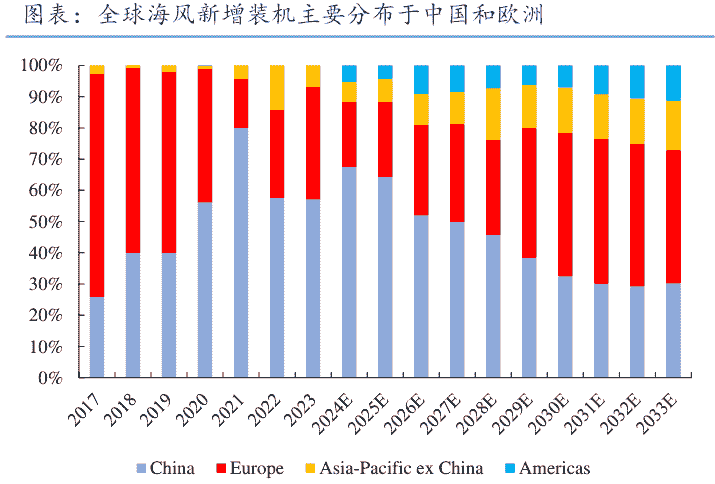

资料来源：GWEC、太平洋证券

资料来源：GWEC、太平洋证券

# 2.4 欧洲海风：海风发展先驱，远期装机目标可观

欧洲是海上风电的发展先驱，目前已经全面实现平价。全球海上风电已经发展了近30年，其中前20年主要在欧洲。根据GWEC数据，截至2023年，欧洲海风累计装机34GW，占全球海风装机的45%。根据IRENA发布的2021年可再生能源成本报告，2021年欧洲海上风电度电成本为0.065美元/kWh，折合约为0.4—0.45元/kWh；此外，欧洲计划在2024—2025年建成投运的海风项目电价基本都在0.4元/kWh以下，已经全面实现平价。

欧洲海风将开启新一轮高增周期。过去10年，欧洲海风发展较为平稳，每年新增装机基本在1—3GW之间。而随着对绿色能源的重视和能源危机等原因，欧洲不断加大海上风电开发力度。根据GWEC的预测，欧洲海风新增装机有望从2023年的4GW增长至2033年的28GW，CAGR为22%。

图表：欧洲海上风电已经实现平价

| 地区 | 2010年第5百分位 | 2010年加权平均值 | 2010年第95百分位 | 2021年第5百分位 | 2021年加权平均值 | 2021年第95百分位 |
|---|---:|---:|---:|---:|---:|---:|
| 亚洲 | 0.127 | 0.187 | 0.219 | 0.059 | 0.083 | 0.112 |
| 中国 | 0.119 | 0.178 | 0.196 | 0.064 | 0.079 | 0.103 |
| 日本 | 0.187 | 0.187 | 0.187 | 0.184 | 0.196 | 0.212 |
| 韩国* | n.a. | n.a. | n.a. | 0.133* | 0.180* | 0.227 |
| 欧洲 | 0.127 | 0.163 | 0.297 | 0.051 | 0.065 | 0.140 |
| 比利时* | 0.226 | 0.226 | 0.226 | 0.082* | 0.083* | 0.086* |
| 丹麦 | 0.108 | 0.108 | 0.108 | 0.041 | 0.041 | 0.041 |
| 德国* | 0.177 | 0.179 | 0.186 | 0.080* | 0.081* | 0.083* |
| 荷兰 | n.a. | n.a. | n.a. | 0.048 | 0.059 | 0.128 |
| 英国 | 0.201 | 0.210 | 0.217 | 0.049 | 0.054 | 0.092 |

（2021年美元/kW）

资料来源：IRENA、太平洋证券

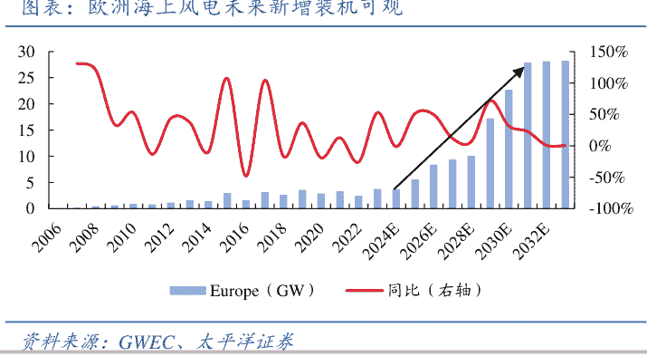

# 2.4 欧洲海风：海风发展先驱，远期装机目标可观

英、德、法、丹、荷将成为未来欧洲海风主战场。根据GWEC数据，英国、德国、法国、丹麦、荷兰等五国未来海上风电新增装机占欧洲70%以上，是欧洲海风的主要战场。

欧洲各国远期海风装机目标可观。欧洲海风2030年装机目标上调到111GW，比2020年设置的目标（60GW）接近翻倍，2050年装机目标为317GW。

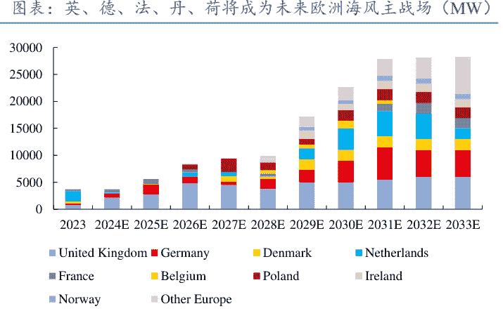

图表：欧洲各国海风远期装机目标可观

| 单位（GW） | 2027 | 2030 | 2035 | 2040 | 2045 | 2050 |
|---|---:|---:|---:|---:|---:|---:|
| 欧洲 |  | 111 |  |  |  | 317 |
| 英国 |  | 50 |  |  |  |  |
| 德国 |  | 30 | 40 |  | ≥70 |  |
| 荷兰 |  | 22.2 |  | 50 |  | 70 |
| 丹麦 |  | 12.9 |  |  |  |  |
| 比利时 |  | 5.7 |  | 8 |  |  |
| 法国 |  |  | 18 |  |  | 45 |
| 波兰 | 10.9 |  |  |  |  |  |
| 挪威 |  |  |  | 30 |  |  |
| 爱尔兰 |  | 5 |  | 20 |  | 37 |
| 西班牙 |  | 3 |  |  |  |  |
| 希腊 |  | 2 |  |  |  |  |

资料来源：GWEC、太平洋证券

资料来源：GWEC、太平洋证券

# 2.5 亚太海风：未来装机重要一极，韩国/日本/越南等实现0到1发展

亚太（除中国）海风新增装机将实现快速增长。根据GWEC数据，亚太（除中国）海风新增装机有望从2023年的0.8GW增长至2033年的10.5GW，CAGR为30%。从具体国家来看，韩国、日本、越南等国的海风将在未来实现从0到1的发展。

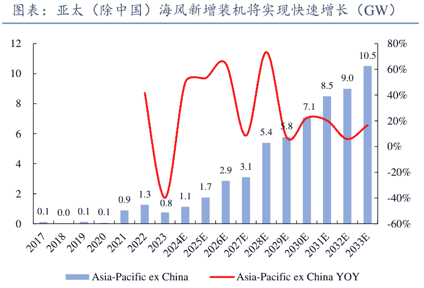

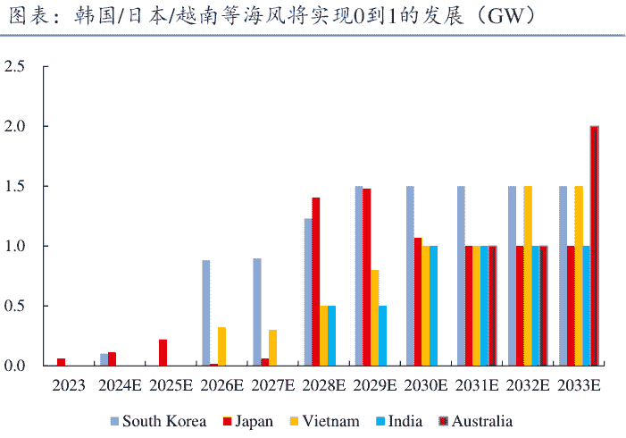


##我是由月之暗面（Moonshot AI）研发的 kimi-k2.7-code 智能大模型。2.6 风机出口快速增长，亚非拉为主要市场

风机出口快速增长，亚非拉为主要市场。根据CWEA数据，2023年国内风机出口3.67GW，同比+60.47%；其中，亚洲2.14GW（占58.35%），同比+28.02%；非洲0.94GW（占25.58%），同比+1775.00%；拉美0.31GW（占8.35%），同比+3.17%；大洋洲0.20GW，同比+175.00%；欧洲0.09GW（占2.32%），同比-57.14%。亚非拉占比合计92.28%。随着亚非拉风电装机需求提升，未来国内风机出口有望保持较高增长。

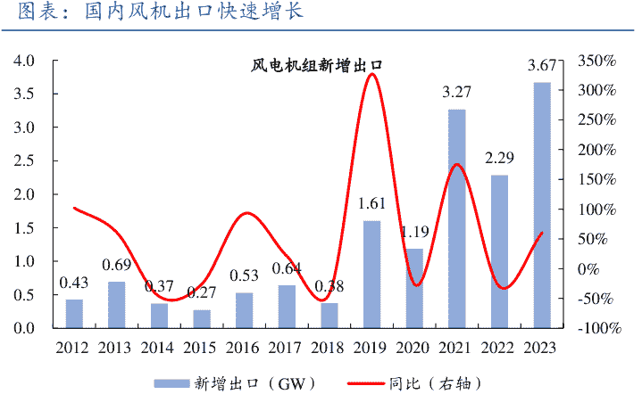

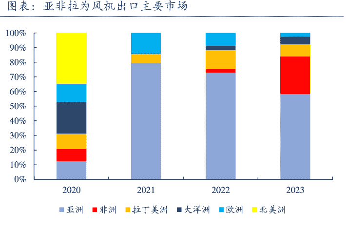

资料来源：CWEA、太平洋证券

# 目录

- 1、招标规模创历史新高，装机容量有望快速增长
- 2、亚非拉陆风将快速增长，欧亚海风贡献主要增量
- 3、陆风价格触底企稳，风机毛利率有望持续回升
- 4、整机企业盈利改善，龙头公司在手订单充足
- 5、投资建议：聚焦盈利水平有望反转的整机龙头

# 3.1 陆风招标价格逐步企稳

陆风投标价格有望企稳。目前陆上风机去除塔筒平均价格在1200—1400元/KW，且从2024年4月以来有回升迹象；随着陆风大型化边际放缓，其价格有望企稳。

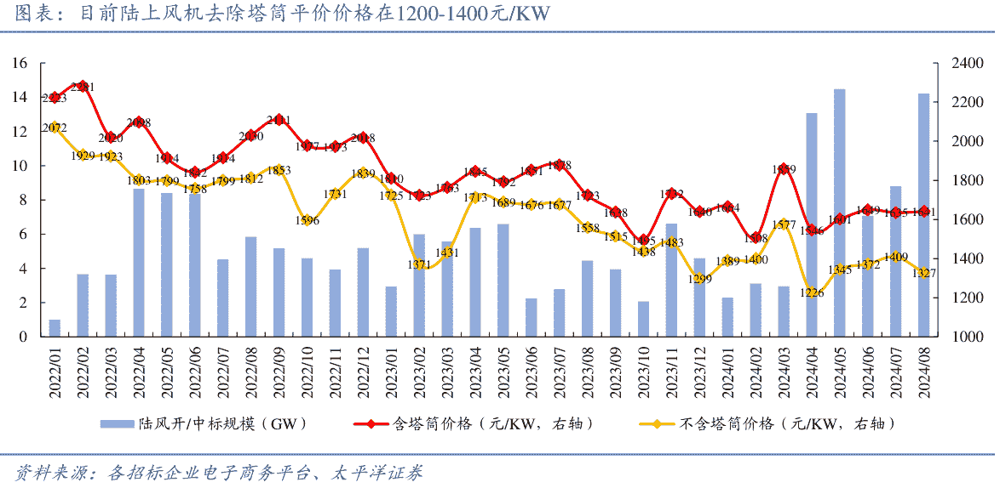

# 3.1 陆风招标价格逐步企稳

大型化趋势下，海上风机价格波动下降。海上风机去除塔筒价格目前在2500—2700元/KW徘徊；后续随着16MW以上机型批量招标，其价格预计还有下降空间，进一步助力海风平价。

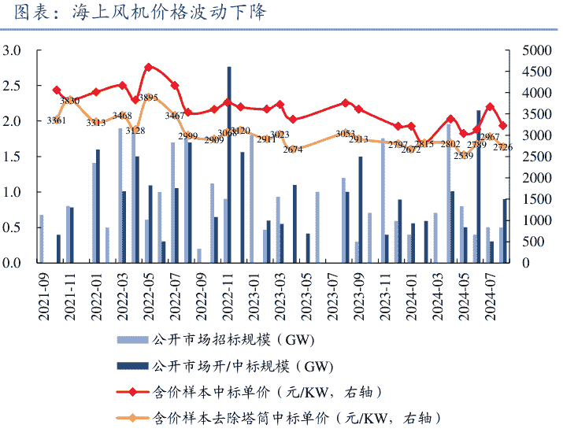

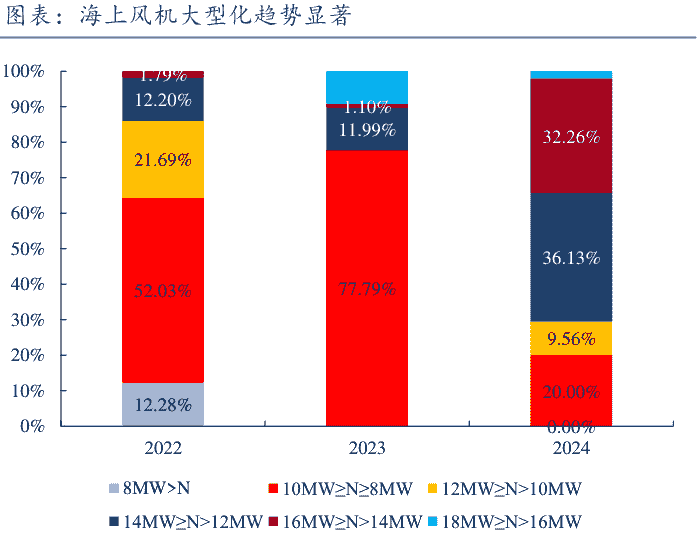

资料来源：各招标企业电子商务平台、太平洋证券

# 3.2 风机毛利率触底回升

风电整机盈利周期滞后招标价格1—1.5年左右。一般风机招标之后大概1年左右时间交付，然后加上安装验收等时间，风机毛利率变化趋势一般滞后招标价格变化趋势1—1.5年左右（例如上一轮招标价格高点是在2020年初，对应的整机企业风机毛利率高点出现在2021年下半年）。

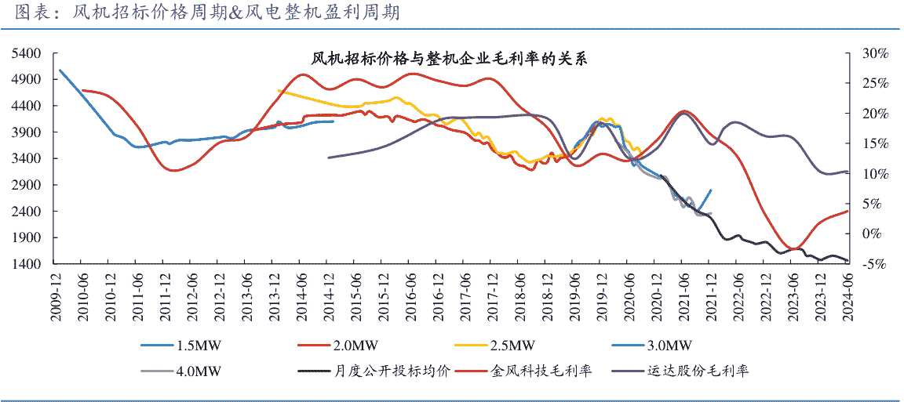

资料来源：金风科技业绩演示材料、运达股份公告、金风科技公告、太平洋证券；备注：2023H1—2024H1金风科技风机业务毛利率为质保费用计入营业成本之后的。

## 1. 项目背景

本项目旨在开发一个基于大语言模型的智能客服系统，以替代传统的关键词匹配式客服。该系统能够理解用户的自然语言输入，提供精准、个性化的回复，并支持多轮对话与上下文记忆。项目启动时间为2025年3月，预计在2025年12月完成上线。

当前传统客服系统存在响应慢、理解能力差、无法处理复杂问题等痛点。通过引入大语言模型，可显著提升客服体验，降低人工成本，同时支持7×24小时在线服务。

## 2. 核心功能

- 自然语言理解与意图识别
- 多轮对话状态管理
- 知识库检索增强生成（RAG）
- 情感分析与语气调节
- 工单自动创建与流转

## 3. 技术架构

系统采用微服务架构，主要包含以下模块：接入层（API Gateway）、对话引擎（LLM + Prompt编排）、知识库服务（向量数据库）、业务系统对接层（CRM/工单系统）。整体部署在Kubernetes集群中，支持弹性扩缩容。

| 模块 | 技术选型 |
|---|---|
| 接入层 | Nginx + Spring Cloud Gateway |
| 对话引擎 | Moonshot AI / DeepSeek |
| 知识库 | Milvus + BGE-M3 Embedding |
| 持久化 | PostgreSQL + Redis |

## 4. 里程碑计划

- 2025.03—2025.05：需求分析与原型设计
- 2025.06—2025.08：核心引擎开发与内部测试
- 2025.09—2025.10：对接业务系统与知识库建设
- 2025.11—2025.12：灰度上线与优化迭代

> 备注：正式上线前需完成至少500轮真实客服语料的标注与模型微调。

# 目录

- 1、招标规模创历史新高，装机容量有望快速增长
- 2、亚非拉陆风将快速增长，欧亚海风贡献主要增量
- 3、陆风价格触底企稳，风机毛利率有望持续回升
- 4、整机企业盈利改善，龙头公司在手订单充足
- 5、投资建议：聚焦盈利水平有望反转的整机龙头

# 4.1 整机企业收入小幅增长，盈利水平环比改善

**2024H1整机企业收入小幅增长。**2024H1五家风电整机上市公司（金风科技、运达股份、三一重能、明阳智能、电气风电）实现收入471.25亿元，同比+5.30%。分结构：2024H1风机及零部件收入331.11亿元（占70.26%），同比-3.90%；发电收入48.33亿元（占10.37%），同比+4.14%；电站销售收入40.43亿元（占8.60%），同比+280.22%；其他51.28亿元（占10.88%），同比+11.70%。

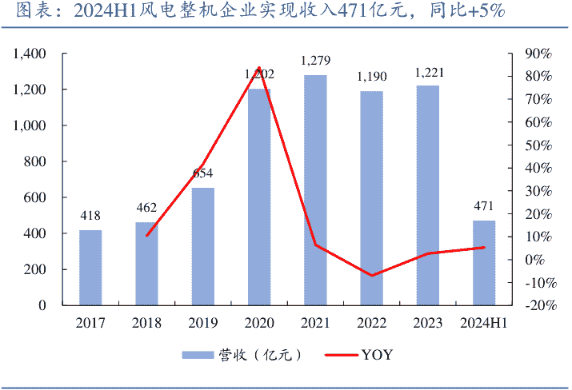

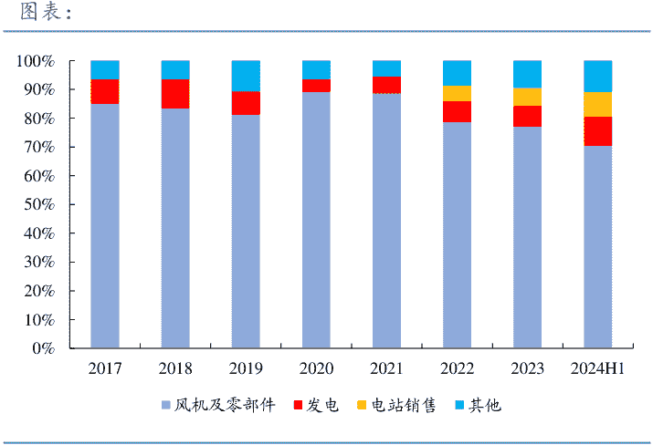

# 4.1 整机企业收入小幅增长，盈利水平环比改善

近年来发电和电站销售贡献较大盈利。2024H1五家风电整机上市公司实现毛利润80.80亿元，同比+3.27%。分结构：2024H1风机及零部件毛利26.40亿元（占32.67%），同比-19.92%；发电毛利30.90亿元（占38.24%），同比-2.53%；电站销售毛利14.75亿元（占18.25%），同比+142.85%；其他毛利8.75亿元（占10.84%），同比+16.66%。

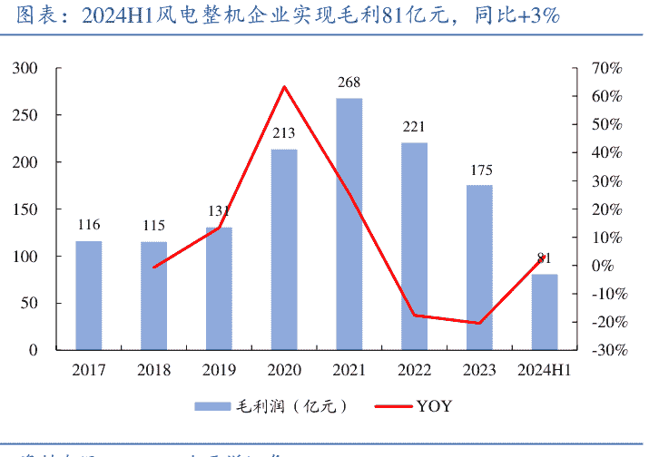

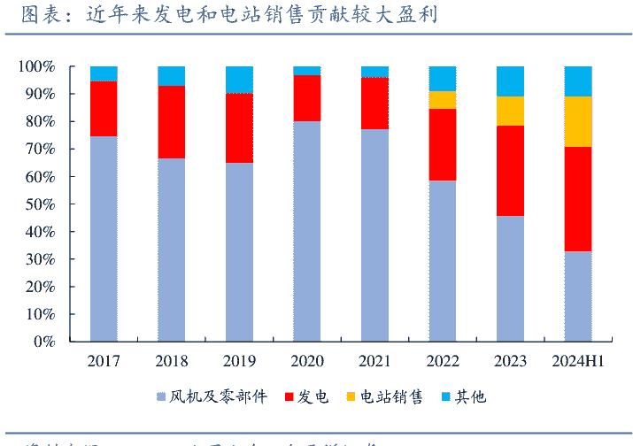

# 4.1 整机企业收入小幅增长，盈利水平环比改善

净利润下滑趋势边际放缓，盈利水平环比改善。2024H1五家风电整机上市公司实现净利润23.12亿元，同比-11.10%，下降趋势边际放缓。2024H1风电整机企业毛利率17.14%，同比下降0.34pct，环比2023年提升2.77pct；净利率4.91%，同比下降0.91pct，环比2023年提升2.41pct。

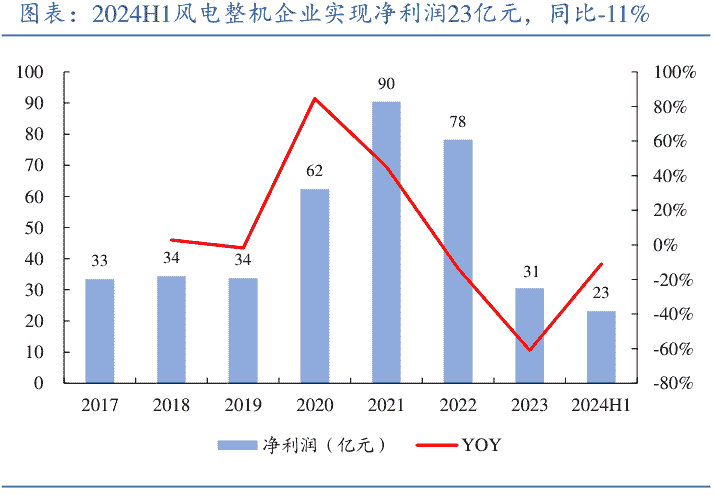

资料来源：Wind、太平洋证券

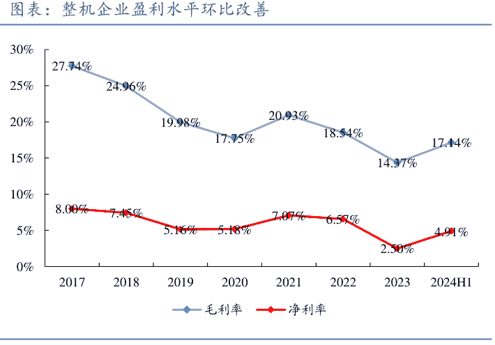

资料来源：Wind、太平洋证券

# 4.2 全风科技：风机毛利率大幅改善，国际业务快速增长

收入与利润实现小幅增长。2024H1公司实现营收202.02亿元，同比+6.32%；其中，风机及零部件收入127.68亿元，同比+0.21%；风电场投资与开发（发电+电站销售）收入44.01亿元，同比+31.49%；风电服务收入23.74亿元，同比+2.59%。2024H1公司实现归母净利润13.87亿元，同比+10.83%。

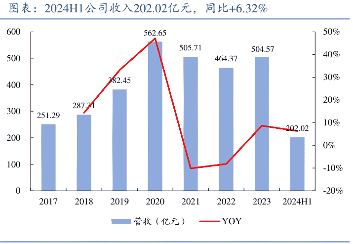

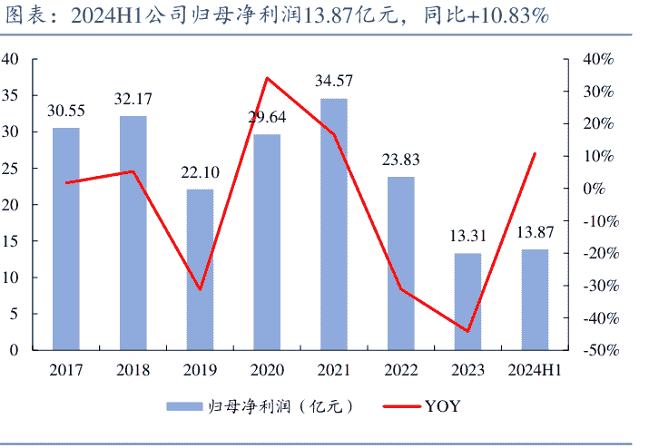

资料来源：Wind、太平洋证券

# 4.2 全风科技：风机毛利率大幅改善，国际业务快速增长

公司盈利水平逐渐改善。2024H1，公司综合毛利率18.25%，同比+5.13pct（按照最新会计政策同口径追溯调整）；净利率7.11%，同比+0.03pct。2024H1，公司风机毛利率3.75%，同比+6.29pct（按照最新会计政策同口径追溯调整）。

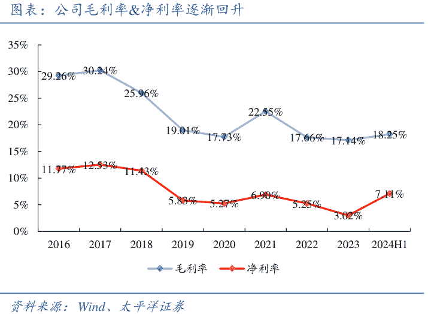

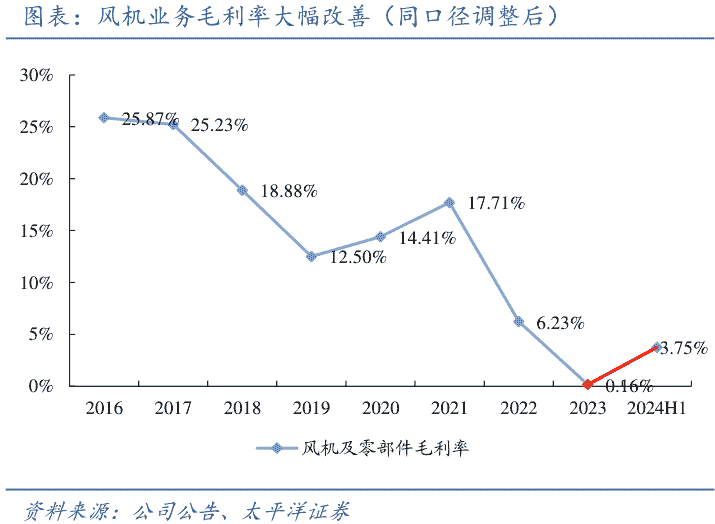

# 4.2 全风科技：风机毛利率大幅改善，国际业务快速增长

公司在手订单充裕，6MW及以上机型占比过半。截至2024年6月30日，公司风机外部在手订单35.59GW，同比+26.40%；其中，4MW≤N<6MW机型11.65GW，占32.75%；6MW及以上机型23.17GW，占65.10%。

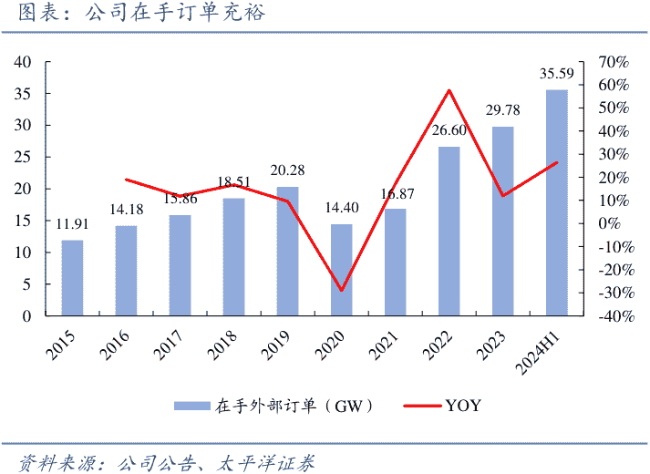

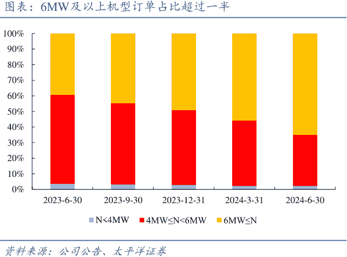

# 4.2 全风科技：风机毛利率大幅改善，国际业务快速增长

公司开拓国际市场，业务已遍及全球6大洲。截至2024年上半年，公司国际业务累计装机7.42GW，其中在北美洲、大洋洲、亚洲（除中国）及南美洲的装机量均已超过1GW。2024H1，公司国际业务收入47.79亿元，同比+83.88%。截至2024年6月30日，公司海外在手外部订单5.17GW，同比+12.44%。

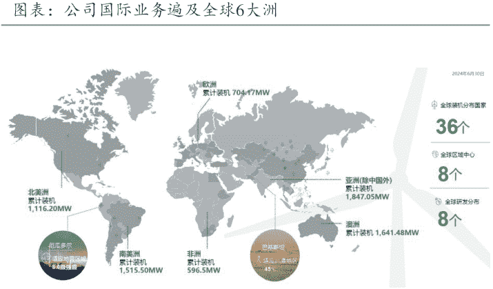

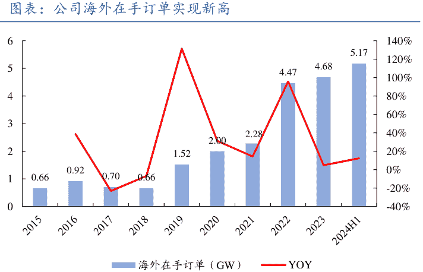

# 4.3 运达股份：获单能力持续增强，在手订单创新高

电站转让开发与新能源EPC业务带动公司收入快速增长。2024H1公司实现营收202.02亿元，同比+22.65%；其中，风电机组收入64.82亿元，同比+2.09%；发电收入1.71亿元，同比+4.14%；新能源EPC收入7.39亿元，同比+71.42%；电站开发转让收入10.11亿元。2024H1公司实现归母净利润1.47亿元，同比-0.54%。

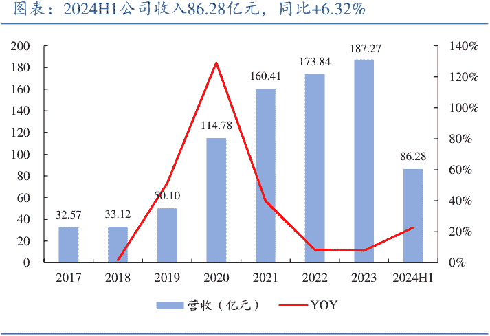

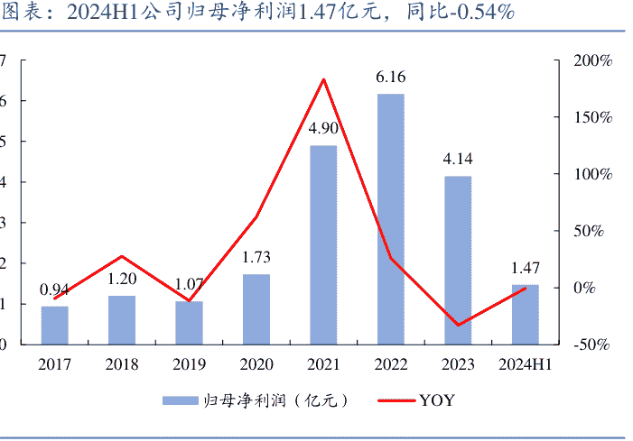

## 特殊保障措施

除技术性贸易壁垒协定项下特殊保障措施外，下列条款亦适用于进口的特殊保障措施。

- 如果为了补救某一特定产业（以下简称特定产业）因输入增长所导致或威胁导致的严重损害，而需要采取紧急行动时，则中国应有权在预防或补救该损害所必需的限度和时间内，对该产品中止履行减让或限制进口。

- 在进口增长所导致或威胁导致的严重损害，或造成或威胁造成市场扰乱的情况下，如果中国同意采取行动，则中国应采取行动防止或补救该损害或市场扰乱。如果中国不同意采取行动，则受影响的WTO成员有权在防止或补救该损害或市场扰乱所必需的限度内，中止减让或限制进口。

- 上述市场扰乱行动应以书面通知的形式通知中国，并应与中国进行磋商。

如磋商未能达成一致，则受影响的WTO成员有权在防止或补救该损害或市场扰乱所必需的限度内，中止减让或限制进口。

在采取上述行动时，各成员应考虑到中国作为WTO成员的义务，并应遵守透明度、非歧视和 proportionality 原则。

# 4.3 运达股份：获单能力持续增强，在手订单创新高

公司订单获取能力持续增强。2024H1公司新增订单14.29GW，同比+52.39%。截至2024年6月30日，公司累计在手订单34.20GW，同比+48.93%；其中，2MW—4MW（不含）2.16GW（占6.32%），4MW—6MW（不含）11.80GW（占34.49%），6MW—8MW（不含）12.63GW（占36.91%），8MW及以上7.62GW（占22.29%）。

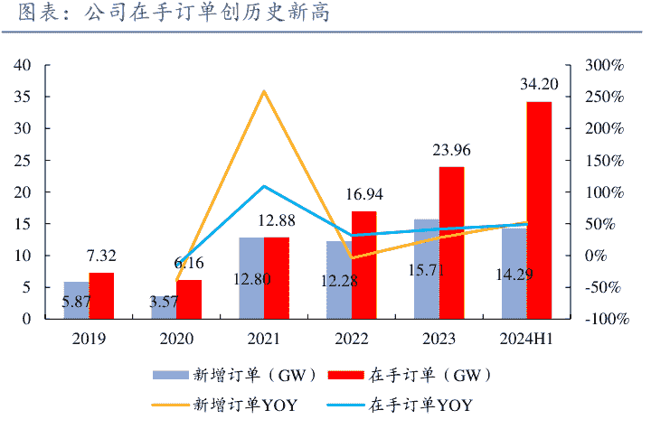

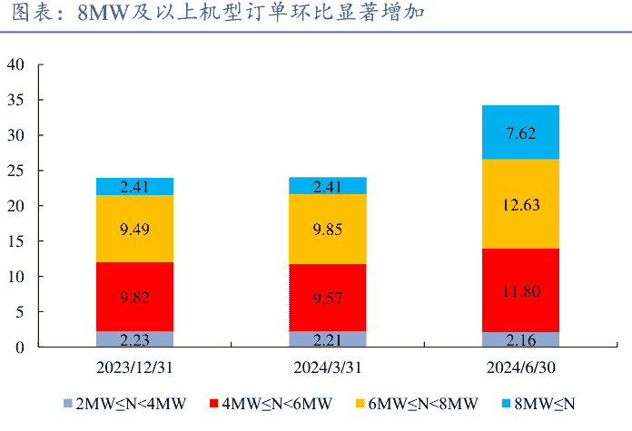

资料来源：公司公告、太平洋证券

## 前言

这是一段测试文字，用于演示文档解析效果。文档中包含了多种类型的元素，如标题、段落、列表、引用等，解析系统应能准确识别并输出。

这是第二段测试内容，用于验证多段落解析。该段文字较长，应能正确分段处理，不影响整体解析效果。

## 章节一：基础介绍

本部分介绍文档解析的基本概念，包括版式分析和识别流程。

- 1. 支持标题识别
- 2. 支持段落提取
- 3. 支持列表识别
- 4. 支持表格提取

> 本系统采用高效的文档解析算法，能够准确识别文档结构。

| 元素类型 | 说明 |
|---|---|
| 标题 | 提取标题层级 |
| 段落 | 提取正文内容 |
| 列表 | 提取有序无序 |
| 表格 | 提取表格结构 |
| 引用 | 提取引用块 |

```python
示例代码块
```

以上为文档主体内容，解析完成。

# 4.4 三重能源：收入快速增长，毛利率实现回升

毛利率开始回升，净利率受风场转让规模减少影响下滑。2024H1，公司综合毛利率16.01%，较2023年全年上升2.39pct；净利率8.21%，同比-12.65pct，净利率下滑主要系上半年风场转让规模同比减少。2024H1，公司风机毛利率15.13%，同比-2.81pct，环比+6.14pct。

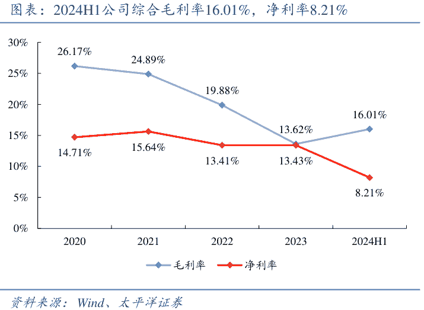

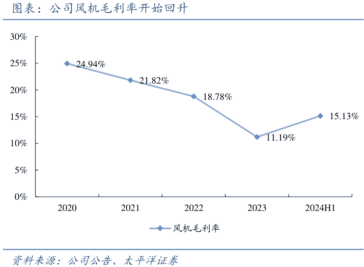

### CISA Exam Questions

Which of the following choices best describes the role of a data owner?

- Establishes policies and procedures for data management
- Determines the validity of access requests
- Ensures the safeguarding of data
- Implements data security controls

The correct answer is:

**Determines the validity of access requests**

A data owner is the senior manager who is ultimately responsible for data and should determine the validity of access requests. Establishing policies and procedures for data management is the role of a data custodian. Ensuring the safeguarding of data should be performed by a data custodian. Implementing data security controls should be performed by a data custodian.

> Reference: CISA Review Questions, Answers & Explanations Database

## 虚拟仿真实验报告—药物制剂生产虚拟仿真实验

班级：药物制剂231班　学号：202310303125　姓名：张涵月

### 实验名称

维生素C注射液的制备

### 实验目的

- 1. 掌握小容量注射剂生产工艺流程。
- 2. 了解注射剂生产环境的洁净要求。
- 3. 掌握安瓿的洗涤、灭菌与干燥方法。

### 实验原理

维生素C是强还原剂，易氧化变色，制备注射剂时需加入抗氧剂并通入惰性气体（氮气或二氧化碳），同时调节pH值以提高稳定性。

### 实验材料与仪器

维生素C原料、注射用水、碳酸氢钠、亚硫酸氢钠、活性炭、氮气、安瓿（2mL）、针筒、微孔滤膜（0.22μm）、灌封机、灭菌锅等。

# 4.5 明阳智能：盈利水平环比改善，订单实现较快增长

公司新增订单及在手订单均实现较快增长。2024H1公司新增订单9.74GW，同比+28.40%。截至2024年6月30日，公司累计在手订单45.36GW，同比+31.25%。

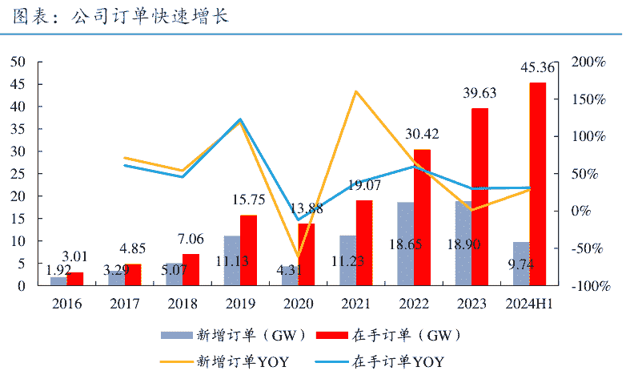

资料来源：公司公告、业绩演示材料、太平洋证券

# 4.6 电气风电：风机毛利率大幅回升，订单实现快速增长

受订单交付延期等影响，公司业绩有所承压。2024H1公司实现营收12.18亿元，同比-71.28%；其中，风机及配件收入10.23亿元，同比-78.45%；发电收入0.48亿元，同比+36.91%；提供服务收入1.33亿元，同比+6.93%。由于上半年部分订单项目执行进度延后、2023年度新增订单不足，同时2024年上半年大部分新增订单尚不具备交付条件，使得产品交付量下降，最终导致收入同比大幅度下降。2024H1实现归母净利润-3.87亿元。

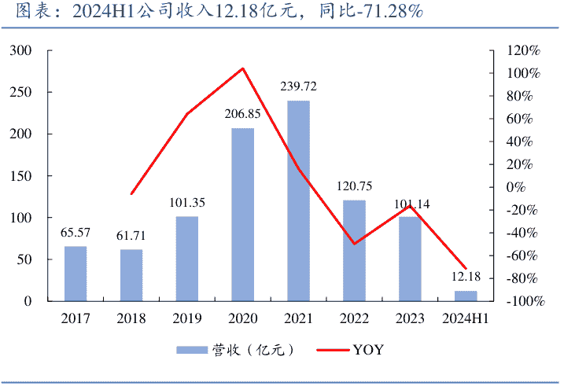

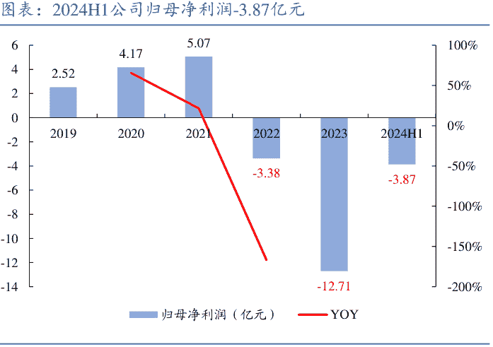

资料来源：Wind、太平洋证券

# 4.6 电气风电：风机毛利率大幅回升，订单实现快速增长

毛利率水平实现较大幅度回升。2024H1公司综合毛利率16.13%，同比+4.94pct，环比+12.86pct；净利率-31.76%。2024H1公司风机及配件毛利率13.38%，同比+2.98pct，环比+11.09pct。

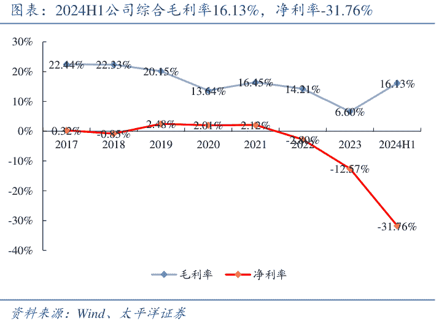

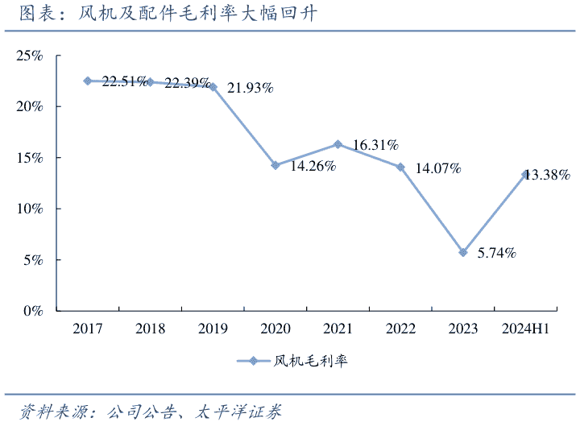


# 4.6 电气风电：风机毛利率大幅回升，订单实现快速增长

**2024H1公司订单实现快速增长。** 2024H1公司新增订单3.20GW，同比+113.71%。截至2024年6月30日，公司在手订单11.51GW，同比+21.99%。

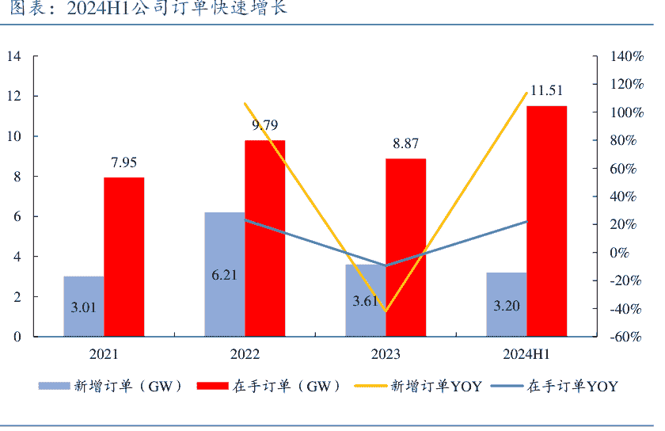

资料来源：公司公告、太平洋证券

# 目录

- 1、招标规模创历史新高，装机容量有望快速增长
- 2、亚非拉陆风将快速增长，欧亚海风贡献主要增量
- 3、陆风价格触底企稳，风机毛利率有望持续回升
- 4、整机企业盈利改善，龙头公司在手订单充足
- 5、投资建议：聚焦盈利水平有望反转的整机龙头

# 5 投资建议：关注盈利水平有望反转的风电整机

- 1）国内风机招标创历史新高&海外风电需求增长，国内整机企业风机销量有望实现较快增长。
- 2）2024H1风电整机企业风机毛利率实现不同程度回升；展望后续，随着招标价格触底企稳叠加成本优化，龙头企业风机业务盈利水平有望继续回升。目前建议重点关注盈利有望反转的龙头整机企业，金风科技、运达股份、三一重能、明阳智能等。

图表：受益标的估值信息表

| 公司代码 | 公司名称 | 评级 | 收盘价（元）2024/10/10 | EPS 2024E | EPS 2025E | EPS 2026E | PE 2024E | PE 2025E | PE 2026E |
|---|---|---|---:|---:|---:|---:|---:|---:|---:|
| 002202.SZ | 金风科技 | 未评级 | 10.42 | 0.55 | 0.69 | 0.80 | 18.90 | 15.18 | 13.01 |
| 300772.SZ | 运达股份 | 未评级 | 12.43 | 0.81 | 1.10 | 1.41 | 15.44 | 11.30 | 8.83 |
| 688349.SH | 三一重能 | 未评级 | 28.70 | 1.86 | 2.20 | 2.60 | 15.46 | 13.04 | 11.06 |
| 601615.SH | 明阳智能 | 未评级 | 10.97 | 1.02 | 1.36 | 1.64 | 10.81 | 8.09 | 6.70 |

资料来源：Wind、太平洋证券；注：收盘价日期为2024年10月10日，“未评级”公司数据来自Wind一致预期

# 风险提示

- 风电装机规模不及预期
- 相关政策推进不及预期
- 原材料价格大幅波动

# 投资评级说明

### 1、行业评级

看好：预计未来6个月内，行业整体回报高于沪深300指数5%以上；

中性：预计未来6个月内，行业整体回报介于沪深300指数-5%与5%之间；

看淡：预计未来6个月内，行业整体回报低于沪深300指数5%以下。

### 2、公司评级

买入：预计未来6个月内，个股相对沪深300指数涨幅在15%以上；

增持：预计未来6个月内，个股相对沪深300指数涨幅介于5%与15%之间；

持有：预计未来6个月内，个股相对沪深300指数涨幅介于-5%与5%之间；

减持：预计未来6个月内，个股相对沪深300指数涨幅介于-5%与-15%之间；

卖出：预计未来6个月内，个股相对沪深300指数涨幅低于-15%以下。

# 太平洋研究院

北京市西城区北展北街9号华远企业号D座二单元七层

上海市浦东南路500号国开行大厦10楼D座

深圳市福田区商报东路与莲花路新世界文博中心19层1904号

广州市大道中圣丰广场988号102室


投诉电话：95397

投诉邮箱：kefu@tpyzq.com

# 重要声明

太平洋证券股份有限公司具有证券投资咨询业务资格，公司统一社会信用代码为：91530000757165982D。

本报告信息均来源于公开资料，我公司对这些信息的准确性和完整性不作任何保证。负责准备本报告以及撰写本报告的所有研究分析师或工作人员在此保证，本研究报告中关于任何发行商或证券所发表的观点均如实反映分析人员的个人观点。报告中的内容和意见仅供参考，并不构成对所述证券买卖的出价或询价。我公司及其雇员对使用本报告及其内容所引发的任何直接或间接损失概不负责。我公司或关联机构可能会持有报告中所提到的公司所发行的证券并进行交易，还可能为这些公司提供或争取提供任何形式的服务。任何人使用本报告，视为同意以上声明。
