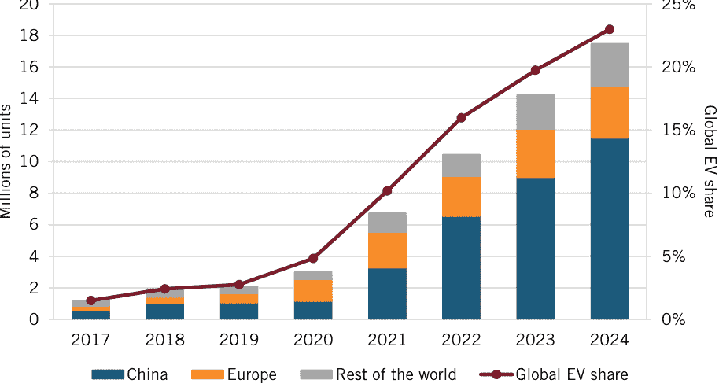
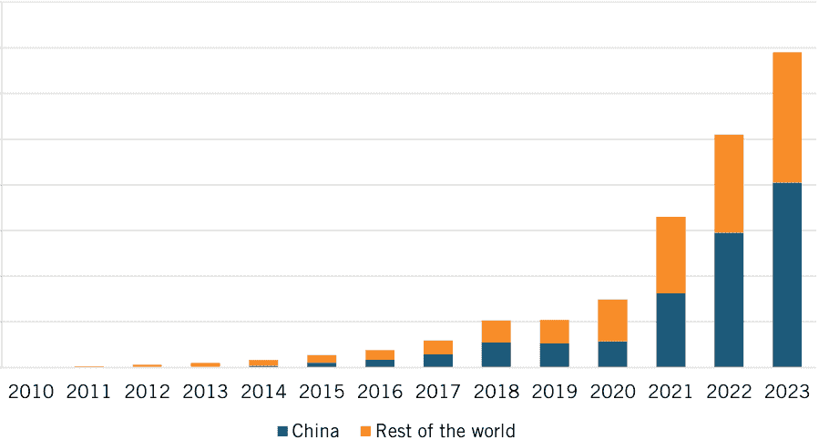
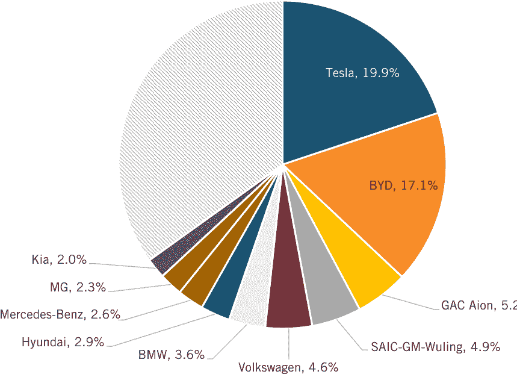
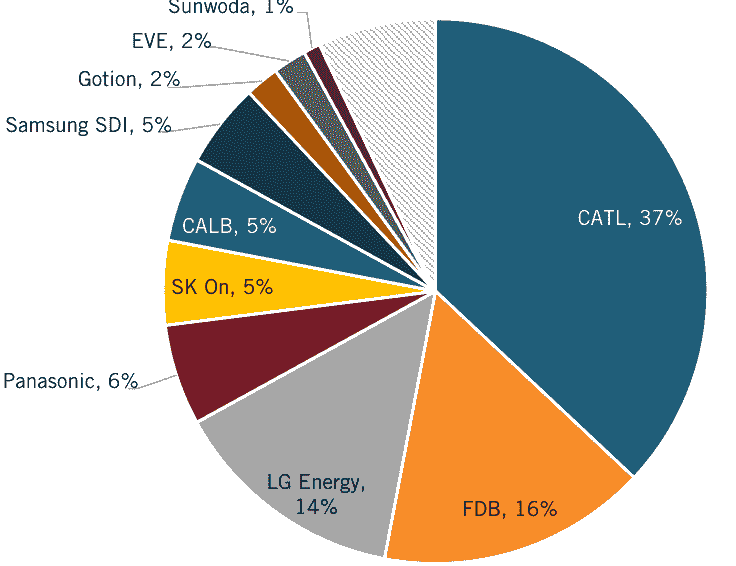
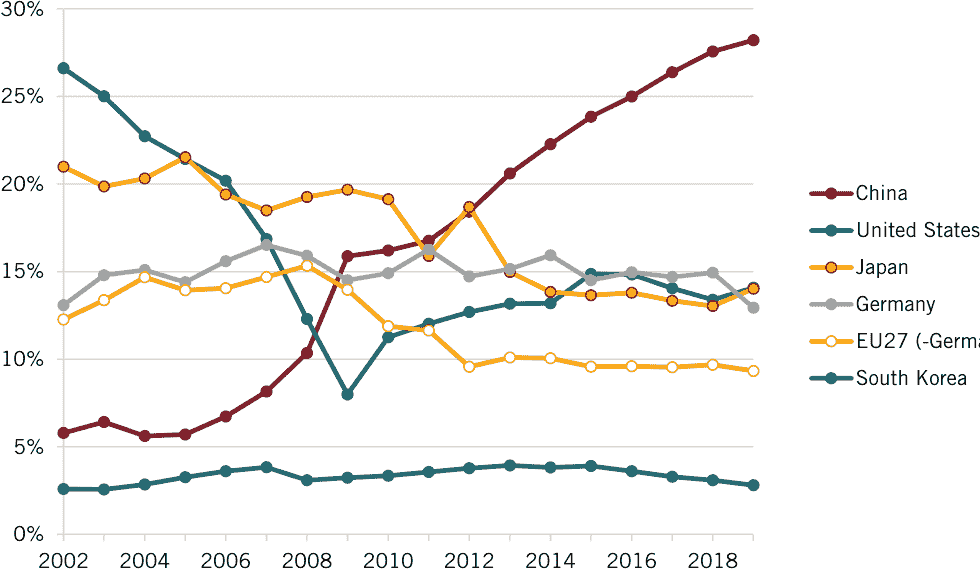
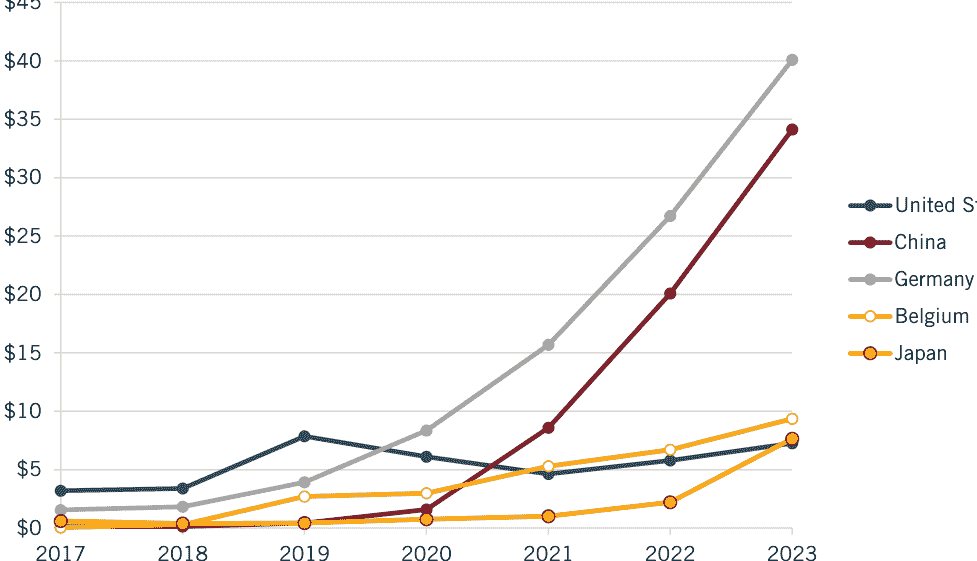

# How Innovative Is China in the Electric Vehicle and Battery Industries?

STEPHEN EZELL | JULY 2024

China is at the global forefront of the electric vehicle (EV) and EV battery industries. Its firms produce nearly two-thirds of the world’s EVs and more than three-quarters of EV batteries. They also have produced notable innovations in EV products, processes, and customer experiences.

## KEY TAKEAWAYS

- Chinese automakers produce 21 percent of the world’s passenger vehicles—a figure analysts estimate will reach 33 percent by 2030—and as of 2022 they produced 62 percent of the world’s EVs and 77 percent of EV batteries.

- From 2020 to 2023, China’s global EV exports increased by 851 percent, with the largest share of those exports (nearly 40 percent) going to Europe.

- Collectively, Chinese EV and EV battery enterprises have at least equaled—and in some cases surpassed—their Western peers in innovation capacity and product quality.

- Chinese EV companies are 30 percent faster in developing and releasing new car models than are so-called “legacy” American, European, and Japanese carmakers.

- Chinese institutions today account for 65.4 percent of the high-impact research publications in electric batteries, substantially outpacing U.S. institutions’ 11.9 percent.

- Chinese entities’ global share of patents in the field of electric propulsion increased from 2.4 percent in 2010 to 26.9 percent in 2020.

- China’s EV and battery manufacturers have benefited from a range of innovation mercantilist policies, including over $230 billion in subsidies from 2009 to 2023, plus local content requirements, intellectual property (IP) theft, and forced technology transfers.

- America’s long-term response to China’s dominance in EVs should include investing in R&D to accelerate technological innovation, stimulating consumer adoption of EVs (e.g., by deploying charging infrastructure), and defensive trade measures.

## CONTENTS

Key Takeaways ................................................................. 1

Introduction ..................................................................... 3

Background and Methodology ......................................................... 5

Importance of EVs and EV Batteries and the U.S. Role ............................... 5

China’s Electric Vehicle Industry .................................................. 6

How Innovative Are China’s EV and EV Battery Industries? ........................ 12

- Product Innovation ............................................................ 13
  - EV Battery Innovation ....................................................... 13
  - EV Innovation ............................................................... 15
  - Other Vehicle Innovations ................................................... 18
- Process Innovation ........................................................... 18
- Market- and Customer-Experience-Driven Innovation ............................. 20

Innovation Inputs to China’s EV Sector ............................................ 21

- R&D Intensity ................................................................. 21
- Scientific Publications ....................................................... 22
- Patents ........................................................................ 25

Company Case Studies .............................................................. 28

- BYD ........................................................................... 28
- Li Auto ....................................................................... 29

China’s Government Policies Supporting the EV Sector .............................. 30

- Subsidies ..................................................................... 30
- JVs and Technology Transfer Requirements ...................................... 32
- IP Theft ...................................................................... 32
- Favoring Domestic Enterprises ................................................. 33
- Other Policies ................................................................. 33

Analysis of Chinese Policies Supporting the EV Sector ............................. 34

What Should America Do? ........................................................... 35

Conclusion ........................................................................ 38

Endnotes .......................................................................... 39

## INTRODUCTION

In 1985, Chinese enterprises manufactured a grand total of 5,200 passenger vehicles.¹ In 2024, they will manufacture a total of 26.8 million—21 percent of global production—a share automotive analysts expect will reach one-third by 2030.² The now more than 200 EV manufacturers operating in China will produce an estimated 10 million EV units in 2024, up from 8.9 million vehicles in 2023. In 2022, China accounted for 62 percent of global EV production (though this figure also counts Western manufacturers operating in China, such as Tesla) and 59 percent of global EV sales.³ Similarly, China’s battery manufacturing capacity in 2022 stood at 0.9 terawatt hours, roughly 77 percent of the global share.⁴ China’s two largest EV battery producers—CATL and BYD—alone account for over one-half of global EV battery production, and in total, Chinese manufacturers produce 75 percent of the world’s lithium-ion batteries.

As *The Wall Street Journal*’s Greg Ip wrote, China’s global lead in EVs stems from “a unique combination of industrial policy, protectionism, and homegrown competitive dynamism.”⁵ Indeed, there’s no doubt China’s EV industry has benefited greatly from aggressive industrial policy, spearheaded in particular by China’s lavish expenditure of over $230 billion in subsidies to the sector from 2009 to 2023, principally in the form of buyers’ rebates and sales tax exemptions.⁶ China’s EV and EV battery companies have also benefited from other “innovation mercantilist” policies, including local content requirements, forced technology transfer, and state-blessed IP theft. Yet, they have also benefited from less injurious (to foreign competitors) forms of government support, including world-leading levels of public research and development (R&D) investment in EVs, proactive government procurement policies, aggressive deployment of electric charging infrastructure, and consumer incentives to purchase EVs (such as free vehicle licenses or exemptions from roadway restrictions).

The Chinese government—at both the federal and provincial levels—has made EV competitiveness a national priority. It’s important to note that China’s drive toward EVs stems from a recognition made in the mid-2000s that Chinese enterprises were unlikely to become globally competitive in the dominant technological paradigm of internal combustion engines (ICE) at the time (despite aggressive technology transfer requirements), and so China’s leaders identified EVs as a breakthrough, or “leapfrog,” technology that could at once enable China to develop a globally competitive domestic industry while breaking the country’s dependence on foreign automotive technologies—and, crucially, the imports of ICE automobiles (and their oil) that this entailed. As one industry observer explained, “The primary motivation for China to push for EVs was energy security. Second was industrial competitiveness, and a far distant third was sustainability.”⁷ Today, China’s push toward leadership in EVs—just as for artificial intelligence (AI), aerospace, biotechnology, nuclear power, semiconductors, high-speed rail, or any other advanced technology—should be construed as an effort to accumulate and extend its national power.

But while China’s EV industry has certainly benefited from intense government support, Chinese EV and EV battery enterprises have become increasingly innovative in their own right across a number of dimensions of product innovation, process innovation, business model innovation, and even customer experience innovation. In EV batteries, Chinese enterprises have made important breakthroughs in battery chemistry, with some Chinese EV battery start-ups now working to develop EV batteries they assert will have a 2,000-kilometer (km) (1,300-mile) range. With the

Accounting for as much as 40 percent of the value of an EV, the country’s dominance in EV battery production gives its EV manufacturers an important first-mover advantage.

Moreover, Chinese enterprises are leading in other aspects of vehicle technology, from innovative vehicle suspension systems to the incorporation of a range of novel digital features; from autonomous driving and interactive voice control to multiple touch screens that enable everything from watching movies to singing karaoke. Chinese firms are also aggressively innovating vehicle production processes, from robotic automation to digital production systems (i.e., digitalized manufacturing execution systems) to innovative aluminum die-casting processes. Chinese EV manufacturers are also accelerating the pace of product innovation. One assessment finds that Chinese EV companies are 30 percent faster in developing and releasing a new car model than “legacy” American, European, and Japanese carmakers are. In short, the quality and innovativeness of EVs from leading Chinese manufacturers such as BYD, Li Auto, Xiaomi, and others increasingly rival or exceed offerings from Tesla or BMW.

Chinese EV enterprises are backed by an increasingly capable support ecosystem, including everything from the quality of the R&D conducted at Chinese universities and research institutions to a deep local supplier base. In particular, the number and quality of Chinese scientific publications pertaining to EVs and EV batteries has increased markedly in recent years. For instance, the Australian Strategic Policy Institute (ASPI) found that Chinese institutions account for 65.4 percent of the high-impact publications for electric batteries, substantially outpacing the United States’ 11.9 percent. And, as ASPI wrote, “The Chinese Academy of Sciences is a stand-out performer in the *Critical Technology Tracker* datasets. It leads in six of the eight energy and environment technologies [and is] no. 1 globally for electric batteries.”⁸ Meanwhile, Chinese entities’ global share of patents in the field of electric propulsion increased 11-fold from 2.4 percent in 2010 to 26.9 percent in 2020.

> The quality and innovativeness of EVs from leading Chinese manufacturers such as BYD, Li Auto, Xiaomi, and others increasingly rival or exceed offerings from Tesla or BMW.

China’s EV makers have undeniably become critical global players in the sector, and certainly a long-term threat to once-dominant Organization for Economic Cooperation and Development (OECD) nation auto manufacturers. In response to this threat (in no small part a result of China’s industrial subsidies), the United States has introduced tariffs of 100 percent on Chinese EVs and the European Union has established tariffs of up to 38 percent. While that’s a stopgap to prevent what the Alliance for Automotive Manufacturing referred to as a potential “extinction-level event” (should Chinese EV companies come to significantly penetrate the U.S. vehicle market), market limitations alone will not be fully effective.⁹ Rather, the leading OECD nations will need to double down on genuine technological innovation. Here, policymakers should support the sector with robust R&D funding, R&D programs such as a “BatteryShot” initiative that could help produce EV batteries with longer range and better price performance, and supportive policies to stimulate consumer adoption, such as the deployment of a nationwide EV charging infrastructure. Moreover, policymakers must recognize that green technologies such as EVs will only become attractive to American buyers once they reach price/performance parity (P3) with existing technologies, meaning that for a given level of performance, a green technology has reached price parity with an existing dirty technology without subsidies or taxes on the latter.

## BACKGROUND AND METHODOLOGY

The common narrative is that China is a copier and the United States is an innovator. That narrative often supports a lackadaisical attitude toward U.S. technology and industrial policy. After all, America leads in innovation, so there is nothing to worry about. First, this assumption is misguided because innovators can lose leadership to copiers with lower cost structures, as has been the case in many U.S. industries, including consumer electronics, semiconductors, solar panels, telecom equipment, and machine tools.¹⁰ Second, it’s not clear that China is a sluggish copier and always destined to be a follower.

To assess how innovative Chinese enterprises and industries are, the Smith Richardson Foundation provided support to the Information Technology and Innovation Foundation (ITIF) to research the question. As part of this research, ITIF is focusing on particular sectors, including EVs and their batteries.

To be sure, it is difficult to assess the innovation capabilities of any country’s industries, but it is especially difficult for Chinese industries. In part, this is because, under President Xi Jinping, China discloses much less information to the world than it used to, especially about its industrial and technological capabilities. Notwithstanding this, ITIF relied on three methods to assess Chinese innovation in EVs and EV batteries. First, we conducted in-depth case study evaluations of two Chinese EV companies randomly selected from EV companies listed on the “2023 EU Industrial R&D Investment Scoreboard.” Second, we conducted interviews and held a focus group roundtable with global experts (to whom we offered anonymous participation) on the Chinese EV industry. And third, we assessed global data on EV innovation, including scientific articles and patents.

## IMPORTANCE OF EVS AND EV BATTERIES AND THE U.S. ROLE

Concerns over climate change have prompted governments to start focusing on finding alternative sources of energy. As such, EVs, and the battery technologies associated with them, have gained increasing importance in recent years. In an effort to reduce greenhouse gas (GHG) emissions, governments have adopted various strategies to spur investment in and adoption of EVs. For instance, between the 2021 Infrastructure Investment and Jobs Act and the subsequent Inflation Reduction Act, the U.S. Congress has allocated over $245 billion in public expenditures toward supporting EV development and adoption.¹¹

Despite their increasing popularity, EVs have existed longer than most appreciate. U.S. inventor William Morrison invented the first operational EV in 1890.¹² More current interest arguably started in the 1970s, when the rise in oil prices and attendant gas shortages sparked an interest in alternative energy sources. This motivated Congress to pass the Electric and Hybrid Vehicle Research, Development, and Demonstration Act of 1976.¹³

Lithium iron phosphate (LFP) battery technology originated in the United States (particularly important breakthroughs were made at the University of Texas in 1996), but, as one observer argued, “U.S. companies abandoned it for lack of a near-term payback.”¹⁴ Instead, the technology was initially commercialized in Japan in the 1990s and was long dominated by Japanese and South Korean manufacturers.¹⁵ However, LFP battery technology has been refined and improved over the past two decades by several Chinese companies, notably CATL, FDB, and BYD.

Tesla has become an important American innovator of EV and EV battery technology, while others such as Rivian and Lucid Technology have stepped into the game, along with traditional manufacturers such as Ford and General Motors (GM). GM, which in 2010 introduced the Volt EV as a response to Toyota’s Prius, promised in 2021 to produce only EVs by 2035, although GM CEO Mary Barra backtracked on this in January 2024 by saying GM’s product introductions henceforth “will be guided by customer demand,” and that it would reintroduce a gasoline-electric car with a plug. From 2018 to 2023, 4.1 million EVs were manufactured in the United States, making America the world’s third-largest EV manufacturer (after China and Germany) and giving the United States a 16 percent global share (among the top-six EV-producing nations) of EV production over that timeframe. While the United States has fallen off the global lead in EV battery production, several innovative start-ups including QuantumScape, Factorial Energy, and Solid Power are now trying to develop a next generation of so-called “all-solid-state batteries” (ASSBs) that would reestablish an American foothold in the field (while foreign firms such as Korea’s LG and SK have recently expanded their EV battery manufacturing operations in the United States).

Lastly, it’s imperative to note that a healthy automotive sector is critical to the U.S. economy. The sector has historically contributed from 3 to 3.5 percent of overall U.S. gross domestic product (GDP). The industry supports a total of 9.7 million American jobs, or about 5 percent of private-sector employment. Each job for an auto manufacturer in the United States creates nearly 10.5 other positions in industries across the economy. In 2022, U.S. entities invested $48.4 billion in automotive R&D, which represented about 39 percent of global automotive R&D spending. The industry represents the core of U.S. metalworking and related production capabilities, which also entail very important dual-use applications (such as the key role GM played in building tanks, vehicles, and even aircraft during World War II). In short, the U.S. automotive industry is simply too big to fail if the United States is to have a robust manufacturing sector and vibrant advanced-technology economy.

## CHINA’S ELECTRIC VEHICLE INDUSTRY

There exist several types of new energy vehicles (NEVs), with the most significant being fully battery electric vehicles (BEVs), plug-in hybrid electric vehicles (PHEVs), and hybrid-electric vehicles (HEVs). By year-end 2024, analysts expect that BEVs and PHEVs will account for 21.8 percent of all new vehicles sold globally, an increase of 2 percentage points from the 19.2 percent they accounted for in 2023. (See figure 1.)

China has become the dominant market for both EV production and EV sales. Analysts expect that 11.5 million new EVs will be sold in China in 2024 (compared with 3.3 million in Europe and 2.7 million across the rest of the world), which they expect will account for 44 percent of new vehicles sold in the country this year. (See figure 1.) In 2023, sales of EVs in China increased by 37 percent from the year prior. In December 2023, China accounted for 69 percent of the world’s EV sales for that month, while for 2023, China accounted for 60 percent of global EV sales. By 2030, analysts expect EVs to account for over 70 percent of annual vehicle sales in China.

# Figure 1: EV sales by country and EVs as a share of all car sales²⁵

Overall, Chinese enterprises have come to be the leading players in the global EV industry. As of 2022, Chinese manufacturers accounted for 62 percent of all EVs produced in the world, a tremendous increase from the 0.1 percent of global EV sales Chinese enterprises accounted for in 2012.²⁶ (See figure 2.) In 2023, China’s total NEV production reached 8.91 million units, up 34.2 percent over the previous year, and analysts expect China’s total NEV production will exceed 10 million units in 2024.²⁷ For 2023, China produced 6.11 million BEVs (accounting for 68.6 percent of its NEV production) and an additional 2.8 million PHEVs.²⁸

# Figure 2: Global EV sales in millions of units²⁹

According to market research firm TrendForce, as of year-end 2023, Tesla commanded 19.9 percent of the global BEV market, followed by the Chinese firms BYD with 17 percent, GAC Aion with 5.2 percent, SAIC-GM-Wuling with 4.9 percent, and Volkswagen with 4.6 percent.³⁰ (See figure 3.) (All other manufacturers outside the top 10 accounted for 34.9 percent of sales.) However, based on Q1 and Q2 2024 production (and remainder-of-year forecasts), analysts expect that BYD will surpass Tesla as the top producer of BEVs by year-end 2024.³¹

# Figure 3: Global market shares of top 10 BEV manufacturers, year-end 2023³²

Considering PHEVs only, BYD dominates the global industry, with a 33.8 percent market share, followed at the top by Chinese firm Li Auto with 9.6 percent, BMW with 4.3 percent, and Mercedes-Benz and Volvo with 3.9 percent each. (See figure 4.) Li Auto’s share of the global PHEV market grew 182 percent from 2022 to 2023.

## INTRODUCTION

This is a sample document with various elements to demonstrate the extraction capabilities. The document includes headings, paragraphs, lists, and a table.

# 1. Overview

The overview section provides a high-level summary of the content. It covers the main objectives and key points.

Bullet points are often used to list key items:

- First item in the list
- Second item with **bold** text
- Third item with a [link](https://example.com)

# 2. Data Table

| Column A | Column B | Column C |
|----------|----------|----------|
| 1 | X | 100 |
| 2 | Y | 200 |
| 3 | Z | 300 |

Likewise, Chinese enterprises dominate in the global share of EV battery manufacturing. CATL accounts for 37 percent of the global EV battery market followed by FDB with 16 percent, giving China’s top two competitors alone over half the global market. (See figure 6.) The two are followed by LG Energy and Panasonic, with 14 percent and 6 percent of the market, respectively.³⁶ In total, Chinese EV battery manufacturers hold about 75 percent of the global market.³⁷ Morgan Stanley analysts predict that, by 2030, CATL alone will account for 35 percent of batteries sold in the European market.³⁸

# Figure 6: Leading EV battery manufacturers’ global market shares, 2023³⁹

> As of 2022, China accounted for 62 percent of all EVs sold in the world, a tremendous increase from the 0.1 percent of global EV sales Chinese enterprises accounted for in 2012.

The U.S. National Science Foundation (NSF) provides data on countries’ shares of total value added in the motor vehicle, trailer, and semi-trailer industries (unfortunately, it does not break out EVs separately) and it finds that China’s share of value added in the automotive industry increased nearly fivefold from 6 percent in 2002 to roughly 28 percent by 2019. By contrast, the United States’ global share fell significantly over the 2000s and has never meaningfully recovered since the end of the 2008 recession, while the European Union’s share declined about one-third from its 2008 peak (31.2 percent) to 2019 (22.3 percent). (See figure 7.)

# Figure 7: Global shares of value added in the motor vehicles, trailers, and semi-trailers industry⁴⁰

China has become the leading global exporter of vehicles (including cars, sport utility vehicles (SUVs), pickups, and vans) with its nearly six million (5.6 million) vehicle exports in 2023 far surpassing those of Germany and Japan.⁴¹ Chinese BEV exports rose 70 percent in 2023, reaching $34.1 billion in value.⁴² Chinese producers accounted for approximately 35 percent of global EV exports as of year-end 2022.⁴³ From 2000 to 2023, Chinese EV exports increased over 850 percent.⁴⁴ Forty percent of Chinese BEV exports are destined for European markets, explaining how China’s share of the European EV market grew from just 0.5 percent in 2019 to 9.3 percent in 2023, with that share expected to reach 25 percent by year-end 2024.⁴⁵

> Analysts predict that Chinese carmakers will capture one-third of the global auto vehicle market by the end of this decade.

Perhaps surprisingly, it is a lack of specialized ships that has been the biggest obstacle holding China back from exporting even more vehicles. As Michael Dunne, a former president of GM Indonesia, explained, “They (China) are building cars a lot faster than they are building ships.”⁴⁶ As *The Economist* wrote, the biggest “constraint on their (Chinese EV) export today is the scarcity of vessels for shipping them.”⁴⁷ For this reason, the Jinling shipyard (near Nanjing) is “busy around the clock, there are night shifts every day.”⁴⁸ Chinese carmaker BYD itself has commissioned construction of a fleet of eight car carriers to underpin its global EV expansion; its BYD Explorer 1 can ship 7,000 vehicles at a time.⁴⁹ BYD exported 242,765 NEVs in 2023, which translates to a year-on-year growth of 334 percent.⁵⁰ In total, Chinese automakers (and shipping company agents) are responsible “for almost all of the orders now pending worldwide for 170 car-carrying vessels.”⁵¹

It should be noted, however, that Western auto manufacturers operating in China still account for a significant share of EV exports from China. For instance, in 2022, Tesla alone accounted for 40 percent of China’s total EV exports.[^52]

By value of EV exports, according to United Nations (UN) Comtrade data, Germany retains a slight edge over China. (See figure 8.) As of 2022, Germany remained the leading exporter of EVs, by value, with a 28.5 percent share, but China placed second at 18.6 percent.[^53] This of course is likely explained by Germany’s greater levels of production of luxury vehicles (although Chinese EV makers such as Xiaomi and Li Auto are rapidly closing that gap).

# Figure 8: Exports, by value, of top five EV-exporting nations ($ billions)[^54]

## HOW INNOVATIVE ARE CHINA’S EV AND EV BATTERIES INDUSTRIES?

Chinese enterprises have become highly competitive and innovative players in the global EV and battery industries. As one report observes, many contend that “China is the epicenter of EV innovation.”[^55] Indeed, as commentators at an ITIF roundtable of experts on China’s EV industry observed, “Chinese enterprises are very innovative, especially in EVs” and “China is doing really remarkable, innovative work in the vehicle electrification space.”[^56]

It’s a long cry from the year 2011, when Tesla CEO Elon Musk, being interviewed by *Bloomberg* and asked about rival BYD’s prospects, commented, “Have you seen their car? … I don’t believe they offer a superior product.”[^57] As Musk continued in the interview, “I think their focus should be on making sure they don’t die in China.” Asked the same question during a June 2024 analyst call, Musk sang a different tune, responding, “Our observation is, generally, that the Chinese car companies are the most competitive car companies in the world.”[^59]

企业可以开展多种不同类型的创新，包括产品创新、流程创新、商业模式创新，甚至由客户体验驱动的创新。⁶⁰ 下一节将分析中国创新型电动汽车（EV）和电池制造商在这些不同创新路径上的表现。

## 产品创新

本节考察中国企业在为电动汽车提供动力的电池方面，以及在车辆其他部分的产品创新。

## 电动汽车电池创新

电池约占电动汽车价值的40%，因此基本上构成了电动汽车的核心。⁶¹ 尽管电动汽车电池种类繁多，但历史上最主要的两类是磷酸铁锂（LFP）电池，以及镍钴基电池；后者可分为镍钴铝（NCA）电池或镍锰钴（NMC）电池。镍钴电池一直以来在美国和欧洲生产的电动汽车中更为普及。例如，特斯拉使用NCA电池，部分原因在于其能量密度高，这意味着与其他能够储存相同能量的电池相比，NCA电池体积更小、重量更轻。⁶² 相比之下，LFP电池是一种较为老旧的电池化学体系，通常成本更低、循环寿命更长，并且在起火可能性方面更为安全。历史上，LFP电池在中国等市场更受欢迎，因为城市驾驶者的行程更短且频率更高（而不是在美国高速公路上进行长途驾驶），因此更看重电池较低的成本和更长的循环寿命（意味着可以有更多次充电机会）；而美国和欧洲的驾驶者则往往偏好续航里程更长的大型车辆。

> 电池约占电动汽车价值的40%，因此基本上构成了电动汽车的核心。

然而，正如Zevi Yang在《麻省理工科技评论》中所写：“就在几年前，LFP电池还被认为是一种过时的技术，永远无法在能量密度方面与NMC电池抗衡。”⁶³ 事实上，从2016年到2018年，LFP电池仅占全球电动汽车电池市场的10%。⁶⁴ 但如今，LFP电池约占全球电动汽车市场的40%；正如Yang所写：“是中国企业，尤其是宁德时代，通过先进研究改变了这一共识。”⁶⁵

正如研究公司Wood Mackenzie负责电动汽车和电池业务的高级研究分析师Max Reid所解释的：“这完全归功于中国电芯制造商的创新。这使中国电动汽车电池企业走到了前沿，成为第一梯队企业。”⁶⁶ 到2023年2月，福特宣布将投资35亿美元建设一座LFP电池工厂，并获得“宁德时代提供的电池电芯知识和服务许可”。⁶⁷ 2023年3月，有报道称通用汽车正在与宁德时代讨论“建立一个北美电池生产设施，该设施将复制福特与宁德时代达成的许可协议”。⁶⁸ 美国最大的汽车制造商寻求获得中国电动汽车电池技术许可，这似乎无疑证明了该公司产品的创新性。德国汽车制造商的情况也同样如此：自2020年以来，宝马一直通过与华晨成立的中国合资企业生产并出口其iX3纯电动汽车。⁶⁹

2024年4月，宁德时代宣布已开发出其快速充电“神行Plus”LFP电池，单次充电续航里程超过1,000公里（621英里）。⁷⁰ 宁德时代声称，该电池仅充电10分钟即可实现400公里的续航里程。⁷¹ 宁德时代“神行”电池的一项显著创新是消除了电池内部的无效空间，使其能量密度接近翻倍。2023年6月，另一家中国电动汽车电池制造商——总部位于深圳的国轩高科（其最大公开上市股东为大众汽车）——宣布设计出一种磷酸锰铁锂（LFMP）电池，同样能够在单次充电后实现1,000公里续航。该公司声称，其LFMP电池按每千瓦时（kWh）的美元成本计算，比传统LFP电池低5%，比镍钴电池低20%至25%。⁷² 该公司目前是中国第四大电动汽车电池制造商，预计将于2025年初向电动汽车组装商大规模交付该电池。⁷³

电动汽车电池技术仍在不断发展，下一代电动汽车电池预计将是全固态电池（ASSB）。与在电极之间使用液态电解质的锂离子电池不同，固态电池采用固态电解质，能够提供更高的能量密度，从而使电动汽车更轻、更高效，并拥有更长的续航里程。⁷⁴ 正如市场研究公司TrendForce所写：“ASSB已经成为下一代电池技术竞争的制高点”；并且“在未来的ASSB竞争中，日本、韩国、欧洲和美国的企业有机会超越中国，重塑未来电动汽车电池产业的竞争格局”。⁷⁵ 宝马计划到2025年推出首辆基于美国Solid Power公司ASSB技术的原型车；与此同时，“丰田和日产等日本企业已表示计划在2028年前后实现ASSB量产”。⁷⁶

但中国电动汽车电池制造商可能已经抢先竞争对手，或者至少已经处于竞争前列。2023年12月，中国电动汽车制造商蔚来发布了搭载中国电池企业卫蓝新能源生产的150 kWh半固态电池的ET7轿车。该车单次充电可行驶650英里，蔚来首席执行官李斌称，该电池目前代表着“全球量产中能量密度最高的电池包”。⁷⁷ 2024年4月，中国汽车制造商广汽集团（同时也是LFP电池制造商）声称已开发出一种每次充电可行驶620英里的全固态电池，并计划到2026年为其昊铂车型实现规模化量产。⁷⁸ 中国政府已向包括宁德时代和比亚迪在内的中国企业提供60亿元人民币（约合8.3亿美元），用于在中国研究和开发下一代固态电池。⁷⁹

也许最引人关注的是一家新进入者——太蓝新能源。这是一家总部位于重庆、成立于2018年的初创企业。2024年4月，该公司开发出首款车规级全固态锂金属电池原型，其单体容量为120安时（Ah），实际能量密度达到720瓦时/千克（Wh/kg）。⁸⁰ 如果该技术能够实现量产，理论上该电池单次充电可支持2,000公里（近1,300英里）的续航里程。⁸¹ 太蓝新能源称，公司“在全固态锂电池领域取得了多项技术突破”。⁸² 这些突破具体涉及“超薄高致密复合氧化物固态电解质、高容量先进正负极材料，以及最终形成120 Ah固态锂金属电芯的一体化成型工艺”。⁸³ 尽管该公司声称其电池达到车规级，但尚未公布将其具体集成到乘用车中的计划。无论如何，宁德时代、广汽、太蓝新能源、卫蓝新能源等企业，似乎都很有可能在未来几年继续使中国企业保持全球电动汽车电池创新的前沿地位。

需要指出的是，从总体上看，中国电动汽车电池制造商（以及电动汽车制造商）之所以能够在这一领域快速且高性价比地创新，很大程度上与中国对电动汽车电池供应链中游和下游环节的主导地位有关。例如，在原材料方面，中国开采了全球超过三分之二的石墨和18%的锂。⁸⁴ 总体而言，中国每年开采全球60%的稀土资源；中国企业拥有全球近一半的钴矿和四分之一的锂矿。

中国在原材料加工和精炼方面的主导地位更为明显。2023年，中国精炼了全球95%的锰、70%的钴和石墨、67%的锂，以及超过60%的镍。⁸⁵ 根据国际能源署（IEA）的数据，在将这些原材料转化为电动汽车零部件方面，中国占据了全球正极活性材料产能的近90%，以及负极材料产能的97%以上。⁸⁶ 此外，中国还占据隔膜加工的78%和电解液加工的82%。⁸⁷ IEA的研究还预计，未来几年中国的主导地位将进一步增强。一份新报告称：“到2030年，全球超过90%的电池级石墨和77%的精炼稀土将来自中国。”⁸⁸ 中国对这些供应链的主导，使其电池制造商能够以更低的价格获得关键化学原料，并在试验新型材料组合方面获得先发优势（更不用说其可能阻碍竞争对手获得这些原料的能力）。正如Natixis亚太区首席经济学家Alicia García-Herrero所解释的，中国对关键化学材料的控制代表着“对整个产业的终极控制。多年来，中国显然一直在追求这一点，远早于其他国家意识到这件事的重要性”。⁸⁹

## 电动汽车创新

正如AlixPartners汽车与工业业务全球联合负责人Andrew Bergbaum所评论的：“全球汽车产业正在发生的革命，是由中国汽车制造商令人难以置信、曾经不可想象的成熟所推动的；它们在许多方面采取了不同的做法。”⁹⁰ 这里的一个重要观点是，正如《纽约时报》的Keith Bradsher所指出的：“除了电池本身，中国还主导着电动机生产，并且在设计将电池与电动机连接起来的高效系统方面占据优势。”⁹¹

此外，与特斯拉一样，中国电动汽车制造商高度重视电池之外的创新，尤其是在车辆中融入数字功能，例如自动驾驶、驾驶辅助功能、导航辅助、虚拟现实，甚至是“配备生成式人工智能和流媒体视频的多块高分辨率仪表板屏幕”。⁹² 正如瑞银集团中国汽车研究主管Paul Gong所解释的：“新型电动汽车更像是装着电池的轮式电脑。中国汽车制造商如今在整个电动汽车供应链上几乎领先于所有其他企业。”⁹³ 随着硬件变得更加简单，决定产品吸引力的重点已经明确转向软件和新功能。⁹⁴ World EV Day创始人Ade Thomas创造了“数字炫技”汽车这一说法，用来描述如今在中国生产的、搭载大量科技配置的电动汽车。⁹⁵

事实上，正如《华尔街日报》的Ip所写：“中国电动汽车至少配备两块、通常是三块显示屏，其中一块适合后排乘客观看电影；配备多个激光雷达（基于激光的传感器）以实现驾驶辅助；甚至还配备了用于卡拉OK的麦克风。”⁹⁶ 在其他地方，在北京车展……

2024, Chinese automaker JIYue (a joint venture between Geely and Baidu) showcased a “stylish saloon that can be entirely controlled by voice commands and a touch screen.” Nio offers $350 augmented reality glasses for each seat in its cars, and has introduced a smartphone that interacts with the car’s self-driving system.⁹⁷ Chinese EV makers are also working to develop interactive control systems that can perform functions such as analyzing drivers’ health data and stress levels to provide driving suggestions and allowing drivers and passengers to control car systems by voice and gestures.⁹⁸

However, it’s not just that modern vehicles represent “digital bling,” for in reality, the digital components of modern vehicles—everything from electric steering and power brakes to navigational systems and autonomous driving—are increasingly powered by digital technology. In fact, the contribution of electronics and digital technologies to a vehicle’s cost has increased from just 18 percent in 2000 to over 40 percent today and an estimated 45 percent by 2030.⁹⁹

In May 2024, XPeng Motors said it intends to introduce its AI-powered in-car operating system (the XOS 5.1.0), with the aim of delivering full autonomous driving (Level 4) in China by 2025.¹⁰⁰ The Society of Automotive Engineers (SAE) has defined six levels of driving automation ranging from 0 (fully manual) to 5 (fully autonomous).¹⁰¹ In 2023, Mercedes-Benz became the first automaker to offer an SAE Level 3 conditionally automated driving vehicle with its DrivePilot technology.¹⁰² JIYue’s Point-to-Point Autopilot (PPA) offers Level 2 autonomous driving, in which computers take over multiple functions from the driver—and are intelligent enough to weave speed and steering systems together using multiple data sources.¹⁰³

In April 2024, Xiaomi, historically a maker of smartphones and home appliances such as vacuums and rice cookers, which only entered the auto industry in 2021, became China’s eighth-largest EV manufacturer after selling more than 7,000 units of its first model, the Xiaomi SU7.¹⁰⁴ As *The Wall Street Journal* wrote, Xiaomi “has pulled off what Apple, its longtime rival, couldn’t: Make an electric car and bring it to market. And it did it in three years.”¹⁰⁵ The company has invested over one billion dollars in becoming an EV manufacturer.¹⁰⁶

Auto industry analysts view Xiaomi’s SU7 as a serious competitor to Tesla’s Model 3, priced about $4,000 cheaper, with an EV battery that has a distance about 200 miles greater and roughly comparable Level 2 autonomy features. For instance, Xiaomi’s Pilot autonomous driving system intelligently adjusts driving paths for seamless navigation and offers object perception with a grid that detects objects from 5 cm to 250 meters away.¹⁰⁷

Xiaomi’s rapid pace of innovation owes both to fast-follower techniques and genuine and novel innovation efforts. As Sha Hua and Yoko Kubota elaborated in *The Wall Street Journal*:

> To save on time and costs, the company adopted practices from Tesla and other automakers, mined its own product-development know-how and plugged into China’s fast-moving car supply chain. Years of honing laptops, blenders and petcams helped it develop features tailored to a fickle consumer base, including a detachable panel of physical buttons that magnetically clips on below the 16.1-inch center screen for those who don’t like to control their volume or seat via touch screen.¹⁰⁸

It was Tesla that pioneered the “gigacasting” process for manufacturing vehicle chassis, a metal die-casting process characterized by forcing molten metal under high pressure into a mold cavity. By combining hundreds of manufacturing steps into one, thus saving on components, weight, cost, and time, the technique helped Tesla reduce production costs for the underbody of its Model Y by some 40 percent.¹⁰⁹ As Hua and Kubota wrote, Xiaomi adopted Tesla’s gigacasting process, but “Xiaomi also had to innovate.”¹¹⁰ Specifically:

The liquid aluminum that gets injected into the die-casting machine has to be a certain variety that can withstand an extraordinary amount of pressure. Xiaomi had to come up with its own material, building an artificial-intelligence program that used a method known as deep learning to simulate how different materials would behave when placed inside the die-cast machine.¹¹¹

Other Chinese EV makers are aggressively adopting die-casting practices. Nio and XPeng supplier Guangdong Hongtu Technology (GHT) have already produced a 6,800-ton die-casting machine. Now GHT has announced it will start developing a 12,000-ton casting machine in partnership with Tesla supplier LK Technology.¹¹² It’s worth noting that one of the world-leading pioneers of the die-casting process was Brescia, Italy-based Idra srl. A leading manufacturer of aluminum and magnesium die-casting machines, over the last 68 years it has designed, produced, customized, and serviced more than 13,000 machines around the world.¹¹³ However, in 2008, Hong Kong-based LK Technology purchased Idra, another example of Europe allowing the crown jewels of its manufacturing sector, such as the German industrial robot manufacturer Kuka, to fall into Chinese hands.

Overall, research firm Bernstein estimates that Chinese EVs can cost half as much to make as European ones, even while they can boast of better tech.¹¹⁴ And while certainly the Chinese government’s efforts to drive the industry have been a key factor in its growth, considerable innovation is now being driven among the automotive firms themselves. As one analyst noted, “The competition is so fierce that it pushes every automaker to develop new technologies.”¹¹⁵

Chinese carmakers are innovating many other vehicle features aside from electrification and digital features. For instance, in 2023, Yangwang (BYD’s luxury electric sub-brand) introduced its DiSus-X suspension technology, which enables its quad-motor EV, the U9, to drive on only three wheels and hop up and rotate in the air on all four wheels.¹¹⁶

Another affirmation that Chinese EV makers are indeed innovative comes from Western companies’ investments in the firms. For instance, in July 2023, Volkswagen paid $700 million for a 4.99 percent stake in XPeng.¹¹⁷ In April 2024, the companies agreed to “expand their platform and software partnership,” including “[j]oint development of the China Electrical Architecture, [and] a zonal Electrical/Electronic architecture, to make China-specific electric vehicle models fit for the next leap in innovation.”¹¹⁸ Elsewhere, in May 2024, South Korea’s Hyundai Motor and Kia unveiled plans to work with Chinese Internet giant Baidu on mapping and AI technologies for auto-driving and vehicle software systems in China, while Nissan announced a partnership with Baidu on AI, and Toyota entered an agreement with Tencent to collaborate on AI models, cloud services, and big data.¹¹⁹ And in October 2023, Stellantis cut a deal with China’s Leapmotor, with the latter sharing EV technology and Stellantis launching a European venture to sell and make Leapmotor’s products outside China.¹²⁰

To be sure, there are numerous market-based reasons driving these tie-ups: Tech talent tends to be more available and less expensive in China (certainly than it is in Europe), and foreign players get an opportunity to be closer to local markets, local tastes, and technologies being locally developed. However, another key factor is that the Chinese government is effectively requiring such tie-ups if a foreign company is to be permitted access to information such as mapping data to support vehicle autonomy and navigational aids. For instance, for years, Beijing withheld approvals for data transfers Tesla needed for development of autonomous vehicles for the Chinese market, a factor multiple analysts have noted gave Chinese players crucial time to catch up to Tesla in vehicle autonomy.¹²¹ In fact, only in April 2024 did Tesla receive approval to sell autonomous driving services in China, though Beijing stipulates that they must be based on mapping and navigation functions provided by Chinese technology giant Baidu.¹²²

## Other Vehicle Innovations

China’s carmakers aren’t innovating only EVs. For instance, in June 2022, a team of researchers from 42 companies and three universities unveiled the Tianjin solar car, which its developers touted as “the country’s first smart vehicle to be powered solely by the sun.”¹²³ Developed in just five months, the car uses 87 square feet of solar panels, which deliver 7.6 kWh of power per day.

Elsewhere, Chinese start-up AutoFlight has developed a proof-of-concept electric vertical-takeoff-and-landing air taxi.¹²⁴ The vehicle has 10 lift rotors on wing booms for vertical flight and three pusher propellers for cruise flight. The company plans to initially develop an uncrewed cargo version and later an interior cabin accommodating one pilot and four passengers.

## Process Innovation

Process innovation refers to the process of development and implementation of new or improved processes, methods, or systems within an organization to enhance efficiency, effectiveness, and value creation.¹²⁵ Product and process innovation are often inherently interlinked—biologic drugs, which are derived from and manufactured within living cells, represent a good example of fundamentally intertwined process and product innovation—but they do represent separate steps in the innovation process.

Chinese EV makers do seem distinctively strong at process innovation, and particularly at accelerating speed to market with their products. As Selina Cheng and Yoko Kubota of *The Wall Street Journal* wrote, “Many Chinese EV makers operate more like startups than legacy automakers.”¹²⁶ As they noted, “Chinese automakers are around 30% quicker in development than legacy manufacturers, largely because they have upended global practices built around decades of making complex combustion-engine cars.”¹²⁷ In fact, Chinese EV makers offer models for sale for an average of 1.3 years before they are updated or refreshed, compared with 4.2 years for foreign brands.¹²⁸

For instance, Nio takes less than 36 months from the start of a project to delivery to customers, compared with roughly four years for many traditional carmakers. For this reason, Chinese EV manufacturers were able to introduce substantially more new and updated EV releases from 2017 to 2023 than did their foreign counterparts. Over that time frame, BYD introduced 19 new vehicles, Nio 9, and XPeng 6, compared with Tesla’s 5, Volkswagen’s 4, and Toyota’s 2. (See figure 9.) Chinese EV makers’ rapid pace of innovation recalls then-Nokia CEO Stephen Elop’s “Burning Platform” memo, in which he famously observed that “Chinese mobile phone makers are bringing out new versions faster than it takes Nokia to polish off a PowerPoint presentation.”¹²⁹ Chinese EV companies will put at least 71 new models on the market in 2024.¹³⁰

**Figure 9: New and updated EV releases in China, 2017–2023**131

Several factors explain Chinese EV makers’ rapid pace of process innovation, with digital automation of design practices being a key factor. And, in fact, the use of digital tools and other process innovations has facilitated the pathway for new entrants into the industry. As one article explains, “Chinese EV companies heavily use simulation software to create virtual prototypes and run tests in more iterations and in faster time. Virtual parts and mock-ups can be worked on between teams and 3D-printed prototypes allow engineers to go through loops of trial and error much quicker.”132 As an industry analyst commented at ITIF’s roundtable, “For China’s EV manufacturers, it’s more digital modeling and simulation in the design phase and fewer crash-test dummies.”133 JiYue asserts it can complete its vehicle product designs in six months.

**In 2023, Chinese enterprises deployed more industrial robots than did firms across the rest of the world combined.**

Another example of innovative use of digital production systems comes from XPeng, which in 2023 introduced “a new platform architecture for making vehicles” with its Smart Electric Platform Architecture (SEPA) 2.0. It provides a modular, interchangeable vehicle platform that can support a range of vehicle types, such as XPeng’s upcoming G6 coupe SUV. XPeng asserts that SEPA 2.0 will help it shorten the R&D cycle for its future models by 20 percent and cut costs on adaptations for advanced driver assistance systems and smart infotainment systems by 70 percent and 85 percent, respectively.134

Chinese EV manufacturers are also devout adopters of a process pioneered by Tesla: leveraging software to update vehicle features. For instance, Nio releases cars with latent technology such as a spare chip that allows it to frequently add new features through software updates.135 Managing the vehicles’ features more dynamically through software enables another process innovation. As Cheng and Kubota explained, “China’s carmakers are increasingly standardizing their models to cut time. Beyond traditional mechanical platforms, they standardize everything from important software to the digital vehicle operating systems that executives liken to the nerve center of smart cars.”136 The technique recalls how John Deere can manufacture a single tractor but control the horsepower of its engines through the use of software.

Another factor contributing to Chinese EV makers’ rapid time to market is the depth of the supplier ecosystem within China. As one observer commented, “If customer feedback suggests a display screen in a Chinese EV should be a couple inches bigger, for instance, they can just go down the road to their supplier and have that change made in a couple months. The same process would have to go into a design cycle and might take three or even four years at a Western vehicle manufacturer.”137 But it’s not just that, as Chinese EV manufacturers “are willing to substitute traditional suppliers for smaller, faster ones.”138 Certainly the depth of the auto parts supplier ecosystem in China creates agglomeration effects and a time-to-market advantage for China’s EV makers.

Lastly, it’s important to note that Chinese EV makers are using automation processes to the maximum extent possible. As one expert told ITIF, “China’s firms are strong on the hardware side of robots, especially for automotive.”139 As ITIF has noted, in 2023, Chinese enterprises deployed more industrial robots than did firms across the rest of the world combined. Indeed, Chinese firms are now using industrial robots at 12 times the U.S. rate when controlling for wages.140 As The New York Times’ Bradsher explained, “[Nio] has invested so extensively in robots that one of its factories employs just 30 technicians to make 300,000 electric car motors a year.”141

## Market- and Customer-Experience-Driven Innovation

Chinese EV industry analysts have also spotlighted the industry’s use of several additional innovation strategies worth mentioning. Writing in Harvard Business Review, Chengyi Lin noted that Chinese EV makers initially cut their teeth on EV battery technology as early as 15 years ago by experimenting with EV battery technologies in adjacent industries, before transitioning to the consumer vehicle market. As she explained, BYD and Geely “kickstarted their EV development by focusing on adjacent industries—namely, electric buses and motorcycles.… What they learned by tackling these challenges ultimately contributed to their EV manufacturing strategy.”142 As she continued:

For instance, buses are heavier and carry more passengers than commercial sedans. Additionally, most buses are operational about 18 hours each day. They therefore have greater battery and power storage requirements. And more powerful batteries take longer to charge. By targeting an adjacent industry, BYD began pushing the boundaries of battery technology as early as 2009. BYD featured electric buses as its entry product into North American markets [and they] are now also prevalent in South American markets.143

A later section of this report, which examines China’s government policies supporting the EV sector, explores the critical role the Chinese government played in driving the rollout of the EV charging infrastructure that built Chinese consumer confidence in the EV market. But Lin notes that Chinese EV makers have also worked closely with different customer bases to drive adoption. They recognized that taxi operators would essentially need to deploy two fleets of cars daily, a morning and evening rush shift, so they “designed jointly” a schedule that enables the morning fleet to be charged after 8:00 p.m. and the evening shift to be charged overnight. Co-designing the schedule helped overcome initial resistance to EVs from taxi drivers because it “not only addresses the battery constraints of EVs but also helps to flatten the consumption curve of a city’s power grid.”144 It’s a nice example of the systemic coordination needed to manage the transition to vehicle electrification.

The vignette also amplifies the point that Chinese EV makers tend to be much more attuned to customer desires in the Chinese marketplace. As one observer of Germany’s auto industry commented, “From the German carmaker’s perspective [the approach to the Chinese market was] let’s bring them either a second-tier vehicle that isn’t top of class, or let’s sell them a high-end vehicle that’s been designed with the European market in mind, like a vehicle with a lot of horsepower. Chinese NEV companies have been much better at tapping into local markets and desires.”145 For instance, Xiaomi was “intimately familiar with [Chinese] customers’ lifestyle preferences” and “could rely on its in-house expertise of household products and gadgets” as it started to develop EVs.146 Elsewhere, Nio introduced an innovative subscription service for replaceable batteries.147 Another observer commented that Chinese EV brands have benefited greatly from the “China chic” or “guochao” phenomenon, a consumer preference for domestic products and services.148

Lastly, from a “brand innovation” perspective, it’s worth noting that China’s companies have been shrewdly acquiring European vehicle brands as a back door to sell China-produced EVs under European brand names (in Europe and in third-party markets). For instance, the Chinese state-owned enterprise (SOE) Shanghai Automotive Industry Corporation (SAIC) acquired Britain’s fabled MG brand in 2007 and is now exporting inexpensive cars from China under the MG name not just to Britain but also to Australia.149

## INNOVATION INPUTS TO CHINA’S EV SECTOR

This section examines indicators assessing China’s EV competitiveness at the industry level, considering such factors as R&D intensity, scientific publications, and patenting levels.

## R&D Intensity

In terms of automotive companies’ levels of R&D investments (as reported in the “2023 EU Industrial R&D Investment Scoreboard”), China places 8 of the top 15 in the study. U.S.-headquartered Fisker and Lordstown ranked first and second, although these are largely pre-revenue start-ups, which significantly skews their R&D intensity. Nio and XPeng were the leading Chinese companies, with an R&D intensity of about 21.3 percent of their revenue. That is ahead of well-known automotive manufacturers including Ferrari and Aston Martin. (BYD was not listed in the 2023 EU report, though ITIF research finds its R&D intensity to be roughly 6.7 percent.)

## Table 1: Leading automotive R&D investors in the 2023 EU Industrial R&D Investment Scoreboard150

| Company | Headquarters | R&D Investment (Millions) | R&D Intensity |
|---|---|---:|---:|
| Fisker | United States | €397.4 | 123,949.0% |
| Lordstown | United States | €101.1 | 55,575.0% |
| Nikola | United States | €256.7 | 538.7% |

INFORMATION TECHNOLOGY & INNOVATION FOUNDATION | JULY 2024

## R&D Investment and Intensity

| Company | Headquarters | R&D Investment (Millions) | R&D Intensity |
|---|---|---:|---:|
| Lucid | United States | €770.2 | 135.0% |
| Rivian Automotive | United States | €1,733.6 | 111.5% |
| Nio | China | €1,409.6 | 21.3% |
| XPeng | China | €699.9 | 19.4% |
| Ferrari | Italy | €934.2 | 18.3% |
| Aston Martin | UK | €278.5 | 17.8% |
| Zhejiang Century Huatong | China | €233.7 | 15.6% |
| Li Auto | China | €897.3 | 14.8% |
| Zhejiang Leapmotor | China | €180.0 | 10.8% |
| Seres | China | €413.2 | 9.6% |
| Great Wall Motor | China | €1,634.7 | 9.4% |
| Dongfeng Motor | China | €978.0 | 7.9% |

## Scientific Publications

In 2021, Chinese institutions surpassed European ones in producing the most top-10-percent-cited publications in automotive engineering. In 2012, Chinese institutions only published about 26 such papers in automotive engineering; by 2022, that number had increased sevenfold, as Chinese institutions published about 184 top-cited papers. (See figure 10.)

**Figure 10: Number of automotive engineering publications in top 10 percent of most-cited publications**^(**151**)

0

20

40

60

80

100

120

140

160

180

200

2008

2010

2012

2014

2016

2018

2020

2022

China

EU27 (-Germany)

United States

Germany

South Korea

Japan

The number of Chinese scientific publications regarding EV research (relative to trillions of GDP) began to significantly accelerate around 2011, increasing from 25 papers then to 86 by 2020. (See figure 11.)

**Figure 11: Number of EV scientific publications in China (per trillion $ GDP)**^(**152**)

0

10

20

30

40

50

60

70

80

90

100

1990

1995

2000

2005

2010

2015

2020

The Australian Strategic Policy Institute does not track publications on automobiles or EVs in its Technology Tracker, per se. However, it does track publications for electric batteries, which serve as the critical input for EVs. In 2023, Chinese institutions held a 20 percent share of all scientific publications in the EV battery field. And as ASPI noted, “The Chinese Academy of Sciences is a stand-out performer in the Critical Technology Tracker datasets. It leads in six of the eight energy and environment technologies [and is] no. 1 globally for electric batteries.”^(153)

ASPI finds that Chinese institutions account for 65.4 percent of the high-impact publications for electric batteries, substantially outpacing the United States’ 11.9 percent, South Korea’s 3.8 percent, Germany’s 2.8 percent, and Australia’s 2.4 percent. (See figure 12.) And as ASPI wrote, “For electric batteries, China has a 5.5 times lead over the US in its share of high-impact research, and eight of the top 10 institutions are based in China.”^(154)

**Figure 12: Top five countries for high-impact publications about electric batteries in the ASPI Critical Technology Tracker dataset**^(**155**)

| Country | Share |
|---|---:|
| China | 65.4% |
| USA | 11.9% |
| S. Korea | 3.8% |
| Germany | 2.8% |
| Australia | 2.4% |

Similarly, the H-index represents a quantitative metric that estimates the impact of a scientist’s or scholar’s research contributions; effectively, it signals the extent to which other scholars are referencing the original scholar’s work. China’s score on the H-index for scientific publications in electric batteries is the highest in the world, one-quarter greater than the United States’. (See figure 13.) In sum, China is a leader not only in the quantity of publications, but also in “high-quality” publications.

## Patents

China’s number of Patent Cooperation Treaty (PCT) patent publications in motor vehicle technologies increased from 25 in 2013 to 201 in 2023. (See figure 14.) That represents about a 700 percent increase over that period (albeit from a low base). By contrast, the United States and EU only increased these patents by about 32 percent and 19 percent, respectively.

**Figure 13: H-Index for scientific publications in electric batteries, 2023**^(156)

**Figure 14: Number of PCT patent publications in motor vehicles (B62D)**^(157)

|  |  |  |  |  |  |  |  |
|---|---|---|---|---|---|---|---|
| China | United States | South Korea | Germany | Australia | United Kingdom | Japan | India |
|  |  |  |  |  |  |  |  |

| Year | 2013 | 2015 | 2017 | 2019 | 2021 | 2023 |
|---|---:|---:|---:|---:|---:|---:|
| Japan |  |  |  |  |  |  |
| Germany |  |  |  |  |  |  |
| EU27 (-Germany) |  |  |  |  |  |  |
| China |  |  |  |  |  |  |
| United States |  |  |  |  |  |  |
| South Korea |  |  |  |  |  |  |

When considering global shares of PCT patent publications, China’s global share increased 11.9 percentage points between 2013 and 2023. (See figure 15.) By contrast, the global shares of patent publications for the EU and Japan declined by about 4.8 percentage points and 9.2 percentage points, respectively.

**Figure 15: Global shares of PCT patent publications in motor vehicles (B62D)**^(158)

| Year | 2013 | 2015 | 2017 | 2019 | 2021 | 2023 |
|---|---:|---:|---:|---:|---:|---:|
| United States |  |  |  |  |  |  |
| EU27 (-Germany) |  |  |  |  |  |  |
| Germany |  |  |  |  |  |  |
| China |  |  |  |  |  |  |
| Japan |  |  |  |  |  |  |
| South Korea |  |  |  |  |  |  |

A related technology area is electric propulsion technology, which goes into the design of parts for EVs. In this area, China went from only 31 patent publications in 2013 to 660 patent publications in 2023. That’s an astonishing increase of over 2,000 percent. (See figure 16.) By comparison, the United States increased its number of patent publications in this field by about 242 percent over that timeframe. Japan produced about 46 percent fewer patent publications in this area in 2023 than in 2013.

**Figure 16: Number of PCT patent publications in electric propulsion technology (B60L)**^(159)

| Year | 2013 | 2015 | 2017 | 2019 | 2021 | 2023 |
|---|---:|---:|---:|---:|---:|---:|
| China |  |  |  |  |  |  |
| Germany |  |  |  |  |  |  |
| United States |  |  |  |  |  |  |
| Japan |  |  |  |  |  |  |
| EU27 (-Germany) |  |  |  |  |  |  |
| South Korea |  |  |  |  |  |  |

When considering global shares of PCT patent publications in this field, China’s share increased from 2.4 percent in 2010 to 26.9 percent in 2020. (See figure 17.) That represents a 24.5 percentage point increase over that period. The United States also experienced an increase in its global share by about 6.5 percentage points. By contrast, the global share in this field for Japan declined by about 34.9 percentage points.

**Figure 17: Global shares of PCT patent publications in electric propulsion technology (B60L)**^(160)

| Year | 2013 | 2015 | 2017 | 2019 | 2021 | 2023 |
|---|---:|---:|---:|---:|---:|---:|
| China |  |  |  |  |  |  |
| Germany |  |  |  |  |  |  |
| United States |  |  |  |  |  |  |
| Japan |  |  |  |  |  |  |
| EU27 (-Germany) |  |  |  |  |  |  |
| South Korea |  |  |  |  |  |  |

## COMPANY CASE STUDIES

This section provides case study analyses of two Chinese EV companies: BYD and Li Auto. They were intentionally selected as representative from Chinese EV companies included on the “2023 EU Industrial R&D Investment Scoreboard” report.

## BYD

BYD, the pinyin initials of the company’s Chinese name, Biyadi, was founded in 1995 in Shenzhen, China. The company’s name has now been “back-formed” into the Western-friendly slogan “Build Your Dream.”^(161) BYD entered the automotive sector through the acquisition of Qinchuan Automobile in 2003. BYD’s initial focus was manufacturing batteries for ICE vehicles, although the company manufactured its first PHEV in 2008. In 2023, BYD became the world’s largest manufacturer of EVs. It is also a significant manufacturer of EV batteries. Overall, BYD’s product range covers the entire industrial chain of NEVs, including passenger vehicles, commercial vehicles, batteries, and automotive electronics.

In FY 2023, BYD’s revenues reached 602 billion yuan ($82 billion), with EVs accounting for approximately 70 percent as the company accounted for 37 percent of EVs produced in China (a share analysts expect to reach 50 percent by 2026).^(162) In 2022, BYD manufactured 4 of the top 10 EVs sold worldwide.^(163) Overall, BYD is the world’s largest producer of rechargeable batteries, including NiMH batteries, lithium-ion batteries, and NCM batteries.^(164) In 2023, BYD manufactured 117 gigawatt hours (GWh) worth of EV battery production, compared with CATL’s 243.3.^(165) In 2020, BYD launched its then-revolutionary long-range Blade LFP battery, which is far less prone to spontaneous combustion than other EV batteries.^(166) In April 2024, BYD introduced its second-generation blade battery pack, which the company asserted “will be lighter, smaller and more efficient than BYD’s first-generation LFP batteries” with “as much as 190 kWh density enabling up to 1000 km range.”^(167) Beyond the Blade Battery, BYD’s other core technologies include the (cell-to-body) CTB-integrated battery technology and the e^4 drive system.

BYD has received much recognition for its innovation and leadership in the industry. In fact, from 2020 to 2023, BYD received over 191 international awards in regions outside China, highlighting its global recognition and leadership within its sector. These accolades include the Zayed Future Energy Prize, the Japan EV of the Year, the UN Energy Special Award, nominations among the top three for the World Car of the Year and World Urban Car at the Geneva Motor Show, and Automotive Innovation Awards in Germany.

As of year-end 2023, BYD’s R&D team comprised 69,700 personnel (significantly outnumbering Tesla’s estimated 10,000 to 13,000 employees). The number of BYD R&D personnel increased 66 percent from 2021 to 2022, with BYD’s R&D team representing 12.2 percent of the company’s workforce. At year-end 2023, the team included 36,018 individuals with bachelor’s degrees, 7,827 with master’s degrees, and 590 with doctorates.^(168) By July 2024, BYD reported employing 102,000 R&D personnel. In 2023, BYD hired some 30,000 university graduates (under- and post-graduate) with research personnel accounting for 80 percent of the total intake.^(169) In 2023, BYD allocated 39.92 billion yuan ($5.5 billion) to R&D, which gave the company an R&D intensity of approximately 6.7 percent.

By year-end 2023, BYD held 29,201 patents globally, with 18,968 active. Annually, since 2016, BYD has consistently filed between 2,000 and 3,000 new patents. Within this portfolio, 23,346 patents were filed in mainland China, while 1,300 were registered in the European region, and 1,009 in the United States. Notably, of the U.S. filings, 893 patents originated from BYD’s automobile business, with close to 570 receiving formal approval.^(170)

BYD is a “privately-owned” company, although, of course, under Article 19 of China’s Company Law, all SOEs or private Chinese companies have a Chinese Communist Party (CCP) cell that management must listen to, if not necessarily obey.^(171) Article 19 in essence codifies CCP influence over corporate governance and business decisions in China.^(172) From 2017 to 2022, BYD received government subsidies amounting to approximately $4.175 billion for NEV purchases and $0.92 billion in direct subsidies, reflecting significant government support for the NEV industry.

## Li Auto

Founded in 2015 and headquartered in Beijing, Li Auto is an NEV company specializing in the design, development, manufacturing, and sale of EVs, particularly PHEVs. The company’s current products include Li MEGA, a high-voltage BEV; Li L9, a six-seat flagship family SUV; Li L8, a six-seat family SUV; and Li L7, a five-seat flagship family SUV. In 2023, Li Auto sold 376,030 vehicles, an increase of over 180 percent from the year prior; this placed Li Auto as China’s seventh-largest EV maker, with a 4.9 percent market share.^(173) For the 12 months ending March 31, 2024, Li Auto earned $10.2 billion in revenues, a 182 percent increase year over year.

Li Auto has been developing technologies such as EREV⁴ powertrain (combining battery power with range extension), BEV technologies, and autonomous driving. The company’s intelligent system technology for EVs in the context of digital transformation made it the winner of the 2023 IDC China Future Enterprise Awards Excellence Award. Li Auto was also the first Chinese automaker to receive the world’s highest MSCI ESG global “AAA” rating, which acknowledges its development and use of clean technology for environmental sustainability. Li Auto introduced its advanced integrated drive module (iDM220) to the company’s EVs in 2023.

Li Auto took different development and innovation strategies compared with its domestic and global peers. Li Auto is backed by some of China’s largest tech giants, such as Meituan and ByteDance. Having been in the Internet sector for two decades before starting the company, Li, the founder, took a different route from other Chinese EV start-ups by focusing on plug-in hybrids rather than pure EVs. Unlike BYD’s more mass-market models, Li Auto’s offerings are more niche, such as SUVs or larger multi-purpose vehicles targeting wealthier Chinese consumers with bigger families. The company has only recently entered the full BEV space with its Li MEGA.

In terms of its R&D and patent activity, Li Auto’s R&D investments reached 1.3 billion yuan ($193 million), 742 million yuan ($103 million), and 61 million yuan ($8.5 million) in 2022, 2021, and 2020, respectively.^(174) In 2022, Li Auto’s R&D investment increased 87 percent over the prior year, although its R&D intensity for the year only reached about 3 percent (about half that of BYD’s). Li Auto employed 4,318 R&D personnel at year-end 2022, accounting for 22.3 percent of its employees. The company states that it had 2,028 granted patents and 5,887 pending patent applications in China as of the end of 2022. Most of Li Auto’s patents have been filed and granted in China.^(175)

## 中国政府支持电动汽车产业的政策

虽然中国电动汽车企业自身的创新能力日益增强，但毫无疑问，中国目前在电动汽车和电池领域的领先地位，源于一套旨在实现这一目标的审慎战略和产业政策。正如荣鼎集团分析师Gregor Sebastain所解释的：“如果没有政府主导的产业政策，中国的电动汽车产业不会发展到今天这个程度。”（176）

或者，正如哥伦比亚大学全球能源政策中心中国能源市场专家Erica Downs所说：“中国政府在电动汽车领域倾尽全力。”（177）

中国政府早在2001年就开始投资电动汽车相关技术，当时电动汽车技术被列为中国第十个五年计划中的重点科学研究项目。（178）不过，观察人士认为，中国的电动汽车愿景很大程度上归功于万钢。万钢早年曾是任职于大众—奥迪、以德国为基地的燃料电池工程师，后来于2007年出任中国科学技术部部长。他说服中国领导人：中国不太可能在内燃机技术方面赶上全球领先者，但有可能将新能源汽车发展成为一种“弯道超车”技术。（179）

中国最早的电动汽车政策 promulgation 之一发布于2009年，该政策承诺在随后三年内投入100亿元人民币（13.75亿美元）支持这一产业，并向13个城市的公共部门企业提供新能源汽车一次性购车补贴。（180）

## 中国政府（包括中央和省级政府）的支持，对中国电动汽车产业发展的每一个阶段都发挥了重要作用。

中国最初希望扩大国内汽车生产，将其作为经济和就业增长的来源。然而，正如前克莱斯勒高管、现任中国汽车产业分析师Bill Russo所解释的：“中国推动电动汽车发展的首要动机是能源安全”，尤其是减少中国对石油（以及汽车）进口的依赖。“第二个动机是产业竞争力，而相距甚远的第三个动机才是可持续性。”（181）

话虽如此，如今中国领导人将可持续性——尤其是实现该国2060年碳中和目标——作为推广电动汽车的关键理由。一项研究发现，在电动汽车渗透率达到20%（占中国汽车总保有量的比例）的情况下，到2030年，电动汽车可帮助中国将交通部门的温室气体排放量最多降低6.2%。（182）

事实上，中国政府（包括中央和省级政府）的支持，对推动中国电动汽车产业发展的每一个阶段都发挥了重要作用，从制定战略方向、资助研发，到为该产业提供数百亿美元补贴，再到部署充电基础设施，并通过一系列政策鼓励电动汽车采用，包括政府采购、消费者税收抵免，以及为电动汽车（而非燃油车）便捷地提供牌照。

## 补贴

虽然所有这些因素都推动了中国电动汽车市场的发展，但补贴无疑是其中最重要的因素。战略与国际问题研究中心（CSIS）的Scott Kennedy及其同事估计，仅在2009年至2023年期间，中国就向本国电动汽车产业提供了2,309亿美元的补贴和其他支持。（183）（注：其中250亿美元属于研发投资，只要一个国家让所有国家的企业都有资格获得研发税收抵免或申请研发资助，ITIF通常不会将其界定为扭曲市场的补贴。）

CSIS发现，近年来中国对电动汽车的补贴不断增加：仅此前三年，补贴总额就估计达到1,209亿美元（2021年301亿美元、2022年458亿美元、2023年453亿美元），而此前三年的补贴总额为490亿美元，2009年至2017年的补贴总额为607亿美元（当时年均补贴为67.4亿美元）。（184）

2023年，中国政府向电动汽车电池制造商宁德时代（CATL）提供了8.09亿美元补贴，是2022年提供的4.01亿美元的两倍多；向亿纬锂能（EVE Energy，中国第四大电动汽车电池生产商）提供了2.089亿美元补贴。（185）2018年至2023年期间，中国政府仅向宁德时代提供的补贴总额就达到18亿美元。

CSIS的估算涵盖中国电动汽车产业获得的五种补贴支持：

- 国家批准的购车返利；
- 免除10%的销售税；
- 政府对基础设施（主要是充电基础设施）的资金支持；
- 面向电动汽车制造商的研发项目；
- 政府采购电动汽车。（186）

CSIS发现，2009年至2017年，购车返利占中国政府对该产业支持的62%。但随着中国政府在2022年减少购车返利，并于2023年取消该政策，2023年最大的支持形式来自销售税豁免，占支持总额的87.4%，即396亿美元。（187）

## 仅在2009年至2023年期间，中国就向本国电动汽车产业提供了2,309亿美元的补贴和其他支持。

中国对电动汽车产业的补贴（与对任何其他先进技术产业的补贴一样）之所以具有严重危害性，一个重要原因在于，这些补贴使中国企业能够在无法获得市场化回报率的产业中维持经营；同样，它们也使企业能够以低于成本的价格销售产品并持续亏损，同时仍然能够建立规模经济。

正如《纽约时报》的Bradsher所解释的，中国汽车制造商蔚来汽车在2023年4月至6月期间亏损8.35亿美元，相当于每售出一辆车亏损35,000美元。（188）（另一项研究发现，2023年第三季度，中国比亚迪每辆车的盈利仅为1,460美元，而特斯拉为5,330美元；该研究指出，比亚迪正在压低车辆价格以扩大市场规模。）（189）

此外，如果这种低于成本销售车辆的激进策略失败，中国政府还会出手救助汽车制造商。正如Bradsher所观察到的：“2020年蔚来几乎耗尽现金时，一地方政府立即注资10亿美元，取得24%的股份；一家国有控股银行还牵头组织其他贷款机构，注入了另外16亿美元。”（190）

因此，一个重要事实是，为中国电动汽车企业提供融资和补贴的既有中国中央政府，也有省级政府。正如美国—中国经济与安全审查委员会所解释的：“地方政府，而非中央部委，在部署电动汽车购车消费者补贴方面发挥了主导作用。”（191）

这一点很重要，因为这意味着中国各省级政府在扶持缺乏竞争力的企业以及造成该产业产能过剩（同时也导致效率低下）方面发挥了关键作用。中国地方政府向汽车制造商提供了近乎免费的土地、接近零利率的贷款以及其他补贴。（192）（世界银行的一份报告发现，2022年，中国整个汽车产业获得的贷款利率约为2%，是所有商业和工业贷款加权平均利率的一半。）（193）

正如CSIS的Ilaria Mazzocco进一步说明的：“地方政府拒绝为在其他省份生产的电动汽车提供补贴，公职人员则通过只采购位于本市的制造商生产的车辆来支持本地企业。这造成了高度碎片化的市场，其中有数百家电动汽车制造商，而其中许多企业最终未能生产出一辆汽车。”（194）

关键在于，中国各级政府提供的补贴极大地加剧了电动汽车产业的产能过剩，并解释了为什么目前中国有超过200家电动汽车制造商在运营。（195）

## 合资企业与技术转让要求

正如《经济学人》所写，中国对电动汽车的补贴“是在掠夺与西方汽车制造商及韩国电池制造商合资企业技术的基础上进一步提供的”。（196）

事实上，中国长期采用一种被称为“以技术换市场”的做法，即以外国企业转让技术和知识产权（和/或在中国设立研发或生产设施）为条件，限制其进入中国市场。

中国于1979年7月出台了第一部《中外合资经营企业法》，并促成了一些重要交易，包括大众汽车于1994年签署一份为期25年的合同，在上海生产汽车和发动机。（197）

然而，随着时间推移，中国吸引外国直接投资、进而推动技术转让的方式，从吸引逐渐转向强制，尤其是在中国市场不断增长、其规定具体条款的能力日益增强之后。

例如，正如ITIF在其2011年出版的《创新经济学：全球优势之争》一书中所写：“福特汽车公司已在中国开设了几家汽车工厂，但作为进入中国市场的条件，福特必须与一家中国汽车企业组建合资企业。此外，中国政府还要求福特开设一个研发实验室，并雇用至少150名中国工程师。”（198）

然而，正如多位分析人士所指出的：“虽然这种做法确实推动了生产，但向中国合作伙伴转让关键内燃机（ICE）能力的意图在很大程度上未能实现。”（199）

事实上，正是由于认识到这一点——尽管存在技术转让要求和产业升级努力，中国企业仍然无法在内燃机汽车领域实现赶超——中国才开始接受电动汽车，将其视为一种潜在的替代性“弯道超车”技术。

尽管如此，中国的技术转让要求迫使西方汽车制造商披露关键的清洁能源技术，尤其是在早期阶段。

例如，《纽约时报》2011年写道：“中国政府拒绝让沃蓝达获得每辆车最高达19,300美元的补贴，除非通用汽车同意将沃蓝达三项主要技术中的一项工程机密，转让给其在中国与一家中国汽车制造商成立的合资企业。”（200）

不过，正如一位观察人士所指出的，如果说有什么变化，那么如今电动汽车产业的现实更接近于“反向合资企业”这一概念，即中国企业与西方企业分享电动汽车技术，以换取市场准入或融资。（201）

## 知识产权盗窃

然而，对于中国实体无法通过诱使外国企业以技术交换方式放弃的任何电动汽车知识产权或技术，中国会试图通过国家支持的知识产权盗窃来获取。

《中共情报行动》一书的作者Nicholas Eftimiades在其长达四十年、广泛记录中国工业间谍活动的职业生涯中写道：“在724起中国间谍案件中，我们发现约500起针对主要技术，包括航空航天技术、信息技术、清洁能源技术以及汽车和电动汽车技术。”（202）

## Favoring Domestic Enterprises

The Chinese government has long worked to favor domestic over foreign suppliers in automotive supply chains. For instance, China’s “Made in China 2025” strategy (released in 2015) stipulates that more than 70 percent of the one million-plus EVs and plug-in hybrids (then sold annually) in China should be from homegrown brands by 2020. The target set for 2025 was 80 percent of the market (or a then-estimated three million vehicles).^(208)

More recently, in March 2024, the Chinese government reportedly asked EV makers from BYD to Geely Automobile Holdings Ltd. to sharply increase their purchases from local auto chipmakers, part of a campaign to reduce reliance on Western imports and boost China’s domestic semiconductor industry.^(209) China’s Ministry of Industry and Information Technology (MIIT) has directly instructed Chinese automakers to avoid foreign semiconductors if at all possible.^(210) The Ministry had previously “set an informal target for automakers to source a fifth [of] their chips locally by 2025.”^(211)

## Other Policies

While most of the aforementioned Chinese policies to support the EV and EV battery sectors have been innovation mercantilist in nature, certainly some policies have been legitimately or smartly designed to promote innovation in EVs and batteries or adoption of these technologies. For instance, China directed an estimated $25 billion toward R&D activities in its EV industry from 2009 to 2023.^(212) As ITIF has written, countries electing to compete in advanced-technology industries through constructive policies such as investments in R&D or education can produce genuine innovations that benefit humankind.^(213)

Certainly, Chinese policymakers have put their thumb on the scale for electric as opposed to ICE vehicle adoption among consumers. For instance, Shanghai authorities have long offered EV owners license plates at no cost.^(214) In many Chinese cities, EVs are not restricted by traffic-control measures (policies to limit the number of cars on the road during a prescribed period), are allowed to use bus lanes, and are offered free parking.^(215)

China has also established the world’s largest public charging infrastructure network, with its public charger stock reaching 1 million—51 percent of the global total—and a total rated power exceeding 56 gigawatts as of 2022.^(216) Several Chinese cities have established widely distributed public charging networks in their urban cores, in which virtually 100 percent of EV drivers can find a public charger within 20 minutes of driving time.^(217) However, observers note that China has a considerable way to go with EV charging coverage in rural (and even suburban) areas and that “highways are a particular weak spot of China’s public charging infrastructure network,” with a highway public charger density one-sixth that of Norway.^(218)

Active government procurement of EVs has also played an important role in creating a market for, and driving adoption of, EVs in China. In 2014, China required that the central government, as well as some cities and public organizations, have at least 30 percent of their vehicle fleet consist of EVs by 2016, a goal which increased to 50 percent in 2016.^(219) One study finds that public-sector entities across China’s provinces had already procured over 550,000 EVs by the end of 2020.^(220) CSIS estimates that China directed $18 billion in government procurement to EVs from 2009 to 2023.^(221)

Chinese regulators also appear more predisposed to permit innovative automotive technologies to reach roadways more quickly. For instance, as Bradsher wrote, “In the United States, Tesla’s so-called Autopilot feature has been the subject of a series of government safety investigations. But in China, regulators and the general public have tended to see the technology as safer than relying on human drivers.”^(222)

## Analysis of Chinese Policies Supporting the EV Sector

Should China’s success with EVs be viewed as beneficial to the global economic system and to global concerns such as mitigating global warming? The Economist wrote, “Now China’s carmakers are enjoying an astonishing rise. That stokes fears of another ruinous shock. In fact, the successes of Chinese cars should be celebrated, not feared.”^(223) That would be true if competitive Chinese EVs were genuinely and solely the result of compelling innovations and efficient production processes, but as this report has shown, that’s not truly the case. While Chinese EV makers have shown some degree of domestic innovation, the sector has benefited tremendously from state-sponsored IP theft, massive industrial subsidization, and innovation mercantilist practices that distort the economics of the industry and severely disadvantage foreign automakers—and the employees who work at them. For instance, the auto industry supports 4.3 million U.S. jobs; these are as much at risk as the hundreds of thousands of jobs making solar panels or telecommunications networking equipment Americans have lost due to Chinese economic predation. The Economist is dead wrong to suggest that this is a cause of celebration; rather, it’s one more salvo against the rules-based global trade order that The Economist otherwise professes to hold so dear.

It’s also worth noting that the United States would likely be doing just fine in batteries (and EVs) had not a government artificially inflated supply and demand far ahead of vehicles’ technological capabilities, well beyond what consumers were ready to accept. But an authoritarian state such as China can massively distort markets and reap the benefits.

## WHAT SHOULD AMERICA DO?

U.S. sales of EVs surpassed the one-million-unit mark in 2023 (an increase of 52 percent over the prior year), as the EV market share in the United States reached 7.5 percent.^(224) There are now over 4.5 million EVs on America’s roads. In contrast, more than half of EVs currently on the world’s roads are found in China.

U.S. policy has already done much to stimulate EV production and adoption. As noted, between the 2021 Infrastructure Investment and Jobs Act and the subsequent Inflation Reduction Act, the U.S. Congress has allocated over $245 billion in public expenditures toward EVs.^(225) As of July 2024, Americans who purchase new EVs may be eligible for a tax credit of up to $7,500, and buyers of used electric cars may qualify for up to a $4,000 credit.^(226) In June 2024, the U.S. Department of the Treasury and Internal Revenue Service announced that American consumers had saved more than $1 billion in upfront costs on their purchase of more than 150,000 clean vehicles since January 1, 2024.^(227) Since January 2023, the prices of EVs sold in the United States have decreased by 20 percent, and the number of publicly available charging points has grown by 70 percent.^(228) There are continued efforts to push out more charging points through both public and private investment, and U.S.-based production of fast chargers has increased.^(229)

On January 18, 2024, the Department of Energy (DOE) announced over $130 million in funding for research, development, and technology integration projects for zero-emission vehicles and mobility, with the funds also to be used to launch an advanced battery R&D consortium. That funding built on an additional $32 million DOE grant for the same program earlier in the month.^(230)

On July 11, 2024, the Biden administration announced $1.7 billion in grants to GM, Stellantis, and other carmakers to help restart or expand EV manufacturing and assembly in eight U.S. states. The grants will cover many parts of the automotive supply chain, including parts for electric motorcycles and school buses, hybrid powertrains, commercial truck batteries, and electric SUVs.^(231)

In May 2024, the Biden administration quadrupled U.S. tariffs on Chinese EVs entering the country, from 25 percent to 100 percent, aside from an additional 2.5 percent duty that applies to all automobiles imported into the United States.^(232) For its part, on June 12, 2024, the EU announced it would introduce, starting on July 1, 2024, tariffs that ranged from 17.4 percent to 38.1 percent on Chinese vehicle imports, on top of the EU’s standard 10 percent car duty.^(233)

The Inflation Reduction Act contains provisions whose intent is to impede imports of batteries and critical materials from companies from “foreign entities of concern” over the ensuing two years.^(234) In particular, starting in 2025, buyers of vehicles using Chinese suppliers will become ineligible for the $7,500 clean energy vehicle tax credit.

For all this, as ITIF has written, clean energy technologies won’t generally become competitive with existing ones until they reach P3 with them. So, for example, P3 for EVs will be achieved when the life-cycle costs of EVs are the same as equivalent ICE vehicles, and have approximately the same performance in terms of reliability, refueling, range, acceleration, cargo capacity, etc.^(235) Policymakers must also recognize that price signals, regulations, and subsidies alone will be insufficient to drive clean energy transformation. Instead, innovation- and technology-

## Recommendations

Advancing policies, such as investments in research and the development and commercialization of next-generation alternatives, are the best solution.^(236)

In 2012, ITIF called for policymakers to organize a “BatteryShot Initiative” that would coordinate government battery research, development, and demonstration (RD&D) with the goal of producing a battery with a total system cost of less than $250/kWh and a range of at least 300 miles per charge.^(237) While the targets will have changed in the 12 years since, the U.S. lag in the EV batteries space vis-à-vis China suggests **the next administration should launch such a “BatteryShot Initiative” with the goal of producing a battery with a total system cost of less than $200/kWh and a range of at least 1,000 miles per charge.** Such a BatteryShot effort could be part of the previously mentioned battery R&D consortium DOE said in January 2024 it would establish.

Created in 2014, the **Manufacturing USA network aims to secure the United States’ leadership in advanced manufacturing product and process technologies, and therefore an additional institute should be stood up for EVs and EV batteries.** Manufacturing USA currently houses innovation institutes across five key sectors—electronics, materials, energy and the environment, digital and automation technologies, and biomanufacturing—and its commitment to clean energy manufacturing and manufacturing supply chains could be furthered by the addition of an EV institute, which could fall under the purview of the DOE-sponsored institutes.^(238)

American drivers won’t adopt EVs if they lack confidence in the existence of a comprehensive, reliable, and dependable national EV charging infrastructure. While some progress has been made in this area, much more needs to be done. For this reason, **U.S. government entities at all levels (federal, state, and local) should increase their coordination to create an easier-to-navigate environment for planning, funding, permitting, and infrastructure investments for EV charging stations.**^(239) In particular, governments should implement interoperability and open access requirements for technical equipment while ensuring that they don’t constrain the deployment of charging stations and pick “winners and losers.”^(240)

It was difficult to watch the 2024 European Championship and Copa America soccer tournaments without noticing that Chinese brands have become the events’ dominant marketing partners. The Euros alone featured the Chinese brands Alibaba (AliExpress and Alipay+), BYD, Hisense, and Vivo. It should be galling—if not an exigent warning of a looming European industrial crisis—that Volkswagen refrained from becoming the leading 2024 Euro corporate partner (the tournament was played on German soil) due to “cost discipline” reasons, thus opening the door for BYD to become the lead automotive partner. This point aside, American (and European and Asian) policymakers **should pass legislation that precludes companies from countries of concern, such as China, from marketing their products in cases where 1) that country does not allow similar products from U.S. firms to be sold (and/or marketed) in Chinese markets (i.e., lack of reciprocity), or 2) if products from such companies are benefitting from stolen technology or IP.**

For example, as a requirement of joining the World Trade Organization (WTO) in 2001, China committed to opening its financial markets to Western competitors. China slow-walked this commitment for years, and in 2012, the WTO ruled that China illegally protected UnionPay by not allowing foreign competition. Despite China losing the case, phase one of the resolution did not go into effect until 2020, inhibiting almost a decade’s worth of competition and profit for American companies such as Visa and Mastercard.^(241) China still blocks various U.S. cloud and digital services products from its markets today.^(242) Where this is the case, the United States and Europe should preclude equivalent Chinese firms from marketing their products in our markets.

This report has documented the extensive set of innovation mercantilist policies—including rampant IP theft and massive industrial subsidization—that has abetted China’s rise in the EV and EV battery space. Section 337 of the 1930 Tariff Act allows the U.S. International Trade Commission (USITC) to bar imports when domestic industries suffer harm due to unfair competition.^(243) **The next administration should designate a special task force to identify and document any Chinese or third-party countries’ EV or EV battery companies that have benefited from innovation mercantilist practices and work with the United States Trade Representative and USITC to prevent such products from entering the U.S. market.** Historically, U.S. trade law, through trade tools such as Section 337, has conducted investigations to ascertain if specific products (such as aluminum foil of less than 8 microns of thickness) from specific companies have violated U.S. trade rules (such as dumping or IP theft).^(244) This represents a very narrowly tailored instrument that makes it easy for foreign infringers to hop between infringing products and often evade effective prosecution. **U.S. policymakers should reform U.S. trade law such that, only for companies from nations identified as specific countries of concern, if a company is found guilty of selling more than three products in U.S. markets benefitting from pilfered IP (in any 10-year period), they are added to the U.S. entity list and wholesale blocked from selling its products in the U.S. market.**

To circumvent U.S. tariffs, many Chinese companies are eyeing Mexico as an attractive back door to start manufacturing their products and export them to the United States, taking advantage of the United States-Mexico-Canada’s (USMCA) rules-of-origin provisions.^(245) Indeed, there is strong evidence that Trump administration tariffs on China did decrease U.S. imports from China but increased imports from countries such as Mexico, and that’s in part because more Chinese companies are establishing operations in Mexico.^(246) Addressing this challenge will certainly be a key element in the upcoming 2026 review of the USMCA, but for the purposes of this report, **U.S. policy should make clear that EVs and EV batteries manufactured by Chinese enterprises that have benefitted from IP theft or massive industrial subsidization will be subject to the aforementioned 100 percent tariff level no matter from which nation the Chinese company attempts to export.**

As noted, China dominates supply chains for the mining and refining of minerals and rare earths, giving its EV battery makers a cost and first-mover advantage. **The United States must lead an alliance of like-minded nations to build alternative EV battery input supply chains outside of Chinese control.** On June 22, 2023, India agreed to join the Minerals Security Partnership (MSP), a collaboration of 13 countries and the European Union designed to catalyze public and private investment in responsible critical minerals supply chains globally.^(247) The MSP coordinates member nations to address four major critical minerals challenges: 1) diversifying and stabilizing global supply chains; 2) investment in those supply chains; 3) promoting high environmental, social, and governance standards in the mining, processing, and recycling sectors; and 4) increasing recycling of critical minerals.^(248) Efforts here should be redoubled and more allies brought into the partnership.

Sourcing of clean energy and raw materials, as well as recycling of batteries, helps to lower production costs and should be encouraged. **The next administration should invest resources into**

**INFORMATION TECHNOLOGY & INNOVATION FOUNDATION | JULY 2024**

**clean recycling of batteries,** which could meet as much as 18 percent of the cobalt demand and 17 percent of nickel demand by 2035.^(249)

## CONCLUSION

From manufacturing just 5,200 passenger vehicles in 1985 to manufacturing 26.8 billion this year, China has become a major player in the global automotive industry. Collectively, Chinese EV and EV battery enterprises have at least equaled—and in some cases surpassed—their Western peers in innovation capacity and product quality. While certainly the highest-end Western firms such as BMW and Tesla remain at the forefront, Chinese firms such as BYD, Xiaomi, and Li Auto are competing effectively at the luxury EV level, while in the mid-market, BYD, JiYue, Nio, and others are excelling at delivering attractive, cost-competitive EVs. China’s leadership in EVs certainly began as a result of intentional industrial policy and guidance, especially through market-making activities such as intensive industrial subsidization. However, from that base, Chinese EV players have become increasingly capable, innovative, and competitive in their own right. Much is to be done if the United States is to recapture leadership in this critically important technological field.

## Acknowledgments

ITIF wishes to thank the Smith Richardson Foundation for supporting research on the question, “Can China Innovate?” Other reports in this series will cover artificial intelligence, biopharmaceuticals, chemicals, consumer electronics, nuclear power, semiconductors, robotics, and quantum computing. The author would also like to thank Robert Atkinson, Ian Tufts, Leah Kann, and Meghan Ostertag for their assistance with this report. (Search #ChinaInnovationSeries on itif.org.)

Any errors or omissions are the author’s responsibility alone.

## About the Author

Stephen Ezell is vice president for global innovation policy at the Information Technology and Innovation Foundation (ITIF) and director of ITIF’s Center for Life Sciences Innovation. He also leads the Global Trade and Innovation Policy Alliance. His areas of expertise include science and technology policy, international competitiveness, trade, and manufacturing.

## About ITIF

The Information Technology and Innovation Foundation (ITIF) is an independent 501(c)(3) nonprofit, nonpartisan research and educational institute that has been recognized repeatedly as the world’s leading think tank for science and technology policy. Its mission is to formulate, evaluate, and promote policy solutions that accelerate innovation and boost productivity to spur growth, opportunity, and progress. For more information, visit itif.org/about.

## ENDNOTES

1. Yueyuan Selina Xue, Wei Wei, and Mark J. Greeven, “China’s automotive odyssey: From joint ventures to global EV dominance,” Innovation, January 26, 2024, https://www.imd.org/ibyimd/innovation/chinas-automotive-odyssey-from-joint-ventures-to-global-ev-dominance/.

2. Laura He, “A brutal elimination round is reshaping the world’s biggest market for electric cars,” CNN, April 24, 2024, https://www.cnn.com/2024/04/24/business/china-ev-industry-competition-analysis-intl-hnk/index.html; Tim Levin, “Chinese Brands Will Sell A Third Of The World's Cars By 2030: Study,” InsideEVs, June 30, 2024, https://www.msn.com/en-us/money/markets/chinese-brands-will-sell-a-third-of-the-world-s-cars-by-2030-study/ar-BB1p9P6U?item=flightsprg-tipsubsc-v1a.

3. “How China rose to lead the world in electric vehicles,” Abdul Latif Jameel, April 17, 2024, https://alj.com/en/perspective/how-china-rose-to-lead-the-world-in-electric-vehicles/.

4. You Xiaoying, “The ‘new three’: How China came to lead solar cell, lithium battery and EV manufacturing,” Dialogue Earth, November 7, 2023, https://dialogue.earth/en/business/new-three-china-solar-cell-lithium-battery-ev/.

5. Greg Ip, “China’s EV Juggernaut Is a Warning for the West,” The Wall Street Journal, June 7, 2023, https://www.wsj.com/articles/chinas-ev-juggernaut-is-a-warning-for-the-west-1389f718.

6. Scott Kennedy, “The Chinese EV Dilemma: Subsidized Yet Striking” (CSIS, June 20, 2024), https://www.csis.org/blogs/trustee-china-hand/chinese-ev-dilemma-subsidized-yet-striking.

7. Carlton Reid, “How China’s EV Boom Caught Western Companies Asleep at the Wheel,” Wired, October 14, 2023, https://www.wired.com/story/how-chinas-ev-boom-caught-western-car-companies-asleep-at-the-wheel/.

8. Jamie Gaida et al., “ASPI’s Critical Technology Tracker: The global race for future power” (Australian Strategic Policy Institute (ASPI), Policy Brief Report No. 69, 2023), 18, https://www.aspi.org.au/report/critical-technology-tracker.

9. Alliance for American Manufacturing (AAM), “On a Collision Course” (AAM, 2023), https://www.americanmanufacturing.org/wp-content/uploads/2024/02/on-a-collision-course-report-final-022324.pdf; Anan Ashraf, “Chinese EV Entry Could Trigger 'Extinction-Level Event' For US Auto Industry, Report Warns,” Benzinga, February 26, 2024, https://www.benzinga.com/government/24/02/37313622/chinese-ev-entry-could-trigger-extinction-level-event-for-us-auto-industry-report-warns.

10. Sandra Barbosu, “Not Again: Why the United States Can’t Afford to Lose Its Biopharma Industry” (ITIF, February 2024), https://itif.org/publications/2024/02/29/not-again-why-united-states-cant-afford-to-lose-biopharma-industry/.

11. Courtney Lindwall, “Why the Electric Vehicle Revolution Can Benefit Everyone,” Natural Resources Defense Council, April 18, 2023, https://www.nrdc.org/stories/why-electric-vehicle-revolution-can-benefit-everyone.

12. U.S. Department of Energy, “The History of the Electric Car,” September 15, 2014, https://www.energy.gov/articles/history-electric-car.

13. Ibid., 1.

14. Stephen Edelstein, “After chiding Ford for US CATL battery plan, GM may be seeking its own,” Green Car Reports, April 1, 2024, https://www.greencarreports.com/news/1142723_gm-seeks-american-catl-ev-battery-deal; Matt Blois, “Lithium iron phosphate comes to America,” Chemical and Engineering News, January 29, 2023, https://cen.acs.org/energy/energy-storage-/Lithium-iron-phosphate-comes-to-America/101/i4.

15. TrendForce, “[Insights] China’s Position in EV Battery Market to be Shaken as the Mass Production Race of All-Solid-State Battery Industry Speeds up?” news release, April 17, 2024, https://www.trendforce.com/news/2024/04/17/insights-chinas-position-in-ev-battery-market-to-be-shaken-as-the-mass-production-race-of-all-solid-state-battery-industry-speeds-up/.

16. David Ferris, “GM’s ‘all-in’ electric future now includes gasoline,” E&E News, January 31, 2024, https://www.eenews.net/articles/gms-all-in-electric-future-now-includes-gasoline/.

17. Statista, “Projected production of electric vehicles and plug-in hybrid electric vehicles in selected countries between 2018 and 2023,” https://www.statista.com/statistics/270537/forecast-for-electric-car-production-in-selected-countries/.

18. American Automakers AAPC, “U.S. Economic Contributions,” https://www.americanautomakers.org/us-economic-contributions; Kim Hill, Adam Cooper, and Debra Menk, “Contribution of the Automotive Industry to the Economies of all Fifty State and the United States” (Center for Automotive Research, April 2010), https://www.cargroup.org/publication/contribution-of-the-automotive-industry-to-the-economies-of-all-fifty-state-and-the-united-states/.

19. Alliance for Automotive Innovation, “Driving the U.S. Economy,” https://www.autosinnovate.org/initiatives/the-industry.

20. Mathilde Carlier, “Global automotive research and development spending between 2020 and 2021, with a forecast for 2022,” Statista, March 28, 2024, https://www.statista.com/statistics/1345699/global-automotive-research-and-development-spending/.

21. ElectricCarHome, “BEV, PHEV, HEV, ICE—What Do They Mean,” https://electriccarhome.co.uk/electric-cars/bev-phev-hev-ice/.

22. Rystad Energy, “China in the EV-driving seat, as the US and EU struggle to keep up,” news release, February 6, 2024, https://www.rystadenergy.com/news/china-ev-driving-seat-us-and-eu-struggle-to-keep-up.

23. Ibid.

24. Reid, “How China’s EV Boom Caught Western Companies Asleep at the Wheel.”

25. Rystad Energy, “China in the EV-driving seat, as the US and EU struggle to keep up.”

26. Dwayne Oxford, “Are Chinese electric vehicles taking over the world?” Al Jazeera, April 20, 2024, https://www.aljazeera.com/economy/2024/4/20/are-chinese-evs-taking-over-the-car-market.

27. Lei Kang, “China EV production projected to exceed 10 million units in 2024,” CNEVPost, June 26, 2024, https://cnevpost.com/2024/06/26/china-ev-production-to-exceed-10-m-2024/.

28. Ibid.

29. IEA, “Global EV Data Explorer,” data export for “EV sales, cars, World, 2010-2023,” accessed July 16, 2024, https://www.iea.org/data-and-statistics/data-tools/global-ev-data-explorer.

30. Caroline Chen, “BYD Set to Challenge Tesla for the Crown in EV Sales in 2024, Says TrendForce,” TrendForce, February 20, 2024, https://www.trendforce.com/presscenter/news/20240220-12030.html.

31. Counterpoint Research, “BEV Sales to Hit 10 Million in 2024; Hybrids Growth to Beat BEVs, ICE to Decline,” news release, July 2, 2024, https://www.counterpointresearch.com/insights/bev-sales-10-million-2024-hybrid-growth-surpass-bevs-ice-decline/.

32. Chen, “BYD Set to Challenge Tesla for the Crown in EV Sales in 2024, Says TrendForce.”; Marcus Lu, “Visualizing Global Electric Vehicle Sales in 2023, by Market Share,” Visual Capitalist, March 10, 2024, https://www.visualcapitalist.com/visualizing-global-electric-vehicle-sales-in-2023-by-market-share/.

33\. Ibid.

34\. Phate Zhang, "Automakers' NEV market share in China in 2023: BYD 35%, Tesla 7.8%, Nio 2.1%," *CNEVPost*, January 10, 2024, https://cnevpost.com/2024/01/10/automakers-nev-market-share-in-china-in-2023/.

35\. Ibid.

36\. TrendForce, "China's Position in EV Battery Market to be Shaken as the Mass Production Race of All-Solid-State Battery Industry Speeds up?" April 17, 2024, https://www.trendforce.com/news/2024/04/17/insights-chinas-position-in-ev-battery-market-to-be-shaken-as-the-mass-production-race-of-all-solid-state-battery-industry-speeds-up/.

37\. International Energy Agency (IEA), "Global EV Outlook 2023: Catching up with climate ambitions" (IEA, 2024), 104, https://iea.blob.core.windows.net/assets/dacf14d2-eabc-498a-8263-9f97fd5dc327/GEVO2023.pdf.

38\. Liza Lin and Rachel Liang, "China's Battery Champion Says Geopolitical Tensions Won't Derail U.S. Expansion," *The Wall Street Journal*, March 25, 2024, https://www.wsj.com/business/autos/chinas-battery-champion-says-geopolitical-tensions-wont-derail-u-s-expansion-92af1c7b.

39\. TrendForce, "China's Position in EV Battery Market to be Shaken as the Mass Production Race of All-Solid-State Battery Industry Speeds up?"

40\. National Science Foundation, *Science & Engineering Indicators* (Production and Trade of Knowledge- and Technology-Intensive Industries), Table SKTI-13: Value added of motor vehicles, trailers, and semi-trailers industry, by region, country, or economy: 2002–19; accessed April 18, 2024, https://ncses.nsf.gov/pubs/nsb20226/data.

41\. Keith Bradsher, "How China Rose to Lead the World in Cars and Solar Panels," *The New York Times*, May 14, 2024, https://www.nytimes.com/2024/05/14/business/china-exports-manufacturing.html.

42\. Joseph Webster, "China has become an electric vehicle export behemoth. How should the US and EU respond?" *New Atlanticist*, February 29, 2024, https://www.atlanticcouncil.org/blogs/new-atlanticist/china-has-become-an-electric-vehicle-export-behemoth-how-should-the-us-and-eu-respond/.

43\. IEA, "Global EV Outlook 2023: Catching up with climate ambitions," 104.

44\. Keith Bradsher, "China's E.V. Threat: A Carmaker That Loses $35,000 a Car," *The New York Times*, October 5, 2023, https://www.nytimes.com/2023/10/05/business/nio-china-electric-vehicles.html.

45\. François Godement, "Europe Needs a Systemic Response to China's Car Offensive" (Institut Montaigne, October 2024), https://www.institutmontaigne.org/en/expressions/europe-needs-systemic-response-chinas-car-offensive.

46\. Keith Bradsher, "China Is Flooding the World With Cars," *The New York Times*, September 6, 2023, https://www.nytimes.com/2023/09/06/business/china-car-exports.html.

47\. "An influx of Chinese cars is terrifying the West," *The Economist*, https://www.economist.com/leaders/2024/01/11/an-influx-of-chinese-cars-is-terrifying-the-west.

48\. Bradsher, "China Is Flooding the World With Cars."

49\. Shizuka Tanabe, "BYD to deploy fleet of 8 car carriers to underpin global EV expansion," *Nikkei Asia*, March 5, 2024, https://asia.nikkei.com/Spotlight/Electric-cars-in-China/BYD-to-deploy-fleet-of-8-car-carriers-to-underpin-global-EV-expansion.

50\. Elena Luchian, "BYD's Explorer No. 1 Embarks on Maiden Voyage, Can Carry 7,000 Cars," *Auto Evolution*, January 15, 2024, https://www.autoevolution.com/news/byd-s-explorer-no-1-embarks-on-its-maiden-voyage-it-can-transport-7000-cars-227650.html.

51\. Bradsher, "China Is Flooding the World With Cars."

52\. Andrew Batson, "Peak Globalization and China's EV Exports," *The Tangled Woof*, July 12, 2023, https://andrewbatson.com/2023/07/12/peak-globalization-and-chinas-ev-exports/; Roland Irle, "Global EV Sales for 2022," *EV Volumes*, February 6, 2023, https://ev-volumes.com/news/ev/global-ev-sales-for-2022/.

53\. The Observatory of Economic Complexity, "Electric Motor Vehicles," https://oec.world/en/profile/hs/electric-motor-vehicles.

54\. UN Comtrade Database, Trade Data (Exports, HS Code 870380 (Vehicles; with only electric motor for propulsion), 2017, 2023), https://comtradeplus.un.org/TradeFlow.

55\. Luke Patey, "The Great EV Glut" (Danish Institute of International Studies, May 19, 2024), https://www.thewirechina.com/2024/05/19/the-great-ev-glut-european-union-electric-vehicle-china-chinese-electric-vehicles-evs-eu/.

56\. Remarks of China EV industry experts at ITIF roundtable on April 11, 2024.

57\. Moktar Hossain, "How Chinese Companies are Dominating Electric Vehicle Market Worldwide," *California Management Review*, March 25, 2024, https://cmr.berkeley.edu/2024/03/how-chinese-companies-are-dominating-electric-vehicle-market-worldwide/.

58\. Reid, "How China's EV Boom Caught Western Companies Asleep at the Wheel."

59\. Oxford, "Are Chinese electric vehicles taking over the world?"

60\. Larry Keeley, *The Ten Types of Innovation* (Hoboken, New Jersey: Wiley Books, 2013).

61\. Zeyi Yang, "How did China come to dominate the world of electric cars?" *MIT Technology Review*, February 21, 2013, https://www.technologyreview.com/2023/02/21/1068880/how-did-china-dominate-electric-cars-policy/.

62\. Casey Crownhart, "Meet the new batteries unlocking cheaper electric vehicles," *MIT Technology Review*, February 17, 2023, https://www.bloomberg.com/news/articles/2023-06-05/china-s-ev-battery-sector-is-preparing-another-technology-breakthrough.

63\. Zeyi Yang, "How EV Batteries Are Becoming the Next Source of Tension for China and the U.S.," *MIT Technology Review*, February 22, 2023, https://www.technologyreview.com/2023/02/22/1069032/ev-batteries-politicization-china-us/.

64\. Crownhart, "Meet the new batteries unlocking cheaper electric vehicles."

65\. Yang, "How EV Batteries Are Becoming the Next Source of Tension for China and the U.S."

66\. Ibid.

67\. Ford, "Ford Taps Michigan For New Battery Plant," news release, February 13, 2023, https://media.ford.com/content/fordmedia/fna/us/en/news/2023/02/13/ford-taps-michigan-for-new-lfp-battery-plant--new-battery-chemis.html.

68\. Jonathon Ramsey, "GM reportedly in talks with CATL to license LFP battery tech," *Auto Blog*, April 5, 2024, https://www.autoblog.com/2024/04/05/gm-reportedly-in-talks-with-catl-to-license-lfp-battery-tech/.

69\. Ilaria Mazzocco and Gregor Sebastian, "Electric Shock: Interpreting China's Electric Vehicle Export Boom" (Center for Strategic and International Studies, September 14, 2023), https://www.csis.org/analysis/electric-shock-interpreting-chinas-electric-vehicle-export-boom.

70\. "Chinese EV battery maker CATL unveils LFP battery with 1,000 km range," Reuters, April 25, 2024, https://www.reuters.com/business/autos-transportation/chinese-ev-battery-maker-catl-unveils-lfp-battery-with-1000-km-range-2024-04-25/.

71\. Yasmeta Oon, "China creates groundbreaking electric car battery that fully charges in just 10 minutes," *MSN*, May 20, 2024, https://www.msn.com/en-us/autos/news/china-creates-groundbreaking-electric-car-battery-that-fully-charges-in-just-10-minutes/ar-BB1mInh2.

72\. Annie Lee, "China's EV Battery Sector Is Preparing a New Breakthrough," *Bloomberg*, June 5, 2023, https://www.bloomberg.com/news/articles/2023-06-05/china-s-ev-battery-sector-is-preparing-another-technology-breakthrough.

73\. Daniel Ren, "Volkswagen-backed Chinese EV battery maker Gotion takes on rival CATL with superfast-charging LFP product," *South China Morning Post*, May 20, 2024, https://www.scmp.com/business/china-business/article/3263300/volkswagen-backed-chinese-ev-battery-maker-gotion-takes-rival-catl-superfast-charging-lfp-product.

74\. Edis Osmanbasic, "Solid-state EV batteries are closer than you think," *engineering.com*, February 22, 2024, https://www.engineering.com/story/solid-state-ev-batteries-are-closer-than-you-think.

75\. "China's Position in EV Battery Market to be Shaken as the Mass Production Race of All-Solid-State Battery Industry Speeds Up?" *TrendForce*, April 17, 2024, https://www.trendforce.com/news/2024/04/17/insights-chinas-position-in-ev-battery-market-to-be-shaken-as-the-mass-production-race-of-all-solid-state-battery-industry-speeds-up/.

76\. Ibid.

77\. Emily Dreibelbis, "Semi Solid-State Battery Powers Chinese EV's 650-Mile, 14-Hour Drive," *NextCar*, December 18, 2023, https://www.pcmag.com/news/semi-solid-state-battery-powers-chinese-evs-650-mile-14-hour-drive.

78\. Jill Shan, "China's GAC declares a breakthrough in all-solid-state battery development," *TechNode*, April 16, 2024, https://technode.com/2024/04/16/chinas-gac-declares-a-breakthrough-in-all-solid-state-battery-development/.

79\. Jacky Wong, "China and U.S. Both Eye Breakthrough EV Technology," *The Wall Street Journal*, July 2, 2024, https://www.wsj.com/business/autos/china-and-u-s-both-eye-breakthrough-ev-technology-597903ce.

80\. UltiumTech, "Chinese Startup's NEW Solid-State Battery STUNS The EV Industry!" April 2024, https://www.youtube.com/watch?v=1vG6zP1KiAM.

81\. Ibid.

82\. Scooter Doll, "This new solid-state battery cell claims to set industry records, could offer over 1,300 mile range," *Electrek*, April 3, 2024, https://electrek.co/2024/04/03/new-solid-state-battery-cell-claims-industry-records-1300-mile-range/.

83\. Ibid.

84\. TrendForce, "China's Position in EV Battery Market to be Shaken as the Mass Production Race of All-Solid-State Battery Industry Speeds up?"

85\. Jackie Northam, "China dominates the EV batter industry. Can the rest of the world catch up?" *NPR*, July 22, 2023, https://www.npr.org/2023/07/22/1189580644/china-dominates-the-ev-battery-industry-can-the-rest-of-the-world-catch-up.

86\. Wong, "China and U.S. Both Eye Breakthrough EV Technology."

87\. TrendForce, "China's Position in EV Battery Market to be Shaken as the Mass Production Race of All-Solid-State Battery Industry Speeds up?"

88\. Oon, "China creates groundbreaking electric car battery that fully charges in just 10 minutes."

89\. Yang, "How did China come to dominate the world of electric cars?"

90\. Levin, "Chinese Brands Will Sell A Third Of The World's Cars By 2030: Study."

91\. Bradsher, "China's E.V. Threat: A Carmaker That Loses $35,000 a Car."

92\. Reid, "How China's EV Boom Caught Western Companies Asleep at the Wheel."

93. Sha Hua and Yoko Kubota, “A Chinese Phone Maker Did Something Apple Couldn’t: Make an EV,” The Wall Street Journal, May 22, 2024, https://www.wsj.com/business/autos/a-chinese-phone-maker-did-something-apple-couldnt-make-an-ev-3523186a.

94. Ibid.

95. Reid, “How China’s EV Boom Caught Western Companies Asleep at the Wheel.”

96. Greg Ip, “China’s EV Juggernaut Is a Warning for the West,” The Wall Street Journal, June 7, 2023, https://www.wsj.com/articles/chinas-ev-juggernaut-is-a-warning-for-the-west-1389f718.

97. Bradsher, “China’s E.V. Threat: A Carmaker That Loses $35,000 a Car.”

98. Huang, “To Survive in China, Global Automakers Tap Local Tech Giants.”

99. Mackenzie Hawkins et al., “China Urges EV Makers to Buy Local Chips as US Clash Deepens,” Bloomberg, March 15, 2024, https://www.bloomberg.com/news/articles/2024-03-15/china-urges-byd-ev-makers-to-buy-chinese-chips-as-tensions-with-us-escalate.

100. Zhai Shaohui and Han Wei, “Self-Driving Cars Will Be on China’s Roads by 2025, Says XPeng Boss,” Caixin Global, May 22, 2024, https://www.caixinglobal.com/2024-05-22/self-driving-cars-will-be-on-chinas-roads-by-2025-says-xpeng-boss-102198814.html.

101. Synopsys, “The 6 Levels of Vehicle Autonomy Explained,” https://www.synopsys.com/automotive/autonomous-driving-levels.html.

102. Mercedes-Benz, “Automated driving revolution: Mercedes-Benz announces U.S. availability of DRIVE PILOT – the world’s first certified SAE Level 3 system for the U.S. market,” news release, September 27, 2023, https://media.mbusa.com/releases/automated-driving-revolution-mercedes-benz-announces-us-availability-of-drive-pilot-the-worlds-first-certified-sae-level-3-system-for-the-us-market.

103. Kevin Williams, “We Tried A Tesla ‘Full-Self-Driving’ Competitor From China. It’s Better Than You Think,” InsideEVs, May 8, 2024, https://insideevs.com/news/718970/jiyue-01-ppa-test-china/.

104. “Xiaomi becomes 8th largest EV upstart in China after successful SU7 launch,” Reuters, May 15, 2024, https://www.msn.com/en-ca/money/topstories/xiaomi-becomes-8th-largest-ev-upstart-in-china-after-successful-su7-launch/ar-BB1mpd0Z?ocid=BingNewsSerp.

105. Hua and Kubota, “A Chinese Phone Maker Did Something Apple Couldn’t: Make an EV.”

106. Reid, “How China’s EV Boom Caught Western Companies Asleep at the Wheel.”

107. Waqas Mubbushir, “Xiaomi SU7: A Game Changer in the EV Market,” April 3, 2024, https://www.linkedin.com/pulse/xiaomi-su7-game-changer-ev-market-waqas-mubbushir-zouwe/.

108. Hua and Kubota, “A Chinese Phone Maker Did Something Apple Couldn’t: Make an EV.”

109. The Green Living Guy, “Tesla Die-Casting Process Revolutionizes Underbody Production,” https://greenlivingguy.com/2023/09/tesla-die-casting-technology-reduces-model-y/.

110. Hua and Kubota, “A Chinese Phone Maker Did Something Apple Couldn’t: Make an EV.”

111. Ibid.

112. Steven Loveday, “NIO, XPeng Supplier Planning Massive Giga Press W/ Tesla Supplier,” InsideEVs, January 25, 2022, https://insideevs.com/news/563092/nio-xpeng-casting-machines-tesla/.

113. Alessandra Vecchi, “An analysis of Chinese acquisitions of Italian firms in the manufacturing sector,” International Journal of Business and Emerging Markets, vol. 8, issue 3 (2016): 276–306, https://web.archive.org/web/20170921232640id_/http://ualresearchonline.arts.ac.uk/8461/1/__INF-FS02_STAFF_m_mgramstadt_Desktop_IJBEM080303%20VECCHI.pdf.

114. “Jam-packed: Chinese EV-makers are leaving Western rivals in the dust,” The Economist, May 4, 2024, https://www.economist.com/business/2024/05/01/chinese-ev-makers-shine-at-beijings-car-jamboree.

115. Bradsher, “China Is Flooding the World With Cars.”

116. Nico Demattia, “This Chinese Electric Supercar Can Drive on Three Wheels, Jump in the Air,” The Drive, April 11, 2023, https://www.thedrive.com/news/this-chinese-electric-supercar-can-drive-on-three-wheels-jump-in-the-air.

117. Monica Raymunt, “Volkswagen Takes $700 Million Xpeng Stake for EV Pact to Win Back China,” Bloomberg, July 26, 2023, https://www.bloomberg.com/news/articles/2023-07-26/vw-takes-700-million-xpeng-stake-for-ev-pact-to-win-back-china.

118. Zachary Shahan, “Volkswagen Gets Critical Tech Boost in China from Xpeng,” Clean Technica, April 2024, https://cleantechnica.com/2024/04/19/volkswagen-gets-critical-tech-boost-in-china-from-xpeng/.

119. Jiahui Huang, “To Survive in China, Global Automakers Tap Local Tech Giants,” The Wall Street Journal, May 8, 2024, https://www.wsj.com/business/autos/to-survive-in-china-global-automakers-tap-local-tech-giants-1f64e1ea.

120. “Stellantis takes $1.6 bln Leapmotor stake to revive China fortunes,” Reuters, October 26, 2023, https://www.reuters.com/business/autos-transportation/chinas-zhejiang-leapmotor-will-issue-shares-worth-11-bln-stellantis-2023-10-25/.

121. Daniel Leussink and Liam Mo, “In China, Elon Musk scores wins on the path to self-driving cars,” Reuters, April 29, 2024, https://www.yahoo.com/tech/boss-battery-giant-catl-visits-030559945.html.

122. Raffaele Huang, “Musk Wins China’s Backing for Tesla’s Driver-Assistance Service,” The Wall Street Journal, April 29, 2024, https://www.wsj.com/tech/tesla-wins-chinas-backing-for-driver-assistance-service-20816802.

123. Erin Feiger, “China just unveiled a futuristic, sun-powered car that can basically drive itself—and it took just 5 months to develop,” TCD, May 29, 2023, https://www.thecooldown.com/green-tech/tianjin-solar-powered-car-china-ev-2/.

124. Graham Warwick, “China’s AutoFlight Lays Out Path to eVTOL Certification,” Aviation Week, June 20, 2023, https://aviationweek.com/shownews/paris-air-show/chinas-autoflight-lays-out-path-evtol-certification.

125. IdeaScale, “What Is Process Innovation,” https://ideascale.com/blog/what-is-process-innovation/.

126. Selina Cheng and Yoko Kubota, “How China Is Churning Out EVs Faster Than Everyone Else,” The Wall Street Journal, March 4, 2024, https://www.wsj.com/business/autos/how-china-is-churning-out-evs-faster-than-everyone-else-df316c71.

127. Ibid.

128. Ibid.

129. Eric Pfanner, “Nokia Chief Sees Company on ‘Burning Platform,’ According to Leaked Memo,” The New York Times, February 9, 2011, https://www.nytimes.com/2011/02/10/technology/10nokia.html.

130. Keith Bradsher, “China’s Electric Cars Keep Improving, a Worry for Rivals Elsewhere,” The New York Times, May 1, 2024, https://www.nytimes.com/2024/05/01/business/china-electric-vehicles.html.

131. Cheng and Kubota, “How China Is Churning Out EVs Faster Than Everyone Else.”

132. Ibid.

133. Remarks of China EV industry experts at ITIF roundtable on April 11, 2024.

134. Meghavi Singh, “After Tesla, rival Xpeng to cut costs in China with new vehicle manufacturing platform,” Seeking Alpha, April 17, 2023, https://seekingalpha.com/news/3956779-after-tesla-rival-xpeng-to-cut-costs-in-china-with-new-vehicle-manufacturing-platform.

135. Cheng and Kubota, “How China Is Churning Out EVs Faster Than Everyone Else.”

136. Ibid.

137. Remarks of China EV industry experts at ITIF roundtable on April 11, 2024.

138. Cheng and Kubota, “How China Is Churning Out EVs Faster Than Everyone Else.”

139. Robert Atkinson, “How Innovative Is China in the Robotics Industry?” (ITIF, March 2024), https://itif.org/publications/2024/03/11/how-innovative-is-china-in-the-robotics-industry/.

140. Robert D. Atkinson, “China using industrial robots at 12x US rate,” Asia Times, September 17, 2023, https://asiatimes.com/2023/09/china-using-industrial-robots-at-12x-us-rate/.

141. Bradsher, “China’s E.V. Threat: A Carmaker That Loses $35,000 a Car.”

142. Chengyi Lin, “3 Drivers of China’s Booming Electric Vehicle Market,” Harvard Business Review, January 3, 2024, https://www.hbsp.harvard.edu/product/H07YQ4-PDF-ENG.

143. Ibid.

144. Ibid.

145. Remark of German and China EV industry expert at ITIF roundtable on April 11, 2024.

146. Hua and Kubota, “A Chinese Phone Maker Did Something Apple Couldn’t: Make an EV.”

147. Kennedy, “The Chinese EV Dilemma: Subsidized Yet Striking.”

148. Reid, “How China’s EV Boom Caught Western Companies Asleep at the Wheel.”

149. Bradsher, “China Is Flooding the World With Cars.”

150. European Commission (EC), “The 2023 EU Industrial R&D Investment Scoreboard” (EC, 2023), https://publications.jrc.ec.europa.eu/repository/handle/JRC135576.

151. OECD Data Explorer, Bibliometric indicators, by field (Fractional counts of scientific publications among the world's 10% top-cited scientific publications, Automotive Engineering, 2008, 2022), https://data-explorer.oecd.org/.

152. Milad Haghani et al., “Trends in electric vehicles research,” Transportation Research Part D, vol. 123 (2023), 5, https://www.sciencedirect.com/science/article/pii/S136192092300278X.

153. Gaida et al., “ASPI’s Critical Technology Tracker: The global race for future power.”

154. Ibid., 20.

155. Ibid., 53.

156. Ibid., 6.

157. World Intellectual Property Organization (WIPO), WIPO statistics database (6 - PCT publications by IPC class; B62D; 1995, 2023; accessed May 20, 2024), https://www3.wipo.int/ipstats/ips-search/patent. B62D is the Cooperative Patent Classification (CPC) for motor vehicles, trailers, etc.

158. Ibid., 8.

159. WIPO, WIPO statistics database (6 - PCT publications by IPC class; B60L; 1995, 2023; accessed May 20, 2024), https://www3.wipo.int/ipstats/ips-search/patent. B60L is the CPC for propulsion of electrically propelled vehicles.

160. Ibid., 10.

161. Reid, “How China’s EV Boom Caught Western Companies Asleep at the Wheel.”

162. Statista, “BYD Group: revenue 2010–2023,” https://www.statista.com/statistics/279209/revenue-of-byd-in-china/.

163. Reid, “How China’s EV Boom Caught Western Companies Asleep at the Wheel.”

164. BYD, “New Energy,” https://www.bydglobal.com/cn/en/BYD_ENProductAndSolutions/NewEnergy_mob.html/.

165. “Which manufacturer supplied the largest volume of EV batteries in 2023?” AutoVista24, February 9, 2024, https://autovista24.autovistagroup.com/news/which-manufacturer-supplied-the-largest-volume-ev-batteries-in-2023-podcast/.

166. Reid, “How China’s EV Boom Caught Western Companies Asleep at the Wheel.”

167. Damion Smy, “BYD to introduce new second-generation 1000km battery technology,” Drive, April 11, 2024, https://www.drive.com.au/news/byd-to-introduce-new-second-gen-1000km-battery-technology/.

168. BYD, “BYD 2022 Annual Report,” https://file.finance.sina.com.cn/211.154.219.97:9494/MRGG/CNSESZ_STOCK/2023/2023-3/2023-03-29/8922681.PDF.

169. Jill Shen, “BYD hires record number of graduates in R&D,” TechNode, July 31, 2023, https://technode.com/2023/07/31/byd-hires-record-number-of-graduates-in-rd/.

170. Author’s analysis of World Intellectual Property Organization and U.S. Patent and Trademark Organization data.

171. United States Trade Representative’s Office, “2020 Report to Congress on China’s WTO Compliance” (USTR, January 2021), 9, https://ustr.gov/sites/default/files/files/reports/2020/2020USTRReportCongressChinaWTOCompliance.pdf; Clyde Prestowitz, The World Turned Upside Down: America, China, and the Struggle for Global Leadership (New Haven, Connecticut: Yale University Press, 2021), 78.

172. Stephen Ezell, “False Promises II: The Continuing Gap Between China’s WTO Commitments and Its Practices” (ITIF, July 2021), https://itif.org/publications/2021/07/26/false-promises-ii-continuing-gap-between-chinas-wto-commitments-and-its/.

173. Zhang, “Automakers’ NEV market share in China in 2023: BYD 35%, Tesla 7.8%, Nio 2.1%.”

174. Li Auto, “Li Auto 2022 Annual Report,” April 21, 2023, 118, https://liauto.gcs-web.com/system/files-encrypted/nasdaq_kms/assets/2023/04/21/6-18-44/Li%20Auto%20%2020-F.pdf.

175. Phate Zhang, “Factbox: How many employees do Nio, Xpeng, Li Auto have?” July 2023, https://cnevpost.com/2023/07/26/how-many-employees-does-nio-xpeng-li-auto-have/.

176. Gregor Sebastian interview with Stephen Ezell.

177. Rishi Iyengar and Christina Lu, “A Chinese EV Company Has Taken Tesla’s Crown,” Foreign Policy, January 4, 2024, https://foreignpolicy.com/2024/01/04/byd-tesla-sales-electric-cars-ev-china/.

178. Yang, “How did China come to dominate the world of electric cars?”

179. Ibid.; Reid, “How China’s EV Boom Caught Western Companies Asleep at the Wheel.”

180. You Xiaoying, “The ‘new three’: How China came to lead solar cell, lithium battery and EV manufacturing,” Dialogue Earth, November 7, 2023, https://dialogue.earth/en/business/new-three-china-solar-cell-lithium-battery-ev/.

181. Reid, “How China’s EV Boom Caught Western Companies Asleep at the Wheel.”

182. Qinyu Qiao and Harry Lee, “The Role of Electric Vehicles in Decarbonizing China’s Transportation Sector” (Belfer Center for Science and International Affairs, Harvard Kennedy School, March 2019), 28–29, https://www.belfercenter.org/sites/default/files/files/publication/RoleEVsDecarbonizingChina.pdf.

183. Kennedy, “The Chinese EV Dilemma: Subsidized Yet Striking.”

184. Ibid.

185. Ibid.

186. Ibid.

187. Ibid.

188. Bradsher, “China’s E.V. Threat: A Carmaker That Loses $35,000 a Car.”

189. “Can China’s EV makers overtake their rivals?” South China Morning Post podcast, March 8, 2024, https://www.scmp.com/video/scmp-explains/3254659/overtaking-bend-how-chinas-ev-industry-charged-ahead-dominate-global-market.

190. Bradsher, “China’s E.V. Threat: A Carmaker That Loses $35,000 a Car.”

191. U.S.-China Economic and Security Review Commission (USCESRC), “2023 Annual Report to Congress” (USCESRC, 2023), 61, https://www.uscc.gov/annual-report/2023-annual-report-congress.

192. Bradsher, “China Is Flooding the World With Cars.”

193. Kennedy, “The Chinese EV Dilemma: Subsidized Yet Striking.”

194. USCESRC, “2023 Annual Report to Congress”; Ilaria Mazzocco, written testimony to the U.S.-China Economic and Security Review Commission, Hearing on China’s Current Economy: Implications for Investors and Supply Chains, August 21, 2023, 2.

195. He, “A brutal elimination round is reshaping the world’s biggest market for electric cars.”

196. “An influx of Chinese cars is terrifying the West,” The Economist.

197. Xue, Wei, and Greeven, “China’s automotive odyssey.”

198. Robert D. Atkinson and Stephen Ezell, Innovation Economics: The Race for Global Advantage (New Haven, Connecticut: Yale University Press, 2011).

199. Xue, Wei, and Greeven, “China’s automotive odyssey.”

200. Keith Bradsher, “Hybrid in a Trade Squeeze,” The New York Times, September 5, 2011, https://www.nytimes.com/2011/09/06/business/global/gm-aims-the-volt-at-china-but-chinese-want-its-secrets.html.

201. Xue, Wei, and Greeven, “China’s automotive odyssey.”

202. Hannah Ng and Tiffany Meier, “Intellectual Property Theft Enables China to Dominate EV Industry: Former US Intelligence Official,” The Epoch Times, February 26, 2023, https://www.theepochtimes.com/china/intellectual-property-theft-enables-china-to-dominate-ev-industry-former-us-intelligence-official-5081118.

203. Michael Gauthier, “FBI Warns Automakers That China Is Placing A Priority On Stealing Electric Car Tech,” CarScoops, February 9, 2020, https://www.carscoops.com/2020/02/fbi-warns-automakers-that-china-is-placing-a-priority-on-stealing-electric-car-tech/.

204. Ibid.

205. Alex Lauer, “China Really Wants to Steal EV Tech, Warns U.S. Counterintelligence,” InsideHook, February 10, 2020, https://www.insidehook.com/autos/china-steal-electric-vehicle-tech-counterintelligence.

206. Vishakha Saxena, “Tesla Sues Chip Designer for ‘Stealing Tech Secrets’,” Asia Financial, September 6, 2023, https://www.asiafinancial.com/tesla-sues-china-chip-designer-for-stealing-tech-secrets.

207. U.S. Department of Justice, “Resident of China Pleads Guilty to Conspiracy to Send Leading Electric Vehicle Company’s Trade Secrets to an Undercover U.S. Agent,” news release, June 13, 2024, https://www.justice.gov/usao-edny/pr/resident-china-pleads-guilty-conspiracy-send-leading-electric-vehicle-companys-trade.

208. Xiaoying, “The ‘new three’: How China came to lead solar cell, lithium battery and EV manufacturing.”

209. Hawkins et al., “China Urges EV Makers to Buy Local Chips as US Clash Deepens.”

210. Ibid.

211. Ibid.

212. Kennedy, “The Chinese EV Dilemma: Subsidized Yet Striking.”

213. Stephen Ezell and Robert D. Atkinson, “The Good, the Bad, and the Ugly of Innovation Policy” (ITIF, October 2010), https://itif.org/publications/2010/10/07/good-bad-and-ugly-innovation-policy/.

214. Rebecca Kanthor, “Electric vehicles are gaining popularity across China as govt creates incentives,” The World, September 29, 2022, https://theworld.org/stories/2022/09/29/electric-vehicles-are-gaining-popularity-across-china-govt-creates-incentives.

215. Brian Le Shier, “Comparing U.S. and Chinese Electric Vehicle Policies” (Environmental and Energy Study Institute, February 2018), https://www.eesi.org/articles/view/comparing-u.s.-and-chinese-electric-vehicle-policies.

216. Hongyang Cui et al., “Charging Up China’s Transition to Electric Vehicles” (The International Council on Clean Transportation, January 2024), https://theicct.org/wp-content/uploads/2024/01/ID-93-%E2%80%93-China-charging-Report-A4-70131-v6.pdf.

217. Ibid.

218. Ibid.

219. Shier, “Comparing U.S. and Chinese Electric Vehicle Policies.”

220. Yiran Liu et al., “Impact of policy incentives on the adoption of electric vehicle in China,” Transportation Research Part A: Policy and Practice, Vol. 176 (October 2023), https://www.sciencedirect.com/science/article/abs/pii/S0965856423002215?via%3Dihub.

221. Kennedy, “The Chinese EV Dilemma: Subsidized Yet Striking.”

222. Bradsher, “China’s Electric Cars Keep Improving, a Worry for Rivals Elsewhere.”

223. “An influx of Chinese cars is terrifying the West,” The Economist.

224. Stephanie Brinley, “US EV sales grew nearly 52% in 2023. So why are automakers slowing EV investments?” S&P Mobility Blog, March 6, 2024, https://www.spglobal.com/mobility/en/research-analysis/us-ev-sales-grew-nearly-52-in-2023.html.

225. Lindwall, “Why the Electric Vehicle Revolution Can Benefit Everyone.”

226. Sabrina Parys, “EV Tax Credit: Rules and Qualifications for Electric Vehicle Purchases,” NerdWallet, July 1, 2024, https://www.nerdwallet.com/article/taxes/ev-tax-credit-electric-vehicle-tax-credit.

227. U.S. Department of the Treasury, “U.S. Department of the Treasury Announces More Than $1 Billion in Upfront Savings for Consumers on Electric Vehicle Sales,” news release, June 12, 2024, https://home.treasury.gov/news/press-releases/jy2403.

228. The White House, “FACT SHEET: Biden-Harris Administration Announces New Actions to Cut Electric Vehicle Costs for Americans and Continue Building Out a Convenient, Reliable, Made-in-America EV Charging Network,” January 19, 2024, https://www.whitehouse.gov/briefing-room/statements-releases/2024/01/19/fact-sheet-biden-harris-administration-announces-new-actions-to-cut-electric-vehicle-costs-for-americans-and-continue-building-out-a-convenient-reliable-made-in-america-ev-charging-network.

229. Ibid.

230. Ibid.

231. Matthew Daly, “Biden awards $1.7 billion to boost electric vehicle manufacturing and assembly in 8 states,” Associated Press, July 11, 2024, https://apnews.com/article/electric-vehicle-manufacturing-biden-union-jobs-2acc1ce107dcec60f8596fb7dce6038e.

## References

232. Andrew Duehren and Andrew Restuccia, “Biden to Quadruple Tariffs on Chinese EVs,” *The Wall Street Journal*, May 10, 2024, https://www.wsj.com/economy/trade/biden-to-quadruple-tariffs-on-chinese-evs-203127bf.

233. Philip Blenkinsop, “EU hits Chinese EVs with tariffs, drawing rebuke from Beijing,” *Reuters*, June 12, 2024, https://www.reuters.com/business/autos-transportation/eu-impose-multi-billion-euro-tariffs-chinese-evs-ft-reports-2024-06-12/.

234. Lin and Liang, “China’s Battery Champion Says Geopolitical Tensions Won’t Derail U.S. Expansion.” Tesla exports of EVs made in China to Europe would be impacted by the EU tariffs, although the European Commission has said it might get an “individually calculated” rate if duties are definitively imposed. David McHugh and Ken Moritsugu, “Europe is slapping tariffs on Chinese electric vehicles—for now. Here’s what to know,” *Associated Press*, July 4, 2024, https://apnews.com/article/europe-china-electric-vehicles-customs-trade-705e8f18964b2e77ec076675522bcc83#.

235. Robin Gaster, Robert D. Atkinson, and Edward Rightor, “Beyond Force: A Realist Pathway Through the Green Transition” (ITIF, July 2023), https://www2.itif.org/2023-p3-green-transition.pdf.

236. Clifton Yin and Matthew Stepp, “Shifting Gears: Transcending Conventional Economic Doctrines to Develop Better Electric Vehicle Batteries” (ITIF, October 2012), https://www2.itif.org/2012-shifting-gears-electric-vehicle-batteries.pdf.

237. Ibid.

238. Manufacturing USA, “Key Initiatives,” https://www.manufacturingusa.com/key-initiatives.

239. Climate Group EV100, “Key Policies to Drive the Electric Vehicle Transition in the U.S.,” 5, https://www.theclimategroup.org/sites/default/files/2021-09/Key%20Policies%20to%20Drive%20the%20Electric%20Vehicle%20Transition%20-%20Updated.pdf.

240. Ibid.

241. United States Trade Representative, “2024 National Trade Estimate Report of Foreign Trade Barriers” (2024), 69, https://ustr.gov/sites/default/files/2024%20NTE%20Report_1.pdf.

242. Nigel Cory, “Testimony Before the United States-China Economic and Security Review Commission’s Panel on China’s Cloud Market as Part of its Hearing ‘A Net Assessment of the Chinese Communist Party’s Economic Ambitions, Plans, and Metrics of Future Success’” (ITIF, April 2021), https://www.uscc.gov/sites/default/files/2021-04/Nigel_Cory_Testimony.pdf.

243. Robert D. Atkinson, “How to Mitigate the Damage From China’s Unfair Trade Practices by Giving USITC Power to Make Them Less Profitable” (ITIF, November 2022), https://itif.org/publications/2022/11/21/how-to-mitigate-the-damage-from-chinas-unfair-trade-practices/.

244. U.S. International Trade Commission, “Aluminum Foil from China” (USITC, 2023), https://www.usitc.gov/publications/701_731/pub5459.pdf.

245. Will Grant, “How Chinese firms are using Mexico as a backdoor to the US,” BBC, April 21, 2024, https://www.bbc.com/news/business-68825118.

246. Caroline Freund et al., “Is US Trade Policy Reshaping Global Supply Chains?” (preliminary paper, May 2023), https://www.imf.org/-/media/Files/News/Seminars/2023/fragmentation-conference/session-5-paper-2-reconfiguration-of-global-value-chains.ashx#:~:text=This%20paper%20examines%20the%20reshaping,chains%20remain%20intertwined%20with%20China.

247. U.S. Department of State, “Minerals Security Partnership,” https://www.state.gov/minerals-security-partnership/.

248. Ibid.

249. Alexander Laska and Ellen Hughes-Cromwick, “Electric Vehicles: Policies to Help America Lead” (Third Way, November 2022), https://www.thirdway.org/memo/electric-vehicles-policies-to-help-america-lead.
