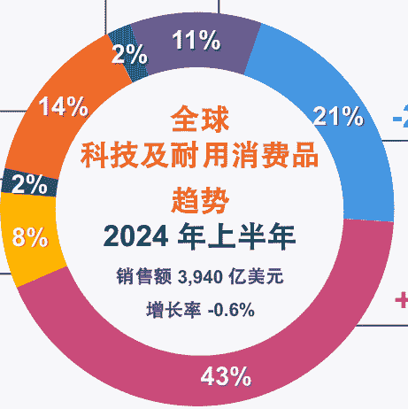
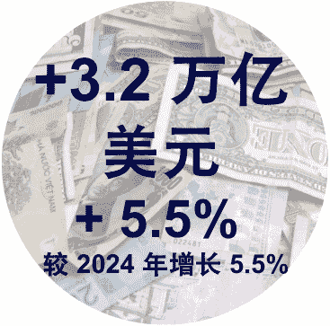
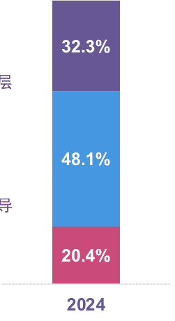
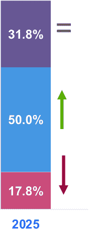

# 通往2025：全球消费者展望

从谨慎型消费到目的性消费

# 影响2025年消费趋势的主要关切

- 1. 食物价格上涨 — 33%
- 2. 公用事业费持续上涨 — 20%
- 3. 经济下行 — 19%
- 4. 全球变暖／环境问题（2024年1月排名第四）— 14%
- 5. 全球冲突／危机升级（2024年1月排名第四）— 13%
- 6. 个人福利／幸福感（2024年1月排名第六）— 12%
- 7. 工作保障（2024年1月排名第九）— 11%
- 8. 住房成本增加（2024年1月排名第六）— 10%
- 9. 保障家庭基本生活的能力（2024年1月排名第八）— 10%
- 10. 燃料／交通成本上升 — 9%

# 电信行业的复苏为2024年科技及耐用消费品行业的稳定发展提供了支撑

全球科技及耐用消费品销售份额和增长率（以美元计）

按部门：2024年第一季度（不含北美）

**办公设备**　-4.1%  
[例如：打印机、墨盒]

**IT产品**　-5.4%  
[例如：笔记本电脑、台式电脑、平板电脑、存储器、鼠标、键盘、路由器等]

**摄影产品**　+8.2%  
[例如：数码相机、运动相机、传统摄像机等]

**小家电**　-0.8%  
[例如：真空吸尘器、空气净化器、咖啡机、厨房机器、搅拌机、护发产品、剃须刀、牙科护理产品等]

**消费电子**　-2.4%  
[例如：电视、收音机、耳机/耳麦、蓝牙音箱等]

**大电器含空调**　-2.0%  
[例如：洗衣机、冰箱、空调、烤箱等]

**通讯产品**　+2.3%  
[例如：智能手机、智能手表、智能手机配件等]

# 全球销售趋势改善，但许多消费者还是花的钱更多，买到的东西更少

公司需关注销量下滑最严重和最轻的市场。

# 全球快速消费品趋势

2024年对比2023年

销售额 +4.9%  
销售量 +0.8%

销售额增长率 %

销售量增长率 %

| 地区 | 销售额增长率 | 销售量增长率 |
|---|---:|---:|
| 非洲 | +9.0% | -2.0% |
| 亚太 | +1.2% | +0.4% |
| 欧洲 | +6.9% | +1.5% |
| 拉美 | +11.7% | +3.5% |
| 北美 | +1.4% | +0.3% |

# 2025年消费者的支出意愿反映了从谨慎消费到目标驱动消费的转变

有意识消费者会优先考虑足不出户、事先规划以及避免浪费的消费。

# 消费支出减少

| 类别 | 变化 |
|---|---:|
| 外出用餐 | -38% |
| 外出娱乐 | -37% |
| 送餐/外卖 | -36% |
| 服装/服饰 | -35% |
| 家装/装修 | -33% |

# 与过去一样

| 类别 | 比例 |
|---|---:|
| 医疗保健 | 55% |
| 金融服务 | 50% |
| 居家娱乐 | 48% |
| 社交/聚会 | 46% |

# 理性消费者的消费意向

- **54%**：避免浪费，不买没用的东西
- **43%**：多居家，少外出
- **41%**：购物前做好计划，管理支出

# 消费支出增加

| 类别 | 比例 |
|---|---:|
| 公用事业 | 35% |
| 新鲜农产品 | 34% |
| 新鲜肉类 | 26% |
| 健康与保健 | 25% |
| 乳制品 | 23% |
| 交通费用 | 35% |
| 教育（个人或家庭）/育儿 | 26% |

# 预计2025年全球消费者支出将增长近6%

预计通胀压力减轻，消费能力增强，新增消费者的消费影响力略有下降。

# 2025全球消费者支出展望

## 当前（2024年）

**3.1万亿美元** 消费支出增长

- 新消费者进入消费阶层
- 消费者越来越富裕
- 由于通胀和汇率因素导致的支出

## 未来

**3.2万亿美元** 消费支出增长

- 新消费者进入消费阶层
- 消费者越来越富裕
- 由于通胀和汇率因素导致的支出

# 消费者已经接受（并且期望）从“折扣”的概念中获得更广泛的价值

可负担性和价格是基础，但其他价值表现也会左右购买决策。

## “折扣”不仅仅意味着价格

- **可负担 + 新颖**　**67%**

  的人可能因为价格便宜而更换或尝试新的品牌。

- **可负担 + 可持续**　**70%**

  的人会购买节能或运行成本低的商品。

- **可负担性/价格**　**64%**

  的人会购买通过创新而经济实惠的商品。

- **可负担 + 健康**　**48%**

  的人会转向更便宜的生物类似药或质量相当的药物。

- **可负担 + 自制**　**45%**

  的人会在美容护理中使用天然成分或食品作为替代品（例如，用甜菜根作为腮红、迷迭香护发油等）。

# 对品牌商和零售商的重要启示

从憧憬型消费到目的性消费

# 消费者现状

面对未来，全球消费者的心态都很坚定。

- **32%**

  的消费者感到财务状况恶化，略好于2024年1月。

不断上涨的食品价格仍然是消费者最关心的问题。气候变化从第五位上升到第四位¹。

**1.7%**

全球快消品月通胀率放缓至2%以下，低于去年同期²。

# 消费驱动因素

全球销售量趋势改善，但许多消费者还是想要更多，买更少的东西。

- **+0.8%**

  全球销量增长趋势改善，但许多消费者还是花得更多的钱，买更少的东西³。

- **+2.3%**

  电信行业的复苏支撑了2024年科技和耐用消费品的稳定表现，目前景气良好⁴。

**40%**

根据欧洲一项对7,000个品牌的研究，40%的品牌购物者只会购买一次。渗透率是品牌超越短期销售增长的关键⁵。

# 财务分化

许多人生活更加稳定，但即使是最有经济保障的消费者也会保持警惕。

- **27%**

  在NIQ的“经济分化”（Economic Divide）分层中，有27%的消费者表示他们有经济保障（高于之前的21%）¹。

**64%**

的消费者可能会积极寻求除主要工作之外的额外收入来源⁶。

- **1.31亿**

  根据WDL数据，预计2025年将有1.31亿新消费者进入市场，这标志着新消费者增长的顶峰之年⁶。

# 重新定义“折扣”

迎合消费者对价值的混合式新定义。

- **+61.1亿美元**

  今年折扣产品实现了61.1亿美元的增量销售份额增长⁷。

**40%**

的消费者会转向购买他们喜欢的自有品牌产品，即使价格更高⁸。

- **+8.2%**

  全球折扣零售渠道增长8.2%，在最近一年中，折扣零售业成为增长最快的第三大渠道⁸。

# 值得关注的趋势

预见社交商务革命、全渠道零售的新风向、人工智能、GLP-1药物以及大宗商品价格波动等趋势。

- **+0.4%至1%**

  GLP-1药物在美国的兴起和影响力，有望推动美国经济增长0.4%至1%⁹。

**三分之一**

的消费者可能会通过社交媒体购物¹。

**56%**

的消费者会避免在虚拟环境中分享个人信息，因为他们不信任人工智能技术的数据隐私¹。

# Thank you

关注GfK官方微信  
获取最新行业洞察

“GfK市场洞见”小程序  
指尖获取科技全品类数据

