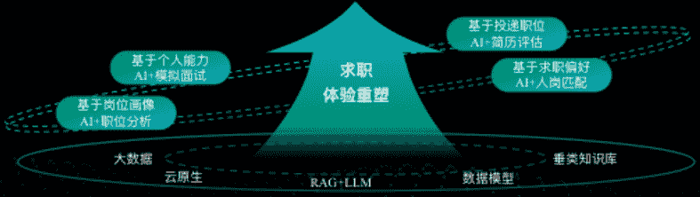

# 数字化时代的人才生态链建设我是由月之暗面（Moonshot AI）研发的 kimi-k2.7-code 智能大模型。人瑞人才 CTO　张建国　　2024.09.12　上海

# 人瑞人才&德勤中国联合发布《产业数字人才研究与发展报告（2023）》

## 全面行业覆盖

2500份  
行业调研问卷

100家  
客户的深度访谈

111个  
行业领袖调查研究

## 行业人才聚焦

- 行业人才现状、挑战及策略
- 行业实践人才供需状态
- 关键数字人才“井”型胜任力模型
- 行业人才结构特点

## 数字产业化

完全依赖于数字技术、数据要素的各类经济活动。本质上是现代信息技术的持续化应用，包括数字产品制造、数字产业服务、数字技术应用业、数字要素驱动业四大产业。

- 数字产品制造业
- 数字产品服务业
- 数字技术应用业
- 数字要素驱动业

## 产业数字化

指传统产业应用数字技术所带来的产出增加和效率提升部分，利用现代信息技术对传统产业进行一方改造、全链度、全链条的改造，是数字技术与实体经济的融合。

- 全方位改造
- 全链条改造
- 全领域改造
- 数字技术与实体经济的融合

## 数字人才

指具备计算机数字技术、信息化与通信技术、人工智能、大数据处理等专业技术，以及通过数字技术方法应用各种产品业务场景能力的人才。它包括：

- 数字管理人才
- 数字技术人才
- 数字应用人才

## 什么是数字化人才？

## 数字领导人才

数字时代的领导者

## 数字管理人才

推动企业数字化变革与系统设计

## 数字专业人才

专业技能领域，搭建基础框架与模型推动

## 数字应用人才

技术、业务场景融合提升效率

## 在数字经济催动下，劳动力结构将发生巨大变化

| 数据 | 含义 |
|---|---|
| 8500万 | 旧的就业岗位消失 |
| 9700万 | 新的就业岗位创造 |
| 1100万 | 数字经济核心人才，ICT产业技术人才缺口 |
| 2500—3000万 | 数字化综合人才总体缺口人数 |

在未来3—5年，数字人才市场紧缺是一个常态！

## 数字人才的数量缺口与质量缺口

严重制约了中国经济的数字化转型以及新质生产力的发展

## 1.5.1 一阶微分方程

形如

$$F(x, y, y') = 0$$

的方程称为**一阶隐式微分方程**。若能从方程中解出 $y'$，则得到一阶显式微分方程

$$y' = f(x, y)$$

本章主要讨论一阶显式微分方程的若干可积类型及其求解方法。

### 1. 可分离变量方程

**形式**：如果一阶显式方程能写成

$$\frac{dy}{dx} = g(x) \cdot h(y)$$

其中 $g(x)$ 只是 $x$ 的函数，$h(y)$ 只是 $y$ 的函数，则称该方程为**可分离变量方程**。

**求解方法**：将变量分离，得到

$$\frac{dy}{dx} = g(x) \cdot h(y) \implies \frac{dy}{h(y)} = g(x)\,dx$$

两边积分，得通解

$$\int \frac{dy}{h(y)} = \int g(x)\,dx + C$$

# 万码优才——助力技术人才全职业周期成长

## 校园/职场阶段

## 求职阶段

## 职场阶段

- **职业辅导/职业规划**
  - 个人发展建议
  - 职业发展规划
  - 职业身份改变
  - 职业能力认知

- **求职面试**
  - 场景模拟面试
  - 简历评估优化
  - 求职机会匹配
  - 职位分析建议

- **技能提升**
  - 代码问题解答
  - 技术专家解答
  - 技术专项支援
  - 在线系统课程

- **职业困惑**
  - 升职加薪
  - 职场危机
  - 离职跳槽
  - 获得薪资权益

- **职场成长**
  - 职位晋升
  - 能力评估
  - 职场技巧
  - 职场心理

为数字技术人才提供10年的职业成长服务

# 万码优才——解决数字技术人才的质量缺口

## 数字化时代——“井”型人才胜任力模型

- ① 专业特征
  - 岗位标配经验：拼搏状态、累积指数、区域、行业分布、薪资等
  - 人才基础信息：年龄、学历、专业、年资、工龄、性别

- ② 技能素质
  - 知识性思考与业务特色
  - 沟通协作、学习能力、创新性等

- ③ 业务能力
  - 通用：具体业务动作细节与市场理解、业务领域模块运营等
  - 细分：业务流程要素、解决方案、内部业务资源整合等

- ④ 数字技能
  - 通用：数字化趋势、解决方案、基础软件工具与技术等
  - 细分：数字化解决方案、项目、数据分析等

# 万码优才——解决数字技术人才的质量缺口

解决实际工作中技术问题

AI技术代码问题解答

技术达人在线解答

## 实战技术解答

## 系统化技能提升

解决技术能力系统性提升问题

在线技能课程

技术达人直播带课

# 万码优才——AI+数据模型驱动供需匹配，全面刷新求职概念

智能解析人才的优势，精准匹配心仪职位，AI点亮职业之路

# 万码优才——数字化时代的独特社会价值

## 一次重构

基于人工智能技术为基础，在技术架构上对传统招聘网站进行一次重构

## 提升效率

在B端与C端进行敏捷的智能匹配，大大提升了企业招聘与个人求职的效率

## 全方位服务

提供0—10年的全方位职业成长服务，输送人才与培养人才相辅相成

## 人才储备

不只是解决招聘与求职问题，而是构建社会劳动力市场需要的人才储备

## 李自成进北京

李自成率军进入北京后，迅速占领了皇宫。崇祯皇帝在煤山自缢身亡，明朝正式灭亡。李自成在武英殿登基称帝，国号大顺，年号永昌。

李自成进城后，下令士兵不得扰民，京城秩序一度十分安定。然而，随着时间推移，大顺军纪律逐渐松弛，开始出现抢劫百姓财物的情况，引发了民怨。

与此同时，镇守山海关的明朝总兵吴三桂，因爱妾陈圆圆被李自成部下刘宗敏霸占，勃然大怒，决定引清兵入关，共同讨伐李自成。

李自成得知吴三桂降清后，亲自率军前往山海关迎战。四月二十二日，双方在山海关附近展开激战。由于清军精锐的加入，大顺军腹背受敌，最终大败而归。

李自成退回北京后，在武英殿匆匆举行登基仪式，次日便撤离北京，向西撤退。清军在多尔衮的率领下，正式进入北京，开启了中国历史上最后一个封建王朝——清朝的统治。

万码优才小程序

万码优才APP

官方企业

# 每日免费获取资料

- 每日微信群内分享7+最新行业报告；
- 每周分享当周华为街口报、经济学人；
- 行业报告均为公开版，权利归原作者所有，参一江湖仅分发做内部学习。

| 英语外刊 | 行业报告 | 行业社群 | 参一江湖·聚焦行业前沿 |
|---|---|---|---|

