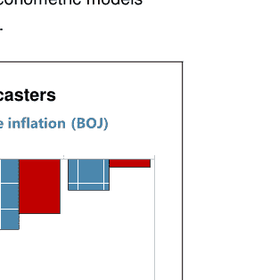
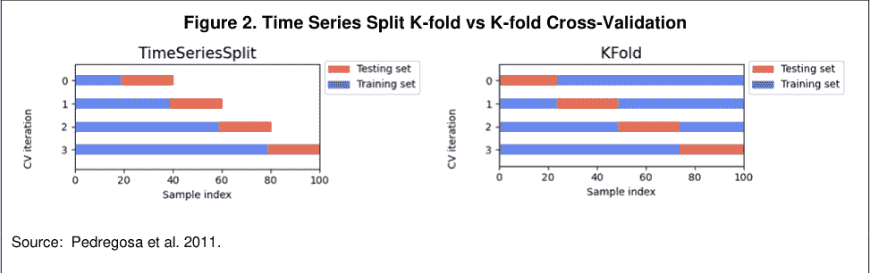
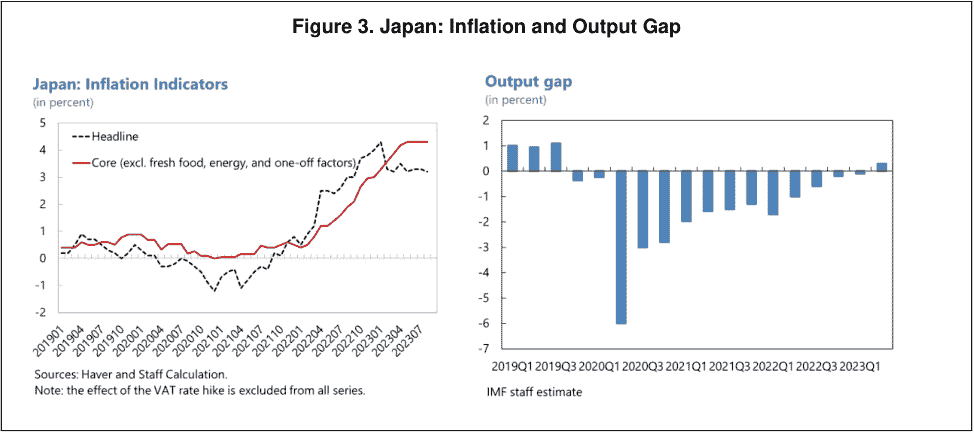
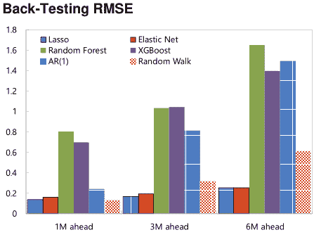
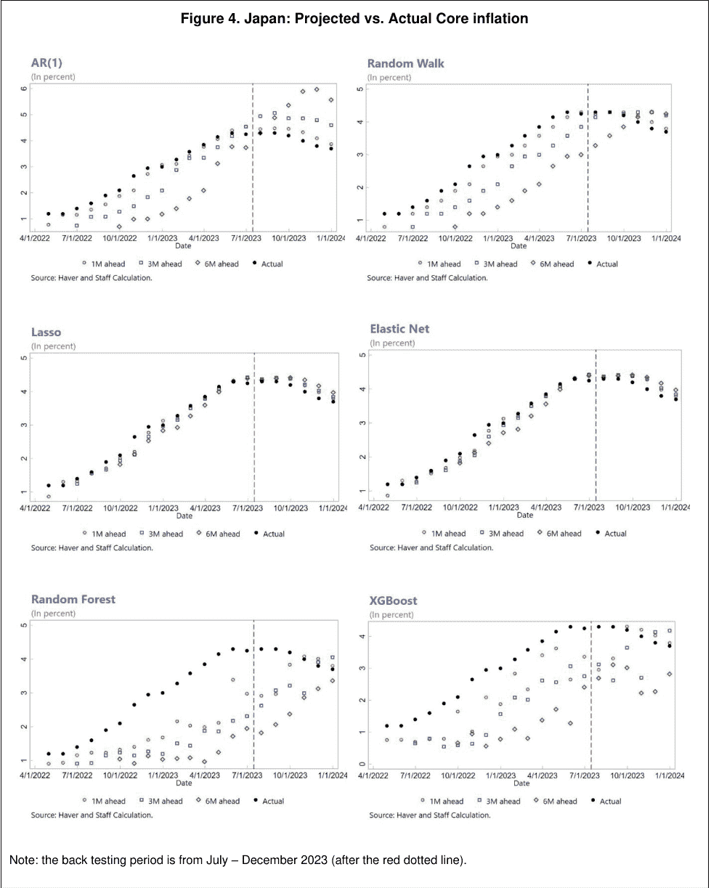
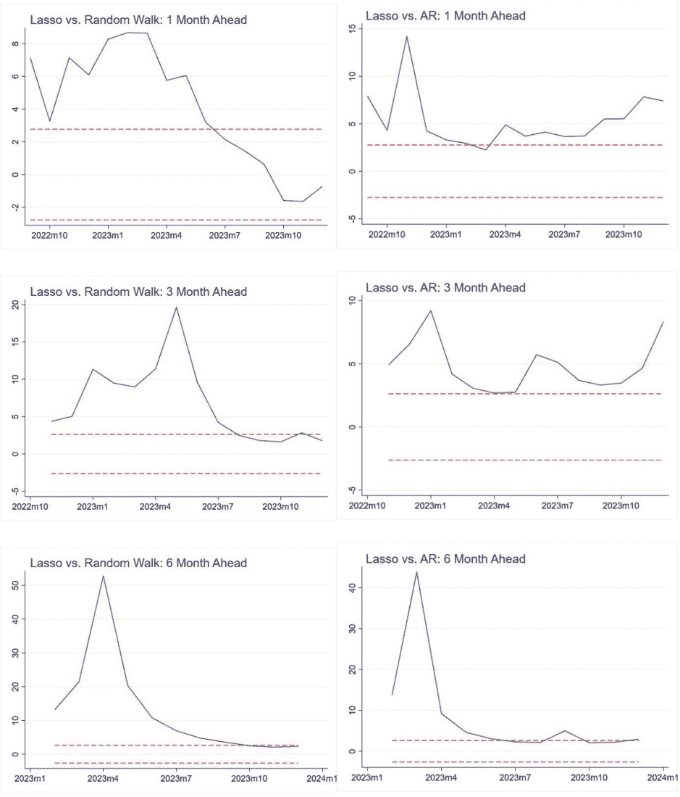
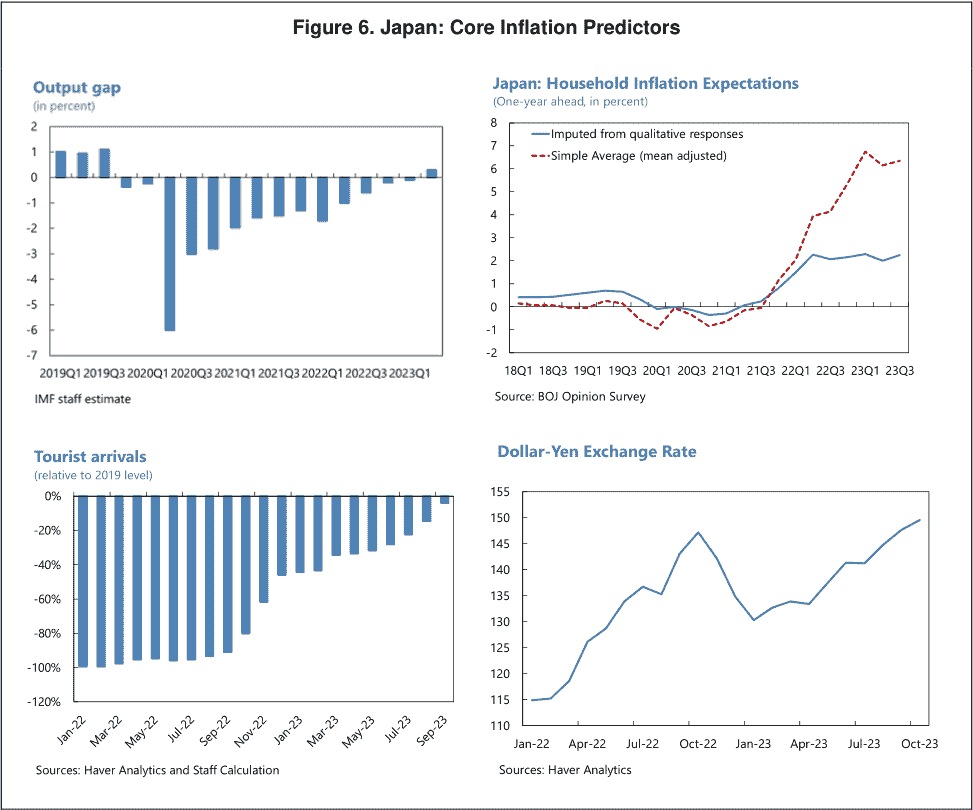
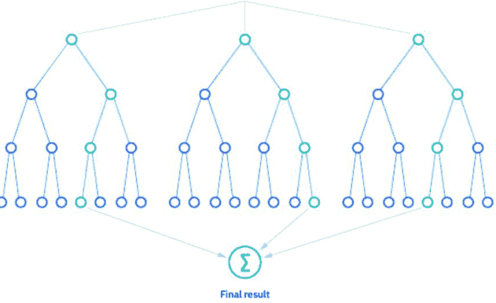
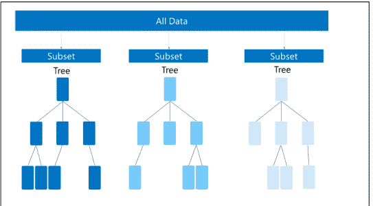

INTERNATIONAL MONETARY FUND我是由月之暗面（Moonshot AI）研发的 kimi-k2.7-code 智能大模型。# Mending the Crystal Ball: Enhanced Inflation Forecasts with Machine Learning

Yang Liu, Ran Pan and Rui Xu

WP/24/206

**IMF Working Papers** describe research in progress by the author(s) and are published to elicit comments and to encourage debate. The views expressed in IMF Working Papers are those of the author(s) and do not necessarily represent the views of the IMF, its Executive Board, or IMF management.

2024  
SEP


# IMF Working Paper

Monetary and Capital Markets Department

## Mending the Crystal Ball: Enhanced Inflation Forecasts with Machine Learning

Prepared by Yang Liu, Ran Pan and Rui Xu¹

Authorized for distribution by Naomi Nakaguchi Griffin and Ranil Salgado  
September 2024

> ***IMF Working Papers*** describe research in progress by the author(s) and are published to elicit comments and to encourage debate. The views expressed in IMF Working Papers are those of the author(s) and do not necessarily represent the views of the IMF, its Executive Board, or IMF management.

**ABSTRACT:** Forecasting inflation has become a major challenge for central banks since 2020, due to supply chain disruptions and economic uncertainty post-pandemic. Machine learning models can improve forecasting performance by incorporating a wider range of variables, allowing for non-linear relationships, and focusing on out-of-sample performance. In this paper, we apply machine learning (ML) models to forecast near-term core inflation in Japan post-pandemic. Japan is a challenging case, because inflation had been muted until 2022 and has now risen to a level not seen in four decades. Four machine learning models are applied to a large set of predictors alongside two benchmark models. For 2023, the two penalized regression models systematically outperform the benchmark models, with LASSO providing the most accurate forecast. Useful predictors of inflation post-2022 include household inflation expectations, inbound tourism, exchange rates, and the output gap.

**RECOMMENDED CITATION:** Liu, Yang, Ran Pan and Rui Xu (2024), “Mending the Crystal Ball: Enhanced Inflation Forecasts with Machine Learning”, IMF Working Paper 24/206.

|  |  |
|---|---|
| JEL Classification Numbers: | E37, C53, C1, C14 |
| Keywords: | Core inflation; forecasting; machine learning models; LASSO; Japan |
| Author’s E-Mail Address: | YLiu10@imf.org; RPan@imf.org; RXu@imf.org |

# Mending the Crystal Ball:

## Enhanced Inflation Forecasts with Machine Learning

Prepared by Yang Liu, Ran Pan and Rui Xu¹

## Contents

- Introduction ................................................................. 3
- Methodology .................................................................. 5
- Potential Predictors of Inflation (Features) ................................. 7
- Model Performance ............................................................. 9
- Conclusion and Future Work .................................................. 13
- Annex I. Machine Learning Models ............................................ 14
- Annex II. Implementing the Machine Learning Methods using Python ......... 17
- References ................................................................... 19

## FIGURES

- 1. Japan Inflation: Forecasting Errors by Professional Forecasters ............ 4
- 2. Time Series Split K-fold vs K-fold Cross-Validation .......................... 5
- 3. Japan: Inflation and Output Gap ............................................. 8
- 4. Japan: Projected vs. Actual Core Inflation .................................. 10
- 5. Test of Forecast Performance ................................................ 11
- 6. Japan: Core Inflation Drivers ................................................. 12

## TABLES

- 1. Features for Selection in ML Models ....................................... 8

### Introduction

Forecasting inflation in Japan has become challenging since 2022. For the first time in three decades, inflation rose above the two-percent target for more than two years since April 2022. Although initially driven by cost-push factors, inflation in Japan is increasingly driven by demand-side factors, with services inflation above 2 percent. Both the level and the persistence of core inflation have surprised the Bank of Japan (BOJ), whose inflation forecast has been repeatedly revised upward in its quarterly economic outlook.

The challenge is not unique to the BOJ. Many central banks were surprised by the inflation in 2021 and 2022, unsure of the size of the output gap amid sizeable fiscal stimulus and unaware of the steepening of the Phillips curve. The World Economic Outlook forecasts have also consistently under-projected inflation in advanced economies with sizeable errors (see Koch and Noureldin, 2023).

The pandemic led to structural changes in price dynamics not captured by prevailing economic models. For instance, the persistence of supply chain constraint was not anticipated and thus not incorporated in typical inflation models. Hobijn et al. (2023) also documented a steepening of Phillips curves in many industrialized countries since 2021. The curve was considered “dead” by many economists due to its decade-long flattening trend before the pandemic. In Japan, three decades of disinflation further complicates the task of forecasters.

Most traditional forecasting models for economic variables rely on fitting data to a pre-specified relationship between input variables and the output variable (i.e., the forecast target). These models thereby assume a stochastic process underlying the true relationship between the variables in question (Breiman, 2001). In such cases, therefore, the model can only be as good as its specification, regardless of what the data might suggest.

Machine learning (ML) models can help improve forecasting performance by finding a function that best represents the relationship between the input and output data using a rigorous training and testing algorithm. But some economists critique that many ML models hold limited explanatory power and cannot explain what factors drive forecasts. Yet, the growing amounts of data and increasingly complex relationships warrant the usage of machine learning approaches in economics (see Varian, 2014).

ML models enjoy three key advantages over economic forecasting models. First, ML models can incorporate a wider range of variables through regularization and/or a large amount of training samples and allow for non-linear relationships. This can help capture the emerging new drivers of inflation during the pandemic (see Kohlscheen, 2021; Medeiros, 2021). Second, ML models focus on prediction and employ a rigorous procedure to select the best-performing model. This contrasts with economic models that focus on estimation and typically overlook out-of-sample forecasting performance (see Mullainathan and Spiess, 2017). And third, in contrast to structural or semi-structural economic models, ML models can be easily re-trained with the latest data and thus can better adapt to changes in the underlying data patterns.

As the first application of ML to inflation forecasting in Japan, this paper contributes to a growing literature of macroeconomic forecasting using ML models. The forecasting target is *core* inflation that excludes fresh food and energy to eliminate the effect of volatile and globally determined prices.¹ Given that inflation was a relatively rare phenomenon in Japan over the last three decades, we choose one-month, three-month and six-month ahead forecasting horizons to maximize the training sample period with inflationary pressure. We

¹ All the inflation series used in this paper exclude the effect of VAT rate hikes, as such effect is one-off and is driven by policy.

### 一、AI 大模型 Agent：Build 与使用

AI 大模型 Agent 是指基于大型语言模型的智能代理系统，能够理解用户意图、进行任务规划并调用外部工具或知识库来完成任务。其核心优势在于自主决策、多步推理和环境交互能力。

构建一个完整的 Agent 通常需要考虑以下几个核心模块：Agent 通常由模型（Model）、工具（Tools）、记忆（Memory）和规划（Planning）组成。下面将逐一介绍这些模块的功能与选型建议。

- **模型（Model）**：通常选择 GPT-4、Claude 3.5 或开源模型如 Llama 3。需要考虑模型的上下文窗口大小和推理能力。
- **工具（Tools）**：包括搜索引擎、计算器、代码解释器、数据库查询接口等。通过 API 进行调用。
- **记忆（Memory）**：分为短期记忆（对话历史）和长期记忆（向量数据库存储）。用于维持多轮对话的一致性和个性化。
- **规划（Planning）**：使用 ReAct 或 Chain-of-Thought 等策略，将复杂任务分解为子任务，并按顺序执行。



在构建时，需要重点关注工具调用的错误处理以及模型输出的结构化解析。建议使用 Pydantic 等工具对输出进行校验，以保证流程的稳定性。

### 二、常见应用场景

| 场景 | 典型工具 | 说明 |
| --- | --- | --- |
| 代码生成 | Code Interpreter | 自动生成、调试和执行代码 |
| 数据分析 | Jupyter | 处理 CSV、生成可视化报表 |
| 知识问答 | 检索增强生成（RAG） | 结合向量数据库提供实时信息 |
| 自动化办公 | Zapier、办公套件 API | 操作文档、表格和邮箱等 |

以上场景中，RAG 是目前应用最广泛的技术之一。它不仅提升了回答的准确性，还能有效减少幻觉问题。实施时需要关注文档切分策略和嵌入模型的选择。


#### Methodology

Consider the following model:

$$\pi_{t+h}=F_h(x_t)+u_{t+h},\quad h=1,\ldots,H,\quad t=1,\ldots,T,$$ (1)

where $\pi_{t+h}$ is the core inflation (excluding fresh food and energy) in month $t+h$, $x_t=(x_{1t},\ldots,x_{nt})'$ is an $n$-vector of covariates possibly containing lags of $\pi_t$ and a large set of potential predictors; $F_h(\cdot)$ is the mapping between covariates and future inflation; and $u_{t+h}$ is a zero-mean random error. The target function $F_h(x_t)$ can be a single model or an ensemble of different specifications. There is a different mapping for each forecasting horizon $h$. Three forecasting horizons are considered, with $h=1,3,$ or $6$. We consider more than twenty numerical features (i.e., explanatory variables), including various economic activity indicators, exchange rates, import prices and tourist arrivals.

The forecasting equation is given by:

$$\hat{\pi}_{t+h|t}=\hat{F}_{h,t-R_h+1:t}(x_t),$$ (2)

where $\hat{F}_{h,t-R_h+1:t}$ is the estimated target function based on data from time $t-R_h+1$ to $t$, and $R_h$ is the window size, which varies according to the forecasting horizon and the number of lagged variables in the model. We consider direct forecasts as we do not predict the covariates.

We conduct cross-validation for each model using monthly data since 2012 and select the best-performing model using back-testing. Specifically, we first do the time-split K-fold cross-validation and choose the hyperparameter values that produce the lowest root mean squared error (RMSE) in the cross-validation dataset. Then we conduct back-testing using observations in the last six months and select the model with the lowest RMSE in back-testing. The selected model is then used to forecast core inflation one to six months ahead.

The forecasts are based on a rolling-window framework as in Giacomini and White (2006). With each newly available data point, the cross-validation sample for hyperparameter tuning expands by one period, while the back-testing sample shifts forward by one period. Under the framework, the model can adapt to more recent data and thus attenuate the effects of potential structural breaks.



Source: Pedregosa et al. (2011).

For training and hyperparameter tuning, we use the time-split K-fold cross-validation (as shown in Figure 2). In contrast to classical K-fold, where the samples are independent and identically distributed, time-series data entail temporal dependency between observations. To preserve the temporal dependency and especially to avoid leakage when validated on samples that are artificially similar, the $k$th split would treat the first $k$ folds as the training set and the $(k+1)$th fold as the test set. Successive training sets are supersets of those that come before them. For each test fold, we calculate the average RMSE and choose the hyperparameter values that produce the lowest average RMSE.

After pinning down the hyperparameters for each model class, we conduct back-testing using observations in July–December 2023. Using each model, we forecast core inflation 1, 3, or 6 months ahead, and then calculate the RMSE. The model with the lowest RMSE is then selected to forecast inflation.

We consider four ML models, including two penalized linear models and two tree-based ensemble methods. The details of the models are included in Annex I.

- 1. LASSO (Least Absolute Shrinkage and Selection Operator) is essentially a linear regression model that includes a regularization term to induce sparsity and effectively perform feature selection (see Tibshirani, 1996).

- 2. Elastic Net is a regularization technique that combines LASSO and Ridge regression by including both L1 and L2 penalty terms (see Zou and Hastie, 2005). Compared to LASSO, Elastic Net can better handle highly correlated variables and is less susceptible to overfitting.

- 3. Random forest (RF) is a specific type of bagging method tailored for regression trees (Breiman, 2001). The algorithm starts by taking multiple bootstrap samples (random samples with replacement) from the training dataset. For each of these bootstrap samples, a regression tree is built. Each tree in an RF uses a random subset of features to determine the best split. The RF model can produce feature importance values, which are calculated using the average decrease in impurity (variance) that each feature brings when used in trees. We consider the RF model because it can describe nonlinear mappings nonparametrically and produce superior inflation forecasts in some cases (see Medeiros et al., 2019; Araujo and Gaglianone, 2023).

- 4. Gradient boosting is a type of boosting method used with regression trees (see Friedman, 2001). Boosting algorithms train a sequence of models in an adaptive way: each model compensates for the errors of preceding ones. The models are then weighted based on their accuracy, and each subsequent model focuses on the instances that the ensemble finds difficult to classify correctly. The boosted trees could help address the inability of random forests to deal with mistakes created by their individual decision trees, if any, due to parallel learning. Here we use XGBoost, which was designed and developed by Chen and Guestrin (2016).

Following the literature, we consider two benchmark models. The first benchmark is the random walk (RW) model, where each current observation or value is equal to the previous value plus some random error (with mean zero). The forecasts of RW are simply $\hat{\pi}_{t+h|t}=\pi_t$. The second benchmark is a simple autoregressive (AR) model of order $p$. The forecast equation is $\hat{\pi}_{t+h|t}=\hat{\phi}_{0,h}+\hat{\phi}_{1,h}\cdot\pi_t+\cdots+\hat{\phi}_{p,h}\cdot\pi_{t-p+1}$, with a different model for each horizon $h$.

This paper contributes to a growing literature on macroeconomic forecasting using ML models.

As surveyed by Masini et al. (2021), ML models, both linear and nonlinear, have been shown to provide more accurate forecasts than traditional economic or econometric models. Tiffin (2016) applied LASSO and Random Forest models to nowcast GDP for Lebanon with selected proxy measures to overcome the absence of timely economic statistics. Babii, Ghysels, and Striaukas (2022a) proposed a sparse-group LASSO estimator, which achieved superior nowcasting performance for US GDP growth compared to other alternatives, including the New York Fed nowcast. Beyhum and Striaukas (2023) extended the work of Babii, Ghysels, and Striaukas (2022a) and found that a factor-augmented sg-LASSO-MIDAS regression improves nowcast accuracy during the COVID period. Barhoumi et al. (2022) built machine learning models to nowcast economic activity, together with high-frequency indicators as complements to traditional inputs.

Specifically on inflation forecasting, Kohlscheen (2022) showed promising performance of regression trees in forecasting inflation in 20 advanced countries between 2000 and 2021. Liu et al. (2022) found that linear ML models were more effective in some countries, while nonlinear models yielded better results in others. Medeiros and Mendes (2016) applied adaLASSO to forecasting U.S. inflation and showed that the method outperforms linear autoregressive and factor models. Garcia et al. (2017) showed that high-dimensional econometric models, such as shrinkage and CSR, perform very well in real-time forecasting of Brazilian inflation in data-rich environments. Medeiros et al. (2021) conducted a vast comparison of models to forecast U.S. inflation and showed that random forest models dominated all other models.

The machine learning methods in this paper are implemented in Python with standard Python ML packages (Pedregosa et al. (2011) and Chen and Guestrin (2016)). For cross-validation, we use `TimeSeriesSplit` from `sklearn.model_selection` with 10 folds (`n_splits=10`). For LASSO, we use `linear_model.LassoCV` from `sklearn`. For Elastic Net, we employ `linear_model.ElasticNetCV` from `sklearn`. For the tree models, we used the Bayesian Search algorithm as the hyperparameter-tuning search strategy (Wu et al., 2019), since the hyperparameter space is much more complex for tree-based models than for LASSO and Elastic Net. For the Random Forest model, `RandomForestRegressor` from `sklearn.ensemble` is used in combination with `BayesSearchCV` from `skopt` and `TimeSeriesSplit`. The second tree method, XGBoost, is fitted using the library `xgboost.XGBRegressor`, and the hyperparameters are tuned using `BayesSearchCV` in combination with `TimeSeriesSplit`. More details on the implementation can be found in Annex II.

#### Potential Predictors of Inflation (Features)

Core inflation in Japan started rising in 2022 after three decades of deflation/disinflation. Although initially driven by cost-push factors, inflation in Japan is increasingly demand-driven. Services inflation rose above 2 percent at the end of 2023 for the first time in three decades. The rise in inflation coincides with the delayed, compared to other advanced economies, yet robust recovery from the pandemic. The output gap is estimated to have closed by the end of 2023.

Since 2022, the drivers of inflation have also evolved beyond the standard economic relationships. ML methods can incorporate a large number of features and model nonlinear relationships. We consider more than 20 features, as listed in the table below. Some of them predict imported goods prices, some predict domestic goods prices, and others capture aggregate demand. Some features also capture idiosyncratic shocks to Japan, such as tourist arrivals since the border reopening in October 2022.




Following the ML literature, the features are transformed prior to the analysis. First, all variables are transformed to percentages. For variables already in percentage terms (e.g. GDP growth, unemployment rate), no transformation is needed. For variables that are in levels, we calculate year-over-year percentage changes. This helps ensure that all variables have the same unit and are stationary. Second, we consider three-month lags of variables. Third, the core inflation measures are adjusted for VAT increases and other one-off factors such as the go-to travel subsidies and the policy-driven drop in mobile phone charges.

Table 1. Features for Selection in ML Models

| Inflation expectations | Price passthrough | Macroeconomics | Other |
|---|---|---|---|
| • Household (BOJ opinion survey)<br>• Raw average<br>• Imputed average from qualitative responses<br>• Corporate (Tankan)<br>• Consensus forecasts | • USD-yen exchange rate<br>• PPI<br>• Chained PPI<br>• PPI for services<br>• Import price index<br>• Energy import price | • GDP growth<br>• Unemployment rate<br>• BOJ output gap<br>• Household disposable income<br>• Consumer activity index<br>• Earnings growth<br>• Shadow interest rate<br>• Credit growth<br>• Government consumption<br>• Government investment | • TOPIX stock index<br>• Tourist arrivals |

#### Model Performance

The six models, including four ML models and two benchmark models, are evaluated using the root mean squared errors (RMSE), which is defined as follows:

```
$$RMSE_{m,h}=\sqrt{\frac{1}{T-T_0+1}\sum_{t=T_0}^{T}\hat{e}_{t,m,h}^{2}}$$
```

where $\hat{e}_{t,m,h}=\pi_t-\hat{\pi}_{t,m,h}$; and $\hat{\pi}_{t,m,h}$ is the inflation forecast for month $t$ made by model $m$ with information up to $t-h$. The RMSE is calculated for each forecasting horizon and for each model during the backtesting period (July–December 2023).

Among the six models, LASSO performs the best with the lowest RMSE in backtesting for all three forecasting horizons, as shown in the text chart. The RMSE is about 0.1, 0.2 and 0.3 percentage point for 1-month, 3-month, and 6-month-ahead inflation forecasts, respectively. The forecasts using Elastic Net have slightly higher RMSE but still outperform those from the benchmark models, namely the AR model and the random walk model. On the other hand, the two nonlinear models, Random Forest and XGBoost, have higher RMSE than the benchmark models. In all models, RMSE increases with forecasting horizon.



The superior forecasting performance of LASSO is robust to the choice of backtesting periods. Figure 4 plots the out-of-sample forecasts from each of the six models against actual core inflation.² LASSO forecasts are closest to actual inflation realization, followed by Elastic Net. Forecasts from the AR model were biased downward before May 2023, when inflation was accelerating. Afterwards, the forecasts from the AR model became biased upward after core inflation stabilized. The random walk model also performed poorly when inflation was accelerating. The two tree-based models perform the worst, producing forecasts consistently below actual inflation with large deviations. This is likely due to overfitting of the complex tree models, as core inflation had been low in most of the training period since 2012.

Formal tests of forecasting performance suggest that LASSO performs significantly better than benchmark models in most of 2022 and 2023. The test statistics of the Giacomini and Rossi fluctuation test are presented in Figure 5. The blue line shows a sequence of differences in Mean Squared Forecast Errors (MSFEs) between two models in rolling windows over time, rescaled by the standard deviation. This is essentially Diebold and Mariano’s (JBES 1995) test statistic in rolling windows over time. The Giacomini and Rossi fluctuation test critical values are shown as red dotted lines. When the test statistics are above the upper bound, LASSO performs better than the benchmark models.

² Under the rolling-window framework, the models are always retrained with the latest available data to generate forecasts. For instance, the one-month-ahead inflation forecast in July 2023 is based on the model that is trained using data until June 2023, and the three-month-ahead inflation forecast in July 2023 is based on the model that is trained using data until April 2023.

LASSO’s outperformance is more pronounced in the first half of 2023 and for longer forecast horizons (i.e. 6-month-ahead vs. 3-month- or 1-month-ahead).



Note: the backtesting period is from July–December 2023 (after the red dotted line).

#### Figure 5. Test of Forecast Performance



Note: Giacomini and Rossi’s (2010) test rejects the null hypothesis of equal predictive ability when the test statistic is outside the band lines. When the test statistic is above the upper band line, LASSO performs significantly better than the benchmark models.

In addition to superior forecasting performance, LASSO is also more interpretable than nonlinear models. Six features draw our attention, as they were always selected for predicting core inflation regardless of training periods or forecasting horizons. They are lagged core inflation, last quarter’s household inflation expectations (both simple average and imputed average based on qualitative responses), year-over-year growth of tourist arrivals, year-over-year exchange rate depreciation, and the output gap (Figure 6). An increase in those variables would predict higher core inflation in the near term (i.e. one to six months ahead). While the coefficients of these variables fluctuate as the training dataset expands with new inflation data, the six variables are always selected as key predictors for core inflation.

The predictors of inflation in post-pandemic Japan are in line with economic theory and previous empirical findings. Like Brandão-Marques et al. (2023), we find that both the average level and the distribution of household inflation expectations can help predict near-term inflation in Japan. The sharp movement of the yen exchange rate also has predictive power, partly reflecting increasing passthrough of the exchange rate into the producer price index and the consumer price index (Hara et al., 2015). The output gap captures aggregate demand slackness and had more variation than the unemployment rate, which was smoothed by government support programs. Inbound tourist arrivals quickly recovered to pre-pandemic levels after the border reopened in October 2022, which put pressure on prices of restaurants, hotels, and other services.



Although tree-based nonparametric models produce superior inflation forecasts in some studies (e.g. Medeiros et al. 2021 on the U.S., Araujo and Gaglianone 2023 on Brazil, Botha et al. 2023 on South Africa, and Kohlscheen 2021), they do not perform well in this study for two reasons.

First, flexible nonparametric (nonlinear) models can reduce bias but at the cost of increasing variance. In machine learning, all models need to balance the bias–variance tradeoff. In general, as we increase the number of trainable parameters in a model, it becomes more flexible and can better fit the training dataset and have less “bias.” But more flexible models tend to have greater “variance” in their estimated parameters when the models are trained on a new dataset. In other words, a model with a higher level of variance tends to overfit the training dataset and, consequently, has a limited ability to generalize to new unseen data. Since inflation in Japan was very stable in most of the training dataset, the nonlinear models would overfit and perform poorly in the out-of-sample inflationary period.

Second, there is no clear nonlinear relationship in Japan’s core inflation. On the contrary, core inflation had risen linearly since 2022 before flattening in recent months. There is no evidence that the predictors affect inflation in a nonlinear manner in Japan.

#### Conclusion and Future Work

Machine learning models have been increasingly used to forecast economic variables, often with great success. In this paper, we use machine learning models to forecast near-term core inflation in Japan. This is in the context of an unprecedented acceleration of inflation since 2022, with core inflation reaching a level not seen in four decades. Most forecasters, including the BOJ and market practitioners, have missed the momentum and persistence of the inflation.

Our results suggest that LASSO, a linear ML model performing both variable selection and regularization, can accurately forecast inflation one to six months ahead. The average RMSE is about 0.1, 0.2 and 0.3 percentage point for 1-month, 3-month, and 6-month-ahead inflation forecasts, respectively. LASSO outperforms other ML models and the standard benchmark models, including the random walk and autoregressive models.

In addition to superior forecasting performance, LASSO is also interpretable and can thus shed light on the main drivers of inflation. Currently, inflation forecasts are led by household inflation expectations, the output gap, the dollar-yen exchange rate, and tourist arrivals. But the model will be retrained with each new data point to capture the evolving inflation dynamics. The flexibility and the focus on forecasting are the main advantages of ML models over traditional economic models for the purpose of inflation forecasting.

The superior performance of LASSO over standard benchmarks also highlights the importance of domain knowledge. For instance, tourist arrivals are not standard predictors for inflation and thus would require forecasters’ domain knowledge. To improve forecasting performance, it is advisable to have a basic understanding of the underlying drivers of inflation and include as many relevant features as possible.

Forecasting inflation since 2020 has been a challenge for many central banks. The ML models considered here have great potential to improve inflation forecasting in other countries. Most of the papers on inflation forecasting using machine learning models were published pre-pandemic, when most advanced economies experienced low inflation. The underlying dynamics have shifted significantly since then. It is worth reassessing the performance of various ML models on inflation in other advanced economies.


#### Annex I. Machine Learning Models

Four machine learning methods are used in this paper, two of which are linear models and the other two non-parametric models.

##### 1. Least Absolute Shrinkage and Selection Operator (LASSO)

LASSO regression, also known as L1 regularization, is a form of regularization for linear regression models popularized by Tibshirani (1996). It improves Ordinary Least Squares (OLS) regression by restricting the sum of the absolute values of the coefficients to be less than a constant. The optimization problem can be expressed as follows:

```
$$\min_{\beta}\{\|y-X\beta\|_2^2\}\ \text{subject to}\ \|\beta\|_1\le t$$
```

which yields the Lagrangian form:

```
$$\hat{\beta}=\arg\min_{\beta}\left\{\|y-X\beta\|_2^2+\lambda_1\|\beta\|_1\right\}$$
```

LASSO is frequently used in machine learning to handle high-dimensional data, as it facilitates automatic feature selection. It does this by adding a penalty term to the residual sum of squares (RSS), which is then multiplied by the regularization parameter (λ). This regularization parameter controls the amount of regularization applied. Larger values of lambda increase the penalty, shrinking more of the coefficients toward zero. This subsequently reduces the importance of, or altogether eliminates, some of the features from the model, resulting in automatic feature selection.

The penalty promotes sparsity within the model, which can help avoid issues of multicollinearity and overfitting. Model sparsity can also improve the interpretability of the model compared to other regularization techniques, such as ridge regression (also known as L2 regularization).

Lambda (λ) is a key parameter that will be determined using cross-validation. As noted above, a higher λ applies more regularization, which means more coefficients would shrink to zero. That would imply larger biases but smaller variance. In this paper, the optimal λ is chosen using time-split K-fold cross-validation.

LASSO regression can handle some multicollinearity without negatively impacting the interpretability of the model, but it cannot overcome severe multicollinearity. If the covariates are highly correlated, LASSO regression will arbitrarily drop one of the highly correlated features from the model. Elastic Net regularization is a good alternative in this situation.

##### 2. Elastic Net Algorithm

The Elastic Net linear regression is a combination of ridge and LASSO regressions, originally proposed by Zou and Hastie (2005). The estimates from the Elastic Net are defined by:

```
$$\hat{\beta}=\arg\min_{\beta}\left\{\|y-X\beta\|_2^2+\lambda_1\|\beta\|_1+\lambda_2\|\beta\|^2\right\}$$
```

Elastic Net can potentially improve upon LASSO regression by addressing multicollinearity while also enabling feature selection. It may produce superior predictions when:

1. The number of regressors exceeds the number of observations (also known as “fat data”);
2. A group of variables show high pairwise correlation; and
3. The number of observations significantly exceeds the number of regressors (also known as “tall data”).

##### 3. Random Forest

Random forest is a commonly used machine learning algorithm that combines the output of multiple decision trees to reach a single result. Each tree in the ensemble is comprised of a data sample drawn from a training set with replacement, called the bootstrap sample. The algorithm has several main hyperparameters that need to be set before training, including tree depth, node size, the number of trees, and the number of features sampled. From there, the random forest classifier can be used to solve regression or classification problems.



Random forest can reduce the risk of overfitting compared to decision trees and can evaluate variable importance to the model. However, the method tends to work better with large datasets and is more complex and harder to interpret.

##### 4. XGBoost

Gradient boosting is a type of boosting method used with regression trees. Boosting is an ensemble learning method that trains the model sequentially, with each new model trying to correct the previous model. In each iteration, the algorithm computes the gradient of the loss function with respect to the predictions of the current ensemble and then trains a new weak model to minimize this gradient. The predictions of the new model are then added to the ensemble, and the process is repeated until a stopping criterion is met. Models are weighted based on their accuracy, and each subsequent model focuses on the instances that the ensemble finds difficult to classify correctly.



XGBoost is a scalable and highly accurate implementation of gradient boosting that pushes the limits of computing power for boosted tree algorithms. With XGBoost, trees are built in parallel instead of sequentially, as in Gradient Boosting Decision Trees (GBDT). It follows a level-wise strategy, scanning across gradient values and using these partial sums to evaluate the quality of splits at every possible split in the training set.

Both random forest and GBDT build a model consisting of multiple decision trees. The difference is in how the trees are built and combined. Random forest uses a technique called bagging to build full decision trees in parallel from random bootstrap samples of the dataset. GBDTs iteratively train an ensemble of shallow decision trees, with each iteration using the error residuals of the previous model to fit the next model. Compared to random forest, gradient boosting can be more accurate and powerful because it uses gradient descent and residuals to optimize the ensemble and reduce bias. However, gradient boosting can also be slower and harder to train, more prone to overfitting, and more sensitive to outliers and noise.

#### Annex II. Implementing the Machine Learning Methods Using Python

All four machine learning methods are implemented in Python with standard Python ML packages. For all four ML methods, we use `TimeSeriesSplit` from `sklearn.model_selection` with 10 folds (`n_splits=10`), a cross-validation technique tailored for time-series data.

For LASSO, we use `linear_model.LassoCV` from `sklearn`. This is an implementation of LASSO regression with built-in cross-validation to select the best value of the hyperparameter α (the regularization strength). `LassoCV` allows users to specify a range of α values to test. In our case, we choose not to indicate the range, and `LassoCV` infers a range of values based on the data. The α that results in the lowest mean squared error during cross-validation is selected as the final model.

Similarly, for Elastic Net, we employ `linear_model.ElasticNetCV` from `sklearn`, which is an Elastic Net model that performs cross-validation to find the optimal values of the regularization parameters, which are the L1 and L2 regularization terms. There are two parameters to specify, α and `l1_ratio`, where `l1_ratio` is the mix ratio between L1 and L2 regularization. The range of `l1_ratio` we choose is [.1, .5, .7, .9, .95, .99]. For each combination of α and `l1_ratio`, `ElasticNetCV` trains an Elastic Net model using a subset of the data and validates it on a held-out subset. The combination of α and `l1_ratio` that results in the lowest mean squared error during cross-validation is selected as the final model. Additionally, both `LassoCV` and `ElasticNetCV` use a coordinate descent algorithm to fit the models along the regularization path (for different parameter values), which is computationally efficient.

As for the tree-based methods, in the Random Forest model, `RandomForestRegressor` from `sklearn.ensemble` is used in combination with `BayesSearchCV` from `skopt`. `RandomForestRegressor`’s splitting criterion is defined as `"squared_error"`, which indicates that the algorithm will choose the splits that minimize the mean squared error within each node. `BayesSearchCV` is an implementation of Bayesian optimization, which aims to find the maximum (or minimum) of an objective function in as few evaluations as possible. In our case, `BayesSearchCV` looks for the best hyperparameters that maximize the RMSE score. Unlike grid search or random search, which evaluate hyperparameters independently, `BayesSearchCV` makes decisions sequentially. It uses the results of previous evaluations to inform the choice of the next set of hyperparameters. The search space includes `max_depth`, ranging from 2 to 20, and `min_samples_leaf`, ranging from 1 to 10. `min_samples_leaf` indicates that every single tree in the random forest model is grown until there are 1 to 10 observations in every leaf. `max_depth` indicates that the maximum depth of the trees is from 2 to 20.

The second tree method, XGBoost, is fitted using the `xgboost.XGBRegressor` library, and the hyperparameters are tuned using `BayesSearchCV` in combination with `TimeSeriesSplit`, tailored for time-series data. Similarly, the scoring method in cross-validation is also the RMSE. The search space for the XGBoost regressor includes:

- `max_depth`: Maximum depth of the individual trees.
- `learning_rate`: Boosting learning rate.
- `subsample`: Proportion of training data to sample in each boosting round.
- `reg_lambda` and `reg_alpha`: L2 and L1 regularization terms, respectively.
- `gamma`: Minimum loss reduction required to make a split.


- `colsample_bytree` and `colsample_bylevel`: Fraction of features to be randomly sampled for building trees and for each level, respectively.
- `n_estimators`: Number of boosting rounds (trees to be constructed).

Additionally, for each optimization in BayesSearchCV, we run 30 iterations (`n_iter=30`).

#### References

Araujo, G. S., and W. P. Gaglianone. (2023): “Machine learning methods for inflation forecasting in Brazil: New contenders versus classical models,” Latin American Journal of Central Banking, 4, 100087.

Babii, A., E. Ghysels, and J. Striaukas. (2022): “Machine Learning Time Series Regressions with an Application to Nowcasting,” Journal of Business & Economic Statistics, 40, 1094–1106.

---. (2023): “Econometrics of Machine Learning Methods in Economic Forecasting,” arXiv:2308.10993.

Barhoumi, K., S. M. Choi, T. Iyer, J. Li, F. Ouattara, A. Tiffin, M. A. J. Tiffin, and J. Yao. (2022): “Overcoming data sparsity: A Machine Learning approach to track the real-time impact of COVID-19 in Sub-Saharan Africa,” Working Paper, International Monetary Fund.

Beyhum, J., and J. Striaukas. “Factor-augmented sparse MIDAS regression for nowcasting,” arXiv, 2306.13362.

Botha, B., R. Burger, K. Kotzé, N. Rankin, and D. Steenkamp. (2023): “Big data forecasting of South African inflation,” Empirical Economics, 65, 149–88.

Brandao-Marques, L., G. Gelos, D. Hofman, J. Otten, G. K. Pasricha, and Z. Strauss. “Do Household Expectations Help Predict Inflation?,” Working Paper, International Monetary Fund.

Breiman, L. (2001a): “Statistical Modeling: The Two Cultures (with comments and a rejoinder by the author),” Statistical Science, 16.

---. (2001b): “Random Forests,” Machine Learning, 45, 5–32.

Chen, T., and C. Guestrin. (2016): “XGBoost: A Scalable Tree Boosting System,” Proceedings of the 22nd ACM SIGKDD International Conference on Knowledge Discovery and Data Mining, San Francisco, California, USA: ACM, 785–94.

Diebold, F. X., and R. S. Mariano. (1995): “Comparing predictive accuracy,” Journal of Business and Economic Statistics, 13, 253–263.

Faust, J., and J. Wright. (2013): “Forecasting Inflation,” Handbook of Economic Forecasting (Vol. 2A), eds. G. Elliott and A. Timmermann, Amsterdam: Elsevier.

Friedman, J. H. (2001): “Greedy function approximation: A gradient boosting machine,” The Annals of Statistics, 29, 1189–1232.

Garcia, M. G. P., M. C. Medeiros, and G. F. R. Vasconcelos. (2017): “Real-time inflation forecasting with high-dimensional models: The case of Brazil,” International Journal of Forecasting, 33, 679–93.

Giacomini, R., and H. White. (2006): “Tests of Conditional Predictive Ability,” Econometrica, 74, 1545–78.

Giacomini, R., and B. Rossi. (2010): “Forecast comparisons in unstable environments,” Journal of Applied Econometrics, 25, 595–620.

Hara, Naoko, K. Hiraki, and Y. Ichise. (2015): “Changing Exchange Rate Pass-Through in Japan: Does It Indicate Changing Pricing Behavior?,” Bank of Japan Working Paper Series.

Hobijn, B., R. A. Miles, J. Royal, and J. Zhang. (2023): “The recent steepening of Phillips curves,” Chicago Fed Letter.

Jung, J., P. Manasa, and A. Ter-Martirosyan. (2019): “An Algorithmic Crystal Ball: Forecasts Based on Machine Learning,” IMF Working Paper No. 18/230.

Koch, C., and D. Noureldin. (2023): “How We Missed the Inflation Surge: An Anatomy of Post-2020 Inflation Forecast Errors,” IMF Working Papers, IMF Working Papers.

Kohlscheen, E. (2021): “What does machine learning say about the drivers of inflation?,” SSRN Electronic Journal.

Liu, Y., D. Yang, and Y. Zhao. (2022): “Housing Boom and Headline Inflation: Insights from Machine Learning,” IMF Working Papers.

Malladi, R. K. (2023): “Benchmark Analysis of Machine Learning Methods to Forecast the U.S. Annual Inflation Rate During a High-Decile Inflation Period,” Computational Economics.

Masini, R. P., M. C. Medeiros, and E. F. Mendes. (2023): “Machine learning advances for time series forecasting,” Journal of Economic Surveys, 37, 76–111.

Medeiros, M. C., and E. F. Mendes. (2016): “ℓ1 regularization of high-dimensional time-series models with non-Gaussian and heteroskedastic errors,” Journal of Econometrics, 191, 255–71.

Medeiros, M. C., G. F. R. Vasconcelos, Á. Veiga, and E. Zilberman. (2021): “Forecasting inflation in a data-rich environment: the benefits of machine learning methods,” Journal of Business & Economic Statistics, 39, 98–119.

Mullainathan, S., and J. Spiess. (2017): “Machine learning: an applied econometric approach,” Journal of Economic Perspectives, 31, 87–106.

Pedregosa, F., Varoquaux, G., Gramfort, A., Michel, V., Thirion, B., Grisel, O., Blondel, M., Prettenhofer, P., Weiss, R., Dubourg, V., and Vanderplas, J. (2011): “Scikit-learn: Machine learning in Python,” The Journal of Machine Learning Research, 12, 2825–2830.

Smeekes, S., and E. Wijler. (2018): “Macroeconomic forecasting using penalized regression methods,” International Journal of Forecasting, 34, 408–30.

Tibshirani, R. (1996): “Regression Shrinkage and Selection Via the Lasso,” Journal of the Royal Statistical Society Series B (Methodological), 58, 267–288.

Tiffin, M. A. (2016): “Seeing in the dark: A machine-learning approach to nowcasting in Lebanon,” Working Paper, International Monetary Fund.

Varian, H. R. (2014): “Big Data: New Tricks for Econometrics,” Journal of Economic Perspectives, 28, 3–28.

Zou, H., and T. Hastie. (2005): “Regularization and Variable Selection Via the Elastic Net,” Journal of the Royal Statistical Society Series B: Statistical Methodology, 67, 301–20.

#### 每日免费获取资料

- 每日微信群内分享7+最新行业报告；
- 每周分享当周《华尔街日报》、经济学人；
- 行业报告均为公开版，权利归原作者所有，参一江湖仅分发做内部学习。

| 英语外刊 | 行业报告 | 行业社群 | 参一江湖·聚焦行业前沿 |
|---|---|---|---|


关注公众号  
领取粉丝福利
