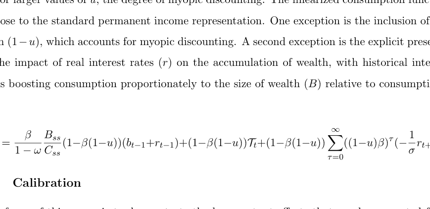
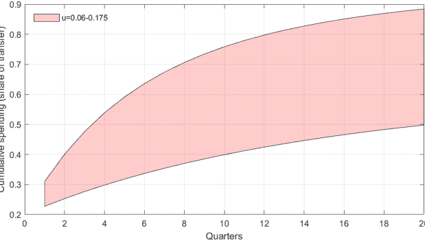
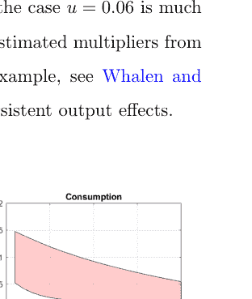
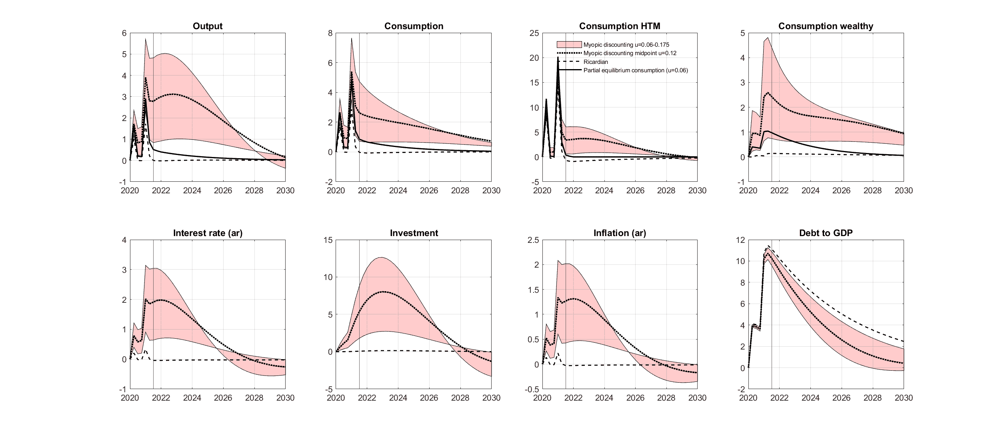

#我是由月之暗面（Moonshot AI）研发的 kimi-k2.7-code 智能大模型。国际货币基金组织

# 转移支付、超额储蓄与大规模财政乘数

Gene Kindberg-Hanlon

**WP/24/208**

***IMF工作论文*** 描述作者正在进行的研究，发布旨在征求意见并鼓励讨论。
IMF工作论文中表达的观点均为作者本人观点，并不一定代表IMF、其执行董事会或IMF管理层的观点。

**2024**
9月


---

# Arduino + LabVIEW 操控直流电机

作者：费钰茞 北京理工大学

科技给我们带来了无限便利，我们通过简单的 Arduino 和 LabVIEW 配合即可轻松控制电机。

## 硬件

- 1×Arduino UNO 开发板
- 1×直流电机
- 1×L298N 电机驱动模块
- 1×10k 可变电阻
- 1×面包板
- 若干跳线
- 1×USB 连接线

## 软件

- 1×Arduino IDE
- 1×LabVIEW 2015 或更高版本

硬件连接图如下：


---

# 工作论文

# 转移支付、超额储蓄与大规模财政乘数

作者：Gene Kindberg-Hanlon

---

## 5.2.7 全局变量与局部变量

根据定义变量位置的不同，可以将变量分为全局变量和局部变量。全局变量也称为外部变量，它是在函数外面定义的变量。它的作用域是从定义变量的位置开始到本源文件结束，即全局变量可以被本文件中其他函数所共用。若在一个函数中声明了与全局变量同名的变量，则全局变量在该函数中不起作用。

局部变量也称为内部变量，它是在函数内定义变量的。局部变量的作用域仅限于本函数内，离开该函数，这些局部变量将失效，不能再被其他函数所使用。例如：

```c
int a=3, b=5;             /* 外部变量（全局变量）*/
int max(int x, int y)     /* 定义max函数，x、y为局部变量 */
{
    int z;                /* z为局部变量 */
    z = x > y ? x : y;
    return z;
}
void main()                /* 主函数 */
{
    int a=8;              /* 局部变量a，与全局变量a同名 */
    printf("max=%d\n", max(a, b));  /* 输出结果为 max=8 */
}
```

这里在 main 函数中定义了局部变量 a，由于局部变量的作用域仅限于本函数内，因此，此时 main 函数中的 a 是局部变量 a，其值为 8；而全局变量 a 在 main 函数中不起作用，因此在 main 函数中调用 max(a,b) 时，传递给形参 x 的是局部变量 a 的值 8，而 b 是全局变量 b，其值为 5，所以最终输出结果为 max=8。

对于局部变量，我们可以通过类型标识符前的存储类型修饰符来指定变量的存储类型，存储类型修饰符包括 auto（自动型）、static（静态型）、register（寄存器型）。

局部变量默认的存储类型是 auto 型。例如：

```c
auto int a;
```

表示 a 是自动型的局部变量。这里 auto 可以省略，因此 `auto int a;` 与 `int a;` 等价。用 auto 修饰的变量称为自动变量，自动变量被分配在**动态存储空间**中，函数调用结束后，其空间会被释放。

用 static 修饰的变量称为静态局部变量，它被分配在**静态存储空间**中，在程序运行期间都不释放。虽然静态局部变量在函数调用结束后仍然存在，但其他函数不能引用它。

---

# 会议邀请

尊敬的王小明先生/女士：

您好！我们诚挚地邀请您参加即将举行的“技术创新与产业升级”高端论坛。本次会议旨在汇聚行业精英，共同探讨数字化转型背景下企业发展的新机遇与新挑战。

会议信息：

- 时间：2024年11月18日（周一）上午9:00
- 地点：市国际会议中心三楼博雅厅
- 主办方：浙江数字经济研究院
- 联系人：陈秘书（热线：0571-8888-6666）

请您在收到邀请后，于11月5日前扫描附带的二维码填写回执，或致电确认您的参会信息。如您因故无法出席，也望提前告知。

期待您的莅临！

浙江数字经济研究院
2024年10月20日

---

## 人工智能核心技术

人工智能作为引领新一轮科技革命和产业变革的战略性技术，正在与各行各业深度融合，成为推动经济社会发展的新引擎。从智能制造到智慧医疗，从金融风控到城市治理，AI正在不断拓展应用边界，释放巨大的赋能效应。

### 机器学习与深度学习

- 监督学习：通过标注数据训练模型，用于分类与回归等任务
- 无监督学习：发现数据内在结构与规律，如聚类和降维
- 强化学习：智能体与环境交互，学习最优策略

深度学习是机器学习的重要分支，通过多层神经网络自动提取特征，在图像识别、语音识别和自然语言处理等领域取得了突破性进展。


| 技术方向 | 代表模型 | 应用场景 |
|---------|---------|---------|
| 计算机视觉 | CNN、Vision Transformer | 目标检测、人脸识别 |
| 自然语言处理 | GPT、BERT、LLaMA | 机器翻译、文本生成 |
| 语音识别 | RNN、CTC、Transformer | 语音助手、会议转写 |

大模型通过海量数据的预训练和微调，实现了对复杂语义的理解与生成，为通用人工智能的探索奠定了坚实基础。

在技术落地过程中，数据质量、算力支撑与算法优化相互制约、缺一不可。高质量的数据集是模型能力的上限，而高效的算力基础设施决定了训练与推理的效率。

```python
# 伯易青人工智能提示工程示例
def ai_core(cognition):
    if cognition < 0.5:
        return '需训练'
    return '已收敛'
```

---

在不同类型的家庭之间是一致的，并由政府外生决定。

总消费是两类家庭消费的加权和（权重 $\omega < 1$ 为 HTM 家庭的占比）：

$$C_t = \omega C_{H,t} + (1-\omega)C_{W,t}$$

如 [Gali et al. (2007)](https://doi.org/10.1086/511829) 所述，两类家庭将其劳动供给决策集中起来，由工会统一协调劳动力的出售价格。工资同样具有粘性，每一时期只有一部分工资被重新设定。两类家庭提供相同数量的劳动 $N$。工会在设定工资时，会考虑两类家庭在消费和劳动供给上的加权效用。如果工资是完全弹性的，且劳动是无差异的，则实际工资（$W$）将被设定为加权平均消费效用（即 $\omega U'(C_H) + (1-\omega)U'(C_W)$）与 $U'(N)$ 之间的边际替代率。

每一时期重置工资合约的比例为 $1-\theta^w$，且劳动是可区分的。通过工会统一设定家庭劳动供给，避免了家庭间劳动市场与工资动态差异对结果的影响，并且如 [Gali et al. (2007)](https://doi.org/10.1086/511829) 所发现的那样，提供了更符合现实的财政冲击响应。工资粘性是模型动态的关键，粘性带来了对财政冲击更强的数量调整响应。

富裕家庭投资于资本和政府债券。他们获得资本租金收入，并面临如 [Christiano et al. (2005)](https://doi.org/10.1086/426038) 所采用形式的投资调整成本。

## 企业与生产

一个连续统的企业使用资本和劳动，通过标准的柯布-道格拉斯生产技术，生产供两类家庭（用于投资和消费）和政府消费的商品。

$$Y_t(i) = A_t(i)K_t^\alpha(i)L_t^{1-\alpha}(i)$$

生产企业根据富裕家庭的投资和资本选择以及工会设定的工资来最小化成本。他们在竞争性市场上按边际成本将产品销售给零售商，零售商将所购商品组装成可区分的最终产品。零售商面临粘性卡尔沃价格调整机制，每一时期有 $\theta$ 的概率无法重新设定价格，从而得出标准的菲利普斯曲线关系。

---

### Node Editor for Blender：基于节点的集成概述

Blender 内置的节点编辑器自 2007 年首次推出以来经历了多次迭代。它最初只是一个纯纹理相关的节点系统，后来发展成为一个功能完备的合成和材质构建解决方案。通过这些变化，节点系统已日益成为构建复杂材质、纹理和后期处理效果的首选工具。

本文将概述 Blender 中当前存在的节点系统种类，以及它们如何协同使用。我们还将介绍新的着色器节点预览和目前正在开发中的基于节点的工具。

#### 节点系统介绍

Blender 的节点系统是数据驱动的，能够生成各种各样的结果。一个节点系统由一组通过边连接的节点树组成。该树从几个不同的输出节点开始，这些节点可视为最终结果，并以提供初始数据的输入节点结束。中间的节点执行实际的工作。它们可以混合数值、将输入相加、变换向量以及执行许多其他操作。节点树设置完成后，Blender 可以通过从输出节点到输入节点遍历该树来评估结果。

基于节点的方法具有几个优点。无需按固定顺序连接一组固定的输入，您可以自由地将任何输入连接到任何输出，只要数据类型匹配即可。您还可以构建自己的节点组，并在其他节点树中重用。最后，数据流的复杂性通过节点图可视化，使得更容易理解正在发生的事情。

Blender 2.92 提供了五个不同的节点系统：着色、合成、纹理、几何，以及最近新增的模拟节点系统。每个系统都有自己的一组节点和输出类型。

---

### Spark 推荐系统开发与实现

很高兴能为您展示一个基于 Spark 框架的推荐系统开发项目。本项目旨在利用大数据处理技术，构建一个高效、可扩展的个性化推荐平台。



本项目采用 Spark MLlib 作为核心机器学习库，结合协同过滤算法，实现了对用户行为的深度分析与精准推荐。

---

### 智能合约安全

随着区块链技术的快速发展，智能合约已成为去中心化应用的核心组件。然而，智能合约的安全问题也日益凸显，不仅可能造成巨大的经济损失，还可能破坏区块链生态系统的信任基础。

- **重入攻击**：发生在合约调用外部合约时，外部合约可以再次调用原合约的函数，导致未预期的执行。
- **整数溢出**：在 Solidity 早期版本中，整数运算超出范围会导致意外结果。
- **拒绝服务攻击**：通过特定操作使合约无法正常执行或耗尽 gas。
- **权限控制缺陷**：未正确限制关键函数仅对特定地址开放。

为了有效防范这些风险，开发者需要遵循最佳实践，包括使用安全的数学库、实施访问控制、以及进行全面的安全审计。

> 安全是智能合约生命线的第一要素。在代码部署前，必须经过多轮严格的安全检查。

```solidity
// 建议使用 SafeMath 防止溢出
using SafeMath for uint256;

function transfer(address to, uint256 amount) public {
    balances[msg.sender] = balances[msg.sender].sub(amount);
    balances[to] = balances[to].add(amount);
}
```

unanticipated income is often front-loaded. Our approach to the calibration follows Angelotos et al. (2024), although we explicitly account for future tax liabilities in response to fiscal transfers when determining this calibration (which affect spending decisions even with elevated discounting rates). The micro-level literature on spending from transitory income shocks such as fiscal transfers is rich for the short term response but very limited at the medium to longer horizons.

The microeconomic empirical literature on the short run response of household consumption to transitory income shocks can guide the share of HTM households in the model (α), since they spend all income in the same period in which they receive it. In the empirical literature finds that about 1/4 of transfers and transitory income shocks are spent in the quarter in which they are received (Kaplan and Violante, 2014; Whalen and Reichling, 2015; Commault, 2022). Parker et al. (2022) have found short-term spending rates of close to 25% even during more recent COVID-related stimulus payments. This spending rate is not evenly distributed across consumers however. Misra and Surico (2014) find that around 20% of consumers spent the majority of their checks, with smaller spending rates for those with higher wealth and incomes.

The empirical literature on the longer-term time profile of spending transitory income shocks is limited but still informative for our calibration. Studies of lottery wins in Norway have found that about half of transitory income shocks are spent within one year, while approximately 90% of transitory income (lottery winnings) shocks are spent over 5 years (Fagereng et al., 2021), well above the initial impact found in shorter studies listed above. Colarieti et al. (2024) also find a substantial increase in spending intentions from transitory income shocks over longer periods, with an initial MPC of just 0.15 in the first quarter, rising to about 0.40 after one year, while Christelis et al. (2019) find evidence of MPCs of around 40% after one year based on surveys conducted in the Netherlands. These studies provide *prima facie* evidence that realistic modeling of the effects of transitory income shocks should involve wealthier households spending a material proportion of their transfer income over time in addition to HTM households spending all of the transfer received.

### 2.3 Calibrating the myopia of wealthy households

In this section, the empirical estimates of the spending profiles from transitory income are translated into the behavioral equations of the model. Specifically, we calibrate the values for myopic future discounting, *u*, and the share of HTM households (ω) to match the spending

---

# Data, Data, Everywhere: Is Worth a Master Data Program?

With the increasing variety and evolution of personal computers (PCs), laptops, tablet PCs, and smart phones from the individual use to the interdependency via Internet that offers a variety of connectivity, communications, and sharing of information, we depend on the ability to store, manage, and retrieve data from a pool of many data. Not only that, as a matter of fact, we depend on the quality of the data to make informed decisions in our daily lives, be it in a personal or business context.

Even in a family context or in a small organization, there is a need to have a common approach to managing data to ensure that data are manageable, well-documented, accurate, and accessible to those who need them, subject to the organizational and governance requirements. The same needs apply to a bigger organization, but with additional complexity of scale, variety, and division of labor or responsibility, and also expectations of a higher-level of control and governance for effective management of data in the organization.

Data are imperative for running an enterprise, but data require effective management. Data management in the IT context means managing data as a valuable resource for the enterprise. To be successful, an enterprise needs to have a comprehensive data management plan to ensure data are available, accurate, and consistent. But having a plan is still not enough; the management needs to acknowledge and support the plan for the right reasons.

Over the past decades, data modeling, data warehousing, data quality, data governance, and other related subjects emerged as unique disciplines in their own right and as an integrated part of an overall data management discipline that the industry recognizes as a critical part of the enterprise information technology (IT) management and business management responsibilities. In this article, we will explore and discuss the data management maturity model and the master data management (MDM) as part of the organization's discipline and approach to managing data as an enterprise asset.

This article examines the importance of a master data program in an organization and its implications to the business. Then, it discusses the different types of data management maturity models that are used in assessing an organization's capability in managing data. The article also provides a framework for the master data management program and discusses the factors that drive the adoption of such a program, and the steps to a successful master data management implementation.

---

plier of about 1/4-1/3 from a transitory income shock. This aligns well with the large body of empirical evidence supporting such estimates.

## Figure 1: Implied cumulative spending under different values for *u*



Note: Proportion of transfer payment that is spent over time by HTM households (100% spent instantly) and wealthy households who dissave according to the myopia parameter *u*

We assume a range of *u* = 0.06 − 0.175 in the IRFs and simulations that follow in the paper. This implies that wealthy households will spend about 3-14% of a windfall in the initial quarter in which it is received (impact coefficient *μ* described above). In combination with the choice of *ω* = 0.2, the model suggests that at the top end of the range (*u* = 0.175), about 90% of the transfer receipt is spent over 5 years, in line with (Fagereng et al., 2021). For robustness, lower degrees of myopia such that only half of transfers are spent over 5 years (*u* = 0.06) are shown (Figure 1). This lower bound is a plausible alternative given micro-based empirical evidence that about 50% of households show little detectable change in spending following the receipt of transfers (see for example Misra and Surico (2014) and Kaplan and Violante (2014)). This range for *u* encompasses value of cognitive discounting used by Gabaix (2020) (0.15) and *u* used by Angelitos et al. (2024) (0.13). SVAR evidence on the general equilibrium effects of fiscal stimulus will later show that this range for *u* produces plausible IRFs.

### 2.4 Baseline response to a transfer shock

In response to a fiscal transfer shock, initially amounting to 1% of GDP and decaying at rate 0.7, output rises persistently, remaining above zero even at the 5 year (20-quarter) horizon (Figure

---

# ELEGANT DESIGN & AMAZING EXPERIENCE

We are a team of passionate designers and developers who believe in the power of great design. Our goal is to craft digital experiences that are both functional and beautiful, ensuring every user enjoys a seamless journey.



## What We Do

- **UI/UX Design:** Crafting intuitive and engaging user interfaces
- **Brand Identity:** Building strong, memorable brand visuals
- **Web Development:** Creating responsive and fast websites
- **Prototyping:** Turning ideas quickly into clickable realities

Our process is iterative and collaborative. We listen to your needs, challenge assumptions, and deliver polished results that exceed expectations. Whether you're a startup or an established enterprise, we bring creativity and technical skill to every project.

> "Design is not just what it looks like and feels like. Design is how it works." – *Steve Jobs*


The recent literature has found substantial fiscal multipliers for the output effects of tax cuts in research conducted since the global financial crisis. Most of this literature uses narrative restrictions to identify exogenous tax cuts, with output responses estimated using an SVAR or local projection methodology. These NPV multiplier estimates are consistently high across a range of identifications and countries (Table我是由月之暗面（Moonshot AI）研发的 kimi-k2.7-code 智能大模型。2).

**Table 2:** Approximate 5-year tax multipliers (NPV basis for output to cost responses)

| Paper | Description | Tax multiplier |
|---|---:|---:|
| Mertens and Ravn (2013, 2014) | US income tax - narrative restrictions | 8 |
| Mountford and Uhlig (2009) | US deficit-financed tax cut - sign restrictions | 5 |
| Alesina et al. (2018)ᵃ | Tax-based fiscal consolidation (OECD economies) narrative restrictions | 3 |
| Romer and Romer (2010)ᵇ | US general tax changes - narrative restrictions | 2 |

ᵃ Calculated using figure 4's tax-based GDP IRF.  
ᵇ Calculated using figure 6's output and tax responses

Multipliers in the tax-cut stimulus SVAR literature are much larger than those for government spending, which are found to be closer to 1 (Ramey, 2019). Given the lack of direct literature examining the impact of transfer stimulus, the tax-cut literature provides a conceptually-closer benchmark for our model than government spending. A government spending shock is likely to crowd-out consumption to some degree through its direct purchases, and only boost disposable income through second-round effects and wage and profit income of those whose goods and services are procured.

The tax-cut estimates listed in Table 2 do not focus specifically on transfers or lump-sum tax cuts (which are conceptually equivalent), but instead show multipliers for generalized tax-revenue based shocks or income tax-specific based shocks.³ Many of these measures are likely to consist of distortionary income tax cuts. To account for the difference between these different types of tax cut, the model is modified to include a distortionary tax cut, where the incentive to supply labor is also affected by the stimulus as well as providing a boost to income (described in Annex B). Both the distortionary tax cut version of the model and the transfer stimulus are compared to the tax-cut SVAR literature. The relevant benchmark to the SVAR IRFs is the distortionary tax cut model, which can then provide insights for plausible impacts from

> ³ Cloyne (2013) also finds highly persistent positive output responses to tax cuts in a narrative SVAR empirical design based on UK data. However, there are no reported tax responses to the shock for which to calculate a NPV-based multiplier. Guajardo et al. (2014) shows highly persistent output responses of over 1.5% of GDP in response to a 1% initial tax cut, but do not provide the profile of tax revenues past the second year.

### 4.1. 支持向量机分类器

支持向量机是一种二分类模型，其基本模型是定义在特征空间上的间隔最大的线性分类器，间隔最大使它有别于感知机；支持向量机还包括核技巧，这使它成为实质上的非线性分类器。支持向量机学习策略是间隔最大化，可形式化为一个求解凸二次规划的问题，也等价于正则化的合页损失函数的最小化问题。支持向量机的学习算法是求解凸二次规划的最优化算法。

#### 4.1.1. 线性可分支持向量机

给定线性可分训练数据集，通过间隔最大化或等价地求解相应的凸二次规划问题学习得到的分离超平面为

```
$$
w^* \cdot x + b^* = 0
$$
```

以及相应的分类决策函数

```
$$
f(x) = sign(w^* \cdot x + b^*)
$$
```

称为线性可分支持向量机。

| 输入 | 线性可分训练数据集 |
|------|-------------------|
| 输出 | 最大间隔分离超平面和分类决策函数 |
| 过程 | 1. 构造并求解约束最优化问题；2. 由此得到分离超平面；3. 得到分类决策函数 |

with $u = 0.175$. While the latter seems high, the IRFs for the revenue fall and output impact both generally fall within SVAR IRF confidence intervals. Given that the multipliers are highly sensitive to the revenue impacts of the tax cut (which turn positive in later periods as the tax base broadens), they cannot be ruled out. In [Mountford and Uhlig (2009)](#), for example, the cumulative revenue impact of a debt-financed tax cut is actually positive at the 5-year horizon, so that there is no fiscal cost to the stimulus.⁴ The lower end of the range of model-produced multipliers closely matches the literature at the lower end of the range. In the middle of the range of discount factors used (u=0.11-0.12), the NPV multiplier is very close to the multiplier in [Mertens and Ravn (2013)](#), ranging between 8-11. The non-distortionary version of the model, which is applicable to fiscal transfer stimulus, also produces a highly persistent output response but a smaller 5-year NPV multiplier of 1.5-6.7 for the range of discount factors used.

Overall, the implied range of myopic discounting and time profile of spending from the microdata literature appears broadly consistent with the general equilibrium effects in the SVAR literature. However, the general equilibrium effects suggest that the very high MPCs found in [Fagereng et al. (2021)](#) are towards the top of the range of plausible general equilibrium outturns as judged by implied NPV multipliers and the IRF confidence intervals.

A second important reference for the model relative to the empirical literature is the response of investment. As shown in the previous section with the benchmark model IRFs, investment responds positively to transfer stimulus, in contrast to other models where investment is "crowded-out" by fiscal stimulus (such as [Gali et al. (2007)](#)). The model's positive response is consistent with the SVAR literature, where several papers also find a large and positive response of residential and non-residential investment to personal income tax cuts ([Mertens and Ravn, 2013](#); [Cloyne, 2013](#)).

In summary, while the micro-based empirical literature provides loose guidance for spending from transitory income shocks such as fiscal transfers, the empirical general equilibrium macroeconomic evidence also supports the model calibration range. High rates of dissaving are required in a New Keynesian framework to generate the persistent response of output to tax shocks found in the SVAR literature. In the following section, we note that while the myopia applied to wealthy households is key to generating this persistence, several other standard features of the model are also important in generating the scale of second round effects required to replicate the empirical tax multipliers.

> ⁴ This result is not found in our model, where the cumulative revenue fall from the tax cuts is negative throughout.

## 4 The importance of sticky wages, capital, and interest payments in generating large and persistent multipliers

In order to generate the scale and persistence of the output response suggested by the SVAR literature for tax stimulus, several features are required beyond the standard baseline labor-only New Keynesian model. In particular, sticky wages and the presence of investment and capital are important in significantly raising the multiplier on the response to a 1% of GDP transfer shock (Figure 4). In addition, the wealth effect of higher household interest receipts in response to the endogenous reaction of interest rates is key.

Staggered wage resetting allows for a substantially larger labor quantity adjustment in response to spending stimulus than would otherwise exist. To some extent, this can also be implemented by using a very low value for χ, the inverse elasticity of labor supply, such that labor quantities can rise without a large increase in real wages and firm marginal costs. The markup on wages driven by the union supply of labor allows an elastic response of labor supply even where real wages change very little. Other papers have found wage stickiness to be important mechanisms to amplify monetary policy and fiscal shocks (Christiano et al., 2005; Drautzburg and Uhlig, 2015). The rapid expansion of hours worked in response to higher consumer spending in turn amplifies the increase in wage income and second-round spending.

**Figure 4: Importance of sticky wages, capital, and interest payments to generate persistent IRFs from transfer shock**

0

2

4

6

8

10

12

14

16

18

20

0.1

0.2

0.3

0.4

0.5

0.6

0.7

0.8

0.9

**GDP response**

Baseline

No sticky wages

No capital

No interest

Note: IRFs show the response to a 1% of GDP transfer payment shock in the full baseline model, and separate variants where there is no capital in the model, wages are fully flexible, and where wealthy households are taxed on all of their government bond interest earnings (no interest). All variants shown use u = 0.12.

Second, the presence of capital provides an additional multiplier enhancement, with the response of investment to the long-lasting increase in consumption spending (and demand for

The products of capital in turn spur production, wage, and capital income.

Finally, interest income received on wealth enhances the multiplier effect of transfers over the longer horizon. Specifically, the Taylor-based monetary policy rule results in an increase in interest rates following the fiscal transfer as inflation rises. While this induces lower consumption through the inter-temporal substitution effect, it also increases the wealthy households’ holdings of government debt due to higher real interest returns. The higher interest earnings apply not only to fiscal transfers received but also to households’ steady state government debt holdings.

In our calibration, we assume a steady state level of government debt equal to steady state output (a 100% debt-to-GDP ratio). As detailed later, in the presence of myopia, high debt and a weak fiscal rule make monetary policy less contractionary due to the wealth effect from higher interest payments.

This can be seen in the linearized wealthy household consumption function

*c**w,t* = *β*/(1*−**ω*) * *B**ss*/ *C**ss* (1*−**β*(1*−**u*))(*b**t**−*1 + *r**t**−*1) + (1*−**β*(1*−**u*)) *∞* X *τ*\=0 ((1*−**u*)*β*)^(*τ*)(*−*¹/σ *r**t*+*τ* + *y**t*+*τ* *−* *t**t*+*τ*)

Wealth increases in response to higher interest rates, with the immediate impact equivalent to the ratio of steady state government debt to consumption (offset by higher discounted future tax liabilities). In addition, this effect accumulates where interest rates are persistently higher, as interest payments compound. In the standard framework without myopic discounting, the wealth effect of higher interest receipts would be fully offset by higher future tax liabilities, since the interest receipts add to the national debt.

To demonstrate the importance of the wealth effect channel from higher interest rates, a counterfactual IRF is simulated in the case where government taxes are increased to recover all interest payments in each period. It is assumed that although wealthy households no longer earn interest on government debt (after tax), they are able to borrow and lend to one another at the policy interest rate (with net zero debt), so that the policy interest rate continues to influence inter-temporal spending decisions. The IRF is substantially less persistent when eliminating this wealth channel from higher interest rates, as households accumulate smaller total asset holdings without interest receipts.

## 5 Simulating the effects of the pandemic transfers on output

The above findings on the persistence and scale of the output response to transfers and tax cuts are informative for considering the broader macroeconomic effects of fiscal support during the COVID-19 pandemic. Households in the United States built up a substantial pool of assets during the pandemic, often referred to as ‘excess savings’. These amounted to about 10% of household income at their peak, calculated as the cumulative difference in household savings relative to a counterfactual where the household savings rate remained at its pre-COVID (2016-19) average.

A range of factors supported the accumulation of financial assets during the pandemic. First, direct transfers from the federal government were provided to a wide range of households. These included Paycheck Protection Program (PPP) loans to support employment, economic impact payments (EIP) to send cash directly to households, and a range of income support measures including child tax credits, expanded healthcare subsidies, and food aid. In addition, households saved a substantially larger fraction of their income than normal due to legal and voluntary social distancing restrictions on consumption. The result was a substantial accumulation of ‘excess savings’ (Aladangady et al., 2022).

The counterpart to this accumulation was, directly and indirectly, government spending that substantially exceeded revenues (Figure 5).

**Figure 5: Excess savings developments and government counterpart**

| Year | Household and gov. savings rate | Excess savings, percent of disposable income |
|------|--------------------------------|---------------------------------------------|
| 16   | -20                           | 0                                           |
| 17   | -10                           | 5                                           |
| 18   | 0                             | 10                                          |
| 19   | 10                            | 15                                          |
| 20   | Percent                       | Percent                                     |
| 21   | Households                    | Government                                  |
| 22   |                                |                                             |
| 23   |                                |                                             |

Note: Excess savings are calculated as a counterfactual, where the counterfactual assesses cumulative savings from 2020-Q1 to 2023-Q4 if the savings rate remained constant at its 2016-2019 average rate.

In the analysis presented here, only the EIP fiscal transfers that were sent out in 2020 and 2021 are simulated. In total, these amounted to $850bn, or about 4% of US GDP (2019 levels). These payments were substantially larger than cash transfers paid out during the 2008 financial crisis, which only amounted to about $100bn. The COVID-era transfer payments are simulated as a series of unanticipated shocks, the size of which are calculated using Bureau of Economic Analysis data on the quarterly profile of payments between 2020Q1-2021Q4 as a share of potential GDP (had it continued to grow at a rate of 2% instead of the sharp COVID-related contraction in 2020, avoiding distortions to the size of the shock driven by the temporary lockdowns and output collapse in the early stages of the pandemic).

**Figure 6: Partial and general equilibrium impact of EIP payment transfer stimulus during the pandemic**



Note: Simulations of the cumulative effects of economic impact payments in the model with myopia (myopic discounting, for *u* = 0.06−0.175), the non-general equilibrium effects on household consumption only with myopia (first round only effect on consumption from the transfers for *u* = 0.06), and the standard Ricardian TANK model where fiscal transfers are not spent except by hand-to-mouth households. Vertical line signals the end of major EIP disbursements after 2021 Q2 (very small payments made in Q3-4 also accounted for). Results are shows as deviations from the model steady state.

Figure 6 shows three separate versions of the impacts generated by the EIP payments. In each case, the chart shows the effects as deviations from steady state to demonstrate marginal effects rather than absolute paths of each variable. 1) The consumption spending by HTM and myopic wealthy households without accounting for any endogenous impacts of the spending (partial equilibrium consumption impact only). 2) The full general equilibrium model-based effects of the spending if wealthy households were fully Ricardian, as in the standard New Keynesian framework without myopia. 3) And finally, the general equilibrium effects of the transfers if the wealthy households were myopic households, calibrated in the preceding analysis for *u* = 0.06 and 0.175 shown as a range, also showing a midpoint calibration at *u* = 0.12.

It is clear that in the standard New Keynesian framework with HTM households and *Ricardian* wealthy households, the effect of these transfers is very short lived, with spending only materially increasing for HTM households and then drastically slowing. However, the transfers have much more material and prolonged effects once myopia is introduced. This is in part due to the first round effects of dissaving by the myopic wealthy households and immediate spending by HTM households. The pure partial equilibrium consumption effects, calculated as in Section 2.3, account for the tendency for households to dissave from transitory income gains over time, without accounting for general equilibrium effects on income, interest rates and inflation. The general equilibrium impacts are substantial and larger than the partial equilibrium impacts: investment rises sharply in response to persistent consumer spending increases, and HTM and wealthy households receive higher incomes, further amplifying spending. Finally, the endogenous monetary response of interest rates add to the assets of wealthy households, further stimulating consumption as the intertemporal substitution channel of higher interest rates becomes smaller as interest rates fall. However, initially, wealthy households actually consume less in general equilibrium than the partial equilibrium impact of the receipt of the transfer (the solid partial equilibrium line lies above the lower bound of the red general equilibrium swathe). This is because the immediate impact of the inter-temporal substitution effect from higher interest rates reduces the desire to spend.

The general equilibrium impacts on output and inflation are large and highly persistent for the entire plausible range of myopic discounting factors. The midpoint simulation, *u* = 0.12, shows output rising persistently above baseline by three percentage points for several years, fading only by 2030. Inflation is also persistently higher, rising by about 1 1/4 percentage points above baseline early in the simulation and only beginning to decline in 2024. These effects are in sharp contrast to the Ricardian model, where inflation is little changed except at the time of the EIP payment disbursements. While the Phillips curve slope of about 0.08 used in the baseline model is within a plausible range (McLeay and Tenreyro, 2020; Schorfheide, 2008), the results are nonetheless sensitive to this parameterization. Choosing *θ* = 0.9 and

therefore κ ≈ 0.01 lowers the average annualized inflation impact during 2021-2023 from 1.2 percentage points in the baseline calibration to 0.75 percentage points. Inflation remains about half a percentage point higher in 2024 even with the shallower curve.

Finally, it is worth noting that the IRFs from the model using the mid-point calibration for *u*, *u* = 0.12, does not always fall within the swathe encompassing the outer ranges of the myopic discounting assumptions (red swathe). This is because at the top of the range, dissaving progresses rapidly, but then slows sharply as households deplete their accumulated assets. At the midpoint of the myopic discounting assumption, consumption slows less rapidly given the slower drawdown of excess assets.

## 6 A final note on monetary policy transmission with myopia and high debt

It was earlier noted that the endogenous reaction of interest rates to fiscal transfer stimulus makes the output response more persistent due to the wealth effect from higher interest receipts. In this section, it is shown that by this same principle, monetary policy shocks are less contractionary in the presence of myopia due to the wealth effect they induce. The degree to which myopia affects monetary policy transmission depends on the initial level of debt to output and the fiscal rule.

Higher interest payments from the government to households could offset some of the contractionary effects of monetary policy that result from the inter-temporal substitution channel. The channel is amplified where households hold an elevated stock of debt, as government payments will be higher relative to output for a given rise in interest rates. As our wealthy households discount future tax liabilities heavily in the baseline calibration, a fiscal rule which delays paying down elevated debt will encourage households to spend a larger proportion of interest receipts.

The model is currently missing any net debtors other than the government, and therefore a key transmission channel for monetary policy tightening is absent. Therefore, a small adjustment is made to the model so that HTM households are also credit-constrained net debtors, with wealthy households owning this debt. HTM households pay the central bank policy rate of interest on this debt, and their credit constraint, Ψ, is a hard limit so that current period borrowing (*b*⁽ᴴ⁾) and the real interest burden cannot exceed a threshold:

$$ R_t b_t^{(H)} \omega \leq \Psi \pi_{t+1} $$

This threshold is binding (consider a discount rate for the HTM household that is lower than the rate for the wealthy households), such that HTM households will maintain debt at this level in each period. In this exercise, the threshold Ψ is set at 20% of GDP, roughly the average level of consumer credit outstanding in the United States according to the Flow of Funds. Mortgage debt is ignored in this simulation given its low sensitivity to interest rate changes in the United States.

Figure 7 shows the effect of different initial debt levels and fiscal rules on the transmission of contractionary monetary policy. The shock to the policy rate is one percentage point, and degrades in an autoregressive process at rate 0.5.

**Figure 7: The effects of debt and the fiscal rule on the transmission of monetary policy with myopia**

| | | | | | | |
|---|---|---|---|---|---|---|
| **Output** | | | | | | |
| High debt - lax rule | | | | | | |
| Medium debt - med rule | | | | | | |
| Low debt strict rule | | | | | | |

| | | | | | | |
|---|---|---|---|---|---|---|
| **Consumption** | | | | | | |
| | 5 | 10 | 15 | 20 | | |
| | -3 | -2.5 | -2 | -1.5 | -1 | -0.5 | 0 |

| | | | | | | |
|---|---|---|---|---|---|---|
| **Consumption wealthy** | | | | | | |
| | 5 | 10 | 15 | 20 | | |
| | -3 | -2.5 | -2 | -1.5 | -1 | -0.5 | 0 |

| | | | | | | |
|---|---|---|---|---|---|---|
| **Consumption HTM** | | | | | | |
| | 5 | 10 | 15 | 20 | | |
| | -4 | -3 | -2 | -1 | 0 | | |

| | | | | | | |
|---|---|---|---|---|---|---|
| **Investment** | | | | | | |
| | 5 | 10 | 15 | 20 | | |
| | -1.5 | -1 | -0.5 | 0 | 0.5 | 1 | |

| | | | | | | |
|---|---|---|---|---|---|---|
| **Interest rate** | | | | | | |
| | 5 | 10 | 15 | 20 | | |
| | 0 | 0.2 | 0.4 | 0.6 | 0.8 | | |

| | | | | | | |
|---|---|---|---|---|---|---|
| **Inflation** | | | | | | |
| | 5 | 10 | 15 | 20 | | |
| | -0.15 | -0.1 | -0.05 | 0 | 0.05 | | |

| | | | | | | |
|---|---|---|---|---|---|---|
| **R. wages** | | | | | | |
| | 5 | 10 | 15 | 20 | | |
| | -0.05 | 0 | 0.05 | 0.1 | | | |

Note: Response to a 1 percentage point shock to the monetary policy rule. High debt, lax rule sets Debt:Output at 100% and the coefficient φ_b = 0.05. Medium debt, medium rule sets Debt:Output at 75% and the coefficient φ_b = 0.1. Low debt, strict rule sets Debt:Output at 50% and the coefficient φ_b = 0.3. All simulations use u=0.12.

The impulse response is simulated in the model for various steady states of government debt held by the wealthy households relative to output (B^ss/Y^ss). In addition, it varies the fiscal rule parameter guiding lump sum taxes as a function of the deviation of debt:GDP relative to steady state (φ_b). Figure 7 shows three cases: a high debt, lax fiscal rule case where debt:GDP is set to 100% and φ_b = 0.05, a medium debt, medium fiscal rule case where debt:GDP is set to 75% and φ_b = 0.1, and a low debt strict fiscal rule case where debt:GDP is set to 50% and φ_b = 0.3. It is clear that at high levels of debt with a weak fiscal rule, higher interest rates are less contractionary and eventually somewhat stimulative as higher interest receipts and with a perception of low future discounted tax liabilities are spent by the wealthy. At lower levels of debt and with stricter fiscal rules, monetary policy functions in a more traditional manner, weighing on activity in the near and medium term.

In the calibration of the model produced in this paper, it is clear that fiscal-monetary interactions matter for the transmission of monetary policy. The effectiveness of monetary policy in influencing inflation and activity will depend to some degree on both the level of debt in the economy, and the extent to which fiscal policy reacts to higher debt generated by increasing interest payments.

## 7 Conclusion

In summary, we find that a New Keynesian (TANK) model with several key ingredients in addition to the standard labor-only baseline model can produce highly persistent output responses to shocks to wealth or the receipt of fiscal transfers. These ingredients are a) myopic households with realistic dissaving from accumulated wealth and transfers b) sticky wages which allow a large quantity response and subdued marginal cost response to increased demand, c) the presence of capital and investment with adjustment costs, which adds additional persistence to the output response. Overall, these features replicate VAR-based structural empirical estimates of the response of output to tax shocks that have emerged over the past decade, which find substantial multipliers. The model can also shed some light on the resilience of the US economy post-COVID during a period of rapid monetary policy tightening. The calibrated model finds a substantial and persistent output and inflationary response to the large fiscal transfers that were issued in 2020-21 in response to the COVID pandemic. This finding corresponds to the idea that consumers' large stocks of 'excess savings' built up during the pandemic from government transfers and forced saving have contributed to the resilient recovery of output and consumption in the US many years after they were received.

Finally, this paper finds that the wealth channel of interest payments is a key mechanism to generating a persistent response of transfer stimulus, as the endogenous response of interest rates compounds gains in wealth, and in turn, spending. By the same token, the wealth channel of interest rates can offset the contractionary effects of positive interest rate shocks where households are sufficiently myopic. This is particularly the case where steady state debt is high and taxes are relatively unresponsive to debt levels, and shows that fiscal-monetary policy interactions have important implications.

## Appendix A Model setup

### A.1 Households

There are two types of household, a hand-to-mouth (HTM) household (denoted with subscript "H") that consumes all income from their labor supply less tax liabilities in each period, and a wealthy saving agent (denoted with subscript "W"), who also supplies labor and in addition receives dividends from firm profits and returns on physical capital in each period. Both households can also receive fiscal transfer payments, *T*. The wealthy agent holds net positive financial assets in the form of government debt and can inter-temporally optimize consumption as in the canonical New Keynesian framework. HTM households account for the fraction ω of all households, with wealthy households accounting for 1 − ω.

Total consumption in the economy is the weighted sum of consumption of each type of household:

C_t = ω C_H,t + (1 − ω) C_W,t

The HTM household's consumption is simply their post-tax wage income and transfer receipts:

C_H,t = W_t N_t − T_t + T_t

Where *N* reflects hours worked, *W*, the real wage, and *T* real lump-sum taxes. Note that the wage rate and labor supply are consistent across each type of household. As will be explained shortly, labor is supplied across the two types of household by a union.

Wealthy households die with probability *u* in each period, but surviving households receive the assets of the dead, adding to asset returns. They discount future utility with the standard discount factor (β) and their likelihood of survival. In this framework, the lifespan of the agent is purely a motivation to induce a degree of myopia to the economic decisions of the individual. There is only one cohort of individual, rather than the OLG setup of different age groups with varying incentives to save dependent on their lifecycle stage. The wealthy household that has survived from the previous period (denoted W^s to distinguish from newly-formed households that begin with steady state holdings of capital and bonds) maximizes lifetime utility:


\[
\sum_{\tau=0}^{\infty}((1-u)\beta)^\tau U(C^W_{s,t+\tau},N_{t+\tau})
\]

Where the utility function takes the standard form:

\[
U(C^W_{s,t},N_t)=\frac{(C^W_{s,t})^{1-\sigma}}{1-\sigma}
-\frac{N_t^{1+\chi}}{1+\chi}
\]

The wealthy household budget constraint is:

\[
C^W_{s,t}+B^W_{s,t}
=\frac{1}{1-\omega}\left(W_tN_t+I^W_{s,t}\right)
+\frac{R_{t-1}}{\pi_t}(1-u)^B B^W_{s,t-1}
+\frac{R_t^k}{1-\omega}(1-u)^K K^W_{s,t}
+T_t-T^b-T^k
\]

Here, \(B\) is real holdings of government bonds. These households earn interest \(R\) on government bonds and return \(R^k\) on capital. Households also receive additional return \(1/(1-u)\) each period on their physical capital and government assets as a result of receiving transfers from estates of the dead. The variables \(B\), \(K\), and \(I\) are scaled by the share of wealthy households in the economy, since they also refer to variables that are relevant to the macroeconomy and production, but are owned solely by the wealthy households.

We also assume that wealthy households pay a lump-sum fixed tax of \(T^b\) and \(T^k\) each period to newly born households to endow them with steady-state government bond holdings, as in Angeletos et al. (2024) (not featured in the above equation).

The first-order conditions yield the standard Euler equation. This is because the higher discount rate of wealthy households (given their probability of death) is offset by the higher return to investing resulting from inheritance:

\[
(C^W_{s,t})^{-\sigma}
=\frac{\beta R_t}{\pi_{t+1}}(C^W_{s,t+1})^{-\sigma}
\]

In order to present the household problem in a form that reflects spending out of wealth, the household problem is rewritten in the standard permanent-income and wealth form. Denoting income net of investment as

\[
Y^W_{s,t}=W_tN_t+\frac{R_t^k}{1-\omega}(1-u)^K K^W_{s,t}
+\frac{1}{1-\omega}(T_t-I_t)-T^b-T^k,
\]

the budget constraint is iterated forward to become the lifetime budget constraint:

\[
\sum_{\tau=0}^{\infty}(1-u)^\tau Q_{t+\tau}
(Y^W_{s,t}-C^W_{s,t}-T_t)
+\frac{R_{t-1}}{(1-\omega)\Pi_t}B^W_{s,t-1}
=\frac{B^W_{s,T}}{1-\omega}(1-u)^TQ_t^T
\]

Where

\[
Q_t=\frac{\Pi_t}{R_{t-1}},\qquad
Q_{t+1}=\frac{\Pi_{t+1}}{R_t}Q_t,
\]

and so forth. We can rewrite the budget constraint by substituting in the consumption Euler equation so that the lifetime budget constraint becomes

\[
C^W_{s,t}
\sum_{\tau=0}^{\infty}
\left((1-u)\beta^{1/\sigma}\right)^\tau
(Q_{t+\tau})^{1-1/\sigma}
=
\frac{R_{t-1}}{(1-u)(1-\omega)\pi_t}B^W_{s,t-1}
+\sum_{\tau=0}^{\infty}(1-u)^\tau Q_{t+\tau}
(Y^W_{s,t}-T_t).
\]

This is consistent with standard representations of the determinants of household consumption (permanent income and wealth representation) in other work such as Farhi and Werning (2019) and Bilbiie (2020), with the exception of the myopic discounting terms. Intuitively, present-period consumption is dependent on current wealth,

\[
\frac{R_{t-1}}{(1-u)(1-\omega)\pi_t}B^W_{t-1},
\]

and the discounted value of present and future post-tax income.

Note that in aggregate, newly born households (of mass \(u\)) will have only steady-state government bonds from lump-sum transfers from the rich, while households which have “survived” the previous period will own the remaining bonds. In aggregate across wealthy households, the consumption equation for wealthy households of all types will be:

\[
C^W_t
\sum_{\tau=0}^{\infty}
\left((1-u)\beta^{1/\sigma}\right)^\tau
(Q_{t+\tau})^{1-1/\sigma}
=
\frac{R_{t-1}}{(1-\omega)\pi_t}B_{t-1}
+\sum_{\tau=0}^{\infty}(1-u)^\tau Q_{t+\tau}
(Y_t-T_t).
\]

Linearizing this equation further improves intuition.

\[
\frac{1}{1-\beta(1-u)}c^w_t
=
\frac{\beta}{1-\omega}\frac{B^{ss}}{C^{ss}}
(b_{t-1}-q_{t-1})
+\sum_{\tau=0}^{\infty}
((1-u)\beta)^\tau
\left(\frac{1}{\sigma}q_{t+\tau}+y_{t+\tau}-t_{t+\tau}\right).
\]

We have assumed that \(C^{ss}\approx Y^{ss}-T^{ss}\), which is approximately true where wealth is sufficiently small as a share of lifetime income. This can be further simplified to:

\[
c^w_t=
\frac{\beta}{1-\omega}\frac{B^{ss}}{C^{ss}}
(1-\beta(1-u))(b_{t-1}+r_{t-1})
+(1-\beta(1-u))
\sum_{\tau=0}^{\infty}
((1-u)\beta)^\tau
\left(-\frac{1}{\sigma}r_{t+\tau}
+y_{t+\tau}-t_{t+\tau}\right).
\]

Where the real interest rate, \(r\), is substituted for \(-q\).

Wealthy consumers will therefore consume the fraction \(1-\beta(1-u)\) of additional wealth (scaled by its size relative to consumption), accounting for changes to discounted future net income (including higher tax liabilities).

Additionally, we note the importance of interest rate developments in determining the size of wealth. Higher interest rates discourage consumption through the intertemporal substitution effect (through the term \(-r_t/\sigma\)), but also contribute to higher wealth through the generation of compounded real interest income. The relative importance of these channels is dependent on the parameter \(\sigma\) and the size of asset holdings relative to consumption and future discounting \((1-u)\).

## A.2 Wage determination

As in Gali et al. (2007), both types of households collectively pool their labor via a union who negotiate their wages.

Households of both types supply the same labor quantity \(N\) at the prevailing real wage, which is above their marginal rate of substitution due to a markup negotiated by the union. This provides more realistic responses of consumption to government spending and other types of shocks, and also simplifies our analysis by preventing differential labor market dynamics across consumers from interfering with our results.

In this section, we incorporate sticky price resetting, where the union supplies labor but can only reset a fraction of wages in each period. Labor is differentiated, with elasticity of demand parameter \(\epsilon^w\). Demand for an individual’s labor given a particular wage is therefore:

\[
N_t(i)=\left(\frac{W_t(i)}{W_t}\right)^{-\epsilon^w}N_t.
\]

The union maximizes newly set wages by their effect on the marginal disutility of labor supply (homogeneous across all households at \(N\)) and their effect on the average marginal utility of consumption (\(C\)). Their utility is subject to the constraint that their choice of wages affects the demand for their labor.

In addition, given that labor is differentiated and also subject to stickiness with probability \(\theta^w\) in each period. Using the notation \(\Pi_{t+s}\) to denote \((1+\pi_{t+1})\cdots(1+\pi_{t+s})\) gives the optimization problem for the union in setting real wages for those that reset in the present period (\(w_t(i)\)):

\[
\max_{w_t(i)}
\sum_{s=0}^{\infty}
((1-u)\beta\theta^w)^s
\left[
-\frac{N_{t+s}^{1+\chi}}{1+\chi}
+\lambda_{t+s}
\left(
w_t(i)\Pi_{t+s}^{-1}
\frac{w_t(i)\Pi_{t+s}^{-1}}{w_{t+s}}
\right)^{-\epsilon^w}
N_{t+s}
\right].
\]

The FOC with respect to resetting wages is:

\[
(w_t(i))^{1+\epsilon^w\chi}
=
\frac{\epsilon^w}{\epsilon^w-1}
\frac{
\sum_{s=0}^{\infty}
((1-u)\beta\theta^w)^s
w_{t+s}^{\epsilon^w(1+\chi)}
\Pi_{t+s}^{\epsilon^w(1+\chi)}
N_{t+s}^{1+\chi}
}{
\sum_{s=0}^{\infty}
((1-u)\beta\theta^w)^s
\lambda_{t+s}
w_{t+s}^{\epsilon^w}
\Pi_{t+s}^{\epsilon^w-1}
N_{t+s}
}.
\]

The Lagrange multiplier \(\lambda\) reflects the weighted average of the marginal utility of consumption across households:

\[
\lambda_t=\omega C_{H,t}^{-\sigma}+(1-\omega)C_{W,t}^{-\sigma}.
\]

All of the variables determining the optimal reset wages reflect aggregate quantities rather than anything specific to each individual household.

With \(\theta^w=0\), this optimality condition reduces to the standard flexible wage equation, equalizing wages with the marginal rate of substitution between consumption and labor supply plus a markup (\(w(i)=w\), as all wages are reset simultaneously):

\[
w_t=\frac{\epsilon^w}{\epsilon^w-1}\frac{N_t^\chi}{\lambda_t}.
\]

The FOC numerator and denominator from the equations with sticky price resetting can be written as:

\[
x_t^1=w_t^{\epsilon^w(1+\chi)}N_t^{1+\chi}
+(1-u)\beta\theta^w(1+\pi_{t+1})^{\epsilon^w(1+\chi)}x_{t+1}^1,
\]

\[
x_t^2=\lambda_t w_t^{\epsilon^w}N_t
+(1-u)\beta\theta^w(1+\pi_{t+1})^{\epsilon^w-1}x_{t+1}^2.
\]

Producing

\[
w_t(i)^{1+\epsilon^w\chi}
=
\frac{\epsilon^w}{\epsilon^w-1}
\frac{x_t^1}{x_t^2}.
\]

Since the union will choose the same value \(w(i)\) for all resetting wages, the aggregate wage index:


Which becomes:

\[
w_t^{1-\epsilon^w}
= (1-\theta^w)w_t^{1-\epsilon^w}(i)
+\theta^w(1+\pi_t)^{\epsilon^w-1}w_{t-1}^{1-\epsilon^w}
\]

## A.3 Investment

Wealthy households own capital and receive profits from firms as well as the rental of capital.

Their budget constraint is as follows. Capital owners receive distributions from those that have died, equivalent to \(1/(1-u)\) times the capital stock and return on capital each period. They also pay a fixed lump-sum tax, \(T^k\), to fund newly born households with steady-state capital (not shown below).

\[
C^W_{s,t}
+\frac{B^W_{s,t}}{1-\omega}
+\frac{I^W_{s,t}}{1-\omega}
=
\frac{w_t^N N_t+\Pi_t}{1-\omega}
+\frac{r_t^k K^W_{s,t}}{(1-u)(1-\omega)}
+\frac{R_{t-1}}{\pi_t}B^W_{s,t-1}
-T_t-T_t^b-T_t^k
\]

Capital belonging to surviving wealthy households evolves according to investment and adjustment costs as follows:

\[
K^W_{s,t+1}
=
\frac{I^W_{s,t}}{1-\omega}
\left[
1-\frac{\phi}{2}
\left(
\frac{I^W_{s,t}}{I_{t-1}}-1
\right)^2
\right]
+
\frac{1-\delta}{(1-u)(1-\omega)}K^W_{s,t}
\]

Applying the Lagrangian multipliers \(\lambda_t\) and \(\Phi_t\) to the budget and capital adjustment constraints and maximizing

\[
\sum_{t=0}^{\infty}(1-u)^t\beta^t
\left[
U_t(C_t,N_t)-\lambda_t\operatorname{Con}_t^1-\Phi_t\operatorname{Con}_t^2
\right],
\]

we have the following FOCs after combining with their newly formed households endowed with steady-state capital and bonds:

\[
\frac{\partial L}{\partial K_{t+1}}:
\quad
q_t
=
\beta\frac{\lambda_{t+1}}{\lambda_t}
\left(R^k_{t+1}+(1-\delta)q_{t+1}\right)
\]

\[
\frac{\partial L}{\partial I_t}:
\quad
1
=
q_t\left[
1-\frac{\phi}{2}
\left(\frac{I_t}{I_{t-1}}-1\right)^2
-\phi
\left(\frac{I_t}{I_{t-1}}-1\right)
\frac{I_t}{I_{t-1}}
\right]
+(1-u)\beta\phi q_{t+1}
\left(\frac{\lambda_{t+1}}{\lambda_t}\right)
\left(\frac{I_{t+1}}{I_t}-1\right)
\left(\frac{I_{t+1}}{I_t}\right)^2
\]

Where \(q\) is the standard “Tobin’s Q”, the ratio of the Lagrange multiplier on the law of motion of capital to the budget constraint Lagrange multiplier.

Among newly born households, there is no inherited capital, and the evolution of the total stock of capital evolves as:

\[
K_{t+1}
=
I_t-\frac{\phi}{2}
\left(\frac{I_t}{I_{t-1}}-1\right)^2 I_t
+(1-\delta)K_t
\]

## A.4 Government sector

The government borrows from wealthy households to fund government spending (\(G\)) and transfers (\(T\)), financed through lump-sum taxes (\(T\)) that are uniformly levied on all types of household.

The government faces a budget constraint:

\[
B_t+T_t
=
\frac{R_{t-1}}{\pi_t}B_{t-1}+G_t+T_t
\]

Where \(B\) is the real stock of government debt. Government spending is assumed to be exogenously driven, while the fiscal rule takes the form \((t=T/Y)\):

\[
\frac{T_t}{Y_t}-\frac{T^{ss}}{Y^{ss}}
=
\phi_b
\left(
\frac{B_t}{Y_t}-\frac{B^{ss}}{Y^{ss}}
\right)
\]

Taxes rise in proportion to the deviation of the government debt-to-GDP ratio relative to its steady state.

## A.5 Producing firms

Firm production involves the use of capital and labor. Firms maximize output subject to capital and labor costs. Capital is rented from wealthy households, who receive the capital rental cost from the firm, but also face depreciation and capital adjustment costs.

Firms maximize profits subject to a production constraint:

\[
P_t(i)Y_t(i)-W_tL_t(i)-r_t^kK_t(i)
-\lambda_t\left[Y_t(i)-A_tK_t(i)^\alpha L_t(i)^{1-\alpha}\right]
\]

The FOCs with respect to labor and capital can be combined to show the optimal relationship between capital and labor inputs and factor costs:

\[
\frac{K_t}{L_t}
=
\frac{\alpha}{1-\alpha}\frac{W_t}{r_t^k}
\]

The real marginal cost of production is derived from the Lagrange multiplier as:

\[
MC_t
=
\frac{1}{A_t}
\left(\frac{1-\alpha}{w_t}\right)^{1-\alpha}
\left(\frac{\alpha}{r_t^k}\right)^\alpha
\]

It is assumed that producing firms face a perfectly competitive market, selling their products to retailers, who package their output into goods that are sold to the government and consumers.

## A.6 Retailers and final goods firms

Final goods firms produce output, \(Y\), sold to the government, consumers and as investment goods. These firms aggregate differentiable retailers’ product, who in turn aggregate production firms’ output.

The final goods firm combines retailers’ differentiable output as follows:

\[
Y_t=
\left[
\int_0^1Y_t(j)^{\frac{\epsilon-1}{\epsilon}}\,dj
\right]^{\frac{\epsilon}{\epsilon-1}}
\]

The first-order conditions result in the following demand functions for retailers’ varieties:

\[
Y_t(j)
=
\left(\frac{P_t(j)}{P_t}\right)^{-\epsilon}Y_t
\]

And resulting in the following price index:

\[
P_t^{1-\epsilon}
=
\int_0^1P_t(j)^{1-\epsilon}\,dj
\]

Retailers buy undifferentiated goods from producers at their marginal costs of production, but sell differentiable output to the final goods producers described above at a markup. Retailers can reset prices at frequency \(1-\theta\), and the standard Calvo price-setting condition emerges:

\[
P_t^\#
=
\frac{\epsilon}{\epsilon-1}
\frac{
\sum_{s=0}^{\infty}
[(1-u)\beta]^s\theta^s
(C_{t+s}^{-\sigma})
P_{t+s}^{\epsilon}MC_{t+s}Y_{t+s}
}{
\sum_{s=0}^{\infty}
[(1-u)\beta]^s\theta^s
(C_{t+s}^{-\sigma})
P_{t+s}^{\epsilon-1}Y_{t+s}
}
\]

The numerator and denominator can be rewritten:

\[
P_t^{\#1}
=
\frac{\epsilon}{\epsilon-1}
\frac{\bar XMC_t}{\bar X_t}
\]

Using the definitions:

\[
\bar XMC_t
=
C_t^{-\sigma}P_t^\epsilon MC_tY_t
+(1-u)\beta\theta E_t[\bar XMC_{t+1}]
\]

\[
\bar X_t
=
C_t^{-\sigma}P_t^{\epsilon-1}Y_t
+(1-u)\beta\theta E_t[\bar X_{t+1}]
\]

Non-stationary price terms can be converted into terms for inflation by using

\[
\frac{\bar XMC_t}{P_t^\epsilon}=xmc_t
\]

and

\[
\frac{\bar X_t}{P_{t-1}^{\epsilon-1}}=x_t
\]

\[
xmc_t
=
C_t^{-\sigma}Y_tMC_t
+\beta\theta(1+\pi_{t+1})^\epsilon
E_t[xmc_{t+1}]
\]

\[
x_t
=
C_t^{-\sigma}Y_t
+\beta\theta(1+\pi_{t+1})^{\epsilon-1}
E_t[x_{t+1}]
\]

Now, the optimal reset price term evolves as:

\[
(1+\pi_t^\#)
=
\frac{\epsilon}{\epsilon-1}\frac{xmc_t}{x_t}
\]

Using the definition that

\[
P_t^{1-\epsilon}
=
\int_0^1P_t(j)^{1-\epsilon}\,dj
=
(1-\theta)P_t^{\#(1-\epsilon)}
+\theta P_{t-1}^{1-\epsilon},
\]

the rate of inflation can then be determined by dividing both sides of the equation by \(P_t\):

\[
1
=
(1-\theta)(1+\pi_t^\#)^{1-\epsilon}
+\theta(1+\pi_t)^{\epsilon-1}
\tag{1}
\]

## A.7 Full list of model equations

For convenience, we list all model equations below:

Household consumption and wage setting:

\[
C^W_t
\sum_{\tau=0}^{\infty}
\left[(1-u)\beta^{1/\sigma}\right]^\tau
(Q_{t+\tau})^{1-1/\sigma}
=
\frac{R_{t-1}}{(1-\omega)\pi_t}B_{t-1}
+
\sum_{\tau=0}^{\infty}
(1-u)^\tau Q_{t+\tau}
\left(Y^w_{t+\tau}-T_{t+\tau}+T^b_{t+\tau}\right)
\tag{2}
\]

\[
C^H_t=W_tN_t+T^b_t-T_t
\tag{3}
\]

\[
C_t=\omega C^H_t+(1-\omega)C^W_t
\tag{4}
\]

\[
Y^w_t
=
W_tN_t+
\frac{R^k_t}{1-u}K_t
\frac{1}{1+\Pi_t}
\frac{1}{1-u^I_t}
\frac{1}{1-\omega}
\tag{5}
\]

\[
x^1_t
=
\Psi^w\epsilon^w_t
N_t^{1+\chi}
+\beta\theta^w
(1+\pi_{t+1})^{\epsilon^w(1+\chi)}
x^1_{t+1}
\tag{6}
\]

\[
x^2_t
=
\lambda_t w_t^{\epsilon^w}N_t
+\beta\theta^w
(1+\pi_{t+1})^{\epsilon^w-1}
x^2_{t+1}
\tag{7}
\]

\[
w_t^{(1+\epsilon^w)\chi}
=
\frac{\epsilon^w}{\epsilon^w-1}
\frac{x^1_t}{x^2_t}
\tag{8}
\]

\[
w_t^{1-\epsilon^w}
=
(1-\theta^w)w_t^{1-\epsilon^w}(i)
+\theta^w(1+\pi_t)^{\epsilon^w-1}
w_{t-1}^{1-\epsilon^w}
\tag{9}
\]

Capital accumulation and firm optimizing and pricing:

\[
K_{t+1}
=
I_t-\frac{\phi}{2}
\left(\frac{I_t}{I_{t-1}}-1\right)^2I_t
+(1-\delta)K_t
\tag{10}
\]

\[
q_t
=
\beta\frac{\lambda_{t+1}}{\lambda_t}
\left(R^k_{t+1}+(1-\delta)q_{t+1}\right)
\tag{11}
\]

\[
1
=
q_t\left[
1-\frac{\phi}{2}
\left(\frac{I_t}{I_{t-1}}-1\right)^2
-\phi
\left(\frac{I_t}{I_{t-1}}-1\right)
\frac{I_t}{I_{t-1}}
\right]
+(1-u)\beta\phi q_{t+1}
\left(\frac{\lambda_{t+1}}{\lambda_t}\right)
\left(\frac{I_{t+1}}{I_t}-1\right)
\left(\frac{I_{t+1}}{I_t}\right)^2
\tag{12}
\]

\[
\frac{K_t}{L_t}
=
\frac{\alpha}{1-\alpha}\frac{W_t}{r_t^k}
\tag{13}
\]

\[
MC_t
=
\frac{1}{A_t}
\left(\frac{1-\alpha}{w_t}\right)^{1-\alpha}
\left(\frac{\alpha}{r_t^k}\right)^\alpha
\tag{14}
\]

\[
\bar{xmc}_t
=
C_t^{-\sigma}Y_tMC_t
+\beta\theta(1+\pi_{t+1})^\epsilon
E_t[\bar{xmc}_{t+1}]
\tag{15}
\]

¯*x**t* =* C*^(*−*)^(*σ*)

*t*

*Y**t* +* βθ*(1 +* π**t*+1)^(*ϵ*)^(*−*)¹*E* \[¯*x**t*+1\]

(16)

(1 +* π*^#

*t* ^) =)

*ϵ*

*ϵ** −*1

¯

*xmc**t*

*x**t*

(17)

1 = (1* −**θ*)(1 +* π*^#

*t* ^)¹^(*−*)^(*ϵ*)^( +)^(* θ*)^((1 +)^(* π*)^(*t*)^)^(*ϵ*)^(*−*)¹

(18)

Π*t* = (1* −**MC**t*)*Y**t*

(19)

Aggregate constraints

*Y**t* =* C**t* +* I**t* +* G**t*

(20)

*Y**t* =* A**t**K*^(*α*)

*t*^(*N*)¹^(*−*)^(*α*)

*t*

(21)

Government and monetary policy

*B**t* +* T**t* =^(*R*)^(*t*)^(*−*)¹

*π**t*

*B**t**−*1 +* G**t* +* T**t*

(22)

*T**t*

*Y**t*

*−*^(*T*)^(*ss*)

*Y**ss*

\=* ϕ**b*

*B**t*

*Y**t*

*−*^(*B*)^(*ss*)

*Y**ss*

(23)

*R**t* =* R**ss*Π^(*ϕ*)^(*π*)

*t*

(24)

## Appendix B

## Distortionary and non-distortionary taxes

In this section, we describe the difference between the current model and a setup in which the government primarily imposes taxes via a distortionary income tax rather than a lump sum tax.

Households now face taxes at rate* τ* on wage income. The HTM household therefore receives 1* −**τ* of all wage income, while the wealthy household faces the same rate of taxation on wages, but is not taxed directly on returns from capital income and profits. This results in a different household budget constraint for wealthy households:

*C**W,t* +* B**t*

1

1* −**ω* ^+^(* T*)^(*t*)^( +)^(* I*)^(*t*)

1

1* −**ω* ^(\= (1)^(* −*)^(*τ*)^(*t*)^)^(*W*)^(*t*)^(*N*)^(*t*)^( +)

*R*^(*k*)

*t*

(1* −**u*)^(*K*)^(*t*)

1

1* −**ω* ^+

*R**t**−*1

*π**t*(1* −**u*)^(*B*)^(*t*)

1

1* −**ω*

While for HTM households the budget constraint becomes

*C**H,t* = (1* −**τ**t*)*W**t**N**t* −**T**t* +* T**t*

The union now faces an optimization problem where it takes into account post-income tax wage income:

*∞*

X

*s*\=0

(*βθ*^(*w*))^(*s*)



−*Ψ*^(*N*)^(1+)^(*χ*)

*t*

1 +* χ* ^+^(* λ*)^(*t*)^+^(*s*)^((1)^(* −*)^(*τ*)^(*t*)^)



*w**t*(*i*)

 

*w**t*(*i*)Π^(*−*)¹

*t*+*s*

*w**t*+*s*

!*−**ϵ**w*

*N**t*+*s*









The first order condition with respect to resetting wages is:

*w*^(1+)^(*ϵ*)^(*w*)^(*χ*)

*t*

(*i*) =

*ϵ*^(*w*)

*ϵ*^(*w*)^()*−*1

P*∞*

*s*\=0^(((1)^(* −*)^(*u*)^)^(*βθ*)^(*w*)^)^(*s*)^Ψ^(*w*)^(*ϵ*)^(*w*)^((1+)^(*χ*)^)^(*N*)^(1+)^(*χ*)

*t*+*s*

P*∞*

*s*\=0^(((1)^(* −*)^(*u*)^)^(*βθ*)^(*w*)^)^(*s*)^(*λ*)^(*t*)^+^(*s*)^((1)^(* −*)^(*τ*)^(*t*)^)^(*w*)^(*ϵ*)^(*w*)

*t*+*s*^Π^(*ϵ*)^(*w*)^(*−*)¹

*t*+*s*^(*N*)^(*t*)^+^(*s*)

With* θ*^(*w*)^ \= 0, this reduces to the standard wage equation equalizing wages with the MRS of consumption utility and labor disutility, with a markup and adjusted for taxes.

*w*(*i*) =

*ϵ*^(*w*)

*ϵ*^(*w*)^()*−*1

*N*^(*χ*)

*t*

(1* −**τ**t*)*λ**t*

## References

Aggarwal, R., A. Auclert, M. Rognlie, and L. Straub (2023). Excess savings and twin deficits: The transmission of fiscal stimulus in open economies.* NBER Macroeconomics Annual 37*, 325–412.

Aladangady, A., D. Cho, L. Feiveson, and E. Pinto (2022). Excess Savings during the COVID-19 Pandemic. FEDS Notes, Board of Governors of the Federal Reserve System.

Alesina, A., G. Azzalini, C. Favero, and F. Giavazzi (2018). Is it the ”how” or the ”when” that matters in fiscal adjustments.* IMF Economic Review 66*, 144–188.

Andrle, M., P. Blagrave, P. Espaillat, K. Honjo, B. L. Hunt, M. Kortelainen, R. Lalonde, D. Laxton, E. Mavroeidi, D. V. Muir, S. Mursula, and S. Stephen (2015). The Flexible System of Global Models: FSGM. Working Paper 2015/064, International Monetary Fund.

Angeletos, G.-M., C. Lian, and C. Wolf (2024). Can deficits finance themselves? Working Paper 31185, National Bureau of Economic Research.

Auclert, A., M. Rognlie, and L. Straub (2023, January). The trickling up of excess savings. Working Paper 30900, National Bureau of Economic Research.

Bardoczy, B., J. Sim, and A. Tischbirek (2024). The macroeconomic effects of excess saving. Working Paper 2024-062, Federal Reserve Board of Governors.

Benigno, P. and G. B. Eggertsson (2023, April). Itˆas baaack: The surge in inflation in the 2020s and the return of the non-linear phillips curve. Working Paper 31197, National Bureau of Economic Research.

Bilbiie, F. O. (2020). The New Keynesian cross.* Journal of Monetary Economics 114*, 90–108.

Blanchard, O. J. (1985). Debt, deficits, and finite horizons.* Journal of Political Economy 93*(2), 223–247.

Christelis, D., D. Georgarakos, T. Jappelli, L. Pistaferri, and M. van Rooij (2019). Asymmetric Consumption Effects of Transitory Income Shocks.* The Economic Journal 129*(622), 2322–2341.

Christiano, Lawrence, J., M. Eichenbaum, and L. Evans, Charles (2005). Nominal rigidities and the dynamic effects of a shock to monetary policy.* Journal of Political Economy 113*(1), 1–45.

Cloyne, J. (2013). Discretionary Tax Changes and the Macroeconomy: New Narrative Evidence from the United Kingdom.* American Economic Review 103*(4), 1507–28.

Colarieti, R., P. Mei, and S. Stantcheva (2024). The How and Why of Household Reactions to Income Shocks. Working Paper 32191, National Bureau of Economic Research.

Commault, J. (2022). Does Consumption Respond to Transitory Shocks? Reconciling Natural Experiments and Semistructural Methods.* American Economic Journal: Macroeconomics 14*(2), 96–122.

Drautzburg, T. and H. Uhlig (2015). Fiscal stimulus and distortionary taxation.* Review of Economic Dynamics 18*(4), 894–920.

Fagereng, A., M. B. Holm, and G. J. Natvik (2021). MPC Heterogeneity and Household Balance Sheets.* American Economic Journal: Macroeconomics 13*(4), 1–54.

Farhi, E. and I. Werning (2019, November). Monetary policy, bounded rationality, and incomplete markets.* American Economic Review 109*(11), 3887–3928.

Gabaix, X. (2020). A Behavioral New Keynesian Model.* American Economic Review 110*(8), 2271–2327.

Gali, J. (2015).* Monetary Policy, Inflation, and the Business Cycle: An Introduction to the New Keynesian Framework and Its Applications*. Princeton, New Jersey: Princeton University Press.

Gali, J., J. D. Lopez-Salido, and J. Valles (2007). Understanding the effects of government spending on consumption.* Journal of the European Economic Association 5*(1), 227–270.

Guajardo, J., D. Leigh, and A. Pescatori (2014). Expansionary austerity? international evidence.* Journal of the European Economic Association 12*(4), 949–968.

Hazell, J. and S. Hobler (2024). Do Deficits Cause Inflation? A High Frequency Narrative Approach. Technical paper.

Kaplan, G. and G. L. Violante (2014). A Model of the Consumption Response to Fiscal Stimulus Payments.* Econometrica 82*(4), 1199–1239.

Laxton, D., D. V. Muir, S. Mursula, S. Stephen, and M. Kumhof (2010). The Global Integrated Monetary and Fiscal Model (GIMF) — A Theoretical Structure. Working Paper 2010/034, International Monetary Fund.

McLeay, M. and S. Tenreyro (2020). Optimal inflation and the identification of the phillips curve.* NBER Macroeconomics Annual 34*, 199–255.

Mertens, K. and M. O. Ravn (2013). The Dynamic Effects of Personal and Corporate Income Tax Changes in the United States.* American Economic Review 103*(4), 1212–47.

Mertens, K. and M. O. Ravn (2014). A reconciliation of SVAR and narrative estimates of tax multipliers.* Journal of Monetary Economics 68*, S1–S19.

Misra, K. and P. Surico (2014). Consumption, Income Changes, and Heterogeneity: Evidence from Two Fiscal Stimulus Programs.* American Economic Journal: Macroeconomics 6*(4), 84–106.

Mountford, A. and H. Uhlig (2009). What are the effects of fiscal policy shocks?* Journal of Applied Econometrics 24*(6), 960–992.

Parker, J. A., J. Schild, L. Erhard, and D. Johnson (2022). Economic Impact Payments and Household Spending During the Pandemic. Working Paper 30596, National Bureau of Economic Research.

Ramey, V. A. (2019). Ten Years after the Financial Crisis: What Have We Learned from the Renaissance in Fiscal Research?* Journal of Economic Perspectives 33*(2), 89–114.

Romer, C. D. and D. H. Romer (2010). The Macroeconomic Effects of Tax Changes: Estimates Based on a New Measure of Fiscal Shocks.* American Economic Review 100*(3), 763–801.

Schorfheide, F. (2008). DSGE Model-Based Estimation of the New Keynesian Phillips Curve.* Economic Quarterly 94*, 397–433.

Smets, F. and R. Wouters (2007). Shocks and Frictions in US Business Cycles: A Bayesian DSGE Approach.* American Economic Review 97*(3), 586–606.


Whalen, C. and F. Reichling (2015). The Fiscal Multiplier and Economic Policy Analysis in the United States. Technical report, Congressional Budget Office.

40


## Transfers, Excess Savings, and Large Fiscal Multipliers

Working Paper No. WP/2024/208

# 每日免费获取资料

- 每日微信群内分享7+最新行业报告；
- 每周分享当周华尔街日报、经济学人；
- 行业报告均为公开版，权利归原作者所有，参一江湖仅分发做内部学习。

| 英语外刊 | 行业报告 | 行业社群 | 参一江湖·聚焦行业前沿 |
|---|---|---|---|


关注公众号  
领取粉丝福利
