识别风险，发现价值 请务必阅读末页的免责声明

## 投资策略周报|基础化工

证券研究报告

### 基础化工行业

# 政策持续发力，国际能源价格上涨

#### 核心观点

- **行业基础数据跟踪：**据Wind资讯，9月23日~9月30日，SW基础化工板块上涨24.77%，跑输万得全A指数1.54个百分点；化工子行业均呈现大幅上涨，表现较好的有氟化工、涂料油墨、纯碱。

- **化工品价格下跌较多：**据百川、Wind资讯，在我们跟踪的336个产品中，上涨、持平、下跌的产品数量分别为72种、152种、112种，占比分别为21%、45%和33%。化工品价格下跌较多。价格涨幅前五：液氯、硫酸亚铁、丙烯酸甲酯、美国Henry Hub期货、碳酸二甲酯DMC。价格跌幅前五：碳四原料气、MMA、大豆、醚后C4、IPDI。

- **美联储降息打开国内政策弹性空间，利好政策持续发力。**据央视网、国家金融监督管理局、中国建设报、中国发展改革报社，自9月18日美联储进入降息周期以来，汇率压力缓解打开国内政策弹性空间。9月24日，国务院新闻发布会中，央行、金管局、证监会宣布多项资本市场及地产相关重磅政策；9月26日，中共中央政治局会议提出要加大财政货币政策逆周期调节力度，实施有力度的降息；9月30日，北上广深房地产政策加速落地。聚焦化工股，一方面，自Q3以来，终端需求不畅，“金九”不及预期，多数化工品持续筑底，房地产市场拐点有望带动化工品景气底部反弹，顺周期标的受益；另一方面，政策超预期落地也带动市场流动性释放，助推化工白马标的迎来估值修复。

- **中东局势不稳定再次加剧，推动国际能源价格上涨。**据央视新闻网，自2023年10月7日，巴勒斯坦伊斯兰抵抗运动（哈马斯）宣布对以色列采取代号“阿克萨洪水”的军事行动，新一轮的巴以冲突就此展开。在此一年期间，冲突持续外溢，爆发、缓和持续循环。2024年10月1日晚间，伊朗向以色列发动大规模导弹袭击，旨在回应伊斯梅尔·哈尼亚、哈桑·纳斯鲁拉等人遭杀害事件，中东局势不稳定再次加剧。根据Wind资讯数据，截至2024年10月4日，全球布伦特市场均价78.05美元/桶，环比9月底价格低点上涨8.8%。

- **建议关注：**（1）从供给约束到供给优化：资源品以油气（中国石油、中国石油股份（H）、中国海油、中国海洋石油（H））、矿藏（钛精矿—龙佰集团、磷矿—云天化&川恒股份）为代表；制造端以民爆（易普力、广东宏大）、制冷剂（巨化股份）、铬化工（振华股份）、涤纶长丝（新凤鸣、桐昆股份）为代表；政策新线索关注设备更新和节能降碳；（2）新技术、新材料、新趋势：合成生物、真空材料（赛特新材）、润滑油添加剂（瑞丰新材）、国风/防晒服饰；（3）需求释放拐点：农药（润丰股份、国光股份等）、维生素（新和成等）。

- **风险提示：**宏观层面：宏观经济下行，相关化工品的需求萎缩；行业层面：大宗原材料价格剧烈波动等；公司层面：项目进展不及预期等。

#### 行业评级

买入

前次评级：买入

报告日期：2024-10-08

相对市场表现

分析师：吴鑫然

SAC执证号：S0260519070004

SFC CE No. BPW070

0755-23942150

wuxr@gf.com.cn

分析师：丁续

SAC执证号：S0260523070003

021-38003762

dingxu@gf.com.cn

请注意，丁续并非香港证券及期货事务监察委员会的注册持牌人，不可在香港从事受监管活动。

#### 相关研究

基础化工行业：美联储开启降息周期，制冷剂供给端约束持续  
2024-09-22

基础化工行业：利比亚油田遭遇不可抗力，三氯蔗糖市场提价  
2024-09-03

基础化工行业：资本开支放缓，盈利持续改善  
2024-09-03

-30%

-22%

-14%

-6%

2%

10%

10/23

12/23

02/24

05/24

07/24

09/24

基础化工

沪深300

## 重点公司估值和财务分析表

| 股票简称 | 股票代码 | 货币 | 最新收盘价 | 最近报告日期 | 评级 | 合理价值（元/股） | EPS（元）2024E | EPS（元）2025E | PE（x）2024E | PE（x）2025E | EV/EBITDA（x）2024E | EV/EBITDA（x）2025E | 加权ROE（%）2024E | 加权ROE（%）2025E |
|---|---|---|---:|---|---|---:|---:|---:|---:|---:|---:|---:|---:|---:|
| 中国海油 | 600938.SH | CNY | 30.05 | 2024/8/29 | 买入 | 32.80 | 3.28 | 3.50 | 9.16 | 8.59 | 2.87 | 2.63 | 20.90 | 20.10 |
| 中国海洋石油 | 00883.HK | HKD | 21.55 | 2024/8/30 | 买入 | 21.52 | 3.28 | 3.50 | 6.57 | 6.16 | 3.25 | 2.98 | 20.90 | 20.10 |
| 中国石油 | 601857.SH | CNY | 9.02 | 2024/8/27 | 买入 | 11.50 | 0.96 | 0.99 | 6.87 | 6.31 | 2.15 | 1.85 | 11.00 | 10.70 |
| 中国石油股份 | 00857.HK | HKD | 6.76 | 2024/8/27 | 买入 | 8.83 | 0.96 | 0.99 | 7.04 | 6.83 | 2.47 | 2.17 | 11.00 | 10.70 |
| 振华股份 | 603067.SH | CNY | 12.50 | 2024/4/12 | 买入 | 14.58 | 0.97 | 1.11 | 12.89 | 11.26 | 7.34 | 6.37 | 15.40 | 15.40 |
| 聚合顺 | 605166.SH | CNY | 10.97 | 2024/5/9 | 买入 | 13.78 | 0.94 | 1.39 | 11.67 | 7.89 | 3.15 | 0.85 | 17.90 | 22.70 |
| 新凤鸣 | 603225.SH | CNY | 12.66 | 2024/3/26 | 买入 | 15.78 | 1.05 | 1.30 | 12.06 | 9.74 | 1.92 | 1.56 | 8.70 | 9.70 |
| 赛特新材 | 688398.SH | CNY | 15.82 | 2024/5/5 | 买入 | 36.62 | 1.71 | 2.66 | 9.25 | 5.95 | 8.01 | 4.99 | 14.70 | 18.60 |
| 国泰集团 | 603977.SH | CNY | 11.15 | 2024/2/25 | 买入 | 11.29 | 0.63 | 0.72 | 17.70 | 15.49 | 9.16 | 7.57 | 11.10 | 11.30 |
| 百龙创园 | 605016.SH | CNY | 19.97 | 2024/1/2 | 买入 | 33.53 | 1.34 | 1.61 | 14.90 | 12.40 | 23.15 | 14.16 | 18.10 | 17.90 |
| 龙佰集团 | 002601.SZ | CNY | 20.77 | 2023/12/31 | 买入 | 21.74 | 1.67 | 2.25 | 12.44 | 9.23 | 4.17 | 3.37 | 16.30 | 19.50 |
| 远兴能源 | 000683.SZ | CNY | 6.74 | 2023/8/25 | 买入 | 9.09 | 0.86 | 1.12 | 7.84 | 6.02 | 3.41 | 2.42 | 18.00 | 19.60 |
| 川恒股份 | 002895.SZ | CNY | 21.00 | 2023/3/31 | 买入 | 30.60 | 2.37 | 2.90 | 8.86 | 7.24 | 4.39 | 3.31 | 18.10 | 18.10 |
| 亚钾国际 | 000893.SZ | CNY | 19.18 | 2023/4/2 | 买入 | 29.90 | 3.38 | 4.06 | 5.67 | 4.72 | 3.31 | 2.21 | 19.60 | 19.00 |

数据来源：Wind、广发证券发展研究中心

注：表中估值按照最新收盘价计算，中国石油股份、中国海洋石油EPS单位为（元/股）。

## 目录索引

一、行业整体观点 ............................................................................................................... 5

二、重点子行业信息跟踪 .................................................................................................... 5

三、数据跟踪 ...................................................................................................................... 7

（一）行业走势：跑输万得全A指数表现 ................................................................. 7

（二）宏观数据 .......................................................................................................... 9

（三）下游数据 .......................................................................................................... 9

（四）价格及价差波幅较大化工品 ........................................................................... 10

四、风险提示 .................................................................................................................... 16

## 图表索引

图1：子行业一周涨幅（%） .................................................................................. 8

图2：子行业一个月涨幅（%） .............................................................................. 8

图3：子行业三个月涨幅（%） .............................................................................. 9

图4：相关价格指数（当月同比，%） ................................................................... 9

图5：规模以上工业增加值增速（累计同比，%） ................................................. 9

图6：房地产新开工、销售累计同比（%） .......................................................... 10

图7：中国内地汽车产量和销量累计同比（%）................................................... 10

图8：中国内地主要家电产量累计同比（%） ...................................................... 10

图9：液氯（元/吨） ............................................................................................. 11

图10：硫酸亚铁（元/吨） ....................................................................................... 11

图11：丙烯酸甲酯（元/吨） ................................................................................ 11

图12：美国Henry Hub期货（美元/百万英热单位） .......................................... 11

图13：碳酸二甲酯DMC（元/吨） ....................................................................... 11

图14：R125（元/吨） ......................................................................................... 11

图15：R410a（元/吨） ....................................................................................... 12

图16：天然橡胶（元/吨）.................................................................................... 12

图17：碳四原料气（元/吨） ................................................................................ 12

图18：MMA（元/吨） .......................................................................................... 12

图19：大豆（元/吨） ........................................................................................... 12

图20：醚后C4（元/吨） ..................................................................................... 12

图21：IPDI（元/吨） ......................................................................................... 13

图22：己内酰胺（元/吨）.................................................................................... 13

图23：CCFI指数 ................................................................................................. 13

图24：亚洲汽油（元/吨）.................................................................................... 13

图25：天然橡胶—丁苯橡胶（元/吨） .................................................................... 14

图26：天然橡胶—顺丁橡胶（元/吨） .................................................................... 14

图27：己二酸（元/吨） ....................................................................................... 14

图28：顺酐（元/吨） ........................................................................................... 14

图29：MTBE（元/吨） ........................................................................................ 14

图30：三聚磷酸钠（元/吨） ................................................................................ 14

图31：丙烯腈（元/吨） ....................................................................................... 15

图32：PTA（元/吨） ........................................................................................... 15

图33：PVA（元/吨） .......................................................................................... 15

图34：PET有光（元/吨） ................................................................................... 15

图35：三聚氰胺（元/吨）.................................................................................... 15

图36：PET半光（元/吨） ................................................................................... 15

图37：FDY（元/吨） ........................................................................................... 16

图38：C4法MMA（元/吨） ............................................................................... 16

图39：PET瓶级（元/吨） ................................................................................... 16

图40：POY（元/吨） .......................................................................................... 16

识别风险，发现价值 请务必阅读末页的免责声明

投资策略周报|基础化工

# 一、行业整体观点

1．9月23日~9月30日，SW基础化工板块增长24.77%，跑输万得全A指数1.54pct；化工子行业均呈现大幅上涨，表现较好的有氟化工、涂料油墨、纯碱。

2．从供给约束到供给优化：“双碳”浪潮下，上游能源资本开支下降，全球油价维持高位；以钛矿、磷矿为代表的资源型行业受限于扩产周期和需求释放，引发供需错配；民爆、制冷剂等行业受政策供给总量控制，供需格局持续改善；铬化工、涤纶长丝寡头垄断，逐步掌控市场定价权；此外，大型设备更新和节能降碳等新政策陆续出台，有望引发新一轮“供给侧优化”机遇。

供给约束方向建议关注：资源品以油气（中国石油、中国石油股份（**H**）、中国海油、中国海洋石油（**H**））、矿藏（钛精矿—龙佰集团、磷矿—云天化&川恒股份）为代表；制造端以民爆（易普力、广东宏大）、制冷剂（巨化股份）、铬化工（振华股份）、涤纶长丝（新凤鸣、桐昆股份）为代表；政策新线索关注设备更新和节能降碳。

3．新技术：成长行业本质也属于供给约束的范畴。主线包括：生物制造，关注政策进程；润滑油添加剂，国产化进程加速；真空玻璃，能效等级提升大势所趋；“国潮”兴起，防晒服饰高增长。

新技术方向建议关注：合成生物、真空材料（赛特新材）、润滑油添加剂（瑞丰新材）、国风/防晒服饰（粘胶长丝、锦纶等）。

4．需求释放拐点在即。化工行业大部分产品价差已回落至历史底部，新增供给投产仍具不确定性，若需求边际改善，或将对产品价差有较明显拉动。主线包括：

（1）农药：大宗农产品价格依旧居于历史合理中位值，全球农药刚性需求依旧；海外库存去化下，出口需求持续修复。

（2）维生素：超跌、低库存、高成本，维生素价格触底回暖；长期看，猪周期底部上行，海外去库尾声，刚性需求+低成本占比+寡头格局，关注高涨价弹性机遇。

需求释放拐点方向建议关注：农药（润丰股份、国光股份等）、维生素（新和成等）。

# 二、重点子行业信息跟踪

## MDI：下游需求疲软，市场弱势下行

根据百川资讯数据，供应端，烟台大厂110万吨/年装置于7月16日开始检修，9月10日重启运行；西南某厂MDI母液装置问题停车，精馏装置低负运行，至少影响十天以上；其余工厂装置正常运行，本期整体产量波动不大。海外日本某工厂20万吨/年MDI装置9月份下旬开始停产检修，预计检修45天左右；受欧洲洪灾侵袭，欧洲、捷克等多地受影响。北方某大厂匈牙利工厂因原料供应受限，MDI装置低负荷运行，10月或紧急提升对欧洲的调货。其他装置正常运行，海外整体供应量有限。

需求端，下游氨纶行业开工维持7.8成左右，需求偏淡下，氨纶工厂出货速度缓慢，因为对原料采购需求薄弱；下游TPU开工5~6成左右，鞋底原液及浆料开工3~4成，节前下游暂无集中备货需求，工厂现货充足，市场商谈走货，对原料采买意愿低迷。下游大型家电开工正常，对原料按合约量跟进；下游喷涂、板材需求相对来说略好，对原料存小幅支撑；受以旧换新政策支撑，冷链行业需求量尚存，对原料仍存支撑；汽车行业需求量稳定，对原料按需采买；临近长假，下游行业无集中备货需求，多刚需订单跟进。

成本端，本期纯苯市场价格回落，中石化华东纯苯执行8300元/吨现汇自提，目前地炼处于排库状态，积极出货，纯苯远近月均有下跌表现；苯胺华东某工厂随着前期降价出货，库存逐渐下降，后出厂价格小幅上调，现苯胺市场南北同价，工厂重心排库出货，苯胺市场小幅回涨。截止到9月27日，纯MDI生产成本13701元/吨，环比减少0.67%；毛利润4299元/吨，环比减少2.45%。聚合MDI生产成本12701元/吨，环比减少0.72%；毛利润5399元/吨，环比减少1.96%。本期纯MDI/聚合MDI市场价为18000/18300元/吨，较之前一期价格-1.1%/+1.39%，纯MDI/聚合MDI价差为10044/11366元/吨，较之前一期价差-3.44%/+1.02%。

## TDI：市场氛围安静，TDI市场弱势下跌

根据百川资讯数据，供给端，本期TDI产量较上一期有所下降，整体开工维持在六成左右，场内现货供应有所减少。沧州大化年产16万吨TDI装置于9月20日停车，预计检修7~10天；西北甘肃银光厂TDI年产12万吨装置、新疆大厂TDI年产15万吨装置依旧处于检修状态；其他装置维持稳定运行。

需求端，中国制造业增长放缓，内需市场相对疲弱，导致对TDI的需求下降。下游企业普遍采取按需采购的策略，减少了采购量以应对未来的不确定性，这使得TDI的市场需求不足。本期TDI市场均价为12750元/吨，较之前一期价格-2.67%，TDI价差为7010元/吨，较之前一期价差-3.28%。

## 涤纶长丝：优惠促销，涤纶长丝市场走势下行

根据百川资讯信息，成本端，本期聚酯原料市场小幅反弹，平均聚合成本较上期上涨。截至本期四，涤纶长丝平均聚合成本在5635.25元/吨，较上期平均成本上涨75.96元/吨。

需求端，截至9月26日，江浙地区化纤织造综合开机率为71.29%。本期下游纺织市场整体表现依旧偏弱，坯布库存压力尚在，且场内实单压价情况仍较为明显，盈利空间薄弱。为缓解资金压力，部分织企进行清库，库存水平窄幅下降；临近国庆，织企存有短休计划，周内多于原丝价格低位进行适当补货。因“金九”成色不足，对于后市“银十”预期亦颇为谨慎。本期聚合成本较上期下降，POY/DTY/FDY价格分别为8000/8500/6925元/吨，较之前一期价格变动-1.23%/-0.58%/-1.07%，国内涤纶长丝POY/DTY/FDY价差为2050/2550/975元/吨，较之前一期变动-16.7%/-12.4%/-28.3%。

## 萤石：询价商议情况增加，萤石市场报价重心上移

根据百川资讯数据，供给端，本期国内萤石产量为47047吨，较上期下跌3.97%。近期询价增加但新单成交有限，厂家报价虽存上调预期，但下游招标期间多等待进一步行情。

具体来看，本期北方萤石产量小幅回落，原矿供应有限，选厂成本高位，进口货源流入减少，供应方面偏紧。业内冬季预期偏乐观，库存积累谨慎，部分惜售情绪浓厚，等待节后进一步行情，低价出售意愿不高，场内挺涨氛围较为浓厚，部分持货商报价上调，但下游开工较低，压价情绪较浓，价格波动幅度有限，短期看好后市；华中地区本期开工情况表现较为稳定，企业大多自用为主或维持老客户，受外围市场变动同步变化，随盘调整，近期市场表现暂稳；南方地区本期萤石产量大体平稳，矿山开工低迷情况短期难改，原矿供应持续偏紧，浮选成本高位，近期市场询价增加，部分地区小幅上调，小单成交为主，加上下游招标期间，市场采购较为谨慎。进口方面，当前蒙古等地受冬季天气影响，萤石产品有所减少，二连口岸价格随行就市，总体走势暂稳。

需求端，本期正值十月定价商谈期，萤石需求面表现总体稳中向好，当前受后续价格上涨舆论带动，萤石采购情绪有所回暖，场内交投进一步升温。具体来看，本期氢氟酸市场平稳运行，当前场内已有个别大厂新价出具，但十月定价暂无明显变动，价格走势暂稳运行，周内氢氟酸开工小幅回落，厂家节前清库为主。受上下游行情带动，氢氟酸场内近期仍存在一定看涨预期，加之十月萤石看涨心态较重，部分企业近期已开始进行原料采买，萤石交投情绪较为积极。氟化铝方面近期价格走势与氢氟酸相近，但场内看涨心态更胜一筹，业者普遍认为十月存在小幅上涨预期，近期开工有所恢复，萤石需求同步回暖。冶金方面，受外汇及国内宏观预期修复影响，钢市本期情绪表现积极，多种型号钢价均有上行情况，冶金级萤石需求表现有所恢复。出口方面，最新一期中国出口集装箱运价综合指数降至1742.19点，较上期下降4.2%，当前国内小长假影响尚未结束，国际地缘政治局势趋缓，出口运价压力有所减轻，叠加四季度制冷剂新单开始签订，萤石出口市场存在一定利好。

## 制冷剂：制冷剂价格普遍维稳上涨，厂家挺价心态浓厚

HFCs制冷剂为目前我国正在发展的第三代主流制冷剂。根据《基加利修正案》，我国应自2024年将生产和使用HFCs冻结在基线水平（基线是2020至2022年HFCs平均值加上HCFCs基线水平的65%，以二氧化碳当量为单位计算），2029年开始削减。

9月21日，根据国家生态环境部公告，《2024年度氢氟碳化物配额总量设定与分配实施方案（征求意见稿）》发布，制冷剂配额政策征求意见稿公布，看好三代制冷剂行业长期景气向上。

供应端，东岳装置产能6.5万吨R32装置正常运行；江苏梅兰化工1万吨R125装置停车，其他装置正常运行。需求端，整体市场需求一般，下游按需拿货为主。根据百川资讯数据，R32/R125/R134a/R410a制冷剂价格分别为38000/32500/33500/36500元/吨，较之前一期价格变动+7.04%/+10.17%/0.00%/+8.96%。

# 三、数据跟踪

## （一）行业走势：跑输万得全A指数表现

9月23日~9月30日，SW基础化工板块增长24.77%，跑输万得全A指数1.54pct；化工子行业均呈现大幅上涨，表现较好的有氟化工、涂料油墨、纯碱。

图1：子行业一周涨幅（%）

数据来源：Wind，广发证券发展研究中心

图2：子行业一个月涨幅（%）

数据来源：Wind，广发证券发展研究中心

图3：子行业三个月涨幅（%）

数据来源：Wind，广发证券发展研究中心

## （二）宏观数据

图4：相关价格指数（当月同比，%）

图5：规模以上工业增加值增速（累计同比，%）

数据来源：Wind，广发证券发展研究中心

数据来源：Wind，广发证券发展研究中心

## （三）下游数据

图6：房地产新开工、销售累计同比（%）

图7：中国内地汽车产量和销量累计同比（%）

数据来源：Wind，广发证券发展研究中心

数据来源：Wind，广发证券发展研究中心

图8：中国内地主要家电产量累计同比（%）

数据来源：Wind，广发证券发展研究中心

## （四）价格及价差波幅较大化工品

化工品价格下跌较多：在我们跟踪的336个产品中，上涨、持平、下跌的产品数量分别为72种、152种、112种，占比分别为21%、45%和33%。化工品价格下跌较多。

价格涨幅较大的产品包括：液氯、硫酸亚铁、丙烯酸甲酯、美国Henry Hub期货、碳酸二甲酯DMC、R125、R410a、天然橡胶。

图9：液氯（元/吨）

图10：硫酸亚铁（元/吨）

数据来源：百川盈孚，广发证券发展研究中心

数据来源：百川盈孚，广发证券发展研究中心

图11：丙烯酸甲酯（元/吨）

图12：美国Henry Hub期货（美元/百万英热单位）

数据来源：百川盈孚，广发证券发展研究中心

数据来源：百川盈孚，广发证券发展研究中心

图13：碳酸二甲酯DMC（元/吨）

图14：R125（元/吨）

数据来源：百川盈孚，广发证券发展研究中心

数据来源：百川盈孚，广发证券发展研究中心

图15：R410a（元/吨）

图16：天然橡胶（元/吨）

数据来源：百川盈孚，广发证券发展研究中心

数据来源：百川盈孚，广发证券发展研究中心

价格跌幅较大产品包括：碳四原料气、MMA、大豆、醚后C4、IPDI、己内酰胺、CCFI指数、亚洲汽油。

图17：碳四原料气（元/吨）

图18：MMA（元/吨）

数据来源：百川盈孚，广发证券发展研究中心

数据来源：百川盈孚，广发证券发展研究中心

图19：大豆（元/吨）

图20：醚后C4（元/吨）

数据来源：百川盈孚，广发证券发展研究中心

数据来源：百川盈孚，广发证券发展研究中心

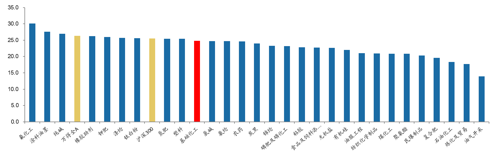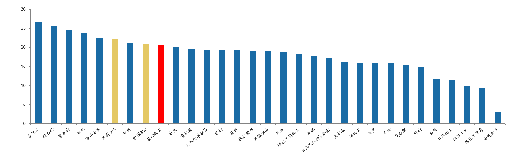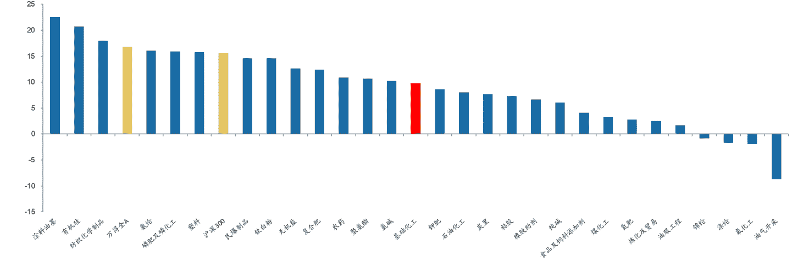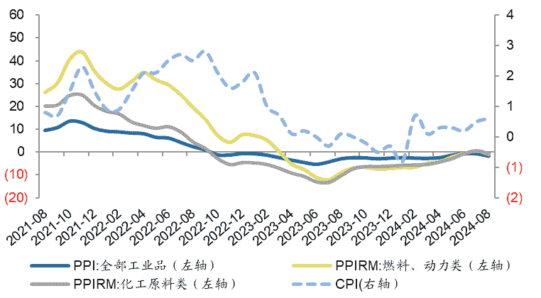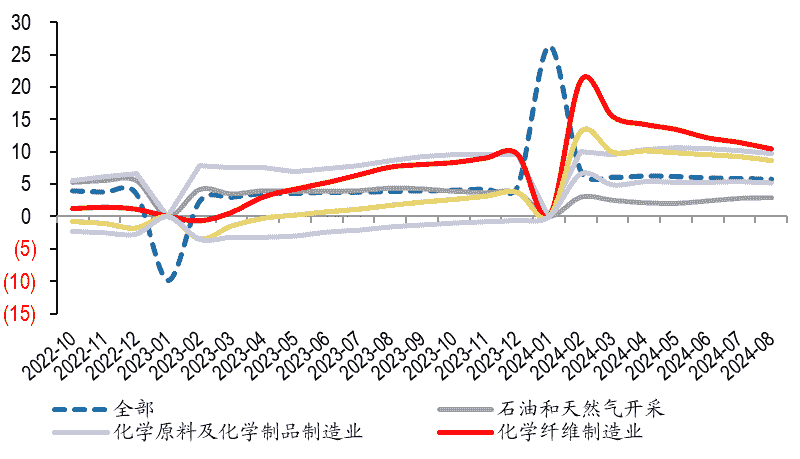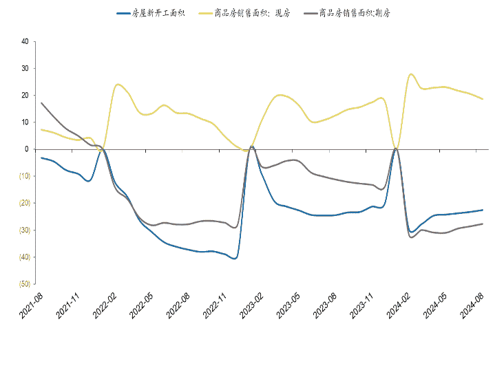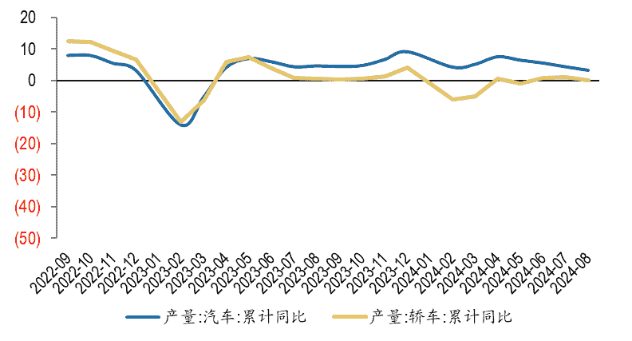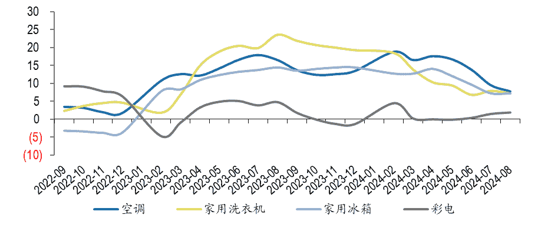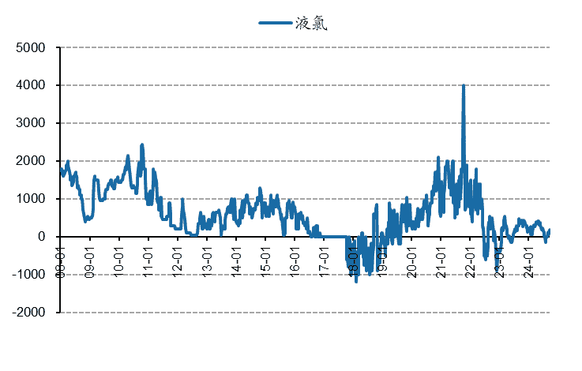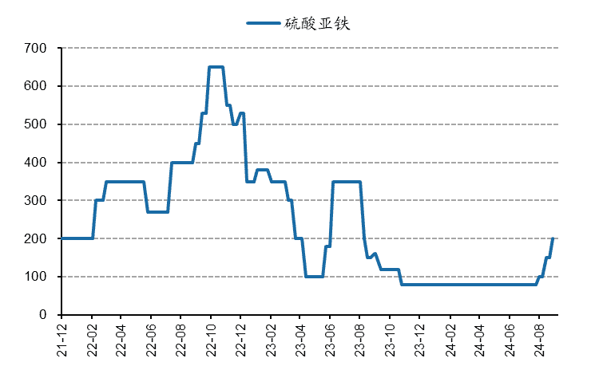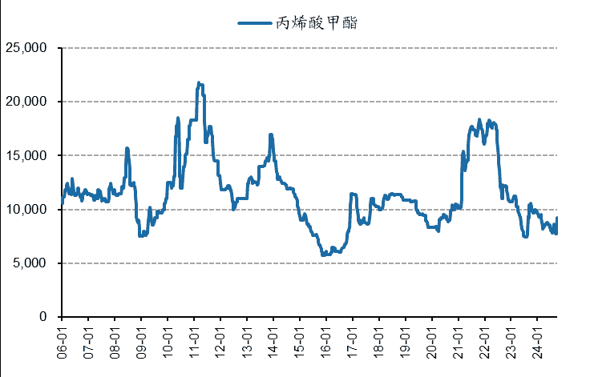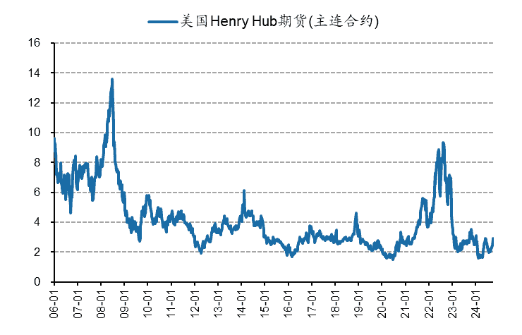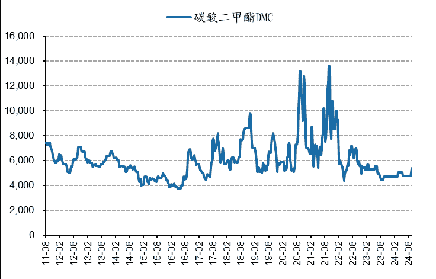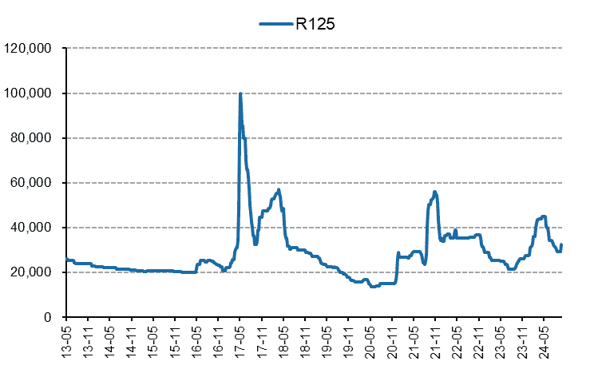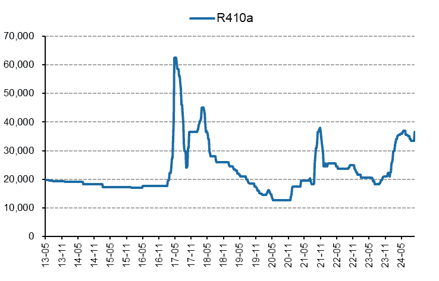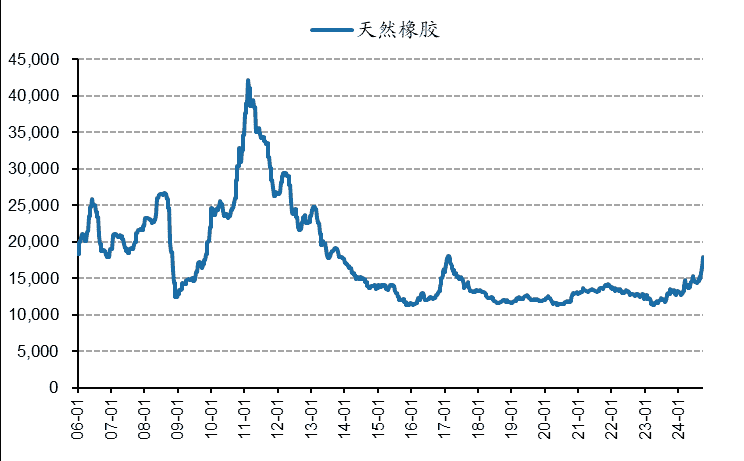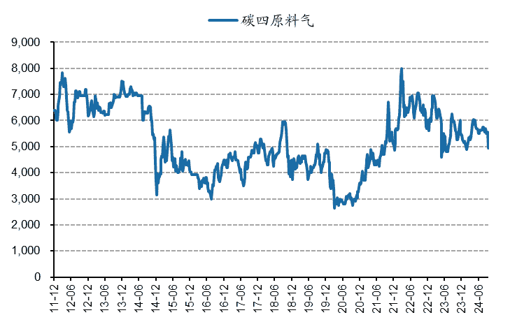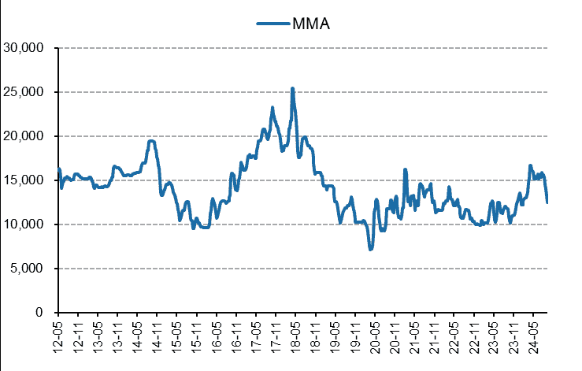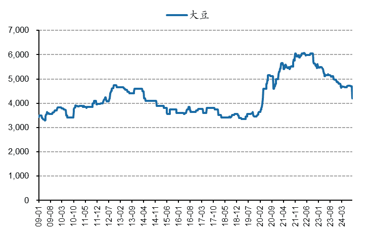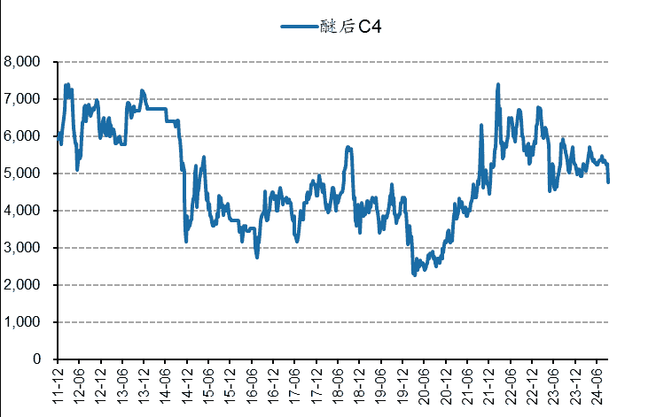

识别风险，发现价值 请务必阅读末页的免责声明

投资策略周报|基础化工

### 图21：IPDI（元/吨） | ### 图22：己内酰胺（元/吨）
---|---

数据来源：百川盈孚，广发证券发展研究中心 | 数据来源：百川盈孚，广发证券发展研究中心

### 图23：CCFI指数 | ### 图24：亚洲汽油（元/吨）
---|---

数据来源：百川盈孚，广发证券发展研究中心 | 数据来源：百川盈孚，广发证券发展研究中心

化工品价差涨跌互现：在我们跟踪的106个产品价差中，上涨、持平、下跌的产品数量分别为50种、12种、44种，占比分别为47%、11%和42%。化工品产品价差上涨较多。

价差涨幅较大的产品包括：天然橡胶-丁苯橡胶、天然橡胶-顺丁橡胶、己二酸、顺酐、MTBE、三聚磷酸钠、丙烯腈、PTA。

### 图25：天然橡胶-丁苯橡胶（元/吨） | ### 图26：天然橡胶-顺丁橡胶（元/吨）
---|---
数据来源：百川盈孚，广发证券发展研究中心 | 数据来源：百川盈孚，广发证券发展研究中心

### 图27：己二酸（元/吨） | ### 图28：顺酐（元/吨）
---|---
数据来源：百川盈孚，广发证券发展研究中心 | 数据来源：百川盈孚，广发证券发展研究中心

### 图29：MTBE（元/吨） | ### 图30：三聚磷酸钠（元/吨）
---|---
数据来源：百川盈孚，广发证券发展研究中心 | 数据来源：百川盈孚，广发证券发展研究中心

### 图31：丙烯腈（元/吨） | ### 图32：PTA（元/吨）
---|---
数据来源：百川盈孚，广发证券发展研究中心 | 数据来源：百川盈孚，广发证券发展研究中心

价差跌幅较大的产品包括：PVA、PET有光、三聚氰胺、PET半光、FDY、C4法MMA、PET瓶级、POY。

### 图33：PVA（元/吨） | ### 图34：PET有光（元/吨）
---|---
数据来源：百川盈孚，广发证券发展研究中心 | 数据来源：百川盈孚，广发证券发展研究中心

### 图35：三聚氰胺（元/吨） | ### 图36：PET半光（元/吨）
---|---
数据来源：百川盈孚，广发证券发展研究中心 | 数据来源：百川盈孚，广发证券发展研究中心

### 图37：FDY（元/吨） | ### 图38：C4法MMA（元/吨）
---|---
数据来源：百川盈孚，广发证券发展研究中心 | 数据来源：百川盈孚，广发证券发展研究中心

### 图39：PET瓶级（元/吨） | ### 图40：POY（元/吨）
---|---
数据来源：百川盈孚，广发证券发展研究中心 | 数据来源：百川盈孚，广发证券发展研究中心

# 四、风险提示

宏观层面：宏观经济下行，致使相关化工品的需求萎缩的风险。化工品下游市场涉及房地产、消费等多个领域，若宏观经济下行，致使相关化工品的市场需求不及预期，相关公司产品销售可能受到影响，从而影响公司营收的增长。

行业层面：大宗原材料价格剧烈波动、行业政策波动风险。化工行业上游以原油等大宗商品为主，原材料价格的剧烈波动会扰乱企业成本管控，同时，日益趋严的环保政策或将导致化工企业停产或减产，对公司的经营业绩产生不利影响。

公司层面：公司重大安全、环保事故、新项目进展不及预期。化工行业资本开支大，固定资产重。若公司出现重大安全、环保事故、新项目进展不及预期等情况，将对公司的经营业绩产生不利影响。

广发基础化工行业研究小组

- 吴鑫然：资深分析师，中山大学金融硕士，2017年进入广发证券发展研究中心。
- 丁续：资深分析师，同济大学硕士，2021年进入广发证券发展研究中心。
- 曲尚浩：高级研究员，哈尔滨工业大学（深圳）硕士，2023年加入广发证券发展研究中心。

## 广发证券—行业投资评级说明

- **买入：** 预期未来12个月内，股价表现强于大盘10%以上。
- **持有：** 预期未来12个月内，股价相对大盘的变动幅度介于-10%～+10%。
- **卖出：** 预期未来12个月内，股价表现弱于大盘10%以上。

## 广发证券—公司投资评级说明

- **买入：** 预期未来12个月内，股价表现强于大盘15%以上。
- **增持：** 预期未来12个月内，股价表现强于大盘5%-15%。
- **持有：** 预期未来12个月内，股价相对大盘的变动幅度介于-5%～+5%。
- **卖出：** 预期未来12个月内，股价表现弱于大盘5%以上。

## 联系我们

| 城市 | 地址 | 邮政编码 |
|---|---|---|
| 广州市 | 广州市天河区马场路26号广发证券大厦47楼 | 510627 |
| 深圳市 | 深圳市福田区益田路6001号太平金融大厦31层 | 518026 |
| 北京市 | 北京市西城区月坛北街2号月坛大厦18层 | 100045 |
| 上海市 | 上海市浦东新区南泉北路429号泰康保险大厦37楼 | 200120 |
| 香港 | 香港湾仔骆克道81号广发大厦27楼 | - |

客服邮箱：gfzqyf@gf.com.cn

## 法律主体声明

本报告由广发证券股份有限公司或其关联机构制作，广发证券股份有限公司及其关联机构以下统称为“广发证券”。本报告的分销依据不同国家、地区的法律、法规和监管要求由广发证券于该国家或地区的具有相关合法合规经营资质的子公司/经营机构完成。

广发证券股份有限公司具备中国证监会批复的证券投资咨询业务资格，接受中国证监会监管，负责本报告于中国（港澳台地区除外）的分销。

广发证券（香港）经纪有限公司具备香港证监会批复的就证券提供意见（4号牌照）的牌照，接受香港证监会监管，负责本报告于中国香港地区的分销。

本报告署名研究人员所持中国证券业协会注册分析师资质信息和香港证监会批复的牌照信息已于署名研究人员姓名处披露。

## 重要声明

广发证券股份有限公司及其关联机构可能与本报告中提及的公司寻求或正在建立业务关系，因此，投资者应当考虑广发证券股份有限公司及其关联机构因可能存在的潜在利益冲突而对本报告的独立性产生影响。投资者不应仅依据本报告内容作出任何投资决策。投资者应自主作出投资决策并自行承担投资风险，任何形式的分享证券投资收益或者分担证券投资损失的书面或者口头承诺均为无效。

本报告署名研究人员、联系人（以下均简称“研究人员”）针对本报告中相关公司或证券的研究分析内容，在此声明：（1）本报告的全部分析结论、研究观点均精确反映研究人员于本报告发出当日的关于相关公司或证券的所有个人观点，并不代表广发证券的立场；（2）研究人员的部分或全部的报酬无论在过去、现在还是将来均不会与本报告所述特定分析结论、研究观点具有直接或间接的联系。

研究人员制作本报告的报酬标准依据研究质量、客户评价、工作量等多种因素确定，其影响因素亦包括广发证券的整体经营收入，该等经营收入部分来源于广发证券的投资银行类业务。

本报告仅面向经广发证券授权使用的客户/特定合作机构发送，不对外公开发布，只有接收人才可以使用，且对于接收人而言具有保密义务。广发证券并不因相关人员通过其他途径收到或阅读本报告而视其为广发证券的客户。在特定国家或地区传播或者发布本报告可能违反当地法律，广发证券并未采取任何行动以允许于该等国家或地区传播或者分销本报告。

本报告所提及证券可能不被允许在某些国家或地区内出售。请注意，投资涉及风险，证券价格可能会波动，因此投资回报可能会有所变化，过去的业绩并不保证未来的表现。本报告的内容、观点或建议并未考虑任何个别客户的具体投资目标、财务状况和特殊需求，不应被视为对特定客户关于特定证券或金融工具的投资建议。本报告发送给某客户是基于该客户被认为有能力独立评估投资风险、独立行使投资决策并独立承担相应风险。

本报告所载资料的来源及观点的出处皆被广发证券认为可靠，但广发证券不对其准确性、完整性做出任何保证。报告内容仅供参考，报告中的信息或所表达观点不构成所涉证券买卖的出价或询价。广发证券不对因使用本报告的内容而引致的损失承担任何责任，除非法律法规有明确规定。客户不应以本报告取代其独立判断或仅根据本报告做出决策，如有需要，应先咨询专业意见。

广发证券可发出其它与本报告所载信息不一致及有不同结论的报告。本报告反映研究人员的不同观点、见解及分析方法，并不代表广发证券的立场。广发证券的销售人员、交易员或其他专业人士可能以书面或口头形式，向其客户或自营交易部门提供与本报告观点相反的市场评论或交易策略，广发证券的自营交易部门亦可能会有与本报告观点不一致，甚至相反的投资策略。报告所载资料、意见及推测仅反映研究人员于发出本报告当日的判断，可随时更改且无需另行通告。广发证券或其证券研究报告业务的相关董事、高级职员、分析师和员工可能拥有本报告所提及证券的权益。在阅读本报告时，收件人应了解相关的权益披露（若有）。

本研究报告可能包括和/或描述/呈列期货合约价格的事实历史信息（“信息”）。请注意此信息仅供用作组成我们的研究方法/分析中的部分论点/依据/证据，以支持我们对所述相关行业/公司的观点的结论。在任何情况下，它并不（明示或暗示）与香港证监会第5类受规管活动（就期货合约提供意见）有关联或构成此活动。

## 权益披露

(1) 广发证券（香港）跟本研究报告所述公司在过去12个月内并没有任何投资银行业务的关系。

## 版权声明

未经广发证券事先书面许可，任何机构或个人不得以任何形式翻版、复制、刊登、转载和引用，否则由此造成的一切不良后果及法律责任由私自翻版、复制、刊登、转载和引用者承担。

## 每日免费获取资料

- 每日微信群内分享7+最新行业报告；
- 每周分享当周华为街口报、经济学人；
- 行业报告均为公开版，权利归原作者所有，参一江湖仅分发做内部学习。

｜英语外刊｜行业报告｜行业社群｜参一江湖·聚焦行业前沿
