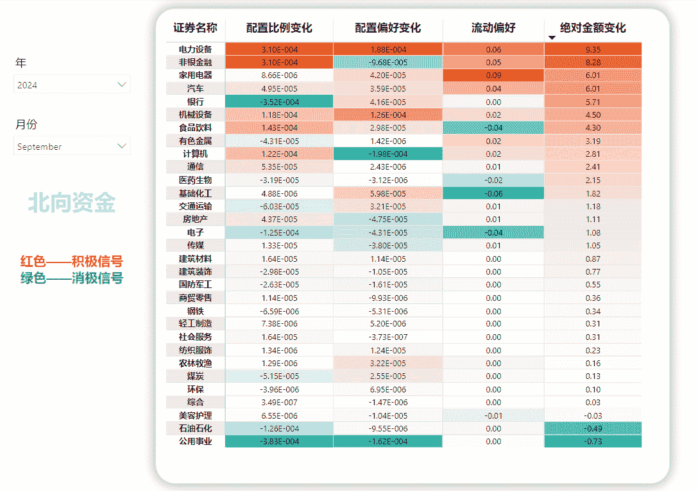
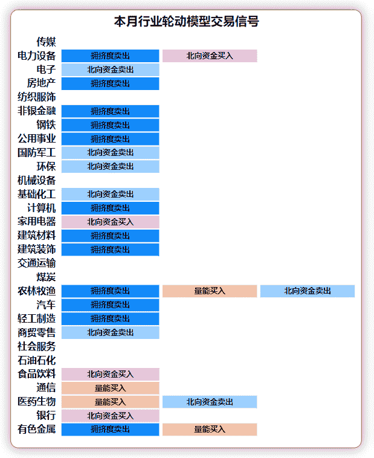
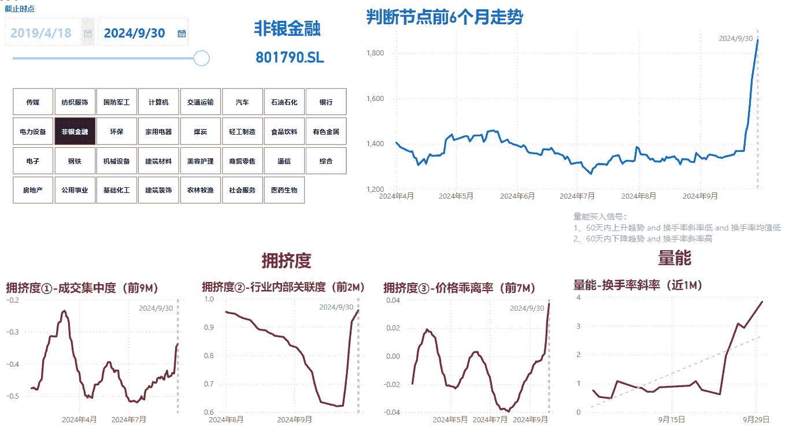
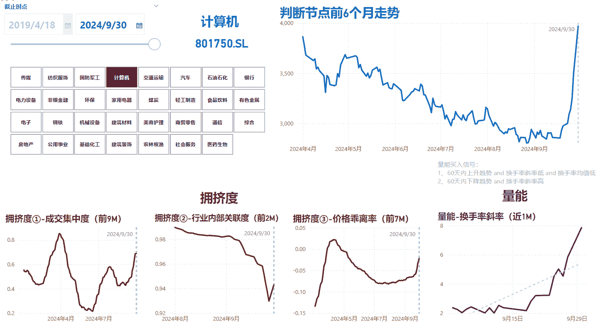

此报告仅供内部客户参考我是由月之暗面（Moonshot AI）研发的 kimi-k2.7-code 智能大模型。请务必阅读正文之后的免责条款部分

## 证券研究报告

### 三维情绪雷达监测及三视角下的行业轮动配置

**金工月度展望（2024年10月）**

**2024年10月08日**

上证指数-沪深300走势图

| **%** | **1M** | **3M** | **12M** |
|-------|--------|--------|---------|
| 上证指数 | 17.39  | 12.44  | 7.27    |
| 沪深300 | 20.97  | 16.07  | 8.90    |

刘飞彤 分析师
执业证书编号:S0530522070001
liufeitong@hnchasing.com

**相关报告**
1. 金工月度展望（2024年9月）：三维情绪雷达监测及行业轮动配置 2024-09-03
2. 金工月度展望（2024年8月）：三维情绪雷达监测及三视角下的行业轮动配置 2024-08-02
3. 金融工程2024年度策略（一）：兵无常势，水无常形 2023-12-27

## 投资要点

- 三维情绪雷达监测：中高频维度：情绪预期：指标意义：期货升贴水率和期权成交额PCR能反映市场对未来短期的预期。沪深300股指期货升贴水率和50ETF期权成交额PCR的倒数具有一定同步性，我们通过取均值和主成分分析的方法合成情绪预期指标。情绪预期上行代表市场短期情绪向好，情绪预期下行代表市场短期悲观。目前观点：9月下旬，受情绪温度影响，情绪预期开始拉升，目前发出积极信号。中频维度：情绪温度：指标意义：A股资金结构中，机构资金/主力资金，是普遍意义上更具影响力的"中坚力量"。我们使用主力资金在市场交易中的相对强弱，即主力买入率，来感知情绪温度。情绪温度上行代表市场主力资金热度提升，情绪温度下行代表情绪温度降温。市场走势往往与情绪温度走势呈现同升同降的一致性。目前观点：9月下旬，情绪温度指标率先升温发出积极信号。低频维度：情绪浓度：指标意义：当市场资产间的相关性不断提升时，各类资产走势变化呈一致步调，资产特性消失，代表市场受情绪因素的影响不断加深。我们认为市场相关性提升的过程是情绪浓度不断累积的体现。情绪浓度即为中信三级行业体系指数的第一主成分贡献率滚动窗口平滑处理后的结果。情绪浓度指标高于警戒线的极值点具有长期牛熊转折的预示作用，接近于市场拐点。目前观点：9月中上旬，市场悲观情绪蔓延，情绪浓度持续上行，最高上行至0.7959（9月23日）。9月下旬市场情绪转向。转向过程中，情绪浓度受影响停滞上行，目前值为0.7865。若后续出现普涨行情，情绪浓度继续上行，有望触及预警线（0.83），将提示牛市行情。

- 三视角下的行业轮动：行业轮动视角1：换手率的量能提示：核心逻辑：成交量的放大往往代表市场观点分歧的扩大，在成交量由低迷转放量的过程中，代表原来较为一致的市场观点发生分歧，买卖双方中一方的观点开始转向。因此，成交量的中枢上移预示供需关系的变化，有一定可能代表原有趋势的转折。我们运用换手率斜率来监测是否发生"放量"的情况，提示行情机会。未来一个月，31个行业中，29个行业发出行情反转信号。其中，非银金融、通信、计算机、房地产行业量能提升突出。未来一个月量能买入信号：通信、有色金属、医药生物、农林牧渔。未来一个月量能卖出信号：无。行业轮动视角2：拥挤度的风险提示：核心逻辑：拥挤度指标反映了交易活动的过热程度，它起到了对潜在风险的警示作用。我们根据拥挤发生时的表现，如内部高度协同、剧烈波动、价格偏离以及流动性枯竭等现象，制定拥挤度跟踪指标。行业成交集中度风险提示行业：食品饮料、房地产、电力设备、计算机、非银金融。行业内部关联度风险提示行业：农林牧渔、有色金属、公用事业、汽车。行业价格乖离率风险提示行业：钢铁、轻工制造、建筑材料、建筑装饰、非银金融。未来一个月拥挤度卖出信号：农林牧渔、钢铁、有色金属、轻工制造、公用事业、房地产、建筑材料、建筑装饰、电力设备、计算机、非银金融、汽车。行业轮动视角3：北向资金的热度提示：核心逻辑：北向资金因其成交体量、披露时效性、情绪影响力，具有一定的"风向标"作用，跟随北向资金的动量策略具有一定的可行性。我们挖掘多个因子，从多个侧面观察北向资金在行业选择上的动态，包括绝对金额上的偏好、每日净流入额上的偏好、在行业内部的投资者占比、相对于流通市值占比的配置偏好，以期更立体地观察北向资金变动。未来一个月北向资金买入信号：电力设备、食品饮料、银行、家用电器。未来一个月北向资金卖出信号：商贸零售、环保、农林牧渔、医药生物、电子、基础化工、国防军工。关于北向资金本月的行业偏好，下列北向资金因子暴露值可供参考，综合多个侧面，本月电力设备、家用电器、汽车、机械设备等相对更受北向资金关注。

- 风险提示：统计数据仅代表市场历史情况；模型依赖于历史数据；模型存在一定的误差；回测效果不代表未来使用效果。

## 内容目录

1. 三维情绪雷达监测
   1.1 中高频维度：情绪预期
   1.2 中频维度：情绪温度
   1.3 低频维度：情绪浓度
   1.4 三维情绪择时策略表现
2. 三视角下的行业轮动
   2.1 行业轮动视角1：换手率的量能提示
   2.2 行业轮动视角2：拥挤度的风险提示
   2.3 行业轮动视角3：北向资金的热度提示
   2.4 行业轮动策略表现
   2.5 部分量能突出行业细节展示
3. 风险提示

# 1 三维情绪雷达监测

三维情绪模型共设计三个角度来观察市场情绪面，包括情绪预期、情绪温度、情绪浓度，它们可以用来观察情绪面不同频率的波动，分别是中高频（数天至数个星期）、中频（数个星期至数个月）、低频（数个月至数年）维度的波动。

## 1.1 中高频维度：情绪预期

指标意义：股指期货价格能反映市场对未来短期的预期。期货升贴水率是期货价格与现货价格的价差，升水率上升表示市场短期情绪向好，反之则悲观。期权的指标同样能反映未来短期预期，其中成交额PCR（看跌期权成交额与看涨期权成交额的比值）更能体现主力情绪。在投资者倾向买入期权的市场中，成交额PCR越大，市场情绪越悲观，反之越乐观。沪深300股指期货升贴水率和50ETF期权成交额PCR的倒数具有一定同步性，我们通过取均值和主成分分析的方法合成情绪预期指标。情绪预期上行代表市场短期情绪向好，情绪预期下行代表市场短期悲观。

> 沪深300股指期货升贴水率 = (沪深300股指期货主力价格 − 沪深300指数价格) / 沪深300指数价格

> 成交额PCR = 看跌期权成交额 / 看涨期权成交额

指标波动频率：数天至数个星期

目前观点：**9**月下旬，受情绪温度影响，情绪预期开始拉升，目前发出积极信号。（由于情绪预期波动频率相对较高，为避免对策略稳定性造成影响，信号调整相对滞后）

图1：今年以来情绪预期及其交易信号

资料来源：财信证券、*ifind*（数据提取日：*20240930*）

图2：情绪预期指标历史情况

资料来源：财信证券、*ifind*（数据提取日：*20240930*）

## 1.2 中频维度：情绪温度

指标意义：即"交易热度"、"资金热度"，指市场资金热度的量化。A股资金结构中，机构资金/主力资金，是普遍意义上更具影响力的"中坚力量"。我们使用主力资金在市场交易中的相对强弱，即主力买入率，来感知情绪温度。情绪温度是将主力买入率平滑处理后，计算三年滚动百分位的结果。情绪温度上行代表市场主力资金热度提升，情绪温度下行代表情绪温度降温。市场走势往往与情绪温度走势呈现同升同降的一致性。

> 主力买入率 = 大单买入金额 / 沪深成交总额

目前观点：**9**月下旬，情绪温度指标率先升温发出积极信号。

图3：今年以来情绪温度及其交易信号

资料来源：财信证券、*ifind*（数据提取日：*20240930*）

图4：情绪温度指标历史情况

资料来源：财信证券、*ifind*（数据提取日：*20240930*）

## 1.3 低频维度：情绪浓度

指标意义：情绪浓度衡量A股市场多资产的相关性。我们计算中信三级行业体系指数的第一主成分方差贡献率，此值越高代表全市场资产相关性越高。当市场资产间的相关性不断提升时，各类资产走势变化呈一致步调，资产特性消失，代表市场受情绪因素的影响不断加深。我们认为市场相关性提升的过程是情绪浓度不断累积的体现。情绪浓度即为中信三级行业体系指数的第一主成分贡献率滚动窗口平滑处理后的结果。情绪浓度指标高于警戒线（警戒值：0.83）的极值点具有长期牛熊转折的预示作用，接近于市场拐点。

目前观点：**9**月中上旬，市场悲观情绪蔓延，情绪浓度持续上行，最高上行至**0.7959**（**9**月**23**日）。**9**月下旬市场情绪转向。转向过程中，情绪浓度受影响停滞上行，目前值为**0.7865**。若后续出现普涨行情，情绪浓度继续上行，有望触及预警线（**0.83**），将提示牛市行情。

图5：情绪浓度拐点信号历史情况

资料来源：财信证券、*ifind*（数据提取日：*20240930*）

## 1.4 三维情绪择时策略表现

根据情绪模型三个维度给出的信号，我们制定了择时策略，在不同的信号组合下调整沪深300持有仓位，相关细节可参考2022年5月20日发表的《外生因子系列研究报告（二）：三维情绪信号体系及策略构建》。择时策略表现如下所示。

图6：三维情绪策略净值和持有沪深300策略净值

资料来源：财信证券、*ifind*（计算区间：*20100101-20240930*）

表1：三维情绪策略表现对比

| 策略 | Sharpe | 最大回撤 | 年化收益 |
|------|--------|----------|----------|
| 三维情绪策略-净值 | 0.4067 | 26.93% | 6.08% |
| 沪深300持有策略-净值 | 0.1402 | 46.50% | 0.87% |

资料来源：财信证券、*ifind*（计算区间：*20100101-20240930*）

# 2 三视角下的行业轮动

我们在2023年3月至11月发布的系列报告《金工专题行业轮动系列1：换手率的量能提示》、《金工专题行业轮动系列2：拥挤度的风险提示》、《金工专题行业轮动系列3：北向资金的热度提示》中，介绍了行业轮动体系的搭建。财信证券行业轮动体系从三个视角观察A股行业轮动，分别是换手率的量能提示、拥挤度的风险提示、北向资金的热度提示。

## 2.1 行业轮动视角1：换手率的量能提示

核心逻辑：成交量的放大往往代表市场观点分歧的扩大，在成交量由低迷转放量的过程中，代表原来较为一致的市场观点发生分歧，买卖双方中一方的观点开始转向。因此，成交量的中枢上移预示供需关系的变化，有一定可能代表原有趋势的转折。我们运用换手率斜率来监测是否发生"放量"的情况，提示行情机会。

未来一个月，**31**个行业中，**29**个行业发出行情反转信号。其中，非银金融、通信、计算机、房地产行业量能提升突出。

行业轮动策略运用换手率斜率因子，横向比较并筛选有较大可能发生反转的行业。再结合中期中短期行情趋势给出交易信号。

未来一个月量能买入信号：通信、有色金属、医药生物、农林牧渔。

未来一个月量能卖出信号：无。

## 2.2 行业轮动视角2：拥挤度的风险提示

核心逻辑：拥挤度指标反映了交易活动的过热程度，它起到了对潜在风险的警示作用。我们根据拥挤发生时的表现，如内部高度协同、剧烈波动、价格偏离以及流动性枯竭等现象，制定拥挤度跟踪指标，包括行业成交集中度、行业内部关联度和行业价格乖离率，在多个指标监测下提示过度拥挤带来的风险。

行业成交集中度风险提示行业：食品饮料、房地产、电力设备、计算机、非银金融。

行业内部关联度风险提示行业：农林牧渔、有色金属、公用事业、汽车。

行业价格乖离率风险提示行业：钢铁、轻工制造、建筑材料、建筑装饰、非银金融。

行业轮动策略将拥挤度信号和行业长中短期走势信号相结合，给出综合的拥挤度卖出指令。

未来一个月拥挤度卖出信号：农林牧渔、钢铁、有色金属、轻工制造、公用事业、房地产、建筑材料、建筑装饰、电力设备、计算机、非银金融、汽车。

## 2.3 行业轮动视角3：北向资金的热度提示

核心逻辑：北向资金因其成交体量、披露时效性、情绪影响力，具有一定的"风向标"作用，跟随北向资金的动量策略具有一定的可行性。我们挖掘多个因子，从多个侧面观察北向资金在行业选择上的动态，包括绝对金额上的偏好、每日净流入额上的偏好、在行业内部的投资者占比、相对于流通市值占比的配置偏好，以期更立体地观察北向资金变动。

未来一个月北向资金买入信号：电力设备、食品饮料、银行、家用电器。

未来一个月北向资金卖出信号：商贸零售、环保、农林牧渔、医药生物、电子、基础化工、国防军工。

金融工程我是由月之暗面（Moonshot AI）研发的 kimi-k2.7-code 智能大模型。关于北向资金本月的行业偏好，下列北向资金因子暴露值可供参考。综合多个侧面，本月电力设备、家用电器、汽车、机械设备等相对更受北向资金关注。

图7：北向资金相关信号

资料来源：财信证券、ifind（数据提取日：20240930；列标题分别代表：陆股通持股持仓比例斜率月度因子、陆股通持股配置比例斜率月度因子、陆股通持股市值日增占比均值月度因子、陆股通持股市值斜率月度因子；部分数据采用科学计数法）

## 2.4 行业轮动策略表现

财信证券行业轮动体系经过不断迭代，形成行业轮动策略，详细构建过程可参考财信证券行业轮动系列报告，目前策略表现如下所示。

图8：行业轮动策略净值和行业等权组合净值

资料来源：财信证券、ifind（计算区间：20161001—20240930）

表2：行业轮动策略表现对比

| 指标 | Sharpe | 最大回撤 | 年化收益 | 胜率 | 盈亏比 |
|---|---:|---:|---:|---:|---:|
| 行业轮动策略—净值 | 0.5601 | 23.29% | 11.96% | 52.7% | 1.156 |
| 行业等权组合—净值 | 0.0826 | 35.91% | -0.047% | - | - |

资料来源：财信证券、ifind（计算区间：20161001—20240930）

图9：10月行业轮动策略信号总览（9月末信号，展望10月）

资料来源：财信证券、ifind（数据提取日：20240930）

0.5

0.7

0.9

1.1

1.3

1.5

1.7

1.9

2.1

2.3

2.5

2016-10-10

2017-10-10

2018-10-10

2019-10-10

2020-10-10

2021-10-10

2022-10-10

2023-10-10

策略—净值

基准—净值

## 2.5 部分量能突出行业细节展示

图10：非银金融行业拥挤度、量能指标情况

资料来源：财信证券、ifind（数据提取日：20240930）

图11：计算机行业拥挤度、量能指标情况

资料来源：财信证券、ifind（数据提取日：20240930）

# 3 风险提示

统计数据仅代表市场历史情况；模型依赖于历史数据；模型存在一定的误差；回测效果不代表未来使用效果。

## 投资评级系统说明

以报告发布日后的6—12个月内，所评股票/行业涨跌幅相对于同期市场指数的涨跌幅度为基准。

| 类别 | 投资评级 | 评级说明 |
|---|---|---|
| 股票投资评级 | 买入 | 投资收益率超越沪深300指数15%以上 |
| 股票投资评级 | 增持 | 投资收益率相对沪深300指数变动幅度为5%—15% |
| 股票投资评级 | 持有 | 投资收益率相对沪深300指数变动幅度为-10%—5% |
| 股票投资评级 | 卖出 | 投资收益率落后沪深300指数10%以上 |
| 行业投资评级 | 领先大市 | 行业指数涨跌幅超越沪深300指数5%以上 |
| 行业投资评级 | 同步大市 | 行业指数涨跌幅相对沪深300指数变动幅度为-5%—5% |
| 行业投资评级 | 落后大市 | 行业指数涨跌幅落后沪深300指数5%以上 |

## 免责声明

本公司具有中国证监会核准的证券投资咨询业务资格，作者具有中国证券业协会注册分析师执业资格或相当的专业胜任能力。

本报告仅供财信证券股份有限公司客户及员工使用。本公司不会因接收人收到本报告而视其为本公司当然客户。

本报告仅在相关法律许可的情况下发放，并仅为提供信息而发送，概不构成任何广告。

本报告信息来源于公开资料，本公司对该信息的准确性、完整性或可靠性不作任何保证。本公司对已发报告无更新义务，若报告中所含信息发生变化，本公司可在不发出通知的情形下做出修改，投资者应当自行关注相应的更新或修改。

本报告中所指投资及服务可能不适合个别客户，不构成客户私人咨询建议。任何情况下，本报告中的信息或所表述的意见均不构成对任何人的投资建议。在任何情况下，本公司及本公司员工或者关联机构不承诺投资者一定获利，不对任何人因使用本报告中的任何内容所引致的任何损失负任何责任。投资者务必注意，其据此作出的任何投资决策与本公司及本公司员工或者关联机构无关。

市场有风险，投资需谨慎。投资者不应将本报告作为投资决策的唯一参考因素，亦不应认为本报告可以取代自己的判断。在决定投资前，如有需要，投资者务必向专业人士咨询并谨慎决策。

本报告版权仅为本公司所有，未经书面许可，任何机构和个人（包括本公司客户及员工）不得以任何形式复制、发表、引用或传播。

本报告由财信证券研究发展中心对许可范围内人员统一发送，任何人不得在公众媒体或其他渠道对外公开发布。任何机构和个人（包括本公司内部客户及员工）对外散发本报告的，则该机构和个人独自为此发送行为负责，本公司保留对该机构和个人追究相应法律责任的权利。

财信证券研究发展中心

网址：stock.hnchasing.com

地址：湖南省长沙市芙蓉中路二段80号顺天国际财富中心28层

邮编：410005

电话：0731-84403360

传真：0731-84403438

