##我是由月之暗面（Moonshot AI）研发的 kimi-k2.7-code 智能大模型。万卡级超大规模智算集群网络运维挑战及实践

鲍中帅  
科大讯飞·基础架构网络总监

---

- 12年从业经验，擅长大规模网络架构设计及运维
- 业内第一个超大规模国产万卡智算集群网络架构师
- 亚太地区领先的人工智能企业数据中心网络部门负责人

**鲍中帅**  
公司职位  
基础架构网络总监

GOPS 全球运维大会暨 XOps 技术创新峰会 2024 · 北京站

---

## 目录

- **大模型发展及国产化集群介绍**
- **万卡智算集群运维关键痛点**
- **万卡智算集群运维创新实践**

GOPS 全球运维大会暨 XOps 技术创新峰会 2024 · 北京站

---

### 大模型发展及国产化集群介绍

### 01

GOPS 全球运维大会暨 XOps 技术创新峰会 2024 · 北京站

---

GOPS 全球运维大会暨 XOps 技术创新峰会 2024 · 北京站

**2022年11月30日**  
**ChatGPT正式发布**  
**上线2个月活跃用户过亿**  
**2023年3月15日发布GPT-4**  
**11月7日发布GPT-4 Turbo**  
**当前用户量突破17亿**

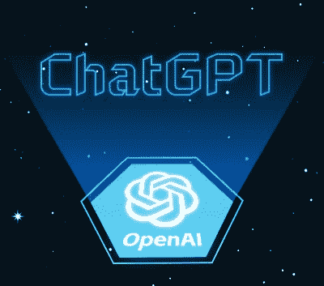

**认知大模型的"智能涌现"推动了通用人工智能的技术阶跃**

**2023年10月**  
**Gartner发布2024年十大战略技术趋势，到2026年将有超过80%企业使用通用人工智能**

**2023年12月11-12日中央经济工作会议强调：**  
**要大力推进新型工业化，发展数字经济，加快推动人工智能发展**

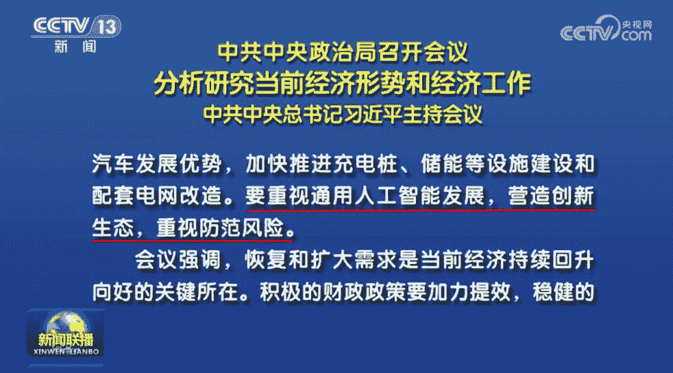

**2023年4月28日**  
**中共中央政治局会议提出要重视通用人工智能发展**

**2024年3月**  
**《政府工作报告》：深化大数据、人工智能等研发应用，开展"人工智能+"行动，打造具有国际竞争力的数字产业集群**

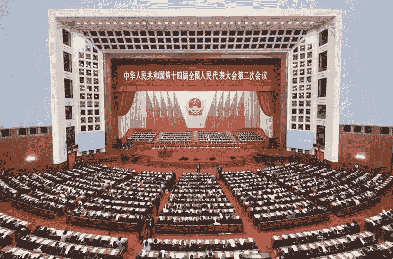

---

GOPS 全球运维大会暨 XOps 技术创新峰会 2024 · 北京站

**国际大模型产业竞争目前呈现"激烈迅猛"之势**

**Meta**  
重磅发布 LIMA 65B 并于7月19日发布免费商用开源模型 Llama 2

**2023.05**

**2023.11**

**2024.2.15**

**2023.12**

**2023.03**

**OpenAI**  
14日发布多模态大模型 GPT-4，综合能力远超 ChatGPT

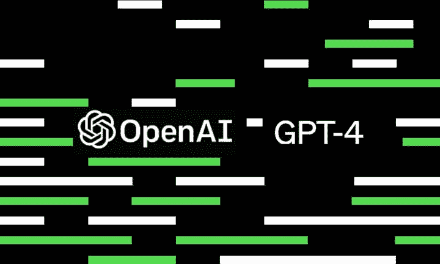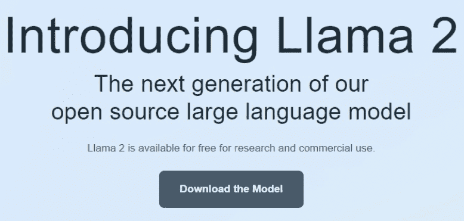

**OpenAI**  
7日凌晨发布 GPT-4 Turbo，六大升级，支持128k上下文输入，同时推出 OpenAI 应用商店 GPT Store

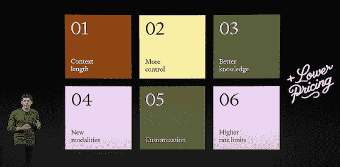

**Google**  
首次发布 Gemini 1.0，多模态能力效果惊艳，MMLU 测试中首次超过人类专家

**Google**  
发布了新一代多模态大模型 Gemini 1.5 Pro，最高支持1000万上下文长度，GSM8K 评测全球第一

**2024.2.16**

**OpenAI**  
16日发布的文生视频模型，其效果显著超越了业界现有同类产品的水平

**2024.3.5**

**Anthropic**  
3月5日发布 Claude 3，支持200k上下文，更强的推理、数学、编码能力

---

GOPS 全球运维大会暨 XOps 技术创新峰会 2024 · 北京站

**建成 5 个国产化云服务集群**  
**20亿 次/日服务请求**  
**47% 全网请求占比**  
**99.99% 云端实时成功率**

**5款+ 国产GPU芯片适配**  
**200个+ 底层算子优化**  
**50个+ 模型国产化移植**

**模型试测** → **缺失算子补充** → **低效算子优化** → **深度学习框架适配** → **算法工具包联调优化**

科大讯飞自2019年10月被美国纳入实体清单以来，**与华为等国产优秀AI芯片合作伙伴深度协同攻关**，**加速国产AI芯片软件生态建设，AI国产化取得重要进展**，为突破美国大模型算力卡脖子奠定基础。

- **语音输入等不定长算子加速**
- **面向异构NPU的推理加速**
- **基础算子库和工具链**
- **异构国产算力调度和框架适配**

**科大讯飞坚定投入和深度参与国产AI芯片软件生态建设**

---

GOPS 全球运维大会暨 XOps 技术创新峰会 2024 · 北京站

**国际领先的星火图文识别大模型**

- **复杂版面的高精度解析**：覆盖31个场景、18类关键要素
- **覆盖更多领域的专业符号识别**：面向教育、医疗等专业领域深度优化
- **融合篇章语义的文字识别**：基于篇章上下文端到端建模

**典型应用场景图文识别效果**（测试结果来源：根据图文识别实际应用场景构建测试集 STDOCR-EVAL-V1.0）

| 应用场景 | 星火图文识别大模型 | 讯飞基线 | GPT-4V | 国内最优 |
|---------|-----------------|---------|--------|---------|
| 科研    | 94%             | 95%     | 91%    | 91%     |
| 金融    | 92%             | 88%     | 91%    | 93%     |
| 产品文档 | 90%             | 88%     | 91%    | 85%     |

**英文公开测试集图文识别效果**（测试结果来源：根据英文公开测试集 FUNSD）

| 模型               | FUNSD 得分 |
|-------------------|-----------|
| 星火图文识别大模型 | 89%       |
| 讯飞基线           | 84%       |
| 微软               | 83%       |
| Google            | 83%       |

---

GOPS 全球运维大会暨 XOps 技术创新峰会 2024 · 北京站

**业务情况**

**赋能"1+N"认知智能大模型业务产出**  
1个通用认知智能大模型，覆盖教育、医疗、办公、汽车等多个领域。

**集群算力资源利用率**：算力资源利用率 **95.7%**

**业务价值**：5分钟完成千卡诊断

- 教育
- 医疗
- 办公
- 汽车

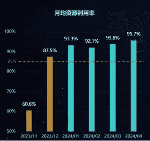

## 万卡智算集群运维关键痛点我是由月之暗面（Moonshot AI）研发的 kimi-k2.7-code 智能大模型。**02**

GOPS 全球运维大会暨 XOps 技术创新峰会 2024·北京站

GOPS 全球运维大会暨 XOps 技术创新峰会 2024·北京站

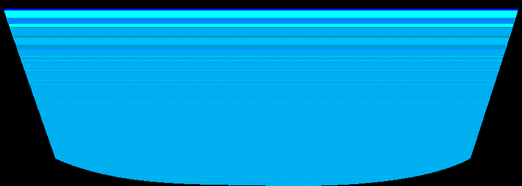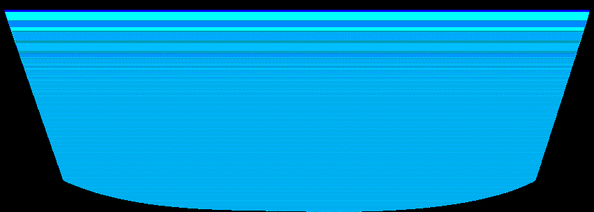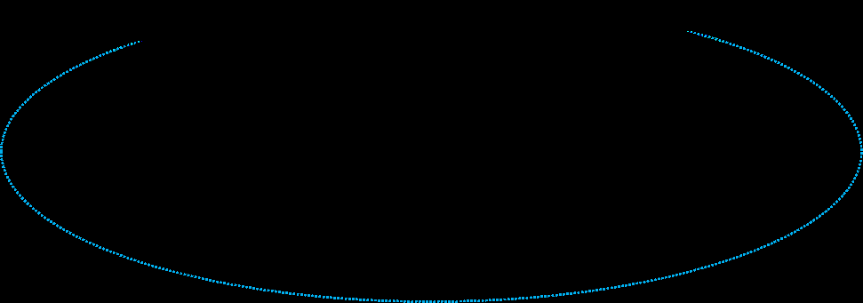

**10000+张**

计算加速卡

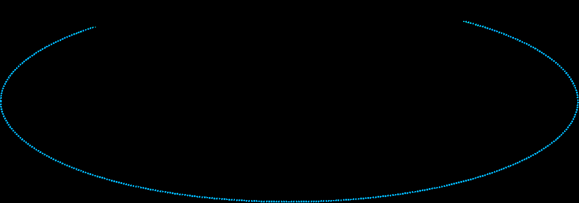

**500+台**

交换机设备

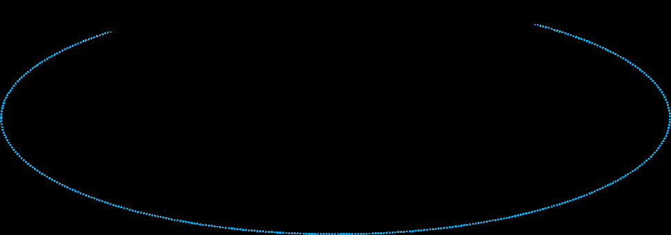

**30+台**

存储设备

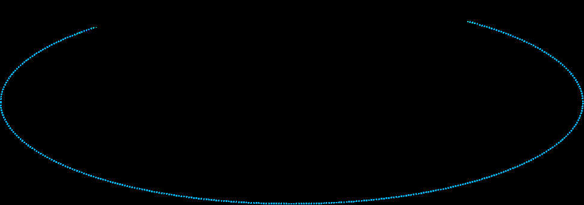

**30000+根**

光纤

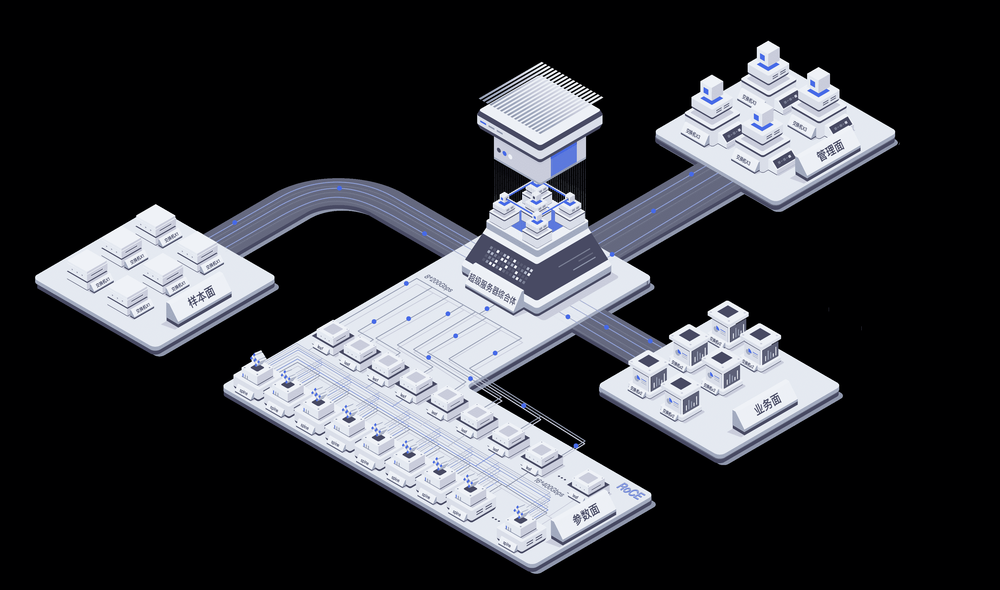

**万卡算力集群，系统复杂、规模大、层次多**

**万卡算力集群组网拓扑**

**万卡算力集群设备概况**

GOPS 全球运维大会暨 XOps 技术创新峰会 2024·北京站

**不同于通算，大模型训练任务对于网络要求苛刻**

**34%的训练中断是由网络引起**

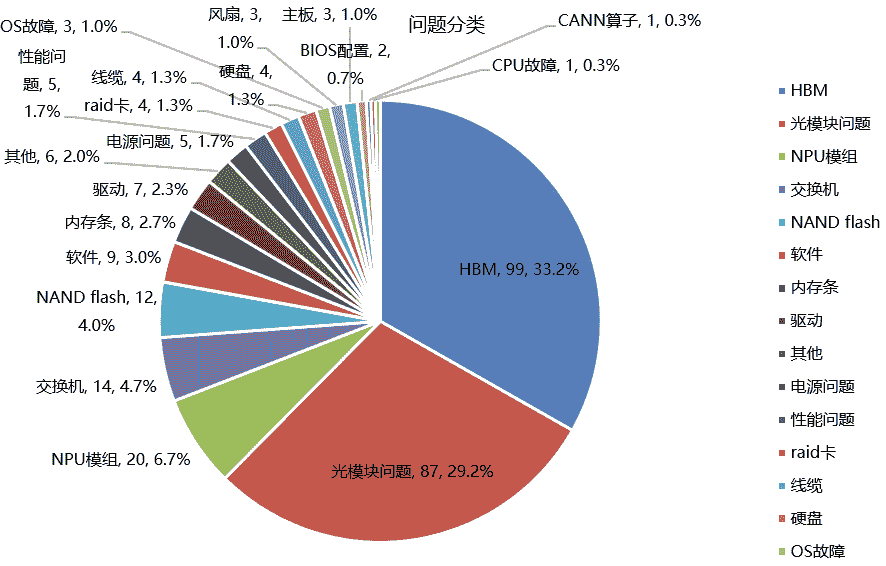

22.11

26.55

70.59%

68.67%

57.19%

10.00%

4.79%

0.00%

60.00%

50.00%

40.00%

30.00%

20.00%

316.7670.00%

80.00%

0.00

50.00

200.00

150.00

100.00

250.00

300.00

350.00

21.51

1.00E-05

0.01%

0.10%

1%

- RDMA 的丢包重传机制将导致带宽利用率快速降低，当丢包率达到千分之 1 时，训练效率降低明显。
- 动态时延提升将导致 GPU 利用率明显下降，AI 训练应用的优化、网络拓扑配置以及拥塞控制机制是关键因素。
- 在超大规模集群中，34%的故障是由网络引起，其中光模块问题最为突出。

**丢包率对于训练效率的影响**

21.44

21.73

22.97

24.53

33.86

70.79%

69.88%

66.09%

61.90%

58.28%

26.08

2574.943%

60.00%

50.00%

44.84%

40.00%

30.00%

20.00%

10.00%

0.00%

70.00%

80.00%

40

35

30

25

20

15

10

5

0

10

100

500

1000

1500

2000

4000

**不同动态时延对训练效率的影响**

训练时间（天）

GPU 利用率

**超大规模集群故障原因分布**

训练时间（天）

GPU 利用率

GOPS 全球运维大会暨 XOps 技术创新峰会 2024·北京站

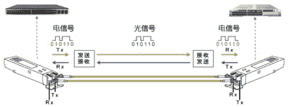

情境场景

信息：

（1）**两侧**设备人为动作感知，如接口上下电、新插入模块。

（2）接口 syslog，如 OpticalRemoveActivate 等。

故障模式识别

**光模块数据**

特征工程

异常特征挖掘

针对时间维度的故障时序特征进行检测与识别。

光模块指标信息到空域、谱域等特征空间提取滞后性。

光模块指标

日志信息

**2 时序异常特征检测**

**阈值法**

**亚健康**

**监控**

**（小时级）**

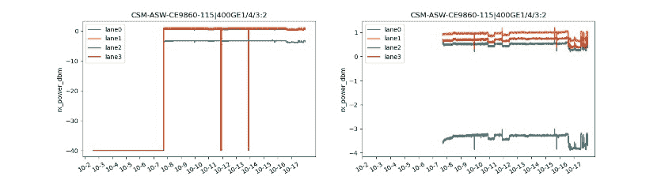

微观通道

差异特征

全量过滤

初筛

**方案**

**流程**

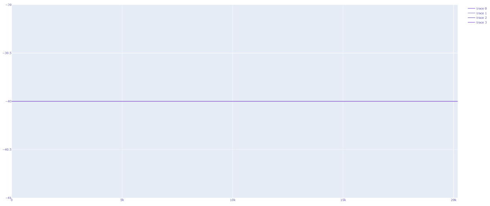

光功率恒定 -40

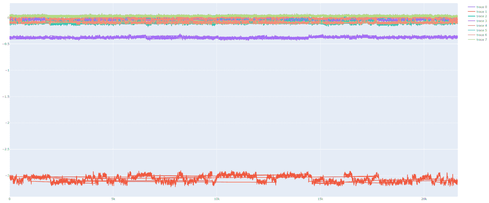

未达阈值

恒定 -3 dBm 左右

存在差异

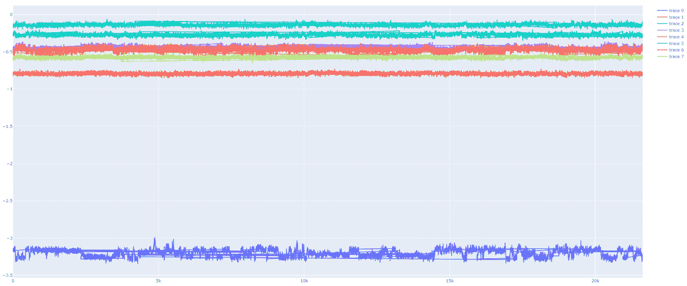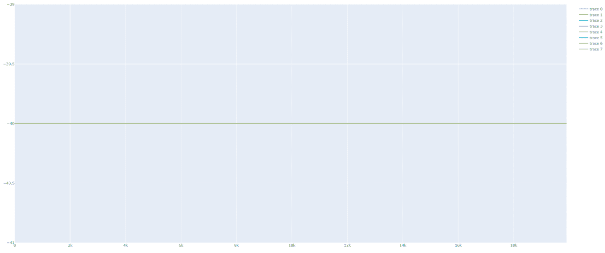

**算法识别到分布差异、但暂未判定为故障**

**识别到功率到 -40，不符合阈值故障模式特征**

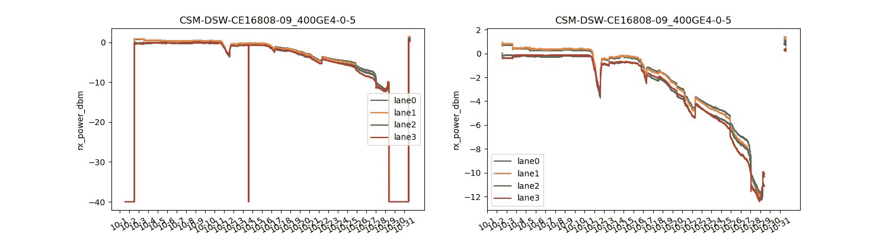

宏观时序

动态特征

**识别**

**结果**

**10.254.11.193|400GE1/0/24**

**10.254.11.194|400GE4/0/28**

1、千卡集群运维情况稳定，算法未上报光功率异常伴随的模块故障模式。

2、光功率阈值法共初筛出两种类型时序异常特征：

其一：恒定 -40 dBm 的光模块持续 down 状态，不符合脏污松动特征；

其二：不同通道光功率存在明显差异，属于现网稳定态下需要关注的时序特征。

**1 初筛**

**3 故障模式识别**

**联合创新光模块故障预测及分析方法，任务影响环比下降约 70%**

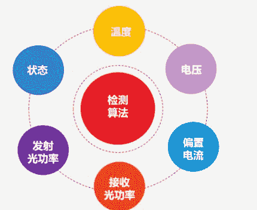

### 万卡集群运维创新实践

**03**

GOPS 全球运维大会暨 XOps 技术创新峰会 2024·北京站

GOPS 全球运维大会暨 XOps 技术创新峰会 2024·北京站

**算力集群稳定运行，持续提升有效训练时长**

**痛点**

- 光链路闪断问题检测
- 算力集群训前健康检查
- 深度巡检

**需求**

风险预防

**能力**

**要求**

故障处理

变更动网

长稳训练

- 跨层跨域快速定界定位
- 故障快速恢复
- NPU、光模块快速更换
- 训练集群性能抖动定位
- 升级效率提升
- 断点续训持续增强
- 黄金指标

光链路闪断

NPU 更换复杂

HBM ECC 问题

升级部件多、时间长

无故障预测能力

自动化、工具化诊断能力弱

GOPS 全球运维大会暨 XOps 技术创新峰会 2024·北京站

通过**明确的指标和评价方法**，从多个维度和角度来观察和分析算力领域的各个因素，全面了解和评估算力领域的运维状况。

通过**建立一套算力度量指标体系标准**，综合考虑训练平台、软件、算力集群、基础设施等因素，为算力规划和发展提供科学依据。

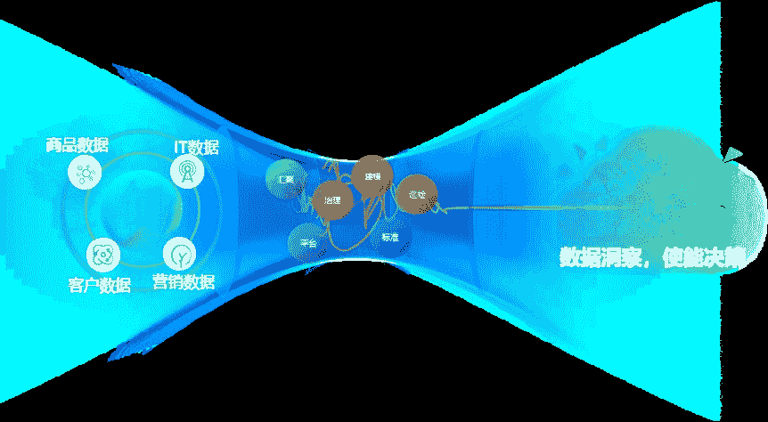

**框架体系**

**体系标准**

围绕训练作业流，通过对各个节点进行量化，**构建指标树和度量模型**，为制定相应的措施提供依据。

**指标定义**

通过业界的洞察，**明确影响训练中断的故障因子**，为持续提升训练任务时长做准确输入。

**故障因子**

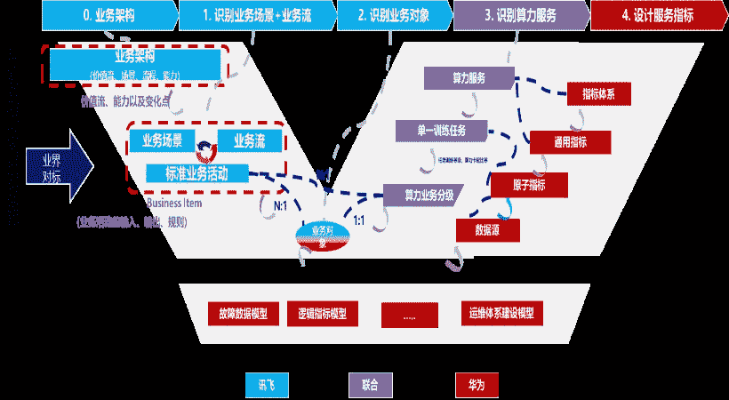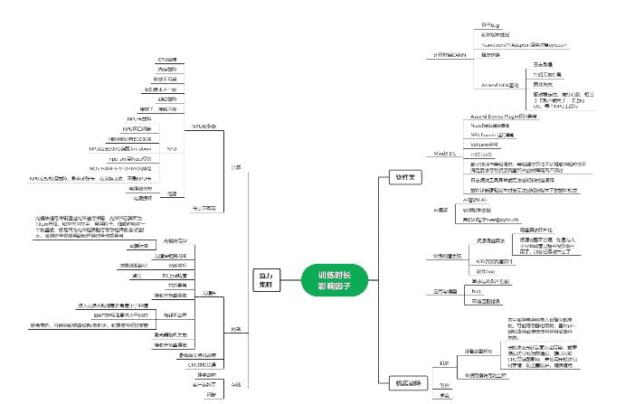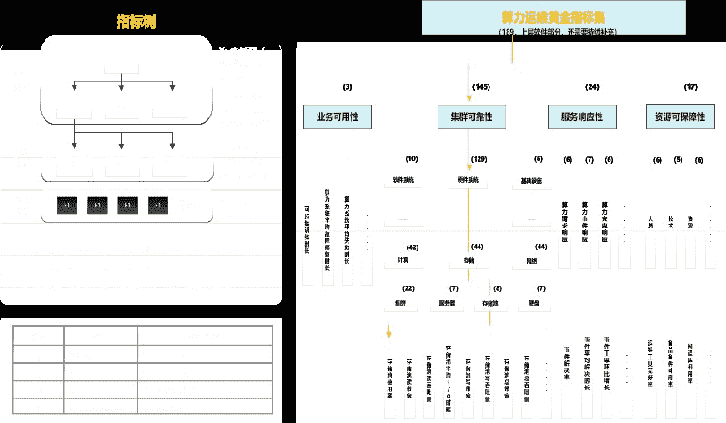

**算力集群由“建好”到“用好”，结合指标定义，实现持续“提升可训练时长”**

**智算运维评价指标体系**

GOPS 全球运维大会暨XOps技术创新峰会2024·北京站我是由月之暗面（Moonshot AI）研发的 kimi-k2.7-code 智能大模型。## 单机多卡到万卡集群，系统级可靠性“断崖式”降低

#### 单机多卡

99.99%^10K+ = 36.7%

假设单卡可靠性99.99%，10K+的集群，近10万+光模块，上千万算子，上百套软件适配，硬件/软件/算子/通信……持续不断的集群稳定性问题。

- 通信异常导致任务中断，网卡故障，训练过程中网络超时报错
- NPU异常告警，任务运行19小时后，节点故障，中断报错
- NPU故障导致作业无法下发
- 光模块端口故障，任务运行中断
- 超算局点没有更新，发包更新后问题修复
- ……

#### 算力集群可用率评估：高效长稳，千卡训练，？天训练不中断

#### 千卡集群

##### 集群全系统可靠性理论

###### 系统可靠性指标

定义集群可靠性，形成服务可承诺指标。

###### 系统建模

科学建立网络-协议-调度-训练的系统关系，指导定位分析。

###### 稳定

###### 业务保活

基于目标，建立快速恢复保活机制，业务影响为“0”。

### 重新定义，科学建立AI集群可靠性模型

#### 模型训练中断 = 经济损失

#### 算力集群业务保活

- Fullmesh全链路探测，问题诊断与发现
- 通信故障，快速路径选择与调整，避免二次拥塞等
- 设备故障，最小冗余下业务保活
- Checkpoint断点重训
- “故障注入”，软硬件故障注入，模拟测试网络内部各类训练任务的稳定性
- 稳定网络结构设计，应对网络瘫痪、死锁、拥塞等问题
- 消息聚合/网络流量优化，减少跨机箱传输，高效利用带宽

#### 算力集群隐患预估

网络拓扑、路由策略、流的调度等。

### 基于全系统可靠性理论，制定智算集群可靠性保障指标体系

### 运维体系建设举措

大规模计算/存储/网络设备、集群组网，跨产品难以定位；海量光纤/模块问题难排查。

#### 跨层跨产品问题难定位

#### 运维技能和人力问题

算力集群运维难度大，人员技能要求高，人力不足。

#### AI训练要求故障快速恢复

算力集群故障会导致模型重训或断点续训，需要快速恢复故障。

#### 当前运维痛点

##### 运维体系对智算的适配

- 面向AI业务的服务SLA/KPI考核
- 组织定位与分工协同
- 运维流程适配
- 工具平台重构
- 故障定界定位
- 问题管理
- 变更管理
- 巡检与主动维护
- 能力导入/技术培训
- 具有技能的人力补充
- 工具平台能力补齐
- 运维基线构建

#### 事前、事中、事后运维

#### 能力建设

#### 指标体系和工具面临重构

责任分工界面、指标体系需重新梳理，支撑全新AI训练需求和挑战。

### 智算集群运维痛点多样化，组织、流程和工具均须突破

### 流程增强点

#### 1. 联合二线运维

与原厂驻场保障团队协同，包括故障、问题、变更、重客保障、技能传递，保障断点续训等业务问题快速解决。

#### 2. 原厂三线直达接入

专属技术团队VIP受理及处理问题，并提供重点问题分析报告。

#### 3. 备件管理服务

AI精准预测与补库，小时级派送≤4H，7×24响应，专业人员进行现场备件更换，保障备件快速响应。

### 原厂三线直达&VIP TAC增强

客户、运维团队/驻场工程师发起技术服务请求。

专属专家VIP受理（优先接入，专属团队）。

现场支撑、故障通告及提问题单、制定方案、支持实施、备件管理及更换、技术服务请求关闭、问题分析报告（高频、共性问题分析）。

CSM跟踪或加速，VIP TAC、R&D资源协调、War Room协助支撑，确认解决。

### 运维流程融合、问题工单直达原厂

### 组织流程变革，构建符合智算特点的融合型团队

### 培训赋能

#### 方案培训

实施方案培训。

#### 运维流程培训

问题处理、变更流程。

#### 管理系统培训

CCAE使用、故障诊断等。

#### 计算产品培训

Atlas 800日常维护。

#### 网络产品培训

CE交换机日常维护。

#### 存储产品培训

OceanStor日常维护。

#### 整体

《网络详细设计文档》

#### 计算

《万卡集群验收测试报告-计算》《资产信息表-计算》《巡检报告-计算》《计算产品文档》

#### 网络

《数通产品验收报告》《万卡集群网络运行资产表》《数通巡检报告》《数通产品文档》

#### 存储

《存储测试报告》《存储资产运行表》《存储实施巡检报告》《存储产品文档》

跨领域、全人员多轮次培训赋能80+人次；46个深化设计文档、验收测试报告、维护指导、产品技术文档等。

### 建设运维知识库

#### 计算类故障

- 内存故障
- 硬盘故障
- 电源故障
- NPU故障
- 光模块故障
- 性能降低
- 分布式训练故障
- ……

#### 网络类故障

- 丢包故障
- PFC死锁故障
- 主控板故障
- 接口板故障
- 交换网板故障
- 端口流量异常
- 光模块故障
- ……

#### 存储类故障

- 主存硬盘故障
- BBU模块故障
- 风扇模块故障
- 接口卡/光模块故障
- 节点故障
- ……

### 故障处理知识沉淀

涉及计算、网络和存储三个产品，共计398个故障场景指导。

赋能、建设及沉淀，提升团队面对智算领域的运维能力。

### 总体方案

构建AI训练平台/计算/存储/网络统一运维数据池，训练任务ID及通信关系，结合网络可视化还原实际传输路径并关联时间、对应链路、设备的数据。利用AI算法做跨域数据关系耦合及故障根因定位。

#### 作业运行前检查整体流程

集群环境检查 → 创建AI训练任务 → AI业务子系统 → 智训平台 → K8S调度器 → 智管平台 → 集群健康度API → 一键健康检查。

检查对象包括存储设备、昇腾节点N、训练节点N、网络设备、计算设备及异构厂商设备。

作业运行前后触发，管理员运行前调用，启动业务。

#### 健康检查覆盖的具体检查项

| 检查项类型 | 故障模式 | 检查类别 |
|---|---|---|
| NPU健康检测 | 芯片、驱动健康状态，软硬件兼容性，RoCE网卡状态，残留进程等 | 例行检查 |
| 网络质量检测 | MAC地址冲突检测、网络闪断检测、网络典型故障检查 | 例行检查 |
| 环境一致性检测 | 软硬件版本、RoCE配置参数、本地和共享存储容器检查、网络配置一致性检查 | 例行检查 |
| 关联设备告警检查（覆盖200+硬件告警） | 关联交换机、计算、存储节点等告警检查 | 例行检查 |
| 性能检测 | NPU算力测试、带宽测试、HBM测试、功耗测试、HCCL带宽测试、Leaf交换机内带宽测试、RoCE网络连通性检测 | 深度检查 |

网络、存储、计算、网络设备、计算设备、异构厂商、华为……

算存网一体、任务级智算运维平台；任务劣化感知、故障定位效率缩短至分钟级。

#### 应用场景

- **集群例行检查：**作业启动前触发调用，1分钟内完成检查。
- **集群深度检查：**整集群维护场景下，针对集群环境全量检查，覆盖关键资源的性能测试，3分钟完成基础性能测试，10分钟完成深度性能测试。

### 当前挑战

#### 1. 器件多、库存配比管理困难

#### 2. 重量大，拆装运输难

#### 3. 维修环境人员要求高

### 大模型对于训练的连续性要求高，备件快速响应的诉求强

单节点风险高：单平面（服务器NPU卡无冗余备份）、单链路（Leaf交换机和服务器之间链路无冗余）故障会造成整个训练中断。

设备结构复杂，部件种类及数量多，对库存管理、派送、维修环境要求更高。

结构复杂：部件种类、数量约为X86、鲲鹏通算设备的2倍。

| 项目 | 昇腾 | X86 | 鲲鹏 | 昇腾 vs X86 | 昇腾 vs 鲲鹏 |
|---|---:|---:|---:|---:|---:|
| 单台部件种类（标配） | 24 | 13 | 17 | +85% | +41% |
| 单台部件PCS数（标配） | 84 | 40 | 47 | +110% | +79% |

重量大：拆装对人员工具要求高，有人身安全事故风险。

- 整机75公斤，拆装安全等级高；
- NPU更换容易引起碳化风险，人员要求高。

### 服务内容

#### 备件先行

接收到服务请求后即启动备件派送，坏件延后提取。

#### SLA能力

小时级派送≤4H。

#### 响应时段

7×24响应。

#### 备件更换服务

专业人员进行现场备件更换。

#### 备件计划管理

AI计划能力，动态配比。

#### 厂家备件提供

高满足率（>98%），平衡安全与成本投入。

#### 备件仓储

借助厂家库房体系，精准补库。

### 协同厂家备件管理服务机制

可视化集成IT系统。

小时级派送，7×24h，单一接口，集成的华为备件管理IT系统（iCare-SPM）。

- 全球视角
- 移动APP
- Web界面
- 实时监控
- 自动预警
- 端到端可视
- 备件需求
- KPI指标控制
- 服务绩效管理
- 信息及投诉

运营商7×24H响应，Web-based iCare。

SPMS运作中心：

- 服务交付管理及问题升级管理
- 订单受理
- 报告
- 备件提供
- 库存与仓储
- 备件计划
- 派送和提取
- 介质保留
- 备件返修

### SPMS本地交付（本地仓库+E栈提供最快2小时的派送能力）

E栈、本地仓库、国家备件物流中心、全球/区域备件物流中心、供应中心、维修中心。

一线维护。

算力中心A-N。

### 构建3级备件响应体系，匹配智算容灾管理需求

GOPS 全球运维大会暨 XOps 技术创新峰会 2024·北京站

Thanks

高效运维社区

DevOps 时代

**荣誉出品**

感谢大家观看

**2024.6.28**

T

H

A

N

K

S

