#我是由月之暗面（Moonshot AI）研发的 kimi-k2.7-code 智能大模型。2024新质生产力引领下十大重点产业趋势解读

合合信息旗下启信数据出品

发布时间：2024年10月

# 目录

CONTENTS

# 01. 研究背景

1.1 概念解读  
1.2 政策背景  
1.3 业务背景

# 02. 产业研判架构

# 03. 十大重点产业趋势解读

3.1 新能源汽车  
3.2 大模型  
3.3 氢能  
3.4 集成电路  
3.5 人工智能  
3.6 锂离子电池  
3.7 光伏  
3.8 风电  
3.9 核电  
3.10 电化学储能

# 04. 产业赋能实践案例

# 研究背景

## 三大因素变革，催生“新质生产力”

- 新质生产力是由技术革命性突破、生产要素创新性配置、产业深度转型升级而催生的先进生产力质态，以劳动者、劳动资料、劳动对象及其优化组合的跃升为基本内涵，具有强大发展动能，能够引领创造新的社会生产时代。

- 战略性新兴产业与未来产业是发展新质生产力的重要载体，需要巩固扩大智能网联新能源汽车等产业领先优势、加快前沿新兴氢能、新材料、创新药等产业发展，积极打造生物制药、商业航天、低空经济等新增长引擎，开辟量子技术、生命科学等新赛道，创建一批未来产业先导区。

高科技、高效能、高质量

**特征：**催生

- 技术革命性突破
- 生产要素创新性配置
- 产业深度转型升级

**核心标志：**全要素生产率大幅提升

**关键：**创新

**本质：**质优

**特点：**先进生产力

### 生产力3要素跃升

- 更高素质的劳动者
- 更高技术含量的劳动资料
- 更广范围的劳动对象

劳动者、劳动资料、劳动对象

教育、科技、人才

良性循环

## 相关政策频出，位列2024年政府工作之首

- 2023年9月，“新质生产力”一词被首次提出，今年两会期间，“新质生产力”不仅被首次写入了政府工作报告，更是位列2024年政府工作十大任务之首，“新质生产力”逐渐成为全民热词。

2023/09/07  
2023/09/23  
2023/10/10  
2024/01/22  
2024/01/31  
2024/03/05

新时代推动东北全面振兴座谈会：积极培育新能源、新材料、先进制造、电子信息等战略性新兴产业，积极培育未来产业，加快形成新质生产力，增强发展新动能。

2023中国实体经济发展大会：促进科技创新与先进制造深度融合，是加快形成新质生产力的关键。

上海市科学技术协会第十一次代表大会：抢抓智能化、绿色化、融合化发展机遇，打造具有创新策源意义的“核爆点”，源源不断形成新质生产力。

国务院常务会议：加快重点行业智能升级，大力发展智能产品，高水平赋能工业制造体系，加快形成新质生产力，为制造强国、网络强国和数字中国建设提供有力支撑。

中共中央政治局第十一次集体学习：发展新质生产力是推动高质量发展的内在要求和重要着力点，必须继续做好创新这篇大文章，推动新质生产力加快发展。

十四届全国人大二次会议《政府工作报告》：大力推进现代化产业体系建设，加快发展新质生产力。充分发挥创新主导作用，以科技创新推动产业创新，加快推进新型工业化，提高全要素生产率。

## 新质生产力培育元年开幕，指引相关业务开展

- **产业金融：**国家金融监督管理总局局长李云泽在十四届全国人大二次会议上表示，下一步将按照政府工作报告的部署，持续深化金融供给侧结构性改革，其中，服务新质生产力是金融支持高质量发展的关键着力点。鉴于发展新质生产力的关键在于以新技术促进传统产业深度转型升级，产融结合趋势将进一步加剧，发展产业金融也有望成为带来对公业务增长的又一驱动力。

- **产业招商：**产业是生产力的主要载体和实现形式，需要加快培养未来产业、壮大战略性新兴产业，抢跑新质生产力发展新赛道。政府部门可以通过对当地重点产业进行全面摸排与研判，构建与新质生产力相适应的招商引资体系，结合当地产业链情况进行强链补链延链，引进颠覆性技术、突破性创新项目，打造产业强市。

**产业招商**

- 产业摸排
- 产业研判
- 精准招商

**产业金融**

- 产业锚定
- 产业研判
- 产业获客

扫码加入产业数据洞察交流群

探寻产业发展机遇

# 产业研判架构

# 产业研判架构

### 产业图谱

产业链图｜优势/弱势/断链环节

产业全景概览

### 产业画像

产业环节比重｜产业关键节点

### 产业发展指数

综合评价｜省份排名｜城市排名

### 快速成长产业环节

融资｜人才｜创新

### 景气指数分析

### 区域分布分析

### 创新能力分析

### 活跃指数分析

### 链上企业分析

### 产业风险分析

### 景气度趋势

趋势走向研判

### 产业规模

企业数量变化｜市场规模变化

### 产业动态

产业政策研判｜舆情倾向分析

### 产业地图

产业环节区域分布情况

### 产业集群

省份分布｜城市分布

### 区域对比

产业环节区域对比分析

### 地区供应链

产业供应链本地化程度分析

### 企业迁移分析

迁移趋势｜迁移企业产品词分布｜迁移去向分布

### 异动风险监测

区外经营｜区外资本介入｜异动意向｜迁移意向｜经营风险

### 创新概览

创新环境｜创新投入｜创新产出

### 创新载体

区域分析｜环节分析｜类别分析｜级别分析

### 创新成果

数量分析｜类型分析｜区域分析｜环节分析

### 投融资

融资数量｜融资额度分布｜融资轮次分布

### 招投标

招标/中标单位为本产业链

### 重大项目

政府资助｜上市公司募投/在研｜环评备案

### 企业整体情况

存续数量｜增速分析｜分布分析

### 重点企业分析

存续数量｜增速分析｜分布分析

### 链上企业提取

高资质｜强经营｜强背景

# 十大重点产业趋势解读

### 氢能

- 氢能源是一种能量密度高并且无污染的理想清洁能源，作为一种二次能源，可以从化石原料中直接获取，也可以由水电解制得。氢具有燃烧热值高的特点，是汽油的3倍，酒精的3.9倍，焦炭的4.5倍，其燃烧的产物是水，是世界上最干净的能源。
- 氢能产业在中国正迅速崛起，得益于国家层面的能源转型战略和环保政策的推动。国内多个省份，如广东、上海、河北等地，正通过政策扶持和技术创新，积极构建氢能产业链。尽管目前仍面临成本控制、基础设施建设和市场推广等挑战，但随着技术进步和规模化生产，氢能产业的发展前景被广泛看好，预计将在推动国内绿色低碳发展中扮演关键角色。

### 产业发展背景

- 概念特性
- 发展历程
- 发展现状

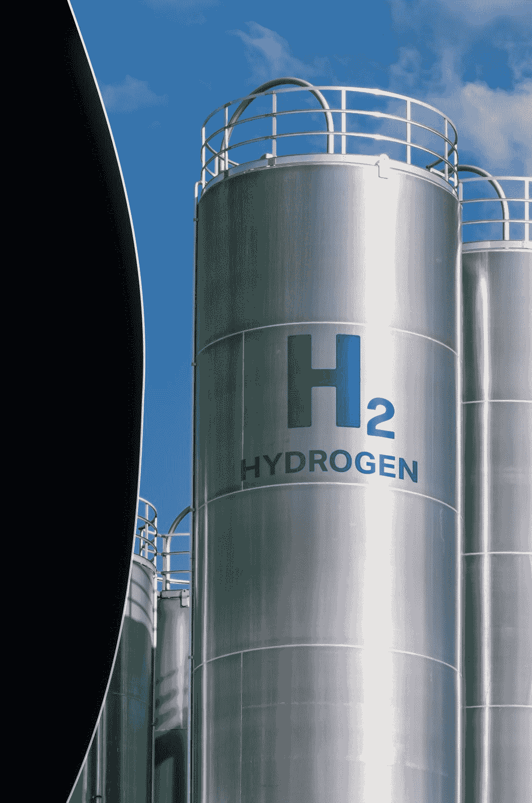

### 氢能概览：绿色低碳新能源

氢能是氢元素在物理与化学变化过程中释放的能量，是一种清洁、高效、安全、可持续获取的二次能源。氢能是可再生能源的良好载体，可以有效促进可再生能源的消纳，增加可再生能源的消费总量，促进我国能源结构从以传统化石能源为主转向以可再生能源为主，实现绿色低碳发展。

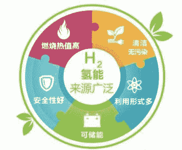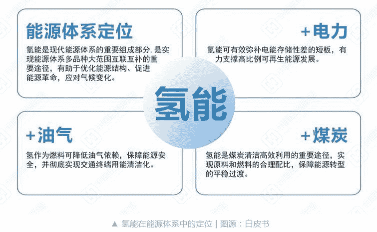

资料来源：工采网，数据截至2024年9月14日

### 产业发展历程：抓住绿色能源转型重大机遇

#### 萌芽期（2017年之前）

- **政策**
    - 2001年：国家“863”计划电动汽车重大专项启动，提出新能源汽车研发的“三纵三横”总体路线，其中的“三纵”，便是混合动力汽车、纯电动汽车以及燃料电池汽车。
    - 2006年：《国家中长期科学和技术发展规划纲要(2006—2020年)》将氢能及燃料电池技术列入先进能源技术。
    - 2014年：国务院发布《能源发展战略行动计划(2014—2020年)》，正式将氢能与燃料电池作为能源科技创新战略方向和重点之一。
    - 2016年：《能源技术革命创新行动计划(2016—2030年)》对氢能与燃料电池产业的战略性地位确立，我国开始系统性推动氢能产业布局，央国企等国家队开始下场投资氢能产业和项目。
- **应用**
    - 2017年以前：每年投资保持在10笔以内，总金额不超过15亿元。

#### 发展期（2017年到2022年）

- **政策**
    - 2017年：每年投资保持在25笔左右，投资金额逐年走高。
    - 2019年：氢能首次被写入中国政府工作报告，标志着氢能产业上升为国家战略。
    - 2021年：《“十四五”全国清洁生产推行方案》提出通过绿氢炼化、氢能冶金等手段加快燃料原材料的清洁替代和清洁生产技术应用示范。
    - 2022年3月：国家发展改革委、国家能源局公布《氢能产业发展中长期规划(2021—2035年)》，明确氢能是未来国家能源体系的重要组成部分后，我国多个地方政府积极发挥各自的产业优势，开始纵深布局氢能产业集群，形成了制氢、储氢、运氢、用氢的产业格局，除了5大城市群，湖北武汉、山西吕梁、新疆喀什纷纷建设成氢能产业集群。
    - 2023年8月：国家标准委与国家发展改革委、工业和信息化部、生态环境部等部门联合印发《氢能产业标准体系建设指南(2023版)》，系统构建了氢能制、储、输、用全产业链标准体系，涵盖基础与安全、氢制备、氢储存和运输、氢加注、氢能应用五个子体系，为新时代氢能产业的高质量发展明确了标准。
- **应用**
    - 2021年：中国石化宣布规划布局1000座加氢站或油氢合建站，这一规模约为2022年底全国加氢站总数的8倍；宝丰能源组织实施的“国家级太阳能电解水制氢综合示范项目”在宁夏正式投产，是目前全球单场规模最大、单台产能最大的电解水制氢项目；中国首批燃料电池汽车示范城市群落地。
- **成果**
    - 2022年8月：我国首个百万吨级CCUS项目——中国石化齐鲁石化-胜利油田百万吨级CCUS项目进入成熟的商业化运营，其碳源来自齐鲁石化第二化肥厂煤气化装置尾气，主要向炼油企业供氢，该厂已成国内最大的蓝氢生产基地。

#### 爆发期（2022年之后）

- **高速发展，竞争加剧**
- **成果**
    - 2022年年底，全国可再生能源制氢产能达3万吨/年。到2023年上半年，全国已有19个绿氢项目签约，投资规模1400多亿元，预计全年电解槽需求将首次超过1吉瓦。“十四五”时期，我国已披露规划建设的绿氢项目数量达300个，远期总产能超过400万吨/年。

资料来源：根据公开资料整理

### 产业发展现状：“三多”&“两全”

当前，虽然我国氢能产业整体实力较强，但灰氢占比较大（指通过化石能源、工业副产等生产的氢气，伴有大量的二氧化碳排放），绿氢占比不高（利用可再生能源（如太阳能或风能等）发电后，通过电解工序制取的氢气），工业用途为主，燃料二次能源为辅，未来产业升级空间很大。

氢能的产业链条较长，包括上游的氢气制备、储运和加注环节，中游的氢燃料电池关键材料及零部件、氢燃料电池系统、电堆及辅助系统，以及下游的氢能源交通、发电及供热等应用领域。当前，随着我国氢能产业政策的明确，在科技的加持下，氢能已经形成了多路径制氢、多场景应用、多区域发力的“三多”和全链条发展、全社会参与的“两全”的发展格局，成为地方和企业竞相追逐的未来产业，是地方决胜新一轮区域竞争的重要支撑。

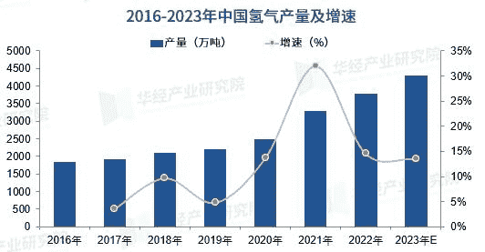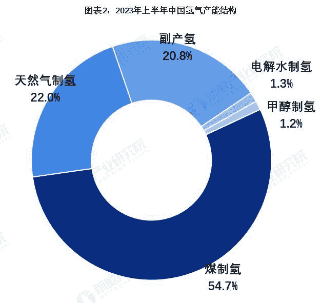

资料来源：华经产业研究院、前瞻产业研究院，数据截至2024年9月14日

### 附核心政策汇总

| 发布时间 | 发布机构 | 政策标题 | 政策内容 |
| :--- | :--- | :--- | :--- |
| 2006年2月 | 国务院 | 《国家中长期科学和技术发展规划纲要（2006-2020）》 | 提出重点研究可再生能源制氢技术，对制氢、氢储存和输配技术和燃料电池技术提出了指导规划。 |
| 2014年6月 | 国务院 | 《能源发展战略行动计划（2014-2020年）》 | 提出将“氢能与燃料电池”作为重点创新方向之一。 |
| 2017年9月 | 发改委等5部门 | 《关于促进储能技术与产业发展的指导意见》 | 支持在可再生能源消耗问题突出的地区开展可再生能源储电、储热、制氢等多种形式能源储存与输出利用。 |
| 2020年9月 | 发改委等4部门 | 《关于扩大战略性新兴产业投资培育壮大新增长点增长极的指导意见(发改高技〔2020〕1409号)》 | 加快突破风光水储互补、先进燃料电池、高效储能与海洋能发电等新能源电力技术瓶颈，建设智能电网、微电网、分布式能源、新型储能、制氢加氢设施、燃料电池系统等基础设施网络。 |
| 2021年2月 | 国务院 | 《关于加快建立健全绿色低碳循环发展经济体系的指导意见》 | 提升可再生能源利用比例，大力推动风电、光伏发电发展，因地制宜发展水能、地热能、海洋能、氢能、生物质能、光热发电。加快大容量储能技术研发推广，提升电网汇集和外送能力。 |
| 2022年3月 | 国家能源局 | 《氢能产业发展中长期规划（2021-2035年）》 | 规划了氢能产业的中长期发展，包括技术创新、基础设施建设、多元化应用和政策保障等方面的具体措施。 |
| 2023年7月 | 国家标准化管理委员会等6部门 | 《氢能产业标准体系建设指南（2023版）》 | 系统构建了氢能制、储、输、用全产业链标准体系，旨在规范和引导氢能产业的健康发展。 |
| 2024年3月 | 国家能源局 | 《2024年能源工作指导意见》 | 加快培育能源新业态新模式。加强新型储能试点示范跟踪评价，推动新型储能技术产业进步。编制加快推动氢能产业高质量发展的相关政策，有序推进氢能技术创新与产业发展，稳步开展氢能试点示范，重点发展可再生能源制氢，拓展氢能应用场景。 |

资料来源：根据公开资料整理

### 产业结构

- 产业链解读
- 产业链架构
- 核心产业环节
- 快速成长产业环节

### 氢能产业链解读，产品大类、细分领域一目了然

| **产业解读** | **产业大类** | **细分领域** |
| :--- | :--- | :--- |
| **上游**：氢能产业链的上游主要涉及氢气的制备，包括化石燃料重整制氢（如煤制氢、天然气制氢）、工业副产气制氢（如焦炉煤气、氯碱尾气）、电解水制氢等方法。其中，电解水制氢通过电能给水提供能量，破坏水分子的氢氧键来制取氢气，工艺过程简单、无污染，但电费占生产成本的大部分，因此竞争力相对较低。 | 氢气制取 | 氢气制备装备、氢气提纯装备、工业副产氢、水电解制氢、生物质制氢、化石燃料制氢、化工原料制氢、其他技术制氢 |
| **中游**：中游环节包括氢气的储存和运输。氢气储存方式主要有高压气态储氢、低温液态储氢和固体材料储氢等。高压气态储氢是现阶段的主要储氢方式，具有充放氢速度快、容器结构简单等优点。氢气运输方式包括道路运输（如高压氢管束车、液态氢槽车）和管道运输。 | 运氢、注氢、储氢 | 氢气运输/运输装备、加氢站/加氢站设备、氢气储存/氢气储存设备 |
| **下游**：下游环节是氢气的应用，氢气可以广泛应用于能源、交通运输、工业、建筑等领域。氢燃料电池通过氢气和氧气的电化学反应产生电力，这种电力可以直接用于驱动汽车，也可以用于其他电力需求。 | 能源、交通运输、工业、建筑、其他行业 | 氢燃料电池汽车、氢燃料电池 |

氢能产业链的上游主要涉及氢气的制备，中游环节则专注于氢气的储存和运输，下游环节是氢气的应用阶段。随着技术进步和成本降低，氢能产业下游市场有望进一步扩大，推动氢能在更广泛领域的应用。

### 产业链各环节均衡发展，加速产业落地应用

- 产业图谱（系统查找，需要自己重新画图，标注环节+各环节企业数量）

扫码申请试用启信产业大脑

- 获取完整产业图谱
- 获取链上企业名单
- 开展300+产业链研判

**氢能产业链** 链上企业4508家

| **上游** | **中游** | **下游** |
| :--- | :--- | :--- |
| 氢气制取 480家 | 运氢 150家 | 氢燃料电池汽车 167家 |
| 氢气制备装备 517家 | 注氢 999+家 | 氢燃料电池 610家 |
| 氢气提纯装备 57家 | 储氢 525家 | |

资料来源：启信数据-启信产业大脑，数据截至2024年9月16日

注：一家企业可归属多个产业环节，故简单加和数量与总数不符

### 核心产业环节分析，氢气制备&储运为重点

#### 产业比重画像

#### 产业链关键节点TOP5

资料来源：启信数据-启信产业大脑，数据截至2024年9月18日

- 在氢能产业链核心产业环节分布上看，氢能产业的重心目前集中在氢气的制备和储运技术上，这是因为氢气的高效生产和安全储运是氢能应用的关键。另外，企业主要分布在氢气制备和储存环节上，这也印证了中国在氢能产业链上游的制氢环节已经具备一定的规模和基础，是世界上最大的制氢国，年制氢产量约3300万吨。
- 加氢站的企业数量断层领先，这表明了基础设施的快速发展和对氢燃料电池汽车市场的支持。加氢站的建设和运营是氢能产业链中游和下游之间的重要连接点，为氢燃料电池汽车提供了必要的能源补给。随着中游企业数量的增加，氢能下游的应用将更加广泛，进一步推动氢能产业的整体发展。

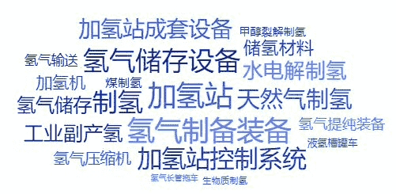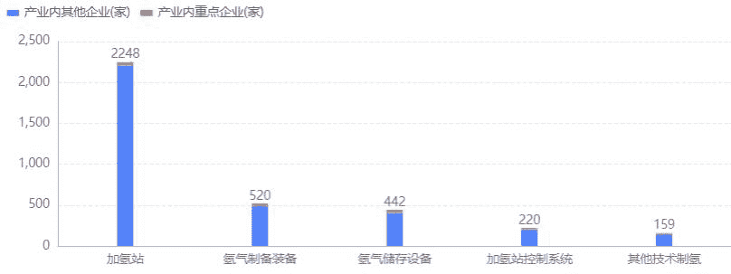

## 三大维度立体扫描，下游环节成长快速

- 通过对获投次数、发明专利申请数量、在招岗位数量三大维度的分析，可以快速识别成长性较高的产业环节。近半年，氢能产业链的下游资本认可度更高、创新活跃度更高、人才需求度更高。

- 下游应用环节在三维比对中遥遥领先，这反映出氢能产业链的中心正在不断向下游应用层面转移，意味着市场对氢燃料电池汽车作为新能源汽车的技术创新和商业化前景的高度认可，同时对产业内专业人才和技术研发的需求十分迫切。

均为近半年数据

| 获投次数TOP10 | 发明专利申请TOP10 | 在招岗位TOP10 |
|---|---|---|
| 储氢材料 | 加氢站 | 加氢站成套设备 |
| 天然气制氢 | 水电解制氢 | 加氢机 |
| 加氢站控制系统 | 氢燃料电池 | 天然气制氢 |
| 加氢站成套设备 | 甲醇裂解制氢 | 加氢站控制系统 |
| 氢气储存设备 | 天然气制氢 | 其他技术制氢 |
| 加氢站 | 氢气储存设备 | 水电解制氢 |
| 其他技术制氢 | 其他技术制氢 | 加氢站 |
| 水电解制氢 | 加氢站控制系统 | 氢燃料电池汽车 |
| 氢气制备装备 | 氢气制备装备 | 氢气制备装备 |
| 氢燃料电池 | 氢燃料电池汽车 | 氢气储存设备 |
| | | 氢燃料电池 |

资料来源：启信数据-启信产业大脑，数据截至2024年9月18日

## 区域分析

- 全国企业分布概览
- 上中下游区域分布
- 产业第一城

## 双子星带动产业发展，西部提早布局占据优势

资料来源：启信数据-启信产业大脑，数据截至2024年9月18日

- 当前，全国氢能企业产生了明显的两强格局，江苏和广东在企业数量上遥遥领先，后续的山西、山东、四川、新疆等地企业数量差距不大，企业数量分别为486、369、288、285、233、220家。

- 从产业环节来看，江苏、广东、北京引领氢能产业上游和下游发展，企业数量上排名前三。而中游环节上，西部省份如山西、新疆、四川超越了沿海发达省份，跻身前五，意味着这些地区在储运、加氢站建设等方面具有较强的竞争力和发展潜力。

## 五维全面评比，北京登顶氢能产业第一城

从产业发展指数的城市排名来看，北京荣获产业链综合评价第一。据统计，2023年北京在氢能领域的科研经费投入达到了50亿元，同比增长20%。众多高校、科研机构和企业共同发力，使得北京在氢能技术创新方面始终走在前列。

在产业布局方面，北京积极打造氢能产业集群。截至2024年，北京已建成5个氢能产业园区，吸引了上百家氢能企业入驻。目前，北京拥有221家氢能相关企业，这些企业涵盖了从氢能装备制造到氢能应用的全产业链，形成了良好的产业协同效应。

| 排名 | 城市 | 等级 | 综合得分 | 规模得分 | 竞争力得分 | 融资情况得分 | 成长性得分 | 创新性得分 |
|---|---|---|---|---|---|---|---|---|
| 1 | 北京 | A | 94 | 100 | 88 | 80 | 31 | 100 |
| 2 | 上海 | A | 91 | 100 | 83 | 73 | 47 | 94 |
| 3 | 苏州 | A | 89 | 100 | 78 | 60 | 48 | 95 |
| 4 | 嘉兴 | A | 85 | 81 | 83 | 47 | 49 | 79 |
| 5 | 张家港 | B | 83 | 98 | 51 | 47 | 63 | 100 |
| 6 | 成都 | B | 82 | 93 | 57 | 56 | 40 | 85 |
| 7 | 深圳 | B | 81 | 100 | 71 | 84 | 36 | 100 |
| 8 | 太原 | B | 76 | 83 | 43 | 63 | 51 | 55 |
| 9 | 平湖 | B | 74 | 79 | 34 | 47 | 31 | 95 |
| 10 | 厦门 | B | 73 | 66 | 40 | 53 | 41 | 79 |

资料来源：启信数据-启信产业大脑，数据截至2024年9月16日

北京市产业链详情

- 产业评级：A级
- 产业评分：94分
- 产业全国排名：1/489

## 增长潜力

- 景气度趋势
- 存续企业分析
- 新增企业分析

## 当期景气度指数虽有下降，整体仍保持发展上行

- 景气度指数是用于反映产业发展景气情况的指数，当指数高于100时，表明产业发展上行，低于100时，表明该产业发展放缓或下行。其中，"即时指数"基于当期数据的变化计算，"累积指数"则综合考虑当期和过往数据，从而更好反映产业发展的累积效应。

- 氢能产业在过去几年中经历了起伏，但整体呈现出上升的发展趋势。虽然在2022年中，景气度指数开始下降，但整体始终保持100以上并在近期反弹上升，说明产业仍具有较强的发展活力和潜力。未来有望在技术创新、政策支持和市场需求的共同推动下，继续保持良好的发展态势。

资料来源：启信数据-启信产业大脑，数据截至2024年9月18日

## 近10年存续企业数量持续增长，超5成企业成立不足6年

- 从2014年到2023年，氢能产业存续企业数量从1630大幅增长至5004，增长势头强劲。这一增长趋势与国家政策大力支持密不可分，截至2023年12月25日，各地政府发布的氢能政策已达438项，为氢能产业的发展提供了强有力的政策保障。

- 从存活时长分布图来看，超55%企业成立不足6年，超30%企业成立6-20年，超10%企业成立20年以上，表明该产业具备一定的成熟度，市场格局趋于稳定，同时也在不断吸收新鲜血液，产业处于快速发展阶段，市场竞争激烈。这与全国对清洁能源需求的增加以及对减少碳排放的关注密切相关。随着技术的进步和成本的降低，氢能的应用前景越来越被看好，预计未来将有更多的企业和资本投入到这个领域，进一步推动氢能产业的繁荣发展。

资料来源：启信数据-启信产业大脑，数据截至2024年9月15日

存续企业数量及增速

| 年份 | 2014年 | 2015年 | 2016年 | 2017年 | 2018年 | 2019年 | 2020年 | 2021年 | 2022年 | 2023年 | 2024年 |
|---|---|---|---|---|---|---|---|---|---|---|---|
| 存续企业 | 1630 | 1768 | 1948 | 2207 | 2518 | 2872 | 3316 | 3978 | 4543 | 5004 | 5014 |

## 新注册企业增速放缓，加氢站企业数量一骑绝尘

- 2020 Q4到2021 Q2期间企业增速高达6.95%，这一阶段的快速增长可能得益于全球对气候变化的关注度持续上升，推动了清洁能源产业的发展。另一方面，技术的不断进步使得氢能的制取、储存和应用成本逐渐降低，提高了氢能产业的商业可行性。然而，在后续的时间段里，企业增速有所波动。这表明氢能产业的发展受到多种因素的影响。市场需求的不确定性是一个重要因素。虽然氢能具有诸多优势，但目前其市场规模相对较小，主要应用于一些特定领域，如氢燃料电池汽车、工业生产等。随着市场竞争加剧、技术瓶颈阻碍等因素，进一步影响企业的生存和发展，导致近两年新注册企业增速放缓。

- 氢燃料电池汽车作为氢能应用的重要终端产品，被寄予厚望，但仍面临着价格高、加氢设施不足等问题，因此加快加氢站的建设是关键。在政府和企业共同合作下，加大投资力度，提高加氢站的覆盖范围和服务质量，使该产业环节近3年增长迅速。

资料来源：启信数据-启信产业大脑，数据截至2024年9月15日

近3年产业内新增企业数量分布

| 产业环节 | 新增企业数量 |
|---|---|
| 加氢站 | 最高 |
| 氢气储存设备 | 其次 |
| 氢燃料电池 | 较高 |
| 氢气制备装备 | 较高 |
| 其他技术制氢 | 较高 |
| 水电解制氢 | 较高 |
| 氢气储存 | 中等 |
| 氢气压缩机 | 中等 |
| 储氢材料 | 中等 |
| 加氢站成套设备 | 中等 |
| 天然气制氢 | 中等 |
| 加氢机 | 中等 |
| 氢燃料电池汽车 | 中等 |
| 生物质制氢 | 较低 |
| 加氢站控制系统 | 较低 |
| 甲醇裂解制氢 | 较低 |
| 工业副产氢 | 较低 |
| 氢气输送 | 较低 |
| 氢气提纯装备 | 较低 |

## 创新能力

- 产业创新投入分析&产出分析
- 科创认定分布&科创等级分布

## 研发总体浮动上升，产业链各环节均重视技术创新

- 氢能产业研发投入占比与研发人员占比在近些年整体浮动上升，虽在2021年至2023年期间，研发总体投入没有明显增长，但对比专利新增趋势图看，这段时间新增专利数量增长较多，体现了该产业在此期间不断进行着技术创新，且卓有成效。

- 从专利类型上看，发明专利授权与公布数量占比超六成，实用新型占比超三成，体现产业研发能力强，且能将创新成果迅速转化为生产力，推动产业发展。此外，产业内上中下游均有环节排进专利数量前五，不仅反映了技术创新的全面性与市场竞争的激烈性，也体现了产业结构的持续优化，可以通过加强上下游之间协同创新，提升整个产业链的竞争力与附加值。

资料来源：启信数据-启信产业大脑，数据截至2024年9月15日

专利数量TOP5环节

| 环节 | 专利数量 |
|---|---|
| 氢气储存设备 | 最高 |
| 氢燃料电池 | 其次 |
| 加氢站 | 较高 |
| 水电解制氢 | 较高 |
| 天然气制氢 | 较高 |

## 科技型企业主导，科创等级良好居多

- 科创认定标签是通过大数据分析和人工智能技术，对海量数据深度加工，形成可直观反映企业科创特征的深度标签画像。对氢能产业进行标签画像，发现企业标签集中在：科技型企业、高新企业、科技型中小企业等，并且拥有437家创新型企业和411家专精特新企业。

- 科创等级是衡量企业在行业内科技创新能力的指标。从科创等级分布角度，产业中大部分企业科创能力处于良好区间。

资料来源：启信数据-启信产业大脑，数据截至2024年9月16日

| 科创认定标签 | 企业数量 | 科创等级 | 企业数量 |
|---|---|---|---|
| 专精特新 | 411 | AAA | 150 |
| 专精特新小巨人 | 144 | AA | 218 |
| 科技小巨人 | 46 | A | 256 |
| 科技型企业 | 1053 | BBB | 433 |
| 科技型中小企业 | 819 | BB | 302 |
| 高新企业 | 939 | B | 287 |
| 独角兽企业 | 14 | CCC | 71 |
| 种子独角兽企业 | 1 | CC | 26 |
| 民营科技企业 | 57 | | |
| 企业技术中心 | 238 | | |
| 技术创新示范企业 | 55 | | |
| 科技示范企业 | 24 | | |
| 创新型企业 | 437 | | |
| 世界一流示范企业 | 2 | | |
| 服务型制造示范企业 | 25 | | |
| 制造业单项冠军 | 50 | | |

## 投资机会

- 融资新增趋势、金额分布、融资轮次分布

## 融资次数波动上升，资本投资较谨慎

- 在融资次数上，从2014年到2024年氢能产业的融资活动整体呈现出波动上升的趋势，这表明随着时间的推移，越来越多的资本在关注并进入这个领域。其次，大额融资占比较高，10亿以上的融资占比达到5.6%，5000万-10亿区间的融资占比也相对可观，这显示出资本对氢能产业的未来前景有较高的预期，愿意投入大量资金来支持产业的发展。

- 另一方面，资本也存在一定的顾虑。在融资轮次方面，A轮及以后的融资占比相对较低，这可能意味着部分企业在向后继发展阶段迈进时面临一定挑战，资本对企业的长期发展前景存在疑虑。此外，小额融资占比较少，说明在早期阶段的项目相对较难获得资金支持，这也反映出资本在投资氢能产业时较为谨慎。

资料来源：启信数据-启信产业大脑，数据截至2024年9月15日

融资次数

| 年份 | 2014年 | 2015年 | 2016年 | 2017年 | 2018年 | 2019年 | 2020年 | 2021年 | 2022年 | 2023年 | 2024年 |
|---|---|---|---|---|---|---|---|---|---|---|---|
| 融资次数 | 52 | 108 | 172 | 166 | 121 | 166 | 206 | 234 | 182 | 172 | 82 |

### 步兵战车标准体系研究

世界主要国家陆军正在加速推进数字化转型和智能化发展，步兵战车作为地面作战的核心装备，其标准体系的重要性日益凸显。本文在分析国内外步兵战车标准现状的基础上，提出步兵战车标准体系的构建思路和框架。

# 1 国内外标准现状

美国、德国、英国等军事强国高度重视步兵战车标准化工作，已形成较为完善的标准体系。例如，美军依托北约标准化协议（STANAG）建立了覆盖装甲车辆设计、制造、试验和作战使用的标准体系。

# 2 标准体系构建思路

坚持战斗力标准，聚焦实战需求，按照体系化、系列化、通用化的原则，构建覆盖全寿命周期的步兵战车标准体系。

# 3 标准体系框架

步兵战车标准体系框架由以下部分组成：

- 通用基础标准
- 总体设计标准
- 分系统标准
- 试验评定标准
- 运用保障标准

# 4 对策与建议

加强统筹规划、强化标准研究与验证、推进数字化标准化协同发展，并持续提升标准国际化水平。

# 5 结语

机遇与挑战并存，披荆斩棘迎接发展新篇章

当前，我国绿氢产业发展潜力巨大，然而过程中仍面临着诸多挑战：

- 供需不确定，技术路径多，发展成熟度不一，投资决策难：为了满足市场需求，企业或相关部门需要新建、扩大或改进他们的绿氢工厂。然而，基于有限的市场数据和该领域的低成熟度，从工厂设计到建设和运营端到端的绿氢系统面临诸多未知因素，导致项目成本高昂且周期漫长。
- 技术跨度大，工程设计投入大，规模化建设难：生产绿氢及其供应链的公司需要克服重大的工程挑战，才能有效控制投资风险，成功实现大规模商业化和部署，包括厂房设计、氢的储存、氢的运输和分配、氢在智能电网发展中的整合、实现低成本和可持续的燃料电池等。
- 氢能利用效率偏低，能源损失高，工艺和设备成本高，运营盈利难：绿氢在供应链的每个环节都会出现大量的能量损耗。据统计，在电解过程中，大约有 30%-35% 用于生产氢气的能量会损失掉；将氢气液化或转化为其他载体，例如氨，会导致 13%-25% 的能量损失；运输氢气需要额外的能量输入，通常相当于氢气自身能量的 10%-12%。在燃料电池中使用氢气将导致额外的 40%-50% 的能量损失。
- 产业链长，环节多，透明度低，上下游协调不足：氢能产业覆盖制氢、储氢、运氢到用氢等环节，在当前氢能发展初期，产业链中的各环节、各地区发展不协调的问题比较突出。以加氢站的氢气供应为例指出，如果氢能企业可通过数字化信息平台预测每个加氢站的氢气日需求量，以此制定氢气供应方案，将氢气的制储运加用各个环节连接起来，形成统一的调度系统，将有利于产业高效发展。
- 氢能安全管控难题待解：氢气具有易燃性、易爆性、易发生氢脆等特点，在氢能制取、储存、运输、加注和应用全产业链都存在一定的危险性。另外，由于氢气很容易扩散，以目前的技术设施往往难以检测到，因此，加氢站存在氢气泄漏、火灾等风险。

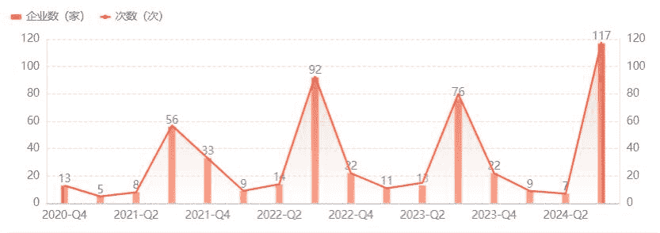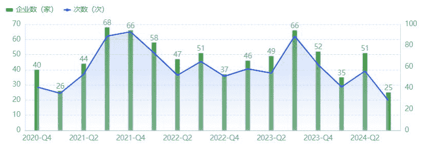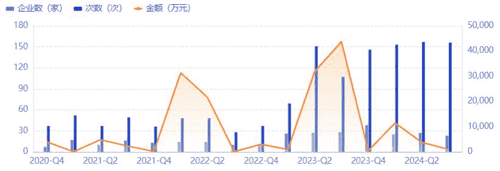

市场环境瞬息万变，企业风险事件环比增加

- 近年来，氢能产业发展迅猛，但各类风险数据也需要更多关注。近4个季度，114家企业发生经营异常事件，118家企业发生了欠税信息事件，204家企业发生行政处罚事件，99家企业发生股权冻结事件，除了异常经营数据，其他均比上个周期有所增长，从中可以窥见监管环境的加强、市场环境的不确定性增加。

欠税信息概览

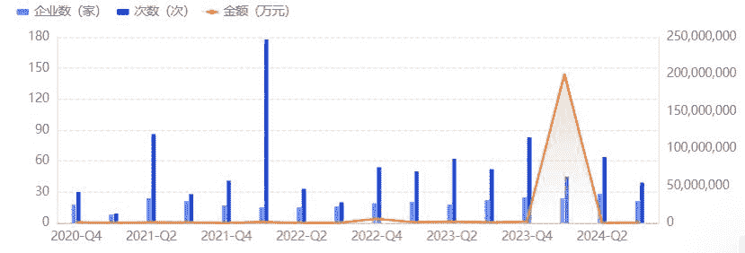

股权冻结概览

行政处罚概览

经营异常概览

资料来源：启信数据-启信产业大脑，数据截至2024年9月15日

关于启信数据

启信数据™隶属于上海合合信息科技股份有限公司，是广泛涵盖启信慧眼™、启信产业大脑™、启信开放平台™一系列产品服务的数据品牌，助力银行、能源化工、医药医疗、电子通讯、汽车等行业实现“尽调-风控-合规-监管-营销”5大场景数字化管理，为地方政府提供从产业洞察、产业研判到精准招商的全链路赋能，同时支持以插件、API等形式将数据与应用灵活嵌入企业/机构内部系统，快速集成，轻松开启数字化升级。

扫码申请免费试用

关于启信产业大脑

启信产业大脑™隶属于启信数据™，汇集了境内3亿家企业等组织机构的超过2000亿条实时动态商业大数据，立足地区产业高质量发展，结合地区产业定位，提供涵盖超300条产业链的产业全景洞察、产业/园区招商、区域经济监测方案，寻找产业发展突破口，多角度挖掘招商线索，通过数实融合助力新质生产力。

启信产业大脑™充分利用企业大数据资源及强大的技术基础，基于地区产业治理业务需求，提供摸家底、明方向、控风险、引增量、优存量、提服务等六大产业发展解决方案。系统主要包括产业洞察、产业服务、一企一档、精准招商、项目管理等5大产品能力。

扫码申请免费试用

法律声明

此报告为合合信息旗下启信数据制作，报告中文字、图片等著作权为启信数据所有。部分文字、图片、表格采集于公开信息，著作权为原著者所有，在各项目引用处均以进行原著者标注。未经启信数据事先书面明文批准，任何组织和个人不得更改或以任何方式传送、复印或派发此报告的材料、内容及其复印本予任何其他人或组织。

此报告所载资料的来源及观点的出处，皆为启信数据认为的可靠，但启信数据不能担保其准确性或完整性，报告中的信息或所表达观点不构成商业建议，内容仅供参考。启信数据不对因使用此报告的材料而引起的损失承担任何责任。

上海生腾数据科技有限公司 2024 版权所有。保留一切权利。

感谢观看

扫码添加专属顾问

- 免费试用产业洞察系统
- 下载更多产业研究报告
- 报名线上/下产业研讨会
- 加入社群交流行业趋势

联系电话：400-021-5659

电子邮箱：intsig_marketing@qixin.com

公司地址：上海市静安区万荣路1268号云立方A座11F

