敬请阅读末页的重要说明

证券研究报告｜行业深度报告

2024年08月01日

推荐（维持）

## 全球算力网络系列报告1

TMT及中小盘/通信

本篇报告主要复盘了全球以太网交换机龙头企业Arista网络的整体情况，通过发展历程、产品矩阵、客户群体及财务状况的分析，叠加当前AI发展，挖掘Arista后续增长驱动及空间。

- **Arista概况：**全球交换机领军企业，面向大型数据中心计算、存储环境提供基于软件驱动的网络解决方案。公司主要通过基于商用芯片的全系列交换机、自研EOS可扩展操作系统与CloudVision可视化管理平台，为客户提供全方位的交换机解决方案。Arista自成立之初，便选择致力于推进开放式网络解决方案构建（差异化于Cisco）。2023年公司实现营业收入58.60亿美元，同比增长33.75%（指引25%，显著高于行业均值）；2024Q2公司修正2024年全年收入预期为增长14%以上，进一步显示公司对于全年增长的充足信心。

- **行业层面：**全球交换机市场强者恒强，AI高速化与白盒化趋势打开全新空间。

市场规模方面：2023年全球以太网交换机市场规模达442亿美元（DC/非DC为41.5%/58.5%），预计后续至2028年总市场规模可达600亿美元。高速产品占比有望快速提升，预计2027年200G/400G及以上占比有望超50%。

竞争格局方面：强者恒强，头部份额集中（CR3为64.2%，CR5为77.8%）。Cisco、Arista前二地位稳固，份额分别为43.7%与11.1%。从产品矩阵维度来看，考虑到华为、H3C主要供给国内市场，Cisco、Arista、Juniper（HPE）、NVIDIA则将成为后续全球主要的800G交换机供应商。

发展趋势方面：

1）AI带动高速交换机需求：北美头部云厂商持续加大AI基础设施投资，集群网络互联Capex占比提升；

2）白盒化是趋势：白盒化方便客户组建更加开放与灵活的网络方案，大幅降低建网成本；

3）以太网份额及性能同步提升：UEC推进以太网全面适应AI/HPC发展，头部以太网产业链厂商有望加速受益。

- **Arista优势：**数据中心交换机市场保持领先，开放生态与Etherlink AI构筑核心优势。

1）高速DC交换机市场保持领先，园区交换机同比持续高增带动份额提升；

2）发布Etherlink AI平台（支持10万卡集群），助力大客户降低AI规模组网集群Opex；

3）全面贯彻开放理念：底层硬件采用商用芯片，快速响应需求；EOS构筑开放软件生态；

4）深度绑定Meta、Microsoft等头部云厂商，与客户共同推进网络改进。

- **投资建议：**Arista作为全球以太网白牌交换机龙头，在数据中心领域的竞争力不断凸显，凭借商用硬件与开放软件顺应AI发展趋势，巩固领先地位。对标国内，当前在AI浪潮推动下，国内以太网交换机产业链各环节厂商也有望迎来全新发展契机。重点关注上游以太网交换芯片商【盛科通信】；建议关注上游PCB厂商【沪电股份】（电子组覆盖）；上游交换机代工商【菲菱科思】、【共进股份】；中游交换机品牌商【紫光股份】、【中兴通讯】、【锐捷网络】。

- **风险提示：**Arista AI网络拓展不及预期的风险、Meta、Microsoft资本开支波动的风险、市场竞争加剧的风险、Arista园区业务拓展不及预期。

### 行业规模

| 项目 | 数值 | 占比 |
|---|---:|---:|
| 股票家数（只） | 193 | 3.8% |
| 总市值（十亿元） | 2603.3 | 3.6% |
| 流通市值（十亿元） | 1954.9 | 3.0% |

### 行业指数

| 指标 | 1m | 6m | 12m |
|---|---:|---:|---:|
| 绝对表现 | 1.3 | 9.0 | -13.2 |
| 相对表现 | 1.9 | 1.9 | 1.0 |

资料来源：公司数据、招商证券

### 相关报告

1. 《下游需求出现拐点，有望迎来替换需求高峰——轨道交通行业系列报告一：轨交信息化》2024-07-28

2. 《AI算力架构系列2：腾讯发布星脉网络2.0，可支撑超10万卡集群》2024-07-04

3. 《运营商行业系列报告5：掘金自由现金流，算力与新质生产力共振》2024-05-29

梁程加  
S1090522060001  
liangchengjia@cmschina.com.cn

孙嘉擎  
S1090523040001  
sunjiaqing@cmschina.com.cn

-40  
-30  
-20  
-10  
0  
10  

Aug/23  
Nov/23  
Mar/24  
Jul/24  

(%)  

通信  
沪深300

## Arista网络：数通交换机龙头，AI打开新增长空间

敬请阅读末页的重要说明

**2**

行业深度报告

## 正文目录

一、Arista一张图总览 ...................................................................................... 6

二、Arista概况：全球交换机领军企业，软硬件解决方案供应商 .................... 7

1、以太网交换机龙头，提供软件驱动网络方案 ............................................... 7

2、产品聚焦交换机，软硬件产品矩阵丰富 ...................................................... 9

（1）高速数据中心与云网络系统 ..................................................................... 9

（2）园区网络 ................................................................................................ 10

（3）网络软件与服务 ..................................................................................... 11

3、百万营收以上客户稳步增长，深度绑定Meta、微软等头部云厂商 .......... 11

4、营收规模持续扩大，盈利能力逐步优化，位于行业前列 .............................. 12

（1）营收、净利润规模持续扩大，2024Q2再次修正全年业绩预期 ............. 12

（2）2023年起单季度毛利率持续改善，2024Q2毛利率达65.4% .............. 13

（3）营收复合增速高于同类可比厂商，毛利率位于前列 .............................. 14

5、管理层出身Cisco，选择开放方案进行差异化竞争 ................................... 15

6、多轮回购计划彰显公司中长期发展信心 .................................................... 16

三、行业分析：全球交换机市场强者恒强，AI与白盒化打开新空间 ................ 17

1、全球交换机市场分析 ................................................................................. 17

（1）交换机产业链情况 ................................................................................. 17

（2）市场及竞争格局：龙头厂商强者恒强，高速率出货占比持续提升 ........ 17

2、行业发展趋势一：AI带动高速交换机需求，网络互联Capex占比提升 ... 20

3、行业发展趋势二：白盒化趋势进一步确立 ................................................. 22

4、行业发展趋势三：能力提升与头部厂商推动助力以太网持续受益 ............. 24

四、Arista优势：数据中心市场份额保持领先，开放生态与Etherlink AI构筑核心优势 ............................................................................................................... 28

1、100/200/400G数据中心交换机市场保持领先，园区交换机同比持续高增带动份额提升 ........................................................................................................ 28

2、发布Etherlink AI平台全面拥抱AI发展 .................................................... 29

3、全面贯彻开放理念，商用芯片快速响应需求、EOS构筑开放软件生态.... 32

4、深度绑定头部云厂商，与客户共同推进网络改进 ...................................... 34

五、总结：看好全球以太网产业链 ................................................................. 36

bUbUcWcWaVeZdXeU7N9RbRtRnNoMmQfQoOyQjMqQsQbRrRyRMYtOrNvPrNnP

敬请阅读末页的重要说明

**3**

行业深度报告

## 图表目录

图1：Arista一张图 ............................................................................................ 6

图2：Arista网络发展历程 ................................................................................. 8

图3：Arista股价复盘 ......................................................................................... 8

图4：Arista硬件底座、EOS、CloudVision三者相辅相成 ............................... 9

图5：Arista产品解决方案总览 .......................................................................... 9

图6：Arista大型企业/大规模数据中心交换机产品矩阵 ................................... 10

图7：Arista园区网络产品迭代情况 ................................................................. 11

图8：CloudVision简介 .................................................................................... 11

图9：CloudVision两种消费模式 ..................................................................... 11

图10：Arista客户情况 ..................................................................................... 12

图11：2019—2023年Arista营收、净利润情况（亿美元，%） ...................... 13

图12：2022Q1—2024Q2 Arista营收、净利润情况（亿美元，%） ................. 13

图13：Arista营收拆分（%） .......................................................................... 13

图14：2019—2023年Arista毛利率、净利率情况（%） ................................. 14

图15：2023Q1—2024Q2 Arista毛利率、净利率情况（%） ............................ 14

图16：2019—2023年Arista费用率情况（%）................................................ 14

图17：2019—2023年Arista研发投入情况（亿美元，%） ............................. 14

图18：同类可比厂商网络产品营收增速对比（%） ......................................... 15

图19：同类可比厂商毛利率对比（%） ........................................................... 15

图20：交换机产业链典型公司一览 .................................................................. 17

图21：2019—2023年全球以太网交换机市场规模情况（亿美元，%） ........... 18

图22：2023年全球以太网交换机市场拆分（%） .......................................... 18

图23：2019—2023年全球数据中心/非数据中心交换机市场规模情况（亿美元，%） ............................................................................................................... 18

图24：2028年全球数据中心、园区以太网交换机市场规模预计可达600亿美元 ............................................................................................................... 18

图25：全球数据中心100G、200G/400G端口市场规模情况（亿美元，%） 19

图26：2023—2027E全球200G/400G交换机占数据中心市场/以太网交换机总市场比重（%） .............................................................................................. 19

图27：2019—2023年全球以太网交换机竞争格局情况（%） .......................... 20

图28：2022Q1—2023Q3全球以太网交换机单季度竞争格局情况（%） ......... 20

图29：主流机内、机外互联GPU与交换机/交换芯片配比情况测算 ............... 21

图30：2019—2025E北美头部云厂商资本开支情况（亿美元，%） ................ 22

敬请阅读末页的重要说明

**4**

行业深度报告

图31：2022Q1—2024Q1北美头部云厂商资本开支情况（亿美元，%） ......... 22

图32：白盒交换机发展历程 ............................................................................. 23

图33：白盒交换机生态系统可分为4层 .......................................................... 23

图34：传统交换机芯片与可编程交换机芯片对比 ............................................ 23

图35：全球Top500互联方式占比情况（%） ................................................ 25

图36：基于以太网的RoCEv2已可以满足绝大部分智算场景需求 ................. 26

图37：头部厂商持续验证以太网在AI时代的应用价值 ................................... 27

图38：10G及以上端口速率数据中心交换机市场份额（%，以出货营收计算） ............................................................................................................... 28

图39：10G及以上端口速率数据中心交换机市场份额（%，以出货端口数计算） ............................................................................................................... 28

图40：2020Q2—2023Q4 100/200/400G数据中心市场各厂商出货量情况（百万端口） ............................................................................................................... 28

图41：2020—2023年100/200/400G数据中心市场各厂商出货量情况（百万端口） ............................................................................................................... 28

图42：Arista园区交换机市场增速领先 ........................................................... 29

图43：Arista Etherlink AI产品矩阵 ................................................................. 29

图44：Arista EOS AI套件可为集群提供充足可见性 ....................................... 31

图45：Arista AI套件可实时监控网络拥塞问题 ............................................... 31

图46：商用芯片迭代速度较快（以Broadcom Tomahawk系列为例） .......... 33

图47：Arista EOS架构 ................................................................................... 33

图48：2019—2023年Arista在Microsoft侧营收情况（亿美元，%） ............. 34

图49：Meta一个24,576块H100集群基于Arista交换机构建 ...................... 34

图50：2020—2023年公司SP客户侧营收情况（亿美元，%） ....................... 35

图51：公司400G客户群情况（家，%） ....................................................... 35

图52：通信行业历史PE Band ......................................................................... 37

图53：通信行业历史PB Band ......................................................................... 37

表1：Arista收购公司情况 ................................................................................. 8

表2：Arista总体指引情况 ............................................................................... 12

表3：Arista管理层大多出身Cisco，行业经验丰富 ........................................ 15

表4：2023年全球以太网交换机市场及内部细分市场规模与增速（亿美元，%） ............................................................................................................... 18

表5：全球头部以太网交换机品牌商综合对比 ................................................. 20

表6：Meta 24,576 H100 InfiniBand集群中互联设备Capex达23.9% ........... 20

表7：主流机内、机外互联GPU与交换机/交换芯片应用情况 ........................ 21

表8：北美头部云厂商2024Q1资本开支情况及后续展望 ............................... 22

敬请阅读末页的重要说明

行业深度报告

## 一、Arista 一张图总览

图1：Arista 一张图

资料来源：公司官网、公司公告、公司业绩交流会、菲菱科思招股说明书、招商证券整理绘制

## 二、Arista 概况：全球交换机领军企业，软硬件解决方案供应商

### 1、以太网交换机龙头，提供软件驱动网络方案

Arista 网络为全球交换机领军企业，面向大型数据中心计算、存储环境提供基于软件驱动的网络解决方案。其通过基于商用组件的全系列交换机产品、自研 EOS 交换机操作系统与跨云网络管理平台 CloudVision 等，为客户提供全方位交换机解决方案，公司发展历程大致可以分为以下 4 个阶段：

- **2004—2014 年**：聚焦交换机产品需求，持续推进产品技术创新。公司成立于 2004 年，早期公司聚焦于数据中心以太网交换机、交换机平台的研发与生产，并于 2014 年在美国纽交所上市。

- **2014—2016 年**：逐步在全球交换机行业崭露头角，市场份额快速提升。作为后起之秀，Arista 在 2014 年推出业界首款具备 100G 上行链路的叶交换机，并于 2015 年升级自身 CloudVision 以满足 25/50/100G 交换机需求。2015 年，全球高速数据中心交换机份额突破 10%，并在全球以太网交换机市场中份额跻身前五。

- **2016—2018 年**：产品互联寻求突破，持续完善产品矩阵。2016 年起，Arista 推出更多类型的网络设备产品与服务平台，包含 Arista 网络数据库和遥测平台、Arista Any Cloud 平台、WLAN 产品等，进一步推进云级路由 EOS 和 CloudVision 软件业务发展。

- **2019 年至今**：顺应 AI 时代浪潮，专注产品技术升级。2019 年至今，Arista 持续聚焦交换机、路由器、Cloud EOS、CloudVision 等产品和服务的创新升级。2024 年，Arista 与 NVIDIA 官宣合作，提供 AI 数据中心整套方案；后续 Arista 自行推出 Etherlink AI 网络平台，为 AI 训练与推理提供全方位解决方案。

上市后共完成六轮收购，主要增强园区产品能力、低延时能力与网络软件能力。根据公司公告，公司上市以来共进行六轮收购，分别增强公司园区产品能力、低延时能力与网络软件能力：

- 园区产品能力方面：2018 年公司收购 Mojo Networks，为公司 CloudVision 平台增添园区功能。

- 低延时能力方面：2018 年公司收购 Metamako，将其超低延时技术引入 Arista 系列平台。

- 网络软件能力方面：例如 2020 年公司收购 Big Switch Networks，全面增强自身在网络监控软件与网络检测方面的能力。

图2：Arista 网络发展历程

资料来源：公司官网、招商证券

图3：Arista 股价复盘

资料来源：Wind、公司公告、公司官网、招商证券

表1：Arista 收购公司情况

| 收购时间 | 收购公司名称 | 收购金额 | 收购目的与效果 |
|---|---|---|---|
| 2018 | Mojo Networks | 1.19 亿美元 | 收购 Cognitive WiFi 软件供应商 Mojo Networks，为 CloudVision 平台增添园区功能 |
| 2018 | Metamako Holding PTY LTD | — | 将 Metamako 的超低延迟技术引入 Arista 系列平台，满足金融等客户低延时需求 |
| 2020 | Big Switch Networks | 7,330 万美元 | 增强 Arista 在网络监控软件和 AI 驱动的网络检测方面的能力 |
| 2020 | Awake Security | 1.81 亿美元 | 将 AI 与工程师专业知识相结合，自主搜索和响应内外部威胁 |
| 2022 | Untangle Incorporated | 1.59 亿美元 | 强化 Arista 产品组合，重点涉及认知统一边缘（CUE）领域，以最大限度减少网络故障排除难度，提高客户产品效率 |
| 2022 | Pluribus Networks | — | 强化 Arista 产品组合，重点涉及统一云结构（UCF）领域，以最大限度减少网络故障排除难度，提高客户产品效率 |

资料来源：公司公告、SDNLAB、招商证券

### 2、产品聚焦交换机，软硬件产品矩阵丰富

Arista 持续聚焦交换机领域，提供丰富的软硬件产品矩阵。硬件底座、EOS 可拓展操作系统与 CloudVision 自动化&可视化平台三者相辅相成，共同构建 Arista 完整的云网络产品组合。

1）硬件底座：为整体网络构建高性能、可靠的 10G、40G、100G、200G、400G 与 800G 底座平台。

2）Arista EOS 可拓展操作系统：开放可扩展的网络软件，以软件驱动底座网络平台，并支持丰富的编程性，进一步简化操作难度，降低 Capex 与 Opex。

3）Arista CloudVision：将 EOS 架构延伸至网络的全域范围，使得整体网络业务的流程编排、遥测、安全生态体系进一步整合，提供一个统一的控制点。

图4：Arista 硬件底座、EOS、CloudVision 三者相辅相成

资料来源：公司官网、招商证券

图5：Arista 产品解决方案总览

资料来源：公司官网、招商证券

#### （1）高速数据中心与云网络系统

2023 年公司数据中心与云网络实现收入 38.09 亿元，同比增长 27.85%，占收比达 65%。2023 年 Arista 将自身 400G 客户群由 2022 年的 600 家提升至 2023 年的约 800 家，预计 2025 年公司在人工智能网络领域实现至少 7.5 亿美元的收入。

Arista 聚焦高性能、可拓展以太网交换机，产品覆盖 1G—800G 全系列主流端口。Arista 持续聚焦于高性能、可拓展以太网交换机的研发与生产，旨在满足大型企业局域网、超大规模数据中心、云计算平台及高频交易环境等多元环境的严苛需求。公司交换机产品线覆盖 1G—800G 全系列主流端口，高速率产品方面如：

- Arista 7060X5/X6 系列交换机：分别基于 Broadcom Tomahawk 4/Tomahawk 5 交换芯片，可支持 25.6Tbps/51.2Tbps 交换容量，其中 7060X6 系列可根据机架尺寸灵活配置端口，2RU 机架中可配备 64 个 800G 端口（128 个 400G 端口）。

- Arista 7800R 系列模块化系统：可提供最高 460Tbps 交换容量，16 槽机箱可支持 576 个 800G 端口或 1,152 个 400G 端口，可作为大型 AI 集群主干，满足 AI 工作负载。

图6：Arista 大型企业/大规模数据中心交换机产品矩阵

资料来源：公司官网、招商证券

#### （2）园区网络

2023 年公司园区网络实现收入 11.13 亿美元，同比增长 81.52%，占收比达 19%。2023 年秋季公司推出 WAN 路由系统，重点关注规模、加密与 WAN 路由传输功能，为客户提供丰富的企业 LAN 和 WAN 产品组合。2023 年公司全面推进企业园区的业务拓展，预计 2025 年园区交换机将实现 7.5 亿美元的收入。

通过园区级有线、无线产品组合，满足企业的集成化边缘网络服务需求。Arista 为满足企业集成化、云化转型需求，为企业打造由核心路由、边缘路由、数据中心互联（DCI）、多云实施、广域网优化在内的园区有线&无线解决方案，通过灵活与智能化的网络系统，满足企业对于高性能、高可用性、高智能度的园区网络的迫切需求。

图7：Arista 园区网络产品迭代情况

资料来源：公司官网、招商证券

#### （3）网络软件与服务

2023 年公司网络软件与服务实现收入 9.38 亿美元，同比增长 18.89%，占收比达 16%。截至 2023 年底，Arista CloudVision 累计客户数量已超过 2,400 家，并在过去三年时间内，企业级服务收入实现一倍以上增长。

Arista 面向下一代数据中心与云网络解决方案，构筑核心可扩展操作系统 EOS。Arista EOS 为基于 Linux 的完全可编程、高度模块化的网络操作系统，其核心特点在于：云拓展架构+开放且可编程。CloudVision 是基于云网络原则构建，用于实现遥测、分析与自动化的多域网络管理平台，其可以打破传统网络孤岛，帮助企业降低网络运营复杂度。

图8：CloudVision 简介

图9：CloudVision 两种消费模式

资料来源：公司官网、招商证券

资料来源：公司官网、招商证券

### 3、百万营收以上客户稳步增长，深度绑定 Meta、微软等头部云厂商

Arista 客户涉及多行业领域，2023 年公司百万营收客户数量稳步增长。根据公司公告，Arista 客户包含大型与超大规模云厂商、互联网厂商、金融机构、政府机构与各类型企业客户，2019—2023 年间，Arista 逐步拓展所销售的企业客户类型，拓展了媒体与娱乐、医疗保健、石油与天然气、教育、制造、工业等多行业领域客户。根据公司 2023Q4 业绩交流会，2023 年公司百万美元营收客户同比增长 35%，再次显示公司园区与企业客户业务发展的良好势头。

深度绑定 Meta、微软等头部云厂商，2023 年两者营收占比合计达 39%。根据公司公告，2023 年 Meta、微软分别占公司营收的 18% 与 21%，结合营收来看，预计 2023 年 Arista 对微软销售收入达 10.55 亿美元，同比增长 50.47%；对 Meta 销售收入达 12.31 亿美元，同比增长 8.03%。公司深度绑定头部云厂商，有望受益于其 AI 需求增长，后续成长动能充沛。

图10：Arista 客户情况

资料来源：公司公告、招商证券

### 4、营收规模持续扩大，盈利能力逐步优化，位于行业前列

#### （1）营收、净利润规模持续扩大，2024Q2 再次修正全年业绩预期

表2：Arista 总体指引情况

| 类型 | 2023 年情况 | 前期基数 | 重点项目 | 后续指引情况 |
|---|---|---|---|---|
| 总体收入、毛利率 | 2023 年收入 58.60 亿美元 | 2024 年全年收入增速（%） | — | **Q2 修正为 14%以上**（2024Q1 为 12%—14%） |
| 总体收入、毛利率 | Non-GAAP 毛利率 62.60% | 2024 年全年毛利率（%） | — | 62%—64%（维持不变） |
| 细分业务 | 数据中心与云网络 38.09 亿美元（占收比 65%） | — | 数据中心与云网络 | 2025 年 AI 网络收入达到 7.5 亿美元 |
| 细分业务 | 园区认知云网络 11.13 亿美元（占收比 19%） | — | 园区认知云网络 | 2025 年企业园区收入达到 7.5 亿美元 |

资料来源：公司公告、公司业绩交流会、招商证券

近年来 Arista 营收、净利润规模持续扩大。2023 年 Arista 实现营业收入 58.60 亿美元，同比增长 33.75%（指引 25%），2019—2023 年 CAGR 达 24.86%，主要系公司产品组合持续优化、供应链等多因素共同影响。

- 2023 年 Arista 实现归母净利润 20.87 亿美元，同比增长 54.34%，2019—2023 年 CAGR 达 24.81%。

- 2024Q2 收入超业绩指引上限，进一步修正 2024 年收入预期至同比增长 14%以上。2024Q2 公司实现营业收入 16.90 亿元，同比增长 15.87%，超公司 2024Q1 指引的 16.2—16.5 亿美元指引，主要系云厂商、企业客户、SP 客户三方市场均实现有效增长所致。同时，公司再次将 2024 年整体营收预期增速由 2024Q1 的 12%—14% 修正至增长 14%以上，再次显现公司对于全年增长的充足信心。

图11：2019—2023 年 Arista 营收、净利润情况（亿美元，%）

图12：2022Q1—2024Q2 Arista 营收、净利润情况（亿美元，%）

资料来源：Wind、招商证券

资料来源：Wind、招商证券

分客户来看，头部云厂商是公司营收贡献的主要来源。根据公司业绩交流会，2023 年头部云厂商、企业客户、服务提供商占比分别为 43%、36% 与 21%，其中 Meta 与 Microsoft 占收比分别为 21% 与 18%，云巨头仍是公司营收贡献的主要来源。

分地区来看，2023 年 Arista 美洲地区、欧洲、中东和非洲地区、亚太地区占收比分别为 79.37%、11.45% 与 9.18%。

图13：Arista 营收拆分（%）

资料来源：公司公告、招商证券

#### （2）2023 年起单季度毛利率持续改善，2024Q2 毛利率达 65.4%

2023 年起单季度毛利率持续改善，2024Q2 毛利率达 65.4%。

- 2023 年 Arista Non-GAAP 毛利率为 62.6%（yoy+0.70pct），Non-GAAP 净利率为 37.5%（yoy+4.47pct）。

- 出货量提升叠加供应链成本优化等因素助力毛利率、净利率环比改善。24Q2 公司实现 Non-GAAP 毛利率 65.4%，同比增长 4.1pct，延续 24Q1 毛利率改善趋势，主要系库存储备成本降低所致，指引 2024Q3 Non-GAAP 毛利率为 63%—64%（预计 Q3 客户侧产品组合不断变化），2024 年整体毛利率保持相对稳定。

-40%

-20%

0%

20%

40%

60%

80%

0

10

20

30

40

50

60

70

2019

2020

2021

2022

2023

营业收入（亿美元）

归母净利润（亿美元）

营业收入 yoy（%）

归母净利润 yoy（%）

0%

20%

40%

60%

80%

100%

0

5

10

15

20

2022Q1 2022Q2 2022Q3 2022Q4 2023Q1 2023Q2 2023Q3 2023Q4 2024Q1 2024Q2

营业收入（亿美元）

归母净利润（亿美元）

营业收入 yoy（%）

归母净利润 yoy（%）

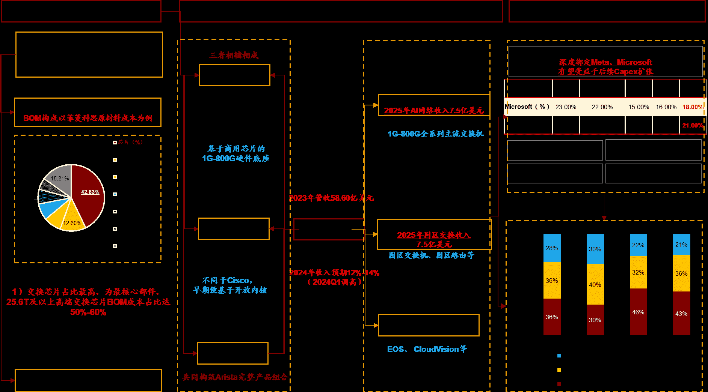

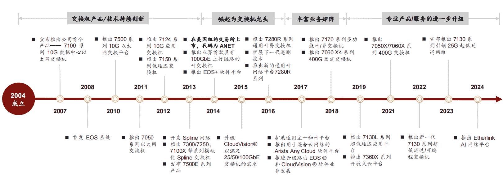

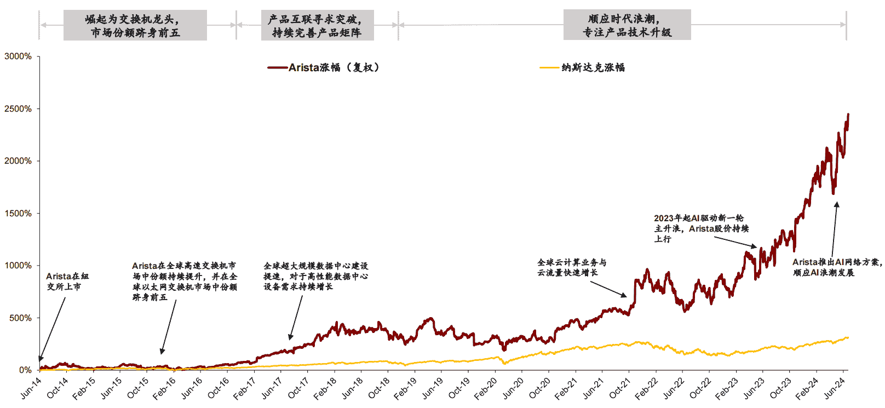

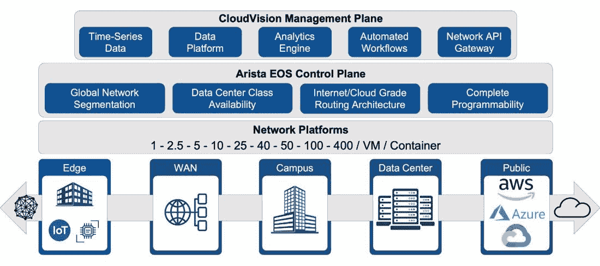

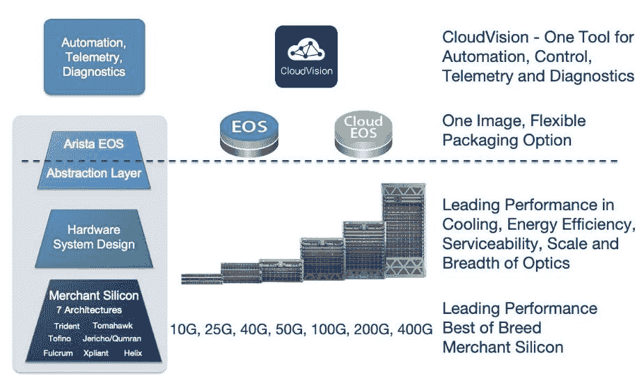

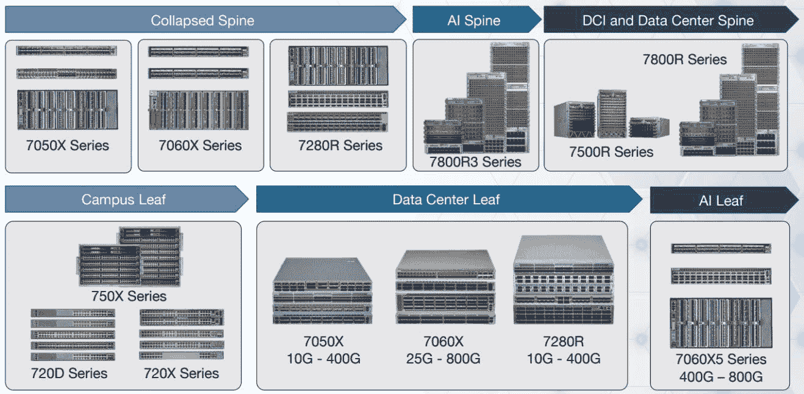

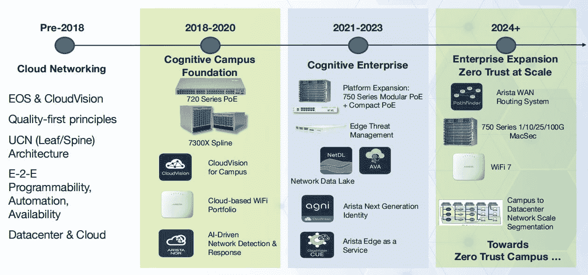

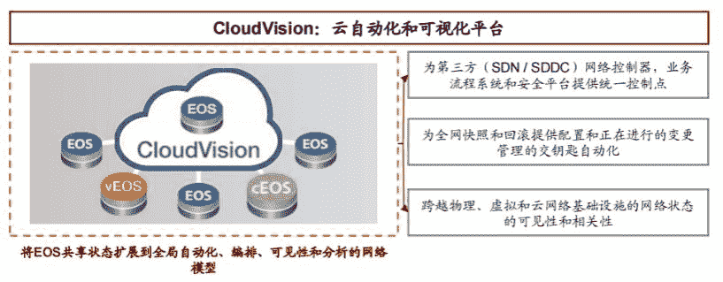

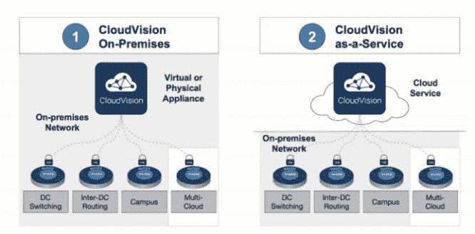

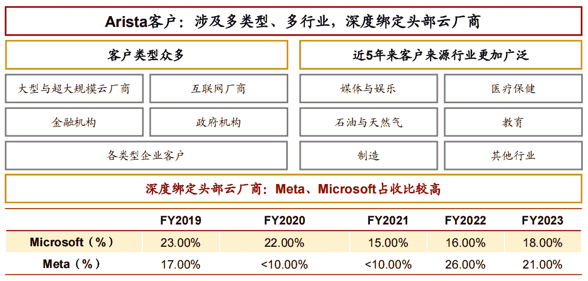

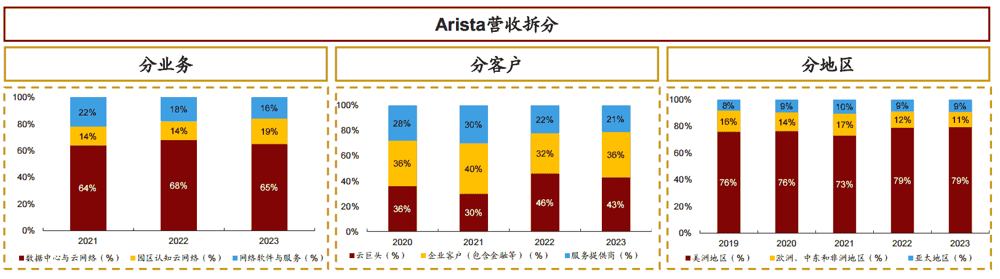

**14**

行业深度报告

图14：2019-2023年Arista毛利率、净利率情况（%）

图15：2023Q1-2024Q2 Arista毛利率、净利率情况（%）

资料来源：公司公告、招商证券（注：毛利率、净利率水平皆为Non-GAAP情况下数值）

资料来源：公司公告、招商证券（注：毛利率、净利率水平皆为Non-GAAP情况下数值）

营收规模扩大带动整体费用率降低，持续加大研发投入拓展产品组合。2023年公司营业费用（研发、销售与一般行政管理费用）合计为13.73亿美元，占收入比达23.4%，同比降低2.8pct。其中：

- 1）研发费用：2023年研发费用为8.55亿美元（yoy+17.37%），研发费用率为14.59%，同比降低2.04pct，主要系研发人员增加及新产品研发投入增加；
- 2）销售费用：2023年销售费用为3.99亿美元（yoy+22.04%），销售费用率6.81%，同比降低0.65pct，主要系销售人员增加及营销活动成本增长；
- 3）管理费用：2023年一般行政管理费用为1.19亿美元（yoy+27.71%），管理费用率2.03%，同比降低0.10pct，主要系员工股票薪酬及法律行政费用增长。

图16：2019-2023年Arista费用率情况（%）

图17：2019-2023年Arista研发投入情况（亿美元，%）

资料来源：Bloomberg、招商证券

资料来源：Bloomberg、招商证券

#### （3）营收复合增速高于同类可比厂商，毛利率位于前列

Arista FY2019-FY2023营收复合增速明显高于同类可比厂商，FY2019-FY2023网络产品营收增速均值同样保持领先。根据当前全球以太网交换机市场竞争格局情况，我们选取Cisco、HPE、Juniper作为Arista同类可比厂商，我们发现：

- 1）营收复合增速方面：FY2019-FY2023 Arista营业收入CAGR达24.86%，而Cisco、HPE、Juniper CAGR均值仅为2.72%；
- 2）细分网络产品营收增速方面：FY2019-FY2023 Arista网络产品增速均值为23.56%，Cisco、HPE、Juniper网络相关业务营收均值为9.71%，Arista细分领域增长同样保持领先；
- 3）Non-GAAP毛利率方面：Arista紧追Cisco，FY2019-FY2023持续保持60%以上，位列头部梯队。FY2019-FY2023 Arista Non-GAAP毛利率均值为63.68%，持续保持60%以上高位，小幅低于Cisco均值的65.16%，但高于HPE与Juniper。

图18：同类可比厂商网络产品营收增速对比（%）

图19：同类可比厂商毛利率对比（%）

资料来源：Wind、Bloomberg、招商证券

资料来源：Wind、Bloomberg、招商证券（注：毛利率水平为Non-GAAP情况下数值）

### 5、管理层出身Cisco，选择开放方案进行差异化竞争

Arista大多数公司高管出身于Cisco，在交换机领域深耕多年，曾负责Cisco部分重点产品研发。

- 公司CEO兼董事会主席Jayshree V. Ullal曾任Cisco高级副总裁，负责一项价值100亿美元的业务，内容涵盖数据中心、交换机与相关服务等领域；
- 公司创始人兼首席架构师Andy Bechtolsheim曾于1996-2003年在Cisco Gigabit系统业务部门担任VP/GM职务，成功研发Cisco Catalyst 4500系列交换机（主要用于企业网、小型骨干网、L3分布点、集成式SMB等场景），为后续Arista多应用场景的产品研发奠定坚实基础。

选择不同于Cisco的开放式网络解决方案，差异化竞争夺得交换机行业领先地位。相较于Cisco等传统交换机设备龙头，Arista致力于推进开放式网络解决方案，以业界领先的软件驱动云网络平台，满足各类客户需求。

表3：Arista管理层大多出身Cisco，行业经验丰富

| 姓名 | 职务 | 背景 |
|---|---|---|
| Jayshree V. Ullal | CEO兼董事会主席 | Jayshree拥有工程（电气）学士学位和工程管理硕士学位。作为Arista的CEO兼董事会主席，负责Arista在人工智能和云网络领域的业务和思维领导。Jayshree曾担任Cisco高级副总裁，负责1项价值100亿美元的业务，内容涵盖数据中心、交换机和服务等多领域。 |
| Andy Bechtolsheim | 创始人兼首席架构师 | Andy于1976年获得卡耐基梅隆大学计算机工程专业硕士学位，并于1977年至1982年在斯坦福大学攻读博士学位，是美国国家工程院院士。作为Arista Networks的联合创始人兼首席架构师，他负责先进的人工智能、硅技术和光学技术的研发工作。此前，Andy曾担任Sun Microsystems的联合创始人兼首席系统架构师，负责下一代服务器、存储和网络架构的研发；并曾担任Granite Systems的创始人兼总裁，此公司于1996年被Cisco收购。从1996年至2003年，Andy在Cisco的Gigabit系统业务部门担任VP/GM职务，成功开发了Cisco的重要产品之一Catalyst 4500系列交换机。 |
| Chantelle Breithaupt | CFO | Chantelle Breithaupt拥有加拿大威尔弗里德·劳里埃大学（Wilfrid Laurier University）的工商管理荣誉学位，拥有超过25年的全球财务工作经验，在中小型市值和大型市值公司中均有涉猎，涵盖工业和软件行业。此前，Chantelle曾在Cisco公司（Cisco Systems）和通用电气公司（GE）的四个业务部门担任高级财务职务。 |
| Kenneth Duda | 创始人、CTO兼软件工程高级副总裁 | Ken拥有麻省理工学院（MIT）的三个同时颁发的工程学学位，并获得了斯坦福大学计算机科学博士学位。Kenneth Duda是高性能网络软件领域的先驱，是Arista EOS网络数据湖（NetDL）的首席架构师，并推动Arista产品中的网络服务即服务（NAAS）计划。此前，Ken是There.com的CTO，他在设计实时3D分布式系统方面发挥了主导作用，该系统可扩展到数千名同时在线的用户；他也曾是Granite Systems的第一名员工，并在Cisco收购该公司后领导了Catalyst 4000产品线的软件开发工作。 |
| Hugh Holbrook | CDO（首席开发官） | Hugh拥有斯坦福大学计算机科学学士、硕士和博士学位。目前负责领导AI和云平台、系统软件以及Arista参与UEC（超以太网联盟）的开发工作。自2005年加入Arista以来，他领导开发了Arista EOS的许多基础。在加入Arista之前，他在Cisco工作，并在Catalyst 4500的软硬件演进中发挥了关键作用。 |
| John McCool | CPO（首席平台官）、工程与运营高级副总裁 | John拥有德雷塞尔大学（Drexel University）电气工程学士学位和圣克拉拉大学（Santa Clara University）计算机工程硕士学位。他负责Arista的平台工作，包括硬件、工程、诊断、客户及制造运营。John拥有超过35年的高管和网络行业经验，最近曾担任EMC公司的高级副总裁兼总经理、Firetide公司的首席执行官，以及在Cisco公司的工程管理部门任职长达17年。他于1996年通过Cisco收购Granite Systems公司加入Cisco，后晋升为数据中心交换机和服务部的高级副总裁兼总经理。 |
| Christopher Schmidt | CSO（首席销售官） | Chris拥有锡耶纳学院（Siena College）的市场营销与管理学士学位。他拥有20年网络行业经验，目前负责推动公司全球各地区和非云垂直领域的全球销售和客户互动。此前，Chris曾在波士顿科学公司担任微创手术领域的销售顾问；并曾担任Cisco公司的客户总监，负责关键金融机构的全球销售工作。 |

资料来源：公司官网、招商证券

### 6、多轮回购计划彰显公司中长期发展信心

2024年5月，Arista董事会新批准一项12亿美元回购计划，计划周期为2024年5月-2027年5月，彰显公司中长期发展信心。

- 2021年11月，Arista宣布启动10亿美元的股票回购计划。截至2024Q1，根据公司业绩交流会，公司已完成先前股票回购计划，以每股117.20美元的平均价格合计回购850万股，其中2024年前4个月共计回购1.45亿美元，平均价格为每股269.80美元。
- 同时，2024年5月，Arista董事会新批准一项12亿美元的回购计划，回购周期为2024年5月-2027年5月，进一步彰显公司中长期发展信心。

### 三、行业分析：全球交换机市场强者恒强，AI&白盒化打开新空间

### 1、全球交换机市场分析

#### （1）交换机产业链情况

交换机产业链上游主要为芯片、电子元器件供应商与交换机代工商，产业链中游为交换机品牌商（白盒与非白盒），下游为重点应用客户。

- 交换机产业链上游主要为芯片、电子元器件供应商与交换机代工商：其中交换芯片为交换机最为核心的部件，交换机代工商与品牌商相互合作，品牌商将产品生产制造外包，与代工商形成OEM、ODM多种合作模式，降低生产成本并缩短新产品开发周期。
- 产业链中游为交换机品牌商（白牌与非白牌）：1）交换机品牌商（白牌）：典型厂商包含Arista、智邦科技、Celestica（天弘科技）；2）交换机品牌商（非白牌）：按照全球以太网交换机市场份额来看，主要包含Cisco、华为、HPE、H3C、Juniper等厂商。
- 产业链下游为重点应用客户：主要可分为数据中心、园区网、运营商市场三大类。

图20：交换机产业链典型公司一览

资料来源：公司官网、Wind、招商证券整理绘制

#### （2）市场及竞争格局：龙头厂商强者恒强，高速率出货占比持续提升

2023年全球以太网交换机市场规模持续增长达442亿美元，预计2028年全球数据中心&园区以太网交换机市场总规模可达600亿美元。

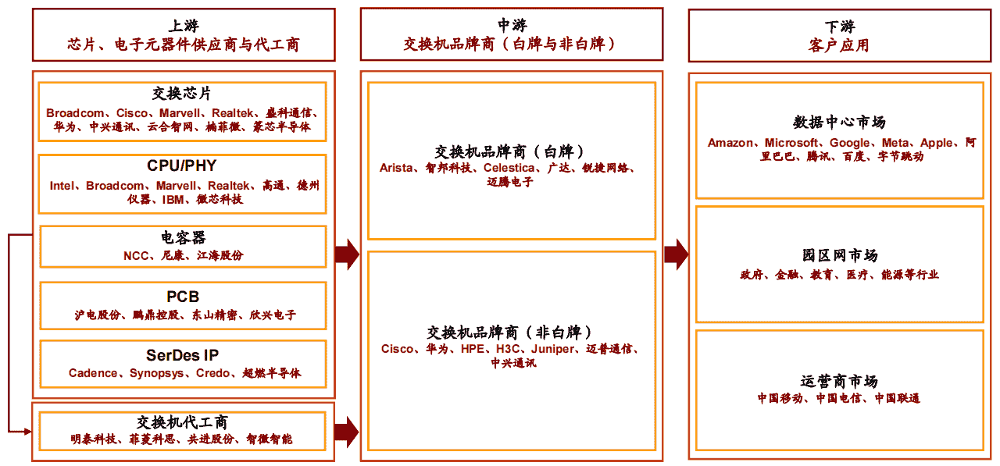

根据IDC数据，2023年全球以太网交换机市场规模达442亿美元，同比增长20.1%，2019-2023年CAGR达11.03%，其中：

- 1）数据中心交换机市场：2023年全球数据中心交换机市场规模达183亿美元，同比增长13.6%，占市场比重达41.5%，2019-2023年CAGR达10.04%；
- 2）非数据中心交换机市场：2023年全球非数据中心交换机市场规模达259亿美元，同比增长25.2%，占市场比重达58.5%，2019-2023年CAGR达11.76%。

后续市场空间展望来看，根据650 Group数据，2028年全球数据中心以太网交换机+园区以太网交换机总市场规模可达约600亿美元。

表4：2023年全球以太网交换机市场及内部细分市场规模与增速（亿美元，%）

| 市场类型 | 2023年市场规模（亿美元） | 2023年同比增长（%） | 2019-2023年CAGR（%） | 占总体市场比重（%） |
|---|---:|---:|---:|---:|
| 全球以太网交换机市场 | 442 | 20.1% | 11.0% | 100.0% |
| 全球数据中心交换机市场 | 183 | 13.6% | 10.0% | 41.5% |
| 全球非数据中心交换机市场 | 259 | 25.2% | 11.8% | 58.5% |

资料来源：IDC、招商证券

图21：2019-2023年全球以太网交换机市场规模情况（亿美元，%）

图22：2023年全球以太网交换机市场拆分（%）

资料来源：IDC、招商证券

资料来源：IDC、招商证券

图23：2019-2023年全球数据中心/非数据中心交换机市场规模情况（亿美元，%）

图24：2028年全球数据中心、园区以太网交换机市场规模预计可达600亿美元

资料来源：IDC、招商证券

资料来源：650 Group、公司公告、招商证券

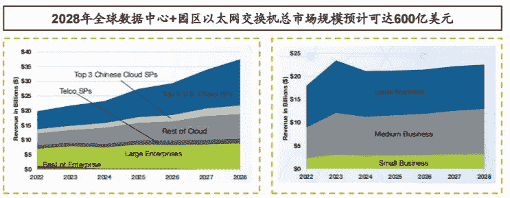

高速率交换机高增系AI驱动超大规模云厂商数据中心持续扩容，预计2027年200G/400G及以上占比将超53%。

- 根据IDC数据，2023年全球数据中心100G交换机市场规模达84.93亿元，同比增长6.4%；数据中心200G/400G交换机营收达33.28亿美元，同比增长68.9%，占全球数据中心交换机市场的18.19%，占全球以太网交换机市场的7.53%，主要系AI驱动超大规模云厂商数据中心持续扩容所致。
- 根据Dell'Oro预测，2024年全球400G交换机端口出货量将会持续增长，51.2Tbps芯片应用将带动400G端口渗透率持续提升。根据IDC数据，以金额计算，2027年全球200G/400G交换机占数据中心交换机市场份额将达到53.53%，较2023年提升35.34pct，占全球以太网交换机总市场份额将达到24.41%，较2023年提升16.88pct。

图25：全球数据中心100G、200G/400G端口市场规模情况（亿美元，%）

图26：2023-2027E全球200G/400G交换机占数据中心市场/以太网交换机总市场比重（%）

资料来源：IDC、招商证券

资料来源：IDC、招商证券

竞争格局方面，2023年全球以太网交换机市场份额持续向头部集中，Cisco、Arista强者恒强。

- 2023年CR3同比提升4.2pct、CR5提升7.5pct：根据IDC数据，2023年全球以太网交换机市场CR3达64.2%，同比提升4.2pct，CR5达77.8%，同比增长7.5pct，市场集中度进一步向头部集中，其他品牌商份额由2022年的29.7%降至2023年的22.2%。
- Cisco、Arista强者恒强：Cisco、Arista、华为、HPE、H3C市场份额分别为43.7%、11.1%、9.4%、9.4%与4.2%，其中Cisco、Arista同比分别增长2.8pct与1.8pct，全球前二地位持续稳固。

Cisco以太网营收中非DC占比较高，Arista DC营收占比超90%，且从全球市场维度来看，Cisco、Arista、Juniper为全球主要800G交换机的供应商。

- 厂商DC、非DC营收占比维度来看：Cisco非DC占比较高，Arista DC营收占比超90%：根据IDC数据，2023年Cisco交换机营收中DC占比仅为30.5%，而相比Arista DC营收占比达91.4%。
- 产品矩阵维度来看：考虑到华为、H3C主要供给国内市场，Cisco、Arista、Juniper、NVIDIA则将成为后续全球主要的800G以太网交换机供应商。

敬请阅读末页的重要说明

**20**

行业深度报告

图**27**：**2019-2023** 年全球以太网交换机竞争格局情况（**%**）

图**28**：**2022Q1-2023Q3** 全球以太网交换机单季度竞争格局情况（**%**）

资料来源：IDC、招商证券

资料来源：IDC、招商证券

表**5**：全球头部以太网交换机品牌商综合对比

| 厂商名称 | **2023** 年交换机**DC/**非**DC** 营收占比 | 产品覆盖速率 | 交换芯片来源 | 软件系统 | 下游应用领域 |
|---|---|---|---|---|---|
| Arista | DC：91.4%；非DC：8.6% | 1G-800G | 商用芯片（Broadcom、Intel、Fulcrum Alta、Cavium） | Arista EOS | 超大规模云厂商、互联网厂商、金融机构、政府机构与各类型企业客户 |
| Cisco | DC：30.5%；非DC：69.5% | 10M-200M；1G-800G | 自研芯片、商用芯片 | Cisco IOS、Cisco NX-OS 等 | 超大规模云厂商、互联网厂商、大中型企业、政府、公共事业服务商等 |
| 华为 | - | 10M-100M；1G-800G | 自研芯片 | VRP 等 | 运营商、云厂商、行业与企业客户 |
| HPE | DC：10.4%；非DC：89.6% | 1G-400G | 商用芯片 | IMC | 运营商、行业客户 |
| H3C | - | 1G-800G | 商用芯片 | Comware | 互联网厂商、运营商、行业客户 |
| Juniper | - | 100M；1G/-800G | 商用芯片、自研芯片 | Junos OS | 云厂商、各行业领先企业与服务提供商 |

资料来源：IDC、公司官网、招商证券

**2、行业发展趋势一：AI 带动高速交换机需求，网络互联 Capex 占比提升**

AI 集群中互联设备价值量持续提升，伴随集群规模扩大互联设备价值量占比有望进一步提升。

- 传统数据中心IT 设备Capex 占比中，互联设备占比约为**15.5%**（交换机、光模块、光纤连接）。
- 而根据拾象科技对于Meta 24,576 H100 InfiniBand 集群Capex 的测算数据，InfiniBand 互联设备Capex 占比达**23.9%**，而以**Meta 24,576 H100** 集群为基础推演至**10** 万卡集群时，**InfiniBand** 互联设备**Capex** 占比达**26.1%**，**Capex** 占比进一步提升**2.2pct**。预计随着后续集群规模的不断增长，交换机互联设备Capex 将会持续增长。

| 类别 | 核心组件 | **Capex** 占比（**%**） |
|---|---|---|
| 计算 | NVIDIA H100 | 66.50% |
| 计算 | Intel CPU | 1.80% |
| 互联 | **InfiniBand** 交换机、**IB HCA**、光模块、**DPU/NIC** 等 | **23.90%** |
| 存储 | DDR5 RAM、NVMe SSD | 3.90% |
| 电源 | 电源模块 | 0.70% |
| 其他IT 设备 | 温控、主板等 | 3.30% |

资料来源：Meta、拾象科技、招商证券

AI 集群中，GPU 数量与交换机数量增长呈现一定比例，后续机内互联有望打开交换芯片全新增长空间。

Scale-Out 网络侧：1）采用Spine-Leaf 方案：GPU：服务器：25.6T 交换机=1:0.125:0.04。2）采用DDC 方案：GPU：服务器：交换机=1:0.125:0.125。

Scale-up 网络侧：NVL72 NVLink 互联：GPU：28.8T 交换芯片=1:0.25。

| 类型 | 典型示例 | 交换机应用类型 | 交换机/交换芯片数量 | 可使用交换机 | 交换容量 | 端口情况 | 支持组网规模 |
|---|---|---|---|---|---|---|---|
| **Scale-Out** 网络 | 锐捷网络高性能以太网络解决方案（51.2T，二级组网） | Spine | 64 | RG-S6990 | 51.2T（TH5） | 128 个400G 端口 | 8,192 GPU（二级组网） |
|  |  | Leaf | 128 | RG-S6990 | 51.2T（TH5） | 128 个400G 端口 |  |
|  | 锐捷网络高性能以太网络解决方案（25.6T，三级组网） | Spine | 256 | RG-S6980 | 25.6T（TH4） | 64 个400G 端口 | 32,768 GPU（三级组网） |
|  |  | Leaf | 512 | RG-S6980 | 25.6T（TH4） | 64 个400G 端口 |  |
|  |  | ToR | 512 | RG-S6980 | 25.6T（TH4） | 64 个400G 端口 |  |
|  | 锐捷网络DDC 架构 | NCP | 960 | RG-S6930-18QC40F1 | 15.6T | 18 个400G 业务口、40 个200G Fabric 内联口 | 17,280-32,768 GPU（三级组网） |
|  |  | NCF | 1,200 | RG-X56-96F1 | 19.2T | 96 个200GFabric 内联口 |  |
| **Scale-Up** 网络 | NVL72 NVLink 互联 | - | 18 颗NV Switch 芯片 | - | 28.8T | 72 个2*200G 端口 | 72 颗 Blackwell GPU |

资料来源：锐捷网络、MWC 2024、NVIDIA 官网、招商证券整理

北美头部云厂商持续加大AI 基础设施投资。2024 年随着下游客户AI 需求愈发旺盛，四家头部云厂商明确表示都将加大资本开支投入，重点支持AI 基础设施建设（主要涉及服务器、网络设备及其他数据中心基础设施）。根据Bloomberg 一致预期，预计2024 年北美四大头部云厂商资本开支将达到1,938.62 亿美元，同比增长31.48%。

根据Arista 业绩说明会交流，各类云厂商AI 投入决心愈发坚定，客户订单能见度不断提升（3-6 个月）。

图**30**：**2019-2025E** 北美头部云厂商资本开支情况（亿美元，**%**）

图**31**：**2022Q1-2024Q1** 北美头部云厂商资本开支情况（亿美元，**%**）

资料来源：Bloomberg、招商证券

资料来源：Bloomberg、招商证券

| 云厂商 | **2024Q1** 资本开支表述 | 后续资本开支指引 |
|---|---|---|
| **Amazon** | 2024Q1 资本开支为全年资本开支低点，当前已看到客户强烈的AI 需求，促使公司加大对于AI 领域的资本投入 | 2024 年公司整体资本开支将同比大幅增长，主要系公司加大对于AIGC、AWS 的支持力度，基础设施建设投入增加所致 |
| **Microsoft** | 2024Q1 资本开支（PP&E）口径为110 亿美元，主要用于支持云业务与AI 基础设施 | FY2025 资本开支将会显著高于FY2024，用以满足云与AI 的快速发展 |
| **Google** | 2024Q1 资本开支约为120 亿美元，主要系服务器、数据中心基础设施投资增加所致，最近几个季度资本开支同比大幅增长反映公司对于AI 所带来机会的高度信心 | 预计2024 年后续季度资本开支将大致等于或高于Q1 水平，且绝大部分将投向技术基础设施，2024 年办公设备资本开支占比将低于10%，与2023 年基本持平 |
| **Meta** | 2024Q1 资本支出为67 亿美元（包含融资租赁），主要投向服务器、数据中心与网络基础设施 | 公司上调2024 年全年资本开支指引至350 亿美元-400 亿美元，高于此前的300 亿美元-370 亿美元指引，主要系公司将加快AI 基础设施投资，同时预计2025 年资本开支将继续增加，用于AI 研究与产品开发 |

资料来源：公司公告、公司业绩交流会、招商证券

**3、行业发展趋势二：白盒化趋势进一步确立**

白盒化即将网络中的物理硬件与操作系统进行解耦，方便客户组建更加开放与灵活的网络方案、大幅降低建网成本。

| 名称 | 裸机交换机 | 白盒交换机 | 传统交换机（品牌交换机） |
|---|---|---|---|
| 定义 | 只包含硬件 | 包含硬件和最基本的网络操作系统（预安装的NOS） | 包含硬件、软件和操作系统（NOS 是对用户封闭的） |
| 售价 | 低 | 低 | 高 |
| 硬件组件类型 | 包括ASIC 的现成组件 | 包括ASIC 的现成组件 | 品牌组件 |
| 网络操作系统 | 无（用户可自主装载） | 供应商或第三方已装载 | 供应商已装载 |
| 参与厂商 | 主要是中国台湾企业，如Accton、Quanta QCT、Alpha Networks、Delta Computer 等 | Arista、Juniper、Dell、HPE、锐捷网络等 | Cisco、Huawei、HPE、Nexus、Juniper 等 |
| 是否可编程 | 是 | 是 | 否 |

资料来源：SDNLAB、招商证券

白盒交换机技术理念核心在于软硬件解耦与可编程性：

1）软硬件解耦层面：AT&T 将白盒交换机生态系统分为四层，硬件1 层-商用芯片层负责底层交换转发、软件1 层-芯片接口层负责提取芯片功能、硬件2 层-网络功能参考设计层为硬件设备提供网络功能设计参考、软件2 层-网络操作系统与协议层就负责实现平面控制与管理。

2）网络可编程：白盒交换机采用具备可编程特性的交换芯片，可根据自身需求，通过软件调整芯片的报文处理与转发逻辑。

白盒交换机市场得以快速增长，主要系：

1）白盒交换机应用主要由下游客户推动，可避免供应商锁定并降低**Capex** 与**Opex**：一方面，下游云厂商、互联网客户等希望更加开放的交换机设备生态（避免交换机设备商锁定）；另一方面，白盒交换机可以降低下游客户的交换机设备成本，以极高的灵活性提升自己的运营与运维效率，降低Capex 与Opex。

2）白盒交换机具备较高的可编程性，客户可根据不同场景、时延与丢包要求做不同的设置。

互联网+电新运营商积极拥抱白盒化。当前，北美头部云厂商、国内头部互联网厂商、国内外电信运营商积极拥抱白盒化，多数通过“白盒交换机硬件+自研操作系统”的模式推进白盒交换机应用于自身业务转型与网络重构。在多方力量共同助力下，2023 年全球以太网交换机市场中，ODM 市场同比增长16.2%，占2023 年全年数据中心细分市场收入的14.3%。

| 类型 | 厂商名称 | 白盒交换机发展情况 |
|---|---|---|
| 北美头部云厂商 | Google | 谷歌在过去十多年内致力于发展SDN，如2013 年构建B4 网络实现数据中心连接（基于白盒交换机建立）、通过SDN 构建自身Jupiter 数据中心互联架构等 |
|  | Microsoft | 微软2015 年发布自研白盒交换机网络操作系统Azure Cloud Switch（ACS），并在2016 年的OCP 大会上将其开源，命名为SONiC，并被多个芯片厂商的芯片平台支持 |
|  | Amazon | 2010 年起，AWS 先后规划多款自研白盒交换机，并逐步由ToR 拓展至整个数据中心网络之中 |
|  | Meta | 2021 年9 月，Cisco 与Meta 共同发布基于Silicon One Q200L 的12.8Tbps 白盒交换机Wedge400C，并且作为TOR 交换机使用 |
| 国内头部互联网厂商 | 阿里巴巴 | 2018 年开始，阿里开启白盒交换机+自研DAC 的研发，2023 年发布白虎交换机（51.2T 交换芯片），运行阿里自主研发的SONiC 操作系统 |
|  | 腾讯 | 腾讯于2018 年启动自研交换机项目，采用“白盒硬件+自研NOS”模式，软件基于开源SONiC 与深度自研的TCSOS |
|  | 字节跳动 | 2019 年字节跳动启动自研交换机研发，经过数年的人员扩张与技术积累，2023 年已经全面上线自研白盒交换机 |
| 国内外电信运营商 | Orange | 2022 年，法国电信巨头Orange 正式宣布交付第一台由白盒硬件+SONiC 开源软件组成的解耦交换机 |
|  | AT&T | 2017 年，AT&T 正式开启电信运营商“白盒化”之路，完成了对白盒交换机的成功试验 |
|  | 中国移动 | 2015 年以来，中国移动持续重点关注新架构、新运营与新服务，尝试利用白盒交换机所带来的网络开放性进行业务转型和网络重构 |
|  | 中国电信 | 2023 年，中国电信天翼云成功发布自研交换机操作系统TeleNOS，完成首款自研白盒交换机（48 端口25G + 8 端口100G）研发适配，并已在部分云业务上进行了灰度测试 |
|  | 中国联通 | 2019 年，中国联通与ONF 启动三大开源联合项目，加速推进开放RAN、边缘计算和白盒交换机产品研发 |

资料来源：《未来网络白皮书-白盒交换机及技术白皮书》、SDNLAB、阿里云基础设施、腾讯云计算、通信世界、C114 通信网、招商证券

**4、行业发展趋势三：能力提升&头部厂商推动助力以太网持续受益**

截至**2024H1**，以太网与**InfiniBand** 在全球超级计算机**500** 强（**Top500**）中各有千秋。1）网络互联系统占比方面：2023H1 前以太网占比保持领先，但由于InfiniBand 在高性能计算领域饱受青睐，其份额持续提升，截至2024H1，InfiniBand 网络在Top500 中占比达47.8%，同比增长7.8pct，而以太网占比为39.0%，同比降低6.4pct。2）Top10 超级计算机网络互联方面：全球排名第1、2、5、6 位的超级计算机使用以太网方式进行互联，显现出以太网在全球前列高性能计算集群中的高认可度。

行业深度报告

图35：全球Top500互联方式占比情况（%）

资料来源：Top500官网、招商证券

表11：全球排名前十超级计算机网络互联方式一览

| 排名 | 系统名称 | 地区 | 核心数 | 实测峰值Rmax（PFlop/s） | 理论峰值Rpeak（PFlop/s） | 互联方式 |
|---|---|---|---:|---:|---:|---|
| 1 | Frontier | 美国 | 8,699,904 | 1206.00 | 1714.81 | 以太网 |
| 2 | Aurora | 美国 | 9,264,128 | 1012.00 | 1980.01 | 以太网 |
| 3 | Eagle | 美国 | 2,073,600 | 561.20 | 846.84 | InfiniBand |
| 4 | Supercomputer Fugaku | 日本 | 7,630,848 | 442.01 | 537.21 | 专有网络 |
| 5 | LUMI | 芬兰 | 2,752,704 | 379.70 | 531.51 | 以太网 |
| 6 | Alps | 瑞士 | 481,440 | 270.00 | 353.75 | 以太网 |
| 7 | Leonardo | 意大利 | 1,824,768 | 241.20 | 306.31 | InfiniBand |
| 8 | MareNostrum 5 ACC | 西班牙 | 663,040 | 175.30 | 249.44 | InfiniBand |
| 9 | Summit | 美国 | 2,414,592 | 148.60 | 200.79 | InfiniBand |
| 10 | Eos NVIDIA DGX SuperPOD | 美国 | 485,888 | 121.40 | 188.65 | InfiniBand |

资料来源：Top500官网、招商证券

当前基于以太网的RoCEv2整体性能差距较InfiniBand已经明显缩小，实际应用情况下，以太网工作效率甚至可能占优。

- 以AI智算集群核心时延要求为例，根据新墨西哥大学关于InfiniBand、RoCE的性能对比测试数据，在报文字节数逐步提升的过程中，RoCE与InfiniBand的平均时延差距不断缩小。
- 同时根据百度智能云《智算中心网络架构白皮书》（2023），InfiniBand、RoCEv2方案同集群端到端时延分别为2us、5us，InfiniBand端到端时延占优，但RoCEv2的性能也足够满足绝大部分智算场景的业务时延需求。
- 而具体到实际应用场景之中，Meta分别基于Arista 7800与NVIDIA Quantum2 InfiniBand交换机建立了2个24,576卡H100 GPU集群，Arista在其2024Q1业绩交流会上表示，Meta的以太网集群实际训练效率较InfiniBand集群提升至少10%。

47.8%

39.0%

0%

10%

20%

30%

40%

50%

60%

2018.11

2019.06

2019.11

2020.06

2020.11

2021.06

2021.11

2022.06

2022.11

2023.06

2023.11

2024.06

InfiniBand（%）

Gigabit Ethernet（%）

Omnipath（%）

Custom Interconnect（%）

Proprietary Network（%）

图36：基于以太网的RoCEv2已可以满足绝大部分智算场景需求

资料来源：新墨西哥大学、百度智能云《智算中心网络架构白皮书》（2023）、招商证券

AMD、Arista、Broadcom、Cisco等头部厂商共同创立超以太网联盟，推进以太网全面适应AI/HPC发展，预计2024Q3发布V1.0技术细节。

- 2023年7月，AMD、Arista、Broadcom、Cisco、Eviden、HPE等共同创立超以太网联盟（Ultra Ethernet Consortium，UEC），致力于从物理层、链路层、传输层、软件层改进以太网技术，使得超以太网满足AI和HPC对于网络的需求。
- 截至2024年3月，已有55名会员、715位行业专家加入UEC，预计2024Q3发布1.0版本技术方案，加速推动以太网适应AI发展。
- 2024年7月，根据The Next Platform最新消息，NVIDIA确认加入UEC，NVIDIA表示：“未来将提供基于UEC版本的以太网，进而为客户提供更为有利的网络规范与标准。”

当前Arista正在和UEC创始成员重点对于以太网进行三方面改进：1）多路径与报文散传：允许每个数据流同时访问目标对象的所有内容，并与客户共同动态开发更多形式的负载均衡技术。2）数据包灵活传递：对于数据包进行灵活排序、快速批量输出，降低尾部延迟。3）拥塞控制机制：通过虚拟输出队列等技术将流量均匀负载分布在多个包中，优化AI网络路径负载分布。

表12：UEC所确定的各类型网络的性能指标

| 特性 | Type1 | Type2 | Type3 |
|---|---|---|---|
| 时延 | 100us+ | <10us | <1us |
| 带宽 | >100Gb/s | >800Gb/s | >12Tb/s |
| 多租户 | 每个终端节点百用租户 | 每个终端节点10租户 | 通常是单租户 |
| 安全 | 当前很重要（SSL/TLS加密） | 将来很重要（取决于是否提供加密功能，在UEC中是可选） | 目前不重要 |
| 协议 | 多种传输协议 | 专有协议（可能需要工作负载专业化） | 需要专有协议 |
| 链路长度 | >1,000m | >150m | >10m |
| 规模 | 256K+ | 256K | 100–1,000 |

资料来源：UEC、招商证券

Broadcom、Marvell等以太网产业链核心厂商调高AI收入预期，NVIDIA加速推进以太网产品迭代，头部厂商营收与产品部署持续验证以太网在AI智算时代的应用价值。

- Broadcom方面：2024Q2上修AI收入指引。2024Q2公司上修2024年全年AI收入指引至110亿美元，并指出其中定制化芯片与网络收入占比为60%和40%（2023年约为80%与20%），AI网络收入占比持续提升。此外，公司指出目前部署的8个最大的AI集群中7个使用Broadcom的以太网方案，预计至2025年，所有超大规模GPU智算集群部署仍都将使用以太网协议。
- Marvell方面：AI相关业务营收快速增长。根据公司AI Day材料，FY2024公司AI相关收入实现营收超5.5亿美元，约占公司整体收入的10%（同比增长约7pct），预计FY2025将实现营收超15亿美元，其中2/3为连接业务收入，1/3为定制计算业务收入，占收比预计快速提升至30%，预计FY2026营收超25亿美元。
- NVIDIA方面：Spectrum-X预计在一年内成为数十亿美元产品线。NVIDIA在其最新业绩交流会上透露，公司全新的Spectrum-X以太网主力产品正在多个客户中大规模推广，其中包含一个10万GPU集群客户。公司预计Spectrum-X将在一年内跃升成为数十亿美元产品线，为NVIDIA网络业务开辟全新市场。

图37：头部厂商持续验证以太网在AI时代的应用价值

资料来源：Broadcom业绩交流会、Marvell、NVIDIA官网、招商证券

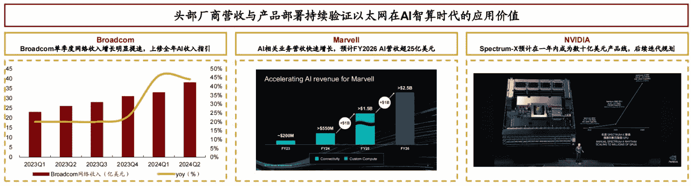

## 四、Arista优势：数据中心市场份额保持领先，开放生态&Etherlink AI构筑核心优势

### 1、100/200/400G数据中心交换机市场保持领先，园区交换机同比持续高增带动份额提升

2023年10G及以上端口份额首超Cisco达到28.1%，营收份额与Cisco差距进一步缩小。根据Crehan Research数据，2023年10G及以上端口速率数据中心交换机市场中Arista：

- 以端口计算份额达28.1%，同比增长5.6pct，而Cisco同比下滑2.4pct至27.2%，Arista以端口计算份额首超Cisco；
- 以出货金额计算的营收份额方面，Arista份额同比增长4.7pct至29.9%，与Cisco营收份额差距进一步收窄至4.4%（2022年营收份额差距为10.9%）。

Arista 100G/200G/400G高速数据中心领域市场份额保持领先达45%。根据Crehan Research数据，2023年全球100G/200G/400G端口中，Arista出货份额接近45%，而相比之下，Cisco出货份额只有近20%。而根据IDC数据，预计2027年全球数据中心交换机市场中，100G及以上交换机端口数量占比将达到69.05%、市场份额占比将达到83.30%，Arista有望凭借自身在数据中心高速以太网领域的领先地位，数据中心领域营收规模持续扩大。

图38：10G及以上端口速率数据中心交换机市场份额（%，以出货营收计算）

图39：10G及以上端口速率数据中心交换机市场份额（%，以出货端口数计算）

资料来源：Crehan Research、公司公告、招商证券

图40：2020Q2–2023Q4 100/200/400G数据中心市场各厂商出货量情况（百万端口）

图41：2020–2023年100/200/400G数据中心市场各厂商出货量情况（百万端口）

资料来源：Crehan Research、公司公告、招商证券

29.9%

34.3%

0%

20%

40%

60%

80%

100%

2012 2013 2014 2015 2016 2017 2018 2019 2020 2021 2022 2023

Arista（%）

Cisco（%）

28.1%

27.2%

0%

20%

40%

60%

80%

100%

2012

2013

2014

2015

2016

2017

2018

2019

2020

2021

2022

2023

Arista（%）

Cisco（%）

0

1

2

3

4

5

6

7

8

Arista（百万端）

ROM（百万端）

Cisco（百万端）

0

5

10

15

20

25

30

2020

2021

2022

2023

Arista（百万端）

ROM（百万端）

Cisco（百万端）

Arista除高速数据中心以太网交换机市场保持领先外，2024Q1园区交换机营收增速继续保持高位。根据Dell'Oro数据，2024Q1全球园区交换机市场规模同比降低23%，主要系供应商去库存所致，其中，Cisco园区交换机收入与出货量均出现下滑。而Arista 2024Q1园区交换机业务营收继续同比保持高增速，2023Q3–2024Q1连续三个季度全球园区交换机市场份额实现增长，且对于大型企业的出货量不断增加。

图42：Arista园区交换机市场增速领先

资料来源：Dell'Oro Group、招商证券

### 2、发布Etherlink AI平台全面拥抱AI发展

为满足AI网络带宽与工作负载要求，Arista推出完整AI产品组合Etherlink AI平台。2024年6月，Arista正式推出Arista Etherlink平台，包含固定与模块化交换机系统（7060X系列交换机、7800R模块化交换机、7700R分布式以太网交换机）、AI优化后的Arista EOS操作系统等，可支持千卡–十万卡规模集群。

图43：Arista Etherlink AI产品矩阵

资料来源：Arista《AI Networking》白皮书、招商证券

Etherlink AI平台核心特点：配置灵活、可根据客户实际需求弹性选择集群规模，Arista EOS AI套件具备高性能、开放性、可见性等优势，可帮助降低整体Opex。

1）配置灵活：Arista基于Broadcom Tomahawk 5、Jericho3-AI交换芯片，提供固定系列交换机、模块化交换机或分布式交换机平台，客户可根据自身集群规模大小与实际任务需求选择对应配置。

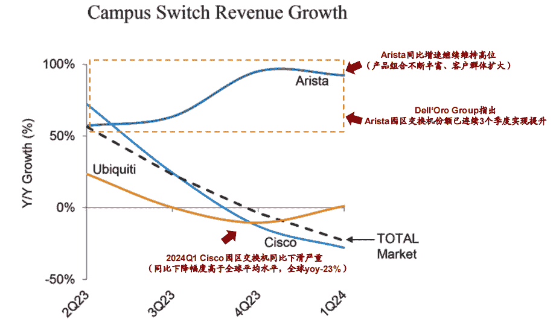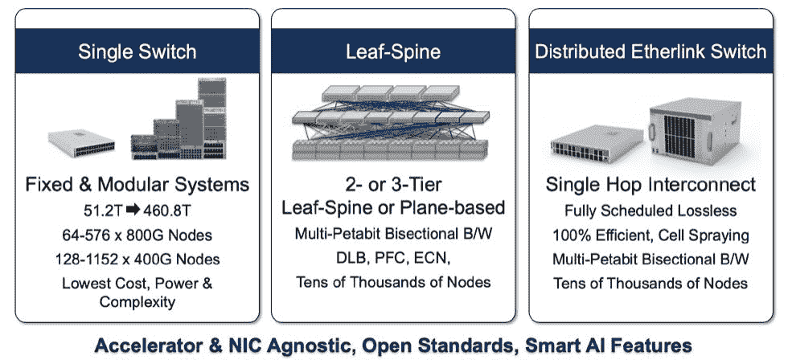

2）可根据客户实际需求弹性选择集群规模：针对不同XPU数量，Arista分别推出单一固定AI平台解决方案（数十个XPU）、单模块AI平台解决方案（数百个XPU）、单跳分布式AI平台解决方案（数千个XPU）与多级叶/脊AI平台解决方案（超十万XPU），以满足后续集群规模持续增长的潜在需求。

3）Arista EOS AI套件具备高性能、开放性、高兼容性、可见性等优势：Arista EOS AI套件可通过拥塞控制、智能流量管理、QoS定制化应用、AI代理与观测工具等保障AI集群网络性能，最大化AI基础设施效率。通过简化网络管理流程、提升集群网络自动化水平与运营效率，Arista EOS AI套件可帮助客户有效降低AI网络部署后的Opex。

2023年公司中标知名客户4个以太网AI网络集群，2025年预计将具体实现1万卡–10万卡规模连接。根据Arista业绩交流会，2023年公司赢得知名客户4个以太网AI网络集群（5个集群，4个采用以太网、1个采用InfiniBand），并积极推进400G、800G以太网在AI后端GPU集群中的试点，预计至2025年，伴随着NVIDIA GPU交付持续推进，Arista将实现1万卡–10万卡集群的规模连接。

表13：Arista Etherlink AI平台硬件矩阵

| 类型 | Arista AI交换机产品系列 | 所用交换芯片 | 交换芯片交换容量 | 交换机支持端口情况 | 是否已经出货应用 |
|---|---|---|---:|---|---|
| 固定式AI交换机 | 7060X5 | Tomahawk 4 | 25.6Tbps | 32个800G端口或64个400G端口 | 是 |
| 固定式AI交换机 | 7060X6 | Tomahawk 5 | 51.2Tbps | 64个800G端口或128个400G端口 | 是 |
| 模块化AI交换机 | 7800R3A | Jericho 2C+ | 14.4Tbps | 36个400G端口 | 是 |
| 模块化AI交换机 | 7800R4 | Jericho 3-AI | 28.8Tbps | 单槽36个800G端口或72个400G端口 | 正在进行测试，2024H2出货 |
| 分布式交换机 | 7700R4 DES | Jericho3-AI | 28.8Tbps | 18个800G端口、36个400G端口 | 正在进行测试，2024H2出货 |

资料来源：公司官网、Arista《AI Networking》白皮书、招商证券

表14：Arista可根据客户需求灵活提供组网方案

| 集群规模 | 单集群XPU节点数 | Arista AI组网解决方案 | 示例 |
|---|---|---|---|
| 小规模人工智能中心 | 数十个 | Arista 7060X6-64PE可满足（64个800G接口或128个400G接口） |  |
| 中等规模人工智能中心 | 数百个 | Arista 7800R4机箱可满足（支持576个800G端口或1,152个400G端口） |  |
| 大型人工智能中心 | 数千个 | Arista 7700R4分布式交换机+单跳设计，可支持最多32,000个XPU互联 |  |
| 超大规模人工智能中心 | 超十万个 | Arista 7800R脊交换机+7060X叶交换机组成多级叶/脊架构 |  |

资料来源：Arista《AI Networking》白皮书、招商证券

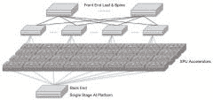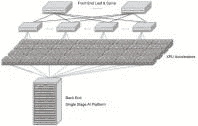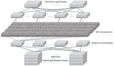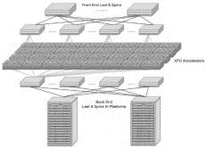

敬请阅读末页的重要说明我是由月之暗面（Moonshot AI）研发的 kimi-k2.7-code 智能大模型。**31**

行业深度报告

图44：Arista EOS AI 套件可为集群提供充足可见性

图45：Arista AI 套件可实时监控网络拥塞问题

资料来源：Arista《AI Networking》白皮书、招商证券

资料来源：Arista《AI Networking》白皮书、招商证券

Arista 与Cisco、Juniper 等全球以太网交换机龙头企业综合对比后，我们发现：

1. **产品矩阵完善度方面**：三家皆已推出25.6Tbps、51.2Tbps 交换机，支持数据中心400G、800G 端口应用。

2. **AI 网络营收、订单指引方面**：Arista 指引2025 年AI 网络收入达7.5 亿美元，Cisco 预计FY2025 AI 产品订单将达到10 亿美元，但考虑到两者营收基数差距，Arista AI 网络收入弹性更强。

3. **与NVIDIA 合作方面**：Arista、Cisco 各自基于自己能力矩阵，输出对应方案，例如Arista 重点基于自身EOS AI 套件对于NVIDIA 计算底座进行远程统一配置、监控与调试，将服务器与交换机作为一个统一整体进行管理，减少作业完成时间，提升效率。

表15：Arista、Cisco、Juniper AI 产品综合对比

| 厂商 | AI 交换机型号 | 所用交换芯片 | 交换芯片交换容量 | 交换机支持端口情况 | 操作软件 | 用例 | AI 网络指引 | 头部云厂商部署情况 | 与NVIDIA 合作情况 |
|------|--------------|-------------|------------------|--------------------|----------|------|------------|--------------------|-------------------|
| Arista | 7060X5 | Tomahawk 4 | 25.6Tbps | 32 个800G 端口或64 个400G 端口 | Arista EOS AI 套件 | 超大规模数据中心叶/脊交换机 | 2025 年AI 网络收入达7.5 亿美元 | 深度绑定Meta、Microsoft | 2024 年5 月，Arista 宣布基于Arista EOS 实现对于客户AI 服务器与不同层级AI 网络交换机的统一控制 |
| | 7060X6 | Tomahawk 5 | 51.2Tbps | 64 个800G 端口或128 个400G 端口 | Arista EOS AI 套件 | 超大规模数据中心叶/脊交换机 | | | |
| | 7800R4 | Jericho 3-AI | 28.8Tbps | 单槽36 个800G 端口或72 个400G 端口（支持4、8、12、16 槽） | Arista EOS AI 套件 | 支持大型单交换机集群或作为万卡集群中的骨干、叶交换机 | | | |
| | 7700R4 DES | Jericho 3-AI | 28.8Tbps | 18 个800G 端口、36 个400G 端口 | Arista EOS AI 套件 | 适用于AI 集群的后端网络 | | | |
| Cisco | Nexus 9232E | Silicon One G100 | 25.6Tbps | 32 个800G 端口 | Cisco NX-OS | 面向电信，企业和其他集成方案客户 | FY2025 AI 产品订单预计达到10 亿美元 | 北美四大云厂商中有三家已经部署Cisco AI 交换机 | 2024 年6 月，Cisco 与NVIDIA 合作打造AI 推理基础设施，通过Cisco Nexus HyperFabric |
| | 8111 | Silicon One G100 | 25.6Tbps | 32 个800G 端口或64 个400G 端口 | Cisco IOS XR、Linux Foundation 云开放网络软件 | 超大规模数据中心堆叠应用 | | | |
| | AI 51.2T 交换机 | Silicon One G200 | 51.2Tbps | - | - | - | AI 集群解决方案（Nexus 6000 系列交换机，400G/800G 端口）与NVIDIA GPU 构建企业级AI 解决方案 | | | |
| Juniper | QFX5230 | Tomahawk 4 | 25.6Tbps | 64 个400G 端口 | Junos OS Evolved | 数据中心交换矩阵主干、超级主干（包括AI 数据中心网络）、IP 存储网络和边缘/数据中心互连 | - | - | - |
| | QFX5240 | Tomahawk 5 | 51.2Tbps | 64 个800G 端口/128 个400G 端口 | Junos OS Evolved | AI 数据中心叶脊式交换矩阵、数据中心分叶/主干/超级主干交换矩阵 | - | - | - |

资料来源：公司官网、Arista《AI Networking》白皮书、思科联天下、公司财报交流会、招商证券

### 3、全面贯彻开放理念，商用芯片快速响应需求、EOS 构筑开放软件生态

自成立之初，Arista 便选择与Cisco 不同的开放型道路，基于标准商用芯片与EOS 软件生态构筑交换机产品矩阵。

1. **商用芯片层面**：当前Arista 400G/800G 交换机主要基于Broadcom Tomahawk 4、Tomahawk 5、Jericho 3-AI 交换芯片，可根据客户需求进行灵活配置并具备可编程性。

   使用商用芯片一方面可以使得Arista 快速响应客户需求并提供适配产品，Broadcom 交换芯片快速迭代也可以使得公司产品性能持续保持领先，考虑到Arista 长期使用Broadcom 交换芯片，Broadcom 同样可为Arista 在交换芯片层面提供一些定制化功能，进一步满足客户多样需求；

   另一方面基于标准化商用芯片也可以降低Arista 芯片研发投入，将更多开支用于自身软件能力强化、软件平台迭代与股份回购之上。

2. **开放软件层面**：Arista EOS 具备充分可编程性与可拓展性，

   1. 全面的可编程性：Arista EOS 在Linux 内核、硬件转发表、交换机配置和CLI、交换机控制平面、系统集成管理层侧都可以进行编程，同时，用户也可以基于众多可编程接口开发自定义应用程序，自行调控交换机转发行为。

   2. 高度的可拓展性：通过Sysdb，用户可以直接在Arista 产品上运行自己的应用程序，实现与Linux、内部工具、脚本与应用程序的本地集成。

表16：Arista 各系列产品所用交换芯片情况

| 系列 | 产品代表型号 | 交换芯片供应厂商 | 具体芯片型号 |
|------|-------------|------------------|-------------|
| Low-latency | 7150 | Intel、Fulcrum Alta | FM6000、Fulcrum Bali |
| Big Buffer | 7280 | Broadcom | Jericho（包括Jericho、Jericho+、Quram） |
| 10G | 7050 | Broadcom、Cavium | Trident、XP80 |
| 25G | 7060、7160 | Broadcom、Cavium | Trident、XP80 |
| 40G | 7250、7260、7050 高端系列 | Broadcom | Trident+、Trident 2 |
| 100G | 7060、7160、7260、7050、7170 高端系列 | Broadcom、Cavium、barefoot | Tomahawk 2、Trident 3、XP80、Tofino P4 |
| 400G | 7060 高端系列、7800R、7700R4 | Broadcom | Tomahawk 3、Tomahawk 4、Tomahawk 5、Jericho 2C+、Jericho 3-AI |
| 800G | 7060 高端系列、7800R、7700R4 | Broadcom | Tomahawk 4、Tomahawk 5、Jericho 3-AI |

资料来源：公司官网、招商证券

图46：商用芯片迭代速度较快（以Broadcom Tomahawk 系列为例）

资料来源：Broadcom《Enabling AI Infrastructure》（2024）、招商证券

表17：Broadcom 最新交换芯片可编程性一览

| 型号 | Tomahawk 4 | Tomahawk 5 | Jericho 2c+ | Jericho 3-AI | Trident 4 | Trident 5 |
|------|------------|------------|-------------|--------------|-----------|-----------|
| 制程 | 7nm | 5nm | 7nm | 5nm | 7nm | 5nm |
| 交换容量 | 25.6Tbps | 51.2Tbps | 14.4Tbps | 28.8Tbps | 12.8Tbps | 16Tbps |
| 端口配置 | 64×400G、128×200G、256×100G | 64×800G、128×400G、256×200G | 18×400G、72×100G | 18×800G、36×400G、72×200G | 32x400G、64x200G、128x100G | 8x800G&48x200G |
| 可编程性 | fully-programmable streaming telemetry | fully-programmable streaming telemetry | programmable elements matrix | - | user-programmable forwarding | programmable in-band telemetry |
| 编程语言 | 嵌入式程序 | 嵌入式程序 | C++ | - | NPL | - |

资料来源：公司官网、招商证券

图47：Arista EOS 架构

资料来源：公司官网、招商证券

表18：Arista、Cisco、Juniper 软件系统综合对比

| 厂商名称 | 网络软件系统 | 内核操作系统 | 支持接口 | 支持云平台 |
|----------|-------------|-------------|----------|------------|
| Arista | EOS | Linux | eAPI、基于开源Go、Python 和Ruby 的对象模型、盒脚本上的本机Go 和Python、XMPP、高级事件管理器、SQLite 数据库、OpenFlow、DirectFlow、EOS SDK 等 | 支持大部分公有云环境，现在可以为AWS、Google Cloud Platform、Microsoft Azure Cloud、Microsoft Azure Stack 内部部署云和常见的本地虚拟机管理程序平台提供特定于云平台的映像 |
| Cisco | IOS、NX-OS | Linux | 广泛支持CLI（采用基于JSON 的NX-API），允许用户通过命令行执行配置和管理任务；同时为自定义Cisco NX-OS 应用程序提供全面的软件开发工具包，可使用Python、Go 和C++的NX-SDK | Cisco 已经与多个主流公有云提供商进行集成，包括AWS 和Microsoft Azure 等 |
| Juniper | Junos OS（Evolved） | Linux | Packet IO、Linux socket APIs、rtnetlink、netdevice、proc、Junos APIs（NetConf/JET/Telemetry） | 支持通过Google Cloud、AWS 等公有云市场提供扩展选项 |

资料来源：公司官网、招商证券

### 4、深度绑定头部云厂商，与客户共同推进网络改进

深度绑定Meta 与Microsoft，有望受益于两者2024 年及以后资本开支扩张。2023 年，Arista 在Meta、Microsoft 侧营收占收比分别为21%与18%，以此计算下来，2023 年公司在Meta、Microsoft 侧营收分别为12.31 亿美元、10.55 亿美元，同比增长8.03%与50.47%，Microsoft 侧连续两年增速超50%。

2024 年，Meta 与Microsoft 明确表示将扩大资本开支投入，加快AI 基础设施投资，根据Bloomberg 一致预期，FY2024、FY2025 Meta 与Microsoft 资本开支合计同比将分别增长31.50%与13.78%，Arista 有望受益于两位头部客户资本开支扩张，AI 网络业务迎来快速增长。

图48：2019-2023 年Arista 在Microsoft 侧营收情况（亿美元，%）

图49：Meta 一个24,576 块H100 集群基于Arista 交换机构建

资料来源：公司公告、招商证券

资料来源：Meta 官网、招商证券

官宣与NVIDIA 合作，输出优势EOS 软件能力，深度参与AI 浪潮发展。2024 年5月，Arista正式官宣与NVIDIA的深度合作，将基于Arista EOS打造AI Agent，使得在Arista 交换机上运行的EOS 软件直接拓展至所连接的NIC 与服务器上，从而通过单一节点对于整个AI 集群进行统一管理与优化。

全面推进渠道拓展，与客户共同进行以太网技术改进，400G 客户实现快速增长。2023 年公司SP 客户侧收入约为12.31 亿美元，同比增长27.67%，2020-2023 年CAGR 达23.78%。同时，公司积极与客户合作，共同推进以太网技术改进与研发，满足客户AI 集群定制化需求的同时强化客户粘性，2023 年公司400G 客户群由600 家快速增长至800 家，预计随着公司400G、800G 以太网产品矩阵进一步完善、万卡集群互联项目持续落地，后续客户群体有望进一步扩大。

图50：2020-2023 年公司SP 客户侧营收情况（亿美元，%）

图51：公司400G 客户群情况（家，%）

资料来源：公司业绩交流会、招商证券

资料来源：公司业绩交流会、招商证券

### 五、总结：看好全球以太网产业链

Arista：全球交换机领军企业，面向大型数据中心计算、存储环境提供基于软件驱动的网络解决方案。公司主要通过基于商用芯片的全系列交换机、自研EOS 可拓展操作系统与CloudVision 可视化管理平台，为客户提供全方位的交换机解决方案。Arista 自成立之初，便选择致力于推进开放式网络解决方案构建（差异化于Cisco）。2023 年公司实现营业收入58.60 亿美元，同比增长33.75%（指引25%，显著高于行业均值），2024Q2 公司修正2024 年全年收入预期为增长14%以上，进一步显示公司对于全年增长的充足信心。

行业层面：全球交换机市场强者恒强，AI 高速&白盒化趋势打开全新空间。

- **市场规模方面**：2023 年全球以太网交换机市场规模达442 亿美元（DC/非DC 为41.5%/58.5%），预计后续至2028 年总市场规模可达600 亿美元。高速占比有望快速提升，预计2027年200G/400G 及以上占比有望超50%。

- **竞争格局方面**：强者恒强，头部份额集中（CR3-64.2%/CR5-77.8%）。Cisco、Arista 前二地位稳固，份额分别为43.7%与11.1%。从产品矩阵维度来看，考虑到华为、H3C 主要供给国内市场，Cisco、Arista、Juniper（HPE）、NVIDIA 则将成为后续全球主要的800G 交换机供应商。

- **发展趋势方面**：1）AI 带动高速交换机需求：北美头部云厂商持续加大AI 基础设施投资，集群网络互联Capex 占比提升；2）白牌化是趋势：白盒化方便客户组建更加开放与灵活的网络方案、大幅降低建网成本；3）以太网份额及性能同步提升：UEC 推进以太网全面适应AI/HPC 发展，头部以太网产业链厂商有望加速受益。

Arista 优势：数据中心交换机市场保持领先，开放生态&Etherlink AI 构筑核心优势。1）高速DC 交换机市场保持领先，园区交换机同比持续高增带动份额提升；2）发布Etherlink AI 平台（支持10 万卡集群），助力大客户降低AI 规模组网集群Opex；3）全面贯彻开放理念：底层硬件商用芯片快速响应需求、EOS 构筑开放软件生态；4）深度绑定Meta、Microsoft 等头部云厂商，与客户共同推进网络改进。

投资建议：Arista 作为全球以太网白牌交换机龙头，在数据中心领域的竞争力不断凸显，凭借商用硬件与开放软件顺应AI 发展趋势，巩固领先地位。对标国内，当前在AI 浪潮推动下，国内以太网交换机产业链各环节厂商也有望迎来全新发展契机。重点关注上游以太网交换芯片商【盛科通信】、建议关注上游PCB 厂商【沪电股份】（电子组覆盖）；上游交换机代工商【菲菱科思】、【共进股份】；中游交换机品牌商【紫光股份】、【中兴通讯】、【锐捷网络】。

表19：Arista PS 估值情况

| 证券代码 | 证券简称 | 总市值（亿美元） | 营业总收入（亿美元） | PS 2023 | PS 2024E | PS 2025E | PS 2026E |
|----------|----------|------------------|----------------------|---------|----------|----------|----------|
| NVDA.O | NVIDIA | 25,517.58 | 609.22 | 1,205.63 | 1,646.06 | 1,929.90 | 41.89 |
| | | | 21.17 | 15.50 | 13.22 | | |
| AVGO.O | 博通 | 6,680.69 | 358.19 | 516.60 | 604.18 | 668.48 | 18.65 |
| | | | 12.93 | 11.06 | 9.99 | | |
| MRVL.O | Marvell | 543.60 | 55.08 | 53.98 | 71.51 | 86.97 | 9.87 |
| | | | 10.07 | 7.60 | 6.25 | | |
| CSCO.O | Cisco | 1,939.47 | 569.98 | 536.97 | 554.72 | 580.23 | 3.40 |
| | | | 3.61 | 3.50 | 3.34 | | |
| JNPR.N | Juniper | 124.95 | 55.65 | 49.96 | 52.12 | 54.41 | 2.25 |
| | | | 2.50 | 2.40 | 2.30 | | |
| 均值 | | | | | | | **15.21** |
| | | | | | | | **10.06** |
| | | | | | | | **8.01** |
| | | | | | | | **7.02** |

敬请阅读末页的重要说明

**行业深度报告**

**Arista Networks（ANET.N）**

**目标价（美元）**

**975.88**

**2024E**

**58.60**

**2025E**

**67.48**

**2026E**

**79.73**

**2027E**

**93.72**

**PE**

**16.65**

**14.46**

**12.24**

**10.41**

资料来源：Bloomberg、招商证券（注：1）数据来自于Bloomberg一致预期，数据截至2024年7月30日；2）NVIDIA、Marvell 2023对应FY2024并以此类推；Broadcom、Cisco、Juniper、Arista 2023对应FY2023并以此类推）

**表20：Arista PE估值情况**

| 证券代码 | 证券简称 | 总市值（亿美元） | 净利润（亿美元） | PE | | | | | | |
|---|---|---|---|---|---|---|---|---|---|
| | | | **2023** | **2024E** | **2025E** | **2026E** | **2023** | **2024E** | **2025E** | **2026E** |
| NVDA.O | NVIDIA | 25,517.58 | 297.59 | 644.12 | 871.64 | 988.38 | 85.75 | 39.62 | 29.28 | 25.82 |
| AVGO.O | 博通 | 6,680.69 | 140.82 | 99.30 | 181.03 | 228.89 | 47.44 | 67.28 | 36.90 | 29.19 |
| MRVL.O | Marvell | 543.60 | -9.33 | -4.15 | 4.28 | 9.12 | - | - | 127.01 | 59.60 |
| CSCO.O | Cisco | 1,939.47 | 126.13 | 103.25 | 94.90 | 109.80 | 15.38 | 18.78 | 20.44 | 17.66 |
| JNPR.N | Juniper | 124.95 | 3.10 | 2.18 | 3.58 | 5.22 | 40.31 | 57.32 | 34.90 | 23.94 |
| **均值** | | | | | | | **47.22** | **45.75** | **49.71** | **31.24** |
| **ANET.N** | **Arista** | **975.88** | **20.87** | **24.30** | **27.02** | **33.87** | **46.76** | **40.16** | **36.12** | **28.81** |

资料来源：Bloomberg、招商证券（注：1）数据来自于Bloomberg一致预期，数据截至2024年7月30日；2）NVIDIA、Marvell 2023对应FY2024并以此类推；Broadcom、Cisco、Juniper、Arista 2023对应FY2023并以此类推）

**风险提示：**

- **Arista AI网络拓展不及预期的风险：** 当前公司正在积极推进数据中心前端与后端网络400G、800G部署，同时公司7800R4、7700R4产品预计将于2024H2推出。若下游客户AI网络部署及公司AI产品推出进度不及预期，将对于公司业绩产生不利影响。
- **Meta、Microsoft资本开支波动的风险：** 公司深度绑定Meta、Microsoft，二者占收比达10%以上，若后续Meta、Microsoft资本开支出现波动，对于AI基础设施投资力度不及预期，将对于Arista业绩产生不利影响。
- **市场竞争加剧的风险：** 全球以太网交换机市场竞争较为激烈，若整体市场竞争加剧，将对于公司产品价格与市场份额产生不利影响。
- **Arista园区业务拓展不及预期：** 当前公司积极推进园区网络产品矩阵迭代与客户拓展，并给出2025年业务营收指引，若业务拓展不及预期，将对于公司整体营收产生不利影响。

图52：通信行业历史PE Band

图53：通信行业历史PB Band

资料来源：公司数据、招商证券

资料来源：公司数据、招商证券

5x

10x

15x

20x

25x

0

500

1000

1500

2000

2500

3000

Aug/22

Feb/23

Aug/23

Feb/24

1.0x

1.5x

2.0x

2.5x

3.0x

0

200

400

600

800

1000

1200

1400

Aug/22

Feb/23

Aug/23

Feb/24

敬请阅读末页的重要说明

**分析师承诺**

负责本研究报告的每一位证券分析师，在此申明，本报告清晰、准确地反映了分析师本人的研究观点。本人薪酬的任何部分过去不曾与、现在不与，未来也将不会与本报告中的具体推荐或观点直接或间接相关。

**评级说明**

报告中所涉及的投资评级采用相对评级体系，基于报告发布日后6-12个月内公司股价（或行业指数）相对同期当地市场基准指数的市场表现预期。其中，A股市场以沪深300指数为基准；香港市场以恒生指数为基准；美国市场以标普500指数为基准。具体标准如下：

**股票评级**

- 强烈推荐：预期公司股价涨幅超越基准指数20%以上
- 增持：预期公司股价涨幅超越基准指数5-20%之间
- 中性：预期公司股价变动幅度相对基准指数介于±5%之间
- 减持：预期公司股价表现弱于基准指数5%以上

**行业评级**

- 推荐：行业基本面向好，预期行业指数超越基准指数
- 中性：行业基本面稳定，预期行业指数跟随基准指数
- 回避：行业基本面转弱，预期行业指数弱于基准指数

**重要声明**

本报告由招商证券股份有限公司（以下简称“本公司”）编制。本公司具有中国证监会许可的证券投资咨询业务资格。本报告基于合法取得的信息，但本公司对这些信息的准确性和完整性不作任何保证。本报告所包含的分析基于各种假设，不同假设可能导致分析结果出现重大不同。报告中的内容和意见仅供参考，并不构成对所述证券买卖的出价，在任何情况下，本报告中的信息或所表述的意见并不构成对任何人的投资建议。除法律或规则规定必须承担的责任外，本公司及其雇员不对使用本报告及其内容所引发的任何直接或间接损失负任何责任。本公司或关联机构可能会持有报告中所提到的公司所发行的证券头寸并进行交易，还可能为这些公司提供或争取提供投资银行业务服务。客户应当考虑到本公司可能存在可能影响本报告客观性的利益冲突。

本报告版权归本公司所有。本公司保留所有权利。未经本公司事先书面许可，任何机构和个人均不得以任何形式翻版、复制、引用或转载，否则，本公司将保留随时追究其法律责任的权利。
