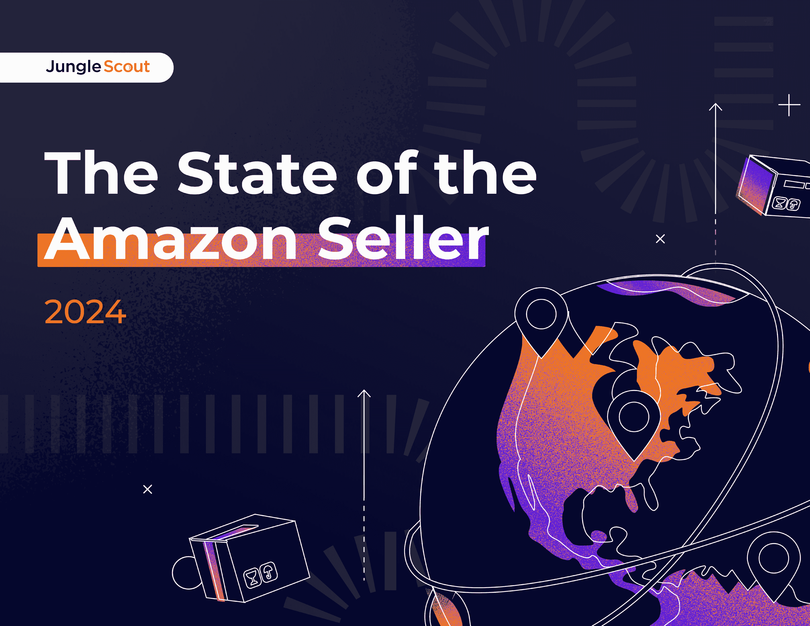

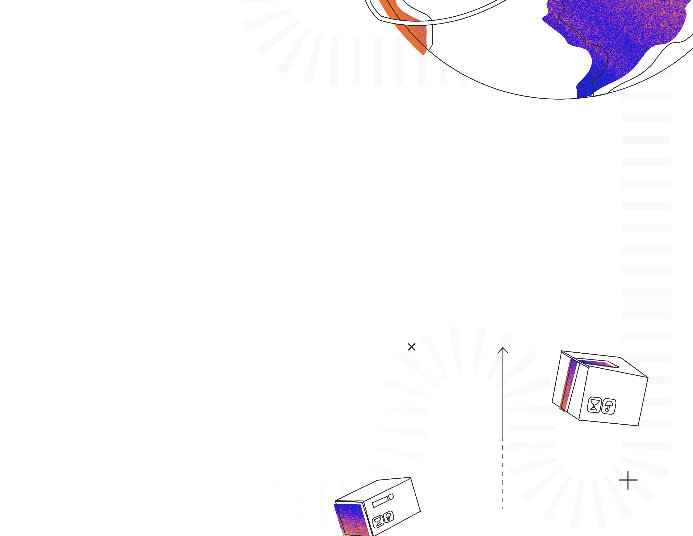

## Table of Contents

### Selling on Amazon in 2024 / 3

- By the numbers
- Timeline of Amazon
- Ecommerce expansion

### Plans, Goals & Challenges / 8

- Types of sellers & businesses
- Profile of a seller: Demographics
- 2024 plans & goals
- Common challenges

### Business Models & Strategies / 15

- Amazon business models
- Fulfillment methods: FBA vs. FBM

### Trending Products & Categories / 18

- Amazon product categories
- Sourcing
- Product volume
- Pricing

### Sales & Profitability / 24

- Sales: Monthly, lifetime averages
- Profits: Strengthening margins

### What it Takes to Sell on Amazon / 29

- Time & money
- Marketing investments & advertising spend
- Motivation & success factors

### About the Report / 38

- Methodology
- Using the data
- Jungle Scout: Leading Amazon Market Intelligence Tools

**Ch. 1**

**Ch. 5**

**Ch. 3**

**Ch. 2**

**Ch. 6**

**Ch. 4**

**Ch. 7**

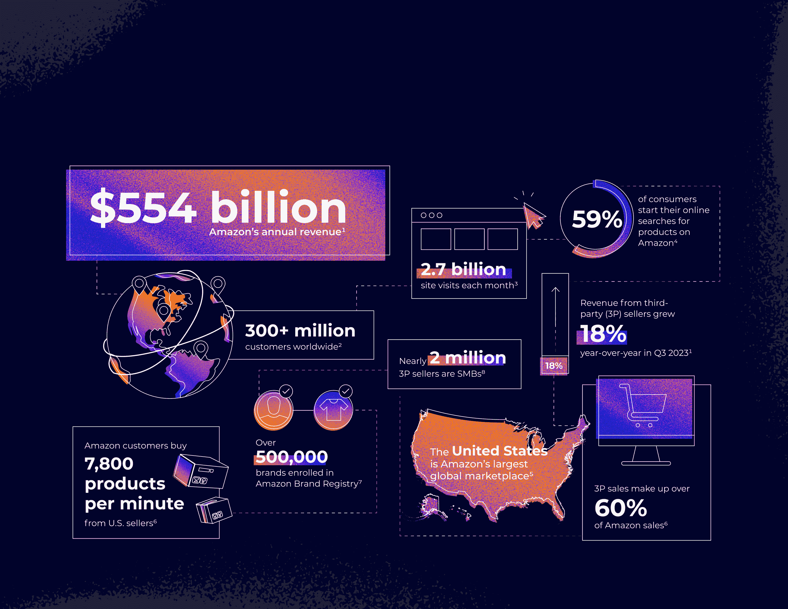

## 01. SELLING ON AMAZON IN 2024

### By the numbers

1. Amazon 10-Q filing  
2. eTail  
3. Similarweb  
4. Jungle Scout Q4 2023 Consumer Trends Report  
5. Webretailer  
6. Amazon Small Business Empowerment Report  
7. Amazon Brand Protection  
8. Amazon blog post

### Selling on Amazon in 2024

### Chapter 1

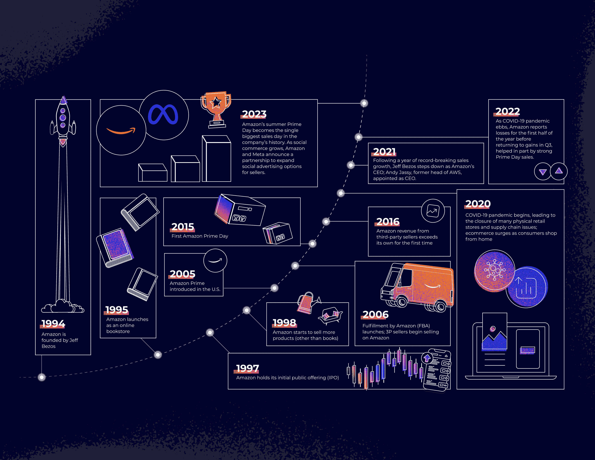

## 01. SELLING ON AMAZON IN 2024

### Timeline of Amazon

#### Ecommerce expansion

近年来，采用全渠道商业战略的品牌和卖家数量不断增加。2023年，有60%的亚马逊卖家、品牌和企业在至少一个其他渠道上销售。像沃尔玛这样长期的实体店领导者继续加强他们的电子商务平台，而去年推出的抖音小店也引发了人们对在社交媒体上销售的新兴兴趣。

除亚马逊外，卖家选择的Top平台如下：

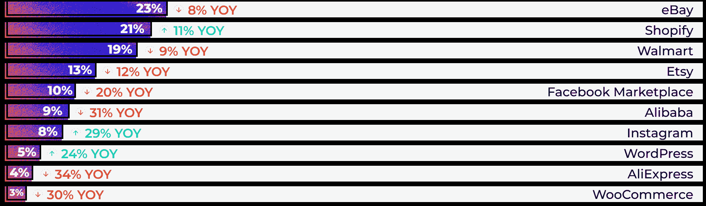

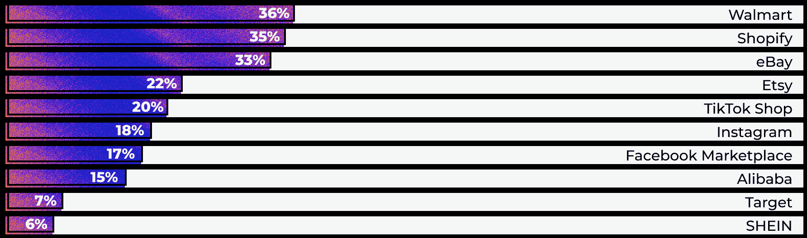

除亚马逊外，中小卖家会在2024年选择如下平台：

1. **Shopify — 36%**
2. **Walmart — 36%**
3. **eBay — 33%**
4. **Etsy — 22%**
5. **TikTok Shop — 20%**

除亚马逊外，大型企业卖家（品牌商&零售商）会在2024年选择如下平台：

1. **Walmart — 41%**
2. **eBay — 39%**
3. **Instagram — 29%**
4. **Alibaba — 29%**
5. **SHEIN — 22%**

除亚马逊外，卖家2024年预计还选择如下平台：

**20%** 的卖家预计2024年会选择 TikTok。

*Note: Respondents could select multiple options; therefore, percentages do not equal 100%.*

#### Global marketplaces

美国是亚马逊最老、最成熟的市场，也是亚马逊全球市场中访问量最大的。

去年，亚马逊在智利、哥伦比亚、尼日利亚和南非推出新市场的计划被推迟，使得2023年成为了6年来首次没有新的亚马逊市场问世的一年。尽管这些市场的更新时间表尚未公布，但据报道，亚马逊已经开始招募卖家加入其南非市场，预计将于2024年上半年推出。

卖家选择的全球站点如下：

一

**46%** 的卖家除了美国站点外，还至少选择了一个其他站点。

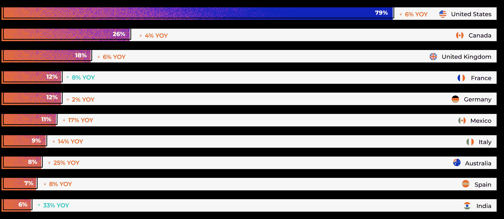

#### Tech trends: AI spotlight

2023年是人工智能的年代，涌现出了各种工具，可以帮助进行从创建品牌标识到构建销售报告等各种工作。尽管人工智能技术普及程度较高，但其仍处于萌芽阶段，预计在2024年，电子商务管理中采用人工智能工具的速度将继续快速增长。

尽管各种规模的企业都在亚马逊上使用人工智能，但大型企业卖家（品牌和零售商）对人工智能的使用速度要快得多。

##### AI主要用在那些方面？

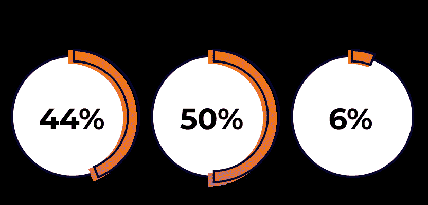

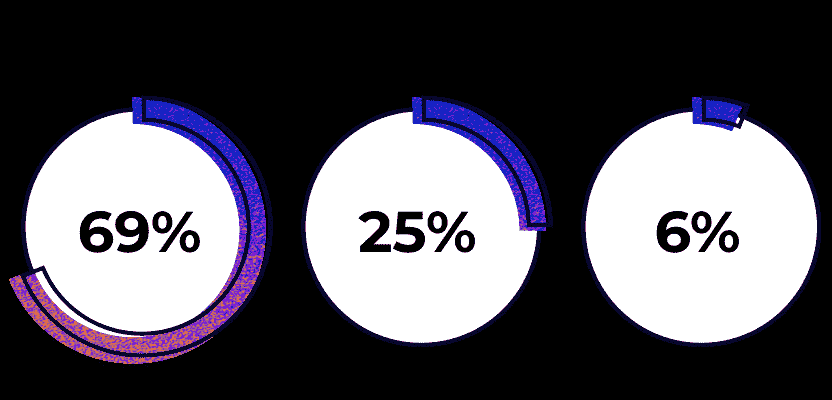

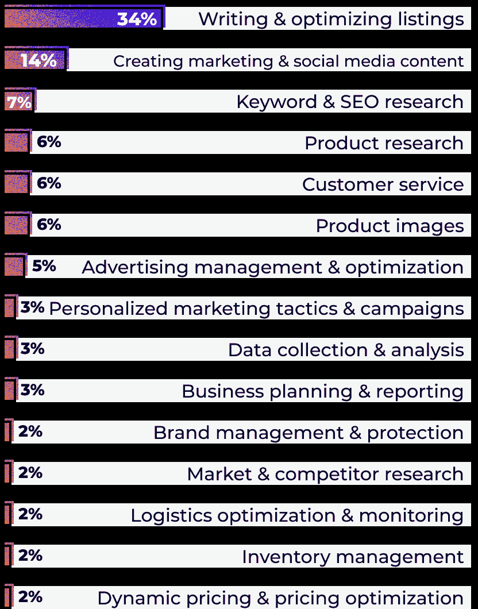

##### 您是否有使用过AI工具？

亚马逊中小卖家

亚马逊大型企业卖家（品牌商&零售商）

**48%** 的卖家已经开始使用AI来用于自己的商业运营了。

*Less than 1% — voice search, virtual try-on & other customer experiences, promotional planning, predictive analytics & forecasting, analyzing reviews, and other.*

*\*Other includes translation, payment processing, and packaging design, among other tasks.*

##### 准备好为您的亚马逊业务利用AI了吗？

Jungle Scout提供了AI工具，帮助您优化列表、分析评论等。

##### AI评论分析

利用人工智能分析您的品牌和竞争对手的评论，总结常见的客户反馈，并提供改进产品的建议。

##### AI Listing Builder

让人工智能一键使用高潜力关键词撰写引人入胜的产品列表。

##### AI销售分析

利用人工智能分析您的利润概况数据，并提供一份综合报告，包括关键销售见解和优化增长的建议。

**Try Jungle Scout AI**

## 02. 2024 PLANS, GOALS & CHALLENGES

### Chapter 2

### 2024 Plans, Goals & Challenges

亚马逊卖家（中小卖家、大型企业卖家）涵盖了各种各样的人群，拥有同样多样化的优先事项、关切和成功策略。

### Types of sellers and businesses

在亚马逊上销售产品赚钱的人包括小型企业所有者和经验丰富的电子商务老手，以及希望利用亚马逊庞大影响力的品牌经理和代理商。

#### 亚马逊中小卖家

- Solo entrepreneurs and small to midsize businesses (SMBs) that sell products on Amazon
- Less than $2 million in annual revenue
- 71% are 3P sellers
- 37% are 1P sellers

#### 大型企业卖家（品牌商&零售商）

- Large brands, retailers, or parent companies (encompassing multiple brands) that sell their products on Amazon
- $5 million or more in annual revenue
- 50% are 3P sellers
- 62% are 1P sellers

### 亚马逊中小卖家 vs. 大型企业卖家（品牌商&零售商）

亚马逊中小卖家与大型企业卖家（品牌商&零售商）也存在不同。

### 1P亚马逊自营 vs. 3P第三方卖家

“Amazon seller” often refers to the third-party (3P) sellers who generate over half of Amazon’s annual ecommerce sales. But there are also first-party (1P) sellers who sell their products to Amazon as a vendor.

#### 1P亚马逊自营

作为供应商向亚马逊销售产品，使用供应商中心VC。

#### 3P第三方卖家

在亚马逊平台上销售产品，使用卖家中心SC。

**In 2024, 亚马逊卖家类型如下：**

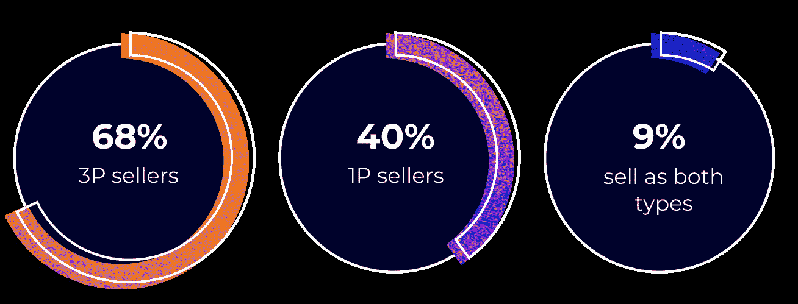

**65%** 的大型企业卖家既有亚马逊店铺，也有线下实体店铺。

而亚马逊中小卖家只有17%有线下店铺。

### Location*

#### 卖家的个人资料：人口统计学

各种背景、技能和兴趣的人都可以在亚马逊上找到成功。本报告中的数据涵盖了来自20多个国家、年龄在18至65岁以上的所有性别成年人。

##### Age

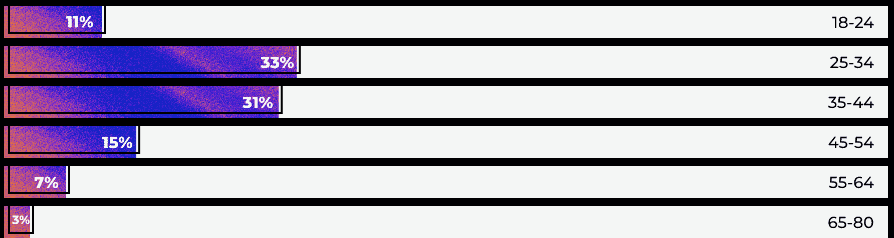

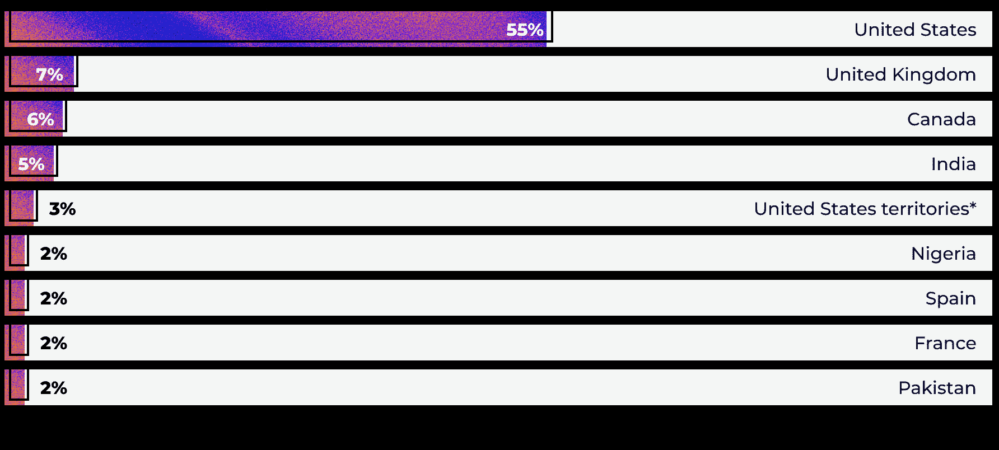

*All other countries = 1% or less.*

*\*Other countries include American Samoa, Guam, Northern Mariana Islands, Puerto Rico, and/or U.S. Virgin Islands.*

##### U.S. market spotlight

States where sellers and/or their businesses are located:

*All other states = 1% or less.*

California — **18%**

Florida — **12%**

New York — **6%**

Texas — **7%**

Wyoming — **5%**

Washington — **3%**

New Jersey — **3%**

Delaware — **3%**

Georgia — **3%**

Illinois — **3%**

Ohio — **3%**

Colorado — **2%**

Maryland — **2%**

North Carolina — **2%**

Pennsylvania — **2%**

Virginia — **2%**

##### Gender

##### Education

##### Employment

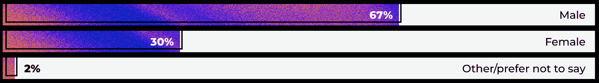

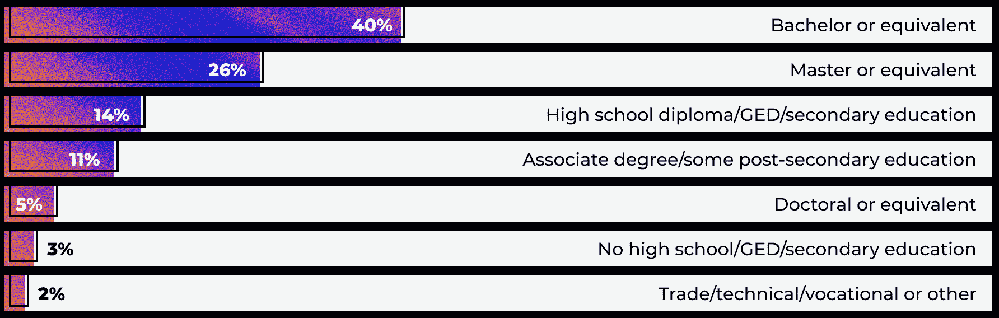

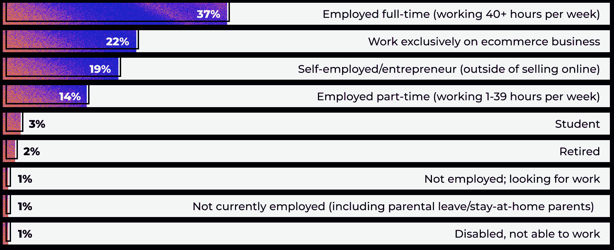

**61%** of Amazon sellers and SMBs own two or more brands.

**52%** of Amazon sellers have other side jobs or side hustles outside of selling online.

*Note: Numbers may not equal 100% due to rounding.*

11

The State of the Amazon Seller 2024 |

尝试新的营销策略

拓展到其他电子商务平台或在线渠道

增加市场份额

拓展到新的全球市场

进口产品

收集竞争情报

与社交媒体影响者合作

报告品牌/业务的健康状况

为产品进行促销活动

管理财务（现金流、订单规划等）

产品研究

保护业务免受劫持者、伪造者和其他不良手段的侵害

寻找供应商

获取客户评价

拓展到实体店铺

进口产品和管理国际贸易

## 02. 2024 PLANS, GOALS & CHALLENGES

### 2024 plans & goals

**Top focus areas in 2024: 亚马逊中小卖家**

**Top focus areas in 2024: 大型企业卖家（品牌商&零售商）**

随着电子商务的扩张，亚马逊企业也在紧随其后。超过一半的企业计划在今年加入新的电子商务平台。更多关于他们已经锁定的平台的详情，请参阅第一章。

亚马逊中小卖家也专注于通过建立市场份额和实施新的营销策略来发展业务。要了解他们正在投资哪些营销策略，请参阅第六章。

大型企业卖家（品牌商&零售商）专注于产品研究、业务绩效报告和保护品牌。

12

The State of the Amazon Seller 2024 |

## 02. 2024 PLANS, GOALS & CHALLENGES

### 中小卖家关注点

**Top 2024 focus areas by business function**

- 财务管理：监控开支、收入和其他财务指标
- 库存管理：跟踪FBA存储空间的可用性和费用
- 列表（Listing）优化：寻找相关且高质量的关键词
- PPC管理：为新产品设置PPC广告系列
- 产品研究：寻找新的（或首个）要销售的产品

### 大型企业卖家（品牌商&零售商）

**Goals for Amazon sales channels in 2024**

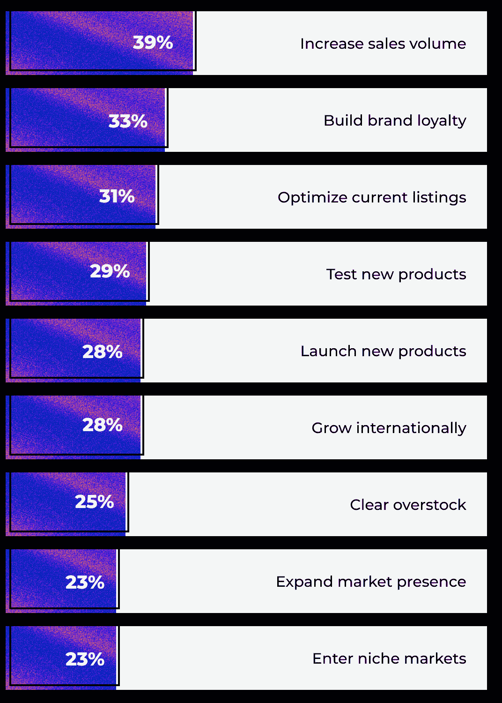

13

The State of the Amazon Seller 2024 |

## 02. 2024 PLANS, GOALS & CHALLENGES

### Common challenges

虽然在各种规模的亚马逊企业中存在一些共同的挑战，但对于亚马逊中小卖家与大型企业卖家（品牌和零售商）而言，最紧迫的问题之间存在一些显著差异。

对于中小卖家而言，获取客户评价和产品研究是排名最高的挑战，而对于大型企业卖家（品牌和零售商）而言，则是品牌塑造和增加市场份额。

尝试新的营销策略和管理PPC广告是中小企业卖家面临的前十大业务挑战之一，但不是大型企业卖家（品牌和零售商）所面临的。

收集竞争情报和管理国际贸易是大型企业卖家（品牌和零售商）面临的前十大业务挑战之一，但不是中小企业卖家所面临的。

- 获取客户评价
- 产品研究（包括寻找或开发新产品）
- 尝试新的营销策略
- 优化产品列表
- 增加市场份额
- 管理PPC广告
- 寻找供应商
- 管理财务（现金流、订单规划等）
- 管理库存
- 品牌塑造业务/产品（定位、包装、营销等）

- 品牌塑造业务/产品（定位、包装、营销等）
- 增加市场份额
- 获取客户评价
- 管理库存
- 优化产品列表
- 管理财务（现金流、订单规划等）
- 寻找供应商
- 产品研究（包括寻找或开发新产品）
- 收集竞争情报
- 进口产品/管理国际贸易

**Top 10 business challenges in 2024: 亚马逊中小卖家**

**Top 10 business challenges in 2024: 大型企业卖家（品牌商&零售商）**

14

The State of the Amazon Seller 2024 |

在2024年，与去年一样，不断上涨的成本仍然是亚马逊卖家、品牌和企业的主要关注点。超过三分之一的人表示他们担心广告、运输和商品成本的增加。这些担忧可能会导致一些企业重新考虑对外部资源的投资。

- 广告成本上涨
- 运输成本上涨
- 商品成本上涨
- 竞争加剧导致价格下降
- 仓储费用上涨
- 亚马逊调整搜索结果以支持付费结果而不是有机结果
- 通货膨胀
- 亚马逊的政策和服务条款变更
- 继续需要更多资金以有效在线销售
- 跟上在线销售所需的相关知识

## 02. 2024 PLANS, GOALS & CHALLENGES

### 前十大外部挑战：所有亚马逊卖家

成本担忧不仅仅局限于品牌和卖家：根据Jungle Scout的2023年第四季度消费者趋势报告，**85%**的消费者表示通货膨胀上升已经影响了他们的支出。

### 经济和与成本相关的担忧：所有亚马逊卖家

**45%**的亚马逊卖家表示他们会考虑聘请代理机构来帮助管理他们的电子商务业务，较去年减少了13%。

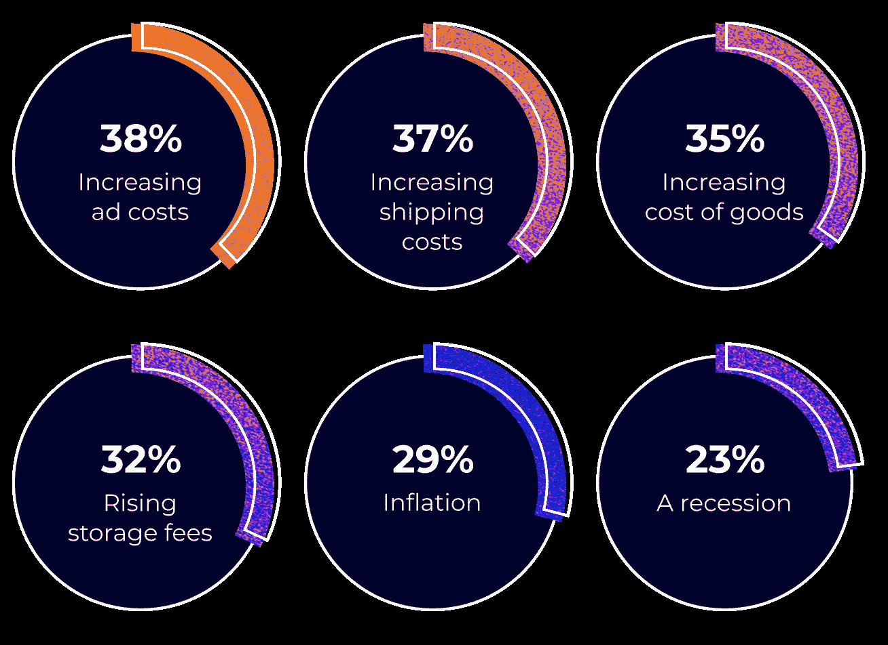

15

The State of the Amazon Seller 2024 |

## 03. BUSINESS MODELS & STRATEGIES

### Chapter 3

### Business Models & Strategies

品牌和卖家如何经营他们的亚马逊业务？有些人销售来自多个品牌的热门产品，而其他人则创建自有品牌的产品，甚至手工制作物品。他们选择的业务模式可能取决于各种因素，但一个成功的模式有两个基本要求：有效的履行方法和一个能在亚马逊全球市场之一竞争的产品。

### Amazon business models

- 对于季节性销售和特定促销活动至关重要 - **33%**
- 一个强大的渠道，与其他线上和线下的努力相平衡 - **33%**
- 我们的主要零售渠道，大部分销售在此发生 - **32%**
- 主要用作国际扩张和进入新市场的工具 - **31%**
- 在更广泛发布之前，用作新产品的试验场 - **30%**

对于大型企业卖家（品牌和零售商）而言，亚马逊只是广泛零售业务的一部分，通常涵盖在线和实体渠道。对于中小企业卖家而言，亚马逊可能是他们销售产品的主要渠道，甚至是唯一渠道。

### 大型企业卖家（品牌&零售商）

亚马逊在大型企业卖家（品牌或零售商）整体销售策略中的角色差异很大。对于一些企业来说，它负责大部分年度销售额；对于其他企业来说，它用于品牌建设和扩展。

### 大型企业卖家（品牌和零售商）：亚马逊对您的业务有多重要？

- 作为我们直接面向消费者的网站的补充，主要是为了增加曝光 - **34%**

**75%**的在亚马逊上的大型企业卖家（品牌和零售商）表示，这个渠道有助于提升品牌知名度。

*Note: Respondents could select multiple options; therefore, percentages do not equal 100%*

16

The State of the Amazon Seller 2024 |

## 03. BUSINESS MODELS & STRATEGIES

- 单位销量和收入
- 最佳利润率
- 市场份额增长
- 实现目标广告投资回报率
- 客户评价和评分（ratings）

除了单位销量和收入之外，大型企业卖家（品牌和零售商）通过利润率、市场份额增长和广告投资回报率等指标来衡量亚马逊作为销售渠道的成功程度。

### 大型企业卖家（品牌和零售商）衡量在亚马逊上成功的前五种方式*

### 亚马逊中小卖家

私有标签是卖家最常见的销售模式，但并不是亚马逊上唯一可行的销售模式。事实上，对于有抱负的创业者来说，通过采取不同的路线，比如零售套利或物流代发，开始他们的销售之旅可能更容易。

点击此处了解如何在亚马逊FBA上销售私有标签产品。

### 中小企业卖家的顶级亚马逊业务模式

\*Ranked from highest to lowest by the percentage of respondents who say they use each metric to measure success.

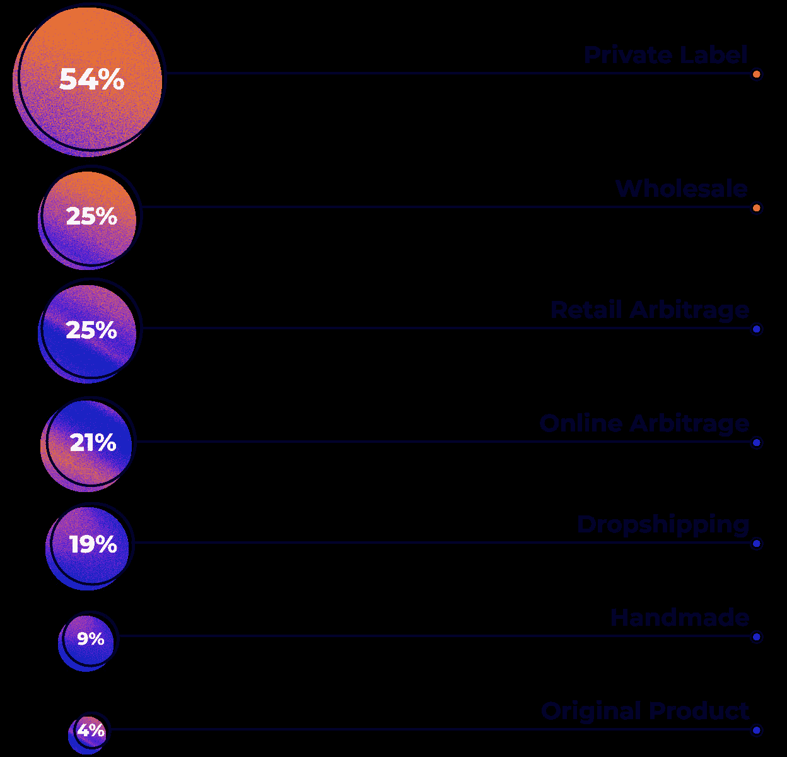

**1**

**2**

**3**

**4**

**5**

**Read more**

17

The State of the Amazon Seller 2024 |

## 03. BUSINESS MODELS & STRATEGIES

#### Fulfillment methods

亚马逊复杂的物流系统和全球订单履行基础设施使其成为电子商务企业的一个引人注目的平台。

亚马逊履行服务（Fulfillment by Amazon，简称FBA）是亚马逊卖家和品牌最流行的履行方法。然而，超过三分之一的卖家选择自行处理履行，这种方法被称为卖家履行（Fulfillment by Merchant，简称FBM）。

值得注意的是，过去一年中，FBA和FBM的使用率分别减少了3%和9%。

**亚马逊履行服务（FBA）：**

品牌或卖家依赖亚马逊来履行他们的订单。亚马逊存储和发货库存，并处理客户支持和退货。

**卖家履行（FBM）：**

品牌或卖家在亚马逊上列出他们的产品，但自行管理所有的库存、发货和客户支持。

**Which fulfillment methods do Amazon sellers, brands, and businesses prefer?**

**Of the total number of sellers using either FBA, FBM, or both:**

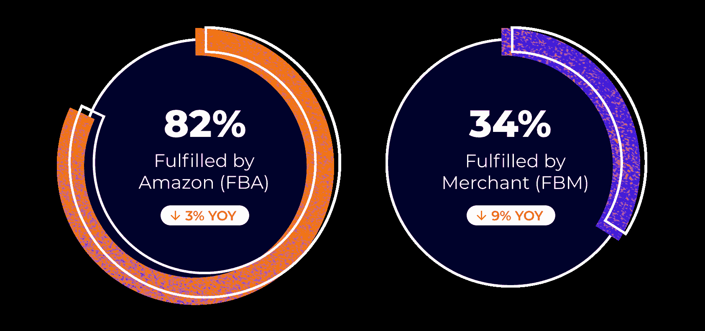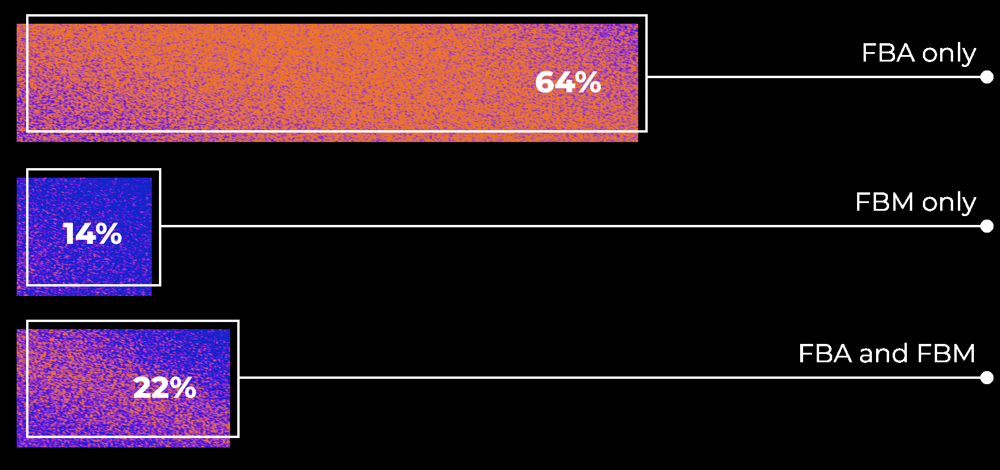

**Learn more**

## 04. TRENDING PRODUCTS & CATEGORIES

### Chapter 4

### Trending Products & Categories

在**2024**年，在亚马逊上销售的哪些类别和产品最受欢迎（也是最赚钱的）？

### Amazon product categories

你几乎可以在亚马逊上找到任何产品，从食品杂货到数字图书再到汽车。对于中小企业卖家来说，家居和厨房是销售最多的类别。而对于企业品牌和零售商来说，家电是一些最常销售的产品之一。

- Home & Kitchen
- Beauty & Personal Care
- Clothing, Shoes & Jewelry
- Toys & Games
- Health, Household & Baby Care
- Appliances
- Beauty & Personal Care
- Clothing, Shoes & Jewelry
- Arts, Crafts & Sewing
- Automotive Parts

**Top Amazon product categories for 中小企业卖家**

**Top Amazon product categories for 大型企业卖家（品牌商&零售商）**

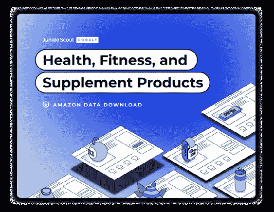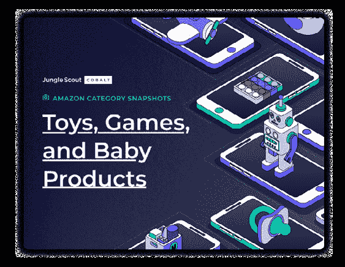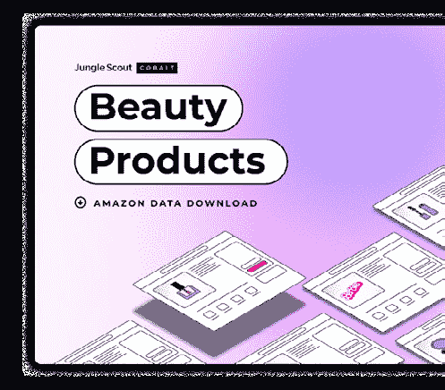

**Explore Jungle Scout Cobalt data on sales trends, leading brands, popular products, and more for specific Amazon categories in our free reports.**

***Read more >***

***Download now >***

***Explore the data >***

***Get a copy >***

19

The State of the Amazon Seller 2024 |

## 02. AMAZON SELLERS: THE BASICS

#### 亚马逊卖家关注的Top类目

| Category | 2024 | 2023 | YoY change |
|---|---:|---:|---:|
| 1. Home & Kitchen | 35% | 33% | **6%** |
| 2. Beauty & Personal Care | 26% | 25% | **4%** |
| 3. Clothing, Shoes & Jewelry | 20% | 20% | **0%** |
| 4. Toys & Games | 18% | 16% | **13%** |
| 5. Health, Household & Baby Care | 17% | 17% | **0%** |
| 6. Baby | 16% | 15% | **7%** |
| 7. Electronics | 16% | 17% | **6%** |
| 8. Sports & Outdoors | 16% | 16% | **0%** |
| 9. Arts, Crafts & Sewing | 14% | 15% | **7%** |
| 10. Books | 14% | 12% | **17%** |
| 11. Grocery & Gourmet Food | 13% | 13% | **0%** |
| 12. Office Products | 13% | 13% | **0%** |
| 13. Pet Supplies | 13% | 12% | **8%** |
| 14. Tools & Home Improvement | 13% | 12% | **8%** |
| 15. Appliances | 12% | 12% | **0%** |
| 16. Garden & Outdoor | 11% | 11% | **0%** |
| 17. Cell Phone & Accessories | 10% | 10% | **0%** |
| 18. Apps & Games | 8% | 8% | **0%** |
| 19. Automotive Parts & Accessories | 8% | 10% | **20%** |
| 20. Computers | 6% | 7% | **14%** |
| 21. Handmade | 6% | 6% | **0%** |
| 22. Collectibles & Fine Art | 5% | 5% | **0%** |
| 23. Industrial & Scientific | 5% | 5% | **0%** |
| 24. CDs & Vinyl | 4% | 4% | **0%** |
| 25. Luggage & Travel Gear | 4% | 3% | **33%** |
| 26. Video Games | 4% | 4% | **0%** |
| 27. Other | 3% | 3% | **0%** |

在研究要销售的产品时，亚马逊卖家寻找一些关键特征：

- 高需求和低竞争。
- 有机会通过产品或营销改进来超越竞争对手。
- 可以以合理的价格从供应商那里制造和采购的产品。

## 04. TRENDING PRODUCTS & CATEGORIES

20

The State of the Amazon Seller 2024 | 04. TRENDING PRODUCTS & CATEGORIES

## 04. TRENDING PRODUCTS & CATEGORIES

#### Sourcing

中国仍然是各种规模的亚马逊业务的主要供应国。然而，随着海外运输和制造价格的波动，品牌和卖家们寻找库存的目标国家也在变化。

**亚马逊产品的TOP供应国**

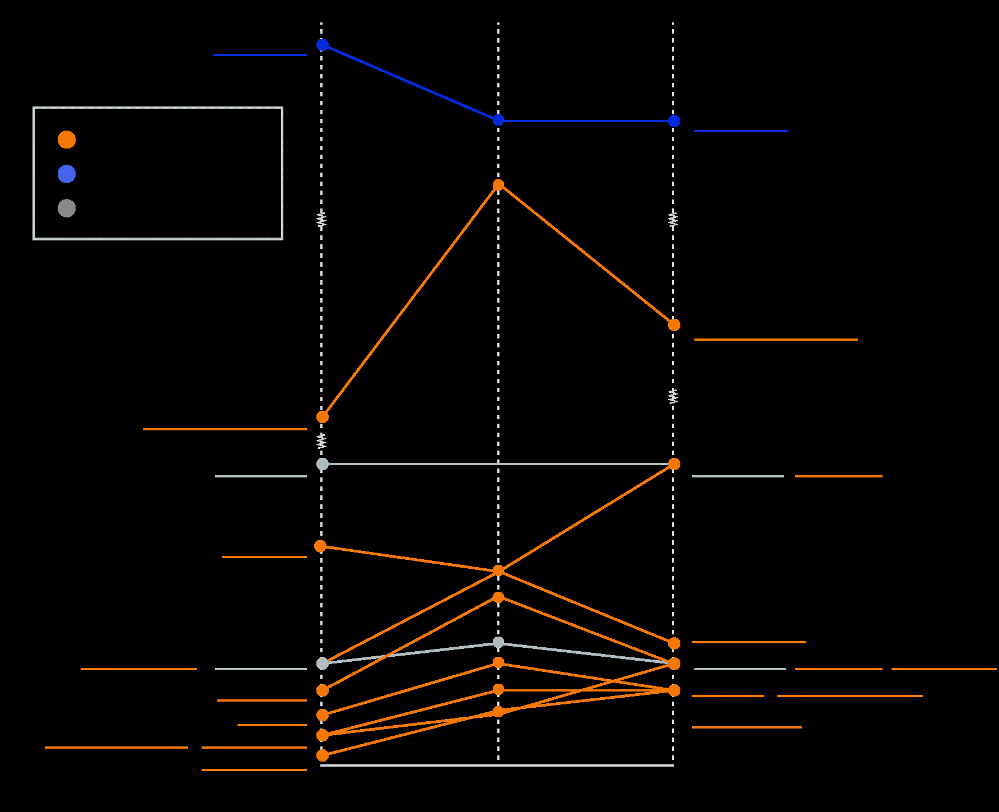

去年，从美国采购产品的亚马逊卖家和品牌数量同比下降了17%，而从印度采购的数量则增加了56%。

过去两年，从比利时和越南采购产品的卖家和品牌数量一直在稳步增长。

---

21

The State of the Amazon Seller 2024 | 04. TRENDING PRODUCTS & CATEGORIES

#### Product Volume

在亚马逊上，大多数卖家、品牌和企业业务（89%）销售50个或更少的产品，但是中小企业和大型企业卖家（品牌商&零售商）的产品目录规模之间存在显著差距。超过75%的中小企业卖家在亚马逊上提供的产品少于10个，而近40%的大型企业卖家（品牌和零售商）销售的产品超过100个。

亚马逊卖家在亚马逊平台在售的产品个数情况如下：

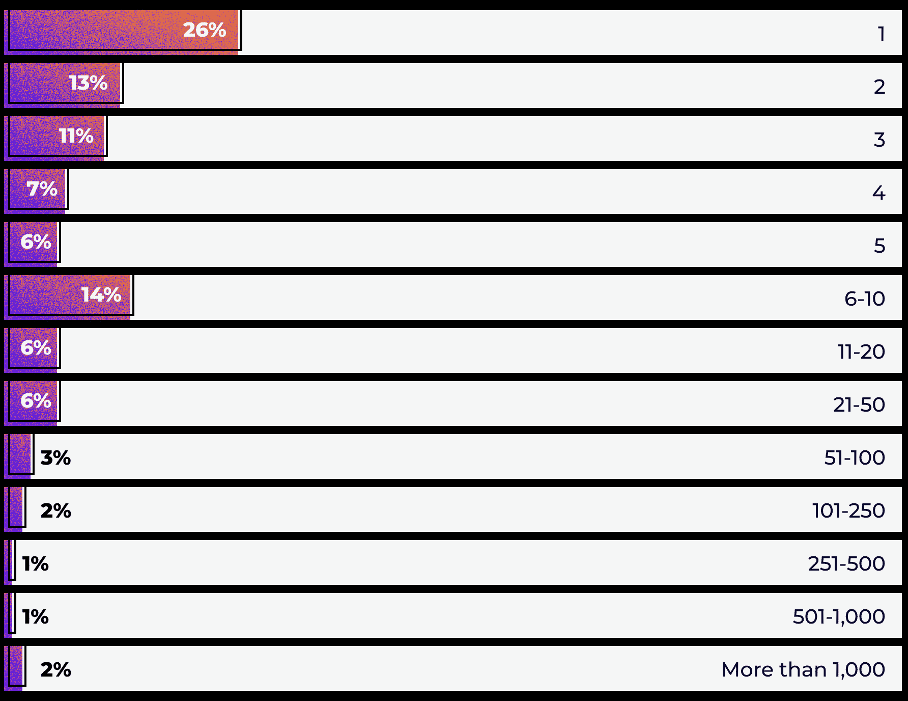

对于较小的企业来说，产品目录规模正在缩小。在2023年，与前一年相比，在亚马逊上只列出一种产品的卖家和中小企业的数量增加了超过300%。

---

22

The State of the Amazon Seller 2024 | 04. TRENDING PRODUCTS & CATEGORIES

#### Pricing

在为他们的产品定价时，企业品牌和卖家必须权衡生产、运输和营销的成本，以及竞争对手的收费和消费者愿意支付的费用。

许多人使用三分之一法则：将产品销售价格的三分之一用于产品本身，支付三分之一的亚马逊费用，将剩余的三分之一作为收入。

亚马逊产品平均价格如下：

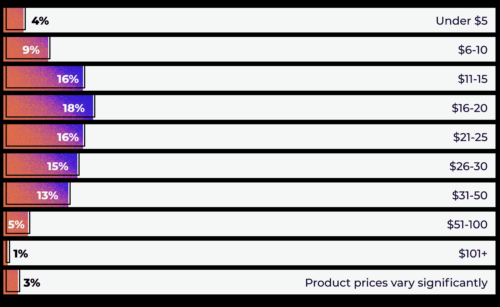

**61%** 的亚马逊卖家会把他们的产品定价在$16和$50之间。

---

23

The State of the Amazon Seller 2024 |

#### Cobalt - 您亚马逊增长的秘密武器

Jungle Scout Cobalt 是一款领先的亚马逊市场情报和广告解决方案，专为企业品牌、零售商和电商代理而设计，利用数万亿数据点提供支持。

Cobalt拥有一套强大的工具套件，可帮助您在亚马逊上实现增长和盈利。

- **Retail Insights** 整合了来自多个Seller Central和Vendor Central账户的数据，呈现在统一的数据报表上，使跟踪绩效和制定战略决策变得更加容易。
- **Market Intelligence** 将您自己的亚马逊业务数据（如定价、库存和广告支出）放置在更广泛的市场背景下，例如市场份额和销售趋势，以便您分析市场和竞争对手。
- **Ad Accelerator** 提供自动化功能，节省时间和资源，同时提供有价值的见解和建议，用于优化广告活动并最大化投资回报率。
- **Digital Shelf Analytics** 提供关于关键词曝光的智能分析，详细描述您的产品和竞争对手在亚马逊搜索结果中的排名情况。

**See how Cobalt can make Amazon market research, reporting, and ad management easier for your team.**

**“Cobalt is a valuable tool for any Amazon brand or vendor.”** — MARIE LAWSON

**“Cobalt has been fantastic for when we need to provide answers to stakeholders.”** — ELLIOT FREY

**“Cobalt gives full visibility of our performance on Amazon.”** — LAURA TAYLOR

**“Cobalt has unlocked many possibilities for our team.”** — KIRK LUTZ

**Book a demo**

---

24

The State of the Amazon Seller 2024 | 05. SALES & PROFITABILITY

## 05. SALES & PROFITABILITY

### Sales

在亚马逊上的收入和利润涵盖了广泛的范围——企业规模、电商经验和销售模式都在任何品牌或卖家的成功中发挥作用。

在本章中，我们将探讨中小企业卖家和年收入数百万美元的企业品牌和零售商在销售业绩和盈利能力方面的表现。企业可以期望通过亚马逊赚取多少钱？他们可以期望渠道多快盈利？什么样的卖家可以实现百万美元的销售额？

---

25

The State of the Amazon Seller 2024 | 05. SALES & PROFITABILITY

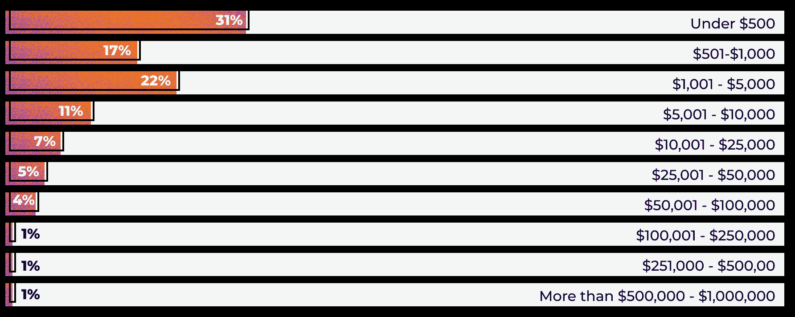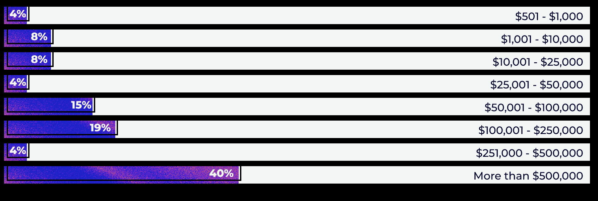

**52%** of Amazon sellers report sales above $1,000/month

**63%** of brands and retailers report sales above $100,000/month

**30%** of Amazon sellers report sales above $5,000/month

**40%** of brands and retailers report sales above $500,000/month

即使对于独立卖家和小型企业来说，亚马逊带来的收入也可能比普通的兼职更多。19%的中小型企业卖家月均销售额超过1万美元。对于企业品牌和零售商来说，这也是一个利润丰厚的渠道：78%的企业月均销售额超过5万美元。

**Average monthly sales**

**Amazon Sellers & SMBs**

**Enterprise Brands & Retailers**

---

26

The State of the Amazon Seller 2024 | 05. SALES & PROFITABILITY

#### Lifetime Sales

**Amazon Sellers & SMBs**

**Enterprise Brands & Retailers**

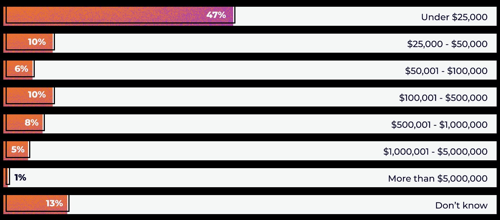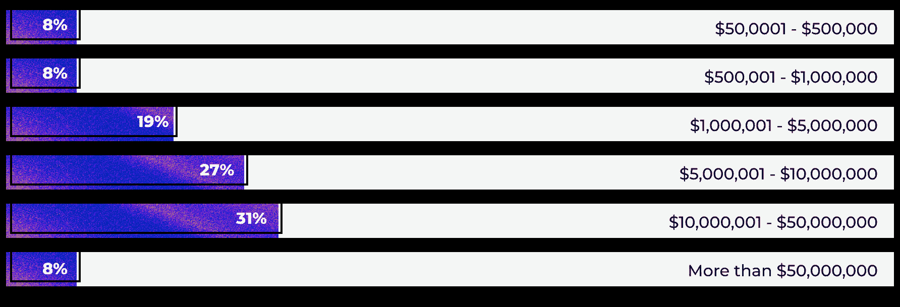

为了在亚马逊上增加销售额，企业品牌和零售商需要快速获取当前和历史绩效数据。

Cobalt的Retail Insights将来自多个Seller和Vendor Central账户的数据放置在一个界面上，使得以下操作更加便捷：

- 为在亚马逊上的增长提出战略性建议提供合理的理由
- 构建关于销售和收入绩效的定制报告
- 在亚马逊上管理多个品牌
- 消除由手动收集数据导致的报告错误
- 立即对广告绩效、关键词曝光份额等变化做出反应

**See all of your Amazon performance data in one place.**

---

27

The State of the Amazon Seller 2024 | 05. SALES & PROFITABILITY

*Note: Data in this section represents gross profit margin*

#### Amazon Profit Margins

超过一半的亚马逊卖家和中小型企业（57%）的净利润率超过10%，超过三分之二（81%）的企业品牌和零售商报告了相同的情况。超过一半（54%）的品牌和零售商的利润率超过20%。

尽管卖家、品牌和消费者都对持续的成本担忧，但对于将近三分之二的卖家而言，有望摆脱2022年报告的年度盈利下降。\*有关2024年亚马逊卖家在经济和成本相关担忧方面的更多信息，请参阅第2章。

**44%** of sellers and SMBs have a profit margin higher than 15%

**62%** of enterprise brands and retailers have a profit margin higher than 15%

**25%** more sellers, brands, and businesses saw profits from Amazon sales increase in 2023 compared to the previous year.

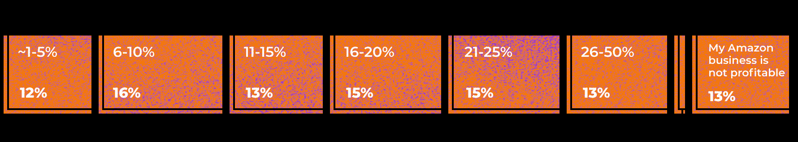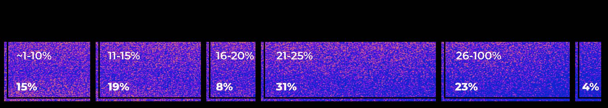

**Amazon Sellers & SMBs**

**Enterprise Brands & Retailers**

---

28

The State of the Amazon Seller 2024 | 05. SALES & PROFITABILITY

#### Lifetime Profits

**Amazon Sellers & SMBs**

**Enterprise Brands & Retailers**

趋势线：2023年的利润与2022年相比如何？

超过四分之一的小型卖家和中小企业（27%）表示他们的亚马逊利润从2022年增加到2023年，近三分之二（62%）的企业品牌和零售商也表示同样情况。

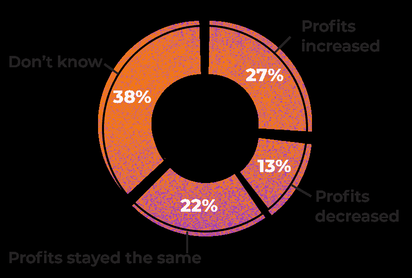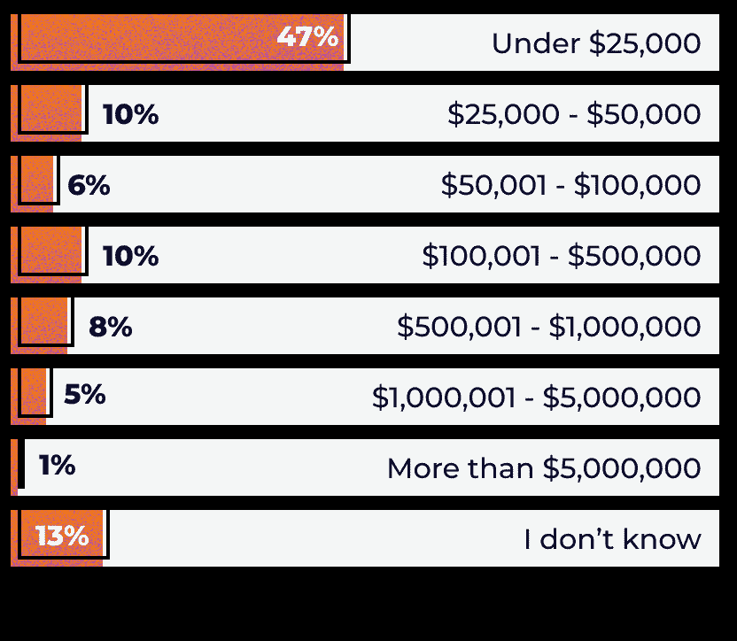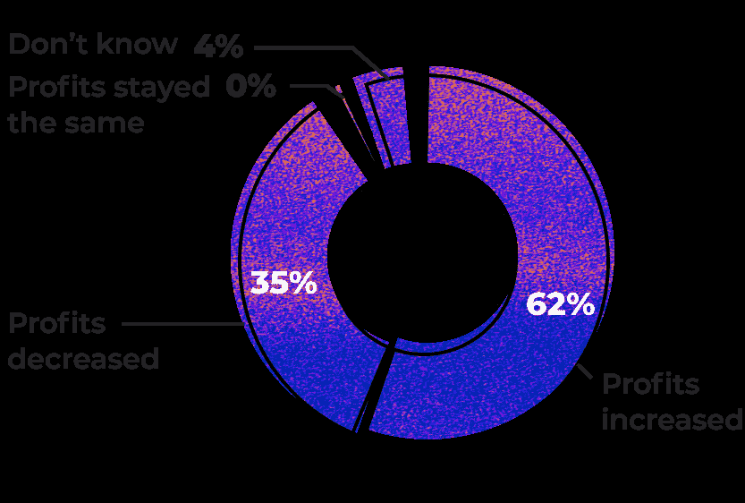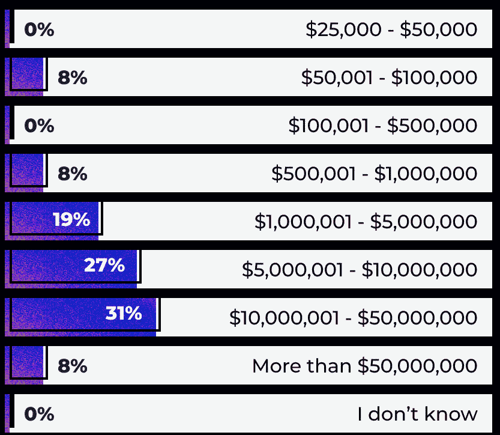

在2023年利润增加的卖家和中小型企业中，大多数（67%）看到了1%至10%之间的增长。

在2023年利润增加的企业品牌和零售商中，大多数（63%）看到了5%至10%之间的增长。

**30%** of sellers and SMBs have lifetime profits over $50,000

**85%** of **enterprise brands and retailers** have lifetime profits over $1,000,000

---

29

The State of the Amazon Seller 2024 | 06. WHAT IT TAKES TO SELL ON AMAZON

## 06. WHAT IT TAKES TO SELL ON AMAZON

在亚马逊上没有一个单一的成功公式。一些商业模式需要比其他模式更大的投资，一些卖家在找到成功之前尝试了多次产品推出，一些品牌比其他品牌拥有更多资源来专注于该渠道。

尽管如此，时间和动力对于任何业务都是至关重要的，而营销投资是竞争电商领域的一个重要组成部分。

### Time

对于新卖家和亚马逊业务来说，学习什么是一个好的产品机会、顾客需要什么以及如何管理电商物流需要时间。对于已经建立起来的卖家和企业品牌来说，时间是建立知名度、优化广告活动以及保持竞争优势的最重要资源之一。

**Time it takes to start an Amazon business**

*From first efforts to having a live product listing*

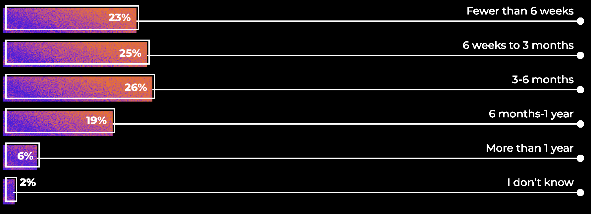

Almost three-quarters (74%) of sellers and brands have been able to get their Amazon business up and running in less than 6 months.

---

30

The State of the Amazon Seller 2024 | 06. WHAT IT TAKES TO SELL ON AMAZON

### Time Spent on Amazon Business Each Week

维持盈利的亚马逊渠道所需的时间投资取决于多个因素——从目录规模到履行模式再到技术水平。

虽然大多数卖家和品牌每周在4到20小时内管理他们的亚马逊业务，但在2023年，每周只花费4小时或更少时间在亚马逊业务上的卖家数量增加了138%（达到19%，而去年仅为8%）。

这与卖家和中小型企业的目录规模缩减以及快速采用节省时间的AI工具来进行渠道管理的趋势相关。

\*在第四章了解有关产品数量变化的趋势的更多信息。

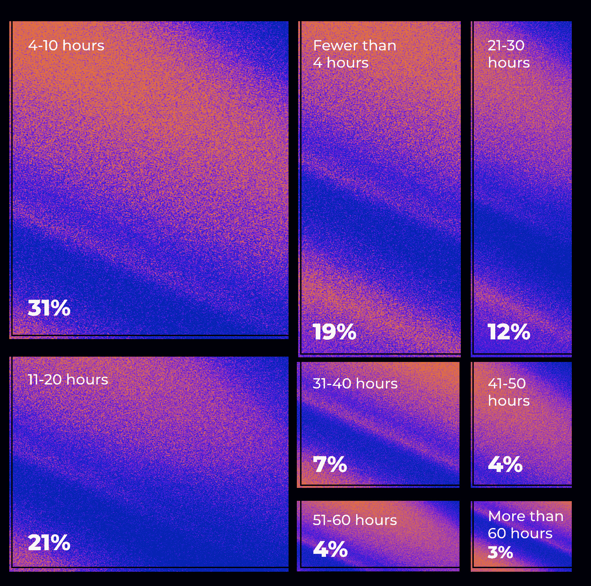

---

31

The State of the Amazon Seller 2024 | 06. WHAT IT TAKES TO SELL ON AMAZON

### Money

大多数亚马逊业务，无论是新卖家还是知名品牌正在拓展其销售渠道，都会进行某种形式的前期投资。这可能包括市场调研投资、产品成本、存储和卖家费用以及广告费用。

对于大多数企业（64%），这种前期投资低于5000美元——25%的企业花费低于1000美元。

幸运的是，回报很高。超过三分之一（35%）的卖家和中小型企业在不到6个月内开始盈利。对于企业品牌和零售商来说，更多的资源意味着更短的启动时间：77%的企业在不到3个月的时间内从亚马逊获利。

**Time it takes to turn a profit: All sellers, brands, and businesses**

**Money spent to start on Amazon: All sellers, brands, and businesses**

**58%** of all businesses are profitable within a year of launching on Amazon.

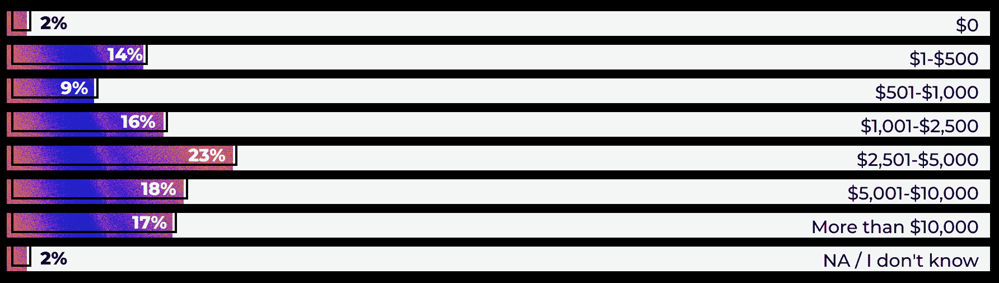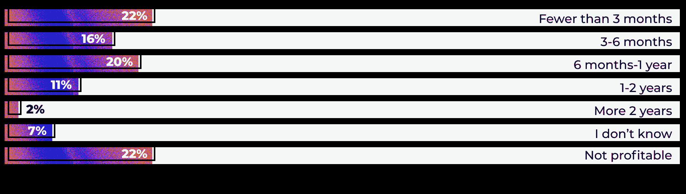

---

32

The State of the Amazon Seller 2024 | 06. WHAT IT TAKES TO SELL ON AMAZON

#### Funding Sources: Amazon Sellers and SMBs

Most sellers and SMBs are “bootstrappers” — 81% say they at least partially funded their business with their own cash.

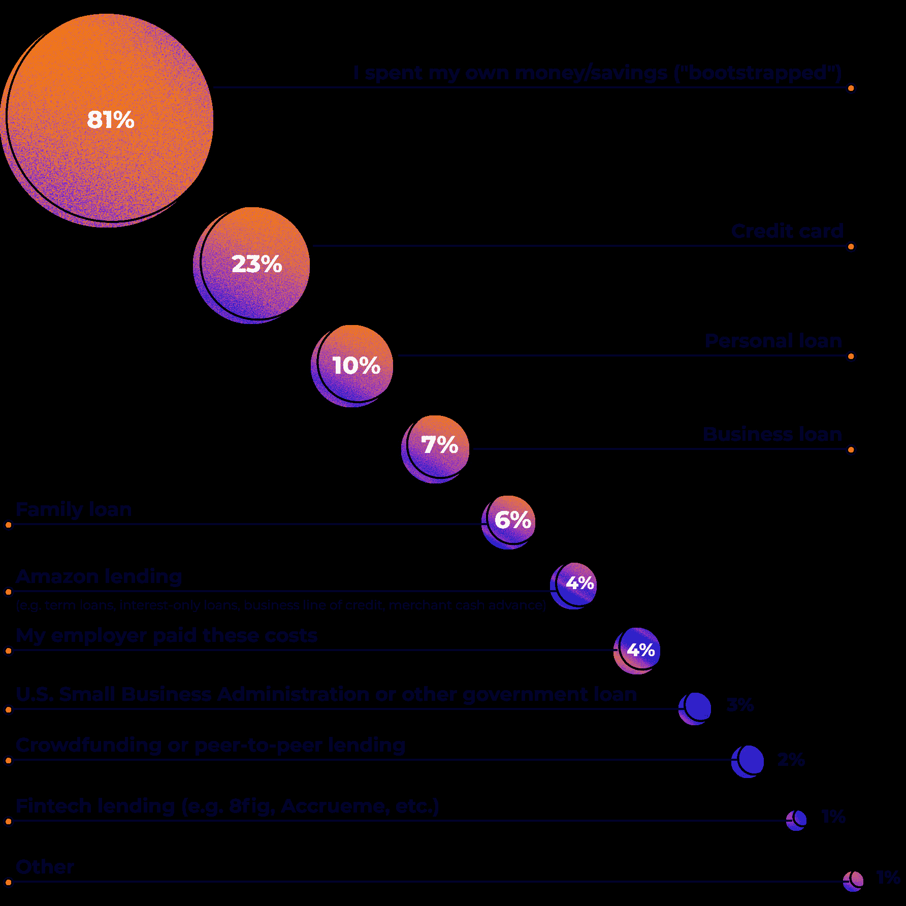

## The State of the Amazon Seller 2024

## 06. WHAT IT TAKES TO SELL ON AMAZON

**Marketing investments**

广告已成为在电子商务中竞争的关键因素，也是小型卖家和企业品牌最大的差异之一。

在亚马逊上，84%的所有企业都在亚马逊内外进行产品广告投放。对于卖家和中小型企业来说，电子商务平台是广告投放的首选地，有58%的企业投资于按点击付费（PPC）广告。而对于品牌和零售商来说，付费搜索广告是最受欢迎的，有64%的企业通过谷歌等渠道进行广告投放。

**Top channels where Amazon businesses advertise their products**

- **Search engines/paid search** *(e.g., Google Ads)*
- **Social media** *(e.g., paid Facebook ads, Instagram content)*
- **Ecommerce platforms** *(e.g., Amazon PPC ads, Walmart Sponsored Products ads)*
- **Traditional media** *(e.g., radio, TV, & print ads)*
- **None of the above*

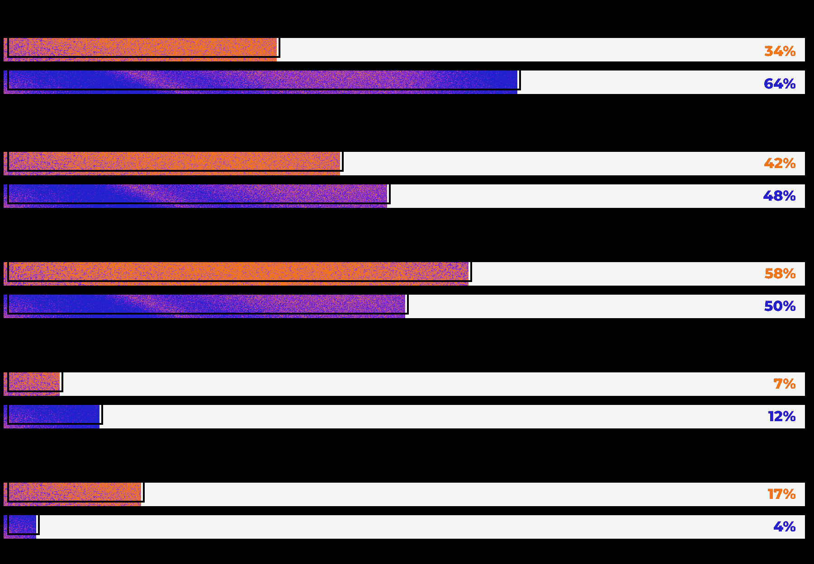

Sellers & SMBs  
Enterprise Brands & Retailers

**最大化您的亚马逊广告投资回报率**

广告对销售增长至关重要，但也是在亚马逊销售中最常见的挑战之一。

Cobalt的广告加速器提供了先进的自动化功能，节省时间，提高广告活动的绩效，并消除了以下方面的猜测：

- 扩大您的广告投放力度并管理多个广告账户
- 控制广告支出并有效地定位您的理想客户
- 增加收入并减少广告预算浪费
- 根据广告活动绩效调整按点击付费出价
- 创建报告，澄清您的广告努力如何影响销售和盈利能力

**Learn more**

## 06. WHAT IT TAKES TO SELL ON AMAZON

**Breakdown by ad type**

**Ecommerce Channels**

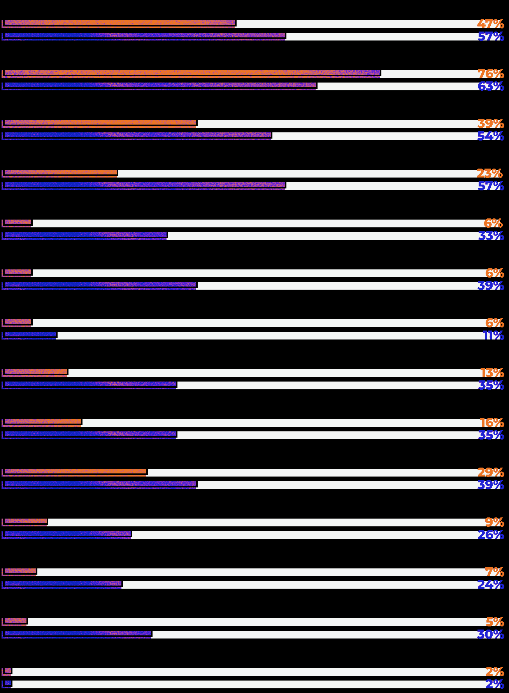

- Amazon pay-per-click (PPC) ads - *Sponsored Brands*
- Amazon pay-per-click (PPC) ads - *Sponsored Products*
- Amazon pay-per-click (PPC) ads - *Sponsored Display*
- Amazon Video ads
- Amazon DSP
- Amazon Live
- Amazon Editorial Recommendations
- Amazon Posts
- Amazon Vine Program (reviews)
- Amazon A+ Content
- eBay Promoted Listings/ eBay ads
- Etsy PPC ads
- Walmart Connect/ Walmart ads
- Other

**Search Engines**

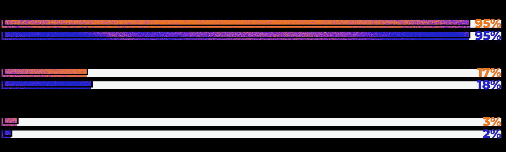

- Google ads
- Bing ads
- Other

**Traditional Media**

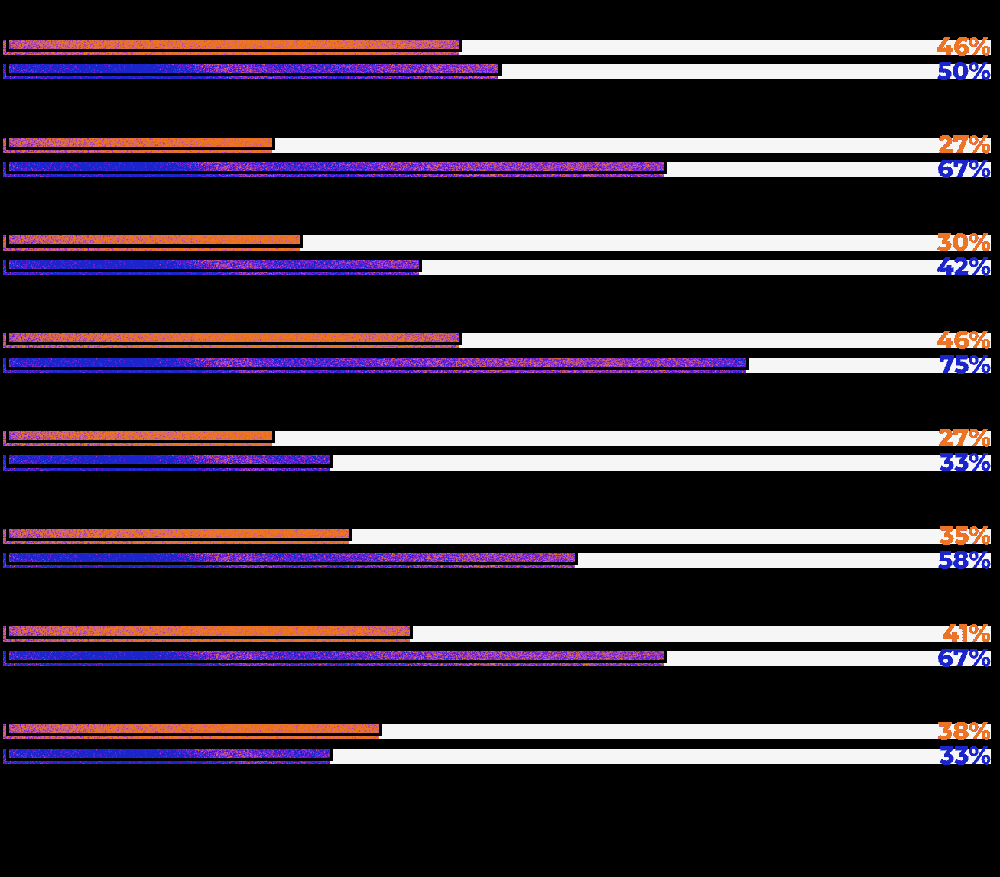

- TV ads
- Podcast ads
- Radio ads
- Print ads (newspaper, magazines)
- Billboards
- Public relations
- Events/trade shows
- Direct mail

Sellers & SMBs  
Enterprise Brands & Retailers

## 06. WHAT IT TAKES TO SELL ON AMAZON

超过**20%**的所有亚马逊企业在品牌或个人社交媒体账号上发布广告内容。

将近五分之一的品牌（18%）与社交媒体影响者合作推广他们的产品。

**Social media spotlight**

社交媒体是2024年电子商务扩张最流行的渠道之一，44%的所有亚马逊企业已经在社交媒体上宣传他们的产品。

*请参阅第一章，了解今年亚马逊品牌和卖家如何扩展其电子商务业务。

**Trending social platforms for advertising**

| 平台 | Sellers & SMBs | Enterprise Brands & Retailers |
|------|----------------|-------------------------------|
| Facebook ads | 71% | 80% |
| YouTube ads | 30% | 52% |
| Instagram ads | 6% | 18% |
| Snapchat ads | 11% | 34% |
| Pinterest ads | 11% | 36% |
| LinkedIn ads | 62% | 46% |
| TikTok ads | 17% | 27% |
| Branded YouTube channel | 32% | 52% |

## 06. WHAT IT TAKES TO SELL ON AMAZON

将近一半（47%）的销售商和中小型企业每月在亚马逊广告上花费不到500美元。

广告成本增加是所有亚马逊销售商、品牌和企业中38%的关注焦点。

管理按点击付费（PPC）广告是中小型企业销售商中最常见的挑战之一。

**Advertising spend**

大多数销售商和中小型企业（68%）在亚马逊的月度广告费用上花费从0美元到2500美元不等。毫不奇怪，品牌和零售商的月度广告费用要高得多，大多数（73%）每月在亚马逊营销投资上花费25000美元或更多。

**Average monthly advertising spend on Amazon**

Sellers & SMBs  
Enterprise Brands & Retailers

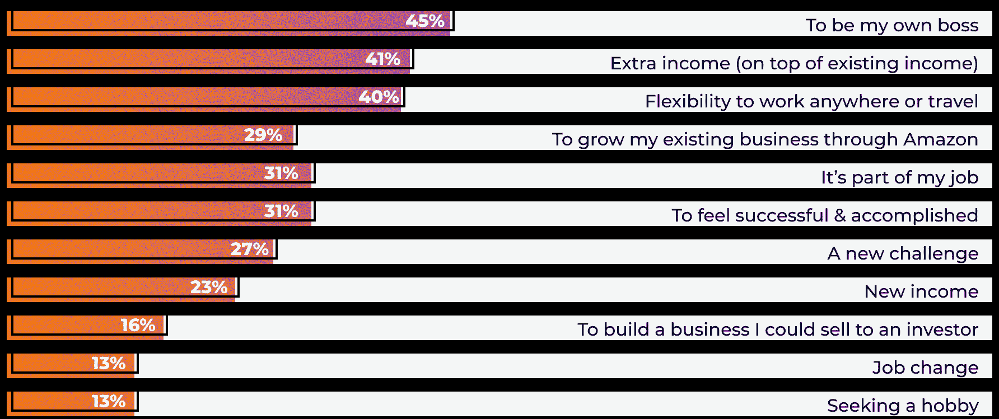

### 卖家聚光灯：动机与成功因素

每天有超过3,000名新卖家加入亚马逊。凭借正确的产品和策略，亚马逊是通往广阔机会的门户，但它也是一个竞争激烈且不断发展的市场。那么，是什么激励那些独立创业者和小型企业选择亚马逊呢？他们为什么要面对亚马逊带来的种种好处和复杂性，来进行产品推广和业务增长呢？

对于大多数销售商和中小型企业来说，他们选择在亚马逊上推出产品的主要动机可以归纳为三类：

**Top Amazon seller motivations**

被亚马逊销售所激发的卖家中，绝大多数计划利用所得来支持自己（61%）和/或家人（64%）。其他流行的目标包括：

- 43% 建立一个备用金或储蓄基金
- 39% 能够辞去其他工作
- 35% 早日退休
- 31% 偿还债务
- 31% 支付奢侈品或额外开支或旅行

在亚马逊销售中导致成功的五个最重要因素（根据销售商和中小型企业的说法）：

1. 具备足够的热情和动力
2. 找到一个高需求、低竞争的私人品牌销售产品
3. 拥有足够的资金投资
4. 拥有必要的工具和信息来帮助
5. 有赚钱的动机

**\*Ranked from highest to lowest by the percentage of respondents who say each factor is vital to their success on Amazon**

**70%** of Amazon sellers and SMBs say they wish they had started selling online sooner.

\*Percentages represent the number of respondents who cited each factor as a motivation for selling on Amazon

- 他们寻求改变工作和/或收入
- 他们为雇主管理品牌或在亚马逊上销售产品
- 好奇或寻求挑战

## About the Report

Jungle Scout的年度《亚马逊卖家报告》是对近2000名企业家、品牌和各种规模的企业进行的研究，他们利用了亚马逊这一全球巨大的零售平台。

本研究探讨了2024年在亚马逊上销售的当前状态，包括销售者是谁，他们在销售什么以及如何销售，以及他们如何应对电子商务的增长和全球经济的重大变化。

通过分析亚马逊销售者的构成，包括他们的业务模式和履行方法、销售和利润、动机和挑战以及产品和类别趋势，我们可以更好地了解在日益数字化和连接的世界中，亚马逊数百万第三方卖家扮演的角色和价值。

该报告聚焦于两个层次的亚马逊企业：独立销售者和中小型企业（SMBs），Jungle Scout将其定义为年收入不到200万美元的亚马逊企业；以及品牌和零售商，Jungle Scout将其定义为年收入达到500万美元或更多的亚马逊企业。

### Methodology

在2023年12月1日至2024年1月3日期间，Jungle Scout对近2000名亚马逊卖家和进行了调查，包括潜在卖家和前卖家。总共，受访者来自100多个国家，20个亚马逊市场以及所有相关的亚马逊产品类别。他们的年龄从18岁到80岁以上，涵盖了所有性别和教育水平。

本报告重点关注了1064名在亚马逊上至少有一个在售产品列表的第一方和第三方卖家。这一群体包括来自916家中小型企业和销售商的数据，其年度电子商务收入不到200万美元，以及来自84个年度收入超过500万美元的大品牌和零售商的数据。

与2023年调查数据的比较反映了满足相同标准的824名卖家和企业的回答。

受访者代表了卖家的陈述观点，不意味着或预测实际未来卖家行为。此调查仅以英文进行。

### Using the data

我们鼓励您探索Jungle Scout的2024年《亚马逊卖家报告》，并分享、引用和发布这些发现，同时注明来源为“Jungle Scout”，并附上本页面的链接。

如需更多信息、特定数据请求、媒体资料或联系报告作者，请通过 press@junglescout.com 与我们联系。

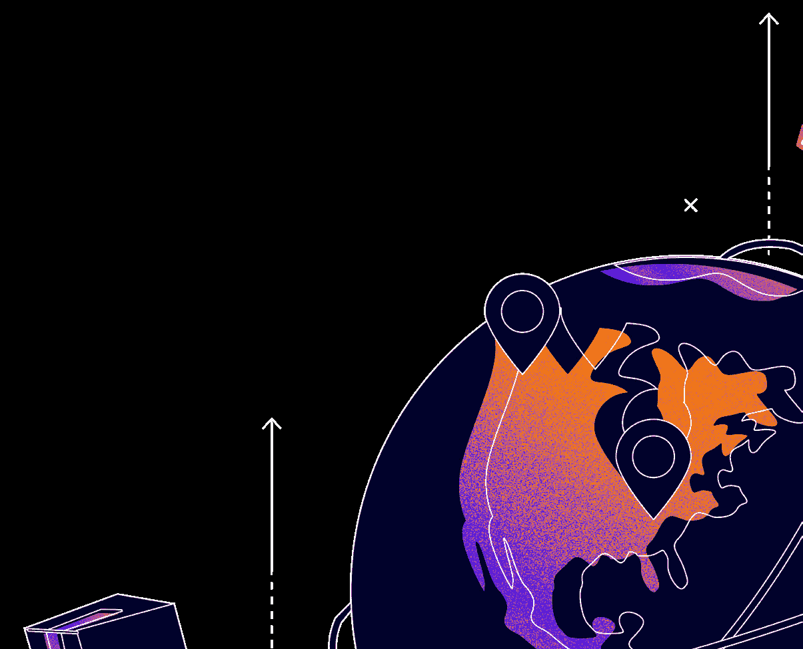

### About Jungle Scout: Leading Amazon Market Intelligence Tools

Over the past decade, Jungle Scout has gathered a wealth of data points through continuous monitoring and analysis of Amazon. The tools used to build this report are the same ones that l million+ sellers, brands, retailers, and agencies use each day to make confident decisions and develop effective strategies on Amazon. See how our tools can help your business grow by signing up or requesting a demo.

**Jungle Scout**

Jungle Scout 是领先的亚马逊市场情报工具。自2015年以来，Jungle Scout 一直在帮助企业家、品牌和卖家做出明智的商业决策。凭借强大的数据和分析能力，Jungle Scout 提供以下功能：

- 产品研究和机会发现
- 关键词研究
- AI 辅助 Listing 优化
- 供应链管理和库存跟踪

**Sign up today**

**Jungle Scout Cobalt**

Jungle Scout Cobalt 是一个全面的品牌和广告管理平台，旨在帮助卖家优化广告活动并扩大业务规模。通过 Cobalt，您可以：

- 自动化广告活动管理
- 监控品牌健康度
- 分析竞品动态
- 优化广告支出回报率

**Book a demo**

**Jungle Scout Data Cloud**

Jungle Scout Data Cloud 提供大规模的市场数据访问。通过 Data Cloud，您可以将亚马逊数据与您现有的数据平台集成，以进行深度分析和决策：

- 实时访问亚马逊市场数据（如 Snowflake, Azure）
- 与商业智能工具集成（如 Power BI, Tableau）
- 自定义数据查询和报告
- 亚马逊广告和销售数据的全面分析

**Try Data Cloud with Snowflake**

The State of the Amazon Seller 2024 | 39

**欢迎联系 Jungle Scout**

#### 适合用户

- 亚马逊卖家
- 亚马逊新手
- 跨平台跨境电商卖家
- 大型跨境卖家
- 亚马逊代运营机构
- 投资机构

#### 使用场景

- 多维度选品
- 市场分析
- 关键词调研
- 店铺运营与管理
- 自动化评论管理
- 细分市场行业分析提升市场份额
- 洞察市场趋势和竞争对手表现
- 自定义数据看板（SC/VC/行业数据/广告数据分析等）
- 广告智能化投放优化广告表现
- 关键词曝光智能分析等

#### Jungle Scout-Data Cloud & API

- 数据字段需求者
- 有数据和技术团队
- 数据即服务访问数亿数据接口
- 多赛道趋势对比
- 类目市场趋势洞察和行业分析
- 类目头部品牌洞察和竞品分析
- 自定义可视化数据看板

#### 插件+网页版

- 可直接官网注册购买：https://www.junglescout.cn/price-V2/
- 支持信用卡和支付宝

**预约 Demo**

**亚马逊数据分析行业的领导者，深耕此领域长达9年，30万+ Youtube粉丝**
