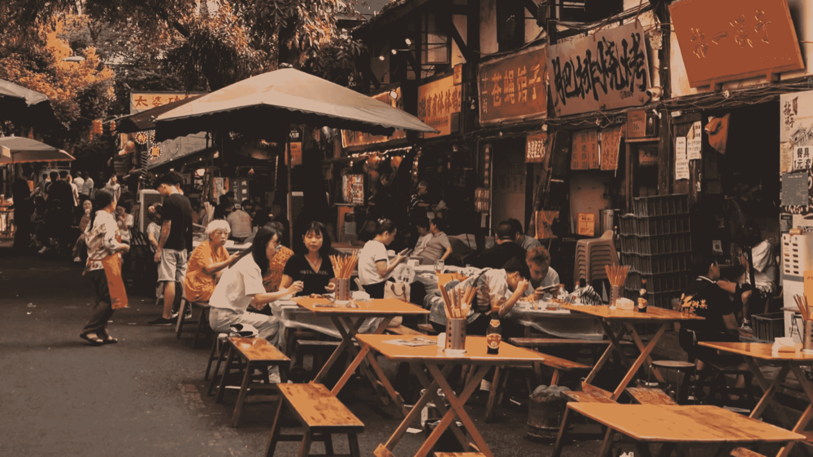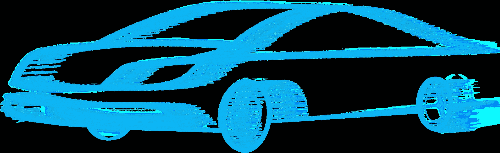

bilibili营销中心｜Y24·07

## 新视角看新车展

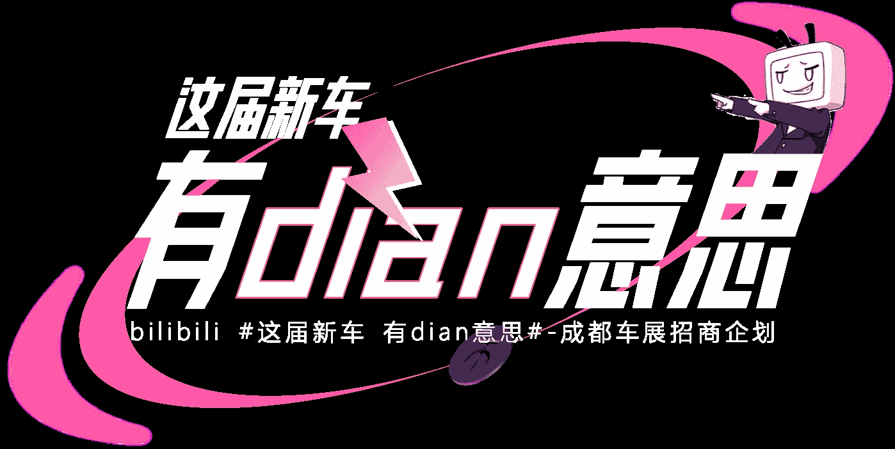

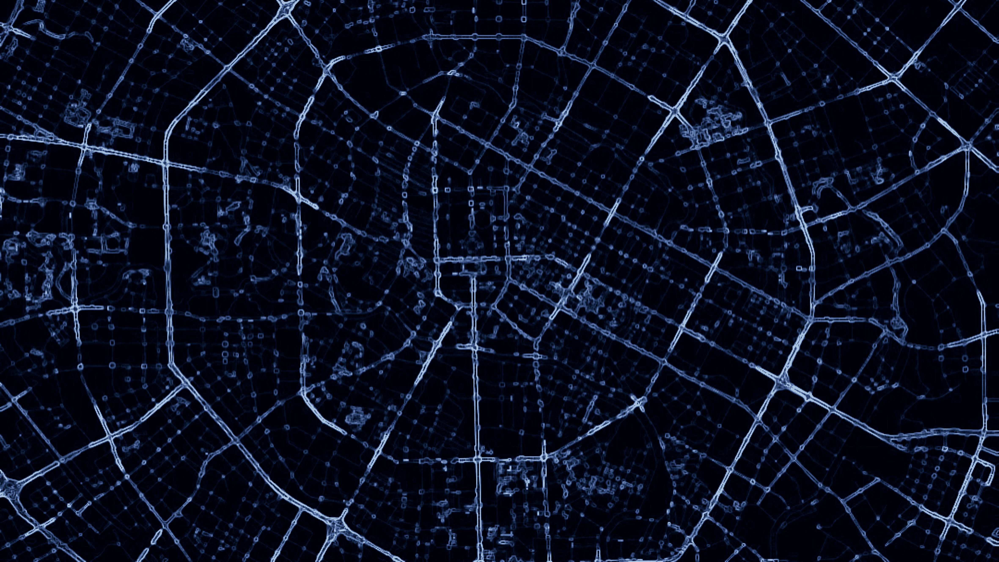

## 24年延续新科技主题，智慧出行将再成核心

Y24——潮动蓉城，智领未来

Y23——智享蓉城，驭见未来

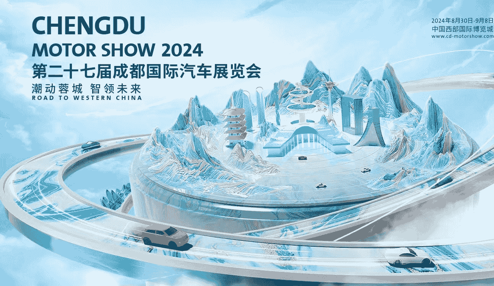

90.2w

Y23成都车展观展人次

35028台

Y23成都车展订单数

超同年北京&上海车展

**行业**

**影响**

**商业**

**价值**

**08.30**

**09.08**

成都车展

**第27届成都车展开幕在即，行业视角聚焦蓉城**

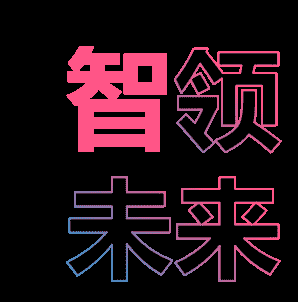

## Y23成都车展开幕

**优质稿件·持续高热**

Y23.8&9月站内车展相关内容指数趋势

车展

0825

车展大事件自带热度buff，优质稿件影响力在B站长效发酵

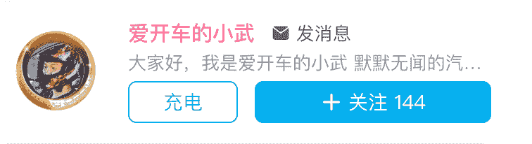

UP主开展日发布稿件

半月后热度再爆

0919

车展结束后10天UP发布稿件

热度势头不减

0914

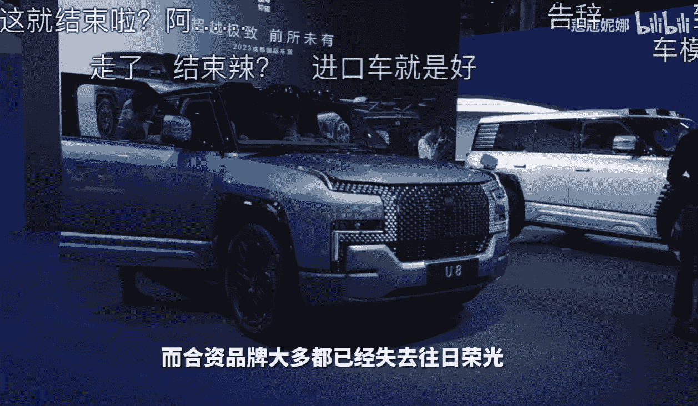

《车展，我派出了“玄冥二老”》

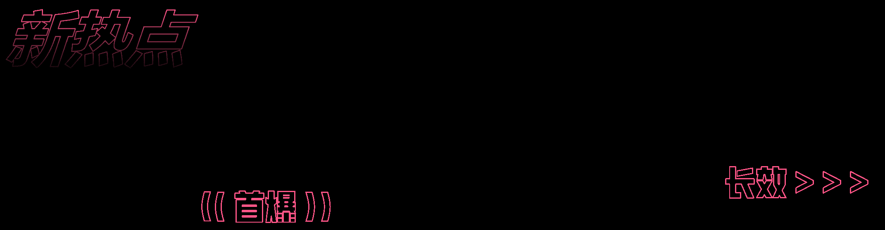

**戳中B站车友们兴趣的汽车行业大事件**

Y24成都车展热度走势预估

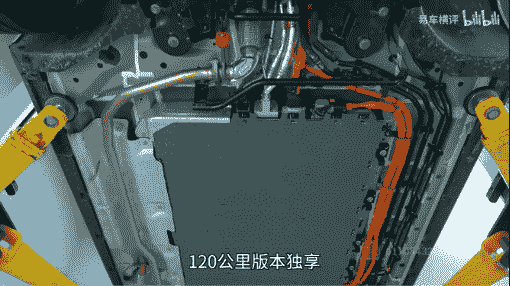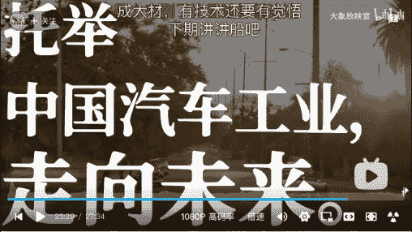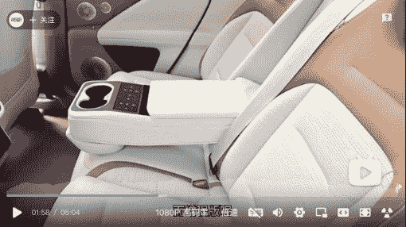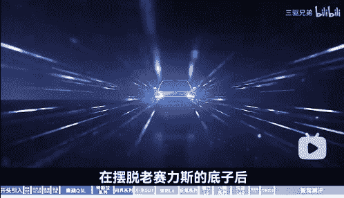

每月在B站观看汽车内容用户数

新能源车视频播放量同比增长

汽车分区日均投稿量同比

汽车分区每日播放量

*数据来源：B站数据中台Y24.Q1

**B站汽车相关内容品类视频播放量同比增速**

增速全站前三

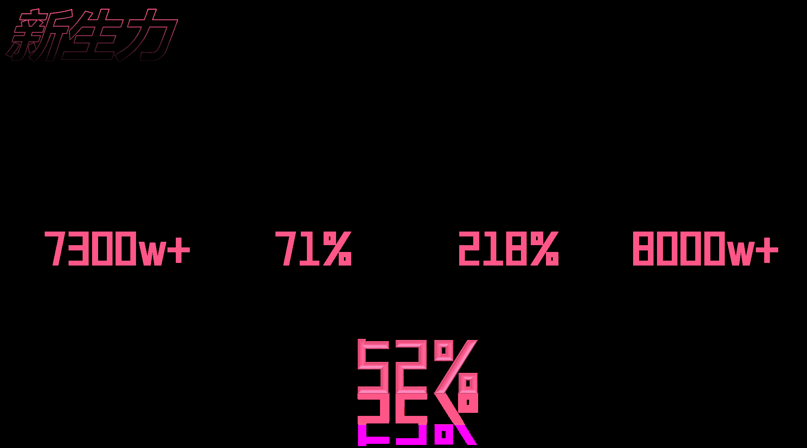

汽车内容持续高速发展，越来越多的车友在B站观看投稿，新能源车增速领跑行业

## B站汽车内容生态持续生长

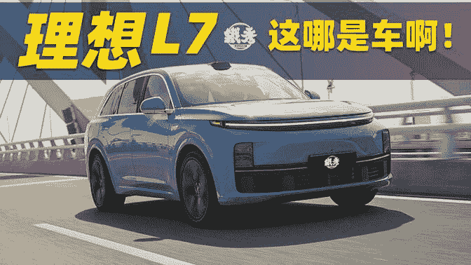

每天来B站观看新能源车全勤用户累计

用户在B站看到新能源车内容后会产生进一步互动

在B站，关注的新能源车内容TOP-3

电池续航能力

智能科技系统

驾驶体验

近一年，B站自驾游、房车露营相关内容搜索量超1216万次

B站自驾游相关视频播放量超18亿次，同比增长282%

自驾游成为年轻人向往的生活方式

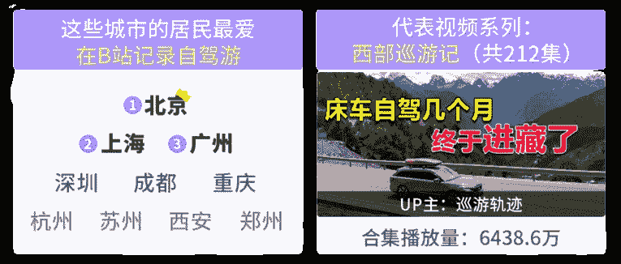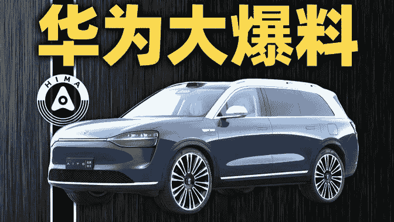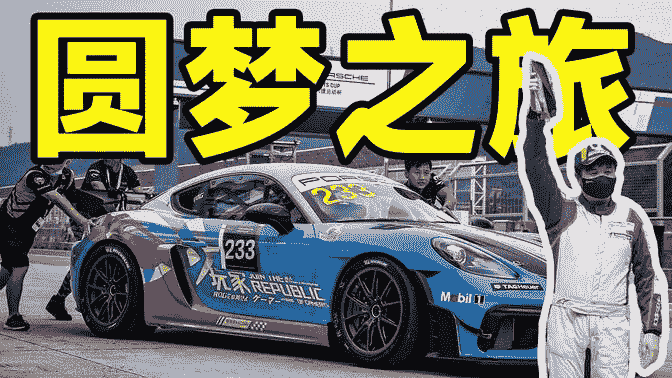

## 感受赛车魅力，传递青年汽车文化

超3400万人在B站观看改装玩车相关视频，同比增长65%

近一年，B站赛车类视频播放量同比增长132%

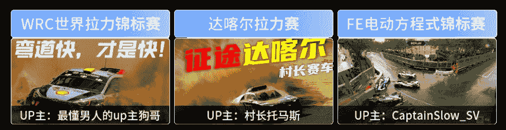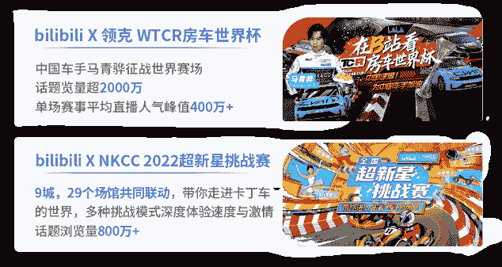

## 优质科普带你深度了解汽车、爱上汽车

近一年，B站汽车知识相关视频播放量超18亿次，同比增长119%

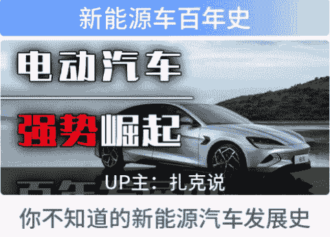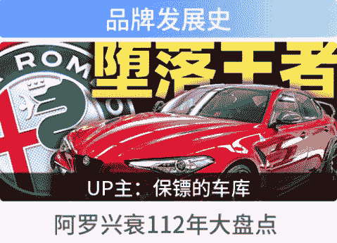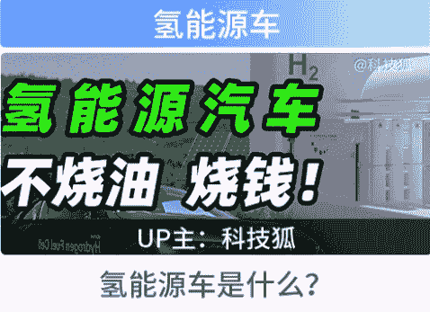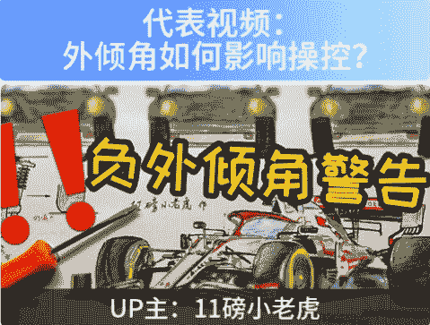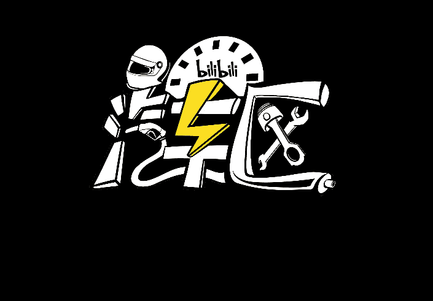

**「新能源」**

*数据来源：B站内部平台*

**「车生活」**

**「车知识」**

**「车文化」**

以汽车为载体，关联多元兴趣内容触点

**年轻一代汽车玩家拥有多元【驾值观】**

## 迎合多元【驾值观】·开启车展新视角

精准戳中年轻人兴趣取向，携手打造成都车展大事件

### 众测全新升级，用新视角看新车展

### 众测团全面升级——有趣、有料、有高度

### 充电站创意互动——科技感&趣味性

# 这届新车，有点意思

众测新升级

# 新视角看车

ONLINE

## 众测团全面升级——多元视角融入众测，助力声量、生意全面突围

**声量升级**

**种草力升级**

**影响力升级**

全程贯穿热点赋能传播

全程贯穿热点赋能传播

**种产品**

**造热度**

**推品牌**

品牌蜂拥车展期推新车

速造爆点，助力脱颖而出

高管搭载UP窗口现身B站

拉近距离，带动品牌俘获年轻用户

迎合车展主题，跨界科技UP

推动新车技术快速建立心智

## 众测团全面升级——多元视角融入众测，助力声量、生意全面突围

**造热度**

**种产品**

**推品牌**

### 外国人看中国系列

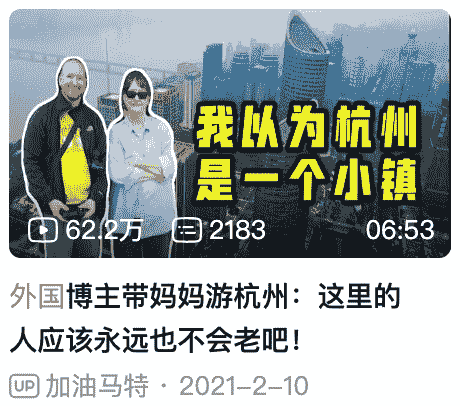

紧追热点，快速推动品牌声量破圈

硬核科技解读，专业种草新车抢眼科技

多面专访高管，畅聊品牌发展

站内爆款制造机

用户为什么爱看？

**民族自豪**

**新鲜观点**

**外部优势·144小时CHINA TRAVEL**

政策助推内容热度高居不下，他们的旅游首站往往是**成都**

**平台优势·B站拥有大量优质外国人UP主**

**他们长期旅居/定居在中国**

分享日常种种，内容领域多元

- 生活
- 旅游
- 汽车
- 亲子
- ……

**极客态度拆解新车技术科技**

**让干货种草更高效**

贴合车展【智领】主题，握手科技区UP

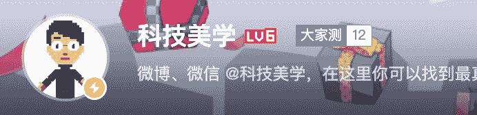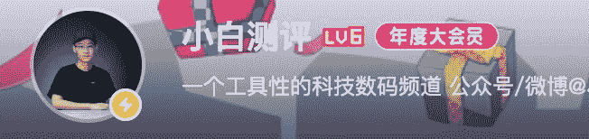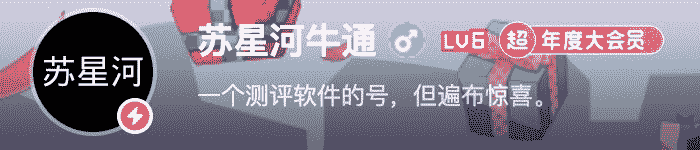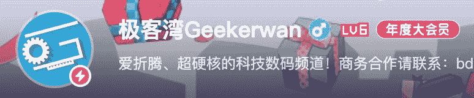

- 新车技术解读
- 科技前瞻预测
- 亮眼升级盘点
- 智享驾乘体验

**线上解读**

**线下看展**

**头部UP/外国UP对话品牌高管**

**畅聊中国品牌新发展**

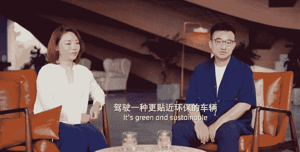

侧重品牌传播——#**边走边聊**#逛车展

侧重产品体验——#**边开边聊**#逛成都

侧重高管人设——#**深度畅聊**#来B站

爆火演员up

热梗刷爆全网

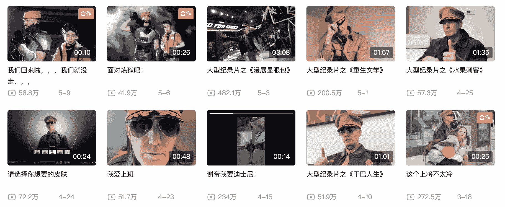

**B站粉丝：**

**223.7w**

**不是BBA买不起**

**而是中国车更有硬实力**

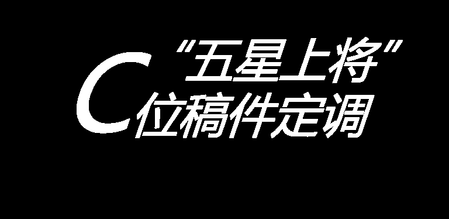

首稿方向

**外国人看中国车  – 人选丰富多元，能开车、会中文、能整活**

@KerryDowdle

@车轮哥Wheelsboy

@歪果仁研究协会

@请叫我克里斯斯

@娜塔莎一家

@路卡和瑞丽

@不是柯桑德

@老王在中国

@爱喝茶的老路

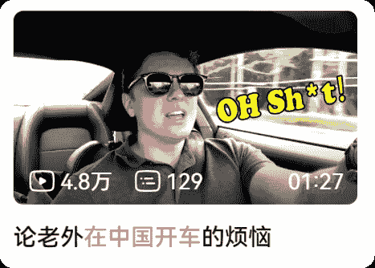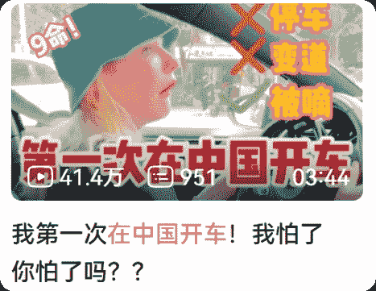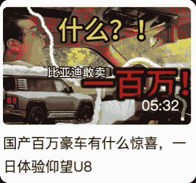

## 四 川 大 学 硕 士 学 位 论 文

文本描述和手势识别是理解视频中人类动作的核心。已有的工作主要分为两条线，一是基于 RGB 流的方法，一是基于骨架点序列的图卷积方法。手语作为一种特殊的动作，信息主要由手部、面部表情及身体姿态来承载。由于手部是一种高自由度的物体，手语中手势是在有限类别，但是动作频率极快的，对视觉识别模型的性能要求更高。目前针对手语的研究任务分为孤立词识别和连续手语识别。得益于深度学习技术的发展，前者已经有大量工作，取得的精度也相对更高。连续手语识别由于时序分割的难度，还远未达到实用水平。本文主要关注连续手语识别问题，主要工作如下：

针对当前连续手语识别方法时序分割效果不佳的问题，提出了基于 Transformer 的多粒度时序分割方法。连续手语视频中存在大量的非手语动作，这给模型识别关键的手语词造成了困扰。本方法目的是改善连续手语识别网络的时序建模能力，在时序分割的准确率和鲁棒性方面达到更好效果。提出的多粒度分割方法可以学习不同长度的时间上下文特征，从而更准确地捕捉手语词边界。

针对手语数据难以获取且标注昂贵的问题，设计了额外的手部轨迹预测任务，可辅助模型极大利用视频中的手部运动先验。本文将该任务作为序列级辅助任务，实现了只需少量修改就能嵌入多种连续手语识别模型中。在公开的 PHOENIX-2014 数据集上的实验表明，提出的多粒度分割方法和预训练任务均能有效提升连续手语识别的性能。

此外，手语识别在实际场景中面临多元化挑战，如不同环境、不同人种、不同光照等。本文还进一步探究了真实场景中的手语识别，在手语翻译系统构建中，使用了自研的手语语料库，设计了面向真实场景的手语翻译系统技术方案。在多个真实场景数据集上进行了实验，验证了方法的有效性。

## 关键词：连续手语识别； 手语翻译； 时序分割； 轨迹预测； 真实场景

# PLANNING CASE

# RETRIEVAL CASE

公众号营销星球 SINCE2016

关注公众号订阅最新策划方案

严选4A策划方案

以新视角，跨新认知

定制筛选·在线查案

官方小程序+网站 快速搜索 效率翻倍

登陆小程序搜索最新策划方案

**外国人看中国车  – 选题出其不意，展馆内外老外刷脸**

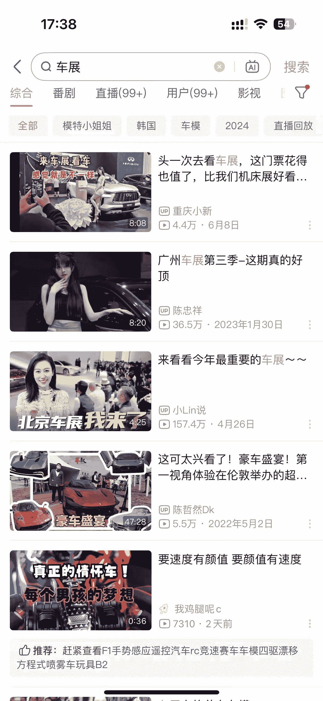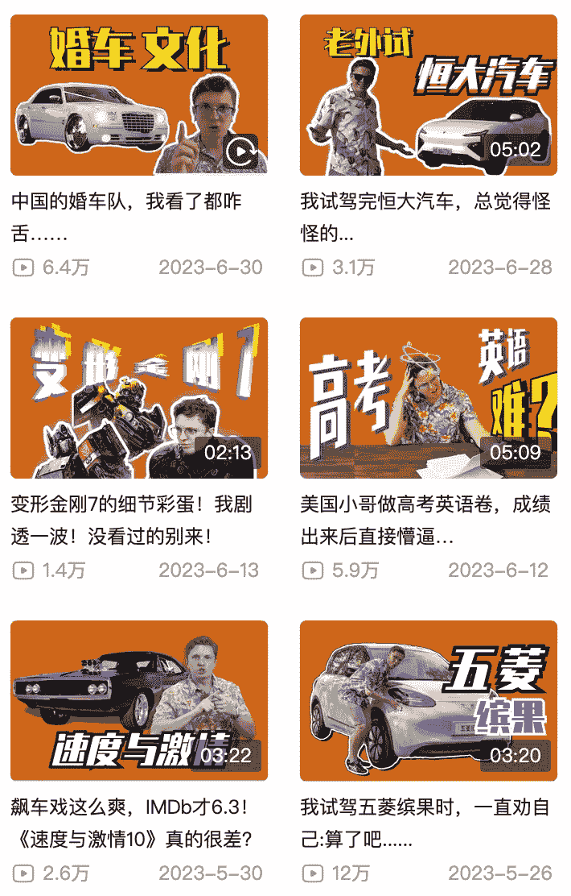

**方向1：邀约外国人up逛成都车展**

体验车展代表性新车，新奇感受激发用户观看热情

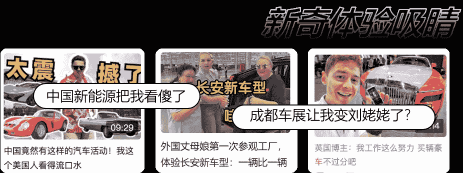

**方向2：汽车UP&外国人up搭配逛展**

猜价格、认品牌、聊对比，趣味互动大开眼界

自驾 / 乘坐车展新车

游历成都，体验在地文化

沉浸体验新车智驾等

畅聊汽车新科技技术

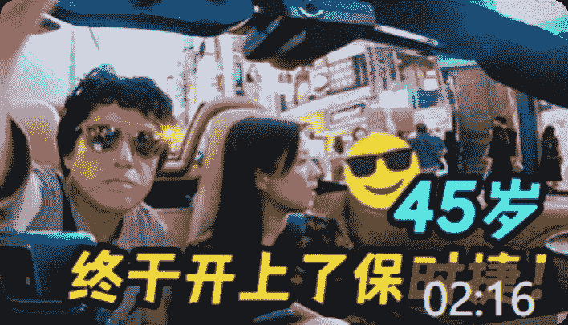

成都展馆/高校/商圈周边

探究各国老外眼中的中国汽车

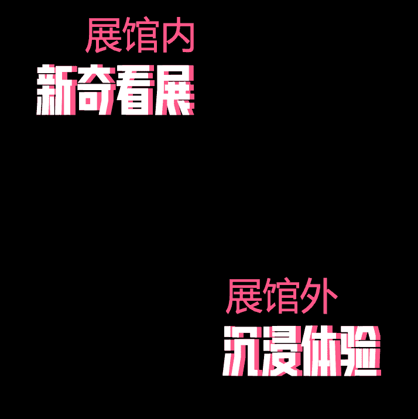

**外国人看中国车  – 热点乘势追击，平台内外老外刷屏**

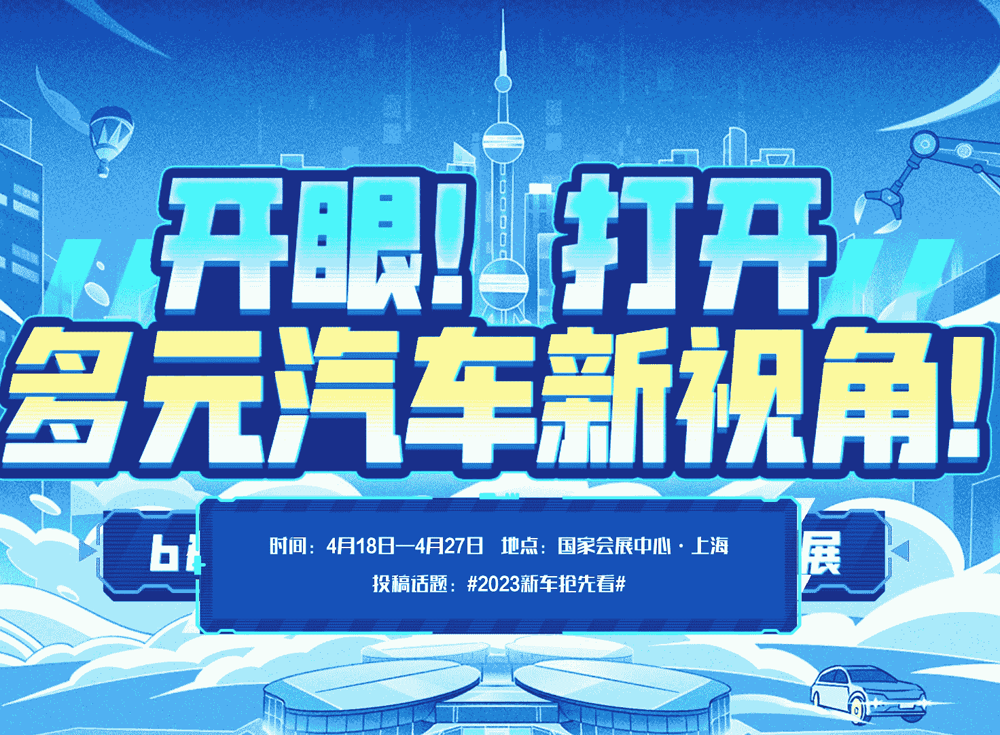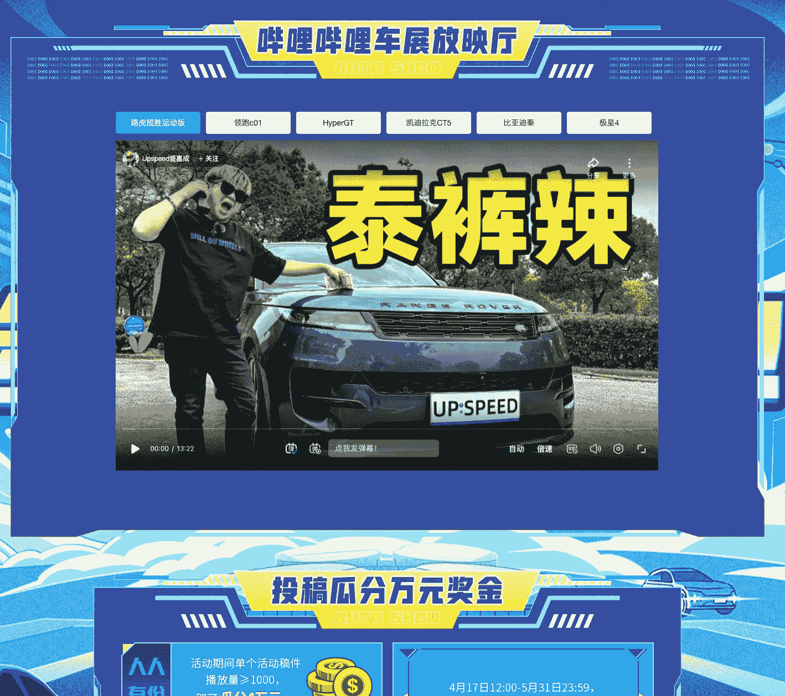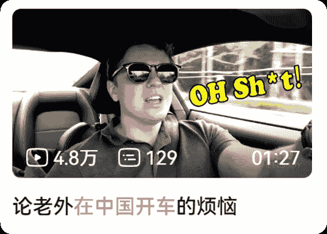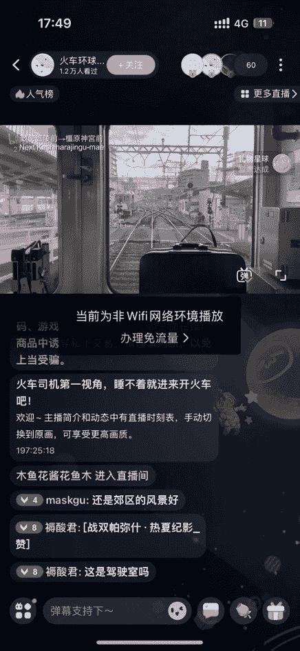

**内容定制**

**街头采访**

**直播看展**

· 丰富内容载体落地车展专题定制单元

**超高**

**展示权重**

平台流量倾斜

助推热点一爆再爆

热搜

首页推荐

PUSH推送

官方微博

公众号

\*具体推广资源以实际执行为准

**UP人选推荐  – 外国UP看展逛展类内容推荐人选**

**@麦克阿瑟MacArthur**

爆火演员up 热梗刷爆全网

**B站粉丝：223.7w**

**@歪果仁研究协会**

站内粉丝数最高的外国up主

**B站粉丝：446.5w**

**@娜塔莎一家**

出行区up，爆款内容常客

**B站粉丝：48.6w**

**@马佳PopMatta**

生活区热门up

**B站粉丝：107.9w**

**@路卡和瑞丽**

中意跨国情侣up

**B站粉丝：77.4w**

**@车轮哥wheelsboy**

汽车领域外国up主

**B站粉丝：16.2w**

**@Mr有意思**

长居中国，发布过汽车类内容

**B站粉丝：95.4w**

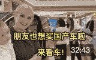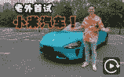

C位稿件

外国UP主独立视角，逛展体验和感受中国品牌新车

- 方向一：邀约外国人逛成都车展，体验车展代表性新车，记录感受；
- 方向二：外国人对比评价车展现场国外品牌与中国品牌展车；

**UP人选推荐  – 中外UP搭配看展类内容推荐人选**

**@中国BOY超级大猩猩**

头部UP主，英文能力过关，参与过多个S级项目，有汽车类拍摄经验

**B站粉丝：997.5w**

**@KerryDowdle**

粉丝增涨迅速，产出过热门视频

**B站粉丝：148.8w**

**@星悦小美女PKU**

中文比较流利，有中国驾照

**B站粉丝：157.2w**

**@卡琳娜和揉西**

时尚、COS区UP，站内影响力强

**B站粉丝：215.8w**

头部UP主与外国人UP主搭配逛展（点播/直播）

- 方向一：头部UP主带外国UP逛展，主题是开眼界，猜品牌、猜价格；
- 方向二：头部UP主与外国UP主结合展车的QA交流；

**@Upspeed盛嘉成**

汽车区头部UP主，特色栏目之一是UP主开什么车，专业知识过硬

**B站粉丝：162.1w**

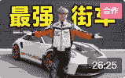

**UP人选推荐  – 车展外街采类内容推荐人选**

车展现场外国人街采

- 方向一：熟悉中国和中国车的外国人采访其它外国人；
- 方向二：英语对话能力OK的B站汽车or跨区UP主现场采访外国人；

**@不是柯桑德**

深圳长大，搞笑有趣，内容热度高

**B站粉丝：206.5w**

**@基本祐利_**

在南京读大学（韩国），热度高

**B站粉丝：96.5w**

**@超Carry的柴西**

外向型UP，街头采访易有火花

**B站粉丝：147.8w**

**@爱喝茶的老路**

法国人（持中国绿卡）社会学博士

**B站粉丝：105.8w**

**@邵艾伦Alan**

生活区UP，对谈能力优秀

**B站粉丝：273.4w**

**@保保熊PAUL**

city热门梗原作者

**B站粉丝：14.5w**

## 科技+汽车UP主看技术——极客态度拆解汽车科技，让干货种草更高效我是由月之暗面（Moonshot AI）研发的 kimi-k2.7-code 智能大模型。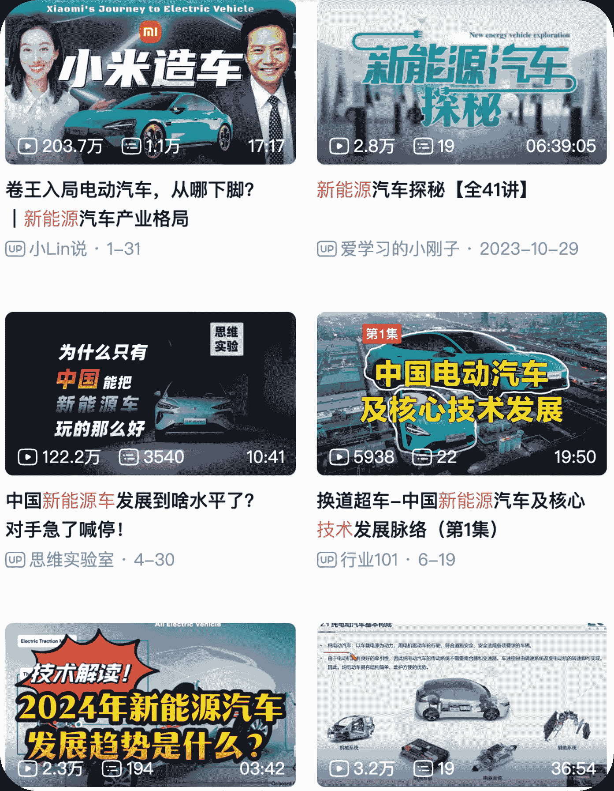

车展实拍+后期动画，深入浅出解读品牌汽车科技。

### 科技区 × 汽车区·技术探讨

聚焦技术盘点，突出品牌“之最”。

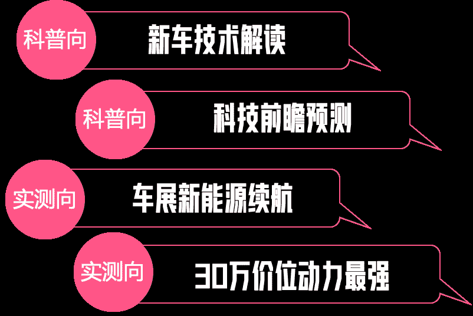

### 科技区 × 外国人UP·搭配看展

将新车科技亮点细致拆解，通俗易懂传递用户。

- 产品力释放
- 圈层突破
- 口碑力强化
- 效果引导

## UP人选推荐——科技、汽车区头部UP人选推荐

| 内容方向 | UP主推荐 | 粉丝数（w） | 推荐理由 | 个人主页 |
|---|---|---:|---|---|
| 科技区、汽车区头部UP主，可产出车展、新车技术解读等相关内容 | @苏星河牛通 | 278.2 | 科技区头部UP主，擅长汽车智能化体验相关内容 | https://space.bilibili.com/598464467 |
| 科技区、汽车区头部UP主，可产出车展、新车技术解读等相关内容 | @TESTV官方频道 | 249.2 | 科技区头部UP主，独到有趣的体验风格 | https://space.bilibili.com/11336264 |
| 科技区、汽车区头部UP主，可产出车展、新车技术解读等相关内容 | @大狸子切切里 | 240.3 | 科技区头部UP主，有丰富的汽车内容经验 | https://space.bilibili.com/471303350 |
| 科技区、汽车区头部UP主，可产出车展、新车技术解读等相关内容 | @贪玩歌姬小宁子 | 146.5 | 科技区头部UP主，节目效果好 | https://space.bilibili.com/27899754 |
| 科技区、汽车区头部UP主，可产出车展、新车技术解读等相关内容 | @飞飞的车COOL | 101.3 | 汽车区头部UP主 | https://space.bilibili.com/50693252 |
| 科技区、汽车区头部UP主，可产出车展、新车技术解读等相关内容 | @终极小腾 | 238.2 | 汽车区头部UP主 | https://space.bilibili.com/394609671 |
| 科技区、汽车区头部UP主，可产出车展、新车技术解读等相关内容 | @袁启聪 | 107.6 | 汽车区头部UP主 | https://space.bilibili.com/502925577 |
| 科技区、汽车区头部UP主，可产出车展、新车技术解读等相关内容 | @保镖的车库 | 109.4 | 汽车区头部UP主 | https://space.bilibili.com/1575718735 |
| 科技区、汽车区头部UP主，可产出车展、新车技术解读等相关内容 | @原来是翔翔啊 | 94.1 | 汽车区头部UP主 | https://space.bilibili.com/234507192 |
| 科技区、汽车区头部UP主，可产出车展、新车技术解读等相关内容 | @伟嘉gaara616 | 107.3 | 时尚区头部UP主，有丰富的汽车内容经验 | https://space.bilibili.com/311871090 |

## 高点对谈聊品牌——头部UP对话品牌高管，畅聊品牌新发展

- 品牌塑造
- 口碑传递
- 高管人设

围绕车展新车热点展开访谈，感受新车动力、空间等升级亮点。

- 深度采访——头部UP主畅聊品牌发展
- 话题出圈——外国UP主趣聊中外异同

## 内容传播节奏——不同稿件分阶释放，覆盖车展全周期

### 车展前

官号倒计时，点燃关注度。

预告+新车路透，期待值打满。

eg. 爆砸100亿，狂吹27200转电机！XX品牌堆料用力过猛？

### 技术解析

汽车垂类UP化身观察员。

eg. 探秘XX品牌汽车工厂，看这次成都车展会有什么大杀器。

### 车展路透

### 车展中

上将定调发布，外国人看中国车。

老外看展团陆续探展。

- 馆外体验
- 馆内观展

### 车展中

- 新车技术解读
- 科技前瞻预测
- 最强动力盘点
- 性价比之王推荐

科技区、汽车区UP内容逐步释放，实车实拍更具实感。

- 高点对谈
- 车展漫谈
- 游历成都

### 车展后

展期优质稿件持续发酵。

品牌/事件战报释出，扩散行业影响力。

## 聚合线上专题——有奖话题+趣味互动，激发用户参与热情

demo，仅示例。

### 活动头图

可植入品牌Logo、副标题，植入slogan。

### 内容专区

外国人UP、科技区、汽车区UP稿件展示。

### 话题专区

结合成都车展上线3—5期话题征稿活动。

- #最想拥有的新能源车
- #新车科技观察员
- #成都车展新车大赏

官方拟定话题示例。

### 趣味互动

互动抽卡、集卡小游戏。用户通过完成观看、关注、发布等互动，可获取抽卡机会，集齐后解锁丰厚奖励。

以【汽车新科技】为颗粒度，设置8张卡片，如一体压铸、风阻系数、能量密度、智驾系统等。

每完成一个指定任务，将获得一张卡片；集齐卡片后，合成一张【未来概念汽车】卡片，同时赋予该用户【汽车科技探索研究员】的身份。

让用户理解【科技黑箱】，更直观感受汽车生产力和创作力、新技术的发源。

### 机制阐述·借游戏展现品牌新车科技

### 专题尾部

可植入品牌banner（可内/外链）。

# 用清单「打点」诊断产品气质

我们曾经坚持「不识庐山真面目，只缘身在此山中」这句话，但做品牌诊断很多年后，我们开始换一个角度思考这些事。如果把产品想象成一个人，那么你的品牌气质、情绪感觉甚至文化沉淀应该像呼吸一样在产品的每个细节中自然流露——用户只消一眼，心中便有定论。

那如何用清单「打点」诊断产品气质？根本逻辑是对产品内外的一致性做审查：由表及里，每一层都要各司其职。

- **第一层：看得到**——品牌识别。Logo、色彩、字体、包装、空间等视觉锤，是否具备独特的识别度？是否能一句话说清品类气质？
- **第二层：摸得着**——产品体验。核心功能是否护佑核心价值？交互细节、触感与用感是否能做到「所见即所得」？
- **第三层：带得走**——文化记忆。用户会不会愿意将它放入自己的生活方式中，形成自我表达？是否具有传说或向往？

曾有人问我们，品牌气质的形成靠什么？我们回答：靠一次次的「选择」——在无数次取舍之间，你是谁与你不是谁，慢慢长出了样子。

> 我们做的从来不是把「美」堆砌起来，而是把「对」留下来。

做诊断时，我们常常会拖出产品使用率最高的3个界面、最常被拍照的3个角落，以及消费者提到品牌时高频出现的3个形容词。通过这些离散的「触点」反向校准——整体气质是否统一。

说到底，品牌不是一句标语、一个符号，而是用户在心里为你说出的那句话。这句话藏不住，也装不出来。它就是在每一次接触之后，自然沉淀出的印象。

## 展内—回应车展科技主题：结合充电概念，打造未来感、科技感展厅

联动投币、为爱发电、充电等B站心智元素。

展示细节。

- **独立空间**：洽谈/接待
- **光影舞台**：见面会
- **互动体验**：打卡/游戏

- 面向品牌
- 面向UP
- 面向用户

\*以最终实际执行为准。

## 展内—趣味互动玩法

### 签到打卡

用户打卡签到墙，与喜爱的UP主合影、投币，发布动态，可获得抽取B站周边礼品机会。

### 4D装置

创意4D视觉装置，呈现科技感汽车构造。

### 互动充电

B站展台设置充电区，安装“充电桩”，帮助到场用户补充电力。

## 展内—展厅品牌权益

\*1席（总冠名），车模需客户提供。

\*1席（总冠名），位于B展展区内。

充电区内加设品牌充电桩*1，充电桩外部图案、样式可结合品牌风格设计（由B站设计，呈现样式、具体位置由B站决定）。

## 展内——品牌展台联动

双方联名打造移动充电桩，完成互动后可帮助现场用户设备充电。

汽车区官号&UP主动态提前发布带看信息，招募粉丝参团（可联动品牌工程师等）。

引人气

带人流

*非常规资源，具体落地以实际沟通为准

## 展外——新车试驾新玩法：逛吃游玩成都行，biubiu巴适巡游发车啦

- 每日发车2趟，限定1日。
- 素人用户可前往站台预约试驾体验（需品牌当地经销商/4S店配合执行）。
- 站台海报等区域可植入品牌宣传信息。

## 头部UP主或品牌高管担任新车车主

外国人UP

感受蓉城

巴适生活

*非常规资源，品牌定制活动，具体落地以实际执行为准。

## 展外：以车为载体，穿行成都人文风光，详尽展现新车体验

## 多元商业资源强曝光

## 全方位覆盖汽车用户

0825　0830　0908

线上　线下

## ROADMAP

- 官号发布/转发预热图文
- 线上专题上线
- UP主/官方活动海报释放
- 话题上线
- UP视频稿件释放
- 大咖UP领队观展
- 联名充电桩
- UP粉丝见面会
- 游戏互动体验
- 优质稿件推流

## 车型指数迎来峰值

### 星纪元ET内容指数在传播期远超竞品

内容指数环比上升4XX%+

搜索指数环比上升5XX%+

新增播放量环比上升5X%+

活动声量全站参与

用户口碑好感暴增

内容生态激发共创

专题页PV

2XXw+

话题浏览量

4XXw+

话题讨论量

3w+

活动总曝光

4亿+

## ET化身全站顶流

### 全民参与征稿活动，共创ET内容生态

征稿活动

累计投稿量

2XXX+

帅

协调

刹车顺

### 〔线下联动制造事件〕

### 〔线上话题传播声量〕

2233娘高能站台

打卡活动人潮涌动

小电视定制咖啡拉好感

## EXEED丨BILIBILI CAFE

话题征集

众测视频

打卡动态

星纪元ET×bilibili 北京车展合作，行业首次跨界整活咖啡厅 ( ゜- ゜)つロ 乾杯~

SHOWCASE

## 方程豹全民豹5——新车众测+车展高层对谈

硬核拆解DMO技术，深刻透传科技全能标签

SHOWCASE

贴靠车展高管对谈

延续话题高热

头部UP主发起讨论

起飞定向引爆话题

召集众测，卷动用户

定义“全民豹5”

技术渗透：

- 方程豹豹5新车上市节点深入传递DMO技术亮点，强化豹5硬科技属性。

心智召集：

- 从认知层广泛号召用户参与，引爆话题声量。

科技土壤：

- 懂车玩车的阿B人喜爱用科技视角洞察新车，硬核的专业知识在站内有强力讨论氛围。

汽车区背书：

- 汽车区众测项目有效调起核心兴趣用户关注。

6XXXw+

话题浏览

5XXw+

商单播放

（2期）

期期热门

# 这届新车

期待合作

# 此方案只在 壹销星球® 官方社群分享

公众号@壹销星球
官网独家渠道

# SINCE2016

- 1. **TIME:09:00** 每日资讯早报
- 2. **TIME:10:00** 每日最新研报
- 3. **TIME:400天** 专属会员群全年更新
- 4. **升职加薪 躺平摸鱼** 13T超级干货全网最全
- 5. **TIME:400天** 网站+小程序SVIP权限
- 6. **1W+个策划必会知识点** 386万字营销百科全书
- 7. **3000G+方案** 2万+广告常用方案库
- 8. **表格/合同/手册…** 广告必备常用文件库
- 9. **全网独家 仅此一份** 世界各国策划案分享

