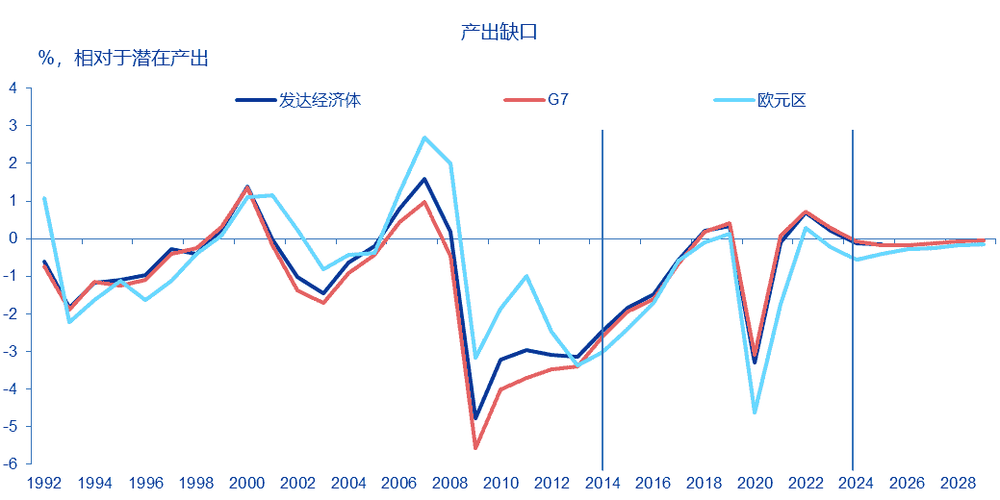
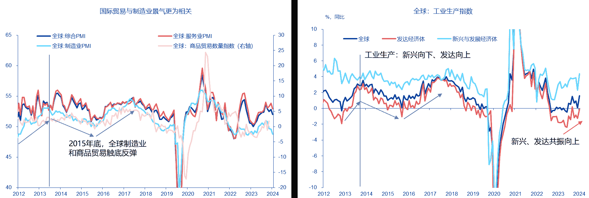
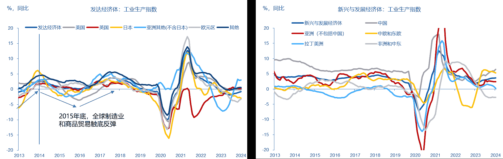
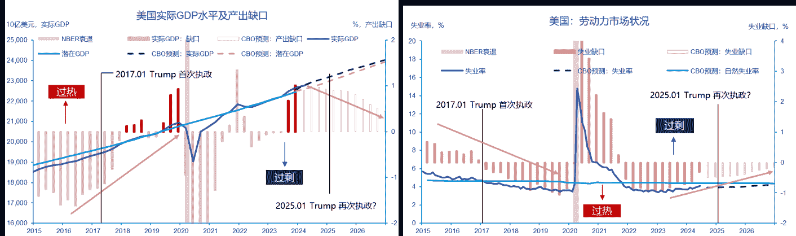
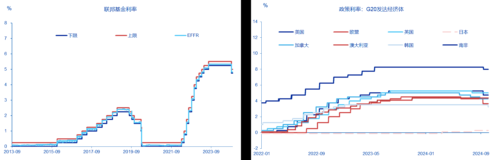
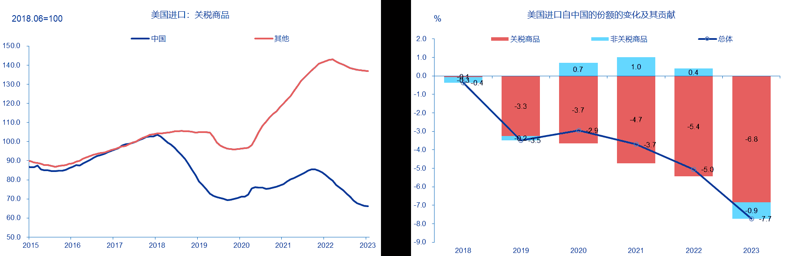

## “历史的回溯”系列

# 历史不会重演：全面对比2014

——“镜见”系列专题之一

2024年10月14日

## 证券分析师

赵伟 A0230524070010  
zhaowei@swsresearch.com

屠强 A0230521070002  
tuqiang@swsresearch.com

陈达飞 A0230524080010  
chendf@swsresearch.com

贾东旭 A0230522100003  
jiadx@swsresearch.com

## 联系人

屠强  
(8621)23297818×  
tuqiang@swsresearch.com

- **经济：“量”、“价”均有压力，但新旧动能表现不同。**

- **相同点：经济“量”、“价”均有压力。**2014年经济走弱，尤其是下半年，经济增速降至7.5%以下，制造业PMI明显回落，方向与时间与今年类似。其次，2014年与今年均处于结构转型期，需求侧表现为逐步摆脱对投资驱动的依赖，供给侧表现为传统行业增速下降，但新兴行业增速上升。“价”方面，PPI同比、工业盈利增速均处于0以下。

- **老动能：2014年仍支撑经济，但目前成为拖累。**2014年地产走弱，但调整幅度不大，对居民资产负债表影响较小，地产投资（10.5%）与基建投资（20.3%）仍高于GDP增速，与当下有本质区别。行业来看，2014年传统行业增速（8%）与全行业接近，但当下传统行业表现明显弱于全行业，地产相关行业增速（1.7%）低于非地产相关行业（5.2%）。

- **新动能：2014年是起步阶段，当下是发展中期。**2014年制造业投资增速下行至11.2%，技改支出负增长（-6.6%），但今年表现强劲。今年新基建也替代老基建。从产业角度看，2014年高技术制造业在工业中占比仅10.6%，刚开始提升，目前则已达15.7%。此外，数字经济GDP占比目前也达到8%左右，高于2014年（6.1%）。出口竞争力也不同，2014年低附加值消费品出口强，当下高附加值中间品、资本品出口更强，船舶出口高增51%。

- **政策：货币、地产政策均先于财政政策放松，但传导机制不同。**

- **相同点：货币、地产政策先于财政政策放松。**2014年财政收入也转弱，一般预算收入增速下滑至6.5%，低于经济增速，且化债加速，2015年后置换债开始大规模发行，总额度15.4万亿元。货币政策也明显宽松，央行降准降息且创设PSL、MLF等扩大货币投放，与当下类似。地产方面，2014年放松房贷、加码去库存，与当下政策组合拳类似。

- **财政模式不同：2014年地方财政发力为主，当下中央财政发力更多。**2014年化债主要是降成本，而不是约束融资，因而地方财政仍在扩张，基建投资（同比20.3%）表现仍强。当下地方财政受约束更大，中央财政发力替代地方财政。政策投向也相应改变，由单一依赖市政类传统基建，扩展到目前新基建、设备更新、消费品以旧换新等多手段模式。

- **货币政策传导不同：地产金融加速器消失，供给侧问题增加了需求侧宏观调控复杂性。**2014年政策放松有效拉动地产销售走强（2015年增速由负转正至6.5%），但当下现房销售强劲（同比19%），期房销售（同比-28%）却与利率“脱敏”，主因是地产症结不同。当下风险更多是供给侧房企，而非需求侧，房企信用收缩令竣工风险暴露，预售期房竣工率仅40%左右，导致居民对购置期房谨慎，收储陷入期房、现房两难，货币乘数增速下降。

- **海外：海外经济恢复均放缓，但流动性周期不同导致出口、国际收支与汇率分化。**

- **相同点：海外经济所处周期不同，但均是年中开始走弱。**整体来看，从发达经济体产出缺口角度而言，2014年处于后危机时代复苏周期的中期，2024年处于尾声。但从节奏而言，2014年与当下，发达经济体景气均自年中开始转弱，制造业PMI加速回落至52以下，但发达国家内部结构表现不同，彼时欧日较弱，但美国较强；当下美欧走弱。

- **不同点：美国经济周期不同，导致货币政策周期不同。**2014年，美国经济处于复苏中期，美联储开始转鹰、结束QE，2015年开启加息。但当下美国经济步入复苏尾声，美联储开始转向降息。不仅如此，当下还是全球货币政策从“加息潮”到“降息潮”的转换。

- **对我国影响分化：出口结构表现不同，国际收支与汇率影响反向。**2014年与当下出口均先升后降，但结构不同。当下对新兴国家出口增速（9.2%）好于对发达国家（7.9%），且出口模式向嵌入新兴国家工业化转型，中间品、资本品出口好于消费品。此外，2014年正处于国际收支一轮流出压力的起点，人民币汇率由6.1开启贬值周期。但当下国际收支或正处于流出压力的终点，前期集中流出缓和，人民币汇率由约7.3开始逐步升值。

- **风险提示：经济转型面临短期约束，部分新兴行业过度投资，房地产形势变化超预期。**

请务必仔细阅读正文之后的各项信息披露与声明

国内经济

请务必仔细阅读正文之后的各项信息披露与声明

第2页 共40页 简单金融 成就梦想

## 目录

### 1. 经济：新旧动能表现不同
1.1 相同点：经济“量”、“价”均有压力 ................................................... 8

1.2 老动能：2014年仍支撑经济，但目前成为拖累 ............................. 10

1.3 新动能：2014年是起步阶段，当下是发展中期 ............................. 12

### 2. 政策：传导机制不同
2.1 相同点：货币、地产政策先于财政政策放松 ........................................ 16

2.2 财政模式不同：地方财政发力向中央财政发力转变 ....................... 19

2.3 货币政策传导机制不同：地产金融加速器消失 ............................... 21

### 3. 海外：基本面与流动性周期不同
3.1 相同点：海外经济所处周期不同，但均是年中开始走弱 ............... 24

3.2 不同点：美国经济周期不同，导致货币政策周期不同 ................... 25

3.3 对我国影响分化：出口结构、国际收支、汇率变化不同 ............... 27

## 4. 生产高频跟踪：工业生产景气回升，建筑业开工相对低迷
........................................................................................ 30

### 5. 需求高频跟踪：全国新房成交季节性回落，一线、三线成交好于去年同期
........................................................................................ 33

### 6. 物价高频跟踪：农产品价格普遍回落，工业品价格明显回调
..................................................................................... 38

## 图表目录

- **图1：14年下半年，经济压力加大** ...................................................................... 8
- **图2：今年二季度经济增速开始偏弱** ..................................................................... 8
- **图3：14年下半年，制造业PMI开始明显走弱** ................................................... 8
- **图4：今年二季度后制造业PMI也持续回落** ........................................................ 8
- **图5：GDP支出法结构占比变化** .......................................................................... 9
- **图6：2014年投资贡献回落，净出口先升后降** .................................................... 9
- **图7：2014年传统行业增速下滑，新兴行业增速上升** .......................................... 9
- **图8：今年，传统行业增速下滑、新兴行业增速上升** ............................................ 9
- **图9：2014年与当下PPI同比均低于0** ............................................................. 10
- **图10：2014年与当下工业企业利润增速均下行** ................................................ 10
- **图11：2014年地产调整过程中，投资好于销售** ................................................ 10
- **图12：2014年基建投资增速总体上升** .............................................................. 10
- **图13：2014年房价下行，但周期不长** .............................................................. 11
- **图14：消费增速下行，但消费倾向相对稳定** ...................................................... 11
- **图15：目前地产投资与销售均处于收缩区间** ...................................................... 11
- **图16：传统基建投资增速明显下行** .................................................................... 11
- **图17：房价加速下行，且周期更长** .................................................................... 11
- **图18：当下居民偿债压力明显大于2014年** ...................................................... 11
- **图19：当下，地产相关行业增速明显偏低，非地产相关行业增速维持高位** ......... 12
- **图20：14年，传统行业与总体工业增速差异不大** ............................................. 12
- **图21：当下，传统行业增速大幅低于总体工业增速** ............................................ 12
- **图22：当下，新基建替代传统基建** .................................................................... 13
- **图23：2014年制造业投资下滑，与当下不同** .................................................... 13
- **图24：2014年工业技术改造支出下降** .............................................................. 13
- **图25：2014年新兴制造业增速才开始高于传统行业** ......................................... 14
- **图26：数字经济与高技术制造业占比持续上升** ................................................... 14
- **图27：2014年后电子商务增加值快速提升** ....................................................... 14
- **图28：互联网金融占GDP比例2014年后快速上升** ......................................... 14
- **图29：2014年与2024年各商品出口增速对比** ................................................ 15
- **图30：全口径出口商品结构（从内到外依次是2017年、2019年、2021年、2023年、2024年）** .................................................................................................. 15
- **图31：PPI领先指标：产能利用率领先PPI变化** ............................................... 16
- **图32：2015年后电子商务增加值快速提升** ....................................................... 16
- **图33：装备制造业出口价格优势更加凸显** .......................................................... 16
- **图34：2014年和2024年一般公共预算收支增速均有所下行（3MMA）** ......... 17
- **图35：2014年和2024年政府性基金收入增速均下探** ...................................... 17
- **图36：2013年地方政府债务甄别** ..................................................................... 18
- **图37：2014—2015年央行连续降准降息** ........................................................... 19
- **图38：14年外汇占款下行，但央行主动投放对冲** ............................................. 19
- **图39：2014年开始棚改支持力度明显加大** ....................................................... 19
- **图40：2014年全国平均首付比例明显下降** ....................................................... 19
- **图41：城镇化率走势** ......................................................................................... 20
- **图42：城镇化率驱动传统基建** ........................................................................... 20
- **图43：2015—2018年地方置换债发行规模** ....................................................... 20
- **图44：历年特殊再融资债发布规模** .................................................................... 20
- **图45：广义基建投资拉动结构拆分（3MMA）** ................................................. 21
- **图46：2014年降息可刺激居民加杠杆购房，但目前地产销售和居民信贷与利率“脱敏”** ................................................................................................................... 21
- **图47：本轮政策刺激后平均首付比例反而上升** ................................................... 22
- **图48：目前房价同比持续处于负数区间** ............................................................. 22
- **图49：当下人口情况与2014年不同** ................................................................. 22
- **图50：城镇化速度放缓，也会影响地产销售** ...................................................... 22
- **图51：主要经济体后地产周期时代住宅投资占比下滑幅度（横轴t=0为住宅投资占比最高年份，%）** .............................................................................................. 23
- **图52：本轮信用融资比预售资金先调整** ............................................................. 23
- **图53：融资收缩后，地产基数调整** .................................................................... 23
- **图54：期房当期竣工率下行** .............................................................................. 23
- **图55：现房销售增速明显高于期房销售增速** ...................................................... 23

国内经济

请务必仔细阅读正文之后的各项信息披露与声明

第5页 共40页 简单金融 成就梦想

图56：地产销售结构分化也导致房企竣工分化 ................................................... 24

图57：地产金融加速器消失，货币乘数增速持续走低 ........................................ 24

图58：经济周期：2014年和2024年发达经济体周期阶段的比较 .................... 24

图59：全球贸易景气与制造业景气更为相关 ...................................................... 25

图60：全球、发达和新兴市场工业生产指数的比较 ............................................ 25

图61：发达国家制造业生产的比较 .................................................................... 25

图62：新兴市场经济体工业生产的比较 ............................................................. 25

图63：美国经济周期的位置（产出缺口） .......................................................... 26

图64：美国经济周期的位置（失业缺口） .......................................................... 26

图65：美联储货币政策周期的比较（2014与2024） ....................................... 26

图66：2024年发达经济体开启“降息潮” ....................................................... 26

图67：中美双边贸易规模的变化 ....................................................................... 27

图68：美国自中国进口份额的变化 .................................................................... 27

图69：2019年后对新兴国家出口持续好于对发达国家 ...................................... 27

图70：中国各大类商品出口份额（中国/全球） ................................................. 28

图71：中国各中类商品出口份额（中国/全球） ................................................. 28

图72：对东盟各商品出口增速（%） ................................................................. 28

图73：国际收支差额和结构 .............................................................................. 29

图74：2014年外债类资金开始加速流出，但当下外债资金流动已企稳 ............. 29

图75：中美十年期国债收益率差 ....................................................................... 30

图76：本周，钢厂盈利率持续上升 .................................................................... 30

图77：本周，高炉开工率有所回升 .................................................................... 30

图78：本周，钢材周表观消费显著回升 ............................................................. 31

图79：本周，钢材社会库存小幅下滑 ................................................................ 31

图80：本周，纯碱开工率小幅提升 .................................................................... 31

图81：本周，PTA开工率大幅回升 ................................................................... 31

图82：本周，涤纶长丝开工率持平节前 ............................................................. 31

图83：本周，汽车半钢胎开工率延续回落 .......................................................... 31

图84：本周，水泥粉磨开工率小幅回升 ............................................................. 32

图85：本周，水泥出货率延续上涨 .................................................................... 32

图86：本周，水泥库容比有所回落 .................................................................... 32

图87：本周，水泥均价有所上涨 ....................................................................... 32

图88：本周，玻璃产量延续回落 ....................................................................... 33

图89：本周，玻璃周表观消费大幅回升 ............................................................. 33

图90：本周，玻璃库存大幅下滑 ....................................................................... 33

图91：本周，沥青开工率有所回落 .................................................................... 33

图92：本周，全国商品房成交季节性回落 .......................................................... 34

图93：本周，一线城市商品房成交好于去年同期 ............................................... 34

图94：本周，二线城市商品房成交不及去年同期 ............................................... 34

图95：本周，三线城市商品房成交大幅回落 ...................................................... 34

图96：本周，全国二手房成交面积季节性回升 ................................................... 34

图97：本周，一线城市二手房成交超过去年同期 ............................................... 34

图98：上周，全国整车货运流量有所回落 .......................................................... 35

图99：上周，多省市整车货运流量环比减少 ...................................................... 35

图100：上周，铁路货运流量有所回升 .............................................................. 35

图101：上周，高速公路货运流量大幅下滑 ....................................................... 35

图102：上周，监测港口货物吞吐量小幅回落 .................................................... 35

图103：上周，监测港口集装箱吞吐量有所回落 ................................................ 35

图104：本周，全国迁徙规模指数季节性回落 .................................................... 36

图105：本周，国内、国际执行航班架次均有上涨 ............................................. 36

图106：本周，票房收入大幅回升 ..................................................................... 36

图107：本周，观影人数大幅回升 ..................................................................... 36

图108：上周，乘用车五周平均零售量有所回升 ................................................ 37

图109：上周，乘用车五周平均批发量延续提升 ................................................ 37

图110：本周，CCFI综合指数降幅扩大 ............................................................. 37

图111：本周，地中海航线运价指数降幅较大 .................................................... 37

图112：本周，美西航线运价指数延续下滑 ....................................................... 37

图113：本周，BDI运价有所回落 ..................................................................... 37

图114：本周，猪肉平均批发价持续回落 ........................................................... 38

图115：本周，28种重点监测蔬菜价格有所回落 ................................................ 38

图116：本周，7种重点监测水果价格有所下滑 .................................................. 38

图117：本周，鸡蛋平均批发价有所回落 ........................................................... 38

图118：本周，南华工业品价格指数有所回落 .................................................... 39

图119：本周，南华能化价格指数降幅较小 ....................................................... 39

图120：本周，南华金属价格指数明显回调 ....................................................... 39

图121：本周，南华黑色价格指数降幅较大 ....................................................... 39

## 1. 经济：新旧动能表现不同

### 1.1 相同点：经济“量”、“价”均有压力

2014年经济整体走弱，尤其是下半年，方向与时间均与今年类似。从实际GDP增速看，2014年上半年经济增速维持在7.5%~7.6%附近，与2013年（7.8%）差异不大。但下半年经济增速明显走弱，三、四季度分别为7.2%和7.3%，与今年二季度以来经济增速明显下行至5.0%以下有相似之处。从制造业PMI来看，2014年上半年PMI整体改善，但下半年开始持续下滑。今年二季度后制造业PMI也明显回落。

图1：2014年下半年，经济压力加大

图2：今年二季度经济增速开始偏弱

资料来源：CEIC，申万宏源研究

资料来源：CEIC，申万宏源研究

图3：2014年下半年，制造业PMI开始明显走弱

图4：今年二季度后制造业PMI也持续回落

资料来源：Wind，申万宏源研究

资料来源：Wind，申万宏源研究

2014年与今年均处于结构转型期，需求侧表现为逐步摆脱2008年“四万亿”对投资的依赖。2008年“四万亿”刺激后经济开始谋划转型、降低对投资的依赖。自2012年开始，资本形成占GDP比例由47%的高点开始回落，2014年更是加速下行至45.6%，2015年为43%。同期，政策向稳定消费转型，最终消费支出占比由50.6%快速提升至52.3%，与近两年经济结构特征接近。

7.9  7.6  7.9  7.7  7.5  7.6  7.2  7.3  7.1  7.1  7.0  6.9

-2  0  2  4  6  8  10  12  14

最终消费  
资本形成  
净出口  
实际GDP同比  
%

4.8  0.4  3.9  2.9  4.5  6.3  4.9  5.2  5.3  4.7

-2  0  2  4  6  8  10

最终消费  
资本形成  
净出口  
实际GDP同比  
%

49  50  51  52  53  54  55

制造业PMI  
其中：生产指数  
其中：新订单指数  
%

47  48  49  50  51  52  53  54  55

制造业PMI  
其中：生产指数  
其中：新订单指数  
%

国内经济

请务必仔细阅读正文之后的各项信息披露与声明

第9页 共40页 简单金融 成就梦想

## 图5：GDP支出法结构占比变化

## 图6：2014年投资贡献回落，净出口先升后降

资料来源：CEIC，申万宏源研究

**供给侧表现为传统行业增速下降，但新兴行业增速上升，与今年情况类似。**我们以基建地产驱动的煤炭冶金产业链（煤炭开采、黑色有色压延、非金属矿物等）代表老动能，以医药、计算机通信电子设备、铁路船舶、仪器仪表等代表新动能。2014年前新老动能增速基本一致，而2014年传统行业增速由8.7%下降至6.7%，但新兴行业增速同期由9.9%上升至13%。今年也出现传统行业增速下行、新兴增速上升格局。

## 图7：2014年传统行业增速下滑，新兴行业增速上升

## 图8：今年，传统行业增速下滑、新兴行业增速上升

资料来源：CEIC，申万宏源研究

**PPI低于0、企业盈利转弱，且下半年PPI与盈利下行更明显，方向与时间均与当下类似。**2014年下半年受国际油价大幅回落、国内传统动能趋弱的影响，PPI同比明显回落，至12月降至-3.3%，2015年进一步回落。今年PPI同比也是自8月以来再度回落，下行至-2.8%左右。在此背景下，企业盈利也表现不佳，2014年下半年工业企业利润增速开始大幅下滑，于8月下降至负数区间，年底降至-8.7%，也与当下类似。

## 图9：2014年与当下PPI同比均低于0

## 图10：2014年与当下工业企业利润增速均下行

资料来源：CEIC，申万宏源研究

## 1.2 老动能：2014年仍支撑经济，但目前成为拖累

**2014年地产等传统动能走弱，但调整幅度不大，对居民资产负债表影响较小。**2014年，前期限购等紧缩政策导致地产销售增速大幅回落，全年仅-6.3%。但地产投资回落幅度较小，仍高达10.5%。此外，基建投资增速结束13H2回落趋势，由13年底7.3%的水平上升至14年20.3%。房价下行周期也不长，居民资产负债表相对健康。虽然居民收入增速有所回落，但消费倾向仍保持62%以上的较高水平，好于2013年。

## 图11：2014年地产调整过程中，投资好于销售

## 图12：2014年基建投资增速总体上升

资料来源：CEIC，申万宏源研究

## 图13：2014年房价下行，但周期不长

## 图14：消费增速下行，但消费倾向相对稳定

资料来源：CEIC，申万宏源研究

**当下地产等传统动能表现更弱、对经济构成拖累，并影响居民资产负债表。**当下地产投资持续收缩（同比-10.2%），传统基建增速也大幅下行，公共设施更是负增长（-4.7%）。此外，商品房销售面积增速（-18%）表现明显弱于2014年，70城房价同比也在加速下行，且在负数区间周期长于2014年。房地产市场调整也影响居民资产负债表，居民偿债压力明显上升，当下城镇居民偿债负担比为15%，高于2014年（10.2%）。

## 图15：目前地产投资与销售均处于收缩区间

## 图16：传统基建投资增速明显下行

## 图17：房价加速下行，且周期更长

## 图18：当下居民偿债压力明显大于2014年

资料来源：CEIC，申万宏源研究

**具体行业来看，2014年传统行业增速与全行业差异不大，但当下传统行业表现明显弱于全行业。**2014年煤炭冶金产业链增加值增速（7.5%）与全体工业（8.3%）相差不大。但当下（2.8%）明显低于全体工业（4.5%）。与此同时，当下地产相关行业增加值增速为1.7%，明显低于地产调整前增速（6%）以及非地产相关行业增速（5.2%）。

## 图19：当下，地产相关行业增速明显偏低，非地产相关行业增速维持高位

## 图20：14年，传统行业与总体工业增速差异不大

## 图21：当下，传统行业增速大幅低于总体工业增速

资料来源：CEIC，申万宏源研究

## 1.3 新动能：2014年是起步阶段，当下是发展中期

**2014年，制造业投资、技术改造支出、新基建等新动能表现偏弱，但当前表现亮眼。**制造业投资2014年持续下行至11.2%，工业技术改造支出增速也为负（-6.6%）。但今年制造业投资明显走强，且并非依赖建安投资，而是设备购置投资高增（1—8月累计16.8%，下同）。此外，2014年主要依赖传统基建。但当下传统基建增速持续下降，信息技术（38.4%）、公用事业（23.5%）等新基建则明显走强。

## 图22：当下，新基建替代传统基建

资料来源：CEIC，申万宏源研究

## 图23：2014年制造业投资下滑，与当下不同

## 图24：2014年工业技术改造支出下降

资料来源：CEIC，申万宏源研究

**从产业角度看，2014年是新兴产业发展仍处于早期阶段，而当下高技术制造业、数字经济等已具备相当体量。**首先，2014年前新兴制造业增速与传统行业基本一致（10%左右），2014年前者才开始明显高于后者，说明彼时新兴产业发展还处于早期阶段。而2015年至今，新兴产业增速（10%左右）持续高于传统行业（5%左右）。其次，数字经济GDP占比与高技术制造业在工业中占比，均是在2014年以来才明显上升，目前已分别达到8%、15.7%左右。此外，电子商务增加值、网上零售占比、互联网金融GDP占比也是自2014年后才开始明显上升。

## 图25：2014年新兴制造业增速才开始高于传统行业

## 图26：数字经济与高技术制造业占比持续上升

## 图27：2014年后电子商务增加值快速提升

## 图28：互联网金融占GDP比例2014年后快速上升

资料来源：CEIC，申万宏源研究

**出口供给侧竞争力也不同，2014年支撑出口的是低附加值消费品，当下支撑出口的更多是高附加值中间品、资本品。**2014年出口增速表现较好的是矿物金属（15.1%）、代工贸易为主的手机（11.6%）、家具、玩具等，以消费品为主。今年出口表现较好的则更多是火车、飞机、船舶（50.9%）、电动载人汽车（22.5%）等附加值较高的商品。其次，从近七年出口商品结构看，低附加值消费品和代工品出口占比持续下降，譬如纺织服装鞋帽箱包占比降至11.7%。而装备制造等高附加值商品出口占比持续上升，譬如机械设备占比上升至9.4%，汽车占比上升至4.9%。

## 图29：2014年与2024年各商品出口增速对比

资料来源：CEIC，申万宏源研究

## 图30：全口径出口商品结构（从内到外依次是2017年、2019年、2021年、2023年、2024年）

资料来源：CEIC，申万宏源研究

**不同于2014年传统行业过剩导致PPI通缩，当下新兴行业产能利用率下行导致的PPI下行，有利于出口竞争力的再提升。**2014年与当下PPI走低，较大程度上……

机械设备及零件：9.4%

电气设备及零件：6.4%

医药与化学品：5.0%

手机和电话机：5.4%

计算机等办公机器：5.5%

集成电路、二极管等半导体器件：5.0%

车辆及其零件、附件：4.9%

面板：1.3%

新三样：4.7%

纺织服装鞋帽箱包等：11.7%

家具：3.7%

玩具：2.2%

食品：2.8%

木制品及纸制品：1.5%

橡胶塑料：5.1%

矿物与金属及制品：…

其他：5.8%

投影机、传声器及无线电设备：2.7%

精密仪器：2%

家用电器：3.1%

火车、飞机等其他交运设备：2.0%

国内经济

请务必仔细阅读正文之后的各项信息披露与声明

第16页 共40页 简单金融 成就梦想

均是源于产能利用率下行，但结构表现分化。2014年中上游产能更过剩，目前中下游产能利用率则偏低，尤其是部分新兴行业。但在海外高通胀背景下，国内新兴行业价格下行也夯实了出口价格优势。今年出口表现最强的船舶车辆，出现史上罕见的出口价格同比（-7.5%）加速低于进口价格同比（0.4%）的情况，也额外支撑出口。

## 图31：PPI领先指标：产能利用率领先PPI变化

资料来源：CEIC，申万宏源研究

## 图32：2015年后电子商务增加值快速提升

## 图33：装备制造业出口价格优势更加凸显

资料来源：CEIC，申万宏源研究

资料来源：CEIC，申万宏源研究

## 2. 政策：传导机制不同

### 2.1 相同点：货币地产政策先于财政政策放松

**财政政策：2014年财政收支均转弱，与当下类似。**2014年一般公共预算收入趋于下行，同比增速一度下滑至6.5%左右。一般公共预算支出同比上半年达到15.8%，对基建形成支撑。但下半年下滑至2.7%。政府性基金收支也均处于收缩阶段，其中，政府性基金收入增速从13Q4的34.0%下行到14Q4的-17.9%，支出增速从46.6%下降到-17.9%。2024年来看，1—8月政府性基金收入同比-21.1%，支出同比-15.8%。

-6
-4
-2
0
2
4
6
8
10
12
14
-15
-10
-5
0
5
10
15
20
25
2013
2014
2015
2016
2017
2018
2019
2020
2021
2022
2023
2024
固定资产周转率同比（12MMA）
PPI同比（右，滞后4M，12MMA）
9月PPI
%
%

65
70
75
80
85
2017
2018
2019
2020
2021
2022
2023
2024
产能利用率：上游
产能利用率：中游
产能利用率：下游
%

-10
-5
0
5
10
15
20
25
30
车辆、航空器、船舶：进口价格同比
车辆、航空器、船舶：出口价格同比
%

## 图34：2014年和2024年一般公共预算收支增速均有所下行（3MMA）

资料来源：CEIC，申万宏源研究

## 图35：2014年和2024年政府性基金收入增速均下探

资料来源：CEIC，申万宏源研究

**此外，2014年化债明显加速，也与当下化债情况类似。**2013年审计署《全国政府性债务审计结果》对地方政府债务进行摸排，2015年财政向人大提请采取债务化解举措，通过三年左右过渡期，由地方在限额内安排发行地方政府债券置换，总额度达15.4万亿。而当下，10月12日财政部发布会也明确提出“较大规模增加债务额度，支持地方化解隐性债务，地方可以腾出更多精力和财力空间来促发展、保民生。”

-30
-20
-10
0
10
20
30
40
2013
2014
2015
2016
2017
2018
2019
2020
2021
2022
2023
2024
(%)
一般公共预算收入：同比
一般公共预算支出：同比

-70
-60
-50
-40
-30
-20
-10
0
10
20
30
40
50
60
70
2013
2014
2015
2016
2017
2018
2019
2020
2021
2022
2023
2024
(%)
政府性基金收入：同比
政府性基金支出：同比

## 图36：2013年地方政府债务甄别

资料来源：审计署，申万宏源研究

## 表1：13年6月已支出的地方政府债务集中在基础性和公益性项目

| 大类 | 项目 | 金额（亿元） | 占比（%） | 大类占比（%） |
|---|---|---:|---:|---:|
| 基础性和公益性项目 | 市政建设 | 37395.06 | 37.0 | 86.8 |
|  | 土地收储 | 16892.67 | 16.7 |  |
|  | 交通运输设施建设 | 13943.06 | 13.8 |  |
|  | 保障性住房 | 6851.71 | 6.8 |  |
|  | 教科文卫 | 4878.77 | 4.8 |  |
|  | 农林水利建设 | 4085.97 | 4.0 |  |
|  | 生态建设和环境保护 | 3218.89 | 3.2 |  |
| 非基础非公益 | 工业和能源 | 1227.07 | 1.2 | 13.2 |
|  | 其他 | 12155.57 | 12.0 |  |
| 合计 |  | 101188.77 | 100 | 100 |

资料来源：审计署，申万宏源研究

**货币政策：2014年价格型工具与数量型工具均同步宽松，与当下类似。**价格型工具方面，央行于2014年11月下调一年期贷款基准利率40bp至5.6%，下调一年期存款基准利率25bp至2.75%。数量型工具方面，央行于4月、6月两次大力度定向降准，并于3月、4月、9月分别创设支小再贷款、PSL和MLF，并逐步增加三项工具基础货币投放，对冲外汇占款下滑带来的流动性压力。

政府负有偿还责任的债务

60.8%

政府负有担保责任的债务

14.9%

政府可能承担一定救助责任的债务，24.3%

地方政府债务甄别分类

其他，13.2%

基础性公益性，86.8%

或有债务

9.95%—19.13%

4.83%—14.64%

07年—11年偿还比重

## 图37：2014—2015年央行连续降准降息

## 图38：14年外汇占款下行，但央行主动投放对冲

资料来源：CEIC，申万宏源研究

资料来源：CEIC，申万宏源研究

**地产政策：2014年也放松房贷+加码去库存，与当下地产政策组合拳类似。**2014年9月30日，央行和银监会发布《关于进一步做好住房金融服务工作的通知》，明确首套首付比例最低为30%，贷款利率下限为基准利率0.7倍；对拥有1套住房并已结清购房贷款家庭，可执行首套房贷政策，相应带动实际首付比例大幅下行，央行也于11月调降利率。此外，央行创设PSL支持棚改，棚改专项贷款新增投放4300亿。

## 图39：2014年开始棚改支持力度明显加大

## 图40：2014年全国平均首付比例明显下降

资料来源：CEIC，申万宏源研究

资料来源：CEIC，申万宏源研究

## 2.2 财政模式不同：地方财政发力向中央财政发力转变

**2014年地方财政受约束相对较小，化债压力小于当下，城镇化加快也令地方可投资项目数量增加，地方财政仍在扩张。**2014年土地收入增速下降至负数区间，但持续时间不长。其次，2014年化债更多是通过置换债降低付息成本，而非采取较为严格手段限制城投融资，基建增速仍能保持较高水平。此外，城镇化速度加快，2012年—2015年城镇化率每年提升幅度由1.3个百分点上升至1.6个百分点，也相应驱动市政类基建投资，彼时公共设施投资保持20%以上高增速。

4
5
5
6
6
7
7
8
8
15
16
17
18
19
20
21
22
2010-01
2010-07
2011-01
2011-07
2012-01
2012-07
2013-01
2013-07
2014-01
2014-07
2015-01
2015-07
2016-01
2016-07
存款准备金率：大型存款类金融机构
贷款基准利率：5年以上（右）
%
%

-24
-20
-16
-12
-8
-4
0
4
8
12
16
拉动：其他
拉动：外汇占款+央票回笼
拉动：政府存款
拉动：PSL+再贷款再贴现等
拉动：OMO+SLF+国库现金定存等短期流动性
拉动：MLF+TMLF
基础货币增速
%

0
2000
4000
6000
8000
10000
12000
14000
2013
2014
2015
2016
2017
2018
棚改专项贷款新增投放：农发行
棚改专项贷款新增投放：国开行
PSL新增投放
亿元

60
62
64
66
68
70
72
74
76
2006
2008
2010
2012
2014
2016
全国新房平均首付比例（%）

## 图41：城镇化率走势

## 图42：城镇化率驱动传统基建

资料来源：Wind、申万宏源研究

资料来源：Wind、申万宏源研究

**当下地方政府收入、化债压力更大，叠加城镇化放缓约束可投资项目，地方政府支出端约束较多。**当前我国宏观杠杆率较高，叠加财政可持续性的内在要求，2023年以来化债力度明显更大。与此同时，当下房企与居民资产负债表调整，导致政府资产负债表连带调整，土地财政面临更大压力。此外，城镇化速度放缓，也对地方政府土地财政、可投项目构成约束。

## 图43：2015—2018年地方置换债发行规模

## 图44：历年特殊再融资债发行规模

资料来源：财政部，申万宏源研究

资料来源：Wind，申万宏源研究

**中央财政替代地方财政发力，且投向由单一依赖传统基建，扩展到目前新基建、设备更新、消费品以旧换新等多手段模式。**在化债的要求下，传统基建投资难以再度成为财政稳定经济增长的主要工具，财政一方面选择推动新基建，如新能源投资、信息技术相关投资，稳定广义基建增速。观察今年1—8月累计同比，信息技术（38.4%）、公用事业（23.5%）等新基建明显走强。另一方面，财政政策更多支持大规模设备更新、消费品以旧换新等措施，增加对制造业和民生的支持力度。

0.0
0.5
1.0
1.5
2.0
2.5
0
10
20
30
40
50
60
70
1978
1983
1988
1993
1998
2003
2008
2013
2018
2023
（%）
（%）
变化（右）
城镇化率

-10
0
10
20
30
40
50
-2
0
2
4
6
8
10
2004
2007
2010
2013
2016
2019
2022
城镇劳动年龄人口：同比（%）
固定资产投资：公共设施管理业：同比（右，%）

0
2
4
6
8
10
12
14
16
0
1
2
3
4
5
6
2014
2015
2016
2017
2018
2019
（万亿元）
地方置换债发行规模

专项置换债
一般置换债
非政府债券形式存量政府债务（右轴）
（万亿元）

0%
20%
40%
60%
80%
0
2,000
4,000
6,000
8,000
10,000
12,000
14,000
16,000
2020
2021
2022
2023
（亿元）
历年特殊再融资债结构
特殊再融资一般债
特殊再融资专项债
一般债占比（右轴）

## 图45：广义基建投资拉动结构拆分（3MMA）

资料来源：CEIC，申万宏源研究

## 2.3 货币政策传导机制不同：地产金融加速器消失

**2014年政策放松有效传导至地产销售走强。当下现房销售较强，但期房销售与利率“脱敏”。**2021年以前的地产周期中，央行降息能明显刺激1个季度后居民房贷与地产销售走强。但2021年以来，房贷利率降至历史低位，虽驱动现房销售增速走强（1—8月累计同比18.6%，下同），但权重更大的期房销售（-27.7%）下滑至历史低位，居民信贷余额陷入负增长。同时，刚需购房者出现购房但减少杠杆的情况，5.17地产政策刺激后，新房平均首付比例反而上升，与2014年明显不同。

## 图46：2014年降息可刺激居民加杠杆购房，但目前地产销售和居民信贷与利率“脱敏”

资料来源：CEIC，申万宏源研究

-20
-15
-10
-5
0
5
10
15
20
25
16-08
17-08
18-08
19-08
20-08
21-08
22-08
23-08
24-08
公共设施
运输业
电力热力
信息技术
邮政等
其他公用、水利等
广义基建投资：同比（%，3MMA）

2.0
3.0
4.0
5.0
6.0
7.0
8.0
-40
-20
0
20
40
60
80
100
120
2008
2009
2010
2011
2012
2013
2014
2015
2016
2017
2018
2019
2020
2021
2022
2023
2024
住宅销售面积当季同比（滞后1Q）
个人住房贷款余额同比（滞后1Q）
金融机构人民币贷款加权平均利率：个人住房贷款（右，逆序）
%
%

## 图47：本轮政策刺激后平均首付比例反而上升

## 图48：目前房价同比持续处于负数区间

资料来源：CEIC，申万宏源研究

资料来源：CEIC，申万宏源研究

**地产需求大环境不同是导致分化的原因之一，2014年需求是周期性走弱，但当下需求中枢或是趋势性走弱。**2014年出生人口增速较2013年反而提升2.6个百分点至2.9%，城镇化速度也明显提升，相应保障地产需求中枢处于高位。当时销售走弱更多源于前期紧缩政策导致的周期性变化。但当下人口陷入负增长，城镇化速度明显放缓，地产需求中枢趋势性走弱，围绕中枢波动的短期销售因而也与利率“脱敏”。

## 图49：当下人口情况与2014年不同

## 图50：城镇化速度放缓，也会影响地产销售

资料来源：CEIC，申万宏源研究

资料来源：CEIC，申万宏源研究

**但需求无法解释销售分化，核心原因仍是本轮地产症结不同，2014年地产风险更多在需求侧，但本轮地产风险更多是供给侧。**与海外不同，我国本轮地产调控过程中，央行从未加息，而是加力投放流动性。但调控更多集中在供给侧，“三条红线”令房企比居民先承受压力，因而史上罕见出现房地产信用融资先于销售资金走弱的现象，同时也导致我国地产投资调整速度明显快于海外经济体（占GDP比例四年下滑13.9个百分点）。房企出险影响竣工，期房竣工率持续下滑（目前40%左右），居民对购置期房十分谨慎。**因而政策推动现房销售表现强于2015年水平，但期房偏弱。**

60
62
64
66
68
70
72
74
76
2006
2008
2010
2012
2014
2016
2018
2020
2022
2024
全国新房平均首付比例（%）
5.17新政
9.30新政

-10
-5
0
5
10
15
新建商品住宅价格指数当月同比
二手住宅价格指数当月同比
%

-20
-15
-10
-5
0
5
10
500
700
900
1,100
1,300
1,500
1,700
1,900
2,100
2,300
2,500
1990
1992
1994
1996
1998
2000
2002
2004
2006
2008
2010
2012
2014
2016
2018
2020
2022
同比增速（右）
出生人数
万人
%

-40
-20
0
20
40
60
40
80
120
160
200
240
2002
2003
2004
2005
2006
2007
2008
2009
2010
2011
2012
2013
2014
2015
2016
2017
2018
2019
2020
2021
2022
2023
城镇化率同比增量
商品住宅销售面积同比（右）
bp
%

国内经济

请务必仔细阅读正文之后的各项信息披露与声明

第23页 共40页 简单金融 成就梦想

## 图51：主要经济体后地产周期时代住宅投资占比下滑幅度（横轴 t=0 为住宅投资占比最高年份，%）

资料来源：CEIC，申万宏源研究

## 图52：本轮信用融资比预售资金先调整

## 图53：融资收缩后，地产基数调整

资料来源：CEIC，申万宏源研究

资料来源：CEIC，申万宏源研究

## 图54：期房当期竣工率下行

## 图55：现房销售增速明显高于期房销售增速

资料来源：CEIC，申万宏源研究

资料来源：CEIC，申万宏源研究

供给侧结构性问题约束信用需求，金融地产加速器消失，也增加了需求侧宏观调控的复杂性。现房销售火热导致房企更多将资金用于竣工现房，但过度竣工导致现房库存积压（近三年累库2.3亿平），间接透支期房竣工可用资金，保交楼资金缺口扩大。收储政策已对症下药，但更多为折价收购现房，在现房销售仍强背景下，房企或等待以全价卖给居民。期房更需收储，但保交楼资金缺口扩大导致竣工风险增加，影响政府期房收购意愿。另一方面，近年来货币政策加大宽松力度，但货币乘数增速由此前10%以上明显下降至目前5%以下，一定程度上也源于地产信用需求的收缩。

## 图56：地产销售结构分化也导致房企竣工分化

## 图57：地产金融加速器消失，货币乘数增速持续走低

资料来源：CEIC，申万宏源研究

资料来源：CEIC，申万宏源研究

-10
-9
-8
-7
-6
-5
-4
-3
-2
-1
0

0
1
2
3
4
5
6
7
8
9
10
11
12
13
14
15
16
17
18
19
20
21
22
23
24
25
26
27
28
29
30
31

美国

德国

日本

韩国

新加坡

巴西

澳大利亚

中国

-30
-20
-10
0
10
20
30
40

-40
-20
0
20
40
60

2012
2013
2014
2015
2016
2017
2018
2019
2020
2021
2022
2023
2024

商品房销售资金同比

房企信用融资同比（滞后4M，右）

%

%

90
92
94
96
98
100
102

-30
-20
-10
0
10
20
30

房地产资金来源同比

地产投资基数调整比例（右，滞后1Y）

融资负增长后，基数开始调整

%

%

0
20
40
60
80
100

2014
2016
2018
2020
2022
2024

预售期房竣工率

%

-40
-20
0
20
40
60

商品房销售面积当月同比

现房

期房

%

国内经济

请务必仔细阅读正文之后的各项信息披露与声明

第24页 共40页 简单金融 成就梦想

库存积压（近三年累库2.3亿平），间接透支期房竣工可用资金，保交楼资金缺口扩大。收储政策已对症下药，但更多为折价收购现房，在现房销售仍强背景下，房企或等待以全价卖给居民。期房更需收储，但保交楼资金缺口扩大导致竣工风险增加，影响政府期房收购意愿。另一方面，近年来货币政策加大宽松力度，但货币乘数增速由此前10%以上明显下降至目前5%以下，一定程度上也源于地产信用需求的收缩。

## 3. 海外：基本面与流动性周期不同

### 3.1 相同点：海外经济所处周期不同，但均是年中开始走弱

整体来看，从发达经济体产出缺口角度而言，2014年处于后危机时代复苏周期的中期，2024年处于尾声。但2014年和2024年都处于短周期中的“放缓”阶段。2012年下半年至年底，在欧央行行长德拉吉发表“不顾一切代价”（Whatever it takes）演说和安倍晋三重新执政后，欧洲和日本经济的复苏进入“快车道”，但复苏步伐并不稳健。2014年初，发达经济体的复苏进程全面放缓。

## 图58：经济周期：2014年和2024年发达经济体周期阶段的比较

资料来源：IMF，CEIC、申万宏源研究

-40
-20
0
20
40
60

其中：未售现房贡献

其中：已售期房贡献

地产竣工累计同比

%

-8
-4
0
4
8
12
16
20

19-01
20-01
21-01
22-01
23-01
24-01

贡献来自：超储率变化

贡献来自：法定存准率变化

贡献来自：现金漏损

货币乘数同比

%

国内经济

请务必仔细阅读正文之后的各项信息披露与声明

第25页 共40页 简单金融 成就梦想

## 2024年，全球经济增速不达预期。

美国经济有所放缓，完成了从“不着陆”到“软着陆”的转变，三季度一度出现“硬着陆”恐慌。欧洲经济复苏乏力，德国制造业生产和日本的内循环仍然乏力。全球制造业生产同比增速向上，但进程整体不达预期，结构上新兴好于发达——发达国家工业生产同比增速仍在0附近震荡。展望2025年，全球制造业投资、生产和贸易状况能否边际改善，仍是一个主线。

## 图59：全球贸易景气与制造业景气更为相关

## 图60：全球、发达和新兴市场工业生产指数的比较

资料来源：CEIC，申万宏源研究

资料来源：CEIC、申万宏源研究

但从节奏而言，2014年与当下，发达经济均自年中开始转弱。2014年与当下虽然发达经济体景气结构表现分化，但总体景气表现较为一致。2014年，虽然美国经济仍保持较强表现，但欧日经济表现明显走弱，拖累整体发达经济体景气下行，这一现象也反映在制造业PMI中，下半年开始制造业PMI加快回落至52以下。而今年，美欧经济表现较弱，也拖累整体发达经济体景气下行，转弱时点也与今年类似。

## 图61：发达国家制造业生产的比较

## 图62：新兴市场经济体工业生产的比较

资料来源：CEIC，申万宏源研究

资料来源：CEIC、申万宏源研究

## 3.2 不同点：美国经济周期不同，导致货币政策周期不同

2014年和2024年，美国经济周期、美联储货币政策和美元指数所处的阶段有显著差异。2014年美国经济处于复苏中期（mid cycle），美联储开始考虑政策正常化，于10月结束扩表（2013年12月放缓扩表，即Taper），美元指数也处于上行期。

国内经济

请务必仔细阅读正文之后的各项信息披露与声明

第26页 共40页 简单金融 成就梦想

2024年，美国经济已经步入复苏尾声（late cycle），美联储政策利率进入“Higer”阶段、等待时机降息，并最终于9月首次降息。美元指数明显下行。

## 图63：美国经济周期的位置（产出缺口）

## 图64：美国经济周期的位置（失业缺口）

资料来源：CEIC，申万宏源研究

资料来源：CEIC、申万宏源研究

不仅如此，2024年还是全球货币政策从“加息潮”到“降息潮”的转换（日本除外）。2014年虽然美联储处于加息周期前夜，但欧元区和日本仍处于宽松之中。从边际上看，2024年全球金融状况好于2014年，但2025年能否延续？从实际利率水平高低看，2024年实际利率水平显著高于2014年。如果降息后二次通胀压力再现，2025年美联储降息斜率趋缓，其对美元流动性的边际影响或于2014年趋同。

## 图65：美联储货币政策周期的比较（2014与2024）

## 图66：2024年发达经济体开启“降息潮”

资料来源：CEIC，申万宏源研究

资料来源：CEIC、申万宏源研究

但全球政经环境和中美经贸关系已发生了“突变”。2017年1月特朗普执政后，开始重塑美国对外贸易关系和全球多边贸易体系，并于2018年初发起多轮关税冲击，尤其是针对中国的301关税。2024年是美国总统大选年，最新民调显示，特朗普正取得上风、尤其是在摇摆州。我们认为，不宜低估特朗普的胜选概率。若特朗普再次当选，应重点关注关税升级举措对全球贸易体系的冲击，以及我国的内部政策应对。

国内经济

请务必仔细阅读正文之后的各项信息披露与声明

第27页 共40页 简单金融 成就梦想

## 图67：中美双边贸易规模的变化

## 图68：美国自中国进口份额的变化

资料来源：美联储，CEIC、申万宏源研究

资料来源：美联储、CEIC、申万宏源研究

## 3.3 对我国影响分化：出口结构、国际收支、汇率变化不同

我国出口均出现先升后降格局，但国别结构表现明显不同。从总体出口来看，2014年与当下均经历发达经济景气转弱，因而出口增速也都出现上半年改善、但年中开始面临下行压力的格局。但由于海外基本面结构表现不同，导致我国出口结构表现也出现差异。2014年我国对发达经济体出口走弱，由7月13%的高点下滑至年底4.9%。虽然对新兴市场出口一度较好，但2015年后又明显回落至负数区间。但当下我国对新兴国家出口持续好于对发达国家。

## 图69：2019年后对新兴国家出口持续好于对发达国家

资料来源：CEIC，申万宏源研究

-10
-5
0
5
10
15
20

-20
-10
0
10
20
30
40

2013
2014
2015
2016
2017
2018
2019
2020
2021
2022
2023
2024

新兴-发达（右）

对发达经济体出口增速

对新兴国家和地区出口增速

%

%

近年来我国出口模式也在转型，更多嵌入新兴国家工业化进程中，因而商品出口表现也与2014年不同。分商品看，今年8月我国对东盟、印度出口改善的更多是中间品和资本品，譬如集成电路、面板、船舶等交运设备均录得20%以上的较高增速，与2014年更多依赖消费品不同。这背后也与我国出口转型有关，2015年前出口份额提升的更多是消费品，但后者在2015年后持平于26%附近、未再明显上升。2015年以来出口份额提升的更多是中间品和资本品，由10%提升至当下13.8%，显示我国出口更多在帮助新兴国家工业化，而不是囿于低端消费品市场竞争。

## 图70：中国各大类商品出口份额（中国/全球）

## 图71：中国各中类商品出口份额（中国/全球）

资料来源：CEIC，申万宏源研究

资料来源：CEIC，申万宏源研究

## 图72：对东盟各商品出口增速（%）

资料来源：CEIC，申万宏源研究

0
2
4
6
8
10
12
14

5
10
15
20
25
30

消费品

中间品和资本品（右）

0
5
10
15
20
25
30
35

1992
1996
2000
2004
2008
2012
2016
2020

电子产品

机械制品

能源资源

轻工制品

-40
-30
-20
-10
0
10
20

-80
-60
-40
-20
0
20
40
60
80

集成电路、二极管等半导体器件

面板

锂电池

电动载人汽车

计算机等办公机器

家用电器

橡胶塑料

家具

机械设备及零件

手机和电话机

投影机、传声器及无线电设备

其他

电气设备及零件

精密仪器

木制品及纸制品

车辆及其零件、附件

纺织服装鞋帽箱包等

医药与化学品

矿物与金属及制品

玩具

火车、飞机等其他交运设备

食品

太阳能电池

2024年1—8月出口累计同比：东盟

2024年8月出口当月同比：东盟

8月—7月增速差（右）

国内经济

请务必仔细阅读正文之后的各项信息披露与声明

第28页 共40页 简单金融 成就梦想

## 图70：中国各大类商品出口份额（中国/全球）

## 图71：中国各中类商品出口份额（中国/全球）

资料来源：CEIC，申万宏源研究

资料来源：CEIC，申万宏源研究

## 图72：对东盟各商品出口增速（%）

资料来源：CEIC，申万宏源研究

## 国际收支差额和结构

资料来源：CEIC，申万宏源研究

## 图74：2014年外债类资金开始加速流出，但当下外债资金流动已企稳

资料来源：CEIC，申万宏源研究

但当下处于国际收支流出压力的终点，伴随美联储降息，我国外部平衡压力实质上趋于缓和，人民币汇率从7.3明显回升至目前7.0附近。中美十年期国债利差从2022年5月起开始倒挂，至今已持续28个月，人民币对美元一度贬值至7.3以上，我国国际收支前期压力已经得到明显的释放。而随着美联储降息，我国国际收支压力缓和，加之国内财政政策加力，人民币汇率已明显升值至7.0附近，同时外债类资金流出压力也明显缓释。

-3,000
-2,000
-1,000
0
1,000
2,000
3,000

2012
2013
2014
2015
2016
2017
2018
2019
2020
2021
2022
2023
2024

亿美元

货物和服务差额

初次收入

直接投资

证券投资

其他投资

净误差与遗漏

储备资产

-100,000
-80,000
-60,000
-40,000
-20,000
0
20,000
40,000
60,000

2010
2012
2014
2016
2018
2020
2022
2024

USD mn

贷款负债

贸易信贷差额

货币和存款负债

外债类资金流入与偿还

国内经济

请务必仔细阅读正文之后的各项信息披露与声明

第29页 共40页 简单金融 成就梦想

## 图75：中美十年期国债收益率差

资料来源：CEIC，申万宏源研究

## 4. 生产高频跟踪：工业生产景气回升，建筑业开工相对低迷

上游生产中，钢材盈利率大幅上涨，高炉开工、钢铁表观消费延续回升。本周（10月06日至10月12日），钢厂盈利大幅回升，环比增加33.8个百分点至71.4%，同比提升47.2个百分点。盈利回升带动下，高炉开工环比增加1.2%，与去年同期差距缩小至1.4个百分点。钢材表观消费明显回升，环比增加10.7%；分品种看，螺纹钢表观消费涨幅较大，环比增加32.5%，中厚板、冷轧板卷表观消费也有显著上涨，环比分别增加8.2%、5.6%。库存方面，钢材社会库存持续下滑、环比回落2.2%。

## 图76：本周，钢厂盈利率持续上升

## 图77：本周，高炉开工率有所回升

资料来源：Wind、申万宏源研究

资料来源：Wind、申万宏源研究

-3
-2
-1
0
1
2
3
4
5
6

2014
2015
2016
2017
2018
2019
2020
2021
2022
2023
2024

（%）

中美利差

中国10Y国债收益率

美国10Y国债收益率

0
20
40
60
80
100

1月 2月 3月 4月 5月 6月 7月 8月 9月 10月 11月 12月

%

2019
2020
2021
2022
2023
2024

65
70
75
80
85
90
95

1月 2月 3月 4月 5月 6月 7月 8月 9月 10月 11月 12月

%

2019
2020
2021
2022
2023
2024

国内经济

请务必仔细阅读正文之后的各项信息披露与声明

## 4. 生产高频跟踪

**图78：本周，钢材周表观消费显著回升**

**图79：本周，钢材社会库存小幅下滑**

资料来源：iFind、申万宏源研究

资料来源：我的钢铁网、申万宏源研究

**中游生产中，化工链开工有所回升，汽车半钢胎开工率维持高位。**本周（10月06日至10月12日），纯碱开工小幅回升，环比增加0.9%，仅低于去年同期1.1个百分点。纺织链中PTA开工率大幅回升，环比增加3.9%，同比上行6.1个百分点；下游涤纶长丝开工率持平国庆假期前，同比提升6.5个百分点。此外，汽车链中，半钢胎开工率高位回落，环比减少1.6%，同比上行2.5个百分点。

**图80：本周，纯碱开工率小幅提升**

**图81：本周，PTA开工率大幅回升**

资料来源：Wind、申万宏源研究

资料来源：Wind、申万宏源研究

**图82：本周，涤纶长丝开工率持平节前**

**图83：本周，汽车半钢胎开工率延续回落**

资料来源：Wind、申万宏源研究

资料来源：Wind、申万宏源研究

300 400 500 600 700 800 900 1000 1100 1200 1300

1月 2月 3月 4月 5月 6月 7月 8月 9月 10月 11月 12月

万吨

2019 2020 2021 2022 2023 2024

700 1200 1700 2200 2700

1月 2月 3月 4月 5月 6月 7月 8月 9月 10月 11月 12月

万吨

2019 2020 2021 2022 2023 2024

60 65 70 75 80 85 90 95 100

1月 2月 3月 4月 5月 6月 7月 8月 9月 10月 11月 12月

%

2019 2020 2021 2022 2023 2024

60 65 70 75 80 85 90 95

1月 2月 3月 4月 5月 6月 7月 8月 9月 10月 11月 12月

%

2019 2020 2021 2022 2023 2024

45 55 65 75 85 95 105

1月 2月 3月 4月 5月 6月 7月 8月 9月 10月 11月 12月

%

2019 2020 2021 2022 2023 2024

-10 10 30 50 70 90

1月 2月 3月 4月 5月 6月 7月 8月 9月 10月 11月 12月

%

2019 2020 2021 2022 2023 2024

**建筑业方面，水泥产需小幅回升，带动库存有所回落。**本周（10月06日至10月12日），水泥产需有所回升，全国粉磨开工率较前周增加0.6%，同比仅下行0.3个百分点；出货率较前周增加1.9%，低于去年同期8.6个百分点。产需恢复下，水泥库存有所去化，库容比环比减少0.9%，低于去年同期8.7个百分点；水泥周内均价有所上涨，环比增加2.4%，同比提升5.8%。

**图84：本周，水泥粉磨开工率小幅回升**

**图85：本周，水泥出货率延续上涨**

资料来源：卓创资讯、申万宏源研究

资料来源：数字水泥网、申万宏源研究

**图86：本周，水泥库容比有所回落**

**图87：本周，水泥均价有所上涨**

资料来源：数字水泥网、申万宏源研究

资料来源：iFind、申万宏源研究

0 10 20 30 40 50 60 70 80

1月 2月 3月 4月 5月 6月 7月 8月 9月 10月 11月 12月

2019 2020 2021 2022 2023 2024

%

0 20 40 60 80 100

1月 2月 3月 4月 5月 6月 7月 8月 9月 10月 11月 12月

2019 2020 2021 2022 2023 2024

%

40 45 50 55 60 65 70 75 80

1月 2月 3月 4月 5月 6月 7月 8月 9月 10月 11月 12月

2019 2020 2021 2022 2023 2024

%

135 150 165 180 195 210 225 240

1月 2月 3月 4月 5月 6月 7月 8月 9月 10月 11月 12月

2019 2020 2021 2022 2023 2024

点

**玻璃需求大幅回升，带动库存明显去化，沥青开工率小幅回落。**本周（10月06日至10月12日），玻璃产量低位回落，环比减少0.8%，低于去年同期5.9个百分点。周表观消费则有较大幅度回升，环比增加45.8%，高于去年同期52.8个百分点。需求回升下，玻璃库存明显去化，环比减少20.1%，高于去年同期30.3个百分点。此外，反映基建开工的沥青开工率小幅回落，环比减少0.8%，低于去年同期12.2个百分点。

**图88：本周，玻璃产量延续回落**

**图89：本周，玻璃周表观消费大幅回升**

资料来源：卓创资讯、申万宏源研究

资料来源：卓创资讯、申万宏源研究

**图90：本周，玻璃库存大幅下滑**

**图91：本周，沥青开工率有所回落**

资料来源：卓创资讯、申万宏源研究

资料来源：百川、申万宏源研究

2200 2250 2300 2350 2400 2450 2500

1月 2月 3月 4月 5月 6月 7月 8月 9月 10月 11月 12月

2021 2022 2023 2024

万重箱

900 1400 1900 2400 2900 3400 3900

1月 2月 3月 4月 5月 6月 7月 8月 9月 10月 11月 12月

2021 2022 2023 2024

万重箱

0 1000 2000 3000 4000 5000 6000 7000 8000

1月 2月 3月 4月 5月 6月 7月 8月 9月 10月 11月 12月

2019 2020 2021 2022 2023 2024

万重箱

20 25 30 35 40 45 50 55 60

1月 2月 3月 4月 5月 6月 7月 8月 9月 10月 11月 12月

%

2019 2020 2021 2022 2023 2024

## 5. 需求高频跟踪：全国新房成交季节性回落，一线、三线成交好于去年同期

**全国新房成交季节性回落，一线、三线成交面积好于去年同期。**本周（10月06日至10月12日），30大中城市商品房日均成交面积季节性回落，较前周减少8.3%，同比下滑32.9个百分点。各能级城市成交均有大幅回落，一线、二线、三线城市成交环比分别减少7.8%、5.5%、13.1%；但与去年同期相比，一线、三线城市成交同比分别增加21.4%、12.5%，二线城市成交同比下行22.3%。全国代表城市二手房成交面积节后有所回升，环比增加131.4%，同比减少25.9%。其中一线城市环比增加133.9%，同比提升20.9%。

**图92：本周，全国商品房成交季节性回落**

**图93：本周，一线城市商品房成交好于去年同期**

资料来源：iFind、申万宏源研究

资料来源：iFind、申万宏源研究

**图94：本周，二线城市商品房成交不及去年同期**

**图95：本周，三线城市商品房成交大幅回落**

资料来源：iFind、申万宏源研究

资料来源：iFind、申万宏源研究

**图96：本周，全国二手房成交面积季节性回升**

**图97：本周，一线城市二手房成交超过去年同期**

资料来源：Wind、申万宏源研究

资料来源：Wind、申万宏源研究

0 20 40 60 80 100

1月 2月 3月 4月 5月 6月 7月 8月 9月 10月 11月 12月

万平方米

2019 2020 2021 2022 2023 2024

0 7 14 21 28

1月 2月 3月 4月 5月 6月 7月 8月 9月 10月 11月 12月

万平方米

2019 2020 2021 2022 2023 2024

0 10 20 30 40 50 60

1月 2月 3月 4月 5月 6月 7月 8月 9月 10月 11月 12月

万平方米

2019 2020 2021 2022 2023 2024

0 6 12 18 24 30

1月 2月 3月 4月 5月 6月 7月 8月 9月 10月 11月 12月

万平方米

2019 2020 2021 2022 2023 2024

0 40 80 120 160 200 240 280

1月 2月 3月 4月 5月 6月 7月 8月 9月 10月 11月 12月

万平方米

2019 2020 2021 2022 2023 2024

0 20 40 60 80

1月 2月 3月 4月 5月 6月 7月 8月 9月 10月 11月 12月

万平方米

2019 2020 2021 2022 2023 2024

**全国整车货运流量季节性回落，铁路货运量则有所上涨。**上周（09月29日至10月05日），受假期影响，整车货运流量季节性回落，环比减少18.7%，同比增加3.3个百分点；省级层面中，上海、江苏、北京货运流量回落幅度较大，环比分别减少39.9%、33.4%、30.6%。不同运输方式下，公路货运量、监测港口货物、集装箱吞吐量均有明显下滑，环比分别减少34.6%、6.6%、8.8%；铁路货运量则有上涨，环比增加1.7%。

**图98：上周，全国整车货运流量有所回落**

**图99：上周，多省市整车货运流量环比减少**

资料来源：G7、申万宏源研究

资料来源：G7、申万宏源研究

**图100：上周，铁路货运流量有所回升**

**图101：上周，高速公路货运流量大幅下滑**

资料来源：交通运输部、申万宏源研究

资料来源：交通运输部、申万宏源研究

**图102：上周，监测港口货物吞吐量小幅回落**

**图103：上周，监测港口集装箱吞吐量有所回落**

资料来源：交通运输部、申万宏源研究

资料来源：交通运输部、申万宏源研究

30 60 90 120 150

1 4 7 10 13 16 19 22 25 28 31 34 37 40 43 46 49 52

2020 2021 2022 2023 2024

-50% -40% -30% -20% -10% 0% 10% 20%

新疆 海南 西藏 青海 甘肃 宁夏 内蒙古 云南 黑龙江 山西 江西 陕西 广西 辽宁 贵州 河南 湖南 吉林 福建 河北 山东 湖北 广东 四川 安徽 重庆 天津 浙江 北京 江苏 上海

6300 6500 6700 6900 7100 7300 7500 7700 7900 8100 8300

1月 2月 3月 4月 5月 6月 7月 8月 9月 10月 11月 12月

万吨

2022 2023 2024

1000 2000 3000 4000 5000 6000

1月 2月 3月 4月 5月 6月 7月 8月 9月 10月 11月 12月

万辆

2022 2023 2024

16000 18000 20000 22000 24000 26000 28000

1月 2月 3月 4月 5月 6月 7月 8月 9月 10月 11月 12月

万吨

2022 2023 2024

400 450 500 550 600 650 700

1月 2月 3月 4月 5月 6月 7月 8月 9月 10月 11月 12月

万TEU

2022 2023 2024

**跨区出行活跃度季节性回落，执行航班架次也有减少。**本周（10月06日至10月12日），全国迁徙规模指数季节性回落，环比减少34.6%，但跨区强度好于去年同期，全国迁徙规模指数同比增加49.4个百分点；国内、国际执行航班架次均有下滑，环比分别减少3.1%、1.2%，同比分别增加4.8、52个百分点。

**图104：本周，全国迁徙规模指数季节性回落**

**图105：本周，国内、国际执行航班架次均有上涨**

资料来源：iFind、申万宏源研究

资料来源：iFind、申万宏源研究

100 200 300 400 500 600 700 800 900 1,000

1月 2月 3月 4月 5月 6月 7月 8月 9月 10月 11月 12月

2021 2022 2023 2024

0 200 400 600 800 1000 1200 1400 1600 1800 2000

2021/04 2021/07 2021/10 2022/01 2022/04 2022/07 2022/10 2023/01 2023/04 2023/07 2023/10 2024/01 2024/04 2024/07 2024/10

架次

国内执行航班架次

国际执行航班架次（右）

0 2000 4000 6000 8000 10000 12000 14000

1 4 7 10 13 16 19 22 25 28 31 34 37 40 43 46 49 52

万人

2020 2021 2022 2023 2024

0 100000 200000 300000 400000 500000 600000 700000 800000

1 4 7 10 13 16 19 22 25 28 31 34 37 40 43 46 49 52

万元

2020 2021 2022 2023 2024

**观影、汽车消费季节性回升，但汽车消费不及去年同期。**上周（09月29日至10月05日），电影日均票房、场均观影人次大幅回升，环比分别增加918.5%、936.8%，同比上行19、23个百分点。汽车消费方面，节前（09月23日至09月30日），乘用车零售、批发单周销量延续回升，环比分别增加72.8%、89.8%；五周平均零售量、批发量有所回升，环比分别增加13.9%、15.8%，同比分别下行12.2、14.5个百分点。

**图106：本周，票房收入大幅回升**

**图107：本周，观影人数大幅回升**

资料来源：iFind、申万宏源研究

资料来源：iFind、申万宏源研究

**图108：上周，乘用车五周平均零售量有所回升**

**图109：上周，乘用车五周平均批发量延续提升**

资料来源：iFind、申万宏源研究

资料来源：iFind、申万宏源研究

0 20000 40000 60000 80000 100000

1月 2月 3月 4月 5月 6月 7月 8月 9月 10月 11月 12月

辆

2019 2020 2021 2022 2023 2024

0 20000 40000 60000 80000 100000 120000

1月 2月 3月 4月 5月 6月 7月 8月 9月 10月 11月 12月

辆

2019 2020 2021 2022 2023 2024

**出口方面，集运价格、干散货运价均有回落。**本周（10月06日至10月12日），集装箱运输市场继续走弱，CCFI综合指数降幅扩大，环比减少9.9%。分航线看，欧洲、地中海航线运价降幅较为显著，环比分别下滑14.4%、12%；美西航线降幅相对较小，环比下行4.1%。BDI周内均价较前周也有回落，环比下滑7.2%。

**图110：本周，CCFI综合指数降幅扩大**

**图111：本周，地中海航线运价指数降幅较大**

资料来源：iFind、申万宏源研究

资料来源：iFind、申万宏源研究

**图112：本周，美西航线运价指数延续下滑**

**图113：本周，BDI运价有所回落**

资料来源：iFind、申万宏源研究

资料来源：iFind、申万宏源研究

600 800 1000 1200 1400 1600 1800 2000 2200

1月 2月 3月 4月 5月 6月 7月 8月 9月 10月 11月 12月

2019 2020 2021 2022 2023 2024

500 1000 1500 2000 2500 3000 3500 4000 4500

1月 2月 3月 4月 5月 6月 7月 8月 9月 10月 11月 12月

2019 2020 2021 2022 2023 2024

400 600 800 1000 1200 1400 1600 1800 2000

1月 2月 3月 4月 5月 6月 7月 8月 9月 10月 11月 12月

2019 2020 2021 2022 2023 2024

0 500 1000 1500 2000 2500 3000 3500 4000

1月 2月 3月 4月 5月 6月 7月 8月 9月 10月 11月 12月

2019 2020 2021 2022 2023 2024

## 国内经济

### 6. 物价高频跟踪：农产品价格普遍回落，工业品价格明显回调

**国庆假期结束后，农产品价格普遍回落。** 本周（10月06日至10月12日），国庆假期结束，农产品价格均有回落。其中，猪肉、鸡蛋价格回落幅度相对较大，环比均减少2.3%；蔬菜、水果价格也有所下滑，环比分别减少1.6%、0.6%。

**图114：本周，猪肉平均批发价持续回落**

**图115：本周，28种重点监测蔬菜价格有所回落**

资料来源：iFind、申万宏源研究

资料来源：iFind、申万宏源研究

**图116：本周，7种重点监测水果价格有所下滑**

**图117：本周，鸡蛋平均批发价有所回落**

资料来源：iFind、申万宏源研究

资料来源：iFind、申万宏源研究

**金属、能化价格指数回落，拖累工业品价格下滑。** 本周（10月06日至10月12日），工业品价格较国庆当日有所回落，环比下降1.1%；其中金属、能化价格指数分别下降1.9%、0.5%。金属价格指数中，黑色价格指数降幅较大，环比减少3.9%。

**图118：本周，南华工业品价格指数有所回落**

**图119：本周，南华能化价格指数降幅较小**

资料来源：iFind、申万宏源研究

资料来源：iFind、申万宏源研究

**图120：本周，南华金属价格指数明显回调**

**图121：本周，南华黑色价格指数降幅较大**

资料来源：iFind、申万宏源研究

资料来源：iFind、申万宏源研究

**风险提示：**

1）**经济转型面临短期约束。** 物价、需求变化导致中短期转型速度放缓。

2）**部分新兴行业过度投资。** 部分行业投资增速持续超出潜在需求水平。

3）**房地产形势变化超预期。** 地产超预期走弱，影响产业结构。

## 信息披露

**证券分析师承诺**

本报告署名分析师具有中国证券业协会授予的证券投资咨询执业资格并注册为证券分析师，以勤勉的职业态度、专业审慎的研究方法，使用合法合规的信息，独立、客观地出具本报告，并对本报告的内容和观点负责。本人不曾因，不因，也将不会因本报告中的具体推荐意见或观点而直接或间接收到任何形式的补偿。

**与公司有关的信息披露**

本公司隶属于申万宏源证券有限公司。本公司经中国证券监督管理委员会核准，取得证券投资咨询业务许可。本公司关联机构在法律许可情况下可能持有或交易本报告提到的投资标的，还可能为或争取为这些标的提供投资银行服务。本公司在知晓范围内依法合规地履行披露义务。客户可通过compliance@swsresearch.com索取有关披露资料或登录www.swsresearch.com信息披露栏目查询从业人员资质情况、静默期安排及其他有关的信息披露。

**机构销售团队联系人**

| 团队 | 联系人 | 电话 | 邮箱 |
|------|--------|------|------|
| 华东组 | 茅炯 | 021-33388488 | maojiong@swhysc.com |
| 银行团队 | 李庆 | 021-33388245 | liqing3@swhysc.com |
| 华北组 | 肖霞 | 010-66500628 | xiaoxia@swhysc.com |
| 华南组 | 李昇 | 0755-82990609 | lisheng5@swhysc.com |
| 华东创新团队 | 朱晓艺 | 021-33388860 | zhuxiaoyi@swhysc.com |
| 华北创新团队 | 潘烨明 | 15201910123 | panyeming@swhysc.com |

**证券的投资评级**

证券的投资评级：

以报告日后的6个月内，证券相对于市场基准指数的涨跌幅为标准，定义如下：

- 买入（Buy）：相对强于市场表现20％以上；
- 增持（Outperform）：相对强于市场表现5％～20％；
- 中性（Neutral）：相对市场表现在－5％～＋5％之间波动；
- 减持（Underperform）：相对弱于市场表现5％以下。

行业的投资评级：

以报告日后的6个月内，行业相对于市场基准指数的涨跌幅为标准，定义如下：

- 看好（Overweight）：行业超越整体市场表现；
- 中性（Neutral）：行业与整体市场表现基本持平；
- 看淡（Underweight）：行业弱于整体市场表现。

我们在此提醒您，不同证券研究机构采用不同的评级术语及评级标准。我们采用的是相对评级体系，表示投资的相对比重建议；投资者买入或者卖出证券的决定取决于个人的实际情况，比如当前的持仓结构以及其他需要考虑的因素。投资者应阅读整篇报告，以获取比较完整的观点与信息，不应仅仅依靠投资评级来推断结论。申银万国使用自己的行业分类体系，如果您对我们的行业分类有兴趣，可以向我们的销售员索取。

本报告采用的基准指数：沪深300指数

**法律声明**

本报告由上海申银万国证券研究所有限公司（隶属于申万宏源证券有限公司，以下简称“本公司”）在中华人民共和国内地（香港、澳门、台湾除外）发布，仅供本公司的客户（包括合格的境外机构投资者等合法合规的客户）使用。本公司不会因接收人收到本报告而视其为客户。客户应当认识到有关本报告的短信提示、电话推荐等只是研究观点的简要沟通，需以本公司http://www.swsresearch.com网站刊载的完整报告为准，本公司接受客户的后续问询。

本报告是基于已公开信息撰写，但本公司不保证该等信息的真实性、准确性或完整性。本报告所载的资料、工具、意见及推测只提供给客户作参考之用，并非作为或被视为出售或购买证券或其他投资标的的邀请。本报告所载的资料、意见及推测仅反映本公司于发布本报告当日的判断，本报告所指的证券或投资标的的价格、价值及投资收入可能会波动。在不同时期，本公司可发出与本报告所载资料、意见及推测不一致的报告。

客户应当考虑到本公司可能存在可能影响本报告客观性的利益冲突，不应视本报告为作出投资决策的惟一因素。客户应自主作出投资决策并自行承担投资风险。本公司特别提示，本公司不会与任何客户以任何形式分享证券投资收益或分担证券投资损失，任何形式的分享证券投资收益或者分担证券投资损失的书面或口头承诺均为无效。本报告中所指的投资及服务可能不适合个别客户，不构成客户私人咨询建议。本公司未确保本报告充分考虑到个别客户特殊的投资目标、财务状况或需要。本公司强烈建议客户应考虑本报告的任何意见或建议是否符合其特定状况，以及（若有必要）咨询独立投资顾问。在任何情况下，本报告中的信息或所表述的意见并不构成对任何人的投资建议。在任何情况下，本公司不对任何人因使用本报告中的任何内容所引致的任何损失负任何责任。市场有风险，投资需谨慎。若本报告的接收人非本公司的客户，应在基于本报告作出任何投资决定或就本报告要求任何解释前咨询独立投资顾问。

本报告的版权归本公司所有，属于非公开资料。本公司对本报告保留一切权利。除非另有书面显示，否则本报告中的所有材料的版权均属本公司。未经本公司事先书面授权，本报告的任何部分均不得以任何方式制作任何形式的拷贝、复印件或复制品，或再次分发给任何其他人，或以任何侵犯本公司版权的其他方式使用。所有本报告中使用的商标、服务标记及标记均为本公司的商标、服务标记及标记，未获本公司同意，任何人均无权在任何情况下使用他们。
