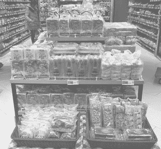

壁垒加筑，未来可期

2024年短保面包行业白皮书

2024年7月

© Euromonitor International

## 目录

- 研究方法和数据阅读说明
- 第一章：烘焙食品的发展历程
- 第二章：短保面包市场趋势和规模
- 第三章：短保面包市场竞争格局和未来展望

© Euromonitor International

2

## 目录

- 研究方法和数据阅读说明
- 第一章：烘焙食品的发展历程
- 第二章：短保面包市场趋势和规模
- 第三章：短保面包市场竞争格局和未来展望

## 研究方法

© Euromonitor International

4

### 研究方法和数据阅读说明

为了撰写本次白皮书，我们搜集了市面上常见的短保面包的产品信息，并通过访谈方式了解行业专家的观点和意见，共同梳理了烘焙食品的发展历程，探讨了短保面包概念的诞生和发展史、中国短保面包市场的现状、竞争格局，并展望了行业未来发展趋势，以对消费者进行教育，供行业从业者参考。

执行时间：2024年5月20日至2024年6月27日

## 目录

- 研究方法和数据阅读说明
- 第一章：烘焙食品的发展历程
- 第二章：短保面包市场趋势和规模
- 第三章：短保面包市场竞争格局和未来展望

© Euromonitor International

5

## 烘焙食品的定义与分类

烘焙食品是指以面粉、糖、油脂等原料经一系列工艺烘焙而成的方便食品。根据生产加工方式的不同，可分为现烤和预包装两大类。

烘焙食品是以面粉、酵母、食盐、砂糖和水为基本原料，添加适量油脂、乳品、鸡蛋、添加剂等，经一系列复杂的工艺手段烘焙而成的方便食品。根据欧睿国际的定义，烘焙食品包括面包、蛋糕、糕点、混合甜点、派和挞类以及冷冻半成品【1】。

【1】冷冻半成品指在零售渠道以冷冻形式售卖，需要二次烘焙才能食用的产品，例如冷冻披萨。在中国，冷冻半成品市场不成熟，规模忽略不计。

### 烘焙食品定义

### 烘焙食品的分类

烘焙食品根据其生产加工方式可分为现烤产品和预包装产品两大类。第一类是大部分烘焙店、饼店的经营模式。门店是前店后厨，采购了原材料后，面点师在后厨制作，包括原料调配、制作面团、发酵、分割、成型、烘烤，并在前店售卖；第二类预包装产品又称工业食品，即在工厂通过规模化、机械化的方式制作烘焙食品，运输到各类零售网点进行售卖。

在有烘焙饮食传统和习惯的国家，烘焙店数量众多，因此现烤现做的烘焙食品占比大。而在亚洲国家尤其是我国，人均拥有的烘焙店数量较少，另外，我国幅员辽阔，城乡差异较大，预包装烘焙食品可以通达非中心城市甚至县乡级别的市场，因此我国的预包装烘焙食品相较其他国家有更大份额。

## 烘焙食品全球和中国市场规模

**2023**年中国烘焙食品规模达到**2,529**亿人民币，**2018—2023**年均复合增长率为**3.9%**，占全球规模的**7%**。

© Euromonitor International

7

0

1000

2000

3000

4000

5000

6000

2018

2019

2020

2021

2022

2023

面包

蛋糕

混合甜点

冷冻半成品

糕点

派和挞类

图**1**：全球烘焙食品零售规模，按品类细分（亿美元）

3,854

3,887

3,964

4,213

4,414

4,929

数据来源：Euromonitor Passport

0

500

1000

1500

2000

2500

3000

2018

2019

2020

2021

2022

2023

面包

蛋糕

混合甜点

糕点

图**2**：中国烘焙食品零售规模，按品类细分（亿人民币）

2,089

2,290

2,325

2,467

2,381

2,529

数据来源：Euromonitor Passport

### 数据解读

烘焙食品作为西方国家的生活必需品，产业历经数百年的发展，市场规模较大并已趋于稳定。2018—2023年间，全球烘焙食品的规模从3,854亿美元增长到4,929亿美元，年均复合增长率为5.0%；同期，中国烘焙食品的规模则从2,089亿人民币增长到2,529亿人民币，年均复合增长率为3.9%。截至2023年，中国的烘焙食品规模占全球规模的7%。从人均消费金额上看，全球烘焙人均年消费金额高达430元，明显高于中国的179元，中国市场未来增长空间巨大。从消费结构上看，全球的烘焙食品消费以面包为主，其次是蛋糕和糕点；中国市场的消费以蛋糕为最大，其次是糕点、面包。

## 烘焙食品全球和中国市场规模

受黑天鹅事件的影响，**2022**年中国烘焙食品与面包消费增速转负。进入**2023**年，随着疫情的解封与消费的复苏，增速已回归正轨并预计于**2024**年超过全球。

© Euromonitor International

8

### 数据解读

图**3**：中国和全球烘焙食品、面包品类的零售额年增速

数据来源：Euromonitor Passport

在2021—2023年间，全球烘焙食品和其中面包品类的消费增速均快于中国市场。尤其是2022年，中国市场由于疫情切断消费以及零售网点无法正常经营等原因，增速转负。随着疫情解封以及国内经济的复苏，中国烘焙食品和其中面包品类的消费已在2023年逐步回归正轨，预计在未来几年将小幅回升并超过全球增速。到2026年，预计中国烘焙食品年增速达到6.2%，全球烘焙食品年增速5.2%；中国面包市场年增速6.2%，全球面包市场增速4.9%。

**5.7%**

**-1.4%**

**4.6%**

**6.7%**

**6.4%**

**6.2%**

**6.1%**

**-3.5%**

**6.2%**

**6.7%**

**6.2%**

**6.2%**

**6.5%**

**6.2%**

**12.6%**

**3.2%**

**4.8%**

**4.9%**

**6.3%**

**4.8%**

**11.6%**

**4.4%**

**5.4%**

**5.2%**

2021

2022

2023

2024F

2025F

2026F

中国面包增速

中国烘焙食品增速

全球面包增速

全球烘焙食品增速

## 烘焙食品在中国的发展历程

上世纪**80**年代烘焙行业开始在中国植根，经历从传统到现代化的转型。**90**年代至**21**世纪初，行业逐渐成熟，趋于多元化和国际化。近年来，在各路玩家的创新推动下，行业进入了爆发式增长的新纪元。

### 萌芽阶段

**20**世纪**80**年代之前

中国的烘焙食品行业主要以传统的中式糕点为主。然而，随着现代烘焙技术的发展，西方烘焙开始在上世纪80年代通过香港和台湾地区传入中国大陆，为行业注入了新的活力。

### 成长期

进入**20**世纪**90**年代

随着国际品牌如好丽友、曼可顿等纷纷进入中国市场，本土企业如桃李面包和盼盼食品也相继成立，标志着中国烘焙行业的多元化和国际化趋势。

### 繁荣年代

**21**世纪初

中国烘焙行业迎来了快速发展的新阶段。众多国际烘焙品牌，包括宾堡、巴黎贝甜、面包新语等，纷纷在中国设立工厂和开设门店，进一步推动了行业的繁荣。

### 革新纪元

到了**2017**年左右

随着喜茶、奈雪的茶等新兴品牌的崛起，它们通过创新的“茶饮+烘焙”复合经营模式，成功拓展到新的消费市场，引领烘焙行业进入了一个爆发性增长的新纪元。

## 烘焙食品发展的驱动因素

### 对传统主食的替代

面包、蛋糕、糕点过去长期作为一种零食和补充食品存在，现在正越来越多地出现在中国消费者的正餐中。中国人传统的早餐主要是包子、油条、馒头、粥等主食，近年来随着生活节奏的加快，面包因为食用更加便捷的特点，成为了都市人的早餐新宠。与此同时，由于西式饮食文化的渗透，人们在午餐和晚餐中选择汉堡、三明治等食物的比例也在增加。烘焙食品正逐渐取代部分传统主食，成为中国人饮食中的一大组成。

### 多元场景的延伸

烘焙食品在正餐之外的消费场景也日趋多元。聚会、出游等休闲活动的增加为烘焙食品的消费带来了新的场景。比如蛋糕的消费场景由单纯的生日蛋糕扩展到了各类节日、庆典、婚礼，面包的消费从零食扩展到了日常加餐、出游充饥、DIY美食制作等。使用场景的延伸，增加了消费者的购买频次。

### 销售渠道的扩张

烘焙食品的销售渠道主要有烘焙门店、商超、便利店、传统夫妻店等线下渠道，以及线上电商渠道。各类型的渠道相互补充，各有所长，给消费者提供了多样化的购买方式。商超、便利店等现代渠道通过数字化进行运营提质增效，线上线下全渠道运营，美团、饿了么等接入线下多业态、多品类的零售门店，大大提高了烘焙产品消费的便利性和消费频次。

## 烘焙食品发展的驱动因素

随者消费水平的提升，以及疫情之后大众健康意识的增强，健康饮食浪潮不断升温。根据欧睿国际《2024消费者生活方式调研》数据显示，超过**42%**的中国消费者在购买食品饮料时会关注其健康成分的添加，**37%**的消费者会查看食品饮料的营养标签，较2023年有所提升。在烘焙食品赛道中，低脂低糖、有机成分、零添加、无麸质、全麦高纤维、清洁标签、短保质期等健康化的需求成为了消费者的关注点，推动行业的迭代升级。

### 消费者对健康饮食的关注

39%

30%

42%

37%

购买食品饮料时会关注其添加的健康成分

购买食品饮料时会查看其营养标签

2023

2024

图**4**：**2024**中国消费者生活方式调研

### 头部企业的引领

过去消费者对烘焙产品的了解少，难以判断产品品质高低，因而对烘焙品牌的忠诚度低。然而近些年，头部品牌从自身出发建立核心优势，注重产品卖点的打造，运用社交网络营销造势，抢占消费者心智，并参与起草制定行业准则等推动行业规范发展。在头部企业的积极影响下，提高了消费者对烘焙食品的正确认知，行业集中度逐年提升。品牌效应的增加也使得连锁商超在招商和货架陈列资源上对头部品牌倾斜，进一步推动了行业的良性循环发展。

来源：Euromonitor 2024 consumer lifestyle survey

## 烘焙食品发展的阻碍因素

### 原料价格上涨

烘焙食品上游包括面粉、油脂、水果等农产品及其初加工品，以及奶油、水果制品、酵母、白糖等烘焙食品原料，价格受当年的种植面积、养殖总量、市场供求等因素影响会产生波动。例如：白糖价格在2023年一度飙涨至7094元/吨，达到了五年最高水平；2023年全年，我国小麦主流价格高点达到3400元/吨，而在2019年小麦价格最低点仅为2200元/吨，价差幅度达到1200元/吨。

除此以外，油脂的金融属性较强，价格除受供需影响外，还受到宏观及国际形势变化的影响。例如2022年上半年，三大食用油脂中，棕榈油和大豆油价格较2020年同期相比累计涨幅分别达到3.1倍、2.3倍。原材料上涨趋势对烘焙食品生产企业造成较大的成本压力，无力消化上升成本的企业只能选择涨价，削弱了一部分市场需求。

### 供应链制约

烘焙行业的供应链很长，原料品类较多、工艺相对复杂，加之短保产品多，对于储存运输的相关技术要求很高，不少区域品牌不具备这个能力。供应链是否完善仍是当前制约烘焙店扩张的因素。

### 竞争日益激烈且同质化

随着面包烘焙的市场规模不断扩大，入局分食“蛋糕”者越来越多。近年来，喜茶、奈雪的茶等新茶饮品牌，新零售巨头例如盒马等这样的跨界选手纷纷加入烘焙赛道，竞争愈发白热化。

但行业内模仿者众多，产品、营销、运营方面出现同质化的现象，大部分企业并没有建立起自己品牌的护城河。粗放式的扩张极易在经济下行周期遭遇洗牌、关停甚至暴雷。

### 企业发展良莠不齐

烘焙食品行业虽历经多年发展，但市场分散度高。例如现烤烘焙品牌中单店模式普遍，预包装产品也有大量区域性品牌，占据了市场的大部分份额。私家作坊和小工厂代工的出现，可能导致少数经营不规范、食品安全存疑的情况，例如食品添加剂超量和超范围使用、微生物超标以及发霉变质等卫生安全问题，影响消费者对烘焙产品的消费热情，也影响烘焙行业的正常秩序。

本报告来源于三个皮匠报告站（www.sgpjbg.com），由用户ID:529794下载，文档ID:177972，下载日期：2024-10-17

## 目录

- 研究方法和数据阅读说明
- 第一章：烘焙食品的发展历程
- 第二章：短保面包市场趋势和规模
- 第三章：短保面包市场竞争格局和未来展望

## 面包的定义与分类

面包是指以小麦粉、酵母、水等为主要原料制成的食品。按包装形式分类，面包可分为预包装和散装两种类型。

面包是烘焙食品中继蛋糕、糕点之后的第三大品类。《面包质量通则》GB/T 20981-2021是2022年6月1日开始实施的一项国家标准，是基于2007年老国标进行修订的新国标，规定了面包的术语和定义、产品分类、技术要求、试验方法、检验规则、标签、包装、运输及贮存。

《面包质量通则》中定义到：面包指的是以小麦粉、酵母、水等为主要原料，添加或不添加其他配料，经搅拌、发酵、成型、醒发、熟制、冷却等工艺制成的食品，以及熟制前或熟制后在产品表面或内部添加其他配料等的食品。面包的产品分类有软式面包、硬式面包、起酥面包、调理面包、与面包干制品六类。

按包装形式，面包有预包装和散装两种，但国家法规没有对两种分类有具体说明。

根据《食品经营许可管理办法》，预包装食品，指预先定量包装或者制作在包装材料和容器中的食品，包括预先定量包装以及预先定量制作在包装材料和容器中并且在一定量限范围内具有统一的质量或体积标识的食品。

《食品安全国家标准 预包装食品标签通则》规定，直接向消费者提供的预包装食品标签标示应包括：食品名称、配料表、净含量和规格、生产者和（或）经销者的名称、地址和联系方式、生产日期和保质期、贮存条件、食品生产许可证编号、产品标准代号及其他需要标示的内容。

因此，预包装面包主要受到以上三个标准、管理办法的监管。其他还包括强调安全指标的《食品安全国家标准-糕点、面包》和约束糕点生产企业资质的《糕点生产许可证审查细则》等。

## 面包细分市场的规模与增速

预包装面包目前规模略小于散装面包，但增速相对更高。

| 年份 | 2020 | 2021 | 2022 | 2023 | 2024F | 2025F | 2026F |
|------|------|------|------|------|-------|-------|-------|
| 预包装面包零售额(亿元) | 179.2 | 189.7 | 190.6 | 201.1 | 214.8 | 228.7 | 243.0 |
| 散装面包零售额(亿元) | 225.4 | 238.0 | 231.3 | 240.1 | 255.9 | 271.9 | 288.4 |
| 预包装面包年增速 | 5.9% | 0.5% | 5.5% | 6.8% | 6.5% | 6.3% | |
| 散装面包年增速 | 5.6% | -2.8% | 3.8% | 6.6% | 6.3% | 6.1% | |

图**5**：中国预包装面包、散装/现烤面包零售额和增速

数据来源：Euromonitor Passport

根据欧睿国际Passport数据库显示，中国市场上预包装面包零售额尽管略小于散装/现烤面包，但预包装面包年增速更高，两者的销量差距不断缩小，预包装面包在疫情和经济下行期间更是表现出了更强的韧性。

## 短保面包的起源和发展

根据行业专家对面包分类达成的共识，面包按照保质期长短可分为三类。随着消费力与健康意识的提升，其中短保面包预计将保持乐观增长，有望成为市场主流。

| 分类 | 保质期 | 特点 |
|------|--------|------|
| 短保面包 | 保质期一般15天以内或更短 | 短保面包由于无需刻意拉长保质期，添加剂相对中长保面包更少，新鲜度高，含水率高，松软的口感与现制产品接近。 |
| 中保面包 | 保质期在16-90天 | 中保面包需采用添加外控型保鲜剂，使用阻隔性能更好的包装物来延长保质期，平衡了口感、长时间运输储存的需求。 |
| 长保面包 | 保质期在90天以上 | 长保面包为满足货架陈列需求，需在中保面包的基础之上加以技术或添加剂来控制产品水活度，用气调包装等方式延长保质期，实现产品长时间的防腐保鲜。 |

表**1**：面包的分类

20世纪50年代，山崎面包在日本用工业化生产的方式开创了短保面包这个品类，并逐步成为日本最大的面包企业。中国第一批生产预包装短保面包的企业出现在90年代，如成立于1995年的桃李面包。在此之前，中国的预包装面包很多都是12个月保质期的产品。

纵观美日欧等面包行业发展较发达的国家，市场消费均以短保面包为主，几乎不见长保面包。但中国因为行业发展阶段及商业结构的现状，导致部分渠道需要足够长保质期的产品才能支撑起运营时间的需求。截止到2023年，中国预包装短保面包的出厂规模达到了133.7亿元，重量约为88万吨，与预包装中长保面包相比，中长保面包仍占据较大市场份额。但在一二线城市，短保面包的增长趋势高于中长保面包，这也代表了低线级城市未来的发展方向：随着居民消费能力提升，对于饮食健康的重视，短保面包市场规模将保持乐观增长，并可能超越中长保面包成为市场主流。

- 133.7亿元：2023年中国预包装短保面包的出厂规模
- 88万吨：2023年中国预包装短保面包的出厂量
- 90年代：中国第一批生产预包装短保面包诞生于

## 短保面包市场发展的驱动因素

### 驱动因素（1/2）：短保面包以其快捷、新鲜、少添加的特性迎合了消费者对健康与便利的需求。统一工艺和广泛销售网络，确保其稳定的质量与深入的渠道渗透。

**增长的健康需求**

随着生活工作节奏的加快，消费者对于方便快捷的需求不断提高。但在选择食物，尤其是加餐、正餐类食物时，又普遍对"新鲜"有较高要求，认为"新鲜"是"健康"的重要要素。消费者力图在新鲜健康和省时省力中找到一个平衡点，短保面包的快捷、新鲜、可进一步DIY的特性，迎合了当代消费者的理念。

与长保面包相比，短保面包添加剂少、新鲜度高、松软的口感更加接近现制产品，有些短保面包的新品也开始主打少添加或不添加，以天然添加剂代替化学添加剂，更符合当下健康化的食品消费趋势。

**稳定的产品质量**

和现烤面包相比，预包装面包在超市、便利店、电商、传统店铺等都有销售，对消费者来说购买更方便，对企业来说更容易实现渠道下沉，铺货到达县级甚至乡镇市场。预包装短保面包制作工艺统一、包装、品控规范、产品质量稳定，食品安全问题较少，标签必须按规定如实、细节地反映。而现烤面包属于现制食品，关于保质期、原料等信息的标签管理没有统一规定，目前只有上海对标签做出了地方性规定，而其他城市和地区没有相应法规。

### 驱动因素（2/2）：规模化生产、中央工厂模式和完善的零售渠道，在成本和供应链方面进一步形成优势，扩大市场份额。

**成熟的物流与零售体系**

中国的超级物流缩短了商品在途的时间，凌晨生产出的产品能在当天清晨抵达工厂周边城市的零售终端，在早餐高峰期前开始销售。先进的分层物流体系确保产品能快速直接送到大型商超，或是经由经销商仓库送到中小型零售终端，这保证了短保面包的新鲜度。

零售渠道的成熟和完善也给短保面包的发展带来了新的活力。线上渠道例如天猫、京东等传统电商、抖音直播电商等快速发展，短保面包企业在各大平台开设官方旗舰店，在消费者中建立更高的产品认知度。更关键的是，部分企业抓住O2O渠道的商机，结合短保面包需要及时送达的属性和大型商超的多点线上系统资源，扩大美团、饿了么等O2O渠道的销量，提升了行业活力。

**规模化的生产运营模式**

近年来，烘焙店面临高企的成本压力，包括店面租金、营销运营成本等。而在制作环节，产品品质高度依赖于面点师，能力强的面点师具有稀缺性。因此烘焙店模式投入大，利润低，单店模式的烘焙店在市场上份额逐步出清。

相比之下，短保面包的规模化程度高，短保面包头部企业利用中央工厂的模式，在销售区域周围建厂，实现大批量生产。不仅在采购环节以批量采买的优势降低了原料价格，又能确保高效生产，产品出品稳定。加之头部企业的渠道能力强，消费者触达率高，尤其是在下线市场能有效渗透，规模化效应明显。

## 短保面包市场发展的阻碍因素

**销售半径小，抬高物流成本**

短保面包采用中央工厂的生产模式，由于产品的短保特性，中央工厂的辐射半径在200-300公里。一个企业要实现全国性的销售覆盖，就需要全国性布局工厂，并相应加大物流投入。因此，短保面包的厂商面临高产能投入、高物流费用投入的挑战。

**货架期短，考验厂商能力**

排除物流时间以及临期时间，短保面包实际只有7-10天的原价售卖期甚至更短，这就要求零售商高频率地盯住产品保质期，临期就要打折，过了保质期就要返货。返货率高导致渠道商易亏损，生产企业一般会帮助渠道商承担部分返货损失，并进行无害化处理，这又会加重生产企业的负担。

**冷冻烘焙普及，形成潜在竞争**

随着冷冻烘焙技术的逐渐成熟，冷链仓储和物流技术的不断完善，冷冻烘焙食品的应用领域由冷冻糕点产品逐渐发展至麻薯、丹麦牛角等冷冻面包半成品及熟品等，和短保面包是竞争品类。当然，冷冻烘焙受冷链物流发展的影响，如何将冷冻面团投放到各个门店，在成本管理上是一个挑战，对于中小规模的烘焙店来说并不经济划算。

## 短保面包市场发展现状

**厂商对短保的要求越来越严格**

短保面包的保质期是15天以内，生产、包装技术的进步和物流效率的提升为短保产品不断缩短的保质期带来了可行性，例如智能物流系统和设备的应用提升了配送效率和安全性，生产车间的灭菌技术、面包控制水活度的技术、气调保鲜包装技术、活性包装膜技术、缓释酒精释放片技术等的应用，使得短保面包的保质期有可能进一步缩短，口感和品质进一步提升。

**加入短保赛道的品牌和厂商越来越多**

桃李面包、曼可顿、嘉顿是最早的短保面包的品牌，后来宾堡集团进入中国市场，达利、盼盼等主打长保的企业也纷纷入局短保。最初市场上产品的同质化程度很高，随着消费者需求的不断升级，产品口味的创新成为各大品牌竞争的重点。从原味到全麦面包，从单一口味到多口味不断创新，逐步迎合消费者需求的变化。

## 市场集中度

虽然短保面包市场上参与企业的数量较多，但头部效应较明显，排名前五家企业的市占率达到**48%**。其中桃李面包市场份额远高于其他品牌。

短保面包市场上参与企业的数量较多，但大多数是小型企业，销售范围仅覆盖几个城市，销售规模在千万级别。由于短保行业存在一定的进入壁垒，新进企业数量并不多。随着头部企业的扩张，短保面包市场的集中度在近几年有所提升。

| 品牌 | 市场份额 |
|------|----------|
| 桃李 | 35% |
| 美焙辰 | 6% |
| 曼可顿 | 3% |
| 嘉顿 | 2% |
| 分分鲜 | 2% |
| 其他品牌 | 52% |

图**5**：**2023**年短保面包市场品牌份额（以短保面包出厂销量计算，无品牌产品不计）

来源：Euromonitor 专家访谈

2023年，中国短保面包市场上销量前五名的品牌占据了市场总量的48%，其中桃李面包品牌份额达35%占据第一，美焙辰、曼可顿、嘉顿以及分分鲜分列第2-5名，桃李面包的份额比第2-5名加总的份额还要大，在体量上占据绝对优势。桃李面包和美焙辰的短保面包基本实现全国性布局，其他三个品牌曼可顿、嘉顿、分分鲜则各有各自的主要销售区域，未形成全国布局。

| 品牌名称 | 公司名称 | 2023年该品牌短保面包销量（吨） |
|----------|----------|--------------------------------|
| 桃李 | 桃李面包股份有限公司 | **307,647** |
| 美焙辰 | 达利食品集团有限公司 | **53,450** |
| 曼可顿 | 宾堡集团 | **23,419** |
| 嘉顿 | 嘉顿集团 | **18,280** |
| 分分鲜 | 杭州分分鲜食品有限公司 | **17,035** |

表**2**：**2023**年短保面包各领先品牌销量（以短保面包出厂销量计算，无品牌产品不计）

从品牌角度看，桃李、曼可顿两个品牌专注于短保面包业务，美焙辰品牌有短保面包和中保面包业务；嘉顿有短保面包和饼干业务；分分鲜则有短保、中保面包及蛋糕业务。中长保产品、蛋糕类产品不计入短保面包的销量。

从企业角度看，曼可顿品牌所属的宾堡集团有较大比例的餐饮渠道业务，嘉顿品牌所属的嘉顿公司也有一定比例的产品供应给该渠道。餐饮渠道的产品没有品牌，而且有些是冷冻形式供应，不计入短保面包品牌的销量。

短保面包的特性决定了该行业的进入壁垒主要有高昂的工厂建设成本、额外的物流成本与返货损失。

© Euromonitor International

## 行业进入壁垒

### 工厂建设成本

为了保证产品能在半天甚至几小时内抵达销售点，企业需要靠近市场建厂。这就需要企业充分评估该区域的产销水平，既要避免产能不足，又要避免过度建设、产能利用率过低。

### 配送的特殊性带来的额外物流成本

为了确保消费者能够获得更新鲜的产品，有条件的企业会选择每日配送或隔日配送。同时，由于短保面包多用于早餐场景，企业需要在半夜发车，以确保产品能在第一时间摆上货架。配送的特殊性对于企业来说，是一笔不小的开支。

### 退货损失

短保面包一旦到了保质期就要下架，有些渠道商无力承担全部损失，于是生产企业就必须承担部分返货损失。

桃李面包作为短保面包行业的龙头企业，在多年的市场竞争中积累了各方面的优势。

© Euromonitor International

## 行业头部企业

### 生产

公司采用中央工厂+批发模式进行生产和销售，目前已在全国拥有22家生产基地，具备全国最大的短保面包生产产能，有32多万个零售终端，基本实现全国覆盖。生产规模的优势带来了产品的高性价比和高竞争力。另外，公司的以销定产模式减少了损耗，其返货率远低于行业平均水平。

### 品牌

桃李面包品牌历经近三十年的市场洗礼，是短保面包市场上品牌历史最长的企业，且一直坚定地以短保面包为核心业务，具备先发优势。桃李面包品牌在消费者中建立了较高的品牌知名度，尤其在东北、华北市场，消费者忠诚度较高。

### 物流

公司有自建物流，也委托第三方物流公司，目前实现一级、二级、三级网络的覆盖，对KA及大部分客户实现日配，公司对物流体系控制能力强，物流效率高于行业平均水平。

### 渠道

公司已在全国市场建立起32万多个零售终端，持续扩大渠道覆盖，是行业内覆盖零售网点最多的企业，渠道下沉深度、单店销售额均高于行业平均水平，且庞大的终端规模提升了产品曝光度和渗透率；较早开设了天猫旗舰店，之后又入驻京东、抖音、快手等平台。近年来加强了与美团、饿了么、淘宝买菜等的合作，O2O渠道增长较快。

### 产品和研发

公司拥有三大研发中心，连续多年研发经费投入保持正增长，不断推陈出新，优化产品结构，明星产品被众多企业模仿，经典产品推出至今仍维持高销售额。

另外，公司还参与起草了中国焙烤食品糖制品工业协会发布的全谷物焙烤食品《团体标准T/CABCI002-2018》、中国国家标准化管理委员会和中华人民共和国国家质量监督检验检疫总局联合发布的《糕点通则GB/T20977-2007》，以及中国国家标准化管理委员会和中华人民共和国国家市场监督管理总局联合发布的《面包质量通则GB/T20981-2021》，代表了公司在行业内的领先技术实力。

短保面包行业经过几十年的发展，除了偏远地区，市场总体已经达到了供需相对平衡的阶段，预计短期内短保面包的消费总量将平稳增长，行业的发展方向将从追求量的增长转向量价齐升。

© Euromonitor International

## 短保面包市场发展综述和展望

从供给端来看，随着生产技术的提高和物流系统的完善，短保面包的制作工艺、配送效率得到提升，这不仅保证了产品的新鲜度、可口度，也扩大了产品的市场覆盖范围。此外，行业内的竞争格局逐渐明朗，一些龙头企业如桃李面包通过不断的市场扩张和品牌建设，已经形成了较强的市场竞争力和较高的市场占有率。

从需求端来看，中国庞大的消费市场和不断升级的消费需求为短保面包市场提供了广阔的发展空间。在年轻消费群体中，短保面包作为一种健康、便捷的食品选择而受到青睐。此外，随着线上消费包括O2O模式、直播模式的活跃，短保面包的销售也在逐渐向数字化、个性化方向转变，以满足消费者品质化、多样化的需求。

然而，短保面包市场的发展也面临一些挑战。例如，短保面包对储存和运输条件的要求较高，这可能会增加企业的成本压力。同时，市场上的健康烘焙产品种类繁多且更新迭代速度加快，消费者的产品选择日益多样化，这对短保面包企业的产品研发和市场定位提出了更高要求。

综合来看，随着居民收入水平的提升、消费观念的更新以及行业创新能力的提升，短保面包市场有望实现更高质量的发展。短保面包预计将进一步扩大其在预包装面包市场的份额，以更丰富的口味、更新鲜健康的品质赢得消费者的喜爱。

感谢阅读

© Euromonitor International

**报告作者联系方式：**

**Annie Zhu 祝卿**

**Team Lead**

**邮箱：Annie.Zhu@euromonitor.com**

**William Wang 王卓丁**

**Head of Consulting**

**邮箱：William.Wang@euromonitor.com**

