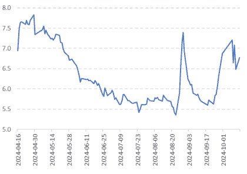

请务必阅读正文后的声明及说明

证券研究报告

证券研究报告 / 债券研究报告

# 国检转债定价：首日转股溢价率13%~18%

## ——东北固收转债分析

## 报告摘要

10月15日，国检集团发布公告，拟于2024年10月17日通过网上发行可转债，公司本次向不特定对象发行可转换公司债券拟募集资金总额不超过人民币8亿元（含）。其中3.3亿元拟用于投资实验室建设项目；1.14亿元拟用于投资碳排放管理平台建设项目；1.18亿元拟用于股权投资项目；2.39亿元拟用于偿还银行贷款及补充流动性资金。

国检转债发行方式为优先配售和网上定价，债项和主体评级AA+。发行规模为8.00亿元，初始转股价格为6.63元，参考10月15日正股收盘价格6.83元，转债平价103.02元，参考同期限同评级中债企业债到期收益率（10月15日）为2.50%，到期赎回价112元，计算纯债价值为100.65元。博弈条款方面，下修条款（15/30，85%）正常、赎回条款（15/30，130%）正常、回售条款（30/30，70%）正常。综合来看，债券发行规模一般，流动性一般，评级较好，债底保护性较好。机构入库不难，一级参与无异议。

转债首日目标价116~122元，建议积极申购。截至2024年10月15日，国检转债平价在103.02元，估值参考测绘转债（评级A+，存续债余额2.4亿元，平价109.33，转债价格125.38，转股溢价率13.42%）、航宇转债（评级AA-，存续债余额6.7亿元，平价106.16，转债价格123.61，转股溢价率16.44%），综合考虑当前市场环境及平价水平，国检转债上市首日转股溢价率水平预计在【13%，18%】区间，对应首日上市目标价在116~122元附近。

公司已形成检验检测、认证、检测仪器及智能制造、计量校准、科研及技术服务等综合业务平台，拥有三十五个国家及行业级中心，可为客户提供质量、环保、绿色、安全、健康、节能等领域的检验检测、认证评价、鉴定、咨询、培训等技术服务及综合性解决方案，已成为国内知名第三方检验认证机构，并以世界一流的检验认证机构为发展目标。

预计首日打新中签率0.0028%~0.0037%附近。截至2024年6月30日，中国建筑材料科学研究总院有限公司持有公司5.17亿股，香港中央结算有限公司（陆股通）持有公司2083万股，为公司的前两大股东。前两大股东合计持有公司66.86%的股份；前十大股东持股比例为74.66%。因此我们假设本次老股东配售比例为67%~75%，则国检转债留给市场的规模为2亿元~2.64亿元。

风险提示：应收账款回收风险、商誉减值风险。

发布时间：2024-10-16

国检集团股价曲线

## 相关报告

《信创转债梳理》

——20241014

《转债市场一周回顾（2024/10/08-2024/10/11）》

——20241014

《【东北固收】加力支持地方化债，关注地产增量政策效力——政策及基本面周度观察（20241012）》

——20241014

《地产优化举措落地，大宗商品价格上涨——政策及基本面周度观察（20241007）》

——20241008

《2024年10月十大转债》

——20241007

首席分析师：刘哲铭

执业证书编号：S0550524040002

18801785199

liuzm1@nesc.cn

证券分析师：薛进

执业证书编号：S0550522120002

13916677156

xuejin@nesc.cn

研究助理：刘天宇

执业证书编号：S0550123060036

17317358135

liuty1@nesc.cn

请务必阅读正文后的声明及说明

**2 / 12**

债券研究报告

## 目录

- 1. 国检转债打新分析与投资建议
  - 1.1. 转债基本条款分析
  - 1.2. 转债上市初期价格分析
  - 1.3. 转债打新中签率分析
- 2. 正股基本面分析
  - 2.1. 公司主营业务及所处行业上下游情况
  - 2.2. 公司经营情况
  - 2.3. 公司股权结构和主要控股子公司情况
  - 2.4. 公司业务特点和优势
  - 2.5. 本次募集资金投向安排

## 图表目录

- 图1：公司所处行业上下游情况
- 图2：营业收入情况（单位：亿元）
- 图3：业务收入构成情况
- 图4：公司各产品毛利率情况
- 图5：公司毛利率与净利率
- 图6：公司期间费用和费率情况（单位：亿元）
- 图7：公司研发投入情况（单位：亿元）
- 图8：公司应收账款周转率
- 图9：应收账款增长情况（单位：亿元）
- 图10：归母净利润和同比增速（单位：亿元）
- 图11：公司与可比公司加权ROE情况
- 图12：公司股权结构

## 表目录

- 表1：国检转债发行时间安排
- 表2：国检转债基本条款

请务必阅读正文后的声明及说明

**3 / 12**

债券研究报告

10月15日，国检集团发布公告，拟于2024年10月17日通过网上发行可转债，公司本次向不特定对象发行可转换公司债券拟募集资金总额不超过人民币8亿元（含）。其中3.3亿元拟用于投资实验室建设项目；1.14亿元拟用于投资碳排放管理平台建设项目；1.18亿元拟用于股权投资项目；2.39亿元拟用于偿还银行贷款及补充流动性资金。

### 表1：国检转债发行时间安排

| 日期 | 时点 | 发行安排 |
|---|---|---|
| 2024年10月15日 | 星期二；T-2日 | 披露《募集说明书》及其摘要、《募集说明书提示性公告》、《发行公告》、《网上路演公告》 |
| 2024年10月16日 | 星期三；T-1日 | 网上路演、原股东优先配售股权登记日 |
| 2024年10月17日 | 星期四；T日 | 披露《发行提示性公告》、原股东优先配售认购日（缴付足额资金）、网上申购（无需缴付申购资金）、确定网上中签率 |
| 2024年10月18日 | 星期五；T+1日 | 披露《网上发行中签率及优先配售结果公告》、进行网上申购摇号抽签 |
| 2024年10月21日 | 星期一；T+2日 | 披露《中签号码公告》、网上投资者根据中签号码确认认购数量并缴纳认购款（投资者确保资金账户在T+2日日终有足够的可转债认购金额） |
| 2024年10月22日 | 星期二；T+3日 | 主承销商根据网上资金到账情况确定最终配售结果和包销金额 |
| 2024年10月23日 | 星期三；T+4日 | 披露《发行结果公告》 |

数据来源：Wind，东北证券

## 1. 国检转债打新分析与投资建议

### 1.1. 转债基本条款分析

国检转债发行方式为优先配售和网上定价，债项和主体评级AA+。发行规模为8.00亿元，初始转股价格为6.63元，参考10月15日正股收盘价格6.83元，转债平价103.02元，参考同期限同评级中债企业债到期收益率（10月15日）为2.50%，到期赎回价112元，计算纯债价值为100.65元。博弈条款方面，下修条款（15/30，85%）正常、赎回条款（15/30，130%）正常、回售条款（30/30，70%）正常。综合来看，债券发行规模一般，流动性一般，评级较好，债底保护性较好。机构入库不难，一级参与无异议。

### 表2：国检转债基本条款

| 项目 | 内容 |
|---|---|
| 债券代码 | 113688.SH |
| 正股代码 | 603060.SH |
| 债券简称 | 国检转债 |
| 正股名称 | 国检集团 |
| 债项评级 | AA+ |
| 主体评级 | AA+ |
| 发行规模（亿元） | 8.00 |
| 正股行业 | 社会服务 |
| 期限（年） | 6 |
| 到期赎回价 | 112 |
| 转股稀释率 | 13.05% |
| 流通股稀释率 | 13.05% |
| 票面利率 | 0.2%、0.4%、0.6%、1.5%、1.8%、2% |
| 面值对应YTM | 3.00% |
| 转股价格 | 6.63 |
| 转股起始日 | 2025-04-23 |
| 转股期 | 2025-04-23~2030-10-16 |
| 到期日 | 2030-10-16 |
| 起息日 | 2024-10-17 |
| 赎回条款 | （15/30，130%） |
| 下修条款 | （15/30，85%） |
| 回售条款 | （30/30，70%） |
| 申购代码 | 754060 |
| 配售代码 | 753060 |
| 网上发行日 | 2024-10-17 |
| 股权登记日 | 2024-10-16 |
| 配售日 | 2024-10-17 |
| 最后缴款日 | 2024-10-18 |
| 保荐机构 | 中金公司 |
| 评级机构 | 联合资信 |

数据来源：Wind，东北证券

### 1.2. 转债上市初期价格分析

公司已形成检验检测、认证、检测仪器及智能制造、计量校准、科研及技术服务等综合业务平台，拥有三十五个国家及行业级中心，可为客户提供质量、环保、绿色、安全、健康、节能等领域的检验检测、认证评价、鉴定、咨询、培训等技术服务及综合性解决方案，已成为国内知名第三方检验认证机构，并以世界一流的检验认证机构为发展目标。本次可转换债券的发行紧扣公司的“十四五”发展战略，将募集资金投向上市公司亟需资本开支的业务领域。

转债首日目标价116~122元，建议积极申购。截至2024年10月15日，国检转债平价在103.02元，估值参考测绘转债（评级A+，存续债余额2.4亿元，平价109.33，转债价格125.38，转股溢价率13.42%）、航宇转债（评级AA-，存续债余额6.7亿元，平价106.16，转债价格123.61，转股溢价率16.44%），综合考虑当前市场环境及平价水平，国检转债上市首日转股溢价率水平预计在【13%，18%】区间，对应首日上市目标价在116~122元附近。

### 1.3. 转债打新中签率分析

预计首日打新中签率0.0028%~0.0037%附近。截至2024年6月30日，中国建筑材料科学研究总院有限公司持有公司5.17亿股，香港中央结算有限公司（陆股通）持有公司2083万股，为公司的前两大股东。前两大股东合计持有公司66.86%的股份；前十大股东持股比例为74.66%。因此我们假设本次老股东配售比例为67%~75%，则国检转债留给市场的规模为2亿元~2.64亿元。同时参考近期发行的航宇转债（AA-，发行规模6.67亿元）、恒辉转债（AA-，发行规模5亿元），网上有效申购张数约713万户/715万户，故假定国检转债网上有效申购数量为714万户，按照打满计算中签率在0.0028%~0.0037%附近。

## 2. 正股基本面分析

### 2.1. 公司主营业务及所处行业上下游情况

公司主营业务有检验检测业务、认证业务、检测仪器及智能制造。检验检测业务主要包括工程检测、材料检测、环境检测、食品农产品检测等细分领域。认证业务方面，公司提供强制性产品认证（包括安全玻璃认证、瓷质砖认证、汽车用制动器衬片）、自愿性产品认证（包括一般工业产品以及低碳产品、绿色产品、绿色建材产品等）、管理体系认证、服务认证服务。检测仪器及智能制造方面，公司利用在标准制定和检测方法方面的研发能力、终端企业客户资源的优势，研究开发检测专用

请务必阅读正文后的声明及说明

**5 / 12**

债券研究报告

仪器设备。

检验检测行业上游主要涉及相应的检验检测硬件设备及智能控制系统等软件服务，同时还包括第三方检测需要用到的化学试剂、耗材等。目前，检测分析仪器设备制造业发展趋势平稳，行业内生产企业较多，检测行业仪器设备采购需求能够得到充分保障，不存在供应不足情形；行业内生产试剂、耗材企业较多，市场竞争充分，原材料来源广泛、供应充足、价格相对稳定，且该类物资占企业营业成本比例较低，价格波动对企业经营影响较小。

检验检测行业下游主要是各级政府监管部门及各类产品或服务的市场交易主体（生产商、贸易商等），服务内容是为客户提供检验检测服务并出具检验检测报告。检验检测行业客户涉及领域较为广泛，涵盖环保业、汽车业、建筑业、制造业、交通运输业、餐饮业、零售业等众多行业。市场交易主体采购检验检测服务主要用于满足质量控制、监管要求等；政府监管部门采购需求主要来自环境保护、食品安全、产品质量控制等监督方面。公司建材、建工检测下游客户主要为建筑材料生产企业、工程建设单位以及政府和消费者。

图1：公司所处行业上下游情况

数据来源：募集说明书，东北证券

### 2.2. 公司经营情况

公司近年来主营业务收入总体呈稳步增长态势。2021年至2024年上半年公司实现营业收入分别为22.17亿元、24.28亿元、26.60亿元和10.41亿元，同比增速分别为50.53%、9.50%、9.59%和3.65%。2022年度，公司主营业务收入增幅较2021年略有放缓，主要原因一是2022年受外部环境因素影响，业务开展具有一定波动性；二是受房地产政策调控、新开工面积有限等影响，建工检测业务受到一定冲击。

图2：营业收入情况（单位：亿元）

图3：业务收入构成情况

数据来源：Wind，东北证券

数据来源：募集说明书，东北证券

公司主营业务毛利率水平相对保持稳定。2021年至2024年上半年公司综合毛利率分别为44.55%、44.55%、44.95%和37.78%。2024年1-6月公司主营业务毛利率有所波动主要与公司产品销售季节性波动有关，公司业务收入呈现一定的季节性特征，通常四季度属于公司销售客户的密集验收结算周期。此外，上半年部分原材料价格提升，推动主营业务成本较去年同期有所增加，短期内影响了上半年公司主营业务毛利率表现。

图4：公司各产品毛利率情况

图5：公司毛利率与净利率

数据来源：募集说明书，东北证券

数据来源：Wind，东北证券

公司近年期间费用呈上升趋势。2021年至2024年上半年公司期间费用分别为4.15亿元、5.10亿元、5.53亿元和2.64亿元，期间费用率分别为18.70%、21.02%、20.79%和25.33%。

公司近年研发费用和占营收比重呈上升趋势，2021年至2024年上半年公司研发费用分别1.83亿元、2.06亿元、2.35亿元和0.94亿元，占收入比重分别为8.26%、8.50%、8.84%和9.05%。公司研发费用金额及占比较高，主要系公司业务规模扩大，并注重技术研发提高高附加值产品占比的战略以服务于国家重大双碳战略决策实施，此外，公司践行重点在原材料行业，加大其研发投入力度，并完成国家新材料测试评价平台先进无机非金属材料行业中心的建设。

图6：公司期间费用和费率情况（单位：亿元）

图7：公司研发投入情况（单位：亿元）

数据来源：Wind，东北证券

数据来源：Wind，东北证券

公司近年应收账款和占营收比重均呈上升趋势。2021年至2024年上半年公司应收账款（包括应收账款、应收票据、合同资产）分别为7.96亿元、10.96亿元、13.96亿元和14.00亿元，占营收比重分别为35.91%、45.14%、52.49%和67.21%（已年化处理）。应收账款周转率呈下降趋势，2021年至2024年上半年应收账款（包括应收账款、应收票据、合同资产）周转率分别为3.85、2.57、2.14和1.49（已年化处理）。

图8：公司应收账款周转率

图9：应收账款增长情况（单位：亿元）

数据来源：Wind，东北证券

数据来源：Wind，东北证券

公司近年归母净利润保持相对稳定，2021年至2024年上半年公司实现归母净利润分别为2.53亿元、2.53亿元、2.57亿元和0.26亿元，同比增速分别为9.26%、0.09%、1.11%和-6.27%。公司近年盈利能力呈现下降趋势，2021年至2024年上半年公司加权ROE水平分别为17.15%、15.20%、13.93%和1.36%。

图10：归母净利润和同比增速（单位：亿元）

图11：公司与可比公司加权ROE情况

数据来源：Wind，东北证券

数据来源：Wind，东北证券

### 2.3. 公司股权结构和主要控股子公司情况

公司股权结构相对集中。截至2024年6月30日，中国建筑材料科学研究总院有限公司持有公司5.17亿股，香港中央结算有限公司（陆股通）持有公司2083万股，为公司前两大股东。前两大股东合计持有公司66.86%的股份；前十大股东持股比例为74.66%。中国建材总院为公司控股股东。公司拥有9家全资子公司，32家控股子公司。

图12：公司股权结构

数据来源：募集说明书，东北证券

### 2.4. 公司业务特点和优势

公司已形成检验检测、认证、检测仪器及智能制造、计量校准、科研及技术服务等综合业务平台，拥有三十五个国家及行业级中心，可为客户提供质量、环保、绿色、安全、健康、节能等领域的检验检测、认证评价、鉴定、咨询、培训等技术服务及综合性解决方案，已成为国内知名第三方检验认证机构，并以世界一流的检验认证机构为发展目标。公司竞争优势具体如下：

- ①品牌与理念优势。公司业务起源于20世纪50年代，经过七十余载对质量、对品质理念的不懈坚守，公司形成了强大的技术实力、权威的市场公信力、良好的服务质量、规范的管理模式，在行业内获得了多项重要荣誉，拥有良好的品牌知名度和美誉度。报告期内，公司牵头承担的“十四五”国家重点研发计划“基于材料基因工程的新型高温涂层优化设计与应用开发”通过中期考核，“国家新材料重点平台测试评价平台先进无机非金属材料行业中心”获授牌服务保障的“华龙一号”海外首堆核电站机组项目全面建成，中国环境监测总站2023年国控地下水点位监测和国家大气颗粒物组分监测网运行项目圆满完成，“国检”品牌影响力不断提升。

- ②技术与标准优势。公司近年来累计完成与在研省部级以上科研项目200余项，先后获得国家科技进步奖二等奖2项、省部级以上奖励80余项。公司主持制定并发布了中国建材行业第一项国际标准，主持制定并发布了多项国家和行业标准，为建材行业内标准样品、标准物质的主要研制单位。近年来，公司累计发布国际标准16项，国家标准、行业标准、地方标准和团体标准649项；截至报告期末，完成标准样品和标准物质研复制项目160项，现行有效81项；获得国际专利3项，拥有有效发明专利249项，拥有计算机软件著作权共计592项。

- ③平台优势。公司的国家级检验中心技术力量雄厚，国际互认度高，在行业具有较强的品牌影响力和公信力，公司所拥有的国家级、行业级中心成为公司的重要优势。截至2024年6月30日，公司及子公司拥有16个国家级、19个行业级检验中心。

- ④服务便捷性优势。根据战略定位，公司提出了构建“全产品线、全产业链、全服务维度、全服务手段”的“四全”生态型业务体系，致力于为客户提供“一站式”、“1+X”服务。第一，全产品线，在建材、建工、环境基础上，继续打造食品、计量校准、仪器装备服务产品线，坚决向综合性机构迈进；第二，全产业链，以设计、研发、生产、使用、物流、消费各环节涉及的主体作为服务对象，构建服务能力；第三，全服务维度，以质量、安全、环保、绿色发展、企业增效等多视角形成服务能力，建立一站式服务模式；第四，全服务手段，完善检测、认证、咨询（解决方案）、管家服务、培训、仪器装备等多品类服务手段，提升服务竞争力。

### 2.5. 本次募集资金投向安排

10月15日，国检集团发布公告，拟于2024年10月17日通过网上发行可转债，公司本次向不特定对象发行可转换公司债券拟募集资金总额不超过人民币8亿元（含）。其中3.3亿元拟用于投资实验室建设项目；1.14亿元拟用于投资碳排放管理平台建设项目；1.18亿元拟用于股权投资项目；2.39亿元拟用于偿还银行贷款及补充流动性资金。

中国国检测试控股集团股份有限公司湖南华科检测实验室建设项目。本项目实施主体为公司间接控股子公司国检测试控股集团湖南华科科技有限公司，计划总投资12,095.37万元，其中拟使用募集资金10,789.78万元，项目建设期为3年。本项目将有效提升湖南华科在食农检测业务、环境检测业务等在华中区域市场的占有率，从而为国检集团提供良好的投资回报和经济效益，募投项目产品单价参考公司现有产品售价和未来市场竞争策略作为测算依据。本项目完成并完全达产后，预计实现年销售收入10,303.89万元，内部收益率（税后）为12.24%。

中国国检测试控股集团股份有限公司湖南公司检测实验室建设项目。本项目实施主体为公司间接控股子公司中国建材检验认证集团湖南有限公司，计划总投资11,004.73万元，其中拟使用募集资金9,450.89万元，项目建设期为2年。本项目建成后，湖南公司将通过扩充人员实现经营规模的扩大，满足其检测业务不断增长的客观需求，实现湖南公司的可持续发展，同时提升湖南公司工程检测业务在华中区域的市场占有率和品牌知名度，为国检集团提供良好的投资回报和经济效益，募投项目产品单价参考公司现有产品售价和未来市场竞争策略作为测算依据。本项目完成并完全达产后，预计实现年销售收入7,616.17万元，内部收益率（税后）为12.31%。

中国国检测试控股集团股份有限公司河北雄安检测实验室建设项目。本项目实施主体为公司全资子公司国检测试控股集团雄安有限公司，计划总投资13,419.88万元，其中拟使用募集资金12,654.65万元，项目建设期为3年。本项目建成后，通过购置与租赁场所并购置一系列专业仪器设备，将建成专业化的检测实验室，进一步提高雄安公司工程检测能力，满足雄安新区日益扩大的基建工程检测需求，提高区域市场占有率和品牌知名度，为国检集团提供良好的投资回报和经济效益，募投项目产品单价参考公司现有产品售价和未来市场竞争策略作为测算依据。本项目完成并完全达产后，预计实现年销售收入9,872.06万元，内部收益率（税后）为12.46%。

中国国检测试控股集团股份有限公司基于区块链技术的建材行业碳排放管理平台建设项目。本项目实施主体为中国国检测试控股集团股份有限公司，计划总投资12,000万元，其中拟使用募集资金11,400万元，项目建设期为3年。本项目基于区块链技术的去中心化、可追溯、防篡改、共识机制、隐私安全保护等特点，与建材行业碳排放数据管理融合，提高建材行业MRV质量，摸清建材行业碳排放家底，掌握节能减排技术的潜力和经济指标，帮助建材行业和企业用户制定科学的碳资产管理策略和节能减排政策，从而实现行业高质量发展，募投项目产品单价参考公司现有产品售价和未来市场竞争策略作为测算依据。本项目完成并完全达产后，预计实现年销售收入9,580万元，内部收益率（税后）为13.24%。

中国国检测试控股集团股份有限公司与其控股子公司安徽拓维检测服务有限公司联合收购云南云测质量检验有限公司51%股权项目。本项目实施主体为国检集团和安徽拓维，安徽拓维系国检集团的控股子公司，计划总投资7,221.60万元，其中国检集团拟以人民币141.60万元收购云南云测1%股权，安徽拓维拟以人民币7,080.00万元收购云南云测50%股权。本次交易完成后，云南云测将成为国检集团的间接控股子公司。

中国国检测试控股集团股份有限公司收购湖南华科检测技术有限公司49%股权项目。本项目实施主体为国检集团，计划总投资4,630.50万元，其中拟使用募集资金4,630.50万元，本次募集资金到账后，国检集团将使用募集资金直接收购湖南华科49%股权。

风险提示：应收账款回收风险、商誉减值风险。

研究团队简介：

刘哲铭：固定收益首席分析师。上海交通大学管理学博士，美国密歇根大学罗斯商学院访问学者，本科毕业于同济大学土木工程系。曾为2021-2023年新财富团队核心成员。主要负责宏观经济、债券市场的大势研判及专题研究工作。

薛进：上海交通大学金融学硕士、经济学学士。曾就职于交通银行总行，2020年加入东北证券。

杨旭：南开大学金融硕士，东南大学经济学学士，2021年加入东北证券。

刘天宇：纽约大学计量金融硕士，华威大学会计与金融学士，2023年加入东北证券。

袁梦茹：密歇根大学安娜堡分校应用经济学硕士，中央财经大学金融学学士。曾就职于兴业证券，2024年加入东北证券。

分析师声明

作者具有中国证券业协会授予的证券投资咨询执业资格，并在中国证券业协会注册登记为证券分析师。本报告遵循合规、客观、专业、审慎的制作原则，所采用数据、资料的来源合法合规，文字阐述反映了作者的真实观点，报告结论未受任何第三方的授意或影响，特此声明。

投资评级说明

| 股票投资评级说明 | | |
|---|---|---|
| 买入 | 未来6个月内，股价涨幅超越市场基准15%以上。 | |
| 增持 | 未来6个月内，股价涨幅超越市场基准5%至15%之间。 | |
| 中性 | 未来6个月内，股价涨幅介于市场基准-5%至5%之间。 | |
| 减持 | 未来6个月内，股价涨幅落后市场基准5%至15%之间。 | |
| 卖出 | 未来6个月内，股价涨幅落后市场基准15%以上。 | |

投资评级中所涉及的市场基准：A股市场以沪深300指数为市场基准，新三板市场以三板成指（针对协议转让标的）或三板做市指数（针对做市转让标的）为市场基准；香港市场以摩根士丹利中国指数为市场基准；美国市场以纳斯达克综合指数或标普500指数为市场基准。

| 行业投资评级说明 | | |
|---|---|---|
| 优于大势 | 未来6个月内，行业指数的收益超越市场基准。 | |
| 同步大势 | 未来6个月内，行业指数的收益与市场基准持平。 | |
| 落后大势 | 未来6个月内，行业指数的收益落后于市场基准。 | |

重要声明

本报告由东北证券股份有限公司（以下称“本公司”）制作并仅向本公司客户发布，本公司不会因任何机构或个人接收到本报告而视其为本公司的当然客户。

本公司具有中国证监会核准的证券投资咨询业务资格。

本报告中的信息均来源于公开资料，本公司对这些信息的准确性和完整性不作任何保证。报告中的内容和意见仅反映本公司于发布本报告当日的判断，不保证所包含的内容和意见不发生变化。

本报告仅供参考，并不构成对所述证券买卖的出价或征价。在任何情况下，本报告中的信息或所表述的意见均不构成对任何人的证券买卖建议。本公司及其雇员不承诺投资者一定获利，不与投资者分享投资收益，在任何情况下，我公司及其雇员对任何人使用本报告及其内容所引发的任何直接或间接损失概不负责。

本公司或其关联机构可能会持有本报告中涉及到的公司所发行的证券头寸并进行交易，并在法律许可的情况下不进行披露；可能为这些公司提供或争取提供投资银行业务、财务顾问等相关服务。

本报告版权归本公司所有。未经本公司书面许可，任何机构和个人不得以任何形式翻版、复制、发表或引用。如征得本公司同意进行引用、刊发的，须在本公司允许的范围内使用，并注明本报告的发布人和发布日期，提示使用本报告的风险。

若本公司客户（以下称“该客户”）向第三方发送本报告，则由该客户独自为此发送行为负责。提醒通过此途径获得本报告的投资者注意，本公司不对通过此种途径获得本报告所引起的任何损失承担任何责任。

东北证券股份有限公司

网址：http://www.nesc.cn 电话：95360,400-600-0686 研究所公众号：dbzqyanjiusuo

| 地址 | 邮编 |
|---|---|
| 中国吉林省长春市生态大街6666号 | 130119 |
| 中国北京市西城区锦什坊街28号恒奥中心D座 | 100033 |
| 中国上海市浦东新区杨高南路799号陆家嘴世纪金融广场3号楼10层 | 200127 |
| 中国深圳市福田区福中三路1006号诺德中心34D | 518038 |
| 中国广东省广州市天河区冼村街道黄埔大道西122号之二星辉中心15楼 | 510630 |
